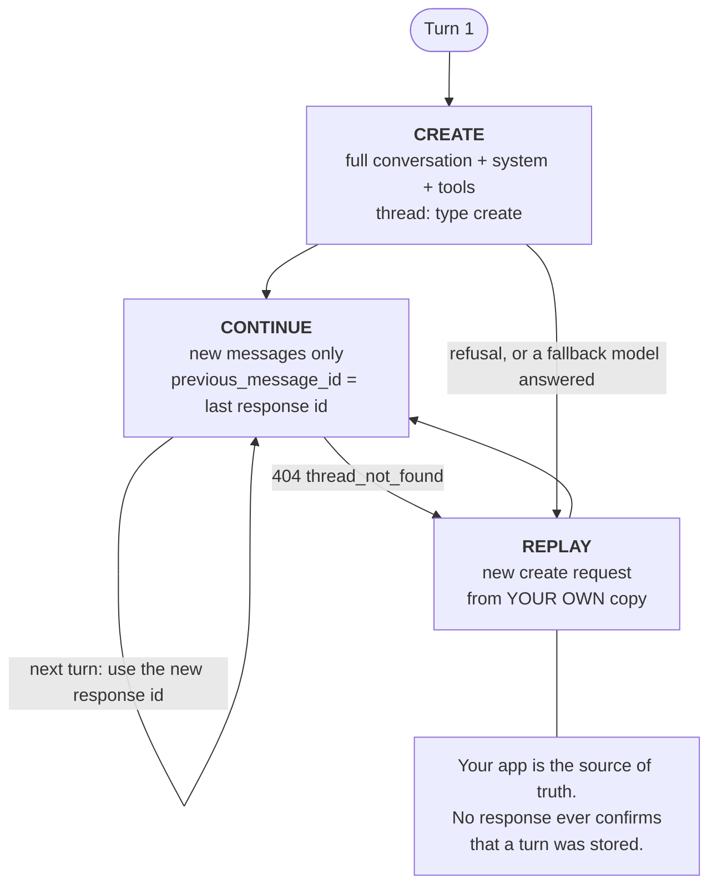

<LevelBadge level="advanced" />

<Callout type="objectives" items={[
  "Genau sagen, was ein Thread spart — Request-Bytes und Time to First Token — und was nicht: Tokens, und damit Geld",
  "Den Drei-Zustände-Lebenszyklus durchlaufen: create, continue, replay — und den Replay-Pfad vor dem Release bauen, nicht danach",
  "Jeden Parameter als create-only, fixed oder free einordnen und einen thread_fingerprint_mismatch auf den ersten Blick erkennen",
  "Prompt Caching auf einem Thread innerhalb des Budgets von 4 Breakpoints am Laufen halten",
  "Einen gestreamten Turn sicher fortsetzen und wissen, warum ein continue vor message_stop einen 404 liefert",
  "Die fünf Thread-Fehler behandeln, plus die zwei Fälle, in denen du einen komplett neuen Thread starten musst, statt zu retten",
  "Entscheiden, ob dein Workload zu denen gehört, bei denen Threads wirklich helfen"
]} />

<VerifyNote lastVerified="2026-11-03" source="https://platform.claude.com/docs/en/build-with-claude/message-threads">
Message Threads sind am **2. November 2026 in die Public Beta** gegangen, hinter dem Header `anthropic-beta: message-threads-2026-08-12`. Feldnamen, Fehlercodes, Ablauffristen und die Liste nicht unterstützter Features sind der offiziellen Referenz entnommen und können sich in der Beta noch ändern — prüfe sie vor dem Release erneut. Verfügbarkeit zum Zeitpunkt des Schreibens: Claude API, Claude Platform on AWS, Claude Models on Google Cloud (von Anthropic verwaltet) und Claude in Microsoft Foundry. **Nicht** verfügbar auf Amazon Bedrock. Die Modellunterstützung ist breit — siehe [die offizielle Liste unterstützter Modelle](https://platform.claude.com/docs/en/build-with-claude/message-threads) und [Modelle & Preise](/docs/whats-new/models-and-pricing).
</VerifyNote>

Ein langer Agent-Loop zahlt eine stille Steuer, die mit dem Modell nichts zu tun hat. In Turn 40 ist deine Anfrage wieder die gesamte Konversation: jede gelesene Datei, jeder Screenshot, jedes Tool-Ergebnis. Die API muss alles empfangen, alles validieren und alles tokenisieren, bevor das Modell auch nur ein Token ausgeben kann. Die Konversation war nicht mehr der *Input*, sondern der *Upload*.

Ein **Message Thread** nimmt den Upload weg. Du sendest die vollständige Konversation einmal. Danach trägt jede Anfrage nur noch die neuen Nachrichten plus die `id` der vorherigen Antwort, und die API baut die Konversation auf ihrer Seite wieder auf, bevor sie das Modell aufruft.

## Was ein Thread tatsächlich spart

Lies diesen Abschnitt, bevor du eine Migration planst, denn fast jeder Bericht aus zweiter Hand über dieses Feature liegt hier falsch.

<Callout type="warning" items={[
  "Threads senken deine Token-Rechnung NICHT. Anthropic ist da eindeutig: Claude liest bei jedem Turn weiterhin die vollständige Konversation, also bleibt der Token-Verbrauch gleich. Preise und Rate Limits ändern sich nicht.",
  "Die dramatischen Zahlen, die du vielleicht zitiert gesehen hast — von Hunderten Kilobyte auf ein paar Kilobyte — sind Größen der Request-Payload, keine Tokens. Ein kleinerer Upload ist ein echter Gewinn bei der Latenz. Er ist keine kleinere Rechnung.",
  "Der Hebel für die Kosten ist weiterhin Prompt Caching, und ein Thread schaltet das Caching nicht für dich ein. Siehe 'Prompt Caching auf einem Thread' weiter unten."
]} />

Was du bekommst, sind Latenz und Bandbreite. Die von Anthropic veröffentlichte Messung: Bei Anfragen im Bereich **500k–1M Tokens** sinkt die mediane Time to First Token um **etwa 35 %**.

<VerifyNote lastVerified="2026-11-03" source="https://claude.com/resources/articles/message-threads">
Die Zahl von ca. 35 % beim medianen TTFT gilt speziell für Anfragen mit 500k–1M Tokens; Anthropics Darstellung ist, dass Threads umso mehr helfen, je mehr Kontext ein Agent mitführt. Kurze Konversationen gewinnen wenig — es gab kaum Upload, den man hätte entfernen können. Dieselbe Quelle stellt klar fest, dass der Token-Verbrauch gleich bleibt, weil Claude bei jedem Turn weiterhin die vollständige Konversation liest.
</VerifyNote>

Die ehrliche Entscheidungsregel lautet also:

| Dein Workload | Lohnen sich Threads? |
|---|---|
| Langer Coding-Agent — jedes Tool-Ergebnis und jede Dateiänderung lässt die Konversation wachsen | **Ja.** Das ist der Fall, für den sie gebaut wurden. |
| Computer-Use-Agent, der in jedem Turn einen Screenshot hochlädt | **Ja.** Screenshots bleiben im Thread, statt erneut hochgeladen zu werden. |
| Dokument- oder bildlastiger Multi-Turn-Workflow | **Ja.** Größte Payload-Reduktion. |
| Chat mit wenigen kurzen Turns | **Nein.** Es gibt nichts Nennenswertes zu entfernen, und du erbst die Replay-Komplexität. |
| Batch-Jobs, Token-Zählung, Compaction on demand | **Nicht möglich.** Siehe [Features, die Threads nicht unterstützen](#features-die-threads-nicht-unterstützen). |
| Du brauchst Zero Data Retention für diesen Traffic | **Nein.** Threads sind nicht ZDR-fähig. Siehe [Datenspeicherung](#datenspeicherung). |

:::tip[Threads und Sessions sind unterschiedliche Features]
Message Threads leben in der Messages API. **Session Threads** sind ein separates Konzept in [Claude Managed Agents](/docs/api/managed-agents). Gleiches Wort, andere Ebene — lass dich von einem Suchergebnis für das eine nicht zum anderen schicken.
:::

## Der Drei-Zustände-Lebenszyklus

<Steps items={[
  {title: "Create", body: "Sende deine erste Anfrage genau so, wie du es heute tust — vollständige Konversation, system, tools — und füge den thread-Parameter mit type 'create' hinzu. Die API speichert die Konversation plus Claudes Antwort unter der Response-ID. Sende den Beta-Header message-threads-2026-08-12 bei dieser und jeder späteren Anfrage des Threads."},
  {title: "Continue", body: "Sende nur die Nachrichten seit der vorherigen Antwort, mit thread type 'continue' und previous_message_id auf die ID dieser Antwort gesetzt. Lass system und tools WEG — der Thread behält die Werte aus der create-Anfrage, und beides erneut zu senden, auch als null, ist ein 400-Fehler. Nutze für den nächsten Turn jeweils die neue Response-ID."},
  {title: "Replay", body: "Ein Thread ist Best-Effort. Er läuft 5 Minuten nach seiner letzten Anfrage ab und wird spätestens 1 Stunde nach der letzten Nutzung gelöscht; jede gespeicherte Antwort startet die 5 Minuten neu. Wenn die API nicht mehr fortsetzen kann, liefert eine continue-Anfrage 404 thread_not_found. Sende die vollständige Konversation erneut in einer neuen create-Anfrage und setze von der ID dieser Antwort aus fort."}
]} />

### Create, dann continue

<PromptCard title="curl — create a thread, then send only the new turn">{`# Turn 1 — full conversation, system, tools, and thread: create
curl https://api.anthropic.com/v1/messages \\
  -H "x-api-key: $ANTHROPIC_API_KEY" \\
  -H "anthropic-version: 2023-06-01" \\
  -H "anthropic-beta: message-threads-2026-08-12" \\
  -H "content-type: application/json" \\
  -d '{
    "model": "claude-opus-5-5",
    "max_tokens": 1024,
    "cache_control": {"type": "ephemeral"},
    "system": "You are a support agent for Acme. Keep replies short.",
    "messages": [{"role": "user", "content": "Hi! I have a question about an order."}],
    "thread": {"type": "create"}
  }'

# Turn 2 — only the new message. No system, no tools.
# message_id is the id from the turn-1 response.
curl https://api.anthropic.com/v1/messages \\
  -H "x-api-key: $ANTHROPIC_API_KEY" \\
  -H "anthropic-version: 2023-06-01" \\
  -H "anthropic-beta: message-threads-2026-08-12" \\
  -H "content-type: application/json" \\
  -d '{
    "model": "claude-opus-5-5",
    "max_tokens": 1024,
    "cache_control": {"type": "ephemeral"},
    "messages": [{"role": "user", "content": "How long does standard shipping usually take?"}],
    "thread": {"type": "continue", "previous_message_id": "'"$message_id"'"}
  }'`}</PromptCard>

Die offiziellen SDKs liefern einen **Thread-Helper** mit, der diese Anfragen für dich baut — er fügt den Beta-Header hinzu, führt im ersten Turn create aus, danach continue, lässt `system` und `tools` weg und spielt bei einem 404 einmal einen Replay ab. Das ist der richtige Standard. Die rohe Form oben brauchst du, wenn du die API aus einer Sprache ohne Helper, über ein Gateway oder per `curl` ansprichst.

## Die drei Feldgruppen

Das ist die Tabelle, die du dir über den Schreibtisch hängen solltest. Jeder Parameter einer Thread-Anfrage gehört zu genau einer Gruppe, und die Gruppe entscheidet, ob du ihn senden darfst, senden musst oder ändern darfst.

| Gruppe | Felder | Regel |
|---|---|---|
| **Create-only** | `system`, `tools` | Nur in der **create-Anfrage** senden, samt allen `cache_control`-Breakpoints darauf. Eines davon in einer continue-Anfrage zu senden — auch als `null` — liefert einen 400. |
| **Fixed** | `model`, `tool_choice`, `thinking`, `mcp_servers` (außer dem Autorisierungs-Token jedes Servers), `context_management`, `output_config`, die `skills` in `container`, das `cache_control` auf oberster Ebene und die Menge der `anthropic-beta`-Werte | In **jeder** Anfrage senden, mit **demselben Wert** wie in der create-Anfrage. Ein abweichender Wert liefert 400 `thread_fingerprint_mismatch`, und die Fehlermeldung nennt die abweichenden Felder. |
| **Free** | `max_tokens`, `stop_sequences`, `stream`, `metadata`, `service_tier` und alles, was oben nicht genannt ist | Von Turn zu Turn frei änderbar. |

Zwei Sonderfälle, die du dir merken solltest:

- **MCP-Server-URLs, MCP-Autorisierungs-Tokens und die Container-`id` werden nicht gespeichert.** Sende `mcp_servers` und `container` bei jeder Anfrage, die sie nutzt. Das Autorisierungs-Token darf zwischen Anfragen wechseln.
- **`fallbacks` gilt ganz oder gar nicht.** Wenn du [Server-Side Fallback](/docs/api/server-side-fallbacks) nutzt, sende `fallbacks` bei jeder Anfrage des Threads oder bei keiner. Es mitten im Thread hinzuzufügen oder wegzulassen, ist ein `thread_fingerprint_mismatch`. Sein *Wert* darf sich ändern.

Um ein create-only- oder fixed-Feld zu ändern, änderst du nicht den Thread — du startest mit einer create-Anfrage, die die neuen Werte trägt, einen neuen.

:::warning[Das Ändern von `system` oder `tools` kann bewahrtes Thinking ungültig machen]
Bei Claude Fable 5.1, Mythos 5.1, Opus 5.5, Sonnet 5.5 und Haiku 5.5 macht der Start eines frischen Threads mit anderem `system` oder `tools` die `thinking`- und `redacted_thinking`-Blöcke in deiner Konversation ungültig, und die create-Anfrage kann einen 400 liefern. Die Lösung: Entferne jeden `thinking`- und `redacted_thinking`-Block aus der Konversation, die du sendest. Das Modell antwortet dann ohne dieses frühere Reasoning. Siehe [Thinking & Effort](/docs/api/thinking-and-effort).
:::

## Der Replay-Pfad ist nicht optional

<Callout type="warning" items={[
  "Deine Anwendung bleibt die Quelle der Wahrheit. Halte eine eigene Kopie jeder Nachricht.",
  "Keine Antwort — weder create noch continue — sagt dir, ob die API diesen Turn gespeichert hat. Du erfährst es bei der NÄCHSTEN continue-Anfrage, wenn sie entweder klappt oder mit 404 scheitert.",
  "Der SDK-Thread-Helper hält seine Kopie im Speicher, solange das Helper-Objekt lebt, und speichert sie nirgendwo sonst. Wenn die Konversation deinen Prozess überleben muss, persistiere sie selbst.",
  "Baue den Replay am ersten Tag. Ein Thread, der in der Entwicklung nie abgelaufen ist, läuft in Produktion beim ersten langsamen Tool-Aufruf ab."
]} />

Ein 404 mit `error.details.error_code` auf `thread_not_found` bedeutet „das kann ich nicht fortsetzen“, und die Antwort sagt bewusst nicht, warum. Die dokumentierten Ursachen:

- Der Thread ist abgelaufen (5 Minuten Inaktivität).
- Die API hat den vorherigen Turn bedient, ihn aber **nicht gespeichert** — zum Beispiel eine Antwort, die in einem durch `max_tokens` abgeschnittenen Tool-Aufruf endet.
- Ein **Fallback-Modell** hat die vorherige Antwort geschrieben.
- Die vorherige Antwort wird **noch generiert**.
- Die Anfrage stammt aus einer anderen Organisation, einem anderen Workspace, Nutzer oder Service Account. Ein mit einem Workspace-Key erstellter Thread bleibt an diesen Key gebunden.
- Die neuen Nachrichten fügen etwas hinzu, das die gespeicherte Konversation nicht aufnehmen kann — das klassische Beispiel ist das **erste Bild** in einer Konversation, die keines hatte.

:::tip[Prüfe den Fehlercode, bevor du den Replay startest]
Auch eine Anfrage für ein nicht existierendes Modell liefert 404. Verzweige auf `error.details.error_code`, nie allein auf den Status.
:::

Zur Wiederherstellung: Sende die vollständige Konversation aus deiner eigenen Kopie in einer **neuen create-Anfrage**, mit `system` und `tools`, und setze dann von der `id` der neuen Antwort aus fort. Entferne zuvor die `cache_control`-Breakpoints von den früheren Nachrichten (siehe das 4-Breakpoint-Budget unten) — der SDK-Helper erledigt das für dich.

**Wenn ein wiederholtes create gelingt, das allernächste continue aber wieder 404 liefert**, kann die API diese Konversation möglicherweise gar nicht speichern — etwa weil sie sehr groß ist. Verwende dafür `thread` nicht mehr und sende normale Anfragen. Der SDK-Helper automatisiert genau das, wenn du ihn mit `unsupported_request_behavior` auf `continue_unthreaded` konstruierst; ohne diese Einstellung spielt er bei jedem einzelnen Turn einen Replay ab, was strikt schlechter ist, als gar keinen Thread zu verwenden.

### Append-only, und ein continue pro `id`

Ein Thread wächst nur. Jede Response-`id` kann **genau einmal** fortgesetzt werden, und du setzt immer von der **neuesten** `id` aus fort. Daraus folgen drei Konsequenzen:

- **Kein Bearbeiten, kein Verzweigen.** Um eine frühere Nachricht zu ändern oder eine Alternative auszuprobieren, starte einen neuen Thread.
- **Kein Zusammenfassen an Ort und Stelle.** Die frühen Turns eines Threads lassen sich nicht durch eine Zusammenfassung ersetzen. Zum Verdichten schreibst du die Zusammenfassung in deinem eigenen Code und sendest sie als gewöhnliche Nachricht in einer **neuen** create-Anfrage. [Compaction on demand](/docs/api/compaction) ist mit Threads überhaupt nicht verfügbar.
- **Ein Retry eines continue ist nicht idempotent.** Wenn du dasselbe continue zweimal abschickst, bekommt das zweite `thread_already_continued` oder `thread_continue_in_flight`.

Die API dedupliziert die Nachrichten, die du bei einem continue sendest, **nicht**. Sendest du eine Nachricht erneut, kann sie zweimal in der Konversation auftauchen oder einen Fehler auslösen. Eine continue-Anfrage, die mit der vorherigen *Antwort* beginnt, scheitert sofort.

### Der Sonderfall `pause_turn`

Wenn eine Antwort mit `stop_reason: "pause_turn"` endet, setze sie mit einer continue-Anfrage von der `id` dieser Antwort aus fort, mit einer **leeren** `messages`-Liste:

<PromptCard title="Resume a paused turn — empty messages, same thread">{`{
  "model": "claude-opus-5-5",
  "max_tokens": 1024,
  "cache_control": {"type": "ephemeral"},
  "messages": [],
  "thread": {"type": "continue", "previous_message_id": "msg_01..."}
}`}</PromptCard>

Sende **keine** neue User-Nachricht, solange der Turn pausiert ist — die API lehnt sie ab. Wenn diese Wiederaufnahme 404 liefert, spiele die vollständige Konversation *einschließlich der pausierten Antwort* in einer neuen create-Anfrage erneut ab. Mit dem SDK-Helper rufst du `send()` ohne Nachrichten auf.

### Nach einer Ablehnung neu anfangen

Wenn eine Antwort `stop_reason: "refusal"` hat, **setze den Thread nicht fort.** Die API hält den abgelehnten Turn möglicherweise bereits, und ein continue kann ihn nicht entfernen. Starte mit einer create-Anfrage einen neuen Thread, der den Turn, der die Ablehnung ausgelöst hat, weglässt oder umformuliert. Siehe [Ablehnungen & Sicherheit](/docs/api/refusals-and-safety). Der SDK-Helper übernimmt das: Er verwirft den abgelehnten Turn, und sein nächster Aufruf startet einen neuen Thread.

## Prompt Caching auf einem Thread

Ein Thread und ein Cache sind orthogonal. **Ein Thread cached deinen Prompt nicht für dich** — [Prompt Caching](/docs/api/prompt-caching) verhält sich genau wie ohne Thread, und du entscheidest weiterhin, wo die Breakpoints liegen. Lässt du das aus, bekommst du einen Thread, der schneller hochzuladen ist und genauso teuer wie vorher.

Das einfache Rezept: Sende bei jeder Anfrage des Threads ein **`cache_control` auf oberster Ebene**. Die API wendet es auf den letzten cachebaren Block der `messages` dieser Anfrage an, sodass jeder Turn die frühere Konversation aus dem Cache liest und den neuen Turn hineinschreibt. Denk daran, dass das `cache_control` auf oberster Ebene ein **fixed**-Feld ist — bei jeder Anfrage derselbe Wert, sonst bekommst du ein Fingerprint-Mismatch.

Wenn du Breakpoints selbst auf Blöcken platzierst, gelten vier Regeln:

1. Breakpoints aus der create-Anfrage wirken in späteren Turns weiter, wenn sie auf `tools`, auf `system` oder auf einem Nachrichtenblock sitzen, der nicht der letzte ist. Ein Breakpoint auf dem **letzten** Block einer Anfrage schreibt den Cache in *dieser* Anfrage — um also jeden neuen Turn zu cachen, sendest du in jeder Anfrage einen.
2. Du kannst einen Breakpoint nach dem Senden **weder verschieben noch entfernen**, weil eine continue-Anfrage eine frühere Nachricht nie erneut senden kann.
3. **Das Budget beträgt 4 Breakpoints pro Thread-Anfrage.** Das `cache_control` auf oberster Ebene zählt als einer. Breakpoints auf `system` und `tools` der create-Anfrage zählen **bei jeder continue-Anfrage erneut**. Breakpoints auf früheren *gespeicherten* Nachrichten zählen nicht. Überschreitest du es, bekommst du 400 `thread_unsupported_request` mit `unsupported: ["cache_control"]`.
4. Beim Replay entfernst du die Breakpoints von früheren Nachrichten und behältst einen auf dem letzten Block — sonst sprengt schon der Replay das Budget.

:::tip[Rechne einmal nach]
`cache_control` auf oberster Ebene (1) + ein Breakpoint auf `system` (2) + einer auf `tools` (3) lässt bei jeder continue-Anfrage genau **einen** Spielraum. Das ist ein Budget, um das man herumplanen kann, aber kein Budget für Nachlässigkeit.
:::

Für die providerübergreifende Version dieses Zielkonflikts siehe [Prompt Caching im Providervergleich](/docs/models/prompt-caching-across-providers).

## Streaming

Threads funktionieren mit [Streaming](/docs/api/streaming), mit einer Timing-Regel, die man leicht falsch macht.

Die Response-`id` kommt früh, im `message_start`-Event. **Setze erst von ihr aus fort, wenn du `message_stop` empfangen hast.** Ein vorher gesendetes continue kann 404 liefern, weil die vorherige Antwort noch generiert wird.

Wenn der Stream einer continue-Anfrage vor `message_stop` abbricht, sende dieselbe continue-Anfrage identisch erneut. Liefert *diese* `thread_already_continued` oder `thread_continue_in_flight`, spiele die vollständige Konversation in einer neuen create-Anfrage erneut ab. Die Mehrdeutigkeit ist inhärent: Deine Verbindung kann abgebrochen sein, bevor der Server die Antwort gespeichert hat, oder danach. Replay ist immer sicher; Retry manchmal nicht.

Der SDK-Helper wiederholt ein continue nach einem abgebrochenen Stream **nicht**. Er behält die fertigen Blöcke und den bis dahin eingetroffenen Text, und sein nächster Turn spielt die vollständige Konversation erneut ab. Um stattdessen den unterbrochenen Turn erneut zu senden, rufe `send()` ohne Nachrichten auf. Und lies jeden Stream bis zum Ende — der Helper zeichnet die Antwort bei `message_stop` auf, sodass ein vorzeitig aufgegebener Stream den Thread besetzt hält, bis du ihn schließt (in Python den `with`-Block verlassen, in TypeScript `abort()`, anderswo `Close`/`close()`).

## Fehler

Alle fünf werden **zurückgegeben, bevor das Modell läuft**: Die Anfrage verbraucht keine Tokens, und weder der Thread noch seine Ablaufzeit ändern sich.

| Status | `error_code` | Bedeutung | Was zu tun ist |
|---|---|---|---|
| 404 | `thread_not_found` | Die API kann den Thread nicht fortsetzen. | Replay: vollständige Konversation in einer neuen create-Anfrage. |
| 400 | `thread_fingerprint_mismatch` | Ein fixed-Feld weicht vom gespeicherten Wert ab. Die Meldung nennt welches. | Fixed-Felder identisch halten oder einen neuen Thread starten, um eines zu ändern. |
| 400 | `thread_already_continued` | Diese Response-`id` wurde bereits fortgesetzt. | Von der neuesten `id` aus fortsetzen. Hat dein Client diese Antwort nie gesehen, Replay. |
| 400 | `thread_continue_in_flight` | Ein anderes continue von dieser `id` läuft noch — meist dein eigener Retry. | Abwarten und von dessen Antwort aus fortsetzen, oder Replay. |
| 400 | `thread_unsupported_request` | Die Anfrage nutzt ein Feature oder eine Organisationseinstellung, die Threads nicht unterstützen. `error.details.unsupported` nennt es, sofern vorhanden. | Das Feature entfernen oder die Anfrage ohne `thread` senden. |

`error.type` ist `invalid_request_error` bei den 400ern und `not_found_error` beim 404. Manche 400er bei Thread-Anfragen tragen **gar keinen** `error_code` — ein continue ohne `previous_message_id` oder eines, das `system` oder `tools` enthält.

<PromptCard title="A thread error body — note where error_code actually lives">{`{
  "type": "error",
  "error": {
    "type": "invalid_request_error",
    "message": "thread: a maximum of 4 blocks with cache_control may be provided when \`thread\` is set. Found 5.",
    "details": {
      "error_code": "thread_unsupported_request",
      "unsupported": ["cache_control"]
    }
  },
  "request_id": "req_011CSHoEeqs5C35K2UUqR7Fy"
}`}</PromptCard>

Die dokumentierten Werte von `error.details.unsupported` sind `context_management`, `cache_control`, `fallbacks`, `hipaa` und `inference_hooks`. Anthropic kann diese Liste erweitern — behandle einen unbekannten Wert also als „diese Anfrage ohne `thread` senden“ und nicht als Bug in deinem Client. Eine Anfrage, die mehrere Bedingungen auslöst, bekommt nur eine gemeldet.

## Features, die Threads nicht unterstützen

- **[Message Batches](/docs/api/message-batches).** Ein Batch-Element mit `thread` scheitert in den Ergebnissen mit einem `invalid_request_error`.
- **Token-Zählung.** Eine Token-Zähl-Anfrage mit `thread` ist ein 400. Zähle stattdessen die vollständige Konversation, mit `system` und `tools`. Siehe [Tokens & Preise](/docs/api/tokens-and-pricing).
- **[Compaction](/docs/api/compaction).** Compaction on demand ist mit Threads nicht verfügbar.
- **[Context Editing](/docs/api/memory-and-context-editing)** — mit einer Ausnahme: `clear_thinking_20251015` mit `keep: "all"`.
- **Organisationen mit aktivierter HIPAA-Readiness.**
- **Organisationen mit aktivierten [Inference Hooks](/docs/api/inference-hooks).** Das solltest du der Person sagen, die eure Organisation betreut: Eine plattformweite Einstellung, die jemand anderes aktiviert hat, kann Threads für dein ganzes Team unbrauchbar machen.

Zwei weitere harte Grenzen: **Es gibt keine API, um einen Thread aufzulisten, zu lesen oder zu löschen**, und Threads sind auf Amazon Bedrock nicht verfügbar.

## Datenspeicherung

Message Threads sind **nicht ZDR-fähig**. Ihre Nutzung beeinflusst die Nutzung anderer ZDR-fähiger Features nicht — der Geltungsbereich ist dieser Traffic, nicht dein Konto.

Was der Thread hält: die an das Modell gesendete Konversation, `system` und `tools` aus der create-Anfrage und einen Fingerprint der fixed-Felder. Er wird **im Arbeitsspeicher gehalten, mit einem servergesteuerten Schlüssel verschlüsselt, nie in dauerhaften Speicher geschrieben und spätestens 1 Stunde nach der letzten Nutzung des Threads gelöscht.** Dateien werden **per Referenz** gehalten, sodass jede von der Konversation genutzte Datei so lange verfügbar bleiben muss, wie du den Thread nutzt.

Wenn deine Compliance-Lage ZDR für einen Workload verlangt, kann dieser Workload keine Threads verwenden. Siehe [Datenschutz](/docs/foundations/privacy).

## Häufige Fehler

| Fehler | Symptom | Lösung |
|---|---|---|
| Eine kleinere Rechnung erwarten | Rechnung unverändert | Threads senken Bytes und TTFT, nicht Tokens. Für die Kosten [Prompt Caching](/docs/api/prompt-caching) ergänzen. |
| `system` bei einem continue erneut senden | 400, kein `error_code` | Create-only. Weglassen — selbst `null` scheitert. |
| `thinking` oder `tool_choice` mitten im Thread anpassen | `thread_fingerprint_mismatch` | Fixed-Felder. Zum Ändern einen neuen Thread starten. |
| Die Antwort als Beweis der Speicherung behandeln | Später eine überraschende 404 | Nichts bestätigt die Speicherung. Replay bauen. |
| Von `message_start` aus fortsetzen | Sporadische 404 unter Last | Auf `message_stop` warten. |
| Blinder Retry eines abgebrochenen continue | `thread_already_continued` | Einmal wiederholen, dann Replay. Replay ist immer sicher. |
| Nach einer Ablehnung fortsetzen | Vergiftete Konversation | Einen neuen Thread ohne diesen Turn starten. |
| Breakpoints auf `system` + `tools` + oberster Ebene + pro Turn | `thread_unsupported_request` | Das Budget ist 4, und die Breakpoints auf `system`/`tools` zählen jeden Turn neu. |
| Eine neue User-Nachricht während `pause_turn` senden | Abgelehnt | Mit `"messages": []` fortsetzen. |
| Helper spielt bei jedem einzelnen Turn Replay ab | Latenz *schlechter* als ohne Thread | `unsupported_request_behavior` auf `continue_unthreaded` setzen. |

<Quiz questions={[
  {
    q: "Du stellst einen Coding-Agenten mit 40 Turns auf Message Threads um, und die Request-Payloads sinken von ~600 KB auf ~2 KB. Was passiert mit deiner monatlichen API-Rechnung?",
    options: [
      "Sie sinkt ungefähr proportional, da du weit weniger Daten sendest",
      "Sie bleibt gleich — Claude liest bei jedem Turn weiterhin die vollständige Konversation, der Token-Verbrauch ändert sich also nicht",
      "Sie sinkt um etwa 35 %, passend zur TTFT-Verbesserung",
      "Sie steigt, weil die API die Thread-Speicherung berechnet"
    ],
    answer: 1,
    explain: "Anthropic sagt es direkt: Claude liest bei jedem Turn weiterhin die vollständige Konversation, also bleibt der Token-Verbrauch gleich, und Threads ändern weder Preise noch Rate Limits. Die Kilobyte-Zahlen sind Größen der Request-Payload. Die ~35 % sind die mediane Time to First Token bei Anfragen mit 500k–1M Tokens, keine Kostenzahl. Prompt Caching bleibt der Kostenhebel — und ein Thread schaltet es nicht für dich ein."
  },
  {
    q: "Turn 12 eines Threads liefert 404 mit error_code thread_not_found. Was ist die richtige Wiederherstellung?",
    options: [
      "Dieselbe continue-Anfrage wiederholen — es ist ein vorübergehender Fehler",
      "Stattdessen von der Response-ID zwei Turns früher fortsetzen",
      "Die vollständige Konversation aus der eigenen Kopie in einer neuen create-Anfrage senden, mit system und tools, und dann von der neuen Response-ID aus fortsetzen",
      "Den Thread-Löschendpunkt aufrufen und einen frischen Thread erstellen"
    ],
    answer: 2,
    explain: "Ein Thread ist Best-Effort, und der 404 sagt nie warum — es kann Ablauf sein, ein nicht gespeicherter Turn, ein Fallback-Modell, ein anderer API-Key oder neuer Inhalt, den die gespeicherte Konversation nicht aufnehmen kann. Die einzige Wiederherstellung ist der Replay aus der eigenen Kopie in einer neuen create-Anfrage, mit wiederhergestelltem system und tools und ohne cache_control-Breakpoints auf den früheren Nachrichten. Es gibt keine API, um einen Thread aufzulisten, zu lesen oder zu löschen."
  },
  {
    q: "Deine create-Anfrage setzt einen cache_control-Breakpoint auf system, einen auf tools und sendet ein cache_control auf oberster Ebene. Wie viele Breakpoints bleiben bei jeder continue-Anfrage verfügbar?",
    options: [
      "Drei — nur der auf oberster Ebene wird übernommen",
      "Einer — das Limit ist 4, der auf oberster Ebene zählt als einer, und die Breakpoints auf system und tools zählen jeden Turn erneut",
      "Vier — Breakpoints auf create-only-Feldern zählen bei continue-Anfragen nicht",
      "Null — die Breakpoints auf system und tools verbrauchen das gesamte Budget"
    ],
    answer: 1,
    explain: "Eine Thread-Anfrage erlaubt höchstens 4 cache_control-Breakpoints. Das cache_control auf oberster Ebene zählt als einer, und Breakpoints auf system und tools der create-Anfrage zählen bei jeder continue-Anfrage erneut — 3 belegt, 1 frei. Nur Breakpoints auf früheren gespeicherten Nachrichten sind kostenlos. Ein Überschreiten liefert 400 thread_unsupported_request mit unsupported: [\"cache_control\"]."
  },
  {
    q: "Was davon kannst du auf einem bestehenden Thread tun?",
    options: [
      "Die ersten zwanzig Turns per Compaction on demand durch eine Zusammenfassung ersetzen",
      "Die Konversation verzweigen, indem du zweimal von derselben Response-ID aus fortsetzt",
      "max_tokens von einem Turn zum nächsten ändern",
      "Das Modell für einen einzelnen schwierigen Turn von Sonnet auf Opus umstellen"
    ],
    answer: 2,
    explain: "max_tokens ist ein free-Feld und darf sich jeden Turn ändern. model ist fixed (eine Änderung ist thread_fingerprint_mismatch). Ein Thread ist append-only, und jede Response-ID kann genau einmal fortgesetzt werden, also ist Verzweigen unmöglich. Compaction on demand wird mit Threads ausdrücklich nicht unterstützt — zum Verdichten schreibst du die Zusammenfassung selbst und sendest sie als gewöhnliche Nachricht in einer neuen create-Anfrage."
  }
]} />

<Callout type="takeaways" items={[
  "Ein Thread tauscht Upload gegen Zustand: Sende die Konversation einmal, danach nur die neuen Nachrichten plus previous_message_id. Beta-Header message-threads-2026-08-12 bei jeder Anfrage.",
  "Er kauft Bytes und Latenz — rund 35 % niedrigere mediane TTFT bei Anfragen mit 500k–1M Tokens — und sonst nichts. Token-Verbrauch, Preise und Rate Limits bleiben unverändert.",
  "Ordne jeden Parameter ein: system und tools sind create-only; model, thinking, tool_choice, context_management, output_config und das cache_control auf oberster Ebene sind fixed; max_tokens und Verwandte sind free.",
  "Deine App ist die Quelle der Wahrheit. Keine Antwort bestätigt die Speicherung, ein Thread läuft nach 5 Minuten Inaktivität ab, und die einzige Wiederherstellung ist der Replay der vollständigen Konversation in einer neuen create-Anfrage.",
  "Append-only, ein continue pro Response-ID: kein Bearbeiten, kein Verzweigen, keine Compaction an Ort und Stelle. Etwas Fixes zu ändern bedeutet einen neuen Thread.",
  "Caching bleibt deine Aufgabe. Ein cache_control auf oberster Ebene bei jeder Anfrage ist das einfache Rezept, innerhalb eines harten Budgets von 4 Breakpoints, bei dem system und tools jeden Turn neu zählen.",
  "Streaming: erst nach message_stop fortsetzen. Ein abgebrochenes continue einmal wiederholen; danach Replay — Replay ist immer sicher.",
  "Nicht für Batches, Token-Zählung, Compaction, das meiste Context Editing, Organisationen mit HIPAA, Organisationen mit aktivierten Inference Hooks, Amazon Bedrock oder jeden Workload, der ZDR braucht."
]} />

## Quellen & weiterführende Literatur

- [Anthropic: Message threads](https://platform.claude.com/docs/en/build-with-claude/message-threads) — die maßgebliche Referenz: der `thread`-Parameter, die drei Feldgruppen, die Fehlertabelle, der Vertrag des SDK-Helpers, die Liste nicht unterstützter Features und die Aussage zur Datenspeicherung.
- [Anthropic API release notes](https://platform.claude.com/docs/en/release-notes/api) — der Eintrag zur Public Beta vom 2. November 2026, mit Ablauffristen und Plattformverfügbarkeit.
- [Anthropic: Make long-running agents faster with message threads](https://claude.com/resources/articles/message-threads) — die Zahl von ca. 35 % beim medianen TTFT für Anfragen mit 500k–1M Tokens, die drei Workloads, denen es am meisten hilft, und die Aussage, dass der Token-Verbrauch gleich bleibt.
- [Anthropic: Prompt caching](https://platform.claude.com/docs/en/build-with-claude/prompt-caching) — die Mindestlänge für das Caching, die ein `cache_control` auf oberster Ebene erreichen muss, bevor es etwas bewirkt.
- AILmanac-Begleitseiten: [Prompt Caching & Kostenoptimierung](/docs/api/prompt-caching) · [Conversation Compaction](/docs/api/compaction) · [Streaming](/docs/api/streaming) · [Server-Side Fallbacks](/docs/api/server-side-fallbacks)

## Weiter

- [Serverseitiger Konversationszustand im Providervergleich](/docs/models/server-side-conversation-state) — OpenAI und Google haben dieselbe Idee mit völlig unterschiedlichen Verträgen zu Haltbarkeit, Speicherung und Abrechnung veröffentlicht. Lies das, bevor du eine Abstraktion über alle drei baust.
- [Prompt Caching & Kostenoptimierung](/docs/api/prompt-caching) — das Feature, das die Rechnung tatsächlich senkt, und das, das ein Thread vollständig dir überlässt
- [Conversation Compaction](/docs/api/compaction) — was zu tun ist, wenn die Konversation zu groß ist, um sie überhaupt zu senden, was kein Thread beheben kann
