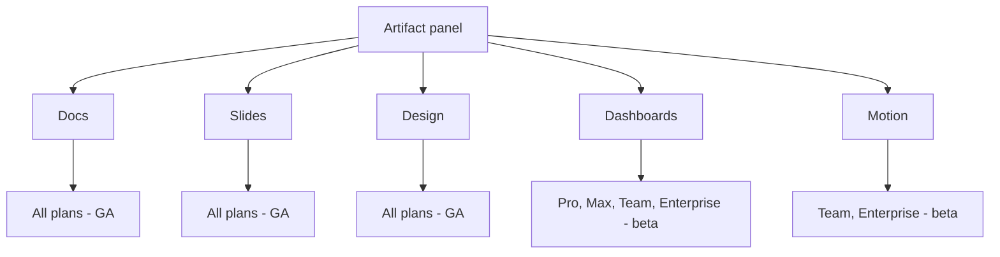

<LevelBadge level="beginner" />

<VerifyNote lastVerified="2026-10-20" source="https://support.claude.com/en/articles/17153992-what-are-artifacts-and-how-do-i-use-them">
Angekündigt am **8. Oktober 2026**. **Claude Dashboards** ist in der Beta in **Pro, Max, Team und Enterprise**; **Claude Motion** ist nur in **Team und Enterprise** in der Beta. Am selben Tag **verließen Docs, Slides und Design die Beta und wurden in jedem Tarif verfügbar, einschließlich Free** — in Enterprise wurden sie am **15. Oktober 2026** standardmäßig aktiviert. Beide Betas sind in Enterprise standardmäßig aus, bis ein Owner sie aktiviert. Verfügbarkeit und Connector-Listen ändern sich schnell — bestätigen Sie im Help Center, bevor Sie auf etwas hier aufbauen.
</VerifyNote>

Zwei neue **Vorlagen** landeten am 8. Oktober 2026 im Artifact-Panel, und sie sind keine Variationen der bereits vorhandenen. **Claude Dashboards** greift *aus* der Konversation heraus in Ihr Data Warehouse. **Claude Motion** erzeugt etwas, das die anderen Vorlagen nicht können: ein bewegtes Bild — und es erzeugt es als Code, nicht als Video.

Dieselbe Ankündigung beendete stillschweigend die Beta von **Docs, Slides und Design**, die jetzt in jedem Tarif einschließlich Free verfügbar sind. Wenn Sie eine AILmanac-Seite (oder den Leitfaden von irgendjemand anderem) lesen, die vor dem 8. Oktober geschrieben wurde und sagt, diese drei seien „kostenpflichtig, Beta“, ist dieser Satz jetzt falsch.

<Callout type="objectives" items={[
  "Dashboards und Motion von den Vorlagen unterscheiden, die Sie schon haben, und von einem einfachen Artifact",
  "Genau wissen, welcher Tarif was bekommt und was ein Enterprise-Owner einschalten muss",
  "Den einen Mechanismus hinter jedem verstehen: eine SQL-Abfrage pro Diagramm und eine aus bearbeitbarem Code kompilierte Animation",
  "Die Freigabefalle vermeiden — wer was sieht, wenn Sie ein Dashboard teilen, und warum ein Connector-gestütztes Artifact nie einen öffentlichen Link haben kann",
  "Die drei Aufgaben erkennen, für die diese das falsche Werkzeug sind",
  "Die Frist vom 14. Dezember 2026 für Claude Design beachten, bevor sie verstreicht"
]} />

## Die fünf Vorlagen auf einen Blick

| Vorlage | Was sie erzeugt | Tarife | Status |
| --- | --- | --- | --- |
| **Docs** | Ein lebendes Dokument mit mehreren Tabs | Alle, auch Free | GA |
| **Slides** | Eine präsentierbare Präsentation | Alle, auch Free | GA |
| **Design** | Visuals, Mockups, Prototypen | Alle, auch Free | GA |
| **Dashboards** | Diagramme, gespeist von Live-Abfragen gegen Ihre Daten | Pro, Max, Team, Enterprise | Beta |
| **Motion** | Eine kurze Animation, exportiert als MP4 | Team, Enterprise | Beta |

In **Enterprise** sind beide neuen Vorlagen **aus, bis ein Owner sie einschaltet**, in den Organisationseinstellungen unter Artifacts — und ein Owner kann den Zugriff mit Custom Roles auf bestimmte Gruppen eingrenzen. In **Team** ist Motion **standardmäßig an**.

## Claude Dashboards

### Der Mechanismus in einem Satz

Sie stellen eine Frage in natürlicher Sprache; **Claude schreibt für jedes Diagramm eine SQL-Abfrage und führt sie gegen Ihre Datenquelle aus.** Das ist das ganze Produkt, und es zu verstehen erklärt jede Stärke und jede Grenze, die daraus folgt.

Unterstützte Data Warehouses: **Amazon Redshift, BigQuery, ClickHouse, Databricks und Snowflake**. Es kann auch Apps lesen, die Sie bereits mit Claude verbunden haben, wobei **Salesforce** die wichtigste ist.

### Warum die Abfrage pro Diagramm wichtig ist

Weil jedes Diagramm von einer benannten Abfrage gestützt wird statt von der Erinnerung eines Modells, ist ein Dashboard **nachprüfbar, wie es eine Chat-Antwort nicht ist**. Jedes Diagramm zeigt **seine eigene Abfrage** und **wann seine Daten zuletzt aktualisiert wurden**. Das stellt das übliche Vertrauensproblem auf den Kopf: Statt zu fragen „hat Claude diese Zahl halluziniert“, klicken Sie auf das Diagramm und lesen das SQL, das sie erzeugt hat.

Das ist die eine Gewohnheit, die man am ersten Tag aufbauen sollte.

<Steps items={[
  {title: "Nach der Entscheidung fragen, nicht nach dem Diagramm", body: "„Baue ein Dashboard der Pipeline dieses Quartals nach Region“ liefert ein Diagramm. „Ich muss entscheiden, wohin ich im nächsten Quartal zwei Vertriebsleute verschiebe — zeig mir, was mir das sagen würde“ liefert ein Diagramm plus den Vergleich, der es umsetzbar macht. Die eigene Empfehlung von Anthropic ist, zu sagen, was Sie wissen wollen, nicht nur, was geplottet werden soll."},
  {title: "Die Tabellen oder die App nennen", body: "Sagen Sie, wo die Daten liegen. Auf eine bestimmte Warehouse-Tabelle oder verbundene App zu zeigen ist der Unterschied zwischen einer Abfrage und drei Vermutungen."},
  {title: "Die Abfrage jedes Diagramms öffnen, bevor Sie der Zahl trauen", body: "Das ist der Schritt, den Leute überspringen. Lesen Sie das SQL: Prüfen Sie den Datumsbereich, den Filter, den Join und ob Zeilen gezählt oder eine Spalte summiert wird. Eine korrekt aussehende Zahl aus dem falschen Filter ist hier der eigentliche Fehlermodus, nicht Erfindung."},
  {title: "Im Gespräch verfeinern", body: "„Füge einen Filter für die Region hinzu“, „teile in Neugeschäft und Verlängerung“, „nimm Geschäftsquartale“. Claude schreibt die Abfrage um, statt ein statisches Bild neu zu zeichnen."},
  {title: "Weitergeben, wenn es tief wird", body: "Die Rahmung von Anthropic ist eindeutig: Dashboards sind für schnelle, explorative Fragen gemacht. Braucht eine Frage echte Analyse, geben Sie das Dashboard an ein dafür gebautes Werkzeug weiter."}
]} />

<PromptCard title="Ein Dashboard-Briefing, das etwas Umsetzbares liefert">{`Build me a dashboard from our Snowflake warehouse (schema: SALES_PROD).

The decision I'm making: which two regions get the next headcount.

Show me:
  1. Closed-won revenue by region, last 4 fiscal quarters, as a trend
  2. Win rate by region over the same period
  3. Average deal cycle in days by region
  4. Open pipeline by region, split new business vs renewal

Rules:
- Use fiscal quarters, not calendar.
- Exclude deals marked is_test = true.
- For every chart, label the exact table you queried.
- If a field I named doesn't exist, say so and ask — do not substitute
  a similar-sounding column.`}</PromptCard>

Diese letzte Regel hat ihren Platz verdient. Der übelste Dashboard-Fehler ist nicht ein kaputtes Diagramm — es ist ein plausibles Diagramm, gebaut auf `amount`, obwohl Sie `amount_arr` meinten.

### Ein Dashboard woandershin schicken

Ein Dashboard ist ein Ausgangspunkt, kein Zuhause. Anthropic nennt Weiterleitungsziele, darunter **Amplitude, Grafana, Hex, Mixpanel, Omni, Perplexity, PostHog und Sigma**, mit **Databricks Genie, Looker, monday.com und Tableau** als kommend.

Lesen Sie diese Liste als Absichtserklärung: Dashboards ist als **schnellster Weg, eine Frage zu stellen** positioniert und ausdrücklich nicht als Ersatz für das BI-Tool, in dem Ihre gesteuerten Kennzahlen leben.

### Das Freigabemodell — lesen Sie das, bevor Sie etwas teilen

Dashboards beginnen **privat bei Ihnen**. Eines zu teilen macht es zu einem Artifact, das einen Connector aufruft, und Connector-gestützte Artifacts folgen Regeln, die fast alle überraschen:

<Callout type="warning" items={[
  "Abfragen laufen als der Betrachter, nicht als Sie. Laut Anthropic: „When someone opens your artifact, it connects to their connectors and data sources.“ Zwei Kollegen können dasselbe Dashboard öffnen und berechtigterweise unterschiedliche Zahlen sehen.",
  "Ein Betrachter ohne Zugriff sieht einen Fehler, nicht Ihre Daten: „If they don't have access to an underlying data source, that part of the artifact shows an error instead of your data.“ Das ist die Funktion, die korrekt arbeitet — es ist auch der Grund, warum Ihr Dashboard für die Person, der Sie es geschickt haben, kaputt aussieht.",
  "Es gibt keinen öffentlichen Link. „There are no external or public links and no per-person recipient selection. Anyone in your organization who has the link can open the artifact.“ Live-Daten und externer Zugriff ohne Login schließen sich auf derselben Seite gegenseitig aus.",
  "Apps mit einem Artifact zu verbinden ist eine Web- und Desktop-Funktion in Pro, Max, Team und Enterprise. Planen Sie keine Mobile-First-Review-Schleife darum herum."
]} />

Die praktische Konsequenz: **Ein Dashboard ist ein internes Instrument, kein Kunden-Deliverable.** Wenn ein externer Empfänger die Zahlen braucht, exportieren Sie die Werte in ein Doc, eine Präsentation oder eine erzeugte Datei und schicken Sie das.

## Claude Motion

### Kein Videomodell

Das ist die Tatsache, die die meiste Berichterstattung falsch hat, daher sei sie klar gesagt: **Motion erzeugt kein Video.** Claude schreibt **bearbeitbaren Code**, der Text, Zahlen, Formen, Bilder und Diagramme animiert, und das Artifact spielt wie ein kurzes Video. Die direkte Folge ist, in den Worten von Anthropic, dass es **keine realistischen Aufnahmen oder Personen erzeugen kann**.

Diese Einschränkung ist auch der ganze Vorteil. Weil die Animation ein Programm *ist*:

- Sie können **ein Wort, eine Zahl oder einen Timing-Wert** ändern, und alles andere bleibt genau so, wie es war.
- Dasselbe Briefing, nach einer Datenkorrektur neu gerendert, ist immer noch dieselbe Animation — nicht ein neuer Würfelwurf.
- Sie können in Prosa Regie führen („verlangsame die zweite Szene“) oder direkt im Editor bearbeiten.

Wenn Ihnen der Mechanismus bekannt vorkommt: Es ist dieselbe Idee wie die breitere [codegesteuerte Erklärvideo-Pipeline](/docs/models/ai-explainer-videos-code-driven) — Motion ist deren First-Party-Version ohne Einrichtung.

### Gut einsetzen

<Steps items={[
  {title: "Es nur dann einer Präsentation vorziehen, wenn Bewegung Bedeutung trägt", body: "Eine Abfolge, ein Prozess, ein Wert, der sich über die Zeit ändert, ein Durchgang durch Schritte. Wenn der Inhalt eine Liste ist, bauen Sie stattdessen Slides — eine Liste zu animieren ist langsamer zu erstellen und langsamer zu lesen."},
  {title: "Zielgruppe, Ort und Länge vorab nennen", body: "„30 Sekunden, für ein All-Hands, auf einer großen Leinwand hinter mir“ und „90 Sekunden, für die Onboarding-E-Mail für Neukunden“ erzeugen berechtigterweise unterschiedliche Animationen. Hängen Sie den Quellbericht oder die Daten an, statt sie neu zu tippen."},
  {title: "Aus dem Chat erstellen oder die Vorlage wählen", body: "Fragen Sie in einer beliebigen Konversation, wählen Sie im Nachrichtenfeld Output und dann Motion, oder starten Sie aus einer Motion-Vorlage im Tab Artifacts. Wählen Sie ausdrücklich, wenn Claude immer wieder eine Präsentation erzeugt."},
  {title: "Jeweils eine Sache iterieren", body: "„Verlangsame die zweite Szene“, „lass die Umsatzzahl landen, nachdem das Diagramm fertig gezeichnet ist“. Einzelne Änderungen sitzen zuverlässig; eine Liste von fünf selten."},
  {title: "Als MP4 exportieren und bei Bedarf woanders fertigstellen", body: "Anthropic nennt Adobe, Descript, HeyGen, Higgsfield, invideo, Luma AI und Runway als Tools, in denen Sie die Ausgabe öffnen können, mit Canva und Captions als kommend. Voiceover, Untertitel und Musik sind nicht als Motion-Funktionen dokumentiert — planen Sie, sie nachgelagert hinzuzufügen."}
]} />

<PromptCard title="Eine Animation briefen, die keinen zweiten Versuch braucht">{`Turn the attached Q3 report into a 30-second animated explainer.

Audience: the whole company at an all-hands, on a projector behind
a speaker. It plays once, with no narration from the file itself.

Structure, four scenes:
  1. The one number that matters (revenue, with last quarter for contrast)
  2. Where the growth came from — animate the regional chart drawing in
  3. The one thing that got worse, stated plainly
  4. What we're doing about it next quarter, three short lines

Constraints:
- Readable from the back of a room: large type, high contrast,
  no more than seven words on screen at once.
- No decorative motion. Every movement should mean something changed.
- Use only figures from the attached report. If a number I asked for
  isn't in it, leave the slot empty and tell me.`}</PromptCard>

## Wann diese das falsche Werkzeug sind

Eine ehrliche Referenz sagt, worin ein Feature schlecht ist. Drei Fälle:

| Sie wollen… | Nicht verwenden | Stattdessen verwenden |
| --- | --- | --- |
| Eine gesteuerte Kennzahl, über die Ihr ganzes Unternehmen berichtet | Dashboards — es beantwortet Fragen, es definiert keine Kennzahlen | Ihre BI-Schicht; schicken Sie das Dashboard dorthin |
| Eine Live-Datenseite, die ein Kunde ohne Login öffnet | Dashboards — Connector-gestützte Artifacts haben keinen öffentlichen Link | Die Werte in ein [Doc oder eine Präsentation](/docs/claude-app/one-claude-docs-and-slides) oder eine [erzeugte Datei](/docs/claude-app/generating-files) exportieren |
| Aufnahmen, einen Moderator, einen sprechenden Kopf | Motion — dahinter steckt kein Videomodell | Ein Videotool; das MP4 von Motion kann darin eine Komponente sein |

Und ein Kostenhinweis, der für beide gilt: **Es gibt keinen separaten Preis.** Dashboards und Motion zählen wie alles andere auf die Nutzungslimits Ihres Tarifs, und Anthropic weist darauf hin, dass längere oder komplexere Animationen mehr von Ihrem Kontingent verbrauchen. Die Seite [Tarife und Abrechnung](/docs/claude-app/plans-and-billing) enthält die allgemeine Form.

## Eine Frist, die in den Kalender gehört

Die Änderungen vom 8. Oktober kamen mit einem Sunset. **Die eigenständige Claude-Design-Site schließt am 14. Dezember 2026**, danach führt `claude.ai/design` einfach zu Claude.

Wenn Ihr Team sie je genutzt hat, ist das eine echte To-do mit Datum:

<Steps items={[
  {title: "Design Systems von der Artifacts-Seite migrieren", body: "Öffnen Sie Artifacts in Claude und klicken Sie auf „Migrate team design systems“, im Banner oder im Claude-Design-Menü. Jedes migrierte Design System behält seinen Owner und die Personen, mit denen es geteilt war. Jeder, der Claude Design nutzen kann, kann die Migration starten — sie ist nicht Owner-exklusiv."},
  {title: "Wissen, was nicht mitkommt", body: "Leere Design Systems und solche, die aus einem eingebauten Starter-Theme gebaut sind, werden nicht migriert. Ebenso wenig Ihre Chats mit Claude oder Kommentare zu Projekten und Design Systems — sie bleiben in der eigenständigen Version und werden gelöscht, wenn sie schließt."},
  {title: "Alles sichern, was Sie aus Chats und Kommentaren brauchen", body: "Das ist der unumkehrbare Teil. Öffentliche Links zu Projekten in der eigenständigen Version funktionieren nach ihrer Schließung ebenfalls nicht mehr."},
  {title: "Einen Sichtbarkeits-Nebeneffekt prüfen", body: "Ein veröffentlichtes, nicht privates Design System wird nach der Migration organisationsweit sichtbar. Prüfen Sie, auf welche das zutrifft, bevor Sie klicken."},
  {title: "Enterprise: zuerst die Schalter bestätigen", body: "Artifacts muss aktiviert sein, und in Enterprise sind Design Systems standardmäßig aus, bis ein Administrator sie einschaltet. Tun Sie das vor der Migration, nicht danach."}
]} />

## Begriffe, die man kennen sollte

<Flashcards cards={[
  {front: "Vorlage", back: "Eine Ausgangsform für ein Artifact, keine separate App. Es gibt jetzt fünf: Docs, Slides, Design (alle GA, jeder Tarif) plus Dashboards und Motion (beide Beta)."},
  {front: "Claude Dashboards", back: "Eine Beta-Vorlage in Pro, Max, Team und Enterprise. Sie fragen in natürlicher Sprache; Claude schreibt pro Diagramm eine SQL-Abfrage und führt sie gegen Redshift, BigQuery, ClickHouse, Databricks, Snowflake oder eine verbundene App wie Salesforce aus."},
  {front: "Abfrage pro Diagramm", back: "Jedes Dashboard-Diagramm zeigt das SQL, das es erzeugt hat, plus wann seine Daten zuletzt aktualisiert wurden. Es zu lesen ist der Weg, eine Zahl zu prüfen, statt ihr zu vertrauen."},
  {front: "Claude Motion", back: "Eine Beta-Vorlage in Team und Enterprise, die eine kurze Animation als bearbeitbaren Code erzeugt — nicht als generiertes Video — und als MP4 exportiert. Sie kann keine realistischen Aufnahmen oder Personen erzeugen."},
  {front: "Connector-gestütztes Artifact", back: "Ein Artifact, das beim Betrachten einen Connector aufruft. Seine Abfragen laufen mit den eigenen Verbindungen des Betrachters, und es kann nie einen externen oder öffentlichen Link erhalten."},
  {front: "Schnelle, explorative Fragen", back: "Die eigene Eingrenzung von Anthropic für Dashboards. Ein schneller Weg zu fragen, kein Ersatz für die BI-Schicht, in der gesteuerte Kennzahlen leben."},
  {front: "14. Dezember 2026", back: "Das Datum, an dem die eigenständige Claude-Design-Site schließt. Migrieren Sie Design Systems vorher von der Artifacts-Seite; Chats, Kommentare und öffentliche Projekt-Links der eigenständigen Version werden gelöscht."}
]} />

## Quiz

<Quiz questions={[
  {q: "Sie bauen ein Dashboard aus Ihrem Snowflake-Warehouse und teilen es mit einem Teamkollegen, der engere Warehouse-Berechtigungen hat als Sie. Was sieht er?", options: ["Ihre Zahlen, weil das Dashboard die Ergebnisse des Erstellers cached", "Seine eigenen Zahlen, wo er Zugriff hat, und einen Fehler bei den Teilen, wo nicht", "Nichts — das Teilen eines Connector-gestützten Artifacts wird nicht unterstützt", "Eine Zugriffsanfrage, die zur Genehmigung an Sie geht"], answer: 1, explain: "Ein geteiltes Artifact verbindet sich mit den eigenen Connectors und Datenquellen des Betrachters, daher können zwei Personen berechtigterweise unterschiedliche Ergebnisse sehen. Wo einem Betrachter der Zugriff auf eine zugrunde liegende Quelle fehlt, zeigt dieser Teil des Artifacts einen Fehler statt Ihrer Daten."},
  {q: "Ein Kunde bittet um einen Link zu Ihrem Live-Dashboard, den er ohne Claude-Konto öffnen kann. Was ist der unterstützte Weg?", options: ["Im Share-Dialog einen öffentlichen Link erzeugen", "Es als schreibgeschütztes externes Artifact veröffentlichen", "Für ein Connector-gestütztes Artifact gibt es keinen öffentlichen Link — die Werte in ein Doc, eine Präsentation oder eine Datei exportieren und das senden", "Das Dashboard zu einem Snapshot herabstufen und dann öffentlich teilen"], answer: 2, explain: "Connector-gestützte Artifacts haben keine externen oder öffentlichen Links und keine Auswahl pro Empfänger — jeder in Ihrer Organisation mit dem Link kann es öffnen, und niemand außerhalb. Live-Daten und externer Zugriff ohne Login schließen sich auf derselben Seite gegenseitig aus."},
  {q: "Welche Aussage über Claude Motion stimmt?", options: ["Es erzeugt Video mit einem Videomodell und kann daher realistische Moderatoren erzeugen", "Es schreibt bearbeitbaren Code, der Text, Diagramme und Formen animiert, und kann daher keine realistischen Aufnahmen oder Personen erzeugen", "Es rendert Slides automatisch zu Video", "Es ist in jedem Tarif verfügbar, auch in Free"], answer: 1, explain: "Motion schreibt Code, statt ein Videogenerierungsmodell aufzurufen. Deshalb kann es keine realistischen Aufnahmen oder Personen erzeugen — und deshalb können Sie ein Wort, eine Zahl oder einen Timing-Wert ändern, ohne den Rest zu stören. Es ist nur in Team und Enterprise in der Beta."},
  {q: "Sie sind im Free-Tarif. Welche davon können Sie heute nutzen?", options: ["Dashboards, weil es am 8. Oktober die Beta verlassen hat", "Motion, weil es standardmäßig an ist", "Docs, Slides und Design — alle drei verließen am 8. Oktober die Beta und sind in jedem Tarif, auch Free", "Keine der Vorlagen"], answer: 2, explain: "Der 8. Oktober 2026 brachte Docs, Slides und Design aus der Beta in jeden Tarif einschließlich Free (in Enterprise wurden sie am 15. Oktober standardmäßig aktiviert). Dashboards blieb in der Beta in kostenpflichtigen Tarifen, und Motion ist nur in Team und Enterprise in der Beta."}
]} />

<Callout type="takeaways" items={[
  "8. Oktober 2026: Dashboards und Motion kamen in die Beta; Docs, Slides und Design verließen die Beta und erreichten jeden Tarif einschließlich Free. Jeder Leitfaden, der diese drei noch „kostenpflichtig, Beta“ nennt, ist veraltet.",
  "Dashboards schreibt pro Diagramm eine SQL-Abfrage. Öffnen Sie die Abfrage, bevor Sie der Zahl trauen — der eigentliche Fehlermodus ist eine korrekt aussehende Zahl aus dem falschen Filter oder der falschen Spalte.",
  "Geteilte Dashboards laufen als der Betrachter. Verschiedene Personen sehen verschiedene Daten, und ein Betrachter ohne Zugriff sieht einen Fehler — beabsichtigt.",
  "Kein Connector-gestütztes Artifact kann einen öffentlichen Link haben. Ein Dashboard ist ein internes Instrument; für externe Empfänger exportieren.",
  "Motion ist Code, nicht Video: endlos bearbeitbar und perfekt wiederholbar, aber es kann nie Aufnahmen oder Personen erzeugen. Kein Voiceover oder Untertitel dokumentiert — nachgelagert hinzufügen.",
  "Anthropic grenzt Dashboards auf schnelle, explorative Fragen ein und nennt Weiterleitungsziele wie Grafana, Hex und Sigma. Betrachten Sie es als schnellsten Weg zu fragen, nicht als Ihre BI-Schicht.",
  "Kalendereintrag: Die eigenständige Claude-Design-Site schließt am 14. Dezember 2026. Migrieren Sie Design Systems von der Artifacts-Seite und sichern Sie zuerst Chats und Kommentare — die werden gelöscht."
]} />

## Quellen & weiterführende Literatur

- Anthropic — [Build live dashboards and animate explainers with Claude](https://claude.com/resources/articles/dashboards-and-motion) (Ankündigung, 8. Oktober 2026; Connector- und Weiterleitungsziel-Listen)
- Anthropic Help Center — [What are artifacts and how do I use them?](https://support.claude.com/en/articles/17153992-what-are-artifacts-and-how-do-i-use-them) (die fünf Vorlagen und ihre genaue Tarifverfügbarkeit)
- Anthropic Help Center — [Get started with Claude Dashboards](https://support.claude.com/en/articles/17454700-get-started-with-claude-dashboards) (Erstellung, Abfragen pro Diagramm, Freigabe, Umfang und Nutzungslimits)
- Anthropic Help Center — [Get started with Claude Motion](https://support.claude.com/en/articles/17454997-get-started-with-claude-motion) (Erstellung, Bearbeitung, MP4-Export, Tarif- und Organisationseinstellungen)
- Anthropic Help Center — [Use live artifacts](https://support.claude.com/en/articles/14729249-use-live-artifacts-in-claude-cowork) (wessen Verbindungen beim Betrachten laufen und warum es keinen öffentlichen Link gibt)
- Anthropic Help Center — [Migrate from standalone Claude Design to Claude](https://support.claude.com/en/articles/17440474-migrate-from-standalone-claude-design-to-claude) (die Schließung am 14. Dezember 2026 und was nicht migriert wird)

## Weiter

- [Artifacts: Live, ausführbare Ausgaben](/docs/claude-app/artifacts) — das Panel, in das alle fünf Vorlagen rendern
- [One Claude: Die Zusammenführung, Claude Docs & Claude Slides](/docs/claude-app/one-claude-docs-and-slides) — die drei GA-Vorlagen im Detail und ihre Grenzen
- [Connectors](/docs/claude-app/connectors) — die Datenquellen anbinden, die Dashboards abfragt
- [Playbook Datenanalyse](/docs/playbooks/data-analysis) — die Analysearbeit, die ein Dashboard weitergibt
