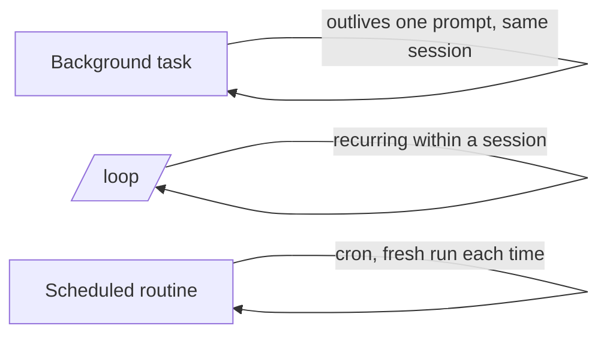

<LevelBadge level="advanced" />

<VerifyNote lastVerified="2026-07-15" source="https://code.claude.com/docs/en">
Die genauen Befehle und die Verfügbarkeit von Hintergrundaufgaben, /loop und Zeitplanung ändern sich zwischen Releases — überprüfe das in der offiziellen Dokumentation.
</VerifyNote>

Nicht alles ist eine schnelle Änderung. Claude Code kann Arbeit ausführen, die **eine einzelne Eingabeaufforderung überdauert**: lange Befehle im Hintergrund, wiederkehrende Schleifen und geplante Läufe.

<Callout type="objectives" items={[
  "Die drei Mechanismen unterscheiden: Hintergrundaufgaben, /loop und geplante Routinen",
  "Einen langen Befehl starten, ohne die Session zu blockieren — und wissen, warum es falsch ist, ihn in einer engen Schleife zu pollen",
  "Mit einer einzigen Frage den richtigen wählen: Überdauert die Arbeit die Eingabeaufforderung, die Session oder keines von beidem?",
  "Anweisungen für einen geplanten Lauf in sich abgeschlossen schreiben, weil jeder Lauf frisch startet",
  "Leitplanken unter alles legen, was unbeaufsichtigt handelt"
]} />

## Hintergrundaufgaben

Starte einen langlaufenden Befehl (einen Dev-Server, einen Test-Watcher, einen Build), **ohne die Session zu blockieren**. Claude arbeitet weiter und wird benachrichtigt, wenn die Aufgabe Ausgabe erzeugt oder fertig ist. Nutze es für alles, was du normalerweise mit `&` in den Hintergrund schicken würdest — aber verwaltet, sodass Claude die Ausgabe später lesen kann.

:::tip[Kein Busy-Waiting]
Starte die Aufgabe im Hintergrund und mach weiter; lass die Abschlussbenachrichtigung dich zurückholen, statt in einer engen Schleife zu pollen.
:::

## Wiederkehrende Schleifen (`/loop`)

`/loop` führt eine Eingabeaufforderung oder einen Befehl in einem **wiederkehrenden Intervall** innerhalb einer Session aus — z. B. "prüfe alle 5 Minuten den Deploy-Status". Gib ein Intervall vor oder lass Claude sein eigenes Tempo bestimmen. Großartig, um einen CI-Lauf zu beaufsichtigen oder einen externen Job zu pollen, über den dich das Harness sonst nicht benachrichtigen kann.

<PromptCard title="Einen Deploy alle fünf Minuten pollen, innerhalb der Session">
{`/loop 5m check the deploy status and tell me the moment it goes green or fails`}
</PromptCard>

Lässt du das Intervall weg, bestimmt Claude sein Tempo selbst, statt nach deiner Uhr zu laufen.

## Geplante Cloud-Agenten

Für Arbeit, die **nach der Uhr, fortlaufend** geschehen soll — "fasse jeden Morgen neue Issues zusammen", "prüfe stündlich auf Neuigkeiten und aktualisiere die Dokumentation" — nutze **geplante Aufgaben / Routinen** (cron-artig). Jeder Lauf startet frisch, daher müssen seine Anweisungen **in sich abgeschlossen** sein.

## Die Wahl zwischen ihnen

| Bedarf | Verwenden |
|---|---|
| Einen langen Befehl ausführen, weiterarbeiten | Hintergrundaufgabe |
| In dieser Session etwas alle N Minuten pollen | `/loop` |
| Etwas nach Zeitplan tun, unbegrenzt | Geplante Routine |

<Steps items={[
  {
    "title": "Frage, was die Arbeit überdauern muss",
    "body": "Eine Eingabeaufforderung, aber nicht die Session? Hintergrundaufgabe. Die Eingabeaufforderung, wiederholt, innerhalb dieser Session? /loop. Die Session selbst, nach der Uhr, unbegrenzt? Geplante Routine."
  },
  {
    "title": "Starte sie, ohne zu blockieren",
    "body": "Starte den langen Befehl im Hintergrund und arbeite weiter. Claude wird benachrichtigt, wenn die Aufgabe Ausgabe erzeugt oder fertig ist — polle sie nicht in einer engen Schleife."
  },
  {
    "title": "Mach einen geplanten Lauf in sich abgeschlossen",
    "body": "Jeder geplante Lauf startet frisch, daher tragen seine Anweisungen den gesamten Kontext, den er braucht. Aus der Session, in der du ihn eingerichtet hast, kommt nichts mit."
  },
  {
    "title": "Begrenze alles Unbeaufsichtigte und grenze es ein",
    "body": "Nur eng abgegrenzte, umkehrbare Arbeit, gepaart mit strikten Berechtigungen. Autonomie ohne Leitplanken ist der Fehlerfall, den diese Funktion leicht erreichbar macht."
  }
]} />

:::warning[Autonomie braucht Leitplanken]
Alles, was unbeaufsichtigt nach Zeitplan handelt, sollte eng abgegrenzt und umkehrbar sein. Kombiniere es mit strikten [Berechtigungen](/docs/claude-code/permissions) und lies [Autonome Läufe absichern](/docs/security/hardening-autonomous-runs).
:::

<Quiz questions={[
  {
    "q": "Du willst jeden Morgen, fortlaufend, eine Zusammenfassung neuer Issues. Welcher Mechanismus passt?",
    "options": [
      "Eine Hintergrundaufgabe",
      "/loop mit einem 24-Stunden-Intervall",
      "Eine geplante Routine",
      "Ein langlaufender Befehl, der mit & gestartet wird"
    ],
    "answer": 2,
    "explain": "Arbeit, die nach der Uhr und unbegrenzt geschehen soll, ist genau das, wofür geplante Aufgaben / Routinen da sind — sie laufen cron-artig und überdauern jede Session. /loop wiederholt sich nur innerhalb einer Session und endet daher mit ihr."
  },
  {
    "q": "Warum müssen die Anweisungen einer geplanten Routine in sich abgeschlossen sein?",
    "options": [
      "Weil geplante Läufe ein kleineres Kontextfenster haben",
      "Weil jeder Lauf frisch startet, ohne den Kontext der einrichtenden Session",
      "Weil die cron-Syntax lange Prompts nicht ausdrücken kann",
      "Weil die Berechtigungen bei jedem Lauf auf schreibgeschützt zurückgesetzt werden"
    ],
    "answer": 1,
    "explain": "Jeder Lauf startet frisch, daher muss alles, was der Lauf braucht, in seinen eigenen Anweisungen stehen. Der Kontext aus der Session, in der du die Routine angelegt hast, wird nicht übernommen."
  },
  {
    "q": "Du hast im Hintergrund einen langen Test-Watcher gestartet. Was solltest du als Nächstes NICHT tun?",
    "options": [
      "In derselben Session mit anderer Arbeit weitermachen",
      "Darauf warten, dass die Abschlussbenachrichtigung dich zurückholt",
      "Die Aufgabe in einer engen Schleife pollen, bis sie fertig ist",
      "Die Ausgabe der Aufgabe später lesen, wenn sie etwas erzeugt hat"
    ],
    "answer": 2,
    "explain": "Busy-Waiting verfehlt den Sinn. Die Aufgabe wird verwaltet, daher wird Claude benachrichtigt, wenn sie Ausgabe erzeugt oder fertig ist — starte sie, arbeite weiter und lass dich von der Benachrichtigung zurückholen."
  }
]} />

<Callout type="takeaways" items={[
  "Drei Mechanismen, eine Frage: Überdauert die Arbeit die Eingabeaufforderung (Hintergrundaufgabe), wiederholt sie sich innerhalb der Session (/loop) oder überdauert sie die Session vollständig (geplante Routine)?",
  "Hintergrundaufgaben werden verwaltet und nicht bloß mit & in den Hintergrund geschickt — Claude kann die Ausgabe später lesen und wird benachrichtigt, wenn sie fertig sind.",
  "Kein Busy-Waiting. Starte sie, mach weiter und lass dich von der Abschlussbenachrichtigung zu ihr zurückholen.",
  "/loop nimmt ein Intervall oder bestimmt sein Tempo selbst, wenn du das Intervall weglässt.",
  "Jeder geplante Lauf startet frisch, daher müssen seine Anweisungen für sich allein stehen.",
  "Unbeaufsichtigte Autonomie braucht strikte Berechtigungen und einen umkehrbaren Umfang — diese Kombination ist nicht optional."
]} />

## Weiter

- [Cloud-Sessions und Cloud-Umgebungen](/docs/claude-code/cloud-sessions) — die vierte Option: Arbeit, die deinen Rechner vollständig überdauert
- [Auto-Commit-Hintergrundagenten: Draft-PR-Übergabe](/docs/claude-code/auto-commit-background-agents) — was passiert, wenn eine Hintergrund-Session endet
- [Headless-Modus & das Agent SDK](/docs/claude-code/headless-and-agent-sdk)
- [Berechtigungen & Modi](/docs/claude-code/permissions)
- [Autonome Läufe absichern](/docs/security/hardening-autonomous-runs)
