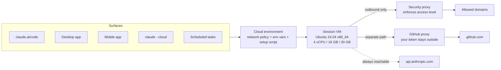

<LevelBadge level="intermediate" />

<Callout type="objectives" items={[
  "Das richtige mentale Modell aufbauen: fünf Oberflächen, eine gespeicherte Umgebung, eine frische Wegwerf-VM pro Sitzung",
  "Die Tabelle lernen, an der alle scheitern: was von deiner Maschine in eine Cloud-Sitzung mitkommt und die fünf Dinge, die stillschweigend nicht mitkommen",
  "Eine Netzwerkzugriffsstufe wählen — None, Trusted, Full, Custom — und die vier Arten von Traffic kennen, die deine Allowlist trotzdem umgehen",
  "Einer Sitzung mit einem Netzwerk-Secret einen API-Schlüssel geben, den sie benutzen, aber nie lesen kann",
  "Richtig zwischen einem Setup-Skript und einem SessionStart-Hook wählen und unter der ~5-Minuten-Regel bleiben, die entscheidet, ob deine Umgebung gecacht wird",
  "Um die echten Ressourcen- und Zeitgrenzen herumplanen: 4 vCPU / 16 GB / 30 GB, ein Standard-Befehls-Timeout von 2 Minuten und eine VM, die pausiert, wenn du weggehst",
  "Die volle Rundreise durchlaufen: claude --cloud, um Arbeit hinauszuschicken, claude -p --cloud, um sie zu steuern, claude --teleport, um sie zurückzuholen",
]} />

<VerifyNote lastVerified="2026-10-26" source="https://code.claude.com/docs/en/cloud-environments">
Geprüft gegen die offiziellen Seiten [Configure cloud environments](https://code.claude.com/docs/en/cloud-environments) und [Use Claude Code in the cloud](https://code.claude.com/docs/en/claude-code-on-the-web). Cloud-Sitzungen sind in den Tarifen **Pro, Max und Team** verfügbar sowie für Enterprise-Nutzer mit Premium-Plätzen oder Chat-+-Claude-Code-Plätzen; wenn deine Organisation eigene Rollen verwendet, brauchst du außerdem eine Rolle mit der Berechtigung für Cloud-Sitzungen. Die Ressourcengrenzen beschreibt Anthropic als ungefähr und änderbar. Die Versionen der vorinstallierten Tools ändern sich laufend — verstehe die Toolchain-Tabelle hier als Gestalt und bestätige Versionen in einer Live-Sitzung.
</VerifyNote>

Eine Cloud-Sitzung ist eine Claude-Code-Sitzung, die auf der Maschine von jemand anderem läuft statt auf deiner — standardmäßig der von Anthropic, oder auf [deinen eigenen Runnern](/docs/claude-code/self-hosted-environments), wenn deine Organisation sie dorthin leitet. Du klappst den Laptop zu; die Arbeit läuft weiter. Für die VM fällt keine gesonderte Gebühr an: Eine Cloud-Sitzung zieht von denselben Tarif-Nutzungslimits wie alles andere, was du mit Claude tust.

Dieser Teil ist leicht zu verstehen. Der Teil, der Leute einen Nachmittag kostet, ist subtiler: **Eine Cloud-Sitzung ist nicht dein Laptop mit einem anderen Hostnamen.** Es ist eine frische Ubuntu-Maschine mit deinem *eingecheckten* Repository darauf und sonst nichts von dir. Die Hälfte der Konfiguration, die du monatelang abgestimmt hast, liegt in `~/.claude/` auf deiner Maschine und kommt nicht mit. Diese Seite handelt größtenteils von dieser Grenze.

## Die Version in einem Absatz

Du speicherst eine **Cloud-Umgebung** — ein benanntes Bündel aus Netzwerkrichtlinie, Umgebungsvariablen und einem Setup-Skript. Jede Oberfläche, die eine Cloud-Sitzung starten kann, wählt eine deiner Umgebungen. Wenn eine Sitzung startet, stellt Anthropic eine isolierte VM bereit (Ubuntu 24.04 auf x86_64, unabhängig davon, was du lokal nutzt), klont dein Repo von GitHub, führt dein Setup-Skript aus, erstellt einen Snapshot des Dateisystems, damit die nächste Sitzung diesen Schritt überspringt, und startet Claude Code. Aller ausgehende Traffic verlässt die VM über einen Proxy, der deine Zugriffsstufe durchsetzt. GitHub-Traffic nimmt einen separaten Pfad, auf dem deine echten Zugangsdaten nie in die VM gelangen. Wenn du aufhörst zu tippen, pausiert die VM mit intakten Dateien; lässt du sie lange genug, wird sie zurückgefordert, und das erneute Öffnen der Sitzung baut eine neue auf.

### Eine Umgebung, fünf Oberflächen

Dieselben gespeicherten Umgebungen gelten überall, wo du eine Cloud-Sitzung startest: dein Browser auf claude.ai/code, die Desktop-App, die mobile Claude-App, dein Terminal über `claude --cloud` und geplante Cloud-Aufgaben. Konfiguriere die Umgebung einmal, und jede Oberfläche erbt sie.

Zwei Nachbarn sind *keine* Cloud-Sitzungen, und sie zu verwechseln stiftet echte Verwirrung:

- **Remote Control** verbindet die Web- und Mobiloberflächen mit einer Sitzung, die auf **deiner eigenen Maschine** läuft. Es nutzt deine Dateien und dein Netzwerk — es ist keine Cloud-Umgebung beteiligt.
- **`--remote-control`** hat trotz ähnlicher Namen nichts mit `--cloud` zu tun. `--cloud` erzeugt eine Sitzung auf der Infrastruktur von Anthropic; `--remote-control` stellt eine lokale Sitzung deinem Handy zur Verfügung.

Wenn du noch keine Umgebung hast, legt das Onboarding eine namens **Default** an: Netzwerkzugriff **Trusted**, keine Variablen, kein Setup-Skript. In Team und Enterprise zeigt dir das Web-Onboarding stattdessen unter Umständen ein Formular „Erste Umgebung erstellen“, sofern kein Owner **Quick setup** aktiviert hat; die Standardwerte des Formulars zu behalten ergibt dasselbe.

## Was von deiner Maschine mitkommt — und was nicht

Diesen Abschnitt solltest du zweimal lesen. Eine Cloud-Sitzung startet von einem **frischen Klon deines Repositories**. Die Regel, die jede Zeile unten erklärt: *Wenn es eingecheckt ist, ist es da; wenn es nur auf deiner Maschine existiert, nicht.*

| Dein Ding | In einer Cloud-Sitzung? | Warum |
| :--- | :--- | :--- |
| Repo-`CLAUDE.md`, `.claude/rules/` | ✅ Ja | Teil des Klons |
| Repo-`.claude/skills/`, `.claude/agents/`, `.claude/commands/` | ✅ Ja | Teil des Klons |
| Hooks und Berechtigungsregeln der Repo-`.claude/settings.json` | ✅ In einer Sitzung mit einem einzelnen Repository | Teil des Klons |
| MCP-Server der Repo-`.mcp.json` | ✅ In einer Sitzung mit einem einzelnen Repository | Wird vom Arbeitsverzeichnis der Sitzung aus gefunden |
| Vom Server verwaltete Einstellungen der Organisation | ✅ Ja (nicht in Claude-Tag-Sitzungen) | Wird beim Start der Sitzung von Anthropic abgerufen |
| Auf claude.ai aktivierte Skills | ✅ Ja | Aus deinem Konto geladen, nicht aus dem Repo |
| **Deine Benutzer-`~/.claude/CLAUDE.md`** | ❌ Nein | Liegt auf deiner Maschine, nicht im Repo |
| **Deine Benutzer-`~/.claude/skills/`, `agents/`, `commands/`** | ❌ Nein | Gleicher Grund. Checke sie stattdessen in das `.claude/` des Repos ein |
| **Plugins und Marketplaces** | ❌ Nein | Eine Cloud-Sitzung installiert weder `enabledPlugins` noch die Marketplaces unter `extraKnownMarketplaces` — weder aus dem Repo noch aus deinen Benutzereinstellungen |
| **MCP-Server, die im lokalen oder Benutzerbereich hinzugefügt wurden** | ❌ Nein | Diese schreiben nach `~/.claude.json`. Füge sie mit `claude mcp add --scope project` neu hinzu und checke die entstehende `.mcp.json` ein |
| **MDM-/verwaltete Einstellungsdateien auf deinem Gerät** | ❌ Nein | Die Sitzung läuft auf einer von Anthropic verwalteten VM |
| **Transportvariablen** wie `NODE_EXTRA_CA_CERTS` oder mTLS-Clientzertifikate in einem `env`-Block des Repos | ❌ Ignoriert | Die Hosting-Umgebung besitzt die API-Verbindung der Sitzung; jeder ignorierte Schlüssel wird im Debug-Log der Sitzung vermerkt |
| **Interaktive Authentifizierung** wie AWS SSO | ❌ Nein | Erfordert einen Browser-Login, der in einer Cloud-Sitzung nicht laufen kann |

In dieser Tabelle verstecken sich zwei Fallen:

- **Die Plugin-Lücke ist die teuerste.** Ein Repository, das in `.claude/settings.json` ein Plugin einschaltet, bekommt dieses Plugin lokal und in der Cloud nichts. Hängt ein Workflow von Plugin-Skills oder -Befehlen ab, checke entweder die Entsprechungen in `.claude/` ein oder akzeptiere, dass sich Cloud-Sitzungen anders verhalten. Siehe [Plugins und Marketplaces](/docs/claude-code/plugins-marketplaces) dazu, was wo liegt.
- **„Sitzung mit einem einzelnen Repository“ ist tragend.** In einer von Anthropic gehosteten Umgebung lädt eine Sitzung, die an *mehrere* Repositories angehängt ist, Hooks und Berechtigungsregeln aus **keinem** davon, und ein Cloud-Thread in einem [Projekt](/docs/claude-code/projects-coordinator-threads) lädt nur die `CLAUDE.md` des Repository-Stamms, `.claude/CLAUDE.md` und nicht pfadspezifische `.claude/rules/`. Hängt dein Setup von einem SessionStart-Hook ab, führt eine Sitzung mit mehreren Repos ihn nicht aus — provisioniere stattdessen mit einem Setup-Skript.

### Deine persönlichen Vorlieben trotzdem hineinbekommen

Du musst persönliche Stilregeln nicht in ein geteiltes Repo schieben. Ein Setup-Skript in einer **deiner eigenen** Umgebungen kann die Memory-Datei auf Benutzerebene direkt schreiben:

<PromptCard title="Setup-Skript: persönliche Vorlieben, ohne das Repo anzufassen">{`#!/bin/bash
mkdir -p ~/.claude
cat > ~/.claude/CLAUDE.md <<'EOF'
Use conventional commit messages.
Prefer small, reviewable diffs over one large change.
EOF`}</PromptCard>

Claude Code lädt das als Benutzeranweisungen. Bestätige, dass es geklappt hat, indem du in deiner nächsten Cloud-Sitzung `/context` ausführst und unter **Memory files** nach `/root/.claude/CLAUDE.md` suchst. Tu das nicht in einer geteilten Umgebung — es würde für alle in der Organisation gelten.

## Netzwerkzugriff: vier Stufen, und die vier Dinge, die sie ignorieren

Jede Umgebung trägt genau eine Netzwerkzugriffsstufe, die ausgehende Verbindungen aus dem Netzwerk der Sitzung regelt.

| Stufe | Was Sitzungen erreichen können |
| :--- | :--- |
| **None** | Nichts über das Netzwerk der Sitzung |
| **Trusted** (Standard) | Eine von Anthropic gepflegte Allowlist: Paket-Registries, GitHub/GitLab/Bitbucket, Container-Registries, Endpunkte der großen Cloud-SDKs |
| **Full** | Jede Domain |
| **Custom** | Deine eigene Liste, eine Domain pro Zeile; ein führendes `*.` passt auf jede Subdomain. Ein Kontrollkästchen entscheidet, ob auch die Trusted-Standards enthalten sind |

Das Ändern der Stufe in einer von Anthropic gehosteten Umgebung wirkt in **bestehenden** Sitzungen innerhalb von etwa einer Minute. Du musst keine neue starten.

Nun der Teil, der für die Bedrohungsmodellierung zählt. Vier Arten von Traffic nehmen einen Pfad, der deine Allowlist nie berührt, **egal welche Stufe du wählst — auch None**:

<Steps items={[
  {title: "GitHub, über seinen eigenen Proxy", body: "Alle GitHub-Operationen in von Anthropic gehosteten Umgebungen laufen über einen dedizierten Proxy, der deine echten Zugangsdaten außerhalb der VM hält. Unabhängig von der Zugriffsstufe."},
  {title: "MCP-Connectors, die du aktivierst", body: "Der Connector-Traffic läuft über die Server von Anthropic statt über das Netzwerk der Sitzung, du fügst den Host eines Connectors also nie zu Allowed domains hinzu. Die Kehrseite: Eine Allowlist begrenzt nicht, was ein aktivierter Connector erreichen kann. Schalte Connectors ab, die du nicht brauchst."},
  {title: "Hosts, die in deinen Netzwerk-Secrets aufgeführt sind", body: "Sitzungen können die Hosts eines Secrets erreichen, selbst wenn die Zugriffsstufe sie sonst nicht erlauben würde. Ein Secret hinzuzufügen erweitert die Erreichbarkeit ebenso, wie es Zugangsdaten anhängt."},
  {title: "api.anthropic.com", body: "Die eigenen Inferenzanfragen von Claude Code gehen auch bei None hinaus. Anthropic sagt das in seinen Isolationshinweisen klar: Bei deaktiviertem Netzwerkzugriff kann Claude Code weiterhin mit der Anthropic-API sprechen, was Daten aus der VM herauslassen kann. None ist kein Air Gap."},
]} />

Wenn du vorhattest, **None** als Eindämmungsgrenze für nicht vertrauenswürdigen Code zu nutzen, lies den vierten Punkt noch einmal und dann [Autonome Läufe absichern](/docs/security/hardening-autonomous-runs). Die Netzwerkstufe verkleinert den Wirkungsradius, sie ist keine Sandbox-Garantie.

Es gibt außerdem keine Allowlist auf Organisationsebene, die ein Admin auf die Umgebung jedes Mitglieds schieben könnte, und keine servergesteuerte Einstellung, die einer Domains hinzufügt. Eine Liste teamweit zu vereinheitlichen gelingt mit einer von einem Owner erstellten **organisationsweit geteilten Umgebung** mit **Custom**-Zugriff und dieser Liste.

### Die scharfe Kante des GitHub-Proxys: kein GraphQL

Verdient eine eigene Überschrift, weil es das Muskelgedächtnis aushebelt. Der GitHub-Proxy **lehnt GraphQL komplett ab**, mit einem 403, was bedeutet, dass die auf GraphQL basierenden `gh`-Unterbefehle in Cloud-Sitzungen scheitern:

- `gh pr ...` und `gh issue ...` → 403, mit dem Hinweis auf den REST-Fallback
- Ein eigenes `GH_TOKEN` hilft nicht — die Einschränkung gilt für jede Anfrage über den Proxy, unabhängig von den Zugangsdaten
- APIs, die es *nur* in GraphQL gibt, wie Projects v2, sind über den Proxy nicht erreichbar

Die Umgehung ist REST, das die eingebauten GitHub-Tools und `gh api` beide sprechen:

<PromptCard title="REST statt der GraphQL-basierten gh-Unterbefehle">{`gh api repos/OWNER/REPO/pulls --jq '.[] | "\\(.number) \\(.title)"'
gh api repos/OWNER/REPO/issues/42/comments -f body="rerunning the flaky suite"`}</PromptCard>

Der Proxy setzt noch drei weitere Regeln durch, die man kennen sollte: Er lehnt **Branch-Löschungen** und Pushes von allem ab, was kein Branch ist (etwa ein Tag); er bedient API-Anfragen nur für Repositories, die **an die Sitzung angehängt** sind, und gibt sonst einen 403 mit `is not enabled for this session` zurück — auch für von `codeload.github.com` abgerufene Quellarchive, selbst öffentliche; und er setzt deine echten Zugangsdaten serverseitig ein, sodass `GH_TOKEN` und `GITHUB_TOKEN` in der VM, wenn der Proxy die Authentifizierung übernimmt, als wörtlicher Platzhalter `proxy-injected` erscheinen. `gh` funktioniert mit diesem Platzhalter einwandfrei. Ein Skript von dir, das `GITHUB_TOKEN` direkt liest und ein brauchbares Token erwartet, tut es nicht.

<PromptCard title="Prüfen, in welchem GitHub-Authentifizierungsfall deine Sitzung ist">{`echo $GH_TOKEN`}</PromptCard>

## Netzwerk-Secrets: ein Schlüssel, den die Sitzung benutzt, aber nicht lesen kann

Umgebungsvariablen sind der falsche Ort für Zugangsdaten, und die Oberfläche von Anthropic selbst sagt das: Jeder, der die Umgebung nutzen kann, kann ihre Variablen lesen. Ein **Netzwerk-Secret** ist der richtige Ort. Du speicherst einen API-Schlüssel in der Umgebung, listest die Hosts auf, für die er gilt, und der Agent-Proxy von Anthropic hängt ihn an passende Anfragen an, **nachdem sie die VM verlassen haben**. Der Schlüssel selbst gelangt nie in die Sitzung, erscheint nicht in `env` und steht in keiner Datei. Nach dem Speichern kannst du ihn auch nicht zurücklesen — um den Wert oder die Hosts eines Secrets zu ändern, lösche es und füge es neu hinzu.

Einrichtungshinweise, die eine Runde sparen:

- **Tarife**: Pro, Max, Team und Enterprise. In Pro, Max und Team kannst du deinen eigenen Umgebungen unabhängig von deiner Rolle Secrets hinzufügen; in Enterprise brauchst du eine Organisations-Admin-Rolle, andernfalls bitte einen Owner, das Secret in eine geteilte Umgebung zu legen, und führe deine Sitzungen dort aus. In Team ohne diese Rolle ist das Formular **Add secret** eine kürzere Ein-Host-Variante ohne `*.`-Wildcard.
- Der **Standard-Secret-Typ** ist **Bearer**: der `Authorization`-Header mit dem Präfix `Bearer`. Für einen Header wie `X-Api-Key`, der den nackten Wert trägt, ändere den Header-Namen und lösche das Präfix.
- **Harte Blocker**: Selbst gehostete Umgebungen haben überhaupt keine Netzwerk-Secrets, die API muss Verbindungen aus dem Internet akzeptieren (Anfragen verlassen das Netzwerk von Anthropic, nicht deines), und Organisationen, die vom Kunden verwaltete Verschlüsselungsschlüssel nutzen, können keine Secrets speichern.

Manche Anfragen bekommen ein von dir hinzugefügtes Secret konstruktionsbedingt nie: GitHub (der GitHub-Proxy authentifiziert es bereits), `api.anthropic.com` und die öffentlichen Paket-Registries (`registry.npmjs.org`, `jsr.io`, `npm.jsr.io`, `pypi.org`, `files.pythonhosted.org`, `index.crates.io`, `proxy.golang.org`), alles, was dein **Setup-Skript** tut — es läuft, bevor Claude Code sich mit dem Agent-Proxy verbindet — und der Telemetrie-Export von Claude Code selbst.

Ein stiller Fehlermodus: Wenn zwei Secrets Hosts haben, die **überlappen, ohne exakt übereinzustimmen**, bekommt keines eine Warnmarkierung, und der Proxy sendet nur eines davon. Halte die Hostlisten disjunkt.

## Setup-Skripte vs. SessionStart-Hooks

Beide laufen, bevor du aus einer Sitzung nützliche Arbeit herausholst, und man greift ständig zum falschen. Die Trennlinie ist einfach:

- **Setup-Skript** → die **VM** provisionieren: Toolchains und CLI-Tools, die nicht vorinstalliert sind. Nur Cloud.
- **[SessionStart-Hook](/docs/claude-code/hooks)** → Projekt-Setup, das **überall** stattfinden soll, Cloud und lokal, wie `npm install`.

| | Setup-Skript | SessionStart-Hook |
| :--- | :--- | :--- |
| Konfiguriert in | Dem Umgebungsdialog (plus der Admin-Seite **Cloud environments** für geteilte Umgebungen) | Einer Einstellungsdatei, typischerweise der `.claude/settings.json` des Repos |
| Wann es läuft | Bevor Claude Code startet — **komplett übersprungen**, wenn eine gecachte Umgebung existiert | Nachdem Claude Code gestartet ist, bei jeder Sitzung, auch fortgesetzten |
| Wo es läuft | Nur Cloud-Sitzungen | Lokal **und** Cloud |
| Wird gecacht | Ja, wenn es in etwa fünf Minuten fertig wird | Nein — es zahlt seine Kosten bei jedem Start und jeder Wiederaufnahme |

Ein Setup-Skript ist Bash, läuft **als root** auf Ubuntu 24.04 und hat vier Einschränkungen, um die man herumschreiben muss:

<Steps items={[
  {title: "Mit Null beenden, sonst startet die Sitzung nicht", body: "Ein Exit-Code ungleich null lässt die Sitzung scheitern, nicht nur den Schritt. Hänge || true an alles Unkritische, damit eine wacklige Registry deine Arbeit nicht blockiert."},
  {title: "In etwa fünf Minuten fertig werden, sonst entfällt das Caching", body: "Dauert es länger, erstellt Anthropic keinen Snapshot der Umgebung — jede Sitzung zahlt dann die vollen Setup-Kosten. Parallelisiere unabhängige Installationen mit & und wait; schiebe einen einzelnen riesigen Download stattdessen in einen SessionStart-Hook im Hintergrund."},
  {title: "Installationen brauchen Netzwerk", body: "Paketinstallationen müssen Registries erreichen. Trusted deckt npm, PyPI, RubyGems und crates.io ab. Bei None scheitert jede Installation in deinem Skript."},
  {title: "Die Variablen der Umgebung sind noch nicht gesetzt", body: "Das Skript läuft, bevor die Sitzung die Variablen der Umgebung anwendet. Alles, was das Skript selbst braucht, setze im Skript."},
]} />

<PromptCard title="Setup-Skript: ein nicht vorinstalliertes Tool installieren">{`#!/bin/bash
apt update && apt install -y shellcheck || true`}</PromptCard>

### Umgebungs-Caching, und wann der Cache falsch liegt

Wenn das Setup innerhalb des ~5-Minuten-Budgets abgeschlossen wird, erstellt Anthropic einen Snapshot des Dateisystems und startet spätere Sitzungen daraus, wobei das Skript übersprungen wird. Deshalb lohnt es sich, ein langsames Setup-Skript einmal zu optimieren: Gezogene Docker-Images, installierte Pakete und geschriebene Dateien überleben alle.

Was der Snapshot behält und verliert, folgt daraus, dass er ein **Dateisystem**-Snapshot ist:

- ✅ Behalten: Pakete, die du installiert hast, Docker-Images, die du gezogen hast, Dateien, die du geschrieben hast
- ❌ Verloren: alles, was nur *lief*. Eine vom Skript gestartete Datenbank, ein `docker compose up`-Stack, ein Dev-Server — alles weg. Starte diese pro Sitzung, indem du Claude fragst oder aus einem SessionStart-Hook.

Der Cache wird neu aufgebaut, wenn du das Setup-Skript oder die erlaubten Hosts änderst und wenn er nach etwa sieben Tagen abläuft. Er wird **nicht** neu aufgebaut, wenn eine pausierte VM wiederhergestellt wird — das Bearbeiten deines Setup-Skripts erreicht also keine Sitzung, die nur im Leerlauf ist. Um eine Änderung sofort anzuwenden, starte eine neue Sitzung.

### Abhängigkeiten nur in der Cloud installieren

Da Hooks an beiden Orten laufen, grenze sie mit der Variable ein, die die VM setzt. `CLAUDE_CODE_REMOTE` ist in einer Cloud-Sitzung `true` und lokal nie `true`:

<PromptCard title="scripts/install_pkgs.sh — nur Cloud, und idempotent">{`#!/bin/bash

if [ "$CLAUDE_CODE_REMOTE" != "true" ]; then
  exit 0
fi

cd "$CLAUDE_PROJECT_DIR" || exit 1
hashes=node_modules/.install_pkgs.sha256

if ! sha256sum --check --status "$hashes" 2>/dev/null; then
  # Delete the old hashes first, so a failed install runs again next time
  rm -f "$hashes"
  if npm install; then
    sha256sum scripts/install_pkgs.sh package.json package-lock.json > "$hashes" || rm -f "$hashes"
  fi
fi

exit 0`}</PromptCard>

Die Hash-Prüfung ist die wichtige Hälfte: Ein SessionStart-Hook läuft bei jedem Start *und* jeder Wiederaufnahme, ein bedingungsloses `npm install` ist also Latenz, die du für immer zahlst. Liest deine Installation weitere Eingaben — eine Workspace-`package.json`, eine `.npmrc`, die eigenen Dateien eines `postinstall`-Skripts —, füge sie der `sha256sum`-Zeile hinzu, sonst behältst du veraltete Pakete, nachdem sich eine davon ändert.

## Was in der Kiste ist, und wo die Grenzen liegen

Jede von Anthropic gehostete Sitzung bekommt eine frische VM mit gängigen vorinstallierten Toolchains: Python mit pip/poetry/uv/pytest/ruff/mypy/black; Node 20, 21 und 22 mit npm/yarn/pnpm/bun; Ruby, PHP mit Composer, OpenJDK mit Maven und Gradle, Go, Rust, GCC/Clang/cmake/ninja; Docker und Compose; PostgreSQL und Redis; und die üblichen `git`, `gh`, `jq`, `yq`, `ripgrep`, `tmux`.

Vier praktische Hinweise dazu:

- **Es ist x86_64-Linux, nicht dein Mac.** Liefert eine Abhängigkeit vorkompilierte Binaries — native Ruby-Gems, vorgebaute Python-Wheels —, willst du den x86_64-Linux-Build.
- **Du bekommst keine Shell.** Claude führt jeden Befehl für dich aus, formuliere VM-Arbeit also als Anfragen in deinem Prompt. Um Versionen zu sehen, bitte Claude, `check-tools` auszuführen (ein Shell-Befehl auf der VM, kein Slash-Befehl); für Tools, die es nicht meldet, frage nach `psql --version` und Verwandten.
- **Datenbanken sind installiert, laufen aber nicht.** Bitte Claude, `service postgresql start` oder `service redis-server start` auszuführen.
- **Bun ist installiert, hat aber bekannte Proxy-Kompatibilitätsprobleme** beim Abrufen von Paketen, weil aller ausgehender Traffic über den Sicherheits-Proxy läuft. Toolchains außerhalb der Liste — das .NET SDK zum Beispiel — brauchen ein Setup-Skript, obwohl ihre Registries auf der Trusted-Allowlist stehen.

**Ressourcengrenzen** (ungefähr und änderbar): **4 vCPUs, 16 GB RAM, 30 GB Festplatte**. Ein speicherhungriger Build oder eine Test-Suite kann von der VM gestoppt werden. Darüber hinaus lauten die Antworten Remote Control auf deiner eigenen Hardware oder eine [selbst gehostete Umgebung](/docs/claude-code/self-hosted-environments) auf Rechenleistung, die deine Organisation betreibt.

**Zeitgrenzen** sind die, die Leute mitten in der Aufgabe überraschen:

| Limit | Standard | Wie man es ändert |
| :--- | :--- | :--- |
| Vordergrundbefehl | 2 Minuten (Claude kann bis zu 10 anfordern) | `BASH_DEFAULT_TIMEOUT_MS` / `BASH_MAX_TIMEOUT_MS` in den Variablen der Umgebung, in Millisekunden |
| Beim Timeout in den Hintergrund verschobener Befehl | Bis zu 30 weitere Minuten | `BASH_DEFAULT_TIMEOUT_MS` über `1800000` anzuheben verlängert auch das |
| SessionStart-`command`-Hook | Nach 600 Sekunden abgebrochen | `timeout` (Sekunden) am Hook-Eintrag setzen oder mit `async: true` ausführen |
| Setup-Skript | Nicht über etwa 5 Minuten hinaus gecacht | Parallelisieren oder den langen Teil in einen Hintergrund-Hook verlagern |
| Sitzung im Leerlauf | VM pausiert nach einigen Minuten, Dateien gespeichert | Nichts zu konfigurieren — deine nächste Nachricht stellt sie wieder her |

Ein Befehl mit Timeout wird übrigens nicht getötet: Claude Code verschiebt ihn stattdessen in den Hintergrund, es sei denn, er beginnt mit `sleep`.

### Wenn die VM zurückkommt — oder nicht

Nach einigen Minuten Inaktivität pausiert die VM mit gespeicherten Dateien, und deine nächste Nachricht stellt dieselbe VM wieder her. Daraus folgen zwei Dinge:

- **Umgebungsvariablen werden neu gelesen** bei der Erstellung und bei jedem Start von Claude Code in der VM — also bei Wiederherstellung aus dem Leerlauf und beim Neuaufbau. Nachdem du eine Variable bearbeitet hast, behält eine laufende Sitzung also den alten Wert, bis ihre VM das nächste Mal wiederhergestellt wird. Um einen neuen Wert sofort zu nutzen, bitte Claude, ihn inline zu setzen (`LOG_LEVEL=trace npm test`), oder starte eine neue Sitzung.
- **Eine pausierte VM kann später zurückgefordert werden.** Das erneute Öffnen der Sitzung stellt dann eine *frische* VM bereit: Dein Gesprächsverlauf wird wiederhergestellt, Hintergrundarbeit aber nicht. Shell-Befehle, die noch liefen, Subagents mitten im Flug und sitzungsbezogene geplante Aufgaben oder ein wartendes `/loop` kommen nicht mit. Claude Code teilt Claude mit, welche Befehle und Subagents gestoppt wurden — und welche Subagents fortgesetzt statt neu gestartet werden können —, „mach weiter mit dem, was abgebrochen wurde“ ist also ein vernünftiger nächster Prompt.

Zwei Umgebungsvariablen verhalten sich besonders. `OTEL_*`-Werte sind für den Telemetrie-Export von Claude Code selbst reserviert und werden nicht an die Befehle weitergegeben, die Claude ausführt. Und Cloud-Sitzungen setzen `CLAUDE_AUTOCOMPACT_PCT_OVERRIDE` selbst, sodass die Kompaktierung mitten im Auto-Compact-Fenster feuert statt erst, wenn es voll ist — diesen Schlüssel selbst zu setzen hat keine Wirkung. Willst du das Fenster verschieben, setze stattdessen `CLAUDE_CODE_AUTO_COMPACT_WINDOW`. ([Kontextverwaltung](/docs/claude-code/context-management) behandelt das Fenster selbst.)

## Die Rundreise: hinausschicken, steuern, zurückholen

<Steps items={[
  {title: "Arbeit mit claude --cloud hinausschicken", body: "Erstellt eine neue Cloud-Sitzung für dein aktuelles Repository. Die VM klont den GitHub-Remote deines aktuellen Verzeichnisses auf deinem aktuellen Branch — nicht deinen lokalen Checkout. Pushe zuerst."},
  {title: "Von überall mit claude -p --cloud <session-id> steuern", body: "Schickt eine Nachricht in eine laufende Sitzung und beendet sich. Es sendet keinen lokalen Zustand und authentifiziert sich mit deinem Konto, funktioniert also von jeder Maschine, auf der du angemeldet bist — auch in einem CI-Skript."},
  {title: "Mit claude --teleport zurückholen", body: "Ruft den Branch der Sitzung ab, checkt ihn aus und lädt die vollständige Unterhaltung in dein Terminal. Über die CLI ist diese Übergabe einseitig: Du kannst eine Cloud-Sitzung herunterziehen, aber keine bestehende Terminalsitzung hochschieben."},
]} />

<PromptCard title="Eine Cloud-Sitzung aus deinem Terminal starten">{`claude --cloud "Fix the authentication bug in src/auth/login.ts"`}</PromptCard>

Jeder `--cloud`-Aufruf ist eine eigene unabhängige Sitzung, was das Auffächern trivial macht — und Rate-Limits zum Punkt, auf den man achten muss, da parallele Sitzungen sie anteilig verbrauchen:

<PromptCard title="Drei unabhängige Aufgaben auffächern">{`claude --cloud "Fix the flaky test in auth.spec.ts"
claude --cloud "Update the API documentation"
claude --cloud "Refactor the logger to use structured output"`}</PromptCard>

Das wirkungsvollste Muster hier ist **lokal planen, in der Cloud ausführen**. Denken ist auf deiner Maschine billig und interaktiv; die Ausführung ist das, was du auslagern willst:

<PromptCard title="Lokal planen, dann den Plan an eine Cloud-Sitzung übergeben">{`claude --permission-mode plan
# collaborate on the approach, save the plan to the repo, commit, push
claude --cloud "Execute the migration plan in docs/migration-plan.md"`}</PromptCard>

<PromptCard title="Eine laufende Sitzung von jeder angemeldeten Maschine steuern">{`claude -p "add a test for the empty-list case" --cloud <session-id>

# machine-readable result: {ok, session_id, url}
claude -p "status?" --cloud <session-id> --output-format json`}</PromptCard>

<PromptCard title="Eine Cloud-Sitzung in dein Terminal holen">{`claude --teleport              # interactive picker
claude --teleport <session-id>  # straight to one session`}</PromptCard>

In einer laufenden CLI-Sitzung öffnet `/teleport` (oder `/tp`) dieselbe Auswahl ohne Neustart; `/tasks` listet Hintergrundsitzungen, und `t` teleportiert in die ausgewählte. Teleport prüft vier Dinge, bevor es fortsetzt: **sauberen Git-Zustand** (es bietet an zu stashen), **dasselbe Repository** (ein Fork genügt nicht), den **gepushten Branch** der Sitzung auf dem Remote und **dasselbe claude.ai-Konto**. Es wartet außerdem nie auf Eingaben — würden Git oder ssh nach einer Passphrase oder einer Bestätigung eines unbekannten Hosts fragen, scheitert der Abruf, lade also deinen Schlüssel in `ssh-agent` und führe zuerst ein manuelles `git fetch` aus.

Ein Detail, das man verinnerlichen sollte: **Die teleportierte Sitzung ist eine Kopie.** Arbeit, die du danach lokal erledigst, bleibt lokal und erscheint nicht in der Cloud-Sitzung auf claude.ai oder deinem Handy. Um nach dem Teleportieren weiter vom Handy aus zu steuern, starte `/remote-control` in der lokalen Sitzung. Und `--teleport` ist nicht `--resume`: `--resume` öffnet eine Unterhaltung aus dem lokalen Verlauf dieser Maschine neu und listet Cloud-Sitzungen gar nicht auf.

### Die Ausgabe mit der Sitzung verknüpfen

Jede Cloud-Sitzung hat eine Transcript-URL, und die Sitzung kann ihre eigene ID aus `CLAUDE_CODE_REMOTE_SESSION_ID` lesen. Commits, die Claude in einer Cloud-Sitzung erstellt, tragen bereits einen Git-Trailer `Claude-Session:`, und PR-Beschreibungen enthalten den Link (setze `attribution.sessionUrl` auf `false`, um beides zu unterdrücken). Für alles andere — einen erzeugten Bericht, einen Slack-Beitrag — baust du die URL selbst. Beachte den Präfixtausch, das Einzige, was Leute falsch machen:

<PromptCard title="Die Sitzungs-ID in eine Transcript-URL verwandeln">{`echo "https://claude.ai/code/\${CLAUDE_CODE_REMOTE_SESSION_ID/#cse_/session_}"`}</PromptCard>

## Acht Fallstricke

1. **`--cloud` klont deinen Remote, nicht deinen Arbeitsbaum.** Die VM checkt deinen aktuellen Branch *von GitHub* aus. Lokale Commits, die du nicht gepusht hast, und nicht eingecheckte Änderungen sind nicht da. Siehst du eine Zeile, die mit `Branch <name> is not on GitHub` beginnt, startet die Sitzung trotzdem — nur von einem gepushten Vorfahren oder dem Standard-Branch. Pushe und starte erneut.
2. **Kein Remote oder keine GitHub App? Claude Code lädt stattdessen dein Repo hoch.** Aus einem Repository ohne Git-Remote oder einem github.com-Repository, auf dem die Claude GitHub App nicht installiert ist, bündelt Claude Code das lokale Repository und lädt es hoch — Historie über Branches hinweg plus nicht eingecheckte Änderungen an getrackten Dateien. Erzwinge es mit `CCR_FORCE_BUNDLE=1`. Grenzen: ein Git-Repo mit mindestens einem Commit, unter 100 MB, und **nicht getrackte Dateien sind ausgeschlossen** (mit `git add` also alles hinzufügen, was die Sitzung sehen muss).
3. **Der Schutz von Zugangsdaten-Dateien hängt von der Plattform ab.** Unter macOS, Linux und WSL lässt der Bundle-Upload nicht eingecheckte Änderungen an Dateien in Form von Zugangsdaten aus — `.env`, Terraform-`*.tfvars`, `id_rsa`, `*.pem` — und gibt einen Hinweis `Left on this machine:` aus. **Unter nativem Windows nicht**: nicht eingecheckte Änderungen an getrackten Dateien werden unabhängig vom Dateinamen unverändert hochgeladen. Stashe zuerst.
4. **IP-Allowlisting legt jede von Anthropic gehostete Cloud-Sitzung lahm.** Cloud-Sitzungen rufen die Anthropic-API von der Infrastruktur von Anthropic aus auf, nicht von deinem Netzwerk. Hat deine Organisation IP-Allowlisting aktiv, scheitert jede mit einem Authentifizierungsfehler — ebenso [Code-Review](/docs/playbooks/ci-for-agent-written-code)-Läufe und geplante Cloud-Aufgaben in gehosteten Umgebungen. Die Lösung ist eine Ausnahme durch den Anthropic-Support oder das Umleiten auf eine selbst gehostete Umgebung, die die API aus deinem eigenen Netzwerk aufruft.
5. **ZDR, HIPAA und CMEK sind harte Sperren.** Organisationen mit Zero Data Retention oder der HIPAA-Konfiguration können `/web-setup` oder andere Cloud-Sitzungs-Funktionen nicht nutzen; Organisationen mit vom Kunden verwalteten Verschlüsselungsschlüsseln können überhaupt keine Cloud-Sitzungen starten.
6. **Cloud-Sitzungen brauchen eine claude.ai-Anmeldung, keinen API-Schlüssel.** `--cloud` und `--teleport` sind nicht verfügbar, wenn Claude Code für Amazon Bedrock, die Agent Platform von Google Cloud oder einen anderen Drittanbieter konfiguriert ist — die Fehlermeldung nennt deinen Anbieter. Ein nur über `ANTHROPIC_BASE_URL` konfiguriertes LLM-Gateway löst diese Prüfung nicht aus, aber du brauchst trotzdem `claude auth login`. Die Richtlinie `allow_remote_sessions` deiner Organisation muss ebenfalls aktiv sein.
7. **Archiviere Umgebungen; löschen kannst du sie nicht.** Von Anthropic gehostete Umgebungen haben keine Löschoption — nur **Archive**, was neue Sitzungen betrifft, nicht laufende. Lösche Netzwerk-Secrets, die du nicht mehr willst, *vor* dem Archivieren: Sie bleiben in noch laufenden Sitzungen angehängt. War die archivierte Umgebung dein gespeicherter CLI-Standard, fallen neue CLI-Sitzungen auf eine andere Umgebung in deiner Liste zurück.
8. **Manche Slash-Befehle verhalten sich anders.** Befehle, die im Terminal eine Auswahl öffnen, nehmen stattdessen ein Argument — `/model sonnet`, `/effort`, `/rename`. Reine Terminal-Befehle wie `/plugin` und `/resume` sind nicht verfügbar. `/config` im Browser öffnet deine Einstellungen, statt einen Wert zu setzen; um eine Einstellung für eine Cloud-Sitzung zu ändern, setze eine Umgebungsvariable oder checke den Schlüssel in die `.claude/settings.json` des Repos ein. [Agent-Teams](/docs/api/cowork-and-agent-teams) sind standardmäßig aus und brauchen `CLAUDE_CODE_EXPERIMENTAL_AGENT_TEAMS=1` in den Variablen der Umgebung.

## Das für ein Team vereinheitlichen

In den Tarifen Team und Enterprise kann ein Owner auf der Admin-Seite **Cloud environments** **organisationsweit geteilte Umgebungen** erstellen. Sie erscheinen im Selektor jedes Mitglieds unter der Überschrift **Organization**, unterhalb der **Personal**-Umgebungen des Mitglieds, und öffnen sich für alle — Owner eingeschlossen — schreibgeschützt aus dem Selektor; Änderungen erfolgen auf der Admin-Seite. Ein Owner kann auch eine seiner eigenen persönlichen Umgebungen über deren Zeile **Who can use it** teilen, was die ID der Umgebung beibehält, sodass Sitzungen und geplante Aufgaben, die bereits darauf zeigen, unberührt bleiben.

Zwei Dinge sind dabei richtig zu machen:

- **Lege Zugangsdaten in Netzwerk-Secrets, nicht in Variablen.** Die Sitzungen jedes Mitglieds können die Variablen einer geteilten Umgebung lesen.
- **Lege den Organisationsstandard separat fest**, in den Admin-Einstellungen von Claude Code. Mitglieder, die keine Umgebung gewählt haben, bekommen ihn. Claude-Tag-Channel-Sitzungen, in denen Claude als Organisation statt als Mitglied handelt, können *nur* Umgebungen auf Organisationsebene nutzen — geteilte oder selbst gehostete —, ein Channel, der eine Nicht-Standard-Toolchain braucht, braucht also eine geteilte Umgebung mit einem Setup-Skript, das sie installiert.

Aus der CLI wählt `/remote-env` deine Standardumgebung für `claude --cloud` und speichert sie in `remote.defaultEnvironmentId` in deinen [Benutzereinstellungen](/docs/claude-code/settings), sodass sie in jedem Projekt auf deiner Maschine gilt, bis du sie änderst — es sei denn, eine Einstellungsebene mit höherem Vorrang, etwa die Projekteinstellungen eines Repos, setzt denselben Schlüssel. `/remote-env` setzt nur den Standard: Es startet keine Sitzung und kann keine Umgebungen erstellen oder bearbeiten.

<Quiz title="Prüfe dein Verständnis" questions={[
  {q: "In ~/.claude/skills/ deines Laptops liegt ein Skill, auf den du täglich zählst. Du startest eine Cloud-Sitzung. Ist der Skill verfügbar?", options: ["Ja — Benutzereinstellungen synchronisieren sich mit deinem Konto", "Nein — er liegt auf deiner Maschine, nicht im Repo; checke ihn stattdessen in .claude/skills/ des Repos ein", "Nur wenn das Repo eine CLAUDE.md hat"], answer: 1, explain: "Skills, Agents und Befehle auf Benutzerebene liegen in ~/.claude/ auf deiner Maschine und kommen nicht mit. Das .claude/-Verzeichnis des Repos schon, weil es Teil des Klons ist. Auf claude.ai aktivierte Skills sind die eine Ausnahme, die aus deinem Konto geladen wird."},
  {q: "Du setzt den Netzwerkzugriff einer Umgebung auf None, um ein riskantes Abhängigkeits-Audit einzudämmen. Was kann die Sitzung trotzdem erreichen?", options: ["Gar nichts — None ist ein Air Gap", "api.anthropic.com, GitHub über seinen Proxy, alle von dir aktivierten MCP-Connectors und die Hosts deiner Netzwerk-Secrets", "Nur die Trusted-Allowlist"], answer: 1, explain: "Vier Arten von Traffic umgehen die Allowlist der Sitzung auf jeder Stufe, auch bei None: die eigenen Anthropic-API-Anfragen von Claude Code, GitHub über seinen dedizierten Proxy, über die Server von Anthropic geleiteter MCP-Connector-Traffic und die in den Netzwerk-Secrets der Umgebung aufgeführten Hosts. None verkleinert den Wirkungsradius; es ist keine Sandbox-Garantie."},
  {q: "Dein Setup-Skript installiert eine große Toolchain und braucht etwa sieben Minuten. Was passiert?", options: ["Nichts — es läuft einmal und wird gecacht", "Die Sitzung startet nicht", "Die Umgebung wird nicht gecacht, sodass jede neue Sitzung wieder die vollen sieben Minuten zahlt"], answer: 2, explain: "Caching setzt voraus, dass das Skript in etwa fünf Minuten fertig wird. Darüber erstellt Anthropic keinen Snapshot des Dateisystems, und jede Sitzung führt das Setup erneut aus. Parallelisiere unabhängige Installationen mit & und wait oder verlagere einen einzelnen langen Download in einen SessionStart-Hook im Hintergrund."},
  {q: "Claude muss in einer Cloud-Sitzung offene Pull Requests auflisten. Welcher Befehl funktioniert?", options: ["gh pr list", "gh api repos/OWNER/REPO/pulls", "Keiner — GitHub ist aus Cloud-Sitzungen nicht erreichbar"], answer: 1, explain: "Der GitHub-Proxy lehnt GraphQL mit einem 403 ab, und gh pr / gh issue basieren auf GraphQL. REST funktioniert: Die eingebauten GitHub-Tools und gh api nutzen es beide. Ein eigenes GH_TOKEN aufzuheben, hebt die Einschränkung nicht auf."},
  {q: "Du committest lokale Arbeit, führst claude --cloud \"run the test suite\" aus, und die Sitzung testet den falschen Code. Wahrscheinlichste Ursache?", options: ["Das Setup-Skript ist stillschweigend gescheitert", "Du hast committet, aber nicht gepusht — die VM klont deinen Branch von GitHub, nicht deinen lokalen Checkout", "Der Umgebungs-Cache war veraltet"], answer: 1, explain: "--cloud klont den GitHub-Remote deines aktuellen Verzeichnisses auf deinem aktuellen Branch. Commits, die nur lokal existieren, sind nicht in der Sitzung. Wurde der Branch nie gepusht, gibt Claude Code eine Zeile aus, die mit \"Branch <name> is not on GitHub\" beginnt, und startet stattdessen von einem gepushten Vorfahren oder dem Standard-Branch."},
]} />

<Callout type="takeaways" items={[
  "Eine Cloud-Sitzung ist eine frische Ubuntu-24.04-x86_64-VM mit deinem EINGECHECKTEN Repository darauf. Alles, was nur in ~/.claude/ liegt — Benutzer-Memory, Skills, Agents, Befehle, MCP-Server im lokalen Bereich — kommt nicht mit. Plugins nie, weder aus dem Repo noch aus deinen Benutzereinstellungen.",
  "Eine gespeicherte Cloud-Umgebung (Netzwerkrichtlinie + Variablen + Setup-Skript) bedient alle fünf Oberflächen: Browser, Desktop, Mobil, claude --cloud und geplante Aufgaben.",
  "Vier Netzwerkstufen: None, Trusted (Standard), Full, Custom. Vier Arten von Traffic umgehen alle — api.anthropic.com, der GitHub-Proxy, MCP-Connectors und Hosts von Netzwerk-Secrets. None ist kein Air Gap.",
  "Zugangsdaten gehören in Netzwerk-Secrets, nie in Umgebungsvariablen: Der Agent-Proxy hängt den Schlüssel an, nachdem die Anfrage die VM verlassen hat, sodass die Sitzung ihn benutzen, aber nie lesen kann. Variablen kann jeder lesen, der die Umgebung nutzen kann.",
  "Setup-Skript = die VM provisionieren, nur Cloud, gecacht, wenn es in ~5 Minuten fertig wird. SessionStart-Hook = Projekt-Setup, läuft überall, nie gecacht. Grenze einen Hook mit CLAUDE_CODE_REMOTE=true auf die Cloud ein.",
  "Der Cache ist ein Dateisystem-Snapshot: installierte Pakete und gezogene Images überleben, laufende Prozesse nicht. Starte Datenbanken und Compose-Stacks pro Sitzung.",
  "Grenzen, um die man herumplanen muss: ~4 vCPU / 16 GB / 30 GB, ein Standard-Befehls-Timeout von 2 Minuten (30 weitere Minuten im Hintergrund) und eine VM, die im Leerlauf pausiert und zurückgefordert werden kann — wobei laufende Befehle und Subagents verloren gehen, dein Verlauf aber nicht.",
  "claude --cloud klont deinen GitHub-Remote, nicht deinen Arbeitsbaum. Pushe zuerst. Die CLI-Übergabe ist einseitig: --teleport zieht eine Sitzung als lokale Kopie herunter, und nichts schiebt eine Terminalsitzung hoch.",
]} />

## Weiter

- Dieselben Sitzungen auf eigener Hardware ausführen → [Selbst gehostete Umgebungen](/docs/claude-code/self-hosted-environments)
- Die drei Wege, wie Arbeit einen Prompt überdauert, im Vergleich → [Hintergrundaufgaben, Schleifen und geplante Läufe](/docs/claude-code/background-tasks)
- Eine Unterhaltung, die viele Cloud-Sitzungen koordiniert → [Projekte und Koordinator-Threads](/docs/claude-code/projects-coordinator-threads)
- Eine Cloud-Sitzung auf einen Zeitplan setzen → [Cowork-geplante Aufgaben](/docs/claude-app/cowork-scheduled-tasks)
