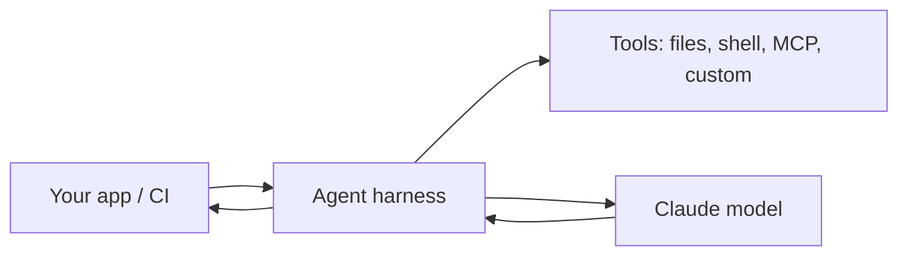

<LevelBadge level="advanced" />

<VerifyNote lastVerified="2026-07-17" source="https://code.claude.com/docs/en/agent-sdk/overview">
SDK-Namen, Paketnamen und Headless-Flags entwickeln sich weiter — bestätige sie in der offiziellen Dokumentation zum Claude Agent SDK bzw. zu Claude Code.
</VerifyNote>

Claude Code ist nicht nur interaktiv. Du kannst es **headless** ausführen (nicht interaktiv, skriptbar) und mit dem **Agent SDK** auf demselben zugrunde liegenden Harness **eigene Agenten** bauen.

<Callout type="objectives" items={["Wie du einen einzelnen Prompt nicht interaktiv ausführst und seine Ausgabe erfasst","Warum ein unbeaufsichtigter Lauf eine bewusste Berechtigungshaltung braucht und nicht den interaktiven Standard","Wann du einem One-Shot-Aufruf entwachsen bist und stattdessen zum Agent SDK greifen solltest","Die drei Modi nebeneinander, damit du bewusst wählst und nicht aus Gewohnheit"]} />

## Headless-Modus

Führe einen einzelnen Prompt nicht interaktiv aus und erfasse die Ausgabe — ideal für Skripte, Pre-Commit-Hooks und CI:

<PromptCard title="Den gestagten Diff aus einem Skript prüfen">
{`claude -p "Review the staged diff and list any bugs as a Markdown checklist"`}
</PromptCard>

Eingabe hineinleiten, Ergebnis herausbekommen. Kombiniere das mit [Berechtigungen](/docs/claude-code/permissions) in einer sicheren, nicht interaktiven Haltung, damit der Lauf nie auf eine Freigabe wartet und hängt — und **sperre ihn ab**, damit ein automatisierter Lauf keine Secrets anfassen kann (siehe [Autonome Läufe absichern](/docs/security/hardening-autonomous-runs)).

<Steps items={[
  {title: "Mit -p und einem engen Prompt beginnen", body: "Ein Prompt, eine Antwort, Ende. Alles, was ein Headless-Lauf braucht, ist ein Flag, denn es gibt keine Oberfläche, die dich etwas fragen könnte."},
  {title: "Die Berechtigungshaltung vorab festlegen", body: "Eine interaktive Sitzung fragt dich; ein CI-Job hat niemanden, den er fragen kann. Setze explizite Allow-Regeln für die Tools, die die Aufgabe wirklich braucht, und stelle sicher, dass eine unbeantwortbare Rückfrage den Lauf beendet, statt ihn festzuhalten."},
  {title: "Den Lauf begrenzen", body: "Begrenze die Züge und die Ausgaben, damit eine Schleife, die schiefläuft, Minuten und Cent kostet statt Stunden und Dollar."},
  {title: "Strukturierte Ausgabe anfordern", body: "Ein Skript, das Prosa parst, ist ein Skript, das kaputtgeht. Fordere JSON — oder ein Schema — an, damit das Ergebnis von vornherein maschinenlesbar ist."},
  {title: "Absichern, was er erreichen kann", body: "Secrets, Netzwerk und Schreibzugriff sind die drei Dinge, von denen ein unbeaufsichtigter Lauf am wenigsten haben sollte. Siehe Autonome Läufe absichern."}
]} />

Die genauen Flags für jeden Schritt — und die Fallen darin — stehen in [Die claude-CLI: Flags, die das Ergebnis verändern](/docs/claude-code/cli-flags). Ein klassischer Einsatz von alledem zusammen: ein CI-Job, in dem Claude jeden Pull Request prüft — siehe die [PR-Review-Anleitung](/docs/walkthroughs/pr-review-action).

## Das Agent SDK

Das **Claude Agent SDK** (Python und TypeScript) lässt dich produktive Agenten auf derselben Schleife bauen, die Claude Code antreibt — Tool-Nutzung, Datei-/Shell-Zugriff, Berechtigungen, Kontextverwaltung —, nur eingebunden in *deine* Anwendung.

Greife dazu, wenn du einem einzelnen API-Aufruf oder einer selbstgebauten Schleife entwachsen bist und eine Agenten-Laufzeit mit allem Drum und Dran willst. Für das Spektrum der Optionen — einzelner Aufruf → Workflow → eigener Agent → verwaltet — siehe [Agenten auf der API bauen](/docs/api/building-agents).

## Headless/SDK vs. interaktiv

| Modus | Wofür |
|---|---|
| Interaktives Claude Code | Alltägliche Entwicklung mit einem Menschen in der Schleife |
| Headless (`claude -p`) | Skripte, Pre-Commit, einmalige CI-Aufgaben |
| Agent SDK | Produktive Agenten, eingebettet in deine Software |

## Teste dich selbst

<Quiz questions={[
  {
    q: "Was ist der entscheidende Unterschied zwischen einem Headless-Lauf und einer interaktiven Sitzung?",
    options: [
      "Headless verwendet ein kleineres Modell",
      "Headless kann keine Tools nutzen",
      "Es gibt niemanden, der eine Rückfrage beantwortet, also muss die Berechtigungshaltung vorab festgelegt werden",
      "Headless-Läufe überspringen CLAUDE.md"
    ],
    answer: 2,
    explain: "Das Harness ist dasselbe. Was sich ändert: Jede Entscheidung, die eine interaktive Sitzung an dich weiterreichen würde, muss vor dem Start des Laufs per Konfiguration geklärt sein — deshalb braucht ein unbeaufsichtigter Lauf explizite Einstellungen für Berechtigungen, Züge und Ausgaben."
  },
  {
    q: "Du hast einen One-Shot-Aufruf `claude -p` in der CI und willst dieselbe Logik nun in dein eigenes Produkt einbetten, mit eigenen Tools und eigener Berechtigungsbehandlung. Wozu greifst du?",
    options: [
      "Ein längerer -p-Prompt",
      "Das Agent SDK, das dieselbe Schleife — Tool-Nutzung, Datei- und Shell-Zugriff, Berechtigungen, Kontextverwaltung — innerhalb deiner Anwendung bereitstellt",
      "Ein zweiter -p-Aufruf, der in den ersten hineingeleitet wird",
      "Die Messages API ohne Agentenschleife"
    ],
    answer: 1,
    explain: "Genau da verläuft die Grenze zwischen beiden. Ein One-Shot-Aufruf mit -p ist ein Skript, das eine CLI aufruft; das Agent SDK gibt dir dasselbe Harness als Laufzeit, die du einbettest und kontrollierst. Agenten auf der API bauen zeigt das ganze Spektrum."
  }
]} />

<Callout type="takeaways" items={["Headless ist dasselbe Harness ohne den Menschen — alles, was der Mensch entschieden hätte, wird also zu Konfiguration.","Berechtigungen eng fassen, Züge und Ausgaben begrenzen und strukturierte Ausgabe anfordern. Alle vier sind Flags, keine Konventionen.","Wechsle zum Agent SDK, wenn du die Schleife in deiner eigenen Anwendung haben willst statt eines CLI-Aufrufs aus einem Skript.","Ein unbeaufsichtigter Lauf ist ebenso sehr eine Sicherheitshaltung wie ein Feature: Sichere ab, was er erreichen kann, bevor du ihn einplanst."]} />

## Weiter

- [Agent-SDK-Berechtigungen: die Reihenfolge in sechs Schritten](/docs/claude-code/agent-sdk-permissions) — das Erste, was du richtig machen musst, sobald die Schleife in deiner eigenen App läuft
- [Die claude-CLI: Flags, die das Ergebnis verändern](/docs/claude-code/cli-flags) — der Fünf-Flag-Vertrag für einen unbeaufsichtigten Lauf
- [GitHub Action, die jeden PR prüft (Anleitung)](/docs/walkthroughs/pr-review-action)
- [Agenten auf der API bauen](/docs/api/building-agents)
- [Autonome Läufe absichern](/docs/security/hardening-autonomous-runs)
