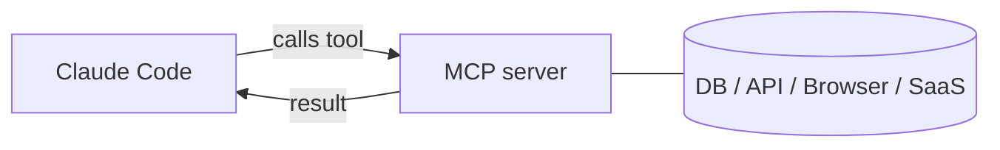

<LevelBadge level="advanced" />

<VerifyNote lastVerified="2026-11-10" source="https://code.claude.com/docs/en/mcp">
Die `claude mcp`-Befehle, Konfigurations-Scopes und Transporte entwickeln sich weiter — prüfe sie in der offiziellen Claude-Code-MCP-Dokumentation und auf modelcontextprotocol.io. Die vier Transporte, die Speicherpfade der Scopes, die Ablösung von SSE und das Verhalten bei der Projektfreigabe weiter unten stammen alle von dieser Seite.
</VerifyNote>

Das **Model Context Protocol (MCP)** ist ein offener Standard, um KI mit externen Werkzeugen und Daten zu verbinden. Ein **MCP-Server** stellt Fähigkeiten bereit (eine Datenbank abfragen, einen GitHub-PR öffnen, einen Browser steuern); Claude Code verbindet sich mit ihm und kann **diese Werkzeuge** während einer Sitzung **aufrufen**. So erweiterst du Claude über dein Dateisystem und deine Shell hinaus.

<Callout type="objectives" items={["Erklären, was ein MCP-Server ist und wie Claude Code seine Werkzeuge aufruft", "Die beiden Transporte unterscheiden: lokales stdio und entferntes HTTP/SSE", "Mit claude mcp add einen Server hinzufügen und das geschriebene JSON lesen", "Den richtigen Scope (local, project, user) danach wählen, wer einen Server sehen soll", "Eine echte Datenbank Ende zu Ende mit Claude verbinden", "Die Sicherheits- und Konfigurationsfallen vermeiden, in die die meisten tappen"]} />

## Das Grundprinzip



Du deklarierst die Server, die Claude nutzen darf; jeder Server veröffentlicht eine Reihe von Werkzeugen mit Schemata; Claude wählt sie aus und ruft sie auf wie jedes andere Werkzeug.

<Flashcards title="MCP-Vokabular" cards={[{front: "Model Context Protocol (MCP)", back: "Ein offener Standard, um KI mit externen Werkzeugen und Daten zu verbinden."}, {front: "MCP-Server", back: "Ein Programm, das Fähigkeiten — eine Datenbank abfragen, einen GitHub-PR öffnen, einen Browser steuern — als aufrufbare Werkzeuge bereitstellt."}, {front: "Werkzeug (Tool)", back: "Eine Fähigkeit, die ein MCP-Server mit einem Schema veröffentlicht; Claude wählt sie aus und ruft sie auf wie jedes andere Werkzeug."}, {front: "Transport", back: "Wie Claude einen Server erreicht: stdio (lokaler Prozess), HTTP (gehostet, oft mit OAuth), SSE (veraltet — HTTP fällt automatisch darauf zurück) oder WebSocket ws/wss (dauerhaft, mit Push, nur Header-Authentifizierung, kein --transport-Flag)."}, {front: "Scope", back: "Wer einen Server sieht: local (du, dieses Projekt), project (das Team über den Commit) oder user (du, überall)."}]} />

## Transporte

Es gibt vier Wege, wie Claude einen Server erreicht. Wähle danach, wo der Server läuft und wie er kommuniziert.

- **stdio** — ein lokaler Prozess, den Claude startet (ideal für lokale Werkzeuge/CLIs). Das bedeutet ein JSON-Eintrag ohne `type`.
- **HTTP** — ein gehosteter Server, oft mit OAuth. Die Standardwahl für alles Entfernte.
- **SSE** — **veraltet**; nutze HTTP, wo es geht. Manche Dienste bieten noch nur einen SSE-Endpunkt an, und ab Claude Code v2.1.265 versucht `--transport http` zuerst HTTP und wechselt von selbst zu SSE, sodass du `--transport sse` selten ausdrücklich brauchst.
- **WebSocket** (`ws` / `wss`) — eine dauerhafte bidirektionale Verbindung, für einen Server, der unaufgefordert Ereignisse pusht. `--transport` akzeptiert `ws` *nicht*: Füge ihn mit `claude mcp add-json '{"type":"ws","url":"wss://…"}'` hinzu oder schreibe ihn in `.mcp.json`. Kein OAuth — die Authentifizierung läuft ausschließlich über Header.

<Callout type="warning" items={["Ein JSON-Eintrag mit url, aber ohne type ist ein Konfigurationsfehler und kein sinnvoller Standard: Claude Code liest einen Eintrag ohne type als stdio-Server, überspringt ihn und meldet, dass er eine „url“ hat, aber keinen „type“. Setze bei einem entfernten Server, den du von Hand schreibst, immer \"type\": \"http\" (oder \"sse\" / \"ws\")."]} />

## Server konfigurieren

Der schnellste Weg ist der Befehl `claude mcp add` — er schreibt die Konfiguration für dich. Folge dieser Abfolge, um von null zu einem verbundenen Server zu kommen.

<Steps items={[{title: "Einen lokalen stdio-Server hinzufügen", body: "Führe claude mcp add aus — alles nach dem -- ist der Startbefehl, den Claude für dich ausführt."}, {title: "Oder einen entfernten HTTP-Server hinzufügen", body: "Übergib --transport http und einen Scope, dann die Server-URL. Entfernte Server sind oft gehostet und nutzen OAuth."}, {title: "Sehen, was verbunden ist", body: "Führe claude mcp list aus, um die konfigurierten Server und ihren Verbindungsstatus zu sehen."}, {title: "Prüfen und authentifizieren", body: "Nutze /mcp in einer Sitzung, um die Werkzeuge eines Servers zu prüfen und entfernte Server zu authentifizieren."}]} />

<PromptCard title="Einen lokalen stdio-Server hinzufügen">{`# A local stdio server (everything after -- is the launch command)
claude mcp add filesystem -- npx -y @modelcontextprotocol/server-filesystem ~/code/myproject`}</PromptCard>

<PromptCard title="Einen entfernten HTTP-Server hinzufügen (mit dem Projekt geteilt)">{`# A remote HTTP server, shared with everyone on the project
claude mcp add --transport http --scope project github https://api.githubcopilot.com/mcp/`}</PromptCard>

Im Kern ist das nur JSON. Ein Server mit Scope **project** landet in einer `.mcp.json` im Repo-Stamm — committe sie, und deine Teammitglieder bekommen dieselben Werkzeuge, sobald sie dem Arbeitsbereich vertrauen:

```json
{
  "mcpServers": {
    "github": { "type": "http", "url": "https://api.githubcopilot.com/mcp/" }
  }
}
```

<Callout type="warning" items={["Greife nicht zu den Paketen @modelcontextprotocol/server-github, -postgres, -slack oder -puppeteer, die du in alten Tutorials findest. Sie sind archiviert und tragen einen npm-Deprecation-Hinweis mit dem Wortlaut „Archived and unmaintained; no security guarantees“. Nutze den Server des Anbieters selbst, wo es einen gibt — der von GitHub ist der HTTP-Endpunkt oben, und die Browsersteuerung ist zu @playwright/mcp umgezogen. Von den TypeScript-Referenzservern werden nur noch filesystem, memory, everything und sequential-thinking gepflegt."]} />

### Der Scope entscheidet, wer den Server sieht

| Scope | Gespeichert in | Geladen in | Verwende ihn für |
|---|---|---|---|
| `local` (Standard) | `~/.claude.json`, unter dem Pfad dieses Projekts | nur in diesem Projekt | persönliche Experimente, Secrets |
| `project` | `.mcp.json` im Repo (committet) | nur in diesem Projekt, mit dem Team geteilt | Werkzeuge, die das ganze Team teilen soll |
| `user` | `~/.claude.json` | in all deinen Projekten | Server, die du überall willst |

<Callout type="warning" items={["Der „local scope“ von MCP ist nicht dasselbe wie die lokalen Einstellungen. Ein MCP-Server mit Scope local liegt in ~/.claude.json in deinem Home-Verzeichnis — NICHT in der .claude/settings.local.json des Projekts. Im Projektordner danach zu suchen, führt ins Leere."]} />

Führe `claude mcp list` aus, um zu sehen, was verbunden ist, und `/mcp` in einer Sitzung, um Werkzeuge zu prüfen und entfernte Server zu authentifizieren. Startvorlagen zum Kopieren findest du unter [MCP-Konfiguration und Server-Gerüste](/docs/templates/mcp-config).

## Praxisbeispiel: Gib Claude deine Datenbank

Angenommen, Claude soll Fragen gegen eine lokale Postgres-Instanz beantworten, statt dass du Abfrageergebnisse einfügst. Füge den Server mit Scope project hinzu, damit ihn auch Teammitglieder bekommen.

Bei Datenbanken schlägt das Problem der archivierten Server am stärksten zu: Das alte `@modelcontextprotocol/server-postgres` wird nicht mehr gepflegt und es gibt keinen offiziellen Ersatz, also ist der Paketname hier die eine Entscheidung, die du selbst treffen musst. Wähle einen gepflegten Community-Server, [prüfe ihn](/docs/security/reviewing-third-party-code) und binde ihn dann ein — die Form ist dieselbe, für welchen du dich auch entscheidest:

<PromptCard title="Einen Postgres-Server mit Scope project hinzufügen">{`# Replace the package with a maintained Postgres MCP server you have reviewed.
# The connection string is read-only on purpose — see below.
claude mcp add --scope project db -- npx -y <postgres-mcp-server> "postgresql://readonly@localhost/app"`}</PromptCard>

Jetzt kannst du in einer Sitzung die Frage in normaler Sprache stellen und Claude die Abfrageschleife für dich erledigen lassen:

<PromptCard title="Der Datenbank eine Frage stellen">{`How many users signed up last week? Check the DB.`}</PromptCard>

Claude ruft das Abfragewerkzeug auf, das der Server bereitstellt, bekommt Zeilen zurück und antwortet — ohne Copy-and-paste-Schleife. Lass den Verbindungsstring schreibgeschützt, solange Claude nicht wirklich schreiben muss. Und wenn du eigentlich nur eine einzige Abfrage brauchst: `psql -c '…'` über Bash kostet nur einen Bruchteil der Tokens; [Die MCP-Token-Steuer](/docs/claude-code/mcp-token-cost) erklärt, wann welcher Weg gewinnt.

Weil der Server project-Scope hat, bekommt ein Teammitglied, das das Repo zieht, dieselbe Fähigkeit — aber **nicht stillschweigend und nicht sofort**. Ein Server aus einer committeten `.mcp.json` bleibt auf `⏸ Pending approval`, bis das Teammitglied `claude` im Ordner ausführt und den Dialog zum Vertrauen in den Arbeitsbereich bestätigt. Ein geklontes Repo kann seine eigenen Server nicht vorab freigeben: `enableAllProjectMcpServers` oder `enabledMcpjsonServers` in der committeten `.claude/settings.json` des Projekts werden in einem nicht vertrauenswürdigen Ordner *ignoriert*. Freigaben aus einer `~/.claude/settings.json` auf Benutzerebene, aus verwalteten Einstellungen oder per `--settings` übergeben gelten dort dagegen. Das ist die übliche Antwort auf „Warum sieht mein Teammitglied den Server nicht?“

## Vertrauen und Sicherheit

<Callout type="warning" items={["Ein MCP-Server führt Code aus und kann Daten lesen und Aktionen ausführen — verbinde nur Server, denen du vertraust.", "Gib jedem Server die geringsten Rechte, die er braucht.", "Jeder externe Inhalt, den ein Server zurückgibt, kann Prompt-Injection enthalten.", "Prüfe Server von Drittanbietern, bevor du sie verbindest."]} />

:::warning[Behandle MCP-Server wie die Installation von Software]
Ein MCP-Server führt Code aus und kann Daten lesen und Aktionen ausführen. Verbinde nur Server, denen du vertraust, gib ihnen die **geringsten nötigen Rechte** und denke daran, dass jeder externe Inhalt, den sie zurückgeben, [Prompt-Injection](/docs/security/prompt-injection) enthalten kann. Prüfe Server von Drittanbietern zuerst — siehe [Code von Drittanbietern prüfen](/docs/security/reviewing-third-party-code).
:::

## MCP auch in den Apps

MCP treibt auch die **Konnektoren** in den Claude-Apps an — derselbe Standard, andere Oberfläche. Siehe [Konnektoren (MCP) in den Apps](/docs/claude-app/connectors) und für die API [MCP und die Anbindung von Werkzeugen](/docs/api/mcp).

## Häufige Fehler

- **Falscher Scope.** Ein Server mit Scope `local` erscheint bei Teammitgliedern nicht; einer, den du nur für dich wolltest, gehört nicht mit Scope `project` in den Commit. Wähle bewusst.
- **Zu viele Server, zu viele Werkzeuge.** Die Tool-Suche ist standardmäßig aktiv, daher kostet ein verbundener Server normalerweise pro Runde nur die *Namen* seiner Werkzeuge und die Server-Anweisungen statt der vollständigen Schemata — das ist aber trotzdem eine Steuer pro Runde, und die Schemata landen im Kontext, sobald Claude danach sucht. Verbinde, was die Aufgabe braucht, nicht deinen ganzen Katalog. Siehe [Die MCP-Token-Steuer](/docs/claude-code/mcp-token-cost) für die echten Zahlen, die `ENABLE_TOOL_SEARCH`-Modi und dafür, wie Codeausführung die zweite Kostenart senkt.
- **Überprivilegierte Verbindungen.** Gib einem Datenbankserver eine schreibgeschützte Rolle, solange Claude nicht wirklich schreiben muss. MCP macht Fähigkeiten real — begrenze sie.
- **Das Injection-Risiko vergessen.** Alles, was ein Server zurückgibt (eine Webseite, der Text eines Issues, eine Zeile), ist nicht vertrauenswürdiger Text, der [Prompt-Injection](/docs/security/prompt-injection) enthalten kann. Verdrahte keinen mächtigen Server mit Schreibzugriff neben einem nicht vertrauenswürdigen mit Lesezugriff, ohne es gründlich durchdacht zu haben.

<Quiz title="Teste dich selbst" questions={[{q: "Welcher Transport ist ein lokaler Prozess, den Claude selbst startet?", options: ["Entferntes HTTP/SSE", "stdio", "OAuth"], answer: 1, explain: "stdio ist ein lokaler Prozess, den Claude startet — ideal für lokale Werkzeuge und CLIs. Die anderen drei sind entfernt: HTTP (oft mit OAuth), das veraltete SSE und WebSocket."}, {q: "Wohin wird ein Server mit Scope project geschrieben, und was muss ein Teammitglied tun?", options: ["In deine Benutzereinstellungen; nur du siehst ihn", "In eine .mcp.json im Repo-Stamm; nach dem Pull muss das Teammitglied dem Arbeitsbereich noch vertrauen, damit der Server Pending approval verlässt", "In einen versteckten globalen Cache; niemand kann ihn bearbeiten"], answer: 1, explain: "Der Scope project landet in einer committeten .mcp.json im Repo-Stamm. Aber ein geklontes Repo kann seine eigenen Server nicht freigeben — ein committetes enableAllProjectMcpServers wird in einem nicht vertrauenswürdigen Ordner ignoriert, sodass der Server auf Pending approval wartet, bis das Teammitglied den Vertrauensdialog für den Arbeitsbereich bestätigt."}, {q: "Warum eine Datenbankverbindung schreibgeschützt lassen, wenn Claude nur lesen muss?", options: ["Abfragen laufen dadurch schneller", "Geringste Rechte — MCP macht Fähigkeiten real, also gib keinen Schreibzugriff, wenn er nicht wirklich nötig ist", "Das Protokoll schreibt Nur-Lesen vor"], answer: 1, explain: "Gib Servern die geringsten Rechte, die sie brauchen. MCP macht Fähigkeiten real, daher vermeidet eine schreibgeschützte Rolle unbeabsichtigte Schreibzugriffe."}]} />

<Callout type="takeaways" items={["MCP ist ein offener Standard; ein MCP-Server stellt Werkzeuge bereit, die Claude Code wie jedes andere Werkzeug aufruft.", "Vier Transporte: stdio (ein Prozess, den Claude startet), HTTP (der Standard für Entferntes), SSE (veraltet — HTTP wechselt von selbst darauf) und WebSocket ws/wss (Push, Header-Authentifizierung, nur über add-json).", "claude mcp add schreibt die Konfiguration für dich; im Kern ist es JSON. Der Scope project liegt in einer committeten .mcp.json, und die Kopie eines Teammitglieds bleibt auf Pending approval, bis es dem Arbeitsbereich vertraut.", "Der Scope steuert die Sichtbarkeit: local (du, dieses Projekt), project (für das Team committet), user (du, überall).", "Behandle Server wie die Installation von Software: Vertrauen, geringste Rechte und Wachsamkeit gegenüber Prompt-Injection in allem, was sie zurückgeben."]} />

## Weiter

- [Deinen ersten MCP-Server bauen und anbinden (Schritt-für-Schritt)](/docs/walkthroughs/first-mcp-server)
- [MCP-Konfiguration und Server-Gerüste](/docs/templates/mcp-config)
- [Agenten und Werkzeuge absichern](/docs/security/securing-agents)
