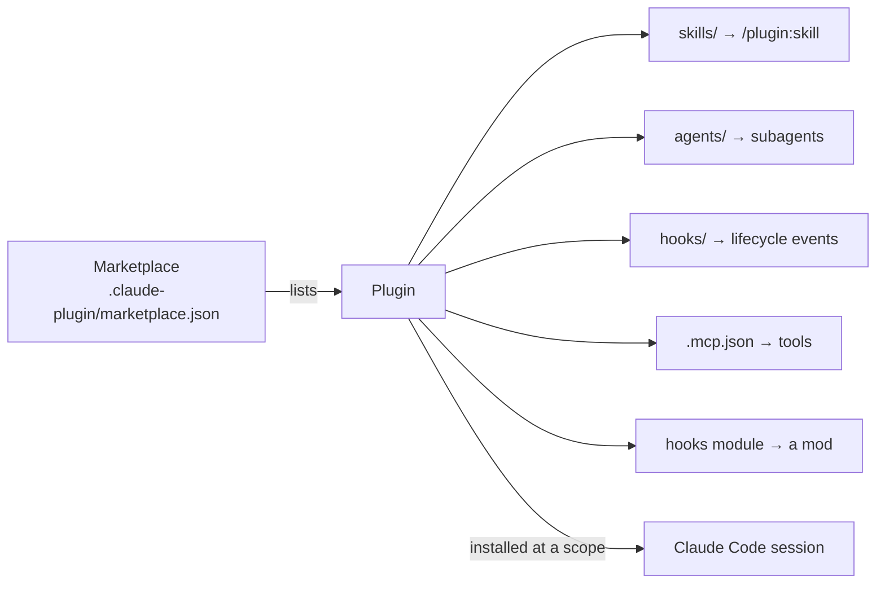

<LevelBadge level="intermediate" />

<Callout type="objectives" items={[
  "Entscheiden, ob du wirklich ein Plugin brauchst oder ob ein eigenständiger Skill, Hook oder MCP-Server genügt",
  "Dein erstes Plugin installieren und aus der Installationszusammenfassung erkennen, ob es in dieser Sitzung nutzbar ist oder einen Reload braucht",
  "Den richtigen von drei Installationsbereichen wählen — Benutzer, Projekt, lokal — und wissen, welcher welchen überschreibt",
  "Die Vertrauensstufe eines Marketplace lesen, bevor du ihm vertraust, und verstehen, warum sich die offiziellen und Community-Namen nicht fälschen lassen",
  "Die dauerhaften Kontextkosten einplanen, die jedes aktivierte Plugin bei jedem Zug berechnet, und die Plugins finden, die du nicht mehr benutzt",
  "Den gesamten Lebenszyklus aus deiner Shell durchlaufen: Marketplace hinzufügen, installieren, aktivieren, deaktivieren, aktualisieren, deinstallieren, aufräumen",
  "Ein eigenes Plugin entwickeln, ohne etwas zu veröffentlichen, mit --plugin-dir",
]} />

<VerifyNote lastVerified="2026-10-26" source="https://code.claude.com/docs/en/plugins">
Geprüft gegen die offiziellen Seiten [Plugins overview](https://code.claude.com/docs/en/plugins) und [Install and manage plugins](https://code.claude.com/docs/en/plugins/install). Zwei der Befehle hier haben Versionsuntergrenzen: `/plugin install <plugin> --marketplace <source>` braucht Claude Code v2.1.275+, das Shell-Äquivalent braucht v2.1.292+. Plugin-Struktur und Marketplace-Mechanik entwickeln sich noch schnell — bestätige Einzelheiten in der offiziellen Dokumentation, bevor du eine Verteilung darauf aufbaust.
</VerifyNote>

Ein **Plugin** bündelt mehrere Anpassungen — [Skills](/docs/claude-code/skills), [Subagents](/docs/claude-code/subagents), [Slash-Befehle](/docs/claude-code/slash-commands), [Hooks](/docs/claude-code/hooks), [MCP-Server](/docs/claude-code/mcp) und eine [**Mod**](/docs/claude-code/mods) (als JavaScript geschriebene Hooks, die auch Panes zeichnen und Befehle hinzufügen können) — zu einer einzigen, versionierten, installierbaren Einheit. Ein **Marketplace** ist ein Katalog, der Plugins auflistet und angibt, wo man jedes abruft. Er ist ein Katalog, kein gehosteter Store: Die Plugins liegen dort, wo ihre Autoren sie hingelegt haben.

## Brauchst du überhaupt ein Plugin?

Fang hier an, denn die Antwort ist oft nein. Skills, Subagents, Hooks und MCP-Server funktionieren für sich allein einwandfrei — eine `SKILL.md` in `~/.claude/skills/` steht in jedem Projekt auf deiner Maschine ganz ohne Paketierung zur Verfügung.

Greife zu einem Plugin, wenn **eine dieser drei Bedingungen zutrifft**:

- Du willst mehrere Komponenten als **eine Einheit** paketieren, mit einem Installationsschritt und einer Versionsnummer.
- Du willst das Setup **eines anderen**, mit Updates aus dessen Marketplace.
- Du willst dein Setup Teammitgliedern **geben**, über viele Projekte hinweg installieren oder versionierte Releases veröffentlichen.

Alles andere ist ein Skill oder ein Hook und sollte das bleiben.

## Das, wovor dich niemand warnt: Ein aktiviertes Plugin ist immer an

Das ist das Wichtigste, was du verinnerlichen solltest, bevor du fünf Plugins installierst, weil sie nützlich aussahen.

**Ein aktiviertes Plugin ist Teil jeder Sitzung, nicht nur der Sitzungen, in denen du es benutzt.** Für jeden Skill, Agent und Befehl, den Claude von sich aus aufrufen kann, stehen *Name und Beschreibung* bei **jedem Zug** in Claudes Kontext, damit Claude weiß, dass es das gibt. Diese Tokens zählen zu deiner Nutzung und verkleinern das [Kontextfenster](/docs/claude-code/context-management), selbst in Sitzungen, in denen nie etwas aus dem Plugin ausgelöst wird. Nur der volle Text lädt bei Nutzung.

Seine MCP-Server laufen außerdem neben jeder Sitzung, in der es aktiviert ist, und seine Hooks feuern bei ihren Ereignissen. Und alles, was es ausführt, führt es **als du** aus.

Plane es also ein. Es gibt drei Momente, den Fußabdruck zu prüfen:

<Steps items={[
  {title: "Vor der Installation", body: "Öffne das Plugin über den Namen seines Marketplace — /plugin install <plugin>@<marketplace> oder den Reiter Marketplaces. Plugins im offiziellen Marketplace von Anthropic zeigen dort eine Schätzung der Kontextkosten, aufgeteilt in Every turn und When invoked. Das Detailfenster, das du aus der Discover-Liste erreichst, zeigt diese Zahlen nicht."},
  {title: "Nach der Installation", body: "Führe in deiner Shell claude plugin details <name> aus. Die Zeile Always-on ist die Token-Zahl, die das Plugin zu jeder Sitzung hinzufügt, in der es aktiviert ist, und die Zeilen pro Komponente zeigen, welcher Skill oder Agent der teure ist."},
  {title: "Regelmäßig, zum Aufräumen", body: "Der Reiter Installed in /plugin gruppiert Plugins, die du länger nicht benutzt hast, unter der Überschrift Not used recently, und die Details jedes Plugins enthalten eine Zeile Last used. Diese berechnen dir weiter bei jedem Zug Kontext. Deaktiviere oder deinstalliere sie."},
]} />

Halte jedes Plugin aus demselben Grund **in sich stimmig** — ein Plugin „Team-Konventionen“, ein Plugin „Python-Toolkit“ — statt eines Sammelsuriums, dessen Beschreibungsliste du ständig mitbezahlst. Die passende Lektüre ist [MCP-Token-Kosten](/docs/claude-code/mcp-token-cost), dieselbe Rechnung angewandt auf Tool-Definitionen.

## Eines installieren

Der offizielle Marketplace von Anthropic, `claude-plugins-official`, wird dir beim ersten Start einer interaktiven Terminalsitzung automatisch hinzugefügt (sofern keine verwaltete Richtlinie ihn blockiert). Die Installation daraus überspringt also den Schritt „Marketplace hinzufügen“ ganz.

<PromptCard title="Die Details eines Plugins zur Prüfung öffnen">{`/plugin install commit-commands@claude-plugins-official`}</PromptCard>

Innerhalb einer Sitzung **installiert dieser Befehl nicht sofort** — er öffnet das Panel `/plugin` auf den Details dieses Plugins, damit du lesen kannst, was es hinzufügt, und zuerst einen Bereich wählst. Ein bloßes `/plugin` öffnet stattdessen den Reiter **Discover**, der Plugins aus all deinen Marketplaces auflistet und dich tippend suchen lässt.

Das Detailfenster ist der Prüfschritt. Lies die Liste **Will install** — die Befehle, Agents, Skills, Hooks sowie MCP- und LSP-Server, die du gleich einschaltest. Plugins aus einem lokalen oder benutzerdefinierten Marketplace zeigen unter Umständen stattdessen `Components will be discovered at installation`, was bedeutet, dass du den Inhalt ungesehen akzeptierst.

Dann wähle einen Bereich und lies den letzten Satz der Installationszusammenfassung, denn er sagt dir, ob überhaupt etwas passiert ist:

| Die Zusammenfassung endet mit | Was es bedeutet |
| :--- | :--- |
| `Plugin is now active.` | Sofort nutzbar. Kein Reload. |
| `Plugin is now active.` + `Its bundled MCP server needs configuration before it can start` | Wähle das Plugin im Reiter **Installed** und dann **Configure**, um die Optionen des Servers zu setzen. |
| `Run /reload-plugins to apply.` | Claude Code führt den Reload für dich aus — es sei denn, er würde den Prompt-Cache ungültig machen; dann warnt es und lässt das Plugin ausstehend. `/reload-plugins --force` aktiviert es trotzdem, zum Preis einer nicht gecachten Anfrage. |
| `The plugin couldn't be loaded` | Öffne den Reiter **Errors** in `/plugin` für den Grund. |

Prüfe, ob es geklappt hat, indem du `/` tippst und nach den Skills des Plugins unter seinem Namensraum suchst: `/commit-commands:commit`. Oder führe in deiner Shell `claude plugin list` aus, das jedes Plugin mit `Version`, `Scope` und `Status` ausgibt.

### Die drei Bereiche, und welcher gewinnt

Der Bereich entscheidet, **wer** das Plugin bekommt und **welche Einstellungsdatei** es als aktiviert vermerkt. Hier einen Fehler zu machen, ist der Weg, auf dem ein Plugin versehentlich für dein ganzes Team aktiviert wird.

| Bereich | Wer es bekommt | Geschrieben nach |
| :--- | :--- | :--- |
| **Benutzer** | Du, in jedem Projekt auf dieser Maschine | `enabledPlugins` in `~/.claude/settings.json` |
| **Projekt** | Alle, die in diesem Repository arbeiten | `.claude/settings.json` — die du eincheckst |
| **Lokal** | Du, nur in diesem Repository | `.claude/settings.local.json` |

**Vorrang, wenn dasselbe Plugin in mehreren Bereichen gesetzt ist: lokal überschreibt Projekt, Projekt überschreibt Benutzer.**

Die Falle beim Projektbereich verdient eine klare Aussage: **Den Eintrag einzuchecken schaltet das Plugin für deine Mitarbeitenden ein, lädt es aber nicht auf deren Maschinen herunter.** Jeder Mitarbeitende führt die Installation weiterhin einmal selbst aus:

<PromptCard title="Ein Mitarbeitender übernimmt ein Plugin im Projektbereich">{`claude plugin install formatter@your-org --scope project`}</PromptCard>

Zwei verwandte Verhaltensweisen: Manche Plugins werden von ihrem Autor mit `defaultEnabled` auf aus ausgeliefert, sie installieren sich also, bleiben aber dunkel, bis du `claude plugin enable <name>` ausführst. Und wenn du ein Plugin **deinstallierst**, das die `.claude/settings.json` des Repositories aktiviert, fragt Claude Code, was du meintest — **y** schreibt für dich `false` in `.claude/settings.local.json` und lässt es für alle anderen installiert; **u** entfernt es aus den geteilten Einstellungen für das ganze Team.

Das Terminal, die lokalen Sitzungen der Desktop-App und die VS-Code-Erweiterung auf einer Maschine lesen dieselben Einstellungsdateien, sodass eine Installation im Benutzerbereich in einem von ihnen auch in den beiden anderen auftaucht.

### Wohin Plugins nicht gelangen

Zwei blinde Flecken, die echte Verwirrung stiften:

- **[Cloud-Sitzungen](/docs/claude-code/cloud-sessions) laden nichts davon.** Eine Cloud-Sitzung, auch claude.ai/code, hat keinen Plugin-Browser und lädt weder die Plugins auf deiner Maschine noch die, die die `.claude/settings.json` deines Repositories einschaltet. Nur Plugins, die deine Organisation über verwaltete Einstellungen verteilt, kommen an. Hängt ein Workflow von Plugin-Befehlen ab, verhält er sich in der Cloud anders.
- **`claude -p` und andere nicht interaktive Läufe** können `/plugin` nicht öffnen — Claude antwortet `/plugin isn't available in this environment.` Bereits installierte Plugins laden. Verwalte sie stattdessen aus deiner Shell.

## Vertrauen: die drei Marketplace-Stufen

Ein Marketplace ist ein Repository oder Verzeichnis, das eine Datei `.claude-plugin/marketplace.json` enthält. Jeder kann einen veröffentlichen. Ein Plugin, das du installierst, kann Code mit deinen Benutzerrechten ausführen, egal welche Quelle es hat.

Der **Name** eines Marketplace ordnet ihn einer von drei Stufen zu, und die ersten beiden lassen sich nicht fälschen: **Claude Code akzeptiert die offiziellen und die Community-Namen von Anthropic nur für Marketplaces, die aus `github.com/anthropics/`-Repositories stammen.**

| Stufe | Beispiele | Was sie dir sagt |
| :--- | :--- | :--- |
| **Offiziell** | `claude-plugins-official`, der Demo-Marketplace `claude-code-plugins` | Der Name ist Anthropic-eigenen Repos vorbehalten. Auto-Update standardmäßig an (mit zwei Ausnahmen). |
| **Community** | `claude-community` und die anderen Community-Namen von Anthropic | Ebenfalls Anthropic-eigenen Repos vorbehalten, aber von der Community beigesteuerte Inhalte. Auto-Update standardmäßig **aus**. |
| **Drittanbieter** | Alles andere — auch der deines Kollegen und der deiner eigenen Organisation | Keine Namensgarantie. Auto-Update standardmäßig aus. |

:::warning[Plugins können ausführbaren Code mitliefern]
Hooks und MCP-Server in einem Plugin laufen mit deinen Rechten, in jeder Sitzung, in der das Plugin aktiviert ist. Installiere nur aus Quellen, denen du vertraust, und lies das Fenster **Will install**, bevor du akzeptierst. Siehe [Drittanbieter-Code prüfen](/docs/security/reviewing-third-party-code) und [Agent-Skills prüfen](/docs/security/vetting-agent-skills).
:::

Beachte auch, was ein Plugin-Marketplace *nicht* ist: [claude.com/marketplace](https://claude.com/marketplace) ist eine Website zum Durchstöbern von Plugins, Connectors und Partnern. Er lässt sich nicht mit `/plugin marketplace add` hinzufügen.

### Einen Marketplace hinzufügen

Du fügst einen Marketplace einmal hinzu; danach erscheinen seine Plugins unter **Discover** und lassen sich per Name installieren. Vier Quellformen:

| Quelle | Was du tippst |
| :--- | :--- |
| GitHub-Repository | `owner/repo`, optional `owner/repo#ref`, um einen Branch oder Tag festzunageln |
| Beliebiger Git-Host | Die vollständige Klon-URL, optional mit `#ref` |
| Lokales Verzeichnis oder lokale Datei | Ein Pfad zu einem Verzeichnis mit `.claude-plugin/marketplace.json` oder zur JSON-Datei selbst — **relative Pfade mit `./` beginnen** |
| Gehostetes JSON | Eine `https://`-URL auf eine `marketplace.json` |

<PromptCard title="Einen Marketplace hinzufügen, auf vier Arten">{`/plugin marketplace add anthropics/claude-code
/plugin marketplace add your-org/plugins#v1.2.0
/plugin marketplace add ./my-marketplace
/plugin marketplace add https://example.com/marketplace.json`}</PromptCard>

In dieser Tabelle stecken zwei Parsing-Fallen. Ein bloßer Pfad wie `name/name` wird als **GitHub-`owner/repo`-Kurzschreibweise** gelesen, ein lokaler Pfad muss also mit `./` oder `../` beginnen. Und ein bloßes `gitlab.example.com/group/repo.git` wird genauso gelesen und abgelehnt — nimm das Präfix `https://` dazu oder verwende die SSH-Form `git@host:path`. (`/plugin market` ist eine gültige Kurzform von `/plugin marketplace`.)

Für ein Plugin aus einem Marketplace, den du noch nicht hinzugefügt hast, erledige beides in einem Befehl — beachte, dass der Plugin-Name **ohne** Suffix `@marketplace` angegeben wird:

<PromptCard title="Den Marketplace hinzufügen und in einem Schritt installieren">{`# in a session (v2.1.275+); asks you to confirm the resolved source
/plugin install deploy-helper --marketplace your-org/plugins

# from your shell (v2.1.292+); no confirmation step
claude plugin install deploy-helper --marketplace your-org/plugins`}</PromptCard>

**Private Marketplaces** funktionieren mit demselben Befehl, geklont mit den Git-Zugangsdaten, die schon auf deiner Maschine liegen — und Claude Code **fragt nie nach**. Das macht die Anforderungen streng: Über HTTPS müssen deine Credential-Helper bereits funktionieren (`gh auth login`, der macOS-Schlüsselbund, `git-credential-store`), weil die Prompts und Askpass-Programme von Git deaktiviert sind; über SSH muss der Host bereits in `known_hosts` stehen und der Schlüssel darf keine Passphrase brauchen. Setze `CLAUDE_CODE_PLUGIN_PREFER_HTTPS=1`, um die SSH-Prüfung bei der GitHub-Kurzschreibweise zu überspringen und immer per HTTPS zu klonen.

Ein Entfernungsverhalten, das du vor dem Ausführen kennen solltest: **Einen Marketplace zu entfernen deinstalliert jedes Plugin, das du daraus installiert hast**, und entfernt deren `enabledPlugins`-Einträge aus deinen Einstellungen. Der Reiter **Marketplaces** nennt sie, bevor er dich um Bestätigung bittet.

## Der gesamte Lebenszyklus aus deiner Shell

Alles, was das Panel `/plugin` tut, tut `claude plugin` nicht interaktiv — genau das, was du in einem Setup-Skript oder einem Dotfiles-Repo willst. Die Standardbereiche unterscheiden sich je nach Verb: `enable` und `disable` wirken auf den **spezifischsten Bereich, der das Plugin bereits auflistet**, während `install` und `uninstall` standardmäßig den Bereich **Benutzer** verwenden.

<PromptCard title="Die acht Befehle, die alles abdecken">{`claude plugin marketplace add anthropics/claude-plugins-official
claude plugin install formatter@your-org --scope project
claude plugin list
claude plugin details formatter@your-org     # always-on token cost
claude plugin disable formatter@your-org
claude plugin enable formatter@your-org
claude plugin update formatter@your-org
claude plugin uninstall formatter@your-org --scope project`}</PromptCard>

Vier Anmerkungen, die dir eine Debugging-Sitzung ersparen:

- **Auf einer frischen Maschine ist der offizielle Marketplace noch nicht registriert**, weil niemand eine interaktive Sitzung geöffnet hat. Ein Provisionierungs-Skript muss `claude plugin marketplace add anthropics/claude-plugins-official` ausführen, bevor es daraus installiert.
- **Manche Plugins installieren sich, indem sie einen Befehl ausführen**, den ihr Marketplace nennt. Claude Code zeigt ihn an und bittet dich um Zustimmung — ein Skript hat niemanden, der antwortet, also übergib `--yes`.
- **Aus der Shell installierte Plugins laden beim nächsten Start** oder wenn du in einer offenen Sitzung `/reload-plugins` ausführst.
- **Es gibt keinen Befehl „alle aktualisieren“.** `claude plugin update` nimmt ein Plugin. Für Stapel nutze **Update marketplace** im Reiter **Marketplaces**, das die Auflistung auffrischt und die daraus installierten Plugins aktualisiert. `claude plugin marketplace update` ohne Namen frischt jede Auflistung auf, lässt installierte Plugins aber auf ihren aktuellen Versionen.

### Abhängigkeiten

Ein Plugin kann andere Plugins als Abhängigkeiten deklarieren, und Claude Code handelt entsprechend mit dir:

- **Install** installiert und aktiviert deklarierte Abhängigkeiten im selben Bereich mit; die Erfolgsmeldung listet sie auf.
- **Enable** aktiviert auch installierte, aber deaktivierte Abhängigkeiten. Ist eine gar nicht installiert, schlägt das Aktivieren fehl und sagt dir, sie zuerst zu installieren.
- **Disable** wird verweigert, wenn ein anderes aktiviertes Plugin das von dir genannte noch braucht — und gibt einen verketteten Befehl aus, der beide in der richtigen Reihenfolge deaktiviert.
- **Uninstall** lässt automatisch installierte Abhängigkeiten zurück. `claude plugin prune` räumt sie weg.

## Ein eigenes entwickeln, ohne etwas zu veröffentlichen

Du brauchst keinen Marketplace, um an einem Plugin zu arbeiten. Zeige Claude Code auf den Ordner:

<PromptCard title="Ein Plugin für eine Sitzung von der Festplatte laden">{`claude --plugin-dir ./my-plugin`}</PromptCard>

Das Manifest unter `.claude-plugin/plugin.json` ist **optional**: Ohne eines lädt Claude Code, was es im Standardlayout findet, sodass ein Ordner, der nur eine `SKILL.md` enthält, bereits als Plugin lädt. Schreibe ein Manifest, wenn du einen Namen, eine Version, Metadaten, eine Komponente außerhalb ihres Standardverzeichnisses oder vom Benutzer konfigurierbare `userConfig`-Optionen willst.

Über die Kernkomponenten hinaus kann ein Plugin [LSP-Server](https://code.claude.com/docs/en/plugins/components) für Code-Intelligenz, Hintergrund-Monitore, Workflows, ein `bin/` mit ausführbaren Dateien und Standardeinstellungen bündeln.

Der natürliche Ablauf — und der, dem es sich bewusst zu folgen lohnt — ist: eine `CLAUDE.md` → ein paar [Skills](/docs/claude-code/skills) und [Befehle](/docs/claude-code/slash-commands) → sie zu einem Plugin bündeln → mit [`claude plugin eval`](/docs/claude-code/plugin-evals) belegen, dass es hilft → in einem Marketplace für dein Team oder die Community veröffentlichen.

## Wenn ein Plugin nicht auftaucht

Drei Ebenen müssen zusammenpassen, und der Fehler liegt fast immer in einer davon:

<Steps items={[
  {title: "Einstellungen", body: "Deine Einstellungen listen die Marketplaces, die du hinzugefügt hast, und die Plugins, die aktiviert sind. Prüfe alle drei Bereiche — denk daran, dass lokal Projekt überschreibt und Projekt Benutzer überschreibt, ein false in .claude/settings.local.json also stillschweigend gewinnt."},
  {title: "Festplatte", body: "~/.claude/plugins/ enthält, was Claude Code tatsächlich abgerufen und installiert hat. Projekteinstellungen, die ein Plugin aktivieren, das niemand heruntergeladen hat, sind die klassische Diskrepanz: Der Eintrag ist eingecheckt, die Dateien sind nicht da."},
  {title: "Sitzung", body: "Plugins laden beim Start. Ein mitten in der Sitzung installiertes Plugin braucht /reload-plugins — und wenn das den Prompt-Cache ungültig machen würde, lässt Claude Code es ausstehend, bis du /reload-plugins --force ausführst."},
]} />

<Quiz title="Prüfe dein Verständnis" questions={[
  {q: "Du installierst sechs Plugins, weil jedes nützlich aussah. Du benutzt immer nur eines. Was kosten dich die anderen fünf?", options: ["Nichts — sie kosten nur Tokens, wenn sie aufgerufen werden", "Jedes aktivierte Plugin legt Namen und Beschreibungen seiner aufrufbaren Skills und Agents bei jedem Zug in den Kontext und führt seine MCP-Server und Hooks in jeder Sitzung aus", "Nur Speicherplatz"], answer: 1, explain: "Ein aktiviertes Plugin ist Teil jeder Sitzung, nicht nur der, in denen du es benutzt. Namen und Beschreibungen stehen bei jedem Zug im Kontext, damit Claude weiß, dass es sie gibt; MCP-Server laufen und Hooks feuern neben jeder Sitzung. Nutze claude plugin details <name>, um die dauerhaften Kosten zu lesen, und die Gruppe Not used recently in /plugin, um die zu finden, die du loswerden kannst."},
  {q: "Du checkst einen Plugin-Eintrag im Projektbereich in .claude/settings.json ein. Was muss ein Teammitglied tun?", options: ["Nichts — es installiert sich beim nächsten Pull automatisch", "Die Installation einmal selbst ausführen: claude plugin install <name>@<marketplace> --scope project", "Den Marketplace hinzufügen, der alles darin installiert"], answer: 1, explain: "Den enabledPlugins-Eintrag einzuchecken schaltet das Plugin für Mitarbeitende ein, lädt es aber nicht auf deren Maschinen herunter. Jeder installiert es weiterhin einmal. Claude Code meldet die Diskrepanz, wenn die Einstellungen ein Plugin aktivieren, das nicht installiert ist."},
  {q: "Ein Plugin ist im Benutzerbereich aktiviert, in .claude/settings.local.json deaktiviert und in der eingecheckten .claude/settings.json aktiviert. Ist es an?", options: ["Ja — Projekteinstellungen sind maßgeblich", "Ja — der Benutzerbereich war zuerst", "Nein — lokal überschreibt Projekt, das Benutzer überschreibt"], answer: 2, explain: "Der Vorrang ist lokal > Projekt > Benutzer. Ein false in .claude/settings.local.json gewinnt gegen beide anderen Ebenen, und genau so funktioniert die Option „für mich deaktivieren“, wenn du ein vom Projekt aktiviertes Plugin deinstallierst."},
  {q: "Jemand schickt dir einen Marketplace unter ./shared/plugins. Du führst /plugin marketplace add shared/plugins aus und es schlägt fehl. Warum?", options: ["Lokale Marketplaces werden nicht unterstützt", "Ein bloßes name/name wird als GitHub-owner/repo-Kurzschreibweise gelesen — ein lokaler Pfad muss mit ./ oder ../ beginnen", "Du musst die Datei marketplace.json direkt hinzufügen"], answer: 1, explain: "Claude Code liest ein bloßes name/name als GitHub owner/repo. Beginne einen relativen Pfad mit ./ oder ../. Dieselbe Parsing-Falle lehnt ein bloßes gitlab.example.com/group/repo.git ab, das sein Präfix https:// oder die SSH-Form git@host:path braucht."},
  {q: "Dein Workflow hängt von einem Plugin-Slash-Befehl ab. Du führst dieselbe Aufgabe in einer Cloud-Sitzung auf claude.ai/code aus. Was passiert?", options: ["Es funktioniert — Plugins synchronisieren sich mit deinem Konto", "Der Befehl ist nicht da: Cloud-Sitzungen laden weder deine lokalen Plugins noch die, die die .claude/settings.json des Repos aktiviert", "Es funktioniert nur, wenn das Plugin im Projektbereich liegt"], answer: 1, explain: "Eine Cloud-Sitzung hat keinen Plugin-Browser und lädt weder die Plugins deiner Maschine noch die enabledPlugins eines Repositories. Nur Plugins, die über verwaltete Organisationseinstellungen verteilt werden, kommen an. Checke die entsprechenden Skills und Befehle in .claude/ ein, wenn der Workflow in der Cloud laufen muss."},
]} />

<Callout type="takeaways" items={[
  "Nutze ein Plugin nur, um mehrere Komponenten als eine versionierte Einheit zu paketieren, das Setup eines anderen zu verwenden oder dein eigenes zu verteilen. Ein einzelner Skill oder Hook braucht kein Plugin.",
  "Ein aktiviertes Plugin ist immer an: Namen und Beschreibungen aufrufbarer Skills und Agents stehen bei jedem Zug im Kontext, seine MCP-Server laufen und seine Hooks feuern — in jeder Sitzung, genutzt oder nicht. Messen mit claude plugin details, aufräumen mit der Gruppe Not used recently.",
  "Drei Bereiche, mit dem Vorrang lokal > Projekt > Benutzer. Benutzer schreibt ~/.claude/settings.json, Projekt schreibt die eingecheckte .claude/settings.json, lokal schreibt .claude/settings.local.json. Der Projektbereich aktiviert für das Team, aber jedes Teammitglied installiert weiterhin einmal.",
  "Drei Vertrauensstufen nach Namen. Die offiziellen und Community-Namen von Anthropic werden nur für Marketplaces akzeptiert, die aus github.com/anthropics/-Repos stammen; alles andere ist Drittanbieter. Jedes Plugin kann Code als du ausführen — lies zuerst das Fenster Will install.",
  "Zwei Parsing-Fallen beim Hinzufügen eines Marketplace: Ein lokaler Pfad muss mit ./ beginnen, und ein Nicht-GitHub-Git-Host braucht sein Präfix https://. Ein bloßes name/name wird immer als GitHub-Kurzschreibweise gelesen.",
  "Einen Marketplace zu entfernen deinstalliert jedes daraus bezogene Plugin und entfernt deren Einstellungseinträge. Ein vom Projekt aktiviertes Plugin zu deinstallieren fragt, ob du „nur mich“ oder „alle“ meintest.",
  "Cloud-Sitzungen laden überhaupt keine lokalen oder vom Repo aktivierten Plugins — nur von der Organisation verwaltete. Checke die Entsprechungen in .claude/ ein, wenn ein Cloud-Workflow davon abhängt.",
  "Entwickle mit claude --plugin-dir ./my-plugin; kein Marketplace, kein Manifest nötig. Belege mit claude plugin eval, dass es seine Kontextkosten verdient, bevor du veröffentlichst.",
]} />

## Weiter

- [Mods: Erweiterungen im Prozess](/docs/claude-code/mods) — die eine Plugin-Komponente, die *innerhalb* von Claude Code läuft und dessen eingebautes Verhalten ersetzen kann
- [Plugin-Evals](/docs/claude-code/plugin-evals) — belege mit `claude plugin eval`, dass das Plugin hilft, bevor du es veröffentlichst
- [MCP-Token-Kosten](/docs/claude-code/mcp-token-cost) — dieselbe Kontextrechnung, angewandt auf Tool-Definitionen
- [Skills](/docs/claude-code/skills) · [Subagents](/docs/claude-code/subagents) · [MCP](/docs/claude-code/mcp)
- [Drittanbieter-Code prüfen](/docs/security/reviewing-third-party-code) · die [Skill-Pakete](/docs/templates/skills) von AILmanac
