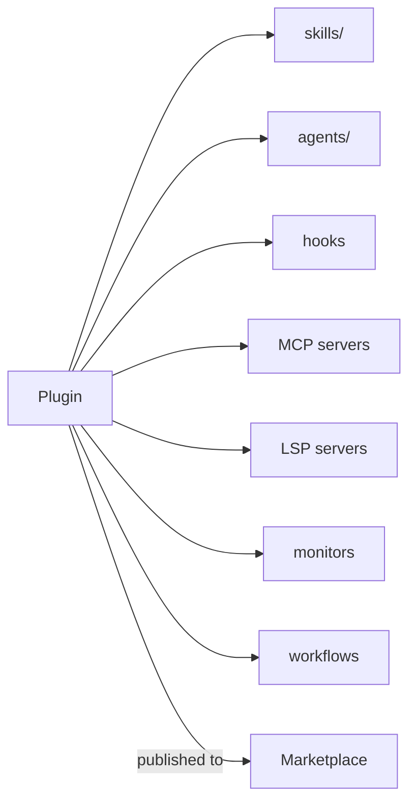

<LevelBadge level="advanced" />

<VerifyNote lastVerified="2026-10-22" source="https://code.claude.com/docs/en/plugins">
Plugin-Struktur und Marketplace-Mechanik entwickeln sich schnell — prüfe die Details in der offiziellen Claude-Code-Dokumentation.
</VerifyNote>

Ein **Plugin** bündelt mehrere Anpassungen — [Skills](/docs/claude-code/skills), [Subagenten](/docs/claude-code/subagents), [Slash-Befehle](/docs/claude-code/slash-commands), [Hooks](/docs/claude-code/hooks), [MCP-Server](/docs/claude-code/mcp) und seit Claude Code v2.1.287 eine [**Mod**](/docs/claude-code/mods) — zu einer einzigen, versionierten, installierbaren Einheit. Ein **Marketplace** ist ein Katalog von Plugins, die man entdecken und installieren kann.

## Warum Plugins wichtig sind

- **Ein Team-Toolkit in einem Schritt ausliefern.** Statt alle zu bitten, fünf Dateien zu kopieren, veröffentlichst du ein Plugin; Teammitglieder installieren es und erhalten dieselben Befehle, Hooks, Agenten und MCP-Verbindungen.
- **Versionierung.** Aktualisiere das Plugin, und alle ziehen die neue Version.
- **Verteilung.** Ein Marketplace macht dein Toolkit (oder das anderer) auffindbar.

## Was typischerweise enthalten ist

Ein Plugin ist ein strukturierter Ordner mit Komponenten. Das Manifest `.claude-plugin/plugin.json` ist **optional**: Ohne Manifest lädt Claude Code, was es im [Standard-Layout](https://code.claude.com/docs/en/plugins-reference#standard-layout) findet — ein Ordner, der nur eine `SKILL.md` enthält, wird also bereits als Plugin geladen. Schreibe ein Manifest, wenn du Metadaten, eine Version, eine Komponente außerhalb ihres Standardverzeichnisses oder vom Benutzer konfigurierbare Werte willst.

Neben Skills kann ein Plugin Subagenten, Hooks und MCP-Server bündeln und — neuerdings — [LSP-Server](https://code.claude.com/docs/en/plugins-reference#lspservers) für Code-Intelligenz, [Monitore](https://code.claude.com/docs/en/plugins-reference#monitors) im Hintergrund, [Workflows](https://code.claude.com/docs/en/workflows#distribute-a-workflow-in-a-plugin), einen `bin/`-Ordner mit ausführbaren Dateien und Standardeinstellungen. Halte jedes Plugin **kohärent** — ein Plugin „Team-Konventionen“, ein Plugin „Python-Toolkit“ — statt eines Sammelsuriums.

## Vertrauen vor der Installation

:::warning[Plugins können ausführbaren Code mitliefern]
Hooks und MCP-Server in einem Plugin laufen mit deinen Rechten. Installiere nur aus Quellen, denen du vertraust, und prüfe zuerst, was ein Plugin tut — siehe [Fremden Code prüfen](/docs/security/reviewing-third-party-code).
:::

## Ein Weg, dein Setup zu skalieren

Die natürliche Abfolge: eine `CLAUDE.md` → ein paar [Skills](/docs/claude-code/skills) und [Befehle](/docs/claude-code/slash-commands) → zu einem Plugin bündeln → in einem Marketplace für dein Team oder die Community veröffentlichen. Dieser letzte Schritt gehört dazu, wie AILmanac das Ökosystem wachsen lassen möchte.

## Weiter

- [Mods: In-Process-Erweiterungen](/docs/claude-code/mods) — die eine Plugin-Komponente, die *innerhalb* von Claude Code läuft und dessen eingebautes Verhalten ersetzen kann
- [Plugin-Evals](/docs/claude-code/plugin-evals) — belege mit `claude plugin eval`, dass das Plugin hilft, bevor du es veröffentlichst
- [Skills](/docs/claude-code/skills) · [Subagenten](/docs/claude-code/subagents) · [MCP](/docs/claude-code/mcp)
- [Fremden Code prüfen](/docs/security/reviewing-third-party-code)
- Die [Skill-Pakete](/docs/templates/skills) von AILmanac
