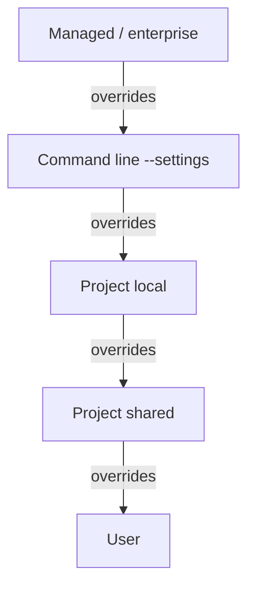

<LevelBadge level="intermediate" />

<VerifyNote lastVerified="2026-09-23" source="https://code.claude.com/docs/en/settings">
Fünfstufiger Vorrang-Stack (verwaltet → Kommandozeile → Projekt lokal → geteiltes Projekt → Benutzer) und die Regel „Umgebungsvariablen sind keine Ebene“ aus der offiziellen Seite [Einstellungsdateien und Vorrang](https://code.claude.com/docs/en/settings). Überschreibungen pro Schlüssel sind in der [Einstellungsreferenz](https://code.claude.com/docs/en/settings-reference) aufgeführt.
</VerifyNote>

In `settings.json` liegt die Konfiguration von Claude Code — [Berechtigungen](/docs/claude-code/permissions), [Hooks](/docs/claude-code/hooks), Umgebungsvariablen, Modell-Standards und mehr. Der Schlüssel liegt im Verständnis der **Ebenen**.

<Callout type="objectives" items={["Der fünfstufige Vorrang-Stack und welche Datei gewinnt, wenn zwei davon denselben Schlüssel setzen","Warum Umgebungsvariablen keine Ebene sind und was das für ANTHROPIC_MODEL bedeutet","In welche Datei eine Einstellung gehört: eingecheckte Team-Konvention, persönliche Überschreibung oder Ein-Sitzungs-Experiment","Die vier Abschnitte, die du tatsächlich bearbeiten wirst, und wo jeder ausführlich dokumentiert ist","Wie du bearbeitest, ohne die Datei zu zerstören, und was nie in eine eingecheckte Einstellungsdatei gehört"]} />

## Die Ebenen (höchster Vorrang zuerst)

Wenn derselbe Schlüssel an mehr als einer Stelle gesetzt ist, verwendet Claude Code den Wert der höchsten Ebene, die ihn setzt:

<Steps items={[
  {title: "Verwaltet / Enterprise", body: "managed-settings.json, eine MDM-Richtlinie oder serverseitig verwaltete Einstellungen aus der claude.ai-Konsole. Nichts, was du setzt, überschreibt sie (bis auf ein paar sicherheitsrelevante Ausnahmen)."},
  {title: "Kommandozeile", body: "claude --settings '<json-or-path>', nur für eine Sitzung. Steht über jeder Datei außer der verwalteten und schreibt in keine Datei — damit ist es das richtige Werkzeug für ein Experiment, an das du dich nicht erinnern willst."},
  {title: "Projekt (persönlich)", body: ".claude/settings.local.json, von Git ignoriert. Deine Überschreibungen für dieses Repo: maschinenspezifische Pfade, ein hier bevorzugtes Modell, ein Hook, den nur du willst."},
  {title: "Projekt (geteilt)", body: ".claude/settings.json, ins Repo eingecheckt. Teamweite Konventionen — die Datei, die ein neues Teammitglied durch Klonen erbt."},
  {title: "Benutzer", body: "~/.claude/settings.json. Deine Standards über alle Projekte hinweg. Niedrigster Vorrang, ein Repo kann dich also immer überschreiben."}
]} />

:::note[Umgebungsvariablen sind keine Ebene]
Sie stehen außerhalb dieses Stacks und werden pro Schlüssel aufgelöst. `ANTHROPIC_MODEL` gilt zum Beispiel über dem Schlüssel `model` aus jeder Datei, während `ANTHROPIC_DEFAULT_MODEL` nur greift, wenn keine Datei `model` setzt.
:::

:::tip[Die geteilte Datei einchecken, die lokale ignorieren]
Lege Team-Konventionen in `.claude/settings.json` ab (eingecheckt). Lege persönliche Anpassungen und maschinenspezifische Pfade in `.claude/settings.local.json` ab (von Git ignoriert). So bleibt das Team konsistent, ohne dass du anderen deine Vorlieben aufzwingst.
:::

## Was du üblicherweise setzt

- **`permissions`** — Allow-/Ask-/Deny-Regeln. Siehe [Berechtigungen](/docs/claude-code/permissions).
- **`hooks`** — Befehle, die bei Lebenszyklus-Ereignissen laufen. Siehe [Hooks](/docs/claude-code/hooks).
- **`env`** — Umgebungsvariablen für die Sitzung.
- **Modell-/Verhaltens-Standards** — z. B. das bevorzugte Modell.

## Sicher bearbeiten

- Halte die Datei gültiges JSON (ein abschließendes Komma macht sie kaputt).
- Bevorzuge **enge** Berechtigungsregeln gegenüber breiten.
- Lege nie Secrets in eine eingecheckte Datei — verwende `env`-Verweise oder einen Secrets-Manager.

<PromptCard title="Eine Einstellung für eine Sitzung ausprobieren, ohne sie in eine Datei zu schreiben">
{`claude --settings '{"permissions":{"allow":["Bash(git log *)"]}}'`}
</PromptCard>

Startdateien zum Kopieren findest du unter [Hooks- & settings.json-Rezepte](/docs/templates/hooks-settings). Wenn eine Datei fehlerhaft ist oder ein Schlüssel nicht tut, was du erwartest, gibt `claude doctor` Validierungsfehler der Einstellungsdatei aus, ohne eine Sitzung zu starten — dazu und zu `--safe-mode` siehe [die CLI-Seite](/docs/claude-code/cli-flags).

## Teste dich selbst

<Quiz questions={[
  {
    q: "Die eingecheckte .claude/settings.json deines Repos setzt ein Modell, und deine ~/.claude/settings.json setzt ein anderes. Welches gilt?",
    options: [
      "Deine Benutzerdatei — persönliche Einstellungen gewinnen immer",
      "Die eingecheckte Datei des Repos — geteiltes Projekt steht über Benutzer",
      "Keines; der Konflikt ist ein Fehler",
      "Die Datei, die zuletzt geändert wurde"
    ],
    answer: 1,
    explain: "Benutzereinstellungen sind die niedrigste Ebene, ein Repo kann deine persönlichen Standards also immer überschreiben. Die Reihenfolge ist verwaltet → Kommandozeile → Projekt lokal → Projekt geteilt → Benutzer."
  },
  {
    q: "Wohin gehört ein maschinenspezifischer absoluter Pfad?",
    options: [
      ".claude/settings.json, damit das Team ihn hat",
      ".claude/settings.local.json, die von Git ignoriert wird",
      "~/.claude/settings.json, damit er für jedes Projekt gilt",
      "managed-settings.json"
    ],
    answer: 1,
    explain: "settings.local.json ist die projektbezogene, von Git ignorierte Ebene: richtig für Pfade und Vorlieben, die nur auf deiner Maschine Sinn ergeben, ohne sie Teammitgliedern aufzudrücken."
  },
  {
    q: "Welche Aussage über Umgebungsvariablen stimmt?",
    options: [
      "Sie bilden eine sechste Ebene, direkt unter den verwalteten Einstellungen",
      "Sie werden pro Schlüssel aufgelöst und stehen außerhalb des Stacks — ANTHROPIC_MODEL überschreibt den Schlüssel model aus jeder Datei, ANTHROPIC_DEFAULT_MODEL greift nur, wenn keine Datei ihn setzt",
      "Sie werden ignoriert, sobald irgendeine Einstellungsdatei existiert",
      "Sie funktionieren nur, wenn sie im Abschnitt env der settings.json gesetzt sind"
    ],
    answer: 1,
    explain: "Die Dokumentation ist eindeutig: Umgebungsvariablen sind keine Vorrang-Ebene. Jede hat ihre eigene Regel, weshalb sich zwei Variablen für dasselbe Konzept unterschiedlich verhalten können."
  }
]} />

<Callout type="takeaways" items={["Fünf Ebenen, eine Regel: Die höchste Ebene, die einen Schlüssel setzt, gewinnt. Verwaltet ist absolut; Benutzereinstellungen sind die schwächsten.","Eingecheckte Datei für Team-Konventionen, lokale Datei für persönliche und maschinenspezifische Werte, --settings für ein Wegwerf-Experiment.","Umgebungsvariablen sind keine Ebene. Prüfe die Regel jeder Variable, statt eine Position im Stack anzunehmen.","Secrets gehören nie in eine eingecheckte Einstellungsdatei.","Wenn eine Einstellung ignoriert scheint, führe claude doctor aus und achte auf Validierungsfehler, bevor du irgendetwas anderes änderst."]} />

## Weiter

- [Die claude-CLI: Flags, die das Ergebnis verändern](/docs/claude-code/cli-flags) — das Pro-Sitzung-Gegenstück zu jedem Schlüssel hier
- [Berechtigungen & Berechtigungsmodi](/docs/claude-code/permissions)
- [Hooks: Deterministische Automatisierung](/docs/claude-code/hooks)
- [Eigene Slash-Befehle](/docs/claude-code/slash-commands)
