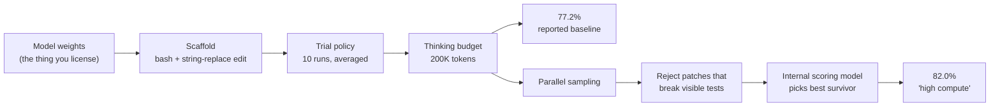

<LevelBadge level="intermediate" />

AILmanac nennt Benchmark-Zahlen auf Dutzenden Modellseiten. Das tut auch jeder Launch-Beitrag, jede Vergleichstabelle und jeder „wir schlagen die Spitze“-Thread. Fast keiner nennt die drei Dinge, die entscheiden, was eine Zahl bedeutet: **welches Scaffold sie erzeugt hat, über wie viele Versuche sie mittelt und ob das Modell die Antworten schon gelesen hatte.**

Diese drei sind keine Haarspalterei. In einem unten veröffentlichten Beispiel erzielen dieselben Modellgewichte auf denselben 500 Aufgaben **77,2 % und 82,0 %** — die Differenz von 4,8 Punkten geht vollständig auf das Harness. In einem anderen lösen Spitzenmodelle, die **über 70 %** eines Coding-Benchmarks bewältigen, nur **etwa 23 %** eines schwereren, der aus derselben Art von Aufgabe gebaut ist. Keine der Lücken ist eine Lüge. Beide sind unsichtbar, wenn du nur die Schlagzeile liest.

Diese Seite ist die Anleitung, die Zahl statt der Schlagzeile zu lesen.

<Callout type="objectives" items={[
  "Wissen, was ein SWE-bench-Wert buchstäblich misst — und was „Verified“ verifiziert hat",
  "Das Modell vom Scaffold trennen, mit der Methodik-Fußnote eines Anbieters als Beleg",
  "Den Kontaminationsabschlag erkennen: warum ein schwererer Benchmark auf ungesehenem Code die Werte um Dutzende Punkte senkt",
  "„High compute“- und „Best-of-n“-Zahlen als das lesen, was sie sind: ein anderes Produkt zu einem anderen Preis",
  "Eine Checkliste mit sechs Fragen in unter zwei Minuten auf jede Benchmark-Behauptung anwenden",
  "Wissen, wann ein Benchmark gesättigt ist und nichts mehr aussagt"
]} />

<VerifyNote lastVerified="2026-10-05" source="https://www.swebench.com/original.html">
Die Fakten zum Aufbau der Benchmarks stammen von den Seiten der Maintainer selbst: [SWE-bench](https://www.swebench.com/original.html) (2.294 Instanzen, 12 Python-Repositories) und [SWE-bench Verified](https://www.swebench.com/verified.html) (500 Instanzen, mit OpenAI gebaut). Das Scaffold und die Methodik zum Test-Time-Compute sind aus [Anthropics Ankündigung von Claude Sonnet 4.5](https://www.anthropic.com/news/claude-sonnet-4-5) zitiert — dieses Modell ist inzwischen abgelöst, aber die Fußnote wird hier als **Methodik-Artefakt** angeführt, nicht als aktueller Wert; was aktuell ist, siehst du unter [Modelle & Preise](/docs/whats-new/models-and-pricing). Die SWE-bench-Pro-Zahlen stammen aus [Scales Ankündigung](https://scale.com/blog/swe-bench-pro) und dem [SWE-Bench-Pro-Paper](https://arxiv.org/abs/2509.16941) und sind **Zahlen zum Launch-Zeitpunkt für die damals getesteten Modelle** — den aktuellen Stand zeigt das [Live-Leaderboard](https://labs.scale.com/leaderboard/swe_bench_pro). Der Beitrag von OpenAI [*Why we no longer evaluate SWE-bench Verified*](https://openai.com/index/why-we-no-longer-evaluate-swe-bench-verified/) blockiert automatisiertes Abrufen; er wird hier nur wegen seines Titels und der erklärten Position zitiert.
</VerifyNote>

## Was ein SWE-bench-Wert buchstäblich misst

Beginne mit der Mechanik, denn die Mechanik ist der Vorbehalt.

SWE-bench wurde gebaut, indem Pull Requests und Issues aus **12 beliebten Python-Repositories** gecrawlt wurden, woraus **2.294 Aufgabeninstanzen** entstanden. Jede Instanz gibt einem Modell eine Issue-Beschreibung und einen Repository-Snapshot. Das Modell schreibt einen Patch. Der Patch wird bewertet, indem Tests laufen, die **vor dem echten Fix fehlschlugen und danach bestanden** — die „Fail-to-Pass“-Menge.

Ein SWE-bench-Wert ist also dieser Satz und nichts weiter:

> *Gegeben einen Issue-Text und ein Repo, hat das System einen Diff erzeugt, der eine bestimmte Menge versteckter Tests von rot auf grün bringt.*

Beachte alles, was dieser Satz **nicht** behauptet. Nicht, dass der Patch der ist, den ein Maintainer mergen würde. Nicht, dass er lesbar, minimal oder sicher ist. Nicht, dass er nichts kaputt macht, was kein Test abdeckt. Nicht, dass ein Mensch den Pull Request akzeptiert hätte. Der Benchmark ist ein *Testsuite-Orakel*, und Testsuiten sind eine unvollständige Spezifikation von Korrektheit — aus demselben Grund ist [Reward Hacking bei Coding-Agenten](/docs/frontiers/reward-hacking-in-coding-agents) ein aktuelles statt ein theoretisches Problem.

### Was „Verified“ tatsächlich verifiziert hat

**SWE-bench Verified** ist eine Teilmenge des Originals mit 500 Instanzen, in Zusammenarbeit mit OpenAI erstellt. Menschliche Annotatoren prüften jede Instanz auf drei Dinge: Die Problembeschreibung ist klar, der Test-Patch ist korrekt, und die Aufgabe ist mit den gegebenen Informationen lösbar.

Lies diese Liste genau. Verified hat **die eigenen Mängel des Benchmarks** behoben — unterspezifizierte Issues, kaputte Grader, unmögliche Aufgaben. Es ist eine Sauberkeitsgarantie, keine Schwierigkeitsgarantie und keine Realismusgarantie. „Verified“ im Namen lässt Leute „als Maß für Ingenieurskönnen validiert“ hören. Es bedeutet: „Wir haben geprüft, dass diese 500 Fragen beantwortbar und korrekt bewertet sind.“

<Callout type="key">
**Verified = die Fragen sind fair. Nicht: die Fragen sind schwer, repräsentativ oder ungesehen.** Das sind drei getrennte Eigenschaften, und die nächsten beiden Abschnitte handeln von denen, die Verified nie behauptet hat.
</Callout>

## Die Scaffold-Steuer: Die Zahl ist ein Systemwert, kein Modellwert

Das ist das Nützlichste auf dieser Seite, und der Beleg ist die Fußnote eines Anbieters.

Als Anthropic Claude Sonnet 4.5 veröffentlichte, stellte die Methodik-Notiz fest, dass alle Claude-Ergebnisse **„ein einfaches Scaffold mit zwei Tools — Bash und Dateibearbeitung per String-Ersetzung“** verwendeten. Die Kennzahl **77,2 %** auf SWE-bench Verified entstand **ohne Test-Time-Compute, gemittelt über 10 Versuche, mit einem Thinking-Budget von 200K, auf dem vollständigen Satz von 500 Aufgaben.**

Derselbe Beitrag nannte eine zweite Zahl: **82,0 %** unter „high compute“. Diese Konfiguration zieht mehrere Versuche parallel, verwirft Patches, die die sichtbaren Regressionstests brechen (Rejection Sampling), und lässt dann ein internes Bewertungsmodell den besten Überlebenden auswählen.

Dieselben Gewichte. Dieselben 500 Aufgaben. **+4,8 Punkte allein durch das Harness.**

Vier Folgerungen ergeben sich daraus, und sie lassen sich weit über dieses eine Beispiel hinaus verallgemeinern.

**1. Eine Leaderboard-Zeile ist ein Agent, kein Modell.** Zwei Einreichungen derselben Gewichte mit verschiedenen Scaffolds sind verschiedene Systeme. Wenn eine Vergleichstabelle Modell A mit 74 % neben Modell B mit 71 % führt und die Zeilen aus verschiedenen Harnesses stammen, hat die Tabelle mindestens ebenso sehr die Harnesses gemessen wie die Modelle. [Coding-Agent-CLIs im Vergleich](/docs/models/coding-agent-clis-compared) gibt es, weil das Harness eine erstrangige Variable ist.

**2. „High compute“-Zahlen sind ein anderes Produkt zu einem anderen Preis.** Best-of-n mit einem Verifizierer sind n Inferenzläufe plus ein Bewertungsdurchgang. Ist die Kennzahl eines Anbieters die High-Compute-Zahl, beträgt der Preis, den du zahlen würdest, um sie zu reproduzieren, grob das n-Fache des offensichtlichen. Frage immer, welcher Zahl die Preisseite entspricht. [Warum Agenten Tokens verbrennen](/docs/models/why-agents-burn-tokens) ist die Kostenseite derselben Rechnung.

**3. Rejection Sampling braucht ein Signal, das du vielleicht nicht hast.** „Verwirf Patches, die die sichtbaren Regressionstests brechen“ funktioniert bei SWE-bench, weil jede Instanz eine Testsuite mitbringt. In deiner Codebasis ist dieser Schritt nur so gut wie deine Tests. Ein High-Compute-Wert misst teilweise *die Testabdeckung des Benchmarks*, als Filter in den Agenten verpflanzt.

**4. Die Mittelungsregel ist tragend.** „Gemittelt über 10 Versuche“ ist eine ehrliche Wahl, die Punkte kostet — Agentenläufe haben hohe Varianz, und ein einzelner Best-of-10-Lauf würde höher lesen. Ein Paper mit einem Einzellauf und ein Paper mit einem 10-Versuche-Mittel sind nicht vergleichbar, und der Unterschied steht selten in der Schlagzeile.

<Callout type="warning">
Hat ein Wert kein genanntes Scaffold, keine Versuchszahl und keine pass@k-Konvention, ist er keine reproduzierbare Messung — er ist Marketing mit einer Nachkommastelle. Das gilt, wenn die Zahl Claude schmeichelt, genauso wie wenn sie irgendetwas anderem schmeichelt.
</Callout>

## Der Kontaminationsabschlag

Die zweite unsichtbare Variable: ob das Modell die Antworten gesehen hat.

SWE-bench wurde aus der öffentlichen GitHub-Historie zusammengestellt. Öffentliche GitHub-Historie sind Trainingsdaten. Bei jedem so gebauten Benchmark gibt es keinen sauberen Weg zu beweisen, dass ein Modell die Aufgabe löst, statt den gemergten Fix abzurufen. Die Position von OpenAI ist inzwischen ausdrücklich in einem Beitrag mit dem Titel [*Why we no longer evaluate SWE-bench Verified*](https://openai.com/index/why-we-no-longer-evaluate-swe-bench-verified/) niedergelegt.

**SWE-Bench Pro** ist die strukturelle Antwort. Scale baute **1.865 Aufgaben aus 41 aktiv gepflegten Repositories**, gezielt so beschafft, dass Überschneidungen mit dem Trainingsset per Konstruktion unwahrscheinlich sind:

| Teilmenge | Repos | Wie Kontamination erschwert wird |
| --- | --- | --- |
| Öffentlich | 11 | Starkes Copyleft (GPL-Familie) — rechtlich heikel für das Training |
| Zurückgehalten | 12 | Als Benchmark veröffentlicht, aber aus dem offenen Release zurückgehalten |
| Kommerziell | 18 | Private Codebasen unter Partnerschaftsvereinbarungen; nie öffentlich |

Die Aufgaben sind außerdem absichtlich schwerer: Probleme, für die professionelle Ingenieure **Stunden bis Tage** brauchen und die typischerweise mehrere Dateien umfassen.

Das Ergebnis zum Launch war die Zahl, die man sich merken sollte. Spitzenmodelle mit **über 70 %** auf SWE-bench Verified landeten bei etwa **23 %** auf der öffentlichen Menge von SWE-bench Pro — und *noch tiefer* auf der kommerziellen Teilmenge, wo der Code nachweislich nie öffentlich war:

| Modell (wie zum Launch getestet) | SWE-bench Pro, öffentlich | SWE-bench Pro, kommerziell |
| --- | --- | --- |
| OpenAI GPT-5 | 23,3 % | 14,9 % |
| Claude Opus 4.1 | 23,1 % | 17,8 % |

Diese Modelle sind längst abgelöst — es geht nicht um die Zeile, sondern um die **Form**. Gleiche Aufgabenfamilie, gleicher Bewertungsmechanismus, zwei Designentscheidungen geändert (ungesehener Code, längerer Horizont), und die Zahl fällt um Dutzende Punkte. Der Abfall von öffentlich zu kommerziell innerhalb *desselben* Benchmarks ist das sauberste veröffentlichte Kontaminationssignal, weil er die Aufgabenschwierigkeit grob konstant hält und nur variiert, ob der Code im Training gewesen sein konnte.

<Callout type="tip">
**Die übertragbare Gewohnheit:** Wenn zwei Benchmarks „dasselbe“ messen und um 40 Punkte abweichen, ist die Abweichung die Information. Frage, welche Designentscheidung sich unterscheidet — ungesehene Daten, längerer Horizont, strengerer Grader — und nimm an, dass *deine* Codebasis dem Schwereren ähnelt. Dein Repo ist privat, langlebig und untertestet; es ähnelt der kommerziellen Teilmenge weit mehr als einem berühmten Django-Issue von 2021.
</Callout>

## Sättigung: wenn ein Benchmark keine Information mehr trägt

Ein Benchmark, bei dem sich die Spitzenreiter bei 90-irgendwas ballen, trennt sie nicht mehr. Die verbleibende Lücke wird von Grader-Rauschen, Scaffold-Unterschieden und den wenigen Instanzen mit mehrdeutiger Spezifikation bestimmt.

Das nützliche Erkennungszeichen ist eine **gepaarte schwerere Variante**. In der Launch-Tabelle zu [Ember-1](/docs/models/ember-1-reasoning-token-efficiency) erreichen dieselben Modelle, die auf SWE-bench Verified 80–93 % erzielen, bei SWE-Interact nur **6,7–21,3 %**, was verlangt, mitten in der Aufgabe dem Nutzer Fragen zu stellen. Eine dieser beiden Spalten misst noch etwas. Wenn du eine Schlagzeile mit 90-irgendwas siehst, ist dein erster Schritt, die gepaarte Zahl zu finden, die nicht 90-irgendwas ist — dort liegt die lebendige Fähigkeitslücke, und es ist dasselbe Phänomen, das [die Fähigkeits-Zuverlässigkeits-Lücke](/docs/frontiers/the-capability-reliability-gap) von der Einsatzseite aus beschreibt.

### Und bei den Leaderboards nach menschlicher Präferenz

Arena-artige Rankings haben das spiegelbildliche Problem. Paarweise menschliche Abstimmung belohnt zuverlässig Antworten, die **länger und stärker formatiert** sind, unabhängig davon, ob sie korrekter sind. Deshalb liefert LMArena eine separate **stilkontrollierte** Ansicht, die statistisch für Antwortlänge und Markdown-Struktur korrigiert. Wenn du einen Arena-Rang zitierst, nenne, aus welcher Ansicht er stammt — die beiden Reihenfolgen sind nicht dieselben, und die unkontrollierte misst teilweise Wortreichtum.

## Sechs Fragen, zwei Minuten

<Steps items={[
  {
    title: "Welcher Benchmark, und welche Variante?",
    body: "SWE-bench, Verified, Lite, Multimodal, Multilingual und Pro sind verschiedene Datensätze mit unterschiedlicher Größe und Schwierigkeit. Eine Zahl ohne Variante ist unlesbar. „SWE-bench 74 %“ könnte vier unvereinbare Dinge bedeuten."
  },
  {
    title: "Welches Scaffold hat sie erzeugt?",
    body: "Welche Tools, wie viele Turns, welches Thinking-Budget, ggf. Retrieval? Wenn der Beitrag es nicht sagt, ist die Zahl nicht reproduzierbar. Anthropics Offenlegung von Zwei-Tool-Bash-plus-String-Ersetzung ist der Standard, an dem man alle messen sollte — auch Anthropic."
  },
  {
    title: "Ein Lauf oder ein Mittel — und pass@1 oder Best-of-n?",
    body: "Agentische Evals haben hohe Varianz. Ein Mittel über 10 Versuche und ein einzelner Glückslauf unterscheiden sich beim selben System um mehrere Punkte. „High compute“, „Best-of-n“, „mit Verifizierer“ und „paralleler Test-Time-Compute“ bedeuten alle: Das kostet das n-Fache von dem, was du denkst."
  },
  {
    title: "Könnten die Antworten in den Trainingsdaten sein?",
    body: "Aus öffentlicher GitHub-Historie vor dem Cutoff des Modells gebaut? Nimm teilweises Abrufen an. Bevorzuge Benchmarks mit zurückgehaltenen oder privaten Teilmengen und gewichte den Wert der privaten Teilmenge am höchsten — er ist der nächste Proxy für dein eigenes ungesehenes Repository."
  },
  {
    title: "Wer hat es ausgeführt?",
    body: "Vom Anbieter ausgeführt auf vom Anbieter gewählten Benchmarks ist ein legitimes und schwaches Signal. Suche dasselbe Modell auf einem unabhängigen Leaderboard mit festem Harness. Wo Anbieter- und unabhängige Zahlen abweichen, ist das Delta meist das Scaffold."
  },
  {
    title: "Ist er gesättigt, und was ist die gepaarte schwere Zahl?",
    body: "Liegen die ersten fünf nahe an der Obergrenze innerhalb von drei Punkten, ist das Ranking Rauschen. Finde die schwerere gepaarte Variante — interaktiv, langer Horizont, privates Repo — und lies stattdessen diese Spalte."
  }
]} />

## Einen Launch-Beitrag verhören

Füge den Benchmark-Abschnitt eines Anbieters ein und lass das Modell Schritt 2 für dich erledigen. Es geht nicht um die Zusammenfassung, sondern um die Liste des **ausdrücklich Fehlenden**.

<PromptCard title="Audit von Benchmark-Behauptungen">
{`You are auditing a benchmark claim for reproducibility. Here is the benchmark section of a model launch post:

<launch_post>
[PASTE THE BENCHMARK SECTION AND ALL FOOTNOTES]
</launch_post>

For each benchmark number reported, produce a row with:
- benchmark name and exact variant (e.g. SWE-bench Verified, 500 instances)
- the score, and whether it is pass@1, best-of-n, or an average of k trials
- the scaffold: tools available, turn limit, thinking/reasoning budget, retrieval
- whether any test-time-compute technique was used (parallel sampling, rejection
  sampling against visible tests, a verifier or scoring model)
- who ran the eval: the vendor, or an independent party with a fixed harness

Then output two lists:
1. NOT STATED — every field above that the post does not disclose.
2. COMPARABILITY RISKS — specific reasons a reader could not place these numbers
   next to another vendor's numbers for the same benchmark.

Do not estimate or infer missing values. If the post does not say it, it goes in
list 1. Quote the footnote text you relied on for each field you did fill in.`}
</PromptCard>

Führst du denselben Prompt gegen die Beiträge zweier Anbieter zum selben Benchmark aus, schreiben die Vergleichbarkeitsrisiken meist die Vorbehaltszeile der Vergleichstabelle für dich.

## Häufige Fehler

| Fehler | Warum er in die Irre führt | Was stattdessen zu tun ist |
| --- | --- | --- |
| Eine Leaderboard-Zeile als Modellwert behandeln | Sie ist ein Modell **plus** Scaffold, Versuchsregel und Compute-Budget | Zeilen nur innerhalb eines festen Harness vergleichen oder ganze Systeme ehrlich vergleichen |
| Die High-Compute-Zahl von Anbieter A neben das pass@1 von Anbieter B stellen | Das eine sind n Inferenzläufe mit Verifizierer, das andere ein Lauf | Die Compute-Konvention angleichen oder die Asymmetrie kennzeichnen |
| „Verified“ als „als realistisch validiert“ lesen | Es hat verifiziert, dass die Fragen beantwortbar und korrekt bewertet sind | Als sauberen Datensatz nutzen, nicht als Beleg für Fähigkeit in der Praxis |
| Einen Wert nahe der Obergrenze als Beleg für einen Vorsprung zitieren | Gesättigte Benchmarks ranken Rauschen | Die gepaarte schwerere Variante zitieren |
| Annehmen, ein Benchmark aus öffentlichem GitHub sei unkontaminiert | Die Daten liegen vor dem Cutoff und sind im Crawl | Zurückgehaltene oder private Teilmengen bevorzugen; diese am höchsten gewichten |
| Einen Benchmark-Wert auf dein Repo hochrechnen | Dein Code ist privat, langlebig und dünn getestet | Ein kleines Eval auf deinen eigenen Aufgaben bauen — siehe [Deinen KI-Agenten evaluieren](/docs/playbooks/evaluating-agents) |
| Einen Arena-Rang ohne die Ansicht zitieren | Unkontrollierte paarweise Abstimmung belohnt teilweise Länge und Formatierung | Angeben, ob es das stilkontrollierte Ranking ist |

Die letzte Zeile ist in der Praxis die wichtigste. Ein veröffentlichter Benchmark beantwortet „ist dieses Modell gut bei diesem Benchmark“. Die Frage, die du tatsächlich hast, lautet „ist dieses Modell gut bei meiner Arbeit“, und das einzige Instrument dafür ist ein Eval auf deinen eigenen Aufgaben. [Evals](/docs/power-user/evals) behandelt, wie man eines baut; zwanzig deiner echten Tickets, bewertet nach einem Raster, das du geschrieben hast, übertrumpfen für deine Entscheidung jedes Leaderboard auf dieser Seite.

<Quiz questions={[
  {
    q: "Ein Anbieter meldet 82,0 % auf SWE-bench Verified unter „high compute“, beschrieben als paralleles Sampling, Verwerfen von Patches, die sichtbare Regressionstests brechen, und ein internes Bewertungsmodell, das den besten Überlebenden wählt. Sein Wert mit einfachem Scaffold auf denselben 500 Aufgaben beträgt 77,2 %. Was misst die Differenz von 4,8 Punkten?",
    options: [
      "Eine bessere Version der Modellgewichte",
      "Das Harness: zusätzliche Inferenzläufe plus ein Verifizierer, keine Änderung am Modell",
      "Messrauschen zwischen zwei Läufen",
      "Den Unterschied zwischen SWE-bench und SWE-bench Verified"
    ],
    answer: 1,
    explain: "Dieselben Gewichte, dieselben 500 Aufgaben. Die Lücke ist vollständig Test-Time-Compute — n parallele Versuche, Rejection Sampling gegen die sichtbaren Tests und ein Bewertungsmodell zur Auswahl. Es ist ein anderes Produkt zu grob dem n-Fachen der Kosten, und es hängt von einem Testsignal ab, das dein eigenes Repo vielleicht nicht hat."
  },
  {
    q: "Auf SWE-bench Pro löste Claude Opus 4.1 zum Launch 23,1 % der öffentlichen Teilmenge, aber 17,8 % der kommerziellen — private Codebasen, die nie öffentlich waren. Warum ist der Abfall von öffentlich zu kommerziell die aussagekräftigere der beiden Zahlen?",
    options: [
      "Die kommerziellen Aufgaben sind viel länger, der Abfall misst also die Kontextlänge",
      "Er hält das Aufgabendesign grob konstant und variiert hauptsächlich, ob der Code in den Trainingsdaten gewesen sein konnte",
      "Die kommerzielle Teilmenge verwendet einen strengeren Grader als die öffentliche",
      "Private Repos haben schlechtere Testabdeckung, daher ist die Bewertung härter"
    ],
    answer: 1,
    explain: "Beide Teilmengen sind derselbe Benchmark, gleicher Aufbau, gleiche Bewertung. Das Wesentliche, was sich ändert, ist, ob das Repository plausibel in Trainingsdaten gecrawlt worden sein konnte — das macht die Lücke zum saubersten veröffentlichten Kontaminationssignal und den kommerziellen Wert zum besseren Proxy für dein eigenes privates Repo."
  },
  {
    q: "Was hat die menschliche Annotation hinter SWE-bench Verified tatsächlich garantiert?",
    options: [
      "Dass die 500 Aufgaben repräsentativ für echte Produktions-Ingenieursarbeit sind",
      "Dass die 500 Aufgaben schwerer sind als der Rest von SWE-bench",
      "Dass Problembeschreibungen klar, Test-Patches korrekt und die Aufgaben mit den gegebenen Informationen lösbar sind",
      "Dass keine der 500 Aufgaben in den Trainingsdaten eines Modells vorkommt"
    ],
    answer: 2,
    explain: "Verified hat die eigenen Mängel des Benchmarks behoben — unterspezifizierte Issues, falsche Grader, unlösbare Aufgaben. Es ist eine Sauberkeitsgarantie. Über Schwierigkeit, Realismus oder Kontamination sagt es nichts, und alle drei sind getrennte Eigenschaften."
  }
]} />

<Flashcards cards={[
  { front: "SWE-bench in einer Zeile", back: "2.294 Aufgabeninstanzen, gecrawlt aus Pull Requests und Issues von 12 beliebten Python-Repositories. Ein Modell erhält ein Issue und einen Repo-Snapshot; sein Patch wird danach bewertet, ob die „Fail-to-Pass“-Tests von rot auf grün gehen." },
  { front: "Was SWE-bench Verified verifiziert hat", back: "500 Instanzen aus dem Original, von menschlichen Annotatoren zusammen mit OpenAI geprüft, ob die Problembeschreibung klar, der Test-Patch korrekt und die Aufgabe lösbar ist. Eine Sauberkeitsgarantie — keine für Schwierigkeit, Realismus oder Freiheit von Kontamination." },
  { front: "Die Scaffold-Steuer", back: "Eine Leaderboard-Zeile ist ein Modell PLUS sein Harness. Anthropics veröffentlichte Methodik zeigt dieselben Gewichte bei 77,2 % (einfaches Zwei-Tool-Scaffold, Mittel über 10 Versuche, kein Test-Time-Compute) und 82,0 % („high compute“: paralleles Sampling, Verwerfen gegen sichtbare Tests, internes Bewertungsmodell) auf denselben 500 Aufgaben." },
  { front: "Was „high compute“ / Best-of-n wirklich kostet", back: "n Inferenzläufe plus ein Verifikationsdurchgang. Ist die Schlagzeile die High-Compute-Zahl, kostet ihre Reproduktion grob das n-Fache des offensichtlichen Preises — und der Rejection-Schritt braucht ein Testsignal, das deine eigene Codebasis vielleicht nicht hat." },
  { front: "SWE-bench Pro", back: "1.865 Aufgaben aus 41 aktiv gepflegten Repos, aufgeteilt in 11 öffentliche (starkes Copyleft) / 12 zurückgehaltene / 18 kommerzielle unter Partnerschaftsvereinbarungen. Die Aufgaben brauchen von professionellen Ingenieuren Stunden bis Tage und umfassen meist mehrere Dateien. Gebaut, damit Überschneidung mit dem Trainingsset per Konstruktion unwahrscheinlich ist." },
  { front: "Der Kontaminationsabschlag", back: "Zum Launch erzielten Modelle über 70 % auf SWE-bench Verified etwa 23 % auf der öffentlichen Menge von SWE-bench Pro und weniger auf der kommerziellen (GPT-5 23,3 % → 14,9 %; Opus 4.1 23,1 % → 17,8 %). Der Abfall von öffentlich zu kommerziell innerhalb des Benchmarks ist das sauberste veröffentlichte Kontaminationssignal." },
  { front: "Benchmark-Sättigung — das Erkennungszeichen", back: "Spitzenreiter, die sich innerhalb weniger Punkte nahe der Obergrenze ballen, bedeuten, dass das Ranking Rauschen ist. Finde die gepaarte schwerere Variante: Die Modelle mit 80–93 % auf SWE-bench Verified erzielen 6,7–21,3 % auf SWE-Interact. Die nicht gesättigte Spalte ist die, die noch Information trägt." },
  { front: "Arena-Stilkontrolle", back: "Paarweise menschliche Abstimmung belohnt längere, stärker formatierte Antworten unabhängig von der Korrektheit, daher veröffentlicht LMArena ein stilkontrolliertes Ranking, das für Länge und Markdown korrigiert. Nenne immer, aus welcher Ansicht ein zitierter Rang stammt." },
  { front: "Die sechs Fragen", back: "Welche Variante? Welches Scaffold? Ein Lauf oder gemittelt, pass@1 oder Best-of-n? Könnten die Antworten in den Trainingsdaten sein? Wer hat es ausgeführt? Ist er gesättigt — und was ist die gepaarte schwere Zahl?" }
]} />

<Callout type="takeaways" items={[
  "Ein Benchmark-Wert ist ein Systemwert. Modell + Scaffold + Versuchsregel + Compute-Budget. Die veröffentlichte Lücke 77,2 % vs. 82,0 % auf identischen Aufgaben ist der Beweis.",
  "„Verified“ heißt, die Fragen sind fair, nicht dass sie schwer, realistisch oder ungesehen sind. Drei getrennte Eigenschaften, ein beruhigendes Wort.",
  "Benchmarks aus öffentlichem GitHub können nicht beweisen, dass das Modell nicht abruft. Gewichte zurückgehaltene und private Teilmengen am höchsten — sie sind der nächste Proxy für dein Repository.",
  "Eine Abweichung von 40 Punkten zwischen zwei Benchmarks, die „dasselbe“ messen, ist die Information, kein Fehler. Finde die Designentscheidung, die sich unterscheidet.",
  "Werte nahe der Obergrenze ranken Rauschen. Lies stattdessen immer die gepaarte schwerere Variante.",
  "Kein veröffentlichter Benchmark beantwortet deine tatsächliche Frage. Zwanzig eigene Tickets mit einem Raster schlagen jedes Leaderboard hier."
]} />

## Weiter

- [Deinen KI-Agenten evaluieren](/docs/playbooks/evaluating-agents) — das Playbook, um das Eval zu bauen, das deine Frage wirklich beantwortet, da kein öffentlicher Benchmark es tut
- [Ist das Modell generft? Wie man es wirklich feststellt](/docs/models/is-the-model-nerfed) — dieselbe Messdisziplin auf die andere häufige Frage gerichtet, mit einem Paired-Design-Protokoll, das du ausführen kannst
- [Coding-Agent-CLIs im Vergleich](/docs/models/coding-agent-clis-compared) — das Harness als erstrangige Variable, genau das, was die Scaffold-Steuer sagt

## Quellen & weiterführende Lektüre

- [SWE-bench](https://www.swebench.com/original.html) — Aufbau (2.294 Instanzen, 12 Python-Repositories) und der Fail-to-Pass-Bewertungsmechanismus
- [SWE-bench Verified](https://www.swebench.com/verified.html) — die mit OpenAI gebaute Teilmenge mit 500 Instanzen und genau das, was die menschliche Annotation geprüft hat
- [Introducing Claude Sonnet 4.5 — Anthropic](https://www.anthropic.com/news/claude-sonnet-4-5) — die hier zitierte Methodik-Fußnote: Zwei-Tool-Scaffold, Mittel über 10 Versuche, Thinking-Budget von 200K und was „high compute“ hinzufügt
- [SWE-Bench Pro: Can AI Agents Solve Long-Horizon Software Engineering Tasks? — arXiv 2509.16941](https://arxiv.org/abs/2509.16941) — 1.865 Aufgaben, 41 Repositories, die Aufteilung öffentlich / zurückgehalten / kommerziell
- [SWE-Bench Pro: Raising the Bar for Agentic Coding — Scale](https://scale.com/blog/swe-bench-pro) — die Kontaminationsstrategie (Copyleft plus privater kommerzieller Code) und die Launch-Ergebnisse öffentlich vs. kommerziell
- [SWE-Bench Pro leaderboard — Scale](https://labs.scale.com/leaderboard/swe_bench_pro) — der aktuelle Stand, wenn die obigen Launch-Zahlen Geschichte sind
- [Why we no longer evaluate SWE-bench Verified — OpenAI](https://openai.com/index/why-we-no-longer-evaluate-swe-bench-verified/) — wegen der erklärten Position zitiert; die Seite blockiert automatisiertes Abrufen
- [LMArena leaderboard](https://lmarena.ai/leaderboard) — vergleiche die Standard- und die stilkontrollierte Ansicht derselben Modelle
- Verwandt: [Evals](/docs/power-user/evals) · [Reward Hacking bei Coding-Agenten](/docs/frontiers/reward-hacking-in-coding-agents) · [Die Fähigkeits-Zuverlässigkeits-Lücke](/docs/frontiers/the-capability-reliability-gap) · [Warum Agenten Tokens verbrennen](/docs/models/why-agents-burn-tokens)
