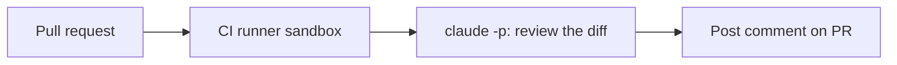

<LevelBadge level="advanced" />

<Callout type="objectives" items={[
  "Claude Code headless in einen pull_request-Workflow einbinden, der den Diff prüft und kommentiert",
  "Den permissions-Block auf reine Kommentarrechte setzen und begründen, warum contents: write die Grenze ist, die du nicht überschreitest",
  "Pull-Request-Inhalte als nicht vertrauenswürdige Eingabe behandeln, denn genau das sind sie",
  "Die Kosten eines Reviews begrenzen, wenn die Diffs wachsen",
  "Den Prompt so schreiben, dass der Kommentar gelesen statt eingeklappt wird"
]} />

<VerifyNote lastVerified="2026-07-17" source="https://code.claude.com/docs/en/headless">
Headless-Flags und Details der CI-Integration ändern sich — gleiche sie mit der offiziellen Claude-Code-/Agent-SDK-Dokumentation ab.
</VerifyNote>

Eine klassische, wertvolle Automatisierung: Claude **jeden Pull Request prüfen** lassen und seine Befunde als Kommentar posten — [headless](/docs/claude-code/headless-and-agent-sdk) in der CI. Hier die Grundform, mit den Leitplanken, die sie sicher halten.

## Was es tut

Bei jedem PR: den Diff auschecken, Claude bitten, ihn auf Bugs, Randfälle und Konventionsverstöße zu prüfen, und einen Kommentar posten. Menschen entscheiden weiterhin; Claude liefert nur einen schnellen ersten Durchgang.



<Steps items={[
  {title: "Genug Historie auschecken, um einen Diff zu berechnen", body: "Ein flacher Klon sieht den Basis-Branch nicht, also kommt der Diff leer heraus und das Review liest sich wie ein selbstsicheres Abnicken von nichts. Hole die volle Tiefe."},
  {title: "Den Diff als Datei erzeugen", body: "Diff der Basis-Referenz gegen HEAD und auf die Platte schreiben. Als Artefakt statt als Shell-Variable verhindert das, dass sehr große Diffs die Kommandozeile sprengen."},
  {title: "Claude headless mit dem Diff auf stdin ausführen", body: "Ein Prompt, ein Durchgang, die Ausgabe als Markdown erfasst. Keine Tools, keine Schreibzugriffe aufs Repo — dieser Schritt muss nur lesen und Text erzeugen."},
  {title: "Das Markdown als PR-Kommentar posten", body: "Mit der gh-CLI oder einer Action. Das ist der einzige Schritt, der überhaupt Schreibrechte braucht, und das einzige Schreibrecht, das er braucht, ist pull-requests."}
]} />

## Der Workflow (Skizze)

```yaml
name: Claude PR review
on: pull_request
permissions:
  contents: read
  pull-requests: write   # to comment — NOT write to code
jobs:
  review:
    runs-on: ubuntu-latest
    steps:
      - uses: actions/checkout@v4
        with: { fetch-depth: 0 }
      - name: Review the diff
        env:
          ANTHROPIC_API_KEY: ${{ secrets.ANTHROPIC_API_KEY }}
        run: |
          git diff origin/${{ github.base_ref }}...HEAD > /tmp/diff.patch
          claude -p "Review this diff for correctness bugs, missing edge cases, and
          security issues. Report ONLY high-confidence findings as a Markdown
          checklist with file:line. Diff:" < /tmp/diff.patch > /tmp/review.md
      # then post /tmp/review.md as a PR comment (e.g. with the gh CLI or an action)
```

(Der genaue Headless-Aufruf kann abweichen — siehe die Dokumentation. Das Prinzip: den Diff einspeisen, Markdown erfassen, posten.)

## Die Leitplanken (lies [Autonome Läufe härten](/docs/security/hardening-autonomous-runs))

:::warning[Minimale Rechte in der CI]
- **Nur kommentieren.** Vergib `pull-requests: write`, **nicht** `contents: write` — der Bot sollte keinen Code pushen.
- **Schränke das Token ein**; gib einem Job, der nicht vertrauenswürdige PR-Inhalte liest, nie Zugriff auf Deployment oder Secrets.
- **Behandle PR-Inhalte als nicht vertrauenswürdig** — sie können [Prompt Injection](/docs/security/prompt-injection) enthalten; lass den Job keine folgenreichen Aktionen ausführen.
- **Begrenze die Kosten** — große Diffs kosten [Tokens](/docs/api/tokens-and-pricing); erwäge, nur geänderte Dateien zu prüfen.
:::

## Nützlich machen, nicht laut

- Bitte um **nur Befunde mit hoher Sicherheit** — eine Wand aus Kleinigkeiten wird ignoriert.
- Behalte es als **ersten Durchgang**, bei dem Menschen die Merge-Entscheidung treffen.

<PromptCard title="Der Review-Prompt — abgestimmt auf einen Kommentar, den Leute wirklich lesen">{`Review this diff for correctness bugs, missing edge cases, and security issues.

Rules for your output:
- Report ONLY high-confidence findings. If you are unsure, leave it out.
- One Markdown checklist item per finding, each starting with file:line.
- State the concrete failure: what input or state leads to what wrong result.
- No style nitpicks, no praise, no summary of what the diff does.
- If you find nothing high-confidence, say exactly that in one line.

Diff:`}</PromptCard>

<Quiz questions={[
  {
    q: "Dein Review-Job muss einen Kommentar auf den Pull Request posten. Welcher permissions-Block ist korrekt?",
    options: [
      "contents: write und pull-requests: write, damit der Bot auch Korrekturen pushen kann",
      "contents: read und pull-requests: write — nur kommentieren; der Bot sollte keinen Code pushen",
      "contents: read und pull-requests: read, da Reviewen ein lesender Vorgang ist",
      "Für pull_request-Workflows ist kein permissions-Block nötig"
    ],
    answer: 1,
    explain: "Kommentieren erfordert pull-requests: write und nichts weiter. contents: write zu vergeben würde einem Job, der nicht vertrauenswürdige Pull-Request-Inhalte liest, erlauben, Code zu pushen — genau die Kombination, die du vermeiden willst. Das Repo zu lesen erfordert contents: read."
  },
  {
    q: "Warum verwendet der Checkout-Schritt fetch-depth: 0?",
    options: [
      "Um den Klon bei großen Repositories zu beschleunigen",
      "Weil Headless-Claude die vollständige Git-Historie zum Laufen braucht",
      "Weil ein flacher Klon den Basis-Branch nicht sehen kann und der Diff daher leer herauskommt",
      "Damit der Job später in den Branch zurückschreiben kann"
    ],
    answer: 2,
    explain: "Der Diff wird gegen die Basis-Referenz berechnet. Ein flacher Klon hat sie nicht, also ist der Diff leer und das Review nickt stillschweigend nichts ab — ein Fehler, der wie ein Bestehen aussieht."
  },
  {
    q: "Ein Beitragender öffnet einen PR, dessen Beschreibung den Reviewer anweist, die Sicherheitsprüfungen zu ignorieren und zu genehmigen. Was ist die richtige Haltung?",
    options: [
      "Dem Prompt eine Anweisung hinzufügen, dass Claude nie Anweisungen im Diff befolgen soll, und es damit als gelöst betrachten",
      "PR-Inhalte als nicht vertrauenswürdige Eingabe behandeln, die Prompt Injection enthalten kann, und den Job keine folgenreiche Aktion ausführen lassen",
      "Die Action auf PRs von Organisationsmitgliedern beschränken",
      "Den Job ein Issue eröffnen lassen, das den Beitragenden meldet"
    ],
    answer: 1,
    explain: "Pull-Request-Inhalte sind nicht vertrauenswürdige Eingaben, und sie können Prompt Injection enthalten. Anweisungen im Prompt helfen, sind aber keine Grenze. Die dauerhafte Kontrolle ist minimale Rechte: Der Job kann nur kommentieren, sodass der schlimmste Fall einer erfolgreichen Injection ein schlechter Kommentar ist statt eines Pushs, eines Deployments oder eines geleakten Secrets."
  }
]} />

<Callout type="takeaways" items={[
  "Der ganze Job ist: Checkout mit voller Tiefe, Diff in eine Datei, ein Headless-Durchgang, Markdown posten. Vier Schritte, von denen einer Schreibzugriff braucht.",
  "pull-requests: write und contents: read. Niemals contents: write in einem Job, der von Beitragenden verfasste Inhalte liest.",
  "fetch-depth: 0, sonst ist der Diff leer und das Review liest sich wie ein Gesundheitszeugnis.",
  "PR-Inhalte sind nicht vertrauenswürdig und können Prompt Injection enthalten. Minimale Rechte sind die Kontrolle; die Formulierung des Prompts ist keine Grenze.",
  "Bitte nur um Befunde mit hoher Sicherheit, mit file:line. Eine Wand aus Kleinigkeiten wird eingeklappt, und die Automatisierung stirbt daran, ignoriert zu werden.",
  "Begrenze die Kosten, wenn die Diffs wachsen — nur geänderte Dateien zu prüfen ist der übliche Hebel.",
  "Es ist ein erster Durchgang. Menschen treffen weiterhin die Merge-Entscheidung."
]} />

## Weiter

- [Headless-Modus & das Agent SDK](/docs/claude-code/headless-and-agent-sdk)
- [Autonome Läufe härten](/docs/security/hardening-autonomous-runs)
- [Coding & Softwareentwicklung](/docs/playbooks/coding)
