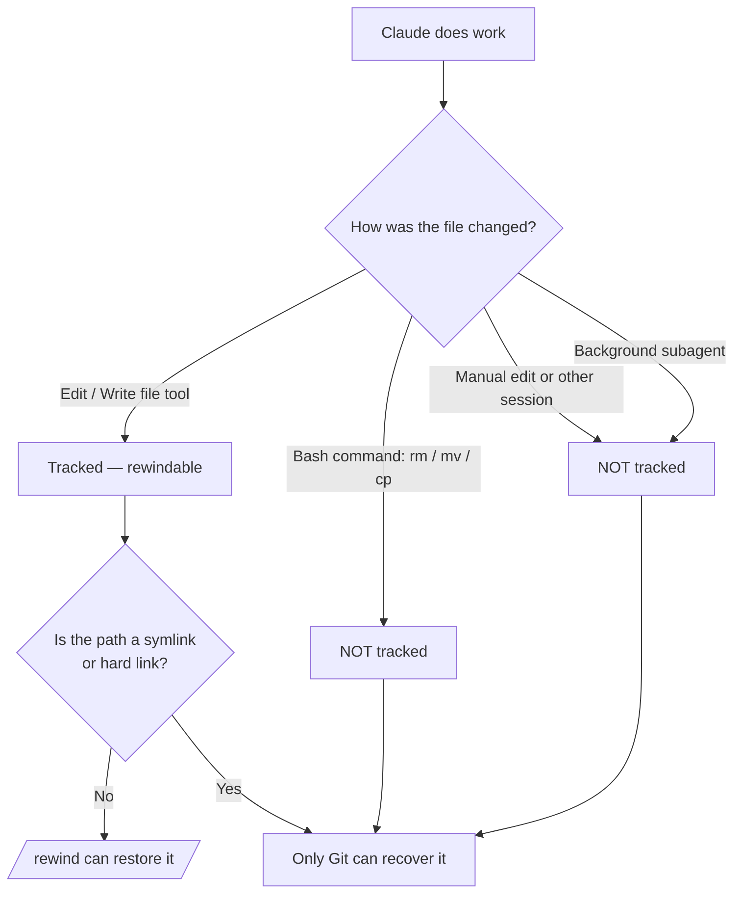

<LevelBadge level="intermediate" />

<Callout type="objectives" items={["Entender qué captura un checkpoint — y qué no captura sin avisar", "Abrir el menú de rewind de dos maneras y elegir cada vez la acción de restauración correcta", "Distinguir 'restore' (deshacer el estado) de 'summarize' (comprimir el contexto)", "Saber exactamente por qué los checkpoints complementan a Git pero nunca lo reemplazan"]} />

<VerifyNote lastVerified="2026-10-09" source="https://code.claude.com/docs/en/checkpointing">
El comportamiento de los checkpoints, las acciones del menú de rewind, el límite de snapshots y la retención cambian entre versiones — confírmalo en la documentación oficial.
</VerifyNote>

## La idea principal

Cuando sueltas a Claude sobre un cambio ambicioso y de gran alcance, la pregunta más temida es "¿y si sale mal a tres ediciones de profundidad?". **Checkpointing** es la respuesta: Claude Code toma automáticamente un snapshot de tu código antes de cada edición, de modo que puedes volver a cualquier estado anterior en lugar de desenredar a mano un refactor a medio terminar.

Piénsalo como un **deshacer local para toda la sesión** — una red de seguridad que te permite decir "sí, prueba el enfoque audaz" sin miedo.

## Cómo se crean los checkpoints

Tú no creas checkpoints — ocurren automáticamente.

<Steps items={[{title: "Cada prompt que inicia un turno = un checkpoint", body: "Cada prompt que inicia un turno captura el estado de tu código antes de que se ejecuten las herramientas de edición de archivos de Claude. Sin comandos, sin configuración, sin ceremonias."}, {title: "Solo se conservan los 100 más recientes", body: "Claude Code conserva los snapshots de archivos de los 100 checkpoints más recientes de una sesión. Los más antiguos se descartan, así que una sesión muy larga no puede rebobinarse hasta su inicio."}, {title: "Persisten entre sesiones", body: "Los checkpoints se guardan con la conversación, así que puedes ejecutar /rewind incluso después de reanudar una sesión, no solo en la sesión activa."}, {title: "Se limpian solos", body: "Los snapshots de archivos de una sesión se eliminan en la limpieza de retención, por defecto unos 30 días después de la última vez que la sesión guardó uno. Rebobinar a un checkpoint cuyos snapshots ya no existen falla con 'No files were restored' — aumenta cleanupPeriodDays para conservarlos más tiempo."}]} />

## Abrir el menú de rewind

Hay dos formas de entrar:

<Steps items={[{title: "Ejecutar /rewind", body: "Escribe el comando slash desde el prompt. Siempre funciona."}, {title: "Pulsar Esc dos veces — pero solo con la entrada vacía", body: "Esc doble abre el menú de rewind cuando el cuadro del prompt está vacío. Si hay texto, Esc doble borra ese texto en su lugar (el texto borrado se guarda en el historial de entrada, así que pulsa Arriba para recuperarlo después)."}]} />

<PromptCard title="Abrir el menú de rewind">{`/rewind`}</PromptCard>

El menú lista **cada prompt que enviaste en esta sesión**. Elige el punto sobre el que quieres actuar y luego una acción.

## Restore vs. summarize: la distinción clave

Aquí es donde la gente se confunde. El menú ofrece dos *tipos* de acción:

- Las acciones **Restore** cambian el estado en disco y/o en la conversación — deshacen.
- Las acciones **Summarize** nunca tocan tus archivos — comprimen la conversación para liberar espacio en la ventana de contexto.

<Callout type="warning" items={["Restore = deshacer (revierte el código, la conversación o ambos). Summarize = comprimir contexto (los archivos en disco no se tocan).", "Usa restore cuando una edición haya roto algo. Usa summarize cuando la sesión esté inflada pero el código esté bien."]} />

### Las acciones de restore

<Steps items={[{title: "Restore code and conversation", body: "Revierte tanto tus archivos como el historial del chat al punto seleccionado — un limpio 'rebobinar el tiempo' a ese momento."}, {title: "Restore conversation", body: "Rebobina el chat hasta ese mensaje pero conserva tu código actual. Útil para repetir una pregunta sin perder las ediciones que quieres mantener."}, {title: "Restore code", body: "Revierte los cambios de archivos pero conserva la conversación. Deshaces las ediciones, mantienes la discusión sobre ellas."}]} />

Las dos opciones de restore de **código** solo aparecen cuando el checkpoint seleccionado realmente tiene cambios de archivos rastreados que revertir. Si no se capturó ninguna edición de archivos después de ese punto, el menú ofrece solo **Restore conversation**, las dos opciones de summarize y **Never mind** (que vuelve a la lista de mensajes sin cambiar nada).

Después de restaurar la conversación (o elegir "Summarize from here"), el prompt original del mensaje seleccionado vuelve al campo de entrada para que puedas reenviarlo o editarlo.

### Las acciones de summarize

Ambas comprimen parte de la conversación en un resumen generado por IA — como un **`/compact` dirigido** en el que eliges qué lado del mensaje seleccionado comprimir.

<Steps items={[{title: "Summarize from here", body: "Los mensajes ANTERIORES al seleccionado permanecen intactos. El mensaje seleccionado y todo lo posterior se convierten en un resumen. Úsalo para descartar una discusión lateral manteniendo el contexto inicial con todo detalle."}, {title: "Summarize up to here", body: "Los mensajes ANTERIORES al seleccionado se convierten en un resumen; el mensaje seleccionado y todo lo posterior permanecen intactos. Te quedas al final de la conversación. Úsalo para comprimir la charla inicial de preparación manteniendo el trabajo reciente textual."}]} />

En ambos casos los mensajes originales permanecen en la transcripción de la sesión, de modo que Claude aún puede consultar los detalles, y aparece un marcador **Summarized conversation** donde estaban los mensajes comprimidos. Para orientar en qué se centra el resumen, resalta una opción **Summarize** con las flechas y escribe instrucciones donde la fila dice **add context (optional)**, luego pulsa Enter — elegir la opción con su tecla numérica resume de inmediato, sin instrucciones.

Para el flujo completo, consulta [Gestión del contexto](/docs/claude-code/context-management) — las acciones summarize de `/rewind` son un bisturí donde `/compact` es una brocha ancha.

<Callout type="note" items={["Summarize te mantiene en la misma sesión. Para ramificar y probar un enfoque distinto dejando intacta la sesión original, usa en su lugar /branch o claude --continue --fork-session."]} />

## Rebobinar más allá de un `/clear`

Si ejecutaste `/clear` antes en el mismo proceso de Claude Code, el menú de rewind muestra una entrada extra arriba: `/resume <session-id> (previous session)`. Selecciónala para volver a la conversación que estaba activa antes de `/clear`.

<VerifyNote lastVerified="2026-10-09" source="https://code.claude.com/docs/en/checkpointing">
Esa entrada solo está disponible hasta que salgas de Claude Code o reanudes otra sesión. Una vez que desaparezca, ejecuta `/resume` y elige la sesión anterior de la lista.
</VerifyNote>

## Dónde se detienen los checkpoints — los límites que duelen

Los checkpoints parecen mágicos hasta que dejan de serlo. Estas lagunas importan:

<Steps items={[{title: "Los cambios hechos con bash son invisibles", body: "Los archivos tocados por comandos de shell que ejecuta Claude — rm, mv, cp, generadores de código, formateadores — NO se rastrean. Solo las ediciones directas mediante las herramientas de edición de archivos de Claude quedan en checkpoints. Un archivo borrado con rm está perdido en lo que respecta a rewind."}, {title: "La mayoría de las ediciones de subagentes no se restauran", body: "Un subagente edita con las mismas herramientas de archivos, pero tu sesión normalmente no captura esas ediciones. La excepción es una skill bifurcada en primer plano (context: fork con background: false), que edita durante tu propio turno y se rebobina con normalidad. Cualquier otro subagente — incluida una skill bifurcada en segundo plano, que es lo predeterminado — necesita Git para deshacerse. Consulta /docs/claude-code/subagents."}, {title: "Los cambios externos y concurrentes son invisibles", body: "Las ediciones manuales que haces fuera de Claude Code y las ediciones de otras sesiones concurrentes normalmente no se capturan — a menos que toquen los mismos archivos que editó la sesión actual."}, {title: "Los mensajes a mitad de turno no reciben checkpoint", body: "Un mensaje que pones en cola mientras Claude trabaja y que le llega dentro del turno en curso se une a ese turno en lugar de iniciar uno nuevo, así que no tiene un checkpoint propio. Para deshacer lo que vino después, rebobina al prompt que inició el turno — lo cual rebobina todo el turno, incluido el trabajo hecho antes de que llegara tu mensaje."}, {title: "Los enlaces simbólicos y los enlaces duros se omiten", body: "Restore omite cualquier ruta rastreada que sea un enlace simbólico o un enlace duro y avisa con 'Restored the code, but skipped N files'; esos archivos conservan su contenido actual. Los enlaces simbólicos de los gestores de dotfiles y los enlaces duros de pnpm caen en este caso. Ejecuta /debug antes de restaurar para que las rutas omitidas se nombren en el registro de depuración."}, {title: "Es a nivel de sesión, no historial", body: "Los checkpoints son una recuperación rápida y local. No son commits, no son ramas y no se pueden compartir con tu equipo."}]} />

## Checkpoints vs. Git: usa ambos

Resuelven problemas distintos, así que combínalos.

| | Checkpoints (`/rewind`) | Git |
|---|---|---|
| Alcance | Una sesión | Historial completo del proyecto |
| Granularidad | Por prompt que inicia un turno, automática | Por commit, deliberada |
| ¿Rastrea cambios hechos con bash? | No | Sí (una vez en staging/commit) |
| Vida útil | Últimos 100 checkpoints, limpiados ~30 días tras la sesión | Permanente |
| Compartible / colaborativo | No | Sí |
| Modelo mental | "Deshacer local" | "Historial permanente" |

<Callout type="tip" items={["Haz commit en Git de los estados que funcionan antes de una ejecución arriesgada y de gran alcance — es tu suelo duradero.", "Usa /rewind para una recuperación rápida dentro de la sesión entre commits, sin ensuciar tu historial de Git.", "Si Claude va a ejecutar bash destructivo (rm/mv), generadores o subagentes en segundo plano, apóyate en Git — rewind no salvará esos archivos."]} />

## Cuándo recurrir a él

<Steps items={[{title: "Explorar alternativas", body: "Prueba una implementación audaz y, si no te gusta, restaura código y conversación al punto de bifurcación e intenta otra."}, {title: "Recuperarte de una mala edición", body: "¿Una edición introdujo un bug hace tres prompts? Restaura el código a justo antes en lugar de depurar los escombros."}, {title: "Iterar sobre una funcionalidad", body: "Experimenta con variaciones sabiendo siempre que un estado correcto está a un /rewind de distancia."}, {title: "Liberar espacio de contexto", body: "¿Un desvío de depuración verboso se comió tu ventana de contexto? Haz summarize desde el punto medio en adelante y conserva tus instrucciones originales con todo detalle."}]} />

<Quiz title="Compruébalo tú mismo" questions={[{q: "Claude ejecutó `rm config.old.json` mediante un comando bash y quieres recuperarlo. ¿Puede `/rewind` restaurarlo?", options: ["Sí — cada cambio que hace Claude queda en un checkpoint", "No — los cambios hechos con bash no se rastrean; solo las ediciones directas con herramientas de archivos", "Solo si ejecutas /rewind en los primeros 30 segundos"], answer: 1, explain: "Los checkpoints solo capturan las ediciones hechas mediante las herramientas de edición de archivos de Claude. Los archivos cambiados por comandos bash (rm, mv, cp) no se rastrean — para eso está Git."}, {q: "Tu código está bien, pero un largo desvío de depuración llenó la ventana de contexto. ¿Qué acción encaja?", options: ["Restore code and conversation a antes del desvío", "Restore code", "Summarize from here al comienzo del desvío"], answer: 2, explain: "Las acciones summarize comprimen la conversación sin tocar los archivos. 'Summarize from here' convierte el desvío en un resumen manteniendo intacto tu contexto anterior — libera espacio de contexto sin ningún cambio de código."}, {q: "¿Cómo se crea un checkpoint?", options: ["Ejecutas /checkpoint manualmente", "Automáticamente — cada prompt que inicia un turno crea uno", "Solo cuando haces commit en Git"], answer: 1, explain: "Los checkpoints son automáticos: cada prompt que inicia un turno captura el estado del código antes de las ediciones. No hay paso manual — pero un mensaje que llega a mitad de turno se une al turno en curso y no recibe un checkpoint propio."}]} />

<Flashcards title="Vocabulario de checkpoints y rewind" cards={[{front: "Checkpoint", back: "Un snapshot automático de tu código tomado antes de cada prompt que inicia un turno. Limitado a la sesión, se conservan los últimos 100, limpiados ~30 días tras la sesión."}, {front: "/rewind", back: "Abre el menú de rewind que lista cada prompt de la sesión, para que puedas restaurar o resumir desde cualquier punto. También accesible con Esc doble en una entrada vacía."}, {front: "Acción restore", back: "Revierte el estado — código, conversación o ambos — al punto seleccionado. Es el 'deshacer'. Las opciones de código solo aparecen cuando ese checkpoint tiene cambios rastreados."}, {front: "Acción summarize", back: "Comprime parte de la conversación en un resumen de IA para liberar contexto. Los archivos en disco nunca se tocan."}, {front: "Punto ciego de bash", back: "Los archivos cambiados por comandos de shell (rm/mv/cp) NO quedan en checkpoints — solo las ediciones directas con herramientas de archivos. Usa Git para esos."}, {front: "Punto ciego de subagentes", back: "Solo se rebobinan las ediciones de una skill bifurcada en primer plano. Los subagentes en segundo plano (incluido el fork en segundo plano predeterminado) necesitan Git."}]} />

<Callout type="takeaways" items={["Los checkpoints son snapshots automáticos tomados antes de cada prompt que inicia un turno — un deshacer local para la sesión. Se conservan los últimos 100 y luego se limpian ~30 días tras la sesión.", "Abre el menú de rewind con /rewind o con Esc doble en una entrada vacía; lista cada prompt que enviaste.", "Las acciones restore deshacen el estado (código, conversación o ambos); las acciones summarize comprimen el contexto y nunca tocan los archivos.", "Los cambios hechos con bash, externos, concurrentes y la mayoría de los de subagentes NO se rastrean — y las rutas con enlaces simbólicos o duros se omiten al restaurar.", "Los checkpoints complementan a Git, no lo reemplazan: piensa en 'deshacer local' frente a 'historial permanente y compartible'."]} />

## Siguiente

- [Gestión del contexto](/docs/claude-code/context-management) — `/compact`, `/clear` y cómo encaja summarize en el panorama general
- [Plan Mode](/docs/claude-code/plan-mode) — investiga y aprueba un plan antes de que se ejecuten las ediciones, para rebobinar con menos frecuencia
- [Permisos](/docs/claude-code/permissions) — la otra mitad de ejecutar tareas ambiciosas con seguridad
