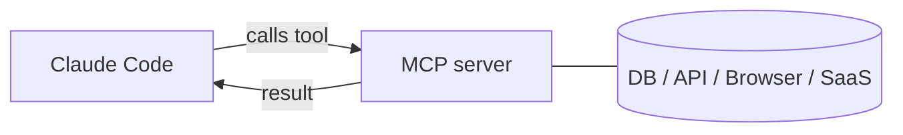

<LevelBadge level="advanced" />

<VerifyNote lastVerified="2026-11-10" source="https://code.claude.com/docs/en/mcp">
Los comandos `claude mcp`, los ámbitos de configuración y los transportes evolucionan: confírmalos en la documentación oficial de MCP de Claude Code y en modelcontextprotocol.io. Los cuatro transportes, las rutas de almacenamiento de los ámbitos, la obsolescencia de SSE y el comportamiento de aprobación de proyecto que se describen abajo provienen de esa página.
</VerifyNote>

El **Model Context Protocol (MCP)** es un estándar abierto para conectar la IA con herramientas y datos externos. Un **servidor MCP** expone capacidades (consultar una base de datos, abrir una PR de GitHub, manejar un navegador); Claude Code se conecta a él y puede **llamar a esas herramientas** durante una sesión. Así extiendes Claude más allá de tu sistema de archivos y tu shell.

<Callout type="objectives" items={["Explicar qué es un servidor MCP y cómo Claude Code llama a sus herramientas", "Distinguir los dos transportes: stdio local vs HTTP/SSE remoto", "Añadir un servidor con claude mcp add y leer el JSON que escribe", "Elegir el ámbito correcto (local, project, user) según quién ve un servidor", "Conectar una base de datos real a Claude de principio a fin", "Evitar las trampas de seguridad y configuración en las que cae la mayoría"]} />

## La idea general



Declaras los servidores que Claude puede usar; cada servidor publica un conjunto de herramientas con sus esquemas; Claude las elige y las llama como cualquier otra herramienta.

<Flashcards title="Vocabulario MCP" cards={[{front: "Model Context Protocol (MCP)", back: "Un estándar abierto para conectar la IA con herramientas y datos externos."}, {front: "Servidor MCP", back: "Un programa que expone capacidades (consultar una base de datos, abrir una PR de GitHub, manejar un navegador) como herramientas invocables."}, {front: "Herramienta (tool)", back: "Una capacidad que un servidor MCP publica con un esquema; Claude la elige y la llama como cualquier otra herramienta."}, {front: "Transporte", back: "Cómo Claude llega a un servidor: stdio (proceso local), HTTP (alojado, a menudo con OAuth), SSE (obsoleto: HTTP recurre a él automáticamente) o WebSocket ws/wss (persistente, con push, solo autenticación por cabeceras, sin la opción --transport)."}, {front: "Ámbito (scope)", back: "Quién ve un servidor: local (tú, este proyecto), project (el equipo mediante commit) o user (tú, en todas partes)."}]} />

## Transportes

Hay cuatro formas en que Claude llega a un servidor. Elige según dónde se ejecuta el servidor y cómo se comunica.

- **stdio**: un proceso local que Claude lanza (ideal para herramientas y CLI locales). Es lo que significa una entrada JSON sin `type`.
- **HTTP**: un servidor alojado, a menudo con OAuth. La opción predeterminada para cualquier cosa remota.
- **SSE**: **obsoleto**; usa HTTP siempre que puedas. Algunos servicios todavía exponen solo un endpoint SSE, y desde Claude Code v2.1.265 `--transport http` prueba primero HTTP y cambia a SSE por sí solo, así que rara vez necesitas `--transport sse` de forma explícita.
- **WebSocket** (`ws` / `wss`): una conexión bidireccional persistente, para un servidor que envía eventos sin que se le pida. `--transport` *no* acepta `ws`: añádelo con `claude mcp add-json '{"type":"ws","url":"wss://…"}'` o escríbelo en `.mcp.json`. Sin OAuth: la autenticación es solo por cabeceras.

<Callout type="warning" items={["Una entrada JSON con url pero sin type es un error de configuración, no un valor predeterminado razonable: Claude Code lee una entrada sin type como un servidor stdio, la omite e informa de que tiene una «url» pero ningún «type». Define siempre \"type\": \"http\" (o \"sse\" / \"ws\") en un servidor remoto que escribas a mano."]} />

## Configurar servidores

El camino más rápido es el comando `claude mcp add`: escribe la configuración por ti. Sigue esta secuencia para pasar de cero a un servidor conectado.

<Steps items={[{title: "Añade un servidor stdio local", body: "Ejecuta claude mcp add: todo lo que sigue a -- es el comando de lanzamiento que Claude ejecuta por ti."}, {title: "O añade un servidor HTTP remoto", body: "Pasa --transport http y un ámbito, y luego la URL del servidor. Los servidores remotos suelen estar alojados y usar OAuth."}, {title: "Mira qué está conectado", body: "Ejecuta claude mcp list para ver los servidores configurados y su estado de conexión."}, {title: "Inspecciona y autentica", body: "Usa /mcp dentro de una sesión para inspeccionar las herramientas de un servidor y autenticar los servidores remotos."}]} />

<PromptCard title="Añadir un servidor stdio local">{`# A local stdio server (everything after -- is the launch command)
claude mcp add filesystem -- npx -y @modelcontextprotocol/server-filesystem ~/code/myproject`}</PromptCard>

<PromptCard title="Añadir un servidor HTTP remoto (compartido con el proyecto)">{`# A remote HTTP server, shared with everyone on the project
claude mcp add --transport http --scope project github https://api.githubcopilot.com/mcp/`}</PromptCard>

Por debajo, todo es JSON. Un servidor de ámbito **project** acaba en un `.mcp.json` en la raíz del repositorio: haz commit y tus compañeros obtienen las mismas herramientas en cuanto confían en el espacio de trabajo:

```json
{
  "mcpServers": {
    "github": { "type": "http", "url": "https://api.githubcopilot.com/mcp/" }
  }
}
```

<Callout type="warning" items={["No recurras a los paquetes @modelcontextprotocol/server-github, -postgres, -slack ni -puppeteer que encontrarás en tutoriales antiguos. Están archivados y llevan un aviso de obsolescencia de npm que dice \"Archived and unmaintained; no security guarantees\". Usa el servidor del propio proveedor cuando exista: el de GitHub es el endpoint HTTP de arriba, y el control del navegador pasó a @playwright/mcp. Entre los servidores de referencia en TypeScript, solo filesystem, memory, everything y sequential-thinking siguen mantenidos."]} />

### El ámbito decide quién ve el servidor

| Ámbito | Se guarda en | Se carga en | Úsalo para |
|---|---|---|---|
| `local` (predeterminado) | `~/.claude.json`, bajo la ruta de este proyecto | solo este proyecto | experimentos personales, secretos |
| `project` | `.mcp.json` en el repo (con commit) | solo este proyecto, compartido con el equipo | herramientas que todo el equipo debe compartir |
| `user` | `~/.claude.json` | todos tus proyectos | servidores que quieres en todas partes |

<Callout type="warning" items={["El «ámbito local» de MCP no es lo mismo que la configuración local. Un servidor MCP de ámbito local vive en ~/.claude.json en tu directorio personal, NO en el .claude/settings.local.json del proyecto. Buscarlo en la carpeta del proyecto es un callejón sin salida."]} />

Ejecuta `claude mcp list` para ver qué está conectado y `/mcp` dentro de una sesión para inspeccionar herramientas y autenticar servidores remotos. Consulta [Configuración MCP y plantillas de servidor](/docs/templates/mcp-config) para puntos de partida que puedes copiar y pegar.

## Ejemplo práctico: dale tu base de datos a Claude

Supón que quieres que Claude responda preguntas sobre un Postgres local en lugar de pegar tú los resultados de las consultas. Añade el servidor en ámbito project, para que tus compañeros también lo tengan.

Las bases de datos son donde más duele el problema de los servidores archivados: el antiguo `@modelcontextprotocol/server-postgres` no tiene mantenimiento y no hay un sustituto oficial, así que el nombre del paquete es la única decisión que debes tomar tú. Elige un servidor de la comunidad que tenga mantenimiento, [revísalo](/docs/security/reviewing-third-party-code) y luego conéctalo: la forma es la misma elijas el que elijas:

<PromptCard title="Añadir un servidor Postgres en ámbito project">{`# Replace the package with a maintained Postgres MCP server you have reviewed.
# The connection string is read-only on purpose — see below.
claude mcp add --scope project db -- npx -y <postgres-mcp-server> "postgresql://readonly@localhost/app"`}</PromptCard>

Ahora, en una sesión, puedes hacer la pregunta en lenguaje natural y dejar que Claude haga por ti el ciclo de consultas:

<PromptCard title="Hacer una pregunta a la base de datos">{`How many users signed up last week? Check the DB.`}</PromptCard>

Claude llama a la herramienta de consulta que publica el servidor, recibe filas y responde, sin ciclo de copiar y pegar. Mantén la cadena de conexión en solo lectura salvo que Claude necesite escribir de verdad. Y si lo único que querías era una consulta, ten en cuenta que `psql -c '…'` a través de Bash cuesta una fracción de los tokens; [El impuesto de tokens de MCP](/docs/claude-code/mcp-token-cost) explica cuándo gana cada uno.

Al ser de ámbito project, un compañero que haga pull del repositorio obtiene la misma capacidad, pero **ni en silencio ni al instante**. Un servidor de un `.mcp.json` con commit se queda en `⏸ Pending approval` hasta que ejecuta `claude` en la carpeta y acepta el cuadro de diálogo de confianza del espacio de trabajo. Un repositorio clonado no puede preaprobar sus propios servidores: `enableAllProjectMcpServers` o `enabledMcpjsonServers` con commit en el `.claude/settings.json` del proyecto se *ignoran* en una carpeta no confiable. Las aprobaciones de un `~/.claude/settings.json` a nivel de usuario, de la configuración administrada o pasadas con `--settings` sí se aplican ahí. Esa es la respuesta habitual a «¿por qué mi compañero no ve el servidor?»

## Confianza y seguridad

<Callout type="warning" items={["Un servidor MCP ejecuta código y puede leer datos y realizar acciones: conecta solo servidores en los que confíes.", "Da a cada servidor el mínimo privilegio que necesite.", "Cualquier contenido externo que devuelva un servidor puede llevar inyección de prompts.", "Revisa los servidores de terceros antes de conectarlos."]} />

:::warning[Trata los servidores MCP como instalar software]
Un servidor MCP ejecuta código y puede leer datos y realizar acciones. Conecta solo servidores en los que confíes, dales el **mínimo privilegio** necesario y recuerda que cualquier contenido externo que devuelvan puede llevar [inyección de prompts](/docs/security/prompt-injection). Revisa primero los servidores de terceros: consulta [Revisar código de terceros](/docs/security/reviewing-third-party-code).
:::

## MCP también en las apps

MCP también impulsa los **Conectores** de las apps de Claude: el mismo estándar, otra superficie. Consulta [Conectores (MCP) en las apps](/docs/claude-app/connectors) y, para la API, [MCP y conexión a herramientas](/docs/api/mcp).

## Errores comunes

- **Ámbito equivocado.** Un servidor añadido en ámbito `local` no aparecerá para tus compañeros; uno que solo querías para ti no debería subirse con commit en ámbito `project`. Elige con intención.
- **Demasiados servidores, demasiadas herramientas.** La búsqueda de herramientas está activada por defecto, así que un servidor conectado normalmente te cuesta en cada turno los *nombres* de sus herramientas y las instrucciones del servidor en lugar de sus esquemas completos, pero sigue siendo un impuesto por turno, y los esquemas entran en el contexto en el momento en que Claude los busca. Conecta lo que necesita la tarea, no todo tu catálogo. Consulta [El impuesto de tokens de MCP](/docs/claude-code/mcp-token-cost) para ver las cifras reales, los modos de `ENABLE_TOOL_SEARCH` y cómo la ejecución de código reduce el segundo coste.
- **Conexiones con privilegios excesivos.** Da a un servidor de base de datos un rol de solo lectura salvo que Claude necesite escribir de verdad. MCP hace reales las capacidades: acótalas.
- **Olvidar el riesgo de inyección.** Todo lo que devuelve un servidor (una página web, el cuerpo de una issue, una fila) es texto no confiable que puede llevar [inyección de prompts](/docs/security/prompt-injection). No conectes un servidor potente con capacidad de escritura junto a uno no confiable con capacidad de lectura sin pensarlo bien.

<Quiz title="Compruébalo tú mismo" questions={[{q: "¿Qué transporte es un proceso local que Claude lanza por sí mismo?", options: ["HTTP/SSE remoto", "stdio", "OAuth"], answer: 1, explain: "stdio es un proceso local que Claude lanza: ideal para herramientas y CLI locales. Los otros tres son remotos: HTTP (a menudo con OAuth), el SSE obsoleto y WebSocket."}, {q: "¿Dónde se escribe un servidor de ámbito project y qué tiene que hacer un compañero?", options: ["Tu configuración de usuario; solo tú lo ves", "Un .mcp.json en la raíz del repositorio; tras hacer pull, aún tiene que confiar en el espacio de trabajo para que el servidor salga de Pending approval", "Una caché global oculta; nadie puede editarla"], answer: 1, explain: "El ámbito project acaba en un .mcp.json con commit en la raíz del repositorio. Pero un repositorio clonado no puede aprobar sus propios servidores: un enableAllProjectMcpServers con commit se ignora en una carpeta no confiable, así que el servidor espera en Pending approval hasta que el compañero acepta el cuadro de diálogo de confianza del espacio de trabajo."}, {q: "¿Por qué mantener una conexión de base de datos en solo lectura cuando Claude solo necesita leer?", options: ["Hace que las consultas se ejecuten más rápido", "Mínimo privilegio: MCP hace reales las capacidades, así que no concedas acceso de escritura salvo que sea realmente necesario", "El protocolo exige solo lectura"], answer: 1, explain: "Da a los servidores el mínimo privilegio que necesiten. MCP hace reales las capacidades, así que un rol de solo lectura evita escrituras no deseadas."}]} />

<Callout type="takeaways" items={["MCP es un estándar abierto; un servidor MCP expone herramientas que Claude Code llama como cualquier otra herramienta.", "Cuatro transportes: stdio (un proceso que Claude lanza), HTTP (el predeterminado para remotos), SSE (obsoleto: HTTP cambia a él por sí solo) y WebSocket ws/wss (push, autenticación por cabeceras, solo con add-json).", "claude mcp add escribe la configuración por ti; por debajo es JSON. El ámbito project vive en un .mcp.json con commit, y la copia de un compañero se queda en Pending approval hasta que confíe en el espacio de trabajo.", "El ámbito controla la visibilidad: local (tú, este proyecto), project (con commit para el equipo), user (tú, en todas partes).", "Trata los servidores como instalar software: confianza, mínimo privilegio y atención a la inyección de prompts en todo lo que devuelven."]} />

## Siguiente

- [Construye y conecta tu primer servidor MCP (guía paso a paso)](/docs/walkthroughs/first-mcp-server)
- [Configuración MCP y plantillas de servidor](/docs/templates/mcp-config)
- [Proteger agentes y herramientas](/docs/security/securing-agents)
