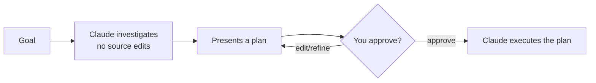

<LevelBadge level="beginner" />

<Callout type="objectives" items={["Explicar qué bloquea el Plan Mode — y qué sigue permitiendo que Claude ejecute", "Entrar y salir del Plan Mode de tres formas distintas", "Recorrer el ciclo investigar-proponer-aprobar-ejecutar", "Distinguir el Plan Mode de los Permisos y usarlos juntos"]} />

<VerifyNote lastVerified="2026-10-09" source="https://code.claude.com/docs/en/permission-modes">
La forma de entrar al Plan Mode (atajo/flag), y exactamente qué comandos de shell permite ejecutar a Claude mientras planifica, cambian entre versiones — consulta la documentación oficial de Claude Code.
</VerifyNote>

## La idea principal

Imagina darle a un contratista las llaves de tu casa frente a pedirle primero que la recorra y anote *qué* cambiaría. El Plan Mode es ese recorrido.

El **Plan Mode** le indica a Claude que **investigue y proponga cambios sin realizarlos**: lee archivos, ejecuta comandos de shell para explorar y escribe un plan — pero **no edita tu código fuente**. Las ediciones quedan bloqueadas hasta que apruebes el plan.

<Callout type="tip" items={["El Plan Mode significa que Claude INVESTIGA pero no CAMBIA tu código fuente — produce un plan y espera tu señal."]} />

### No es estrictamente de solo lectura

Explorar a veces requiere un comando, así que el Plan Mode trata de *no editar*, no de *no ejecutar*. Lo que ocurre con un comando de shell durante la planificación depende de la sesión — gana el primer caso que coincida:

<Steps items={[{title: "Auto mode disponible y useAutoModeDuringPlan activado (el valor por defecto)", body: "El clasificador revisa los comandos de shell en lugar de preguntarte, salvo las eliminaciones en rutas críticas. Los comandos aprobados se ejecutan; los rechazados quedan bloqueados."}, {title: "Auto mode no disponible, o useAutoModeDuringPlan desactivado", body: "Los comandos que quedan fuera del conjunto integrado de solo lectura te piden aprobación."}, {title: "Sesiones de terminal interactivas con bypass permissions disponible", body: "Los bloqueos del Plan Mode NO se aplican. Claude sigue recibiendo la instrucción de planificar sin editar, pero cualquier edición o comando que intente durante la planificación se ejecuta sin preguntar. El Plan Mode mantiene sus bloqueos en todos los demás contextos — ejecuciones headless con -p, el Agent SDK y el panel de chat de la extensión de VS Code."}]} />

<Callout type="warning" items={["Si arrancaste con --allow-dangerously-skip-permissions, el Plan Mode es una instrucción firme más que una salvaguarda estricta. Trátalo como una convención de planificación, no como un sandbox."]} />

## Por qué es la forma más segura de empezar

Para cualquier cosa grande, arriesgada o desconocida, quieres ver *qué* pretende hacer Claude antes de que toque tu repositorio. El Plan Mode separa el **pensar** del **hacer**:

La recompensa: detectas suposiciones equivocadas *antes* de que se conviertan en código equivocado.

## Cuándo usarlo

<Callout type="tip" items={["SIEMPRE para cambios grandes o multiarchivo, migraciones o refactorizaciones", "Cuando trabajas en una base de código que aún no conoces del todo", "Cuando quieres un plan revisable para compartir con un compañero de equipo"]} />

Para ediciones pequeñas y obvias puedes saltártelo, pero en caso de duda, planifica primero.

## Cómo funciona en la práctica

Sigue el ciclo. Cada paso habilita el siguiente: Claude solo pasa a editar *después* de que apruebes.

<Steps items={[{title: "Entra al Plan Mode y expón tu objetivo", body: "Pulsa Shift+Tab para recorrer los modos de permiso hasta que la barra de estado muestre 'plan mode on', o prefija un único prompt con /plan. Para empezar ya ahí, arranca con claude --permission-mode plan. Luego describe lo que quieres lograr."}, {title: "Claude investiga", body: "Lee los archivos relevantes, ejecuta comandos exploratorios y hace preguntas aclaratorias."}, {title: "Claude devuelve un plan paso a paso", body: "Archivos a cambiar, el enfoque y cómo verificar el resultado. Pulsa Ctrl+G para abrir el plan propuesto en tu editor y modificarlo directamente."}, {title: "Apruebas o refinas", body: "Elige 'Yes, and use auto mode', 'Yes, manually approve edits' o 'No, keep planning'. Aprobar sale del Plan Mode hacia el modo de permiso que describe esa opción, y Claude empieza a editar."}]} />

Para salir del Plan Mode sin aprobar un plan, pulsa `Shift+Tab` otra vez. Para convertirlo en el modo por defecto de las sesiones de terminal de un proyecto, pon `defaultMode` en `plan` dentro de `.claude/settings.json` — consulta [Ajustes](/docs/claude-code/settings).

### Pruébalo tú mismo

Copia esto en una sesión de planificación real y observa cómo se desarrolla el ciclo:

<PromptCard title="Inicia una sesión de planificación">{`I want to migrate our auth from sessions to JWT. Stay in Plan Mode: investigate the current setup, ask anything you need, then propose a step-by-step plan with files to change and how to verify — don't edit anything yet.`}</PromptCard>

:::tip Combínalo con CLAUDE.md
Un buen [CLAUDE.md](/docs/claude-code/claude-md) hace que los planes sean más precisos: Claude planifica teniendo ya en cuenta tus convenciones y salvaguardas.
:::

## Plan Mode frente a Permisos

Una confusión clásica. Resuelven problemas distintos y funcionan juntos:

- **Plan Mode** = "investiga y propón, no edites todavía." (Esta página.)
- **[Permisos](/docs/claude-code/permissions)** = una vez actuando, *qué* acciones están permitidas sin preguntar.

Piénsalo como **si actuar ahora** (Plan Mode) frente a **qué acciones están permitidas una vez actuando** (Permisos).

<Flashcards cards={[{front: "¿En qué estado pone el Plan Mode a Claude Code?", back: "Investigar y proponer: lee archivos, ejecuta comandos de shell para explorar y escribe un plan, pero no edita tu código fuente. Las ediciones quedan bloqueadas hasta que apruebes."}, {front: "¿Cómo se entra y se sale del Plan Mode?", back: "Entra con Shift+Tab, con el prefijo /plan en un prompt, o con claude --permission-mode plan. Sal sin aprobar pulsando Shift+Tab otra vez."}, {front: "¿Cuál es el ciclo del Plan Mode?", back: "Investigar → presentar un plan → apruebas o refinas → Claude ejecuta."}, {front: "¿Cuándo deberías recurrir al Plan Mode?", back: "Por defecto para trabajo grande, arriesgado o desconocido (cambios multiarchivo, migraciones, refactorizaciones, bases de código desconocidas). Sáltatelo solo para ediciones pequeñas y obvias."}, {front: "¿Plan Mode frente a Permisos?", back: "El Plan Mode gobierna SI actuar ahora; los Permisos gobiernan QUÉ acciones están permitidas una vez actuando."}]} />

<Callout type="takeaways" items={["El Plan Mode es investigar y proponer: Claude lee y ejecuta comandos exploratorios, pero no edita tu código fuente hasta que apruebes el plan", "No es estrictamente de solo lectura — los comandos durante la planificación los revisa el clasificador, te los pregunta, o (con bypass permissions disponible en una terminal interactiva) quedan totalmente desbloqueados", "Entra con Shift+Tab, con el prefijo /plan o con --permission-mode plan; aprobar cambia la sesión al modo que nombra esa opción de aprobación", "Úsalo por defecto para trabajo grande, arriesgado o desconocido; sáltatelo solo para ediciones pequeñas y obvias", "El Plan Mode gobierna SI actuar ahora; los Permisos gobiernan QUÉ acciones están permitidas una vez actuando"]} />

<Quiz title="Ponte a prueba" questions={[{q: "¿Qué puede hacer Claude Code mientras está en Plan Mode?", options: ["Editar archivos y ejecutar cualquier comando", "Leer archivos y ejecutar comandos de shell para explorar — pero no editar tu código fuente hasta que apruebes", "Solo responder preguntas, sin ningún acceso a archivos"], answer: 1, explain: "El Plan Mode trata de no editar, no de no ejecutar. Claude lee archivos y ejecuta comandos exploratorios (revisados por el clasificador o consultados contigo, según la sesión), pero las ediciones a tu código fuente quedan bloqueadas hasta que apruebes el plan."}, {q: "¿Cuándo deberías recurrir al Plan Mode?", options: ["Solo para corregir erratas de una línea", "Para cambios grandes o multiarchivo, migraciones, refactorizaciones o bases de código desconocidas", "Nunca: solo te ralentiza"], answer: 1, explain: "Úsalo siempre para cambios grandes o multiarchivo, migraciones o refactorizaciones, y cuando trabajas en una base de código que aún no conoces del todo. Las ediciones pequeñas y obvias pueden saltárselo."}, {q: "¿Cuál es el orden correcto del ciclo del Plan Mode?", options: ["Ejecutar, luego investigar, luego aprobar", "Investigar sin editar, presentar un plan, apruebas o refinas, y luego Claude ejecuta", "Aprobar primero, luego Claude investiga y edita"], answer: 1, explain: "Claude investiga sin editar tu código fuente, presenta un plan, apruebas o refinas, y solo entonces pasa a ejecutar el plan."}, {q: "¿En qué se diferencian el Plan Mode y los Permisos?", options: ["Son dos nombres para la misma función", "Plan Mode = investigar y proponer, no editar todavía; Permisos = una vez actuando, qué acciones están permitidas sin preguntar", "Los Permisos deciden si planificar; el Plan Mode decide qué archivos editar"], answer: 1, explain: "El Plan Mode separa el pensar del hacer. Los Permisos controlan qué acciones están permitidas sin preguntar una vez que Claude está actuando. Funcionan juntos."}]} />

## Siguiente

- [Permisos y modos de permiso](/docs/claude-code/permissions)
- [Gestión del contexto](/docs/claude-code/context-management) — mantén efectivas las sesiones largas
- [Tutorial: Personaliza Claude Code para un repo real](/docs/walkthroughs/customize-claude-code)
