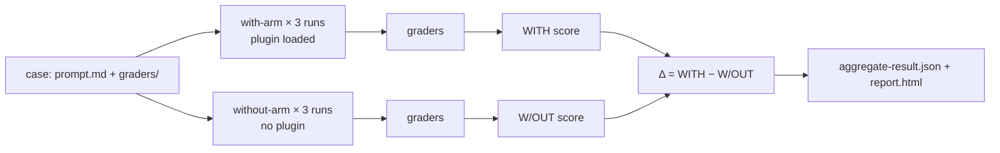

<LevelBadge level="advanced" />

<VerifyNote lastVerified="2026-09-14" source="https://code.claude.com/docs/en/plugin-evals">
`claude plugin eval` llegó en Claude Code **v2.1.269 (11 de septiembre de 2026)** y está documentada como una función joven: el esquema de casos es `1.1`, el resultado JSON es `schemaVersion: 1` y Anthropic puede desactivar el comando desde el servidor («plugin eval is currently unavailable»). Los valores por defecto, los flags y la semántica de los graders de abajo provienen de la página oficial en la fecha indicada; vuelve a comprobarlos antes de montar una puerta estricta en el CI.
</VerifyNote>

<Callout type="objectives" items={[
  "Entender qué mide un plugin eval que `claude plugin validate` y una prueba manual no pueden: si la skill *se activa* y si supera a un modelo sin plugin",
  "Leer los tres números de cada resultado —WITH, W/OUT y Δ— y saber por qué algunos graders se excluyen deliberadamente de la puntuación",
  "Elegir entre los seis tipos de grader (cuatro gratuitos, dos basados en juez) y escribir rúbricas que den una señal estable",
  "Simular los servidores MCP de un plugin para que una suite sea repetible y nunca toque el servicio real",
  "Montar una puerta de CI con modelos fijados, un tope de coste y el contrato de códigos de salida"
]} />

Hasta ahora, quien creaba un plugin tenía dos herramientas: `claude plugin validate`, que comprueba que los manifiestos y el frontmatter se pueden leer, y sus propios ojos. Ninguna responde a la pregunta que decide si merece la pena instalar un plugin: **cuando un usuario escribe una petición natural, ¿Claude elige la skill y el resultado es mejor que lo que Claude habría hecho de todos modos?** `claude plugin eval` responde exactamente eso. Ejecuta cada caso en una sesión desechable con solo tu plugin cargado, lo ejecuta de nuevo sin ningún plugin, califica ambos y reporta la diferencia.

Esta página es para quienes ya tienen un [plugin](/docs/claude-code/plugins-marketplaces) o una [skill](/docs/claude-code/skills) funcionando. Si solo necesitas el concepto, lee las dos primeras secciones y el quiz.

## El modelo mental: dos brazos y un delta

Cada caso es un **prompt** más uno o más **graders**. Un grader es una comprobación de pasa/no pasa sobre lo que produjo Claude. Para cada caso, Claude Code ejecuta:

- el **brazo con plugin** (with-arm): una sesión headless nueva con solo tu plugin cargado, se envía el prompt, Claude trabaja hasta terminar o alcanzar el límite de turnos/tiempo, y después se aplican los graders;
- el **brazo sin plugin** (without-arm): el mismo prompt, el mismo número de ejecuciones, sin plugin.

Cada brazo ejecuta el caso **tres veces por defecto**, porque una sola ejecución de un agente no determinista casi no dice nada. La puntuación de una ejecución es la fracción de graders que pasaron (ponderada, si defines pesos). La puntuación del caso es la media de las ejecuciones. Obtienes:

| Columna | Significado |
|---|---|
| `WITH` | Puntuación media con el plugin cargado |
| `W/OUT` | Puntuación media sin plugin |
| `Δ` | `WITH − W/OUT` — lo que el plugin realmente aportó |

Lo poco evidente: **una puntuación `WITH` alta por sí sola no demuestra nada.** Si un caso puntúa 1.0 en ambos brazos, Claude lo resolvió sin ti y tu plugin es lastre para ese prompt. El Δ es el número que justifica la existencia de un plugin. La propia documentación de Anthropic nombra el primer hallazgo más común: un Δ cercano a cero *con* un grader de skill-fired fallido, lo que significa que Claude nunca eligió tu skill con una formulación natural. Es un problema del `description` en `SKILL.md`, no de código, y ninguna prueba manual en la que invoques la skill por su nombre lo habría detectado.



### Por qué algunos graders se excluyen de la puntuación

Una comprobación como «se invocó la herramienta `Skill`» nunca puede pasar en el brazo sin plugin. Si contara, arrastraría `W/OUT` hacia cero e inflaría Δ gratis. Por eso, en una ejecución de dos brazos, Claude Code **excluye de la puntuación, en ambos brazos**, todo grader `tool_used` cuyo `tool` sea `Skill`, además de cualquier cosa que marques con `arm: with-only`. Siguen apareciendo en el informe como indicadores de pasa/no pasa (el informe los etiqueta como «plugin-fired indicator») y el JSON los marca `scored: false`. De aquí salen dos reglas de borde:

- Si *todos* los graders de un caso fueran a excluirse, se puntúan con normalidad; de lo contrario no quedaría nada que puntuar.
- `arm: both` fuerza a un grader a contar en ambos brazos. Es lo que quieres para una comprobación de «**no** debe invocar la skill» en un prompt señuelo, escrita como `tool_used` con `min: 0` y `max: 0`.

Una consecuencia que conviene recordar: la misma suite puede dar una **puntuación absoluta distinta** con `--ablation none` (un solo brazo, nada excluido) que en el modo por defecto de dos brazos. Compara lo comparable cuando dibujes tendencias.

## Anatomía de un caso

Una suite vive en `evals/` dentro del plugin (u otro directorio que indiques). Cada caso es una carpeta con un `prompt.md`, un `case.yaml` o ambos, más una carpeta `graders/` con un archivo Markdown por grader.

```text
my-plugin/
├── .claude-plugin/plugin.json
├── skills/...
└── evals/
    ├── drafts-commit-message/
    │   ├── prompt.md            # frontmatter: run limits; body: the user's request
    │   └── graders/
    │       ├── criteria.md      # type: llm — rubric in the body
    │       └── skill-fired.md   # type: tool_used, tool: Skill
    ├── ignores-unrelated-request/
    │   └── ...
    ├── mocks/                   # optional suite-wide MCP mocks
    └── results/                 # written by each run — add to .gitignore
```

El cuerpo del prompt se envía a Claude **exactamente como está escrito**. Dos cosas pillan primero a quien empieza:

- Cada ejecución arranca en un **directorio de trabajo vacío**, con un home desechable, sin ajustes de usuario, sin `CLAUDE.md`, sin servidores MCP personales, sin otros plugins y solo con una lista permitida de variables de entorno (las básicas como `PATH`, la autenticación del proveedor, la mayoría de `ANTHROPIC_*`/`CLAUDE_CODE_*` y todo lo que se llame `EVAL_*`). Si la tarea necesita archivos, ponlos en el prompt, genéralos con un scaffold o inclúyelos en el plugin.
- Las menciones `@path` del prompt **no** se expanden a adjuntos. Concede `Read` en `allowed_tools` si Claude debe abrir un archivo.

Los campos del frontmatter de `prompt.md` que más importan:

| Campo | Por defecto | Nota |
|---|---|---|
| `runs` | 3 | De 1 a 50 por brazo; `--runs` lo sobrescribe |
| `max_turns` | 10 | Hasta 200. Alcanzarlo se registra como error de ejecución y suele bajar la puntuación, así que sé generoso |
| `timeout_seconds` | 300 | Hasta 3600 por ejecución |
| `allowed_tools` | `[]` | Las herramientas de solo lectura se conceden con solo listarlas; todo lo demás necesita una concesión por CLI |
| `model` | el de la sesión por defecto | `--model` lo sobrescribe; fíjalo en el CI |
| `env` | `{}` | Las claves deben cumplir `EVAL_[A-Z0-9_]*` o la ejecución falla |
| `plugins` | el plugin envolvente más cercano | Pon `["../.."]` si la autodetección no encuentra tu plugin |

`case.yaml` lleva los mismos campos (los de ejecución bajo `execution:`) más tres que referencian otros archivos: `context.scaffold_script` (un script de Bash que prepara el espacio de trabajo, solo se ejecuta con `--scaffold`), `context.history_file` (una transcripción `.jsonl` que se reanuda, de modo que tu prompt pasa a ser el siguiente turno) y `context.add_dirs` (directorios de fixtures que Claude puede leer).

## Los seis tipos de grader

Cuatro se calculan a partir de la transcripción y los archivos y no cuestan nada. Dos llaman a un modelo juez y suben la factura.

| Tipo | ¿Gratis? | Pasa cuando |
|---|---|---|
| `regex` | sí | Se encuentra una expresión regular de JavaScript en el objetivo (`last_message` por defecto, o `trace`, `files`, un archivo concreto o `mock_calls`). `match: not_contains` para ausencia, `match: "count:N"` para un recuento exacto. La insensibilidad a mayúsculas va en `flags: i`; el `(?i)` en línea no está soportado |
| `tool_used` | sí | Las llamadas a `tool` cuya entrada codificada en JSON coincide con `input_match` están entre `min` (por defecto 1) y `max` (sin límite). `min: 0, max: 0` afirma que una herramienta nunca se llamó |
| `tool_order` | sí | Ambas herramientas se llamaron y la primera coincidencia de `before` precede a la primera de `after` |
| `file_exists` | sí | Un archivo **creado por Claude** coincide con el glob de `path` (o ninguno, con `exists: false`). Los archivos creados por un scaffold o simplemente editados por Claude no cuentan |
| `llm` | no | Un modelo juez vota PASS según tu rúbrica en al menos **dos de tres votos** |
| `baseline` | no | Un juez considera que la ejecución cumple los criterios al menos tan bien como una transcripción de referencia que guardaste como `baseline_file` |

**No hay graders de código personalizado.** Si necesitas comprobar que una compilación o un test pasó, haz que el prompt le diga a Claude que lo ejecute y escriba el resultado en un archivo, califica ese archivo con `regex` y afirma que el comando se ejecutó con un grader `tool_used` cuyo `input_match` lo nombre.

El grader de skill-fired que casi todo caso necesita se ve así (cambia el nombre de la skill; el patrón también coincide con la forma con espacio de nombres `plugin:skill`):

<PromptCard title="graders/skill-fired.md — did my skill actually run?">{`---
type: tool_used
tool: Skill
input_match: '"skill"\\s*:\\s*"(?:[\\w-]+:)?your-skill-name"'
---`}</PromptCard>

Y la rúbrica del juez a su lado, escrita como condiciones concretas de PASS/FAIL en lugar de adjetivos:

<PromptCard title="graders/criteria.md — a rubric that gives a stable verdict">{`---
type: llm
weight: 2
---

PASS if the reply is a single conventional-commit subject line under 72 characters,
starts with "refactor:", and mentions both the rename (getUser -> fetchUser) and the
number of call sites updated.
FAIL if the reply contains more than one candidate message, asks a clarifying
question, or omits the rename.`}</PromptCard>

### Hábitos que mantienen estables las puntuaciones

Son las prácticas que recomienda la documentación oficial y coinciden con lo que aprende por las malas quien ha ejecutado pipelines de LLM-as-judge:

- **Califica las salidas largas con `regex` sobre el archivo, no con un juez `llm`.** La varianza del juez crece con la longitud de lo que lee. Reserva los graders `llm` para mensajes finales cortos.
- **Un grader sobre el resultado, otro sobre el camino.** Un grader `regex`/`llm`/`file_exists` te dice que la respuesta era correcta; un grader `tool_used`/`tool_order` te dice que *tu plugin* la produjo. Necesitas ambos para interpretar Δ.
- **Sospecha del juez antes que del plugin cuando Δ es negativo pero la skill se activó.** El juez por defecto es un modelo pequeño y rápido; puede suspender una respuesta correcta por tener un formato distinto al de la rúbrica. Vuelve a ejecutar con `--judge-model sonnet` y afina la rúbrica para que el formato no decida.
- **Itera sobre un caso con un brazo**, y luego confirma con tres ejecuciones: `--case <name> --runs 1 --ablation none`. Con un solo brazo, la tabla muestra `SCORE` y `PASS%` en lugar de `WITH`/`W/OUT`/`Δ`.

## Simula los servidores MCP

Si las skills de tu plugin llaman a herramientas MCP, una ejecución **nunca arranca los servidores reales salvo que lo pidas**. En su lugar, Claude Code registra un sustituto bajo el nombre de cada servidor y responde a las llamadas de herramientas desde archivos Markdown: `evals/mocks/<server>/<tool>.md` para toda la suite, o la carpeta `mocks/` de un caso para sobrescribir por caso. El cuerpo del archivo es el resultado de la herramienta, con sustituciones `{{input.<field>}}` e inserciones `{{file:fixtures/...}}`. Una herramienta sin archivo de mock simplemente no está disponible para Claude.

<PromptCard title="evals/mocks/tracker/create_issue.md — a mock that also asserts the input">{`---
expect:
  title: string
  priority: [low, medium, high]
---

Created issue #4821: {{input.title}}`}</PromptCard>

El bloque `expect:` convierte un mock en una aserción: una llamada que lo incumple **aborta la ejecución con puntuación 0** y registra el servidor, la herramienta y el motivo. Apunta un grader a `target: mock_calls` para calificar lo que el plugin le pidió al servidor. Para servidores cuyas respuestas dependen de la conversación, `type: agent` permite que un modelo pequeño haga de servidor; las ejecuciones limpias guardan sus respuestas en `results/<timestamp>/mock-recordings/`, y una vez que copias una grabación en `mocks/.replay/<server>/`, las ejecuciones posteriores la reproducen sin llamar al modelo. Haz commit de `.replay/` para que el CI sea determinista. `_tools.json` (una respuesta `tools/list` guardada) da a las herramientas simuladas sus descripciones y esquemas reales en lugar de un marcador permisivo.

Para usar servidores reales: `--allow-real-servers` arranca los que no tienen mocks; `--mocks off` ignora los mocks por completo. En ambos casos esos procesos se ejecutan **como tú, fuera del sandbox**, y sus herramientas siguen necesitando una concesión explícita como `--allow-tools "mcp__plugin_my-plugin_github__*"`.

## Ejecutarlo

<Steps items={[
  {title: "Genera la suite", body: "Desde la raíz del plugin ejecuta `claude plugin eval init`. Abre una sesión interactiva en la que Claude lee el plugin, pregunta qué es un buen resultado, propone prompts que deberían y que no deberían activarlo, diseña graders, los prueba una vez y escribe un directorio de caso por prompt. `claude plugin eval init --bare <name>` escribe en su lugar una plantilla en blanco (la única forma que funciona sin terminal, p. ej. en el CI)."},
  {title: "Ejecuta toda la suite", body: "`claude plugin eval .` ejecuta cada caso, ambos brazos, tres ejecuciones cada uno. La primera vez pregunta `Trust this plugin directory?`; dentro de un repositorio git, decir que sí confía en todo el repositorio, también en sesiones interactivas. Se imprime una línea de progreso por ejecución con el veredicto de cada grader; después vienen una tabla resumen y una ruta `Report:`."},
  {title: "Concede solo lo que los casos necesitan", body: "Las ejecuciones nunca se detienen a pedir permiso. Las herramientas integradas que necesitan una concesión que no diste (`Bash`, `Write`, `Edit`, `WebFetch`, `WebSearch`) se eliminan por completo de la sesión. Concédelas para toda la ejecución: `--allow-tools Write Edit \"Bash(npm test *)\"`. Cualquier concesión de Bash se ejecuta bajo el sandbox a nivel de SO de Claude Code; en una máquina sin backend de sandbox (Windows nativo) la ejecución se rechaza en lugar de correr sin confinamiento."},
  {title: "Lee el informe", body: "`report.html` es un único archivo autocontenido sin peticiones externas. Arriba: una línea de veredicto (efecto del plugin en puntos frente al baseline, casos mejorados/sin cambios/empeorados) y cinco tarjetas (puntuación de la suite, Δ de ablación, puntuación del baseline, casos aprobados, ejecuciones perfectas). Cada tarjeta de caso muestra Δ y una barra de puntuación con una marca en el umbral; un Δ negativo recibe un borde izquierdo rojo. Los graders fallidos aparecen ya desplegados con los votos del juez y el extracto que vio."},
  {title: "Decide adónde va el informe", body: "Con sesión iniciada en una suscripción de claude.ai y artefactos activados, el informe también se publica como artefacto privado y se imprime una URL `Published:`; `--no-publish` lo mantiene local. La autenticación con clave de API nunca publica. Una ejecución iniciada desde dentro de una sesión de Claude Code se queda local salvo que añadas `--publish-report`."}
]} />

El comando para la suite completa con los flags que realmente vas a usar:

<PromptCard title="Run the suite with a stronger judge and a cost ceiling">{`claude plugin eval . \\
  --judge-model sonnet \\
  --max-cost-usd 10 \\
  --allow-tools Read Write "Bash(npm test *)" \\
  -j 4`}</PromptCard>

Notas sobre los flags: `-j`/`--concurrency` va de 1 a 8 y solo acorta el tiempo real, porque todas las ejecuciones comparten el límite de peticiones de tu cuenta. `--max-cost-usd` es un tope sobre la **estimación a precio de lista**, comprobado antes de iniciar cada ejecución; las ejecuciones ya en curso terminan, de modo que el gasto puede exceder el tope en lo que cuesten, y cualquier cosa sin iniciar hace que el comando salga con 2 y `partial: true`. Pon el objetivo (`.`) **antes** de `--tag`, `--allow-tools` y `--json`: cada uno de ellos toma una lista o un valor opcional y se tragaría un objetivo que viniera después (el error «`--json` output path must end in `.json`» es justo ese descuido).

## Cuánto cuesta

Cada ejecución y cada voto del juez es una llamada real a un modelo en tu cuenta, que cuenta contra el uso de tu plan o tu factura de la API. La aritmética aproximada: `cases × runs` ejecuciones de agente para el brazo con plugin, lo mismo otra vez para el brazo sin plugin, más **tres llamadas cortas al juez por cada grader `llm` o `baseline` por ejecución**. El caso único del tutorial oficial, con dos graders (uno `llm`, uno `tool_used`), hizo seis ejecuciones de agente en 74 segundos con una estimación a precio de lista de unos $0.41. Tres palancas mantienen una suite asequible:

- `--ablation none` reduce a la mitad las ejecuciones de agente cuando estás iterando graders y no necesitas Δ.
- Solo graders gratuitos (`regex`, `tool_used`, `tool_order`, `file_exists`) para la suite de cada commit; graders con juez para la nocturna.
- Un error de límite de uso o de tasa a mitad de suite hace que cada ejecución posterior **termine con ese error y suela puntuar 0, y la suite no se marca como `partial`**, así que una ejecución limitada puede parecer exactamente una regresión. Revisa la columna `NOTES` o `cases[].arms.with[].error` antes de creer una caída repentina.

## Bloquea el CI con ello

<PromptCard title="CI job — pinned models, local report, exit code drives the build">{`claude plugin eval . \\
  --trust-plugin \\
  --json results.json \\
  --threshold 0.8 \\
  --model claude-sonnet-5 \\
  --judge-model claude-haiku-4-5 \\
  --no-publish \\
  --max-cost-usd 20`}</PromptCard>

Por qué está cada flag:

- `--trust-plugin` afirma la decisión de confianza de la primera ejecución. Sin él, un trabajo no interactivo es rechazado con salida 1 (o se queda colgado en el aviso si el runner asigna un TTY). Pásalo solo para plugins cuyo código y suite ejecutarías en tu propia máquina.
- `--model` y `--judge-model` están **fijados** para que el despliegue de un modelo nunca se confunda con una regresión del plugin. Importa más de lo que parece: el agente bajo prueba usa por defecto `ANTHROPIC_MODEL` o el modelo por defecto actual de Claude Code, que cambia con las versiones.
- `--threshold 0.8` porque el valor por defecto es **1.0**, lo que hace que el comando salga con 1 siempre que algún caso sea menos que perfecto. Un listón de 1.0 sobre la media de tres ejecuciones de un agente no determinista es una puerta inestable.
- `--json results.json` escribe el documento de resultado versionado (`schemaVersion: 1`, camelCase, los campos nuevos se añaden sin renombrar) y silencia la salida de progreso.

El contrato de códigos de salida:

| Salida | Significado |
|---|---|
| 0 | Todos los casos en o por encima del umbral y todos los archivos de caso cargados |
| 1 | Un caso por debajo del umbral, un archivo de caso no se cargó, no se encontraron casos, una ejecución no pudo iniciarse, directorio no confiable sin `--trust-plugin`, o una opción inválida |
| 2 | Ejecución parcial: se alcanzó el tope de coste, o la credencial fue rechazada en o antes de la primera ejecución. `results.json` se escribe igualmente con `partial: true` |
| 130 / 143 | Interrumpida / terminada (p. ej. timeout del CI). Se escriben resultados parciales |

Los problemas al escribir o publicar el informe **nunca** cambian el código de salida. Al dibujar tendencias, descarta los documentos con `partial: true` y las ejecuciones marcadas `skippedPaidGraders`, porque sus puntuaciones no son comparables.

Campos que lee un script de puerta del JSON: `aggregates.overallScore`, `aggregates.casesPassed` / `casesTotal`, `aggregates.meanDelta`, y por caso `cases[].aggregates.score` y `.delta` (omitido cuando los brazos no son comparables). Una ejecución con un `cases[].arms.with[].error` no nulo (p. ej. `timed out after 300s`) se califica igualmente por lo que produjo, así que un error no implica puntuación 0; una ejecución `aborted` (saltó el `expect:` de un mock) puntúa 0 con `error` todavía en `null`.

## Qué puede y qué no puede alcanzar una ejecución

Lee esto antes de evaluar un plugin que no escribiste tú. Apuntar `claude plugin eval` a un directorio es la misma decisión de confianza que `claude --plugin-dir`: las skills **y los hooks** del plugin se cargan y se ejecutan en tu máquina como tú. El aislamiento limita lo que puede hacer el *agente bajo prueba*; no es una frontera frente al código propio del plugin, y una suite que pasa no dice nada sobre si el plugin es seguro.

- **Agente aislado.** Cada ejecución recibe un home, un directorio de trabajo y una configuración de Claude Code desechables, se ejecuta como proceso hijo `claude -p`, no puede leer el directorio de evals (así que nunca ve los prompts ni los graders del caso ni de sus hermanos) y tiene la herramienta Artifact desactivada.
- **Los ajustes gestionados siguen aplicándose.** Las restricciones desplegadas por un administrador en la máquina se aplican dentro de una ejecución, así que los resultados en un portátil gestionado pueden diferir de los de un runner de CI no gestionado.
- **Válvulas de escape opt-in.** El `scaffold_script` de un caso se ejecuta como tú, fuera del sandbox, y solo con `--scaffold`. Los servidores MCP reales solo con `--allow-real-servers` o `--mocks off`. El `allowed_tools` de un caso o el frontmatter `allowed-tools` de una skill nunca pueden ampliarlos.
- **Red.** Los comandos de shell que concedas siguen las reglas de red del sandbox; una concesión `WebFetch(domain:…)` llega a ese dominio directamente; los hooks del plugin y cualquier servidor MCP real que arranques pueden alcanzar cualquier host.

Para un plugin de terceros que incluye hooks o necesita sus servidores reales, trata las puntuaciones como orientativas salvo que hayas ejecutado la suite en un contenedor o en un runner de CI. Consulta [Reviewing Third-Party Code](/docs/security/reviewing-third-party-code) para la lista de comprobación más amplia.

## Referencia rápida: las trampas

- El `target` por defecto de `regex` es `last_message`. Cuando apuntas a `trace`, es JSON por línea, así que las comillas aparecen como `\"` y los saltos de línea van escapados.
- `files` es una **lista de rutas** que Claude creó, no su contenido. Para calificar el contenido, usa `{ source: file, path: <path> }` como `target`/`focus`. Un juez `llm` ve PNG/JPEG/GIF/WebP como imágenes y rechaza otros binarios (`.pptx`, PDF).
- Un juez `llm` que lee `trace` solo ve los **primeros 12 y los últimos 12 mensajes**.
- `file_exists` solo ve los archivos creados durante la ejecución. Un archivo generado por un scaffold o simplemente editado le es invisible; califica su contenido o usa `tool_used` sobre `Edit`.
- Las claves desconocidas en el frontmatter de `prompt.md` son un error, y las claves de `env` deben ser `EVAL_*`.
- Evaluar un plugin instalado por nombre (`name@marketplace`) escribe los resultados en `./evals/results/` en tu directorio actual y se salta el aviso de confianza.
- El formato de casos de plugin-eval es **independiente** del archivo `evals/evals.json` que usa el plugin skill-creator para las evaluaciones de skills.

<Flashcards cards={[
  {front: "with-arm / without-arm", back: "Los dos conjuntos de ejecuciones de un caso: con solo tu plugin cargado y sin ningún plugin. Δ es la puntuación del brazo con plugin menos la del brazo sin plugin."},
  {front: "¿Por qué `tool_used: Skill` no se puntúa?", back: "Nunca puede pasar sin el plugin, así que contarlo arrastraría W/OUT a cero e inflaría Δ. Se excluye en ambos brazos y se muestra como indicador de plugin activado."},
  {front: "Umbral por defecto", back: "1.0: cualquier caso por debajo de lo perfecto hace que el comando salga con 1. Fija `--threshold` en tu listón real en el CI."},
  {front: "Regla de votos del juez", back: "Un grader `llm` pasa cuando el juez vota PASS en al menos dos de tres votos; un grader `baseline` compara con una transcripción de referencia guardada."},
  {front: "Código de salida 2", back: "Ejecución parcial: se alcanzó el tope --max-cost-usd o se rechazó la credencial. results.json se escribe igualmente con partial: true."},
  {front: "Bloque `expect:` de un mock", back: "Guarda de entrada de una herramienta MCP simulada. Una llamada que lo incumple aborta la ejecución con puntuación 0 y registra servidor, herramienta y motivo."},
  {front: "Variables EVAL_*", back: "Las únicas variables de entorno personalizadas que llegan a una ejecución. Todo lo demás de tu shell se retiene salvo una pequeña lista permitida."}
]} />

<Quiz title="Compruébalo tú mismo" questions={[
  {q: "Un caso puntúa 1.00 WITH y 1.00 W/OUT. ¿Qué te dice?", options: ["El plugin funciona perfectamente", "Claude resuelve este prompt sin el plugin, así que el plugin no aporta nada aquí", "Los graders están rotos", "El modelo juez es demasiado débil"], answer: 1, explain: "Δ es cero. Una puntuación alta en el brazo con plugin nunca demuestra por sí sola que el plugin ayudó; solo lo hace la diferencia entre brazos."},
  {q: "Tu trabajo de CI ejecuta `claude plugin eval . --json results.json` sin más flags y sale con 1 aunque cada caso puntuó 0.9. ¿Por qué?", options: ["El modo JSON siempre sale con 1", "El --threshold por defecto es 1.0, así que 0.9 es un fallo", "El directorio del plugin era de confianza", "--json desactiva la puntuación"], answer: 1, explain: "El umbral por defecto es la perfección (1.0). Pasa --threshold 0.8 o tu listón. Pasa también --trust-plugin en el CI, o la comprobación de directorio no confiable también sale con 1."},
  {q: "¿Qué tipos de grader no cuestan nada extra al ejecutarse?", options: ["llm y baseline", "regex, tool_used, tool_order, file_exists", "Solo regex", "Los seis son gratuitos"], answer: 1, explain: "Cuatro graders se calculan a partir de la transcripción y los archivos. llm y baseline añaden cada uno tres llamadas cortas al juez por ejecución."},
  {q: "Δ es negativo pero el grader de skill-fired pasó en cada ejecución del brazo con plugin. ¿Qué dice la guía oficial que compruebes primero?", options: ["Borrar el plugin", "Subir max_turns", "El juez: volver a ejecutar con --judge-model sonnet y afinar la rúbrica para que el formato no decida", "Añadir más casos"], answer: 2, explain: "Un juez pequeño puede suspender una respuesta correcta por tener un formato distinto al de la rúbrica. Sospecha del juez antes que del plugin."},
  {q: "Una herramienta MCP simulada de una ejecución recibe una llamada cuya entrada incumple el bloque `expect:` del mock. ¿Qué ocurre?", options: ["La llamada devuelve una cadena de error y la ejecución continúa", "La ejecución se aborta con puntuación 0 y se registra el motivo", "Se omite el grader", "Se arranca el servidor real como alternativa"], answer: 1, explain: "expect: es una aserción. Una llamada que lo incumple aborta la ejecución, puntúa 0 y aparece como `aborted` con servidor, herramienta y motivo en el JSON."},
  {q: "¿A cuál de estas cosas tiene acceso el agente bajo prueba durante una ejecución?", options: ["Tus ajustes de ~/.claude y CLAUDE.md", "Tus servidores MCP personales", "El prompt y los graders del caso", "Las herramientas de solo lectura listadas en allowed_tools del caso, más lo que hayas concedido con --allow-tools"], answer: 3, explain: "Las ejecuciones están aisladas: home y configuración desechables, sin ajustes personales, sin otros plugins, y el directorio de evals está oculto para el agente."}
]} />

## Fuentes y lecturas adicionales

- [Test plugins with evals](https://code.claude.com/docs/en/plugin-evals) — la referencia oficial en la que se basa esta página: formato de casos, tabla de graders, opciones, códigos de salida, aislamiento
- [Plugin CLI reference: `claude plugin eval`](https://code.claude.com/docs/en/plugins/cli-reference#plugin-eval) — cada flag, con `plugin eval init` para generar una suite
- [Plugins reference: `experimental.evals`](https://code.claude.com/docs/en/plugins-reference#fields) — el campo del manifiesto que apunta a un directorio de evals no predeterminado
- [Claude Code changelog, v2.1.269 (11 sept. 2026)](https://code.claude.com/docs/en/changelog) — la entrada de la versión
- [Skills: frontmatter y cómo el `description` decide la activación](https://code.claude.com/docs/en/skills)
- [Sandboxing](https://code.claude.com/docs/en/sandboxing) — el sandbox a nivel de SO que se aplica cuando concedes Bash a una ejecución
- [Headless mode](https://code.claude.com/docs/en/headless) — el hijo `claude -p` sobre el que se construye cada ejecución

## Siguiente

- [Plugins & Marketplaces](/docs/claude-code/plugins-marketplaces) — empaqueta lo que acabas de probar y publícalo cuando la suite esté en verde
- [Skills](/docs/claude-code/skills) — el campo `description` es lo que te dice que arregles un grader de skill-fired fallido
- [Reviewing Third-Party Code](/docs/security/reviewing-third-party-code) — antes de ejecutar el plugin de otra persona (y sus hooks) con un eval en tu máquina
