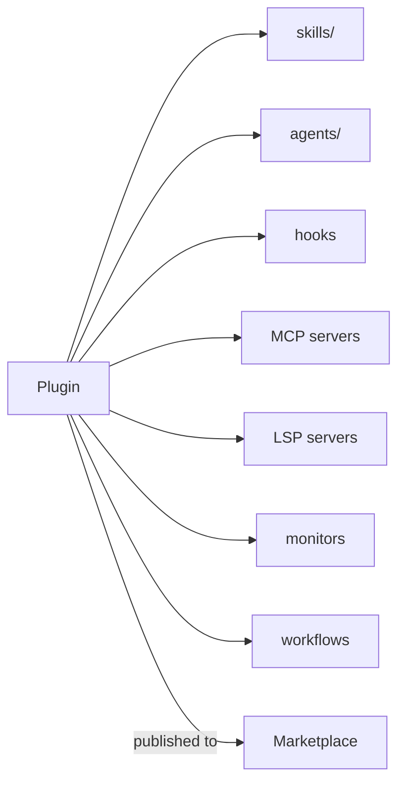

<LevelBadge level="advanced" />

<VerifyNote lastVerified="2026-10-22" source="https://code.claude.com/docs/en/plugins">
La estructura de los plugins y el funcionamiento de los marketplaces evolucionan rápido — confirma los detalles en la documentación oficial de Claude Code.
</VerifyNote>

Un **plugin** agrupa varias personalizaciones — [skills](/docs/claude-code/skills), [subagentes](/docs/claude-code/subagents), [comandos slash](/docs/claude-code/slash-commands), [hooks](/docs/claude-code/hooks), [servidores MCP](/docs/claude-code/mcp) y, desde Claude Code v2.1.287, un [**mod**](/docs/claude-code/mods) — en una única unidad versionada e instalable. Un **marketplace** es un catálogo de plugins que la gente puede descubrir e instalar.

## Por qué importan los plugins

- **Entrega el kit de herramientas de un equipo en un paso.** En lugar de pedir a todos que copien cinco archivos, publica un plugin; tus compañeros lo instalan y obtienen los mismos comandos, hooks, agentes y conexiones MCP.
- **Versionado.** Actualiza el plugin y todos descargan la nueva versión.
- **Distribución.** Un marketplace hace que tu kit de herramientas (o el de otros) sea fácil de descubrir.

## Qué suele contener

Un plugin es una carpeta estructurada de componentes. El manifiesto `.claude-plugin/plugin.json` es **opcional**: sin él, Claude Code carga lo que encuentre en el [diseño estándar](https://code.claude.com/docs/en/plugins-reference#standard-layout), así que una carpeta que solo contenga un `SKILL.md` ya se carga como plugin. Escribe un manifiesto cuando quieras metadatos, una versión, un componente fuera de su directorio predeterminado o valores configurables por el usuario.

Además de skills, un plugin puede agrupar subagentes, hooks y servidores MCP y — más recientemente — [servidores LSP](https://code.claude.com/docs/en/plugins-reference#lspservers) para inteligencia de código, [monitores](https://code.claude.com/docs/en/plugins-reference#monitors) en segundo plano, [workflows](https://code.claude.com/docs/en/workflows#distribute-a-workflow-in-a-plugin), una carpeta `bin/` de ejecutables y ajustes predeterminados. Mantén cada plugin **coherente** — un plugin de «convenciones del equipo», un plugin de «kit de herramientas de Python» — en lugar de un cajón de sastre.

## Confianza antes de instalar

:::warning Los plugins pueden incluir código ejecutable
Los hooks y servidores MCP de un plugin se ejecutan con tus privilegios. Instala solo desde fuentes de confianza y revisa primero qué hace un plugin — consulta [Revisión de código de terceros](/docs/security/reviewing-third-party-code).
:::

## Un camino para escalar tu configuración

La progresión natural: un `CLAUDE.md` → unas pocas [skills](/docs/claude-code/skills) y [comandos](/docs/claude-code/slash-commands) → agrúpalos en un plugin → publícalo en un marketplace para tu equipo o la comunidad. Ese último paso forma parte de cómo AILmanac quiere ayudar a que el ecosistema crezca.

## Siguiente

- [Mods: extensiones en proceso](/docs/claude-code/mods) — el único componente de un plugin que se ejecuta *dentro* de Claude Code y puede reemplazar su comportamiento integrado
- [Plugin Evals](/docs/claude-code/plugin-evals) — demuestra que el plugin ayuda con `claude plugin eval` antes de publicarlo
- [Skills](/docs/claude-code/skills) · [Subagentes](/docs/claude-code/subagents) · [MCP](/docs/claude-code/mcp)
- [Revisión de código de terceros](/docs/security/reviewing-third-party-code)
- Los [paquetes de skills](/docs/templates/skills) de AILmanac
