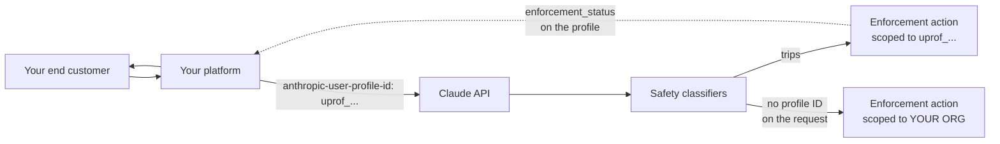

<LevelBadge level="advanced" />

<Callout type="objectives" items={[
  "Le problème de rayon d'impact que connaît toute plateforme d'IA : sans attribution, un seul client final abusif peut faire restreindre toute votre organisation",
  "Comment enregistrer un client final (POST /v1/user_profiles) et attribuer chaque requête (l'en-tête anthropic-user-profile-id)",
  "application vs passthrough : quel access_type correspond à la façon dont vous vendez Claude, et pourquoi le mauvais affaiblit l'attribution",
  "Les quatre valeurs d'enforcement_status et la règle exacte qui en choisit une, y compris pending (que la documentation narrative omet)",
  "Le schéma enforcement_actions : six raisons, l'étape suivante verify, et les règles de compatibilité ascendante qu'Anthropic vous demande de coder défensivement",
  "Pourquoi les webhooks d'organisation ne remplacent pas encore une boucle de polling, et la requête de liste exacte qui trouve chaque profil restreint",
  "Où cela ne fait silencieusement rien : Claude Platform on AWS, Bedrock et Google Cloud géré par Google se comportent chacun différemment",
]} />

<VerifyNote lastVerified="2026-11-02" source="https://platform.claude.com/docs/en/manage-claude/user-profiles">
Les profils utilisateur ont été lancés le **20 octobre 2026** ; les champs `enforcement_status` et `enforcement_actions` ont été ajoutés le **21 octobre 2026** avec la [version d'API 2026-10-21](/docs/api/api-version-2026-10-21). Les webhooks d'organisation sont en **bêta** (`webhooks-2026-10-07`) et la documentation d'Anthropic indique elle-même que **la livraison d'événements n'est pas active** : vous pouvez enregistrer des endpoints, mais aucun événement n'est encore envoyé. Les noms de champs et valeurs d'enum viennent du [guide des profils utilisateur](https://platform.claude.com/docs/en/manage-claude/user-profiles), de la [référence List User Profiles](https://platform.claude.com/docs/en/api/user_profiles/list) et du [guide des webhooks d'organisation](https://platform.claude.com/docs/en/manage-claude/organization-webhooks). Revérifiez avant de livrer une dépendance forte.
</VerifyNote>

Si vous revendez Claude, exploitez une passerelle d'IA ou construisez sur l'API Claude un produit auquel s'inscrivent des milliers d'inconnus, vous avez un problème que les développeurs mono-locataire n'ont pas : **les classifieurs de sécurité automatisés d'Anthropic tournent sur votre trafic API, et chaque requête arrive sous votre organisation.** Un client final qui déclenche un classifieur est, du point de vue d'Anthropic, indiscernable de *vous* en train de le faire. L'action d'application des règles qui suit s'applique à toute votre organisation, et emporte avec elle tous vos autres clients.

Les profils utilisateur sont la solution. Vous dites à Anthropic pour quel client final chaque requête est faite, et une action d'application des règles tombe sur ce profil plutôt que sur l'organisation. Le reste de votre trafic continue de tourner.

:::tip[C'est un contrôle de rayon d'impact, pas une fonctionnalité de facturation]
Les profils ne sont pas facturables et ne changent pas les tarifs. Ils n'accordent ni ne retirent rien par eux-mêmes. Leur seul rôle est de rendre l'application des règles *ciblée*, ce qui n'aide que si vous avez attribué le trafic **avant** que quelque chose ne tourne mal. Il n'existe pas d'attribution rétroactive.
:::

## La version en un paragraphe

Créez un profil par client final avec `POST /v1/user_profiles`, stockez l'ID `uprof_…` renvoyé sur la fiche de votre client, et envoyez-le dans l'en-tête `anthropic-user-profile-id` à chaque requête faite pour ce client. Puis faites tourner une boucle qui liste vos profils filtrés par `enforcement_status[]=restricted` et `enforcement_status[]=banned`, afin d'apprendre une action avant que votre boîte de support ne vous la signale. Les requêtes **sans** ID de profil comptent comme votre propre usage, et si l'une d'elles déclenche un classifieur, vous revenez à l'application des règles à l'échelle de l'organisation.

## La mise en place en quatre étapes

<Steps items={[
  {title: "Séparer votre propre trafic dans une autre organisation", body: "Un profil appartient à une organisation, pas à un workspace : des workspaces séparés au sein d'une même organisation ne suffisent donc pas. Gardez le trafic des clients finaux dans une organisation et votre usage interne dans une autre. Seule l'organisation des clients finaux a besoin de profils."},
  {title: "Enregistrer chaque client final une fois, à l'intégration", body: "POST /v1/user_profiles renvoie un profil avec un ID uprof_. L'endpoint n'est PAS idempotent : chaque appel crée un nouveau profil, même quand reference_id correspond à un profil que vous avez déjà. Créez-le dans votre parcours d'inscription et stockez l'ID ; ne laissez jamais une instance de service en créer un à la volée."},
  {title: "Envoyer l'ID à chaque requête pour ce client", body: "L'en-tête anthropic-user-profile-id. Les SDK et le CLI ant l'exposent comme argument (user_profile_id ; userProfileId en Java, UserProfileID en Go/C#, --user-profile-id dans le CLI). Cela fonctionne de la même façon sur Messages, le comptage de tokens, Message Batches et la couche de compatibilité avec le SDK OpenAI."},
  {title: "Interroger les actions d'application des règles, et tenir les profils à jour", body: "Listez les profils par enforcement_status pour trouver les restrictions et bannissements. Mettez à jour un profil quand les détails du client ou le statut de son compte changent ; supprimez-le quand il ferme son compte ou demande l'effacement de ses données."},
]} />



La ligne pointillée est celle que vous devez construire. Anthropic renseigne les champs d'application des règles ; rien ne vous les pousse aujourd'hui.

## Décider qui reçoit un profil

Ce qu'un profil *représente* dépend de la façon dont vous vendez Claude. Le champ `access_type` enregistre quel cas s'applique, et se tromper affaiblit l'attribution pour laquelle vous avez mis le profil en place.

| Pour qui est le trafic | Ce qu'il faut créer | `access_type` |
| --- | --- | --- |
| Un utilisateur inscrit à votre produit | Un profil par utilisateur, créé à l'inscription | `application` — **le défaut**, utilisé quand vous omettez le champ |
| Une entreprise à qui vous revendez l'accès à l'API (passerelle, revendeur) | Un profil par **entreprise**, pas par personne en son sein | `passthrough` — **pas** le défaut, donc vous devez l'envoyer |
| L'usage de votre propre organisation | Rien. Une requête sans ID de profil compte comme votre propre usage : gardez-la dans une organisation séparée | n/a |
| Un workspace de votre organisation | Pas de profil séparé. Un profil appartient à l'organisation et son ID fonctionne via n'importe quel workspace | n/a |

<PromptCard title="Register a reseller customer (passthrough)">{`curl https://api.anthropic.com/v1/user_profiles \\
  -H "x-api-key: $ANTHROPIC_API_KEY" \\
  -H "anthropic-version: 2023-06-01" \\
  -H "content-type: application/json" \\
  -d '{
    "name": "Acme Analytics, Inc.",
    "access_type": "passthrough",
    "external_user_details": {
      "reference_id": "cust-8f2a1c",
      "country": "US"
    }
  }'`}</PromptCard>

Pour un profil `application`, omettez `access_type` et décrivez une personne dans `name` et `external_user_details` plutôt qu'une entreprise.

:::warning[Un profil passthrough identifie une entreprise, pas une personne]
Si une requête passant par un revendeur vient d'un humain identifiable, envoyez *aussi* un identifiant pour cet humain dans le champ `metadata.user_id` propre à la requête Messages, qui est un objet différent du `metadata` du profil. Sans cela, Anthropic voit l'entreprise mal se comporter mais pas lequel de ses utilisateurs, et l'action qu'elle peut prendre est d'autant plus grossière.
:::

### Ce qu'il faut dire à Anthropic, et ce qu'il ne faut pas

Chaque champ est optionnel. Vous pouvez envoyer `name`, `metadata` (jusqu'à 16 paires ; clés ≤ 64 caractères, valeurs ≤ 512) et sept champs dans `external_user_details` : `entity_type`, `country`, `reference_id`, `onboarded_at`, `account_status`, `name_hash`, `email_hash`. Un profil ne contient **que** ce que vous envoyez plus les statuts qu'Anthropic renseigne, jamais le contenu des conversations, et Anthropic n'en vérifie rien.

Quatre règles à intérioriser avant d'écrire le code d'intégration :

- **Laissez de côté les inconnues, n'envoyez pas de valeurs de remplissage.** Vous pouvez remplacer plus tard une valeur de `external_user_details`, mais vous ne pouvez **jamais en effacer** une. L'API rejette `null` avec une 400. Une chaîne `"unknown"` écrite le premier jour est permanente.
- **`country` est le pays du *client***, pas le vôtre.
- **`reference_id` est votre propre identifiant** du client. Il n'a pas à être unique, et ce n'est pas une clé de déduplication : voir l'avertissement sur la non-idempotence plus haut.
- **Si vous ne pouvez pas partager un nom ou un e-mail, envoyez un hash.** `name_hash` et `email_hash` permettent à Anthropic de voir quels profils de chez vous *partagent* une identité sans jamais la recevoir. Vous choisissez la fonction de hachage, mais utilisez la même fonction et la même normalisation de casse/espaces pour chaque profil, car seules des valeurs calculées de façon identique correspondent. Il n'existe aucun champ pour une adresse e-mail brute.

## Attribuer chaque requête

<PromptCard title="A Messages call attributed to one end customer">{`curl https://api.anthropic.com/v1/messages \\
  -H "x-api-key: $ANTHROPIC_API_KEY" \\
  -H "anthropic-version: 2023-06-01" \\
  -H "anthropic-user-profile-id: $PROFILE_ID" \\
  -H "content-type: application/json" \\
  -d '{
    "model": "claude-opus-5-5",
    "max_tokens": 1024,
    "messages": [{"role": "user", "content": "Hello, Claude"}]
  }'`}</PromptCard>

Les ID de modèles évoluent : voir [Modèles & tarifs actuels](/docs/whats-new/models-and-pricing) pour la gamme à jour.

Sur l'API Claude, Claude Platform on AWS, les déploiements Microsoft Foundry hébergés par Anthropic et Claude sur Google Cloud géré par Anthropic, l'ID est **validé à chaque requête** : un ID mal formé, ou appartenant à une autre organisation, renvoie une `400` `invalid_request_error`. Cette vérification inter-organisations mord de façon précise et surprenante : si vous envoyez du trafic sous deux organisations (disons une sur l'API Claude et une sur Claude Platform on AWS), un profil créé par l'une est rejeté par l'autre.

**Message Batches est l'exception.** La création d'un batch ne vérifie que le *format* de l'ID. Un ID bien formé qui n'appartient pas à votre organisation laisse quand même le batch se créer, puis chaque requête à l'intérieur échoue individuellement avec un résultat `errored` portant la même `invalid_request_error`. Si vous attribuez des batches, validez l'ID vous-même avant de soumettre : voir [Message Batches](/docs/api/message-batches).

### Où cela en fait silencieusement moins

C'est le tableau à lire avant de supposer que l'attribution fonctionne.

| Plateforme | Y créer des profils ? | Envoyer l'ID dans | Les champs d'application des règles fonctionnent ? |
| --- | --- | --- | --- |
| API Claude | Oui | en-tête `anthropic-user-profile-id` | Oui |
| Claude Platform on AWS | Oui | en-tête `anthropic-user-profile-id` | **Non** : toujours `unrestricted` / vide |
| Microsoft Foundry (hébergé par Anthropic) | Oui | en-tête `anthropic-user-profile-id` | Oui |
| Claude Models on Google Cloud (géré par Anthropic) | Oui | en-tête `anthropic-user-profile-id` | Oui |
| Claude Models on Google Cloud (géré par Google) | Non : créer sur l'API Claude ou Claude Platform on AWS | en-tête `anthropic-user-profile-id` | Format vérifié seulement |
| Claude in Amazon Bedrock | Non : créer sur l'API Claude ou Claude Platform on AWS | **champ `user_profile_id` dans le corps de la requête** | Format vérifié seulement |

Trois conséquences :

1. **Sur Claude Platform on AWS, `enforcement_status` vaut toujours `unrestricted` et `enforcement_actions` est toujours vide**, et Anthropic n'y refuse pas de requêtes à cause d'une action ouverte. Ne construisez pas de tableau de bord qui lit « tout est clair » sur une plateforme incapable de rapporter autre chose.
2. **Sur Bedrock et Google Cloud géré par Google, l'ID est vérifié en format mais jamais recherché.** Une réponse `200` ne confirme **pas** que l'ID correspond à un vrai profil. Un ID bien formé mais mal saisi ressemble exactement à un succès tout en n'attribuant rien.
3. **Sur Bedrock, l'ID est un champ du corps, pas un en-tête** : `"user_profile_id": "uprof_…"` au premier niveau. Et il ne fonctionne pas avec l'ancienne intégration Bedrock que vous appelez via `InvokeModel` ou `Converse`.

Pour Bedrock et Google Cloud géré par Google, vous devez aussi **lier le compte** à l'organisation Anthropic qui possède vos profils, dans le Verification Portal sur `portal.anthropic.com` sous **Linked accounts** (l'admin lance le lien → quelqu'un ayant l'accès IAM exécute une commande fournie → l'admin termine la vérification). Les approbations de programme rattachées à un profil ne s'appliquent aux requêtes de ce compte que lorsque le portail l'affiche comme **Linked**.

## Lire l'état d'application des règles

Chaque réponse qui renvoie un profil (création, lecture, mise à jour et chaque ligne d'une liste) inclut `enforcement_status` et `enforcement_actions`.

```json
{
  "type": "user_profile",
  "id": "uprof_011CZkZCu8hGbp5mYRQgUmz9",
  "enforcement_status": "restricted",
  "enforcement_actions": [
    {
      "type": "restriction",
      "id": "enac_011CZkZEq4TnWb7xLfRgPm2v",
      "reason": "fraud_or_abuse",
      "action": null,
      "opened_at": "2026-10-02T19:30:00Z",
      "expires_at": null
    }
  ]
}
```

### Les quatre statuts, dont celui que le guide omet

`enforcement_status` est choisi par **la première règle qui s'applique**, dans cet ordre :

| Valeur | Règle |
| --- | --- |
| `banned` | Une action ouverte quelconque est un `ban` |
| `pending` | Une restriction qu'une vérification d'identité *peut* lever est ouverte, l'utilisateur final a soumis cette vérification, l'examen par Anthropic n'est pas terminé, et la `reason` d'aucune action ouverte n'est `account_compromise` |
| `restricted` | Une action quelconque est ouverte |
| `unrestricted` | Aucune action n'est ouverte |

:::warning[La documentation d'Anthropic elle-même est en désaccord sur le nombre de valeurs]
Le [guide des profils utilisateur](https://platform.claude.com/docs/en/manage-claude/user-profiles) et le [guide des webhooks d'organisation](https://platform.claude.com/docs/en/manage-claude/organization-webhooks) décrivent tous deux `enforcement_status` comme ayant trois valeurs : `unrestricted`, `restricted`, `banned`. La [référence d'API](https://platform.claude.com/docs/en/api/user_profiles/list) en documente **quatre**, en ajoutant `pending`, et accepte `pending` dans le filtre de liste `enforcement_status[]`. Considérez la référence d'API comme faisant autorité sur l'enum et traitez `pending` explicitement : c'est le seul état où le client final fait quelque chose pour régler le problème, et le traiter comme un `restricted` générique fait perdre ce signal. Nous avons signalé l'écart ; cette note disparaîtra quand il sera réconcilié.
:::

### L'objet action

`enforcement_actions` liste les actions **ouvertes** et est vide quand il n'y en a pas. Une action qui prend fin quitte simplement la liste.

| Champ | Signification |
| --- | --- |
| `type` | `restriction` (Anthropic a limité la façon dont elle sert l'utilisateur final ; il peut encore être servi en partie) ou `ban` (Anthropic a cessé de le servir et ne prévoit pas de le refaire) |
| `id` | L'ID de l'action, préfixé `enac_`, stable tant que l'action est ouverte |
| `reason` | L'une de `unsupported_region`, `fraud_or_abuse`, `high_harm`, `usage_policy_violation`, `account_compromise`, `unspecified` |
| `action` | L'étape suivante : `verify` (l'utilisateur final peut la lever maintenant en passant une vérification d'identité) ou `null` (rien qu'il puisse faire pour l'instant, **y compris pendant qu'Anthropic examine une vérification déjà soumise**). Toujours `null` sur un ban |
| `opened_at` | Quand Anthropic l'a ouverte (RFC 3339) |
| `expires_at` | Quand elle prend fin d'elle-même, ou `null` si elle n'a pas de date de fin. Toujours `null` sur un ban, et toujours `null` quand `reason` vaut `account_compromise` |

Tant qu'une action est ouverte, Anthropic refuse une partie ou la totalité des requêtes d'inférence portant l'ID de ce profil.

Deux champs sont **en lecture seule** : une requête de création ou de mise à jour qui inclut `enforcement_status` ou `enforcement_actions` renvoie une `400`. Et ne confondez pas `enforcement_status` (la décision d'Anthropic) avec `external_user_details.account_status` (`active` / `suspended` / `blocked` : *votre* décision sur le compte). Ils sont indépendants, et vous voudrez les deux : qu'Anthropic restreigne un client que vous considérez actif est exactement l'alerte qui mérite de réveiller quelqu'un.

### Codez dès maintenant les règles de compatibilité ascendante

Anthropic se réserve le droit d'ajouter des valeurs d'enum, et vous dit comment dégrader. Écrivez ces quatre lignes de mapping défensif dès le premier jour plutôt que de livrer un plantage plus tard :

| Non reconnu… | Traiter comme |
| --- | --- |
| `enforcement_status` | `restricted` |
| `type` d'action | `restriction` |
| `reason` | `unspecified` |
| `action` | `null` |

## Il vous faut quand même une boucle de polling

Le chemin temps réel prévu, ce sont les **webhooks d'organisation** (bêta, `webhooks-2026-10-07`), gérés sous `/v1/organizations/webhooks`, avec deux types d'événements :

| Événement | Déclencheur |
| --- | --- |
| `user_profile.enforcement_action_opened` | Anthropic ouvre une action d'application des règles sur un profil |
| `user_profile.enforcement_action_resolved` | Une action prend fin : Anthropic la résout, ou son `expires_at` est passé |

:::warning[La livraison d'événements n'est pas active]
La documentation d'Anthropic indique clairement qu'elle **n'envoie pas ces deux événements** : un endpoint que vous enregistrez ne reçoit donc rien. Vous pouvez enregistrer des endpoints et construire votre gestionnaire sur le format d'événement documenté, mais à la date de vérification de cette page, **le polling est le seul mécanisme qui vous informe réellement d'une action d'application des règles.** Construisez d'abord la boucle et traitez le gestionnaire de webhook comme le chemin de montée en gamme.
:::

<PromptCard title="Find every restricted or banned profile (the loop you actually need)">{`curl --globoff "https://api.anthropic.com/v1/user_profiles?\\
enforcement_status[]=restricted&\\
enforcement_status[]=banned&\\
limit=100" \\
  -H "x-api-key: $ANTHROPIC_API_KEY" \\
  -H "anthropic-version: 2026-10-21"`}</PromptCard>

Il y a ici une règle de pagination peu évidente, et l'ignorer est la façon de construire un moniteur qui manque silencieusement des clients :

:::warning[Une page courte ne signifie pas la fin de la liste]
Avec `enforcement_status[]` défini, le service examine un **nombre borné de profils par requête**. Une page peut contenir moins de profils que `limit`, **voire aucun**, et porter quand même un curseur `next_page`. **Seul un `next_page` à `null` signifie que la liste est complète.** Continuez à demander des pages jusque-là. Le filtre peut aussi échouer avec `overloaded_error` quand les actions d'un profil ne peuvent pas être lues pour le moment : réessayez plutôt que de traiter cela comme « aucun résultat ».
:::

Deux autres pièges dans la même zone :

- **Ne surveillez pas `updated_at`.** Anthropic dit qu'un changement des champs d'application des règles ne le fait *pas de façon fiable* bouger. Comparez les valeurs des champs à ce que vous avez stocké la dernière fois.
- **Supprimez l'ancien en-tête bêta.** Toute requête dont l'en-tête `anthropic-beta` porte `user-profiles-2026-09-04` ou plus ancien **omet entièrement les deux champs d'application des règles** et fait renvoyer une `400` au filtre `enforcement_status[]`. Le symptôme (chaque profil a l'air `unrestricted` parce que le champ n'est pas là) se lit exactement comme une bonne nouvelle. Retirez la valeur pour obtenir les champs.

### Si et quand les événements se mettront à circuler

Le format d'événement est déjà spécifié, donc le gestionnaire vaut la peine d'être écrit. Les événements portent des **ID, pas l'état** : `data.id` est l'ID du profil, `data.enforcement_action_id` est l'ID `enac_`.

```json
{
  "type": "event",
  "id": "whe_4f2a9c1e7b3d5a8f0e6c2b9d1a7f3e5c",
  "created_at": "2026-10-15T17:02:41Z",
  "data": {
    "type": "user_profile.enforcement_action_opened",
    "id": "uprof_011CZkZCu8hGbp5mYRQgUmz9",
    "enforcement_action_id": "enac_011CZkZEq4TnWb7xLfRgPm2v",
    "organization_id": "org_011CZkZBj9RsYd3wNcHvKq6t"
  }
}
```

Le travail du gestionnaire est donc toujours le même : récupérer le profil et lire son état actuel. Ne reconstruisez jamais l'état à partir de l'ordre des événements : Anthropic prévient que les événements peuvent arriver **en retard ou dans le désordre**, et ne garantit que ceci : quand un événement arrive, le profil reflète déjà le changement (ou un changement ultérieur). Les livraisons suivent la spécification [Standard Webhooks](https://www.standardwebhooks.com/) avec les en-têtes `webhook-id`, `webhook-timestamp` et `webhook-signature` ; vérifiez la signature avec le secret `whsec_` de l'endpoint avant de faire confiance à quoi que ce soit, **répondez par un 2xx en moins de 5 secondes** et faites le travail lent après, et **dédupliquez sur l'`id` de l'événement** (la même valeur que `webhook-id`), car un endpoint peut recevoir deux fois le même événement. Les livraisons échouées sont réessayées quelques fois pendant les minutes suivantes puis abandonnées : la boucle de polling est donc aussi, en permanence, votre mécanisme de rattrapage.

Limites opérationnelles des endpoints à connaître d'emblée : une organisation peut avoir jusqu'à **32** endpoints (les désactivés comptent encore) ; l'URL doit être **HTTPS sur le port 443 avec un nom de domaine public**, pas une IP ; deux endpoints *activés* ne peuvent pas partager une URL ; et Anthropic **désactive automatiquement** un endpoint qui renvoie une `3xx`, se résout vers une IP non publique ou échoue de façon répétée, en sautant définitivement ses événements au lieu de les rejouer plus tard. L'accès est conditionné : votre organisation doit avoir les webhooks d'organisation activés par votre équipe de compte, ne doit pas avoir la HIPAA readiness activée, et ne doit pas utiliser de clé de chiffrement gérée par le client sur son workspace par défaut. Si vous voyez une `404` sur ces endpoints, la cause habituelle est l'en-tête bêta manquant ou une organisation non activée, pas un mauvais ID.

Notez aussi : **supprimer un profil met fin à ses actions ouvertes sans émettre d'événement `…_resolved`**, et une action ouverte avant l'enregistrement de votre endpoint ne produit pas non plus d'événement `…_opened`. Les deux lacunes sont comblées par la même requête de liste.

## Tenir les profils à jour

`POST /v1/user_profiles/[id]` ne modifie que les champs que vous envoyez, avec trois sémantiques de fusion différentes à ne pas mélanger :

- `name` et `access_type` : **remplacent** la valeur stockée.
- Chaque champ dans `external_user_details` : **remplace** la valeur stockée et ne peut pas être effacé (`null` → `400`).
- `metadata` : **fusionne clé par clé**. Une clé que vous envoyez l'écrase, **une chaîne vide supprime la clé**, et les clés que vous omettez ne sont pas touchées.

<PromptCard title="Suspend an account on your side and drop a metadata key">{`curl "https://api.anthropic.com/v1/user_profiles/$PROFILE_ID" \\
  -H "x-api-key: $ANTHROPIC_API_KEY" \\
  -H "anthropic-version: 2023-06-01" \\
  -H "content-type: application/json" \\
  -d '{
    "external_user_details": {"account_status": "suspended"},
    "metadata": {"trial_cohort": ""}
  }'`}</PromptCard>

`DELETE /v1/user_profiles/[id]` supprime définitivement tout ce que **vous** avez fourni : `name`, `external_user_details`, `metadata`. Cela ne supprime **pas** les enregistrements de confiance et sécurité qu'Anthropic conserve sur cet ID de profil. Trois points à bien régler :

1. **Cessez d'envoyer l'ID avant de le supprimer.** Pendant environ **10 minutes** après une suppression, les requêtes d'inférence portant l'ID supprimé peuvent encore réussir ; ensuite, les plateformes qui recherchent les profils les rejettent avec une `400`, tandis que Bedrock et Google Cloud géré par Google, qui ne les recherchent pas, continuent de les accepter pour toujours.
2. **Une demande d'effacement d'un client qui continue signifie créer, basculer, puis supprimer** : nouveau profil, rediriger votre trafic, supprimer l'ancien.
3. **Une `404` sur un retry de suppression signifie que la première a fonctionné.** Réessayez les erreurs serveur ; lisez la `404` comme un succès.

## Erreurs fréquentes

| Erreur | Ce qui se passe réellement |
| --- | --- |
| Créer le profil paresseusement à la première requête, indexé par `reference_id` | `POST /v1/user_profiles` n'est pas idempotent. Vous obtenez un nouveau `uprof_` par appel et votre trafic se répartit sur des profils en double, si bien qu'aucun ne cumule le signal sur lequel repose l'application des règles |
| Garder votre propre trafic interne dans la même organisation | Les requêtes non attribuées comptent comme votre usage ; si l'une déclenche un classifieur, l'action est de nouveau à l'échelle de l'organisation : exactement le résultat que les profils existent pour éviter |
| Utiliser des workspaces séparés au lieu d'organisations séparées | Un profil a la portée de l'organisation. Son ID fonctionne via n'importe quel workspace, donc les workspaces n'offrent ici aucune isolation |
| Laisser `user-profiles-2026-09-04` dans `anthropic-beta` | Les deux champs d'application des règles disparaissent de chaque réponse et le filtre de liste renvoie une 400. Chaque client a l'air en règle |
| Arrêter la pagination à la première page courte | Avec `enforcement_status[]`, une page courte ou vide est normale. Seul `next_page: null` termine la liste : arrêtez-vous plus tôt et vous manquez des clients bannis |
| Interroger `updated_at` pour détecter les changements | Il ne bouge pas de façon fiable quand l'application des règles change. Comparez les valeurs des champs |
| Lire « tout est clair » sur Claude Platform on AWS | Elle rapporte toujours `unrestricted` sans actions. Elle ne peut rien dire d'autre |
| Prendre un `200` sur Bedrock pour une preuve d'attribution | Bedrock ne vérifie que le format de l'ID. Un ID bien formé mais faux n'attribue rien et renvoie un succès |
| Envoyer `access_type: application` pour une entreprise revendeuse | L'attribution décrit alors un « utilisateur » qui est en fait toute une entreprise, et le signal par personne en son sein est perdu sauf si vous envoyez aussi `metadata.user_id` |
| Écrire une valeur de remplissage dans `external_user_details` | Les valeurs peuvent être remplacées mais jamais effacées. La valeur de remplissage est permanente |

## Quiz

<Quiz questions={[
  {
    q: "Votre moniteur liste les profils avec enforcement_status[]=restricted&enforcement_status[]=banned et reçoit une page de 0 profil avec un next_page non nul. Que doit-il faire ?",
    options: [
      "S'arrêter : une page vide signifie qu'il n'y a aucun profil restreint",
      "Continuer à demander des pages jusqu'à ce que next_page soit null",
      "Réessayer la même page, puisqu'une page vide est toujours une erreur",
      "Abandonner le filtre et parcourir tous les profils à la place"
    ],
    answer: 1,
    explain: "Avec enforcement_status[] défini, le service examine un nombre borné de profils par requête, donc une page peut contenir moins de profils que limit, voire aucun, et porter quand même un curseur next_page. Seul un next_page null signifie que la liste est complète. S'arrêter à la première page courte est la façon dont un moniteur manque silencieusement des clients bannis."
  },
  {
    q: "Vous exploitez une passerelle d'IA qui revend l'accès à l'API à des entreprises. Chaque requête porte anthropic-user-profile-id et chaque profil est en enforcement_status: unrestricted, pourtant l'inférence d'un client continue d'être refusée. Vous appelez directement l'API Claude. Quelle est la cause la plus probable ?",
    options: [
      "external_user_details.account_status du profil est réglé sur blocked",
      "Vous envoyez user-profiles-2026-09-04 (ou plus ancien) dans l'en-tête anthropic-beta, donc les champs d'application des règles sont omis de chaque réponse",
      "Les profils passthrough ne rapportent pas l'état d'application des règles",
      "Le profil a été supprimé il y a plus de 10 minutes"
    ],
    answer: 1,
    explain: "Sous user-profiles-2026-09-04 et les valeurs bêta antérieures, les réponses omettent entièrement enforcement_status et enforcement_actions, et le filtre enforcement_status[] renvoie une 400. Un champ absent se désérialise en rien, ce que votre code lit comme « tout va bien ». Retirez la valeur de anthropic-beta pour obtenir les champs. (account_status est votre propre décision et ne conduit jamais Anthropic à refuser ; access_type n'affecte pas le reporting ; un profil supprimé renverrait une 404 à la lecture.)"
  },
  {
    q: "Une restriction est ouverte sur un profil avec la reason \"fraud_or_abuse\". Le client final a soumis la vérification d'identité demandée par Anthropic et l'examen est toujours en cours. Que lit-on dans enforcement_status, et que lit-on dans le champ `action` de l'action ?",
    options: [
      "restricted, et action vaut \"verify\"",
      "pending, et action vaut null",
      "pending, et action vaut \"verify\"",
      "unrestricted, car une vérification soumise lève l'action"
    ],
    answer: 1,
    explain: "pending est exactement l'état où une restriction pouvant être levée est ouverte, la vérification a été soumise, l'examen n'est pas terminé, et la reason d'aucune action ouverte n'est account_compromise. Et `action` vaut null pendant que cet examen se déroule : null signifie « rien que l'utilisateur final puisse faire pour l'instant », ce qui inclut l'attente d'une vérification déjà soumise. Notez que les pages narratives du guide omettent complètement pending ; la référence d'API le documente."
  }
]} />

<Flashcards title="Les préfixes d'ID et les en-têtes" cards={[
  {front: "uprof_", back: "Un ID de profil utilisateur. Renvoyé par POST /v1/user_profiles ; stockez-le sur la fiche de votre client."},
  {front: "enac_", back: "Un ID d'action d'application des règles. Stable tant que l'action est ouverte ; quitte enforcement_actions quand l'action prend fin."},
  {front: "wep_", back: "Un ID d'endpoint de webhook d'organisation. Jusqu'à 32 par organisation, désactivés compris."},
  {front: "whsec_", back: "Le secret de signature d'un endpoint de webhook d'organisation. Renvoyé uniquement à la création de l'endpoint ou à la régénération du secret : stockez-le de façon sécurisée."},
  {front: "anthropic-user-profile-id", back: "L'en-tête de requête qui attribue un appel à un client final. Sur Claude in Amazon Bedrock, il devient un champ de corps user_profile_id de premier niveau."},
  {front: "webhooks-2026-10-07", back: "La valeur anthropic-beta requise sur chaque requête /v1/organizations/webhooks. L'omettre renvoie 404, pas 400."},
  {front: "access_type: application", back: "Le défaut. Un profil par utilisateur final individuel de votre produit."},
  {front: "access_type: passthrough", back: "Pas le défaut : vous devez l'envoyer. Un profil par entreprise à qui vous revendez l'accès à Claude."},
  {front: "enforcement_status: pending", back: "Une restriction pouvant être levée est ouverte, l'utilisateur final a soumis une vérification d'identité, l'examen n'est pas terminé, et aucune action ouverte n'est account_compromise. Documenté uniquement dans la référence d'API."},
]} />

<Callout type="takeaways" items={[
  "L'attribution est préventive et ne peut pas être appliquée rétroactivement : une requête envoyée sans ID de profil est définitivement l'usage propre de votre organisation.",
  "Construisez la boucle de polling avant le gestionnaire de webhook : Anthropic indique que la livraison d'événements n'est pas active, donc lister par enforcement_status[] est le seul mécanisme qui fonctionne aujourd'hui.",
  "Paginez jusqu'à ce que next_page soit null. Avec le filtre enforcement_status[], une page courte ou vide est attendue, pas la fin de la liste.",
  "Retirez user-profiles-2026-09-04 et les versions antérieures de anthropic-beta, sinon les deux champs d'application des règles disparaissent silencieusement et chaque client a l'air non restreint.",
  "Traitez pending explicitement, et mappez les valeurs d'enum inconnues sur restricted / restriction / unspecified / null comme Anthropic le demande.",
  "Connaissez votre plateforme : Claude Platform on AWS ne peut pas du tout rapporter l'application des règles, et Bedrock ainsi que Google Cloud géré par Google ne vérifient que le format de l'ID : un 200 n'y prouve pas l'attribution.",
]} />

## Suite

- [L'Admin API : automatiser votre organisation Claude](/docs/api/admin-api) — les endpoints au niveau de l'organisation à côté desquels se placent ces appels de profils et de webhooks, avec l'identifiant requis pour chacun.
- [Managed Agents : restrictions de domaine](/docs/api/managed-agents-domain-restrictions) — l'autre contrôle d'octobre 2026 pour restreindre ce que vos agents ont le droit d'atteindre.
- [Inference Hooks : DLP en ligne pour Claude Enterprise](/docs/api/inference-hooks) — une application des règles que vous exécutez vous-même, avant que le modèle ne voie un prompt, plutôt qu'une application qu'Anthropic exerce après coup.
- [Usage responsable, éthique & vérification](/docs/security/responsible-use) — le volet politique de la même question.
