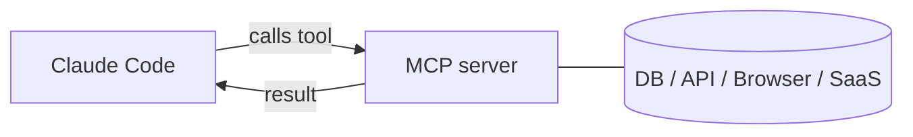

<LevelBadge level="advanced" />

<VerifyNote lastVerified="2026-11-10" source="https://code.claude.com/docs/en/mcp">
Les commandes `claude mcp`, les portées de configuration et les transports évoluent — vérifiez dans la documentation officielle MCP de Claude Code et sur modelcontextprotocol.io. Les quatre transports, les chemins de stockage des portées, l'abandon de SSE et le comportement d'approbation de projet ci-dessous proviennent tous de cette page.
</VerifyNote>

Le **Model Context Protocol (MCP)** est un standard ouvert pour connecter l'IA à des outils et à des données externes. Un **serveur MCP** expose des capacités (interroger une base de données, ouvrir une PR GitHub, piloter un navigateur) ; Claude Code s'y connecte et peut **appeler ces outils** pendant une session. C'est ainsi que vous étendez Claude au-delà de votre système de fichiers et de votre shell.

<Callout type="objectives" items={["Expliquer ce qu'est un serveur MCP et comment Claude Code appelle ses outils", "Distinguer les deux transports : stdio local et HTTP/SSE distant", "Ajouter un serveur avec claude mcp add et lire le JSON qu'il écrit", "Choisir la bonne portée (local, project, user) selon les personnes qui doivent voir un serveur", "Connecter une vraie base de données à Claude de bout en bout", "Éviter les pièges de sécurité et de configuration dans lesquels tombent la plupart des gens"]} />

## Le principe



Vous déclarez les serveurs que Claude peut utiliser ; chaque serveur publie un ensemble d'outils avec leurs schémas ; Claude les choisit et les appelle comme n'importe quel autre outil.

<Flashcards title="Vocabulaire MCP" cards={[{front: "Model Context Protocol (MCP)", back: "Un standard ouvert pour connecter l'IA à des outils et à des données externes."}, {front: "Serveur MCP", back: "Un programme qui expose des capacités — interroger une base de données, ouvrir une PR GitHub, piloter un navigateur — sous forme d'outils appelables."}, {front: "Outil (tool)", back: "Une capacité qu'un serveur MCP publie avec un schéma ; Claude la choisit et l'appelle comme n'importe quel autre outil."}, {front: "Transport", back: "La manière dont Claude atteint un serveur : stdio (processus local), HTTP (hébergé, souvent avec OAuth), SSE (obsolète — HTTP y bascule automatiquement) ou WebSocket ws/wss (persistant, avec push, authentification par en-tête uniquement, pas d'option --transport)."}, {front: "Portée (scope)", back: "Qui voit un serveur : local (vous, ce projet), project (l'équipe, via le commit) ou user (vous, partout)."}]} />

## Transports

Il existe quatre façons pour Claude d'atteindre un serveur. Choisissez selon l'endroit où le serveur s'exécute et la façon dont il communique.

- **stdio** — un processus local que Claude lance (idéal pour les outils/CLI locaux). C'est ce que signifie une entrée JSON sans `type`.
- **HTTP** — un serveur hébergé, souvent avec OAuth. Le choix par défaut pour tout ce qui est distant.
- **SSE** — **obsolète** ; utilisez HTTP quand vous le pouvez. Certains services n'exposent encore qu'un point d'accès SSE et, depuis Claude Code v2.1.265, `--transport http` essaie d'abord HTTP puis bascule tout seul vers SSE : vous avez donc rarement besoin d'indiquer `--transport sse` explicitement.
- **WebSocket** (`ws` / `wss`) — une connexion bidirectionnelle persistante, pour un serveur qui envoie des événements sans sollicitation. `--transport` n'accepte *pas* `ws` : ajoutez-le avec `claude mcp add-json '{"type":"ws","url":"wss://…"}'` ou écrivez-le dans `.mcp.json`. Pas d'OAuth — l'authentification se fait uniquement par en-tête.

<Callout type="warning" items={["Une entrée JSON avec une url mais sans type est une erreur de configuration, pas une valeur par défaut raisonnable : Claude Code lit une entrée sans type comme un serveur stdio, l'ignore et signale qu'elle a une « url » mais pas de « type ». Définissez toujours \"type\": \"http\" (ou \"sse\" / \"ws\") sur un serveur distant que vous écrivez à la main."]} />

## Configurer les serveurs

Le chemin le plus rapide est la commande `claude mcp add` — elle écrit la configuration à votre place. Suivez cette séquence pour passer de zéro à un serveur connecté.

<Steps items={[{title: "Ajouter un serveur stdio local", body: "Exécutez claude mcp add — tout ce qui suit le -- est la commande de lancement que Claude exécute pour vous."}, {title: "Ou ajouter un serveur HTTP distant", body: "Passez --transport http et une portée, puis l'URL du serveur. Les serveurs distants sont souvent hébergés et utilisent OAuth."}, {title: "Voir ce qui est connecté", body: "Exécutez claude mcp list pour afficher les serveurs configurés et leur état de connexion."}, {title: "Inspecter et s'authentifier", body: "Utilisez /mcp dans une session pour inspecter les outils d'un serveur et authentifier les serveurs distants."}]} />

<PromptCard title="Ajouter un serveur stdio local">{`# A local stdio server (everything after -- is the launch command)
claude mcp add filesystem -- npx -y @modelcontextprotocol/server-filesystem ~/code/myproject`}</PromptCard>

<PromptCard title="Ajouter un serveur HTTP distant (partagé avec le projet)">{`# A remote HTTP server, shared with everyone on the project
claude mcp add --transport http --scope project github https://api.githubcopilot.com/mcp/`}</PromptCard>

En coulisses, ce n'est que du JSON. Un serveur de portée **project** atterrit dans un fichier `.mcp.json` à la racine du dépôt — commitez-le et vos coéquipiers obtiennent les mêmes outils dès qu'ils font confiance à l'espace de travail :

```json
{
  "mcpServers": {
    "github": { "type": "http", "url": "https://api.githubcopilot.com/mcp/" }
  }
}
```

<Callout type="warning" items={["N'allez pas chercher les paquets @modelcontextprotocol/server-github, -postgres, -slack ou -puppeteer que vous trouverez dans de vieux tutoriels. Ils sont archivés et portent un avis de dépréciation npm indiquant « Archived and unmaintained; no security guarantees ». Utilisez le serveur du fournisseur lui-même quand il y en a un — celui de GitHub est le point d'accès HTTP ci-dessus, et le contrôle du navigateur est passé à @playwright/mcp. Parmi les serveurs de référence TypeScript, seuls filesystem, memory, everything et sequential-thinking sont encore maintenus."]} />

### La portée décide qui voit le serveur

| Portée | Stockée dans | Chargée dans | À utiliser pour |
|---|---|---|---|
| `local` (par défaut) | `~/.claude.json`, sous le chemin de ce projet | ce projet uniquement | expériences personnelles, secrets |
| `project` | `.mcp.json` dans le dépôt (commité) | ce projet uniquement, partagé avec l'équipe | outils que toute l'équipe doit partager |
| `user` | `~/.claude.json` | tous vos projets | serveurs que vous voulez partout |

<Callout type="warning" items={["La « portée local » de MCP n'est pas la même chose que les paramètres locaux. Un serveur MCP de portée local se trouve dans ~/.claude.json, dans votre répertoire personnel — PAS dans le fichier .claude/settings.local.json du projet. Le chercher dans le dossier du projet mène à une impasse."]} />

Exécutez `claude mcp list` pour voir ce qui est connecté et `/mcp` dans une session pour inspecter les outils et authentifier les serveurs distants. Voir [Configuration MCP et squelettes de serveur](/docs/templates/mcp-config) pour des modèles de départ à copier-coller.

## Exemple pratique : donner votre base de données à Claude

Imaginons que vous vouliez que Claude réponde à des questions sur un Postgres local plutôt que de coller vous-même les résultats de requêtes. Ajoutez le serveur avec la portée project, pour que vos coéquipiers l'obtiennent aussi.

C'est avec les bases de données que le problème des serveurs archivés se fait le plus sentir : l'ancien `@modelcontextprotocol/server-postgres` n'est plus maintenu et il n'existe pas de remplaçant officiel, donc le nom du paquet est la seule décision que vous devez prendre vous-même. Choisissez un serveur communautaire maintenu, [examinez-le](/docs/security/reviewing-third-party-code), puis branchez-le — la forme est la même quel que soit votre choix :

<PromptCard title="Ajouter un serveur Postgres avec la portée project">{`# Replace the package with a maintained Postgres MCP server you have reviewed.
# The connection string is read-only on purpose — see below.
claude mcp add --scope project db -- npx -y <postgres-mcp-server> "postgresql://readonly@localhost/app"`}</PromptCard>

Désormais, dans une session, vous pouvez poser la question en langage naturel et laisser Claude faire la boucle de requêtes à votre place :

<PromptCard title="Poser une question à la base de données">{`How many users signed up last week? Check the DB.`}</PromptCard>

Claude appelle l'outil de requête que le serveur publie, reçoit des lignes et répond — plus de copier-coller. Gardez la chaîne de connexion en lecture seule, sauf si Claude a vraiment besoin d'écrire. Et si vous ne vouliez qu'une seule requête, sachez que `psql -c '…'` via Bash coûte une fraction des tokens ; [La taxe des tokens MCP](/docs/claude-code/mcp-token-cost) explique quand l'un l'emporte sur l'autre.

Comme il est de portée project, un coéquipier qui récupère le dépôt obtient la même capacité — mais **pas en silence, ni instantanément**. Un serveur de `.mcp.json` commité reste à `⏸ Pending approval` tant qu'il n'a pas lancé `claude` dans le dossier et accepté la boîte de dialogue de confiance de l'espace de travail. Un dépôt cloné ne peut pas pré-approuver ses propres serveurs : `enableAllProjectMcpServers` ou `enabledMcpjsonServers` commités dans le `.claude/settings.json` du projet sont *ignorés* dans un dossier non approuvé. Les approbations venant d'un `~/.claude/settings.json` au niveau utilisateur, de paramètres gérés ou passées avec `--settings` s'appliquent en revanche. C'est la réponse habituelle à « pourquoi mon coéquipier ne voit-il pas le serveur ? »

## Confiance et sécurité

<Callout type="warning" items={["Un serveur MCP exécute du code et peut lire des données et effectuer des actions — ne connectez que des serveurs en qui vous avez confiance.", "Donnez à chaque serveur le moindre privilège dont il a besoin.", "Tout contenu externe renvoyé par un serveur peut contenir une injection de prompt.", "Examinez les serveurs tiers avant de les connecter."]} />

:::warning[Traitez les serveurs MCP comme l'installation d'un logiciel]
Un serveur MCP exécute du code et peut lire des données et effectuer des actions. Ne connectez que des serveurs en qui vous avez confiance, donnez-leur le **moindre privilège** nécessaire et rappelez-vous que tout contenu externe qu'ils renvoient peut contenir une [injection de prompt](/docs/security/prompt-injection). Examinez d'abord les serveurs tiers — voir [Examiner du code tiers](/docs/security/reviewing-third-party-code).
:::

## MCP aussi dans les applications

MCP alimente aussi les **Connecteurs** dans les applications Claude — même standard, autre surface. Voir [Connecteurs (MCP) dans les applications](/docs/claude-app/connectors) et, pour l'API, [MCP et connexion aux outils](/docs/api/mcp).

## Erreurs courantes

- **Mauvaise portée.** Un serveur ajouté avec la portée `local` n'apparaîtra pas chez vos coéquipiers ; un serveur que vous ne vouliez que pour vous ne devrait pas être commité avec la portée `project`. Choisissez délibérément.
- **Trop de serveurs, trop d'outils.** La recherche d'outils est activée par défaut : un serveur connecté vous coûte donc normalement, à chaque tour, les *noms* de ses outils et les instructions du serveur plutôt que ses schémas complets — mais c'est tout de même une taxe par tour, et les schémas entrent dans le contexte dès que Claude les recherche. Connectez ce dont la tâche a besoin, pas tout votre catalogue. Voir [La taxe des tokens MCP](/docs/claude-code/mcp-token-cost) pour les vrais chiffres, les modes de `ENABLE_TOOL_SEARCH` et la façon dont l'exécution de code réduit le second coût.
- **Connexions sur-privilégiées.** Donnez à un serveur de base de données un rôle en lecture seule, sauf si Claude a vraiment besoin d'écrire. MCP rend les capacités réelles — restreignez-les.
- **Oublier le risque d'injection.** Tout ce qu'un serveur renvoie (une page web, le corps d'un ticket, une ligne) est du texte non fiable pouvant contenir une [injection de prompt](/docs/security/prompt-injection). Ne branchez pas un serveur puissant capable d'écrire à côté d'un serveur non fiable capable de lire sans y avoir bien réfléchi.

<Quiz title="Testez-vous" questions={[{q: "Quel transport est un processus local que Claude lance lui-même ?", options: ["HTTP/SSE distant", "stdio", "OAuth"], answer: 1, explain: "stdio est un processus local que Claude lance — idéal pour les outils et CLI locaux. Les trois autres sont distants : HTTP (souvent avec OAuth), SSE (obsolète) et WebSocket."}, {q: "Où un serveur de portée project est-il écrit, et que doit faire un coéquipier ?", options: ["Dans vos paramètres utilisateur ; vous seul le voyez", "Dans un .mcp.json à la racine du dépôt ; après son pull, il doit encore faire confiance à l'espace de travail pour que le serveur quitte Pending approval", "Dans un cache global caché ; personne ne peut le modifier"], answer: 1, explain: "La portée project aboutit dans un .mcp.json commité à la racine du dépôt. Mais un dépôt cloné ne peut pas approuver ses propres serveurs — un enableAllProjectMcpServers commité est ignoré dans un dossier non approuvé, donc le serveur attend à Pending approval jusqu'à ce que le coéquipier accepte la boîte de dialogue de confiance de l'espace de travail."}, {q: "Pourquoi garder une connexion à une base de données en lecture seule quand Claude n'a besoin que de lire ?", options: ["Les requêtes s'exécutent plus vite", "Moindre privilège — MCP rend les capacités réelles, donc n'accordez pas l'accès en écriture s'il n'est pas vraiment nécessaire", "La lecture seule est exigée par le protocole"], answer: 1, explain: "Donnez aux serveurs le moindre privilège dont ils ont besoin. MCP rend les capacités réelles, donc un rôle en lecture seule évite les écritures involontaires."}]} />

<Callout type="takeaways" items={["MCP est un standard ouvert ; un serveur MCP expose des outils que Claude Code appelle comme n'importe quel autre outil.", "Quatre transports : stdio (un processus que Claude lance), HTTP (le choix par défaut pour le distant), SSE (obsolète — HTTP y bascule tout seul) et WebSocket ws/wss (push, authentification par en-tête, add-json uniquement).", "claude mcp add écrit la configuration pour vous ; en coulisses, c'est du JSON. La portée project vit dans un .mcp.json commité, et la copie d'un coéquipier reste à Pending approval tant qu'il ne fait pas confiance à l'espace de travail.", "La portée contrôle la visibilité : local (vous, ce projet), project (commité pour l'équipe), user (vous, partout).", "Traitez les serveurs comme l'installation d'un logiciel : confiance, moindre privilège, et vigilance face à l'injection de prompt dans tout ce qu'ils renvoient."]} />

## Suite

- [Construire et brancher votre premier serveur MCP (pas à pas)](/docs/walkthroughs/first-mcp-server)
- [Configuration MCP et squelettes de serveur](/docs/templates/mcp-config)
- [Sécuriser les agents et les outils](/docs/security/securing-agents)
