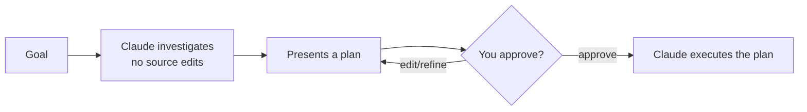

<LevelBadge level="beginner" />

<Callout type="objectives" items={["Expliquer ce que Plan Mode bloque — et ce qu'il laisse quand même exécuter à Claude", "Entrer et sortir de Plan Mode de trois façons différentes", "Parcourir la boucle enquêter-proposer-approuver-exécuter", "Distinguer Plan Mode des Permissions et les utiliser ensemble"]} />

<VerifyNote lastVerified="2026-10-09" source="https://code.claude.com/docs/en/permission-modes">
La façon d'entrer en Plan Mode (raccourci/option), et les commandes shell qu'il laisse exactement exécuter à Claude pendant la planification, changent d'une version à l'autre — vérifiez dans la documentation officielle de Claude Code.
</VerifyNote>

## L'idée principale

Imaginez confier vos clés de maison à un artisan versus lui demander d'abord de faire le tour et de noter *ce qu'il* changerait. Plan Mode est le tour de repérage.

**Plan Mode** demande à Claude de **rechercher et proposer des changements sans les faire** : il lit des fichiers, exécute des commandes shell pour explorer et rédige un plan — mais il n'**édite pas vos sources**. Les éditions restent bloquées jusqu'à ce que vous approuviez le plan.

<Callout type="tip" items={["Plan Mode signifie que Claude ENQUÊTE mais ne MODIFIE pas vos sources — il produit un plan et attend votre feu vert."]} />

### Il n'est pas strictement en lecture seule

Explorer nécessite parfois une commande : Plan Mode consiste donc à *ne pas éditer*, non à *ne pas exécuter*. Ce qui arrive à une commande shell pendant la planification dépend de la session — le premier cas qui correspond l'emporte :

<Steps items={[{title: "Sessions de terminal interactives avec bypass permissions disponible", body: "Les blocages de Plan Mode ne sont PAS appliqués. Claude reçoit toujours la consigne de planifier sans éditer, mais une édition ou une commande qu'il tente pendant la planification s'exécute sans demande de confirmation. Plan Mode conserve ses blocages partout ailleurs — les exécutions headless -p, l'Agent SDK et le panneau de chat de l'extension VS Code."}, {title: "Auto mode disponible et useAutoModeDuringPlan activé (le défaut)", body: "Le classifieur examine les commandes shell au lieu de vous solliciter, sauf pour les suppressions sur des chemins critiques. Les commandes approuvées s'exécutent ; celles qui sont rejetées sont bloquées."}, {title: "Auto mode indisponible, ou useAutoModeDuringPlan désactivé", body: "Les commandes qui sortent de l'ensemble intégré en lecture seule vous demandent une approbation."}]} />

<Callout type="warning" items={["Si vous avez lancé avec --allow-dangerously-skip-permissions, Plan Mode est une instruction forte plutôt qu'un garde-fou strict. Traitez-le comme une convention de planification, pas comme un bac à sable."]} />

## Pourquoi c'est la façon la plus sûre de commencer

Pour tout ce qui est grand, risqué ou inconnu, vous voulez voir *ce que* Claude compte faire avant qu'il ne touche votre dépôt. Plan Mode sépare la **réflexion** de l'**action** :

Le gain : vous attrapez les mauvaises hypothèses *avant* qu'elles ne deviennent du mauvais code.

## Quand l'utiliser

<Callout type="tip" items={["TOUJOURS pour les changements grands ou multi-fichiers, les migrations ou les refactorisations", "Quand vous travaillez dans une base de code que vous ne connaissez pas encore entièrement", "Quand vous voulez un plan révisable à partager avec un coéquipier"]} />

Pour de minuscules éditions évidentes, vous pouvez sauter cette étape — mais en cas de doute, planifiez d'abord.

## Comment ça marche en pratique

Suivez la boucle. Chaque étape mérite la suivante — Claude ne passe à l'édition qu'*après* votre approbation.

<Steps items={[{title: "Entrer en Plan Mode et énoncer votre objectif", body: "Appuyez sur Shift+Tab pour faire défiler les modes de permission jusqu'à ce que la barre d'état affiche 'plan mode on', ou préfixez un seul prompt avec /plan. Pour démarrer directement dedans, lancez claude --permission-mode plan. Décrivez ensuite ce que vous voulez accomplir."}, {title: "Claude enquête", body: "Il lit les fichiers pertinents, exécute des commandes exploratoires et pose des questions de clarification."}, {title: "Claude renvoie un plan étape par étape", body: "Les fichiers à changer, l'approche, et comment vérifier le résultat. Appuyez sur Ctrl+G pour ouvrir le plan proposé dans votre éditeur et le modifier directement."}, {title: "Vous approuvez ou affinez", body: "Choisissez 'Yes, and use auto mode', 'Yes, manually approve edits', ou 'No, keep planning'. L'approbation fait sortir de Plan Mode vers le mode de permission décrit par l'option choisie, et Claude commence à éditer."}]} />

Pour quitter Plan Mode sans approuver de plan, appuyez à nouveau sur `Shift+Tab`. Pour en faire le mode par défaut des sessions de terminal d'un projet, définissez `defaultMode` sur `plan` dans `.claude/settings.json` — voir [Réglages](/docs/claude-code/settings).

### Essayez vous-même

Copiez ceci dans une vraie session de planification et regardez la boucle se dérouler :

<PromptCard title="Lancer une session de planification">{`I want to migrate our auth from sessions to JWT. Stay in Plan Mode: investigate the current setup, ask anything you need, then propose a step-by-step plan with files to change and how to verify — don't edit anything yet.`}</PromptCard>

:::tip[Associez-le à CLAUDE.md]
Un bon [CLAUDE.md](/docs/claude-code/claude-md) rend les plans plus précis — Claude planifie avec vos conventions et garde-fous déjà en tête.
:::

## Plan Mode vs Permissions

Une confusion classique. Ils résolvent des problèmes différents et fonctionnent ensemble :

- **Plan Mode** = « enquêter et proposer, ne pas encore éditer ». (Cette page.)
- **[Permissions](/docs/claude-code/permissions)** = une fois en action, *quelles* actions sont autorisées sans demander.

Voyez-le comme **agir maintenant ou non** (Plan Mode) versus **quelles actions sont autorisées une fois en action** (Permissions).

<Flashcards cards={[{front: "Dans quel état Plan Mode met-il Claude Code ?", back: "Recherche et proposition : il lit des fichiers, exécute des commandes shell pour explorer et rédige un plan, mais il n'édite pas vos sources. Les éditions restent bloquées jusqu'à votre approbation."}, {front: "Comment entrer et sortir de Plan Mode ?", back: "Entrez avec Shift+Tab, un préfixe /plan sur un prompt, ou claude --permission-mode plan. Sortez sans approuver en appuyant de nouveau sur Shift+Tab."}, {front: "Quelle est la boucle de Plan Mode ?", back: "Enquêter → présenter un plan → vous approuvez ou affinez → Claude exécute."}, {front: "Quand recourir à Plan Mode ?", back: "Par défaut pour le travail grand, risqué ou inconnu (changements multi-fichiers, migrations, refactorisations, bases de code inconnues). Ne sautez que les minuscules éditions évidentes."}, {front: "Plan Mode vs Permissions ?", back: "Plan Mode régit S'IL FAUT agir maintenant ; les Permissions régissent QUELLES actions sont autorisées une fois en action."}]} />

<Callout type="takeaways" items={["Plan Mode, c'est rechercher et proposer : Claude lit et exécute des commandes exploratoires mais n'édite pas vos sources tant que vous n'avez pas approuvé le plan", "Il n'est pas strictement en lecture seule — pendant la planification, les commandes sont examinées par le classifieur, soumises à votre approbation, ou (avec bypass permissions disponible dans un terminal interactif) entièrement débloquées", "Entrez avec Shift+Tab, un préfixe /plan, ou --permission-mode plan ; l'approbation fait basculer la session dans le mode nommé par l'option d'approbation choisie", "Utilisez-le par défaut pour le travail grand, risqué ou inconnu ; ne sautez que les minuscules éditions évidentes", "Plan Mode régit S'IL FAUT agir maintenant ; les Permissions régissent QUELLES actions sont autorisées une fois en action"]} />

<Quiz title="Testez-vous" questions={[{q: "Que peut faire Claude Code en Plan Mode ?", options: ["Éditer des fichiers et exécuter n'importe quelle commande", "Lire des fichiers et exécuter des commandes shell pour explorer — mais pas éditer vos sources avant votre approbation", "Seulement répondre aux questions, sans aucun accès aux fichiers"], answer: 1, explain: "Plan Mode consiste à ne pas éditer, non à ne pas exécuter. Claude lit des fichiers et exécute des commandes exploratoires (examinées par le classifieur ou soumises à votre approbation, selon la session), mais les éditions de vos sources restent bloquées jusqu'à ce que vous approuviez le plan."}, {q: "Quand recourir à Plan Mode ?", options: ["Seulement pour les corrections de fautes de frappe d'une ligne", "Pour les changements grands ou multi-fichiers, les migrations, les refactorisations, ou les bases de code inconnues", "Jamais — il ne fait que vous ralentir"], answer: 1, explain: "Utilisez-le toujours pour les changements grands ou multi-fichiers, les migrations ou les refactorisations, et quand vous travaillez dans une base de code que vous ne connaissez pas entièrement. Les minuscules éditions évidentes peuvent le sauter."}, {q: "Quel est l'ordre correct de la boucle de Plan Mode ?", options: ["Exécuter, puis enquêter, puis approuver", "Enquêter sans éditer, présenter un plan, vous approuvez ou affinez, puis Claude exécute", "Approuver d'abord, puis Claude enquête et édite"], answer: 1, explain: "Claude enquête sans éditer vos sources, présente un plan, vous approuvez ou affinez, et ce n'est qu'alors qu'il passe à l'exécution du plan."}, {q: "En quoi Plan Mode et les Permissions diffèrent-ils ?", options: ["Ce sont deux noms pour la même fonctionnalité", "Plan Mode = enquêter et proposer, ne pas encore éditer ; Permissions = une fois en action, quelles actions sont autorisées sans demander", "Les Permissions décident s'il faut planifier ; Plan Mode décide quels fichiers éditer"], answer: 1, explain: "Plan Mode sépare la réflexion de l'action. Les Permissions contrôlent quelles actions sont autorisées sans demander une fois que Claude agit. Ils fonctionnent ensemble."}]} />

## La suite

- [Permissions & modes de permission](/docs/claude-code/permissions)
- [Gestion du contexte](/docs/claude-code/context-management) — garder les longues sessions efficaces
- [Tutoriel : personnaliser Claude Code pour un vrai dépôt](/docs/walkthroughs/customize-claude-code)
