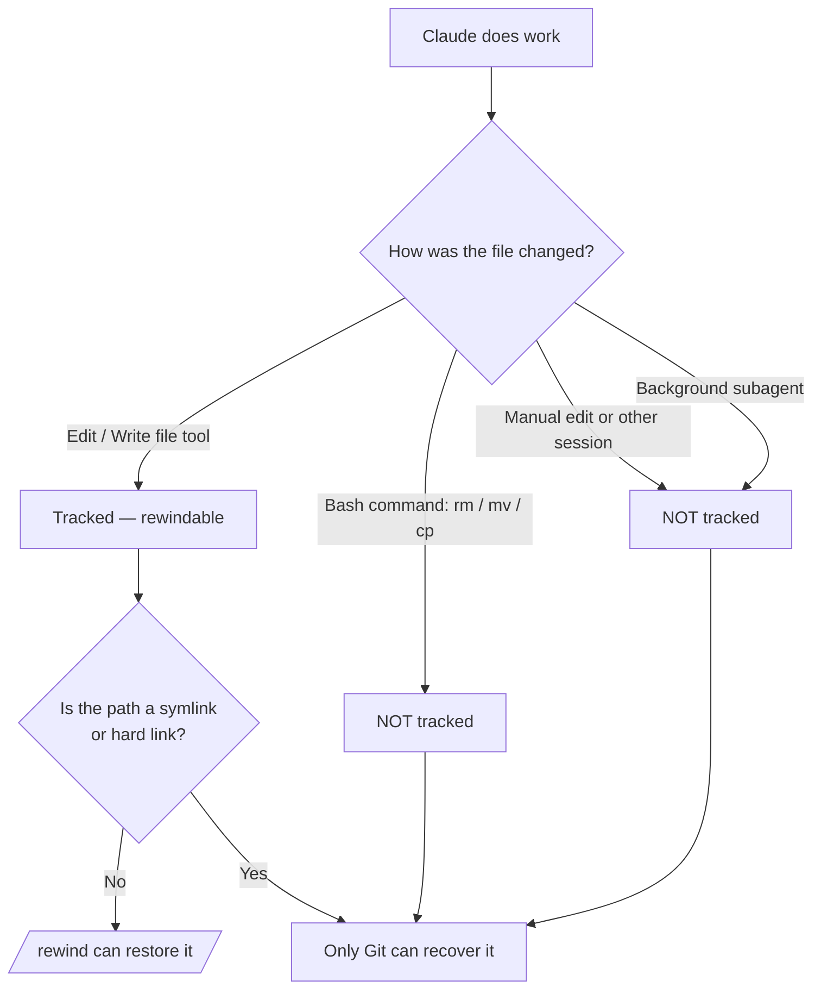

<LevelBadge level="intermediate" />

<Callout type="objectives" items={["समझें कि चेकपॉइंट क्या कैप्चर करता है — और क्या चुपचाप कैप्चर नहीं करता", "रिवाइंड मेनू को दो तरीकों से खोलें और हर बार सही रिस्टोर क्रिया चुनें", "'रिस्टोर' (स्थिति पूर्ववत करना) और 'समराइज़' (संदर्भ संपीड़ित करना) में अंतर पहचानें", "ठीक-ठीक जानें कि चेकपॉइंट Git के पूरक क्यों हैं, पर उसकी जगह कभी नहीं ले सकते"]} />

<VerifyNote lastVerified="2026-10-09" source="https://code.claude.com/docs/en/checkpointing">
चेकपॉइंट का व्यवहार, रिवाइंड मेनू की क्रियाएँ, स्नैपशॉट की सीमा और रिटेंशन रिलीज़ के बीच बदलते रहते हैं — आधिकारिक दस्तावेज़ में पुष्टि करें।
</VerifyNote>

## मुख्य विचार

जब आप Claude को किसी महत्वाकांक्षी, व्यापक बदलाव पर खुला छोड़ते हैं, तो सबसे डरावना सवाल होता है "अगर तीसरे संपादन तक पहुँचकर कुछ बिगड़ गया तो?" **चेकपॉइंटिंग** इसका जवाब है: Claude Code हर संपादन से पहले आपके कोड का स्नैपशॉट अपने-आप ले लेता है, ताकि आप किसी भी पुरानी स्थिति में वापस जा सकें, बजाय इसके कि अधूरे रिफ़ैक्टर को हाथ से सुलझाएँ।

इसे **पूरे सत्र के लिए एक लोकल अनडू** समझें — एक सुरक्षा जाल जो आपको बिना डर के कहने देता है "हाँ, साहसी तरीक़ा आज़माओ।"

## चेकपॉइंट कैसे बनते हैं

आप चेकपॉइंट नहीं बनाते — वे अपने-आप बनते हैं।

<Steps items={[{title: "हर प्रॉम्प्ट जो एक टर्न शुरू करता है = एक चेकपॉइंट", body: "हर वह प्रॉम्प्ट जो एक टर्न शुरू करता है, Claude के फ़ाइल-संपादन टूल चलने से पहले आपके कोड की स्थिति कैप्चर करता है। कोई कमांड नहीं, कोई कॉन्फ़िग नहीं, कोई औपचारिकता नहीं।"}, {title: "केवल सबसे हालिया 100 रखे जाते हैं", body: "Claude Code एक सत्र में सबसे हालिया 100 चेकपॉइंट के फ़ाइल स्नैपशॉट रखता है। पुराने हटा दिए जाते हैं, इसलिए बहुत लंबे सत्र को उसकी शुरुआत तक पूरी तरह रिवाइंड नहीं किया जा सकता।"}, {title: "वे सत्रों के पार बने रहते हैं", body: "चेकपॉइंट बातचीत के साथ सहेजे जाते हैं, इसलिए सत्र फिर से शुरू करने के बाद भी आप /rewind चला सकते हैं, सिर्फ़ चालू सत्र में ही नहीं।"}, {title: "वे खुद को साफ़ कर लेते हैं", body: "किसी सत्र के फ़ाइल स्नैपशॉट रिटेंशन स्वीप में हटा दिए जाते हैं, डिफ़ॉल्ट रूप से सत्र द्वारा आख़िरी बार स्नैपशॉट सहेजने के लगभग 30 दिन बाद। जिस चेकपॉइंट के स्नैपशॉट जा चुके हैं, उस पर रिवाइंड करना 'No files were restored' के साथ विफल होता है — उन्हें ज़्यादा समय तक रखने के लिए cleanupPeriodDays बढ़ाएँ।"}]} />

## रिवाइंड मेनू खोलना

भीतर जाने के दो रास्ते हैं:

<Steps items={[{title: "/rewind चलाएं", body: "प्रॉम्प्ट पर स्लैश कमांड टाइप करें। हमेशा काम करता है।"}, {title: "Esc दो बार दबाएं — पर केवल खाली इनपुट पर", body: "जब प्रॉम्प्ट बॉक्स खाली हो, तब डबल-Esc रिवाइंड मेनू खोलता है। अगर उसमें टेक्स्ट है, तो डबल-Esc उस टेक्स्ट को साफ़ कर देता है (साफ़ किया गया टेक्स्ट इनपुट हिस्ट्री में सहेजा जाता है, इसलिए बाद में उसे वापस पाने के लिए ऊपर वाला तीर दबाएँ)।"}]} />

<PromptCard title="रिवाइंड मेनू खोलें">{`/rewind`}</PromptCard>

मेनू **इस सत्र में आपके भेजे हर प्रॉम्प्ट** की सूची दिखाता है। वह बिंदु चुनें जिस पर आप कार्रवाई करना चाहते हैं, फिर एक क्रिया चुनें।

## रिस्टोर बनाम समराइज़: मुख्य अंतर

यहीं लोग उलझते हैं। मेनू दो *तरह* की क्रियाएँ देता है:

- **रिस्टोर** क्रियाएँ डिस्क पर और/या बातचीत में स्थिति बदलती हैं — वे पूर्ववत करती हैं।
- **समराइज़** क्रियाएँ आपकी फ़ाइलों को कभी नहीं छूतीं — वे संदर्भ विंडो में जगह खाली करने के लिए बातचीत को संपीड़ित करती हैं।

<Callout type="warning" items={["रिस्टोर = अनडू (कोड, बातचीत, या दोनों को वापस ले जाता है)। समराइज़ = संदर्भ संपीड़न (डिस्क पर फ़ाइलें अछूती रहती हैं)।", "जब किसी संपादन ने कुछ तोड़ा हो तो रिस्टोर चुनें। जब सत्र फूल गया हो पर कोड ठीक हो तो समराइज़ चुनें।"]} />

### रिस्टोर क्रियाएँ

<Steps items={[{title: "कोड और बातचीत रिस्टोर करें", body: "आपकी फ़ाइलों और चैट हिस्ट्री, दोनों को चुने हुए बिंदु तक वापस ले जाता है — उस क्षण तक एक साफ़ 'समय में वापसी'।"}, {title: "बातचीत रिस्टोर करें", body: "चैट को उस संदेश तक वापस ले जाता है पर आपका मौजूदा कोड रखता है। जो संपादन रखना चाहते हैं उन्हें खोए बिना कोई सवाल दोबारा पूछने के लिए उपयोगी।"}, {title: "कोड रिस्टोर करें", body: "फ़ाइल बदलाव वापस लेता है पर बातचीत रखता है। संपादन पूर्ववत करें, उनके बारे में हुई चर्चा रखें।"}]} />

दोनों **कोड** रिस्टोर विकल्प केवल तभी दिखते हैं जब चुने हुए चेकपॉइंट में वापस लेने लायक ट्रैक किए गए फ़ाइल बदलाव हों। अगर उस बिंदु के बाद कोई फ़ाइल संपादन कैप्चर नहीं हुआ, तो मेनू केवल **बातचीत रिस्टोर करें**, दोनों समराइज़ विकल्प, और **Never mind** (जो बिना कुछ बदले संदेश सूची पर लौटा देता है) देता है।

बातचीत रिस्टोर करने के बाद (या "यहां से समराइज़ करें" चुनने के बाद), चुने हुए संदेश का मूल प्रॉम्प्ट इनपुट फ़ील्ड में वापस डाल दिया जाता है ताकि आप उसे दोबारा भेज या संपादित कर सकें।

### समराइज़ क्रियाएँ

दोनों बातचीत के एक हिस्से को AI-जनित सारांश में संपीड़ित करती हैं — एक **लक्षित `/compact`** की तरह, जहाँ आप चुनते हैं कि चुने हुए संदेश का कौन-सा पक्ष दबाना है।

<Steps items={[{title: "यहां से समराइज़ करें", body: "चुने हुए संदेश से पहले के संदेश अक्षुण्ण रहते हैं। चुना हुआ संदेश और उसके बाद का सब कुछ सारांश बन जाता है। किसी भटकी हुई चर्चा को हटाते हुए शुरुआती संदर्भ को पूरे विवरण के साथ रखने के लिए इसका उपयोग करें।"}, {title: "यहां तक समराइज़ करें", body: "चुने हुए संदेश से पहले के संदेश सारांश बन जाते हैं; चुना हुआ संदेश और उसके बाद का सब कुछ अक्षुण्ण रहता है। आप बातचीत के अंत में ही बने रहते हैं। शुरुआती तैयारी की बातचीत को संपीड़ित करते हुए हालिया काम को शब्दशः रखने के लिए इसका उपयोग करें।"}]} />

दोनों ही स्थिति में मूल संदेश सत्र ट्रांसक्रिप्ट में बने रहते हैं, इसलिए Claude अब भी विवरणों का हवाला दे सकता है, और जहाँ संपीड़ित संदेश थे वहाँ एक **Summarized conversation** मार्कर दिखाई देता है। सारांश किस पर केंद्रित हो, यह तय करने के लिए तीर कुंजियों से किसी **समराइज़** विकल्प को हाइलाइट करें और जहाँ पंक्ति में **add context (optional)** लिखा हो वहाँ निर्देश टाइप करें, फिर Enter दबाएँ — विकल्प को उसकी नंबर कुंजी से चुनने पर बिना किसी निर्देश के तुरंत समराइज़ हो जाता है।

पूरे प्रवाह के लिए [संदर्भ प्रबंधन](/docs/claude-code/context-management) देखें — `/rewind` की समराइज़ क्रियाएँ एक नश्तर हैं, जहाँ `/compact` एक चौड़ा ब्रश है।

<Callout type="note" items={["समराइज़ आपको उसी सत्र में रखता है। मूल सत्र को जस का तस रखते हुए अलग राह पकड़कर कोई दूसरा तरीक़ा आज़माने के लिए इसके बजाय /branch या claude --continue --fork-session का उपयोग करें।"]} />

## `/clear` के पार रिवाइंड करना

अगर आपने उसी Claude Code प्रोसेस में पहले `/clear` चलाया था, तो रिवाइंड मेनू में सबसे ऊपर एक अतिरिक्त प्रविष्टि दिखती है: `/resume <session-id> (previous session)`। `/clear` से पहले जो बातचीत चालू थी, उस पर वापस जाने के लिए इसे चुनें।

<VerifyNote lastVerified="2026-10-09" source="https://code.claude.com/docs/en/checkpointing">
वह प्रविष्टि केवल तब तक उपलब्ध रहती है जब तक आप Claude Code से बाहर नहीं निकलते या कोई दूसरा सत्र फिर से शुरू नहीं करते। एक बार वह चली जाए, तो इसके बजाय `/resume` चलाएँ और सूची से पिछला सत्र चुनें।
</VerifyNote>

## जहाँ चेकपॉइंट रुक जाते हैं — वे सीमाएँ जो चुभती हैं

चेकपॉइंट तब तक जादुई लगते हैं जब तक वे नहीं लगते। ये कमियाँ मायने रखती हैं:

<Steps items={[{title: "बैश परिवर्तन अदृश्य होते हैं", body: "Claude जो शेल कमांड चलाता है उनसे छुई गई फ़ाइलें — rm, mv, cp, कोड जनरेटर, फ़ॉर्मैटर — ट्रैक नहीं होतीं। केवल Claude के फ़ाइल-संपादन टूल से किए गए सीधे संपादनों का चेकपॉइंट बनता है। rm से हटाई गई फ़ाइल रिवाइंड के लिहाज़ से हमेशा के लिए गई।"}, {title: "अधिकांश सबएजेंट संपादन रिस्टोर नहीं होते", body: "सबएजेंट उन्हीं फ़ाइल टूल से संपादन करता है, लेकिन आपका सत्र आमतौर पर उन संपादनों को कैप्चर नहीं करता। अपवाद फ़ोरग्राउंड में चलने वाली forked स्किल है (context: fork के साथ background: false), जो आपके अपने टर्न के दौरान संपादन करती है और सामान्य रूप से रिवाइंड होती है। कोई भी अन्य सबएजेंट — डिफ़ॉल्ट बैकग्राउंड forked स्किल सहित — को पूर्ववत करने के लिए Git चाहिए। देखें /docs/claude-code/subagents।"}, {title: "बाहरी और समवर्ती परिवर्तन अदृश्य होते हैं", body: "Claude Code के बाहर आपके हाथ से किए गए संपादन, और अन्य समवर्ती सत्रों के संपादन, सामान्यतः कैप्चर नहीं होते — जब तक कि वे संयोग से उन्हीं फ़ाइलों को न छू लें जिन्हें मौजूदा सत्र ने संपादित किया हो।"}, {title: "टर्न के बीच भेजे गए संदेशों का चेकपॉइंट नहीं बनता", body: "Claude के काम करते समय आप जो संदेश कतार में लगाते हैं और जो चालू टर्न के भीतर ही उस तक पहुँच जाता है, वह नया टर्न शुरू करने के बजाय उसी टर्न में जुड़ जाता है, इसलिए उसका अपना कोई चेकपॉइंट नहीं बनता। उसके बाद जो हुआ उसे पूर्ववत करने के लिए उस प्रॉम्प्ट तक रिवाइंड करें जिसने टर्न शुरू किया था — इससे पूरा टर्न रिवाइंड होगा, जिसमें आपके संदेश के पहुँचने से पहले हुआ काम भी शामिल है।"}, {title: "सिमलिंक और हार्ड लिंक छोड़ दिए जाते हैं", body: "रिस्टोर किसी भी ट्रैक किए गए ऐसे पाथ को छोड़ देता है जो सिमलिंक या हार्ड लिंक हो और चेतावनी देता है 'Restored the code, but skipped N files'; उन फ़ाइलों की मौजूदा सामग्री जस की तस रहती है। dotfile-मैनेजर के सिमलिंक और pnpm के हार्ड लिंक, दोनों इसमें आते हैं। रिस्टोर से पहले /debug चलाएँ ताकि छोड़े गए पाथ डीबग लॉग में नाम सहित दर्ज हो जाएँ।"}, {title: "यह सत्र-स्तर का है, इतिहास नहीं", body: "चेकपॉइंट त्वरित, लोकल रिकवरी हैं। वे कमिट नहीं हैं, ब्रांच नहीं हैं, और आपकी टीम के साथ साझा नहीं किए जा सकते।"}]} />

## चेकपॉइंट बनाम Git: दोनों का उपयोग करें

वे अलग-अलग समस्याएँ हल करते हैं, इसलिए दोनों को साथ रखें।

| | चेकपॉइंट (`/rewind`) | Git |
|---|---|---|
| दायरा | एक सत्र | पूरे प्रोजेक्ट का इतिहास |
| ग्रैन्युलैरिटी | हर टर्न शुरू करने वाले प्रॉम्प्ट पर, स्वचालित | हर कमिट पर, सोच-समझकर |
| बैश से हुए बदलाव ट्रैक करता है? | नहीं | हाँ (स्टेज/कमिट होने के बाद) |
| जीवनकाल | अंतिम 100 चेकपॉइंट, सत्र के लगभग 30 दिन बाद स्वीप | स्थायी |
| साझा करने योग्य / सहयोगी | नहीं | हाँ |
| मानसिक मॉडल | "लोकल अनडू" | "स्थायी इतिहास" |

<Callout type="tip" items={["जोखिम भरे, व्यापक रन से पहले Git से काम करती स्थितियाँ कमिट करें — वही आपकी टिकाऊ ज़मीन है।", "कमिट के बीच अपने Git इतिहास को गंदा किए बिना सत्र के भीतर तेज़ रिकवरी के लिए /rewind का उपयोग करें।", "अगर Claude विनाशकारी bash (rm/mv), जनरेटर, या बैकग्राउंड सबएजेंट चलाएगा, तो Git पर भरोसा करें — रिवाइंड उन फ़ाइलों को नहीं बचाएगा।"]} />

## कब इसका सहारा लें

<Steps items={[{title: "विकल्पों की खोज", body: "कोई साहसी इम्प्लीमेंटेशन आज़माएँ, और अगर पसंद न आए तो कोड और बातचीत को फ़ोर्क बिंदु तक रिस्टोर करके दूसरा रास्ता आज़माएँ।"}, {title: "खराब संपादन से उबरना", body: "तीन प्रॉम्प्ट पहले किसी संपादन से बग आ गया? मलबे को डीबग करने के बजाय कोड को उससे ठीक पहले तक रिस्टोर करें।"}, {title: "किसी फ़ीचर पर पुनरावृत्ति", body: "अलग-अलग रूप आज़माएँ, यह जानते हुए कि एक ज्ञात-सही स्थिति बस एक /rewind की दूरी पर है।"}, {title: "संदर्भ स्थान खाली करना", body: "डीबगिंग के किसी लंबे भटकाव ने आपकी संदर्भ विंडो खा ली? बीच के बिंदु से आगे तक समराइज़ करें और अपने मूल निर्देश पूरे विवरण के साथ रखें।"}]} />

<Quiz title="खुद को परखें" questions={[{q: "Claude ने bash कमांड से `rm config.old.json` चलाया और आप उसे वापस चाहते हैं। क्या `/rewind` उसे रिस्टोर कर सकता है?", options: ["हाँ — Claude का किया हर बदलाव चेकपॉइंट होता है", "नहीं — bash से हुए बदलाव ट्रैक नहीं होते; केवल सीधे फ़ाइल-टूल संपादन होते हैं", "केवल तब जब आप 30 सेकंड के भीतर /rewind चलाएँ"], answer: 1, explain: "चेकपॉइंटिंग केवल Claude के फ़ाइल-संपादन टूल से किए गए संपादनों को कैप्चर करती है। bash कमांड (rm, mv, cp) से बदली फ़ाइलें ट्रैक नहीं होतीं — Git ठीक इसी के लिए है।"}, {q: "आपका कोड ठीक है, पर डीबगिंग के एक लंबे भटकाव ने संदर्भ विंडो भर दी है। कौन-सी क्रिया उपयुक्त है?", options: ["भटकाव से पहले तक कोड और बातचीत रिस्टोर करें", "कोड रिस्टोर करें", "भटकाव की शुरुआत पर 'यहां से समराइज़ करें' चुनें"], answer: 2, explain: "समराइज़ क्रियाएँ फ़ाइलों को छुए बिना बातचीत को संपीड़ित करती हैं। 'यहां से समराइज़ करें' भटकाव को सारांश में बदल देता है और आपका पहले का संदर्भ अक्षुण्ण रखता है — कोड में शून्य बदलाव के साथ संदर्भ में जगह खाली करता है।"}, {q: "चेकपॉइंट कैसे बनता है?", options: ["आप हाथ से /checkpoint चलाते हैं", "स्वचालित रूप से — टर्न शुरू करने वाला हर प्रॉम्प्ट एक बनाता है", "केवल जब आप Git में कमिट करते हैं"], answer: 1, explain: "चेकपॉइंटिंग स्वचालित है: टर्न शुरू करने वाला हर प्रॉम्प्ट संपादन से पहले के कोड की स्थिति कैप्चर करता है। कोई मैन्युअल कदम नहीं — पर टर्न के बीच पहुँचा संदेश चालू टर्न में जुड़ जाता है और उसका अपना चेकपॉइंट नहीं बनता।"}]} />

<Flashcards title="चेकपॉइंट और रिवाइंड शब्दावली" cards={[{front: "चेकपॉइंट", back: "हर टर्न शुरू करने वाले प्रॉम्प्ट से पहले लिया गया आपके कोड का स्वचालित स्नैपशॉट। सत्र-सीमित, अंतिम 100 रखे जाते हैं, सत्र के लगभग 30 दिन बाद स्वीप होते हैं।"}, {front: "/rewind", back: "रिवाइंड मेनू खोलता है जो इस सत्र के हर प्रॉम्प्ट की सूची देता है, ताकि आप किसी भी बिंदु से रिस्टोर या समराइज़ कर सकें। खाली इनपुट पर डबल-Esc से भी पहुँचा जा सकता है।"}, {front: "रिस्टोर क्रिया", back: "स्थिति — कोड, बातचीत, या दोनों — को चुने हुए बिंदु तक वापस ले जाती है। यही 'अनडू' है। कोड विकल्प केवल तब दिखते हैं जब उस चेकपॉइंट में ट्रैक किए गए बदलाव हों।"}, {front: "समराइज़ क्रिया", back: "संदर्भ खाली करने के लिए बातचीत के एक हिस्से को AI सारांश में संपीड़ित करती है। डिस्क पर फ़ाइलें कभी नहीं छूई जातीं।"}, {front: "बैश का अंधा कोना", back: "शेल कमांड (rm/mv/cp) से बदली फ़ाइलों का चेकपॉइंट नहीं बनता — केवल सीधे फ़ाइल-टूल संपादनों का बनता है। उनके लिए Git का उपयोग करें।"}, {front: "सबएजेंट का अंधा कोना", back: "केवल फ़ोरग्राउंड forked स्किल के संपादन रिवाइंड होते हैं। बैकग्राउंड सबएजेंट (डिफ़ॉल्ट बैकग्राउंड fork सहित) के लिए Git चाहिए।"}]} />

<Callout type="takeaways" items={["चेकपॉइंट हर टर्न शुरू करने वाले प्रॉम्प्ट से पहले लिए गए स्वचालित स्नैपशॉट हैं — सत्र के लिए एक लोकल अनडू। अंतिम 100 रखे जाते हैं, फिर सत्र के लगभग 30 दिन बाद स्वीप होते हैं।", "रिवाइंड मेनू /rewind से या खाली इनपुट पर डबल-Esc से खोलें; यह आपके भेजे हर प्रॉम्प्ट की सूची दिखाता है।", "रिस्टोर क्रियाएँ स्थिति (कोड, बातचीत, या दोनों) को पूर्ववत करती हैं; समराइज़ क्रियाएँ संदर्भ संपीड़ित करती हैं और फ़ाइलों को कभी नहीं छूतीं।", "bash से हुए, बाहरी, समवर्ती और अधिकांश सबएजेंट के बदलाव ट्रैक नहीं होते — और रिस्टोर में सिमलिंक या हार्ड-लिंक वाले पाथ छोड़ दिए जाते हैं।", "चेकपॉइंट Git के पूरक हैं, उसकी जगह नहीं लेते: सोचें 'लोकल अनडू' बनाम 'स्थायी, साझा करने योग्य इतिहास'।"]} />

## आगे

- [संदर्भ प्रबंधन](/docs/claude-code/context-management) — `/compact`, `/clear`, और समराइज़ बड़ी तस्वीर में कहाँ बैठता है
- [Plan Mode](/docs/claude-code/plan-mode) — संपादन चलने से पहले जाँचें और योजना को मंज़ूर करें, ताकि आपको कम बार रिवाइंड करना पड़े
- [अनुमतियाँ](/docs/claude-code/permissions) — महत्वाकांक्षी कार्यों को सुरक्षित रूप से चलाने का दूसरा आधा हिस्सा
