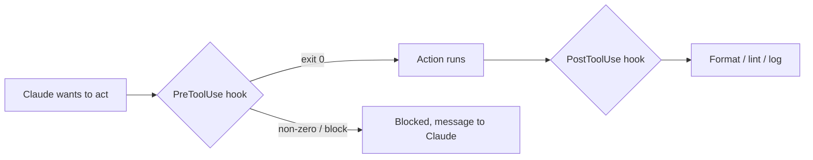

<LevelBadge level="advanced" />

<VerifyNote lastVerified="2026-08-22" source="https://code.claude.com/docs/en/hooks">
Claude Code 30 से अधिक hook इवेंट दस्तावेज़ित करता है, जो चरण के अनुसार समूहित हैं — पूरी सूची, प्रति-इवेंट matcher व्याकरण और सार्वभौमिक JSON आउटपुट फ़ील्ड आधिकारिक hooks रेफ़रेंस में हैं। नाम और payload का स्वरूप बदलता रहता है; किसी विशिष्ट इवेंट या फ़ील्ड पर निर्भर होने से पहले स्रोत से पुष्टि कर लें।
</VerifyNote>

Hooks **ऐसे शेल कमांड हैं जिन्हें Claude Code अपने लाइफ़साइकल के तय बिंदुओं पर अपने-आप चलाता है**। जहाँ [अनुमतियाँ](/docs/claude-code/permissions) तय करती हैं कि कोई कार्रवाई *अनुमत है या नहीं*, वहीं hooks *आपको* उसके आसपास निर्धारक लॉजिक चलाने देते हैं — फ़ॉर्मैटिंग, वैलिडेशन, लॉगिंग, गेट, रिडैक्शन। इन्हीं से व्यवहार "कृपया याद रखना" के बजाय गारंटीशुदा बनता है।

<Callout type="objectives" items={["कब निर्देश, अनुमति या skill के बजाय hook का सहारा लें", "पूरा लाइफ़साइकल: सेशन, प्रॉम्प्ट, टूल, सबएजेंट, टास्क, कॉम्पैक्शन और टर्न-समाप्ति के इवेंट", "hook कैसे जोड़ा जाता है: इवेंट, matcher और stdin पर JSON payload", "hook किसी कार्रवाई को रोकने के दो तरीक़े — एग्ज़िट कोड 2 बनाम stdout पर JSON", "इवेंट्स में साझा सार्वभौमिक JSON आउटपुट फ़ील्ड: continue, additionalContext, systemMessage, reloadSkills, sessionTitle, suppressOutput, updatedInput", "अच्छे अभ्यास और आम ग़लतियाँ, जो तेज़ और सुरक्षित hooks को सुस्त और मौन hooks से अलग करती हैं"]} />

## hook का सहारा कब लें

hook तब चुनें जब आप चाहते हैं कि कोई व्यवहार *गारंटीशुदा* हो, सिर्फ़ अनुरोध किया हुआ नहीं। हर आम काम एक लाइफ़साइकल इवेंट से जुड़ता है:

- हर फ़ाइल एडिट के बाद **ऑटो-फ़ॉर्मैट / लिंट** (`Edit|Write` पर `PostToolUse`)।
- किसी नियम का उल्लंघन करने वाली कार्रवाई को चलने से पहले **ब्लॉक** करना (`PreToolUse`)।
- असिस्टेंट के संदेश को टर्मिनल तक पहुँचने से पहले **रिडैक्ट** करना (`MessageDisplay`)।
- `SessionStart` के बाद **skills रीलोड** करना या **सेशन टाइटल** सेट करना।
- सेशन ख़त्म होने, टास्क पूरा होने या टर्न फ़ेल होने पर **सूचित करना या लॉग करना** (`Stop`, `StopFailure`, `SessionEnd`)।
- सेशन की शुरुआत में या निर्देश लोड होते समय **संदर्भ इंजेक्ट** करना।

## ये कैसे काम करते हैं

आप [`settings.json`](/docs/claude-code/settings) में hooks रजिस्टर करते हैं, किसी **इवेंट** से मिलाकर (और अक्सर एक matcher के साथ — आमतौर पर टूल का नाम, कभी सबएजेंट का प्रकार, कॉम्पैक्शन ट्रिगर या नोटिफ़िकेशन की क़िस्म)। इवेंट फ़ायर होने पर Claude आपका कमांड चलाता है और **stdin पर JSON payload** भेजता है (इवेंट का नाम, सेशन, और इवेंट-विशिष्ट फ़ील्ड जैसे टूल का नाम और इनपुट)। आपके कमांड का एग्ज़िट कोड और stdout तय करते हैं कि आगे क्या होगा।

<Steps items={[{title: "इवेंट से मिलाएँ", body: "hook को settings.json में उस लाइफ़साइकल इवेंट के अंतर्गत रजिस्टर करें जो आपके काम का है — जैसे टूल के बाद के ऑटोमेशन के लिए PostToolUse, या रिडैक्शन के लिए MessageDisplay।"}, {title: "matcher से दायरा सीमित करें", body: "एक matcher जोड़ें ताकि hook सिर्फ़ प्रासंगिक होने पर फ़ायर हो, जैसे फ़ाइल एडिट के लिए matcher \"Edit|Write\", या SessionStart पर matcher \"startup|resume\"।"}, {title: "stdin से payload पढ़ें", body: "इवेंट फ़ायर होने पर Claude आपका कमांड चलाता है और stdin पर JSON payload पाइप करता है — इवेंट का नाम, सेशन, और इवेंट-विशिष्ट फ़ील्ड (tool_name, tool_input, notification आदि)।"}, {title: "तय करें कि आगे क्या हो", body: "आपके कमांड का एग्ज़िट कोड और आउटपुट नतीजा तय करते हैं: कार्रवाई को आगे बढ़ने दें, अपना लॉजिक चलाएँ, उसे ब्लॉक करें, या Claude जो देखता है उसे बदलने के लिए संरचित JSON लौटाएँ।"}]} />

```json
{
  "hooks": {
    "PostToolUse": [
      {
        "matcher": "Edit|Write",
        "hooks": [
          { "type": "command", "command": "jq -r '.tool_input.file_path' | xargs npx prettier --write" }
        ]
      }
    ]
  }
}
```

ऊपर का hook stdin के JSON (`.tool_input.file_path`) से एडिट की गई फ़ाइल का पथ निकालता है और उसे फ़ॉर्मैट करता है। यह न मानें कि किसी एनवायरनमेंट वेरिएबल में पथ है — **उसे stdin से पढ़ें।** `${CLAUDE_PROJECT_DIR}` जैसे उपयोगी पथ प्लेसहोल्डर स्क्रिप्ट खोजने के लिए *उपलब्ध* हैं।

## लाइफ़साइकल एक नज़र में

Claude Code के hooks पूरे सेशन में फैले हैं, सिर्फ़ टूल कॉल तक सीमित नहीं। उन्हें चरण के अनुसार समूहित करें ताकि पता रहे कि अपना लॉजिक कहाँ टाँगना है।

| चरण | इवेंट | आम उपयोग |
| --- | --- | --- |
| **सेशन** | `SessionStart`, `SessionEnd`, `Setup`, `InstructionsLoaded`, `ConfigChange`, `CwdChanged`, `DirectoryAdded`, `FileChanged` | शुरुआत में संदर्भ इंजेक्ट करना, अंत में स्नैपशॉट लेना, `CLAUDE.md` रीलोड या डिस्क पर `.env` बदलाव पर प्रतिक्रिया देना |
| **प्रॉम्प्ट** | `UserPromptSubmit`, `UserPromptExpansion` | Claude के देखने से पहले प्रॉम्प्ट पर गेट लगाना या उसे फिर से लिखना |
| **टूल** | `PreToolUse`, `PermissionRequest`, `PermissionDenied`, `PostToolUse`, `PostToolUseFailure`, `PostToolBatch` | कार्रवाई को अनुमति/अस्वीकार देना, किसी इंसान तक बढ़ाना, एडिट के बाद फ़ॉर्मैट करना, ऑटो-मोड अस्वीकृति के बाद दोबारा कोशिश |
| **सबएजेंट** | `SubagentStart`, `SubagentStop` | स्पॉन/स्टॉप लॉग करना, सबएजेंट को लौटने से रोकना |
| **टास्क** | `TaskCreated`, `TaskCompleted` | ग़लती से बने टास्क को रोलबैक करना, पूर्णता पर गेट लगाना |
| **कॉम्पैक्शन** | `PreCompact`, `PostCompact` | कॉम्पैक्शन से पहले ट्रांसक्रिप्ट का स्नैपशॉट लेना, बाद में जाँचना |
| **मॉडल** | `PreModelSwitch`, `PostModelSwitch` | लागू होने से पहले मॉडल स्विच को ब्लॉक करना; मॉडल बदलने के बाद प्रतिक्रिया देना, तब भी जब रिज़्यूम किया गया सेशन उसे बहाल करे |
| **टर्न** | `Stop`, `StopFailure`, `Notification`, `MessageDisplay` | पूरा होने पर सूचित करना, API विफलता पर अलर्ट देना, दिखाए गए टेक्स्ट को रिडैक्ट करना |
| **टीम + MCP** | `TeammateIdle`, `Elicitation`, `ElicitationResult`, `WorktreeCreate`, `WorktreeRemove` | क्रॉस-सेशन समन्वय, MCP elicitation पर गेट लगाना, worktree ऑपरेशन को लपेटना |

हर इवेंट के सटीक stdin फ़ील्ड, matcher व्याकरण और ब्लॉकिंग नियम [आधिकारिक hooks रेफ़रेंस](https://code.claude.com/docs/en/hooks) में हैं। ऊपर की सूची नक्शा है; रेफ़रेंस असली इलाक़ा।

## hook कैसे ब्लॉक करता है

दो तरीक़े हैं, इवेंट के अनुसार:

- **एग्ज़िट कोड 2** — hook कार्रवाई को विफल कर देता है और उसने **stderr** पर जो लिखा वही Claude को दिखने वाला संदेश बन जाता है। सरल है और ब्लॉकिंग इवेंट पर कमांड hooks के लिए काम करता है (`PreToolUse`, `UserPromptSubmit`, `UserPromptExpansion`, `Stop`, `SubagentStop`, `TeammateIdle`, `TaskCreated`, `TaskCompleted`, `ConfigChange`, `PostToolBatch`, `PreCompact`, `PreModelSwitch`, `Elicitation`, `ElicitationResult`, `WorktreeCreate`, `WorktreeRemove`)। `PermissionRequest` पर एग्ज़िट 2 अनदेखा किया जाता है; अस्वीकृति उसके `decision` ऑब्जेक्ट से दें।
- **stdout पर JSON (एग्ज़िट 0)** — संरचित निर्णय लौटाएँ। `PreToolUse` के लिए यह `permissionDecision` है जिसका मान `"allow"`, `"deny"`, `"ask"` (कॉल को उपयोगकर्ता के सामने रखें) या `"defer"` (सिर्फ़ उन `-p` रन के लिए जिन्हें कोई ऐप चलाकर फिर से शुरू करता है) हो सकता है, साथ में `permissionDecisionReason`। नॉन-ब्लॉकिंग इवेंट (`PostToolUse`, `Notification`, `MessageDisplay`, `StopFailure`, अधिकांश सेशन इवेंट) ब्लॉक करने की कोशिशों को अनदेखा करते हैं — पर उनका JSON आउटपुट फिर भी तय कर सकता है कि Claude आगे क्या देखे।

नीचे की स्क्रिप्ट Bash टूल पर एक `PreToolUse` hook है। इसे ऊपर से नीचे पढ़ें: यह stdin से कमांड निकालती है, और अगर वह विनाशकारी लगे तो stderr पर कारण लिखकर एग्ज़िट 2 से ब्लॉक करती है।

```bash
#!/usr/bin/env bash
# PreToolUse hook on the Bash tool: refuse to delete things.
command=$(jq -r '.tool_input.command' < /dev/stdin)
if [[ "$command" == rm\ * || "$command" == *"rm -rf"* ]]; then
  echo "Blocked: destructive 'rm' is not allowed by policy." >&2
  exit 2
fi
exit 0
```

## सार्वभौमिक JSON आउटपुट फ़ील्ड

अधिकांश इवेंट stdout पर संरचित JSON ऑब्जेक्ट स्वीकार करते हैं जो आगे की दिशा तय करता है — `permissionDecision` जैसे इवेंट-विशिष्ट निर्णय फ़ील्ड से अलग। सबसे उपयोगी:

| फ़ील्ड | यह क्या करता है | कहाँ काम करता है |
| --- | --- | --- |
| **`continue`** | `false` हो तो Claude पूरी तरह प्रोसेसिंग रोक देता है — हर इवेंट-विशिष्ट निर्णय पर प्राथमिकता रखता है | अधिकांश इवेंट |
| **`systemMessage`** | Claude के संदर्भ / ट्रांसक्रिप्ट में संदेश जोड़ता है ताकि वह देखे कि आपने ऐसा क्यों किया | अधिकांश ब्लॉकिंग इवेंट |
| **`additionalContext`** | अतिरिक्त संदर्भ इंजेक्ट करता है जिसे Claude अगले टर्न में पढ़कर उस पर काम कर सके | `SessionStart`, `UserPromptSubmit`, अन्य |
| **`reloadSkills`** | skill डायरेक्टरी दोबारा स्कैन करता है ताकि सेशन आपके अभी लिखे skill को उठा ले | `SessionStart` (और अन्य सेशन इवेंट) |
| **`sessionTitle`** | UI में सेशन का टाइटल सेट करता है — `SessionStart` पर `hookSpecificOutput` के अंतर्गत | `SessionStart` |
| **`suppressOutput`** | टूल का आउटपुट Claude से छिपाता है (शोर करने वाले कमांड के लिए उपयोगी) | टूल इवेंट |
| **`updatedInput`** | चलने से पहले टूल का इनपुट बदल देता है (जैसे `--dry-run` फ़्लैग जोड़ना) | `PreToolUse` |
| **`terminalSequence`** | टर्मिनल एस्केप सीक्वेंस भेजता है — बेल, विंडो टाइटल, नोटिफ़िकेशन बैज | `Notification`, `StopFailure`, अन्य |

इवेंट-विशिष्ट निर्णय फ़ील्ड — `PreToolUse` पर `permissionDecision` (`"allow"`, `"deny"`, `"ask"` या `"defer"`, साथ में `permissionDecisionReason`), `PermissionRequest` पर `decision.behavior` (`"allow"` या `"deny"`), और `PermissionDenied` पर `retry: true` जिससे Claude अस्वीकृत कॉल को दोबारा आज़मा सके — इन सार्वभौमिक फ़ील्ड के ऊपर परत की तरह लगते हैं।

## मानसिक मॉडल

`PreToolUse` hook कार्रवाई से *पहले* चलता है और उसे ब्लॉक कर सकता है; `PostToolUse` hook उसके सफल होने के *बाद* चलता है और नतीजे पर प्रतिक्रिया देता है।



<Flashcards title="Hook इवेंट एक नज़र में" cards={[{front: "PreToolUse", back: "कार्रवाई चलने से पहले फ़ायर होता है। इसे ब्लॉक करने या गेट लगाने के लिए इस्तेमाल करें — जैसे विनाशकारी कमांड को चलने से पहले ठुकराना। निर्णय फ़ील्ड: permissionDecision।"}, {front: "PostToolUse", back: "मेल खाती कार्रवाई के बाद फ़ायर होता है। अभी जो बदला उसे फ़ॉर्मैट, लिंट या लॉग करने के लिए इस्तेमाल करें। नॉन-ब्लॉकिंग।"}, {front: "MessageDisplay", back: "असिस्टेंट के संदेश का टेक्स्ट दिखाए जाते समय फ़ायर होता है। टर्मिनल से सीक्रेट या PII रिडैक्ट करने के लिए इस्तेमाल करें — सिर्फ़ डिस्प्ले के लिए, ब्लॉक नहीं कर सकता।"}, {front: "SessionStart", back: "सेशन की शुरुआत (या रिज़्यूम) पर फ़ायर होता है। additionalContext से संदर्भ इंजेक्ट करने, नया skill आने के बाद reloadSkills करने, या sessionTitle सेट करने के लिए इस्तेमाल करें।"}, {front: "Stop / StopFailure", back: "Stop तब फ़ायर होता है जब Claude टर्न साफ़ तरीक़े से पूरा करे; StopFailure तब जब टर्न API त्रुटि (rate_limit, overloaded, auth आदि) पर ख़त्म हो। विफलता वाले रूप पर सूचित करें या ऑटो-रिट्राई करें।"}, {front: "PreCompact / PostCompact", back: "संदर्भ कॉम्पैक्शन के आसपास फ़ायर होते हैं। PreCompact ब्लॉक कर सकता है (एग्ज़िट 2) या पहले ट्रांसक्रिप्ट का स्नैपशॉट ले सकता है; PostCompact कॉम्पैक्ट हुई स्थिति पर प्रतिक्रिया देता है।"}]} />

## अच्छे अभ्यास

- **hooks को तेज़ और idempotent रखें** — ये बहुत बार चलते हैं। सभी `SessionEnd` hooks मिलकर 1.5 सेकंड का एक ही बजट साझा करते हैं, इसलिए सेशन-अंत का काम न्यूनतम रखें।
- **असली समस्याओं पर साफ़ तौर पर विफल हों**, पर दिखावटी मुद्दों पर ब्लॉक न करें।
- **hook के आउटपुट को Claude के लिए फ़ीडबैक मानें** — stderr पर (एग्ज़िट 2) या `systemMessage` में (JSON) साफ़ संदेश उसे ख़ुद को सुधारने में मदद करता है।
- **जब "ब्लॉक हुआ" से ज़्यादा कहना हो तो एग्ज़िट कोड के बजाय JSON आउटपुट चुनें** — `PreToolUse` पर `permissionDecision: "ask"` दरवाज़ा पटके बिना मामला इंसान तक पहुँचाता है, और `additionalContext` आपको सिर्फ़ मना करने के बजाय *दिशा देने* देता है।
- Hooks आपके शेल के विशेषाधिकारों से चलते हैं — जो hook आपने नहीं लिखा, उसकी समीक्षा करें ([तृतीय-पक्ष कोड की समीक्षा](/docs/security/reviewing-third-party-code))।

## आम ग़लतियाँ

- **फ़ाइल पथ को एनवायरनमेंट वेरिएबल से पढ़ना।** पथ stdin के JSON में है (`.tool_input.file_path`), `$CLAUDE_FILE_PATH` में नहीं। stdin को `jq` से पाइप करें।
- **मौन ब्लॉक।** अगर `PreToolUse` hook stderr पर कुछ लिखे बिना एग्ज़िट 2 करे, तो Claude ब्लॉक हो जाता है पर उसे *पता नहीं* क्यों और वह ढल नहीं पाता। हमेशा साफ़ कारण लिखें (या `permissionDecisionReason` का उपयोग करें)।
- **नॉन-ब्लॉकिंग इवेंट को ब्लॉक करने की कोशिश।** `PostToolUse` टूल चलने के *बाद* फ़ायर होता है — एग्ज़िट 2 सिर्फ़ Claude के कान में एक संदेश डालता है, कार्रवाई को पलट नहीं सकता। गेट लगाना हो तो `PreToolUse` पर hook करें।
- **धीमे hooks।** `PostToolUse` hook हर मेल खाते एडिट के *बाद* चलता है। 3 सेकंड का लिंटर पूरे सेशन को सुस्त बना देता है — hooks तेज़ रखें और आदर्श रूप से सिर्फ़ उसी पर काम करें जो बदला।
- **बहुत व्यापक matcher।** `matcher: ".*"` हर टूल पर फ़ायर होता है। सटीक नाम, `Edit|Write` सूची, या प्रति-handler `if` फ़ील्ड (जैसे `"if": "Bash(git push *)"`) से सीमित करें।
- **यह भूल जाना कि गैर-टूल इवेंट के लिए भी matcher होते हैं।** `SessionStart` `startup|resume|clear|compact|fork` से मेल खाता है; `Notification` `permission_prompt|idle_prompt|agent_completed` जैसी क़िस्मों से; `PreCompact` `manual|auto` से। ग़लत उपसमुच्चय से जुड़ा एक hook या तो बहुत बार फ़ायर होता है या कभी नहीं।
- **जो hooks आपने नहीं लिखे उन पर भरोसा करना।** hook आपके विशेषाधिकारों के साथ मनमाना शेल चलाता है। प्लगइन या टेम्पलेट से आए किसी भी hook की पहले समीक्षा करें — देखें [तृतीय-पक्ष कोड की समीक्षा](/docs/security/reviewing-third-party-code)।

<Callout type="warning" items={["hook आपके विशेषाधिकारों के साथ मनमाना शेल चलाता है — प्लगइन या टेम्पलेट का कोई hook पढ़े बिना कभी न जोड़ें।"]} />

## अपनाने लायक रेसिपी

कॉपी-पेस्ट के शुरुआती नमूने [Hooks और settings.json रेसिपी](/docs/templates/hooks-settings) में हैं। नए इवेंट का स्वरूप समझाने वाले कुछ असरदार उदाहरण:

<PromptCard title="एडिट की गई फ़ाइलें ऑटो-फ़ॉर्मैट करें (Edit|Write पर PostToolUse)">{`{
  "hooks": {
    "PostToolUse": [
      {
        "matcher": "Edit|Write",
        "hooks": [
          { "type": "command", "command": "jq -r '.tool_input.file_path' | xargs npx prettier --write" }
        ]
      }
    ]
  }
}`}</PromptCard>

<PromptCard title="शुरू होते समय प्रति-प्रोजेक्ट सेशन टाइटल सेट करें (SessionStart)">{`{
  "hooks": {
    "SessionStart": [
      {
        "matcher": "startup|resume",
        "hooks": [
          {
            "type": "command",
            "command": "jq -nc --arg t \\"$(basename \\"$PWD\\") — $(git rev-parse --abbrev-ref HEAD 2>/dev/null || echo detached)\\" '{hookSpecificOutput:{sessionTitle:$t}}'"
          }
        ]
      }
    ]
  }
}`}</PromptCard>

<PromptCard title="SessionStart के बाद skills रीलोड करें (आपके अभी लिखे skill को उठा लेता है)">{`{
  "hooks": {
    "SessionStart": [
      {
        "matcher": "startup|resume",
        "hooks": [
          { "type": "command", "command": "printf '{\\"reloadSkills\\": true}\\n'" }
        ]
      }
    ]
  }
}`}</PromptCard>

<PromptCard title="दिखाए गए असिस्टेंट टेक्स्ट से API कुंजियाँ रिडैक्ट करें (MessageDisplay)">{`{
  "hooks": {
    "MessageDisplay": [
      {
        "hooks": [
          {
            "type": "command",
            "command": "jq -r '.message.content' | sed -E 's/(sk-[A-Za-z0-9_-]{20,})/sk-***REDACTED***/g'"
          }
        ]
      }
    ]
  }
}`}</PromptCard>

<PromptCard title="टर्न विफल होने पर सूचित करें (StopFailure — रेट लिमिट, ओवरलोड, ऑथ)">{`{
  "hooks": {
    "StopFailure": [
      {
        "matcher": "rate_limit|overloaded|authentication_failed|billing_error",
        "hooks": [
          { "type": "command", "command": "osascript -e 'display notification \\"Claude Code turn failed — check the terminal\\" with title \\"Claude Code\\"'" }
        ]
      }
    ]
  }
}`}</PromptCard>

<Quiz title="ख़ुद को परखें" questions={[{q: "अभी एडिट हुई फ़ाइल का पथ hook को कहाँ मिलता है?", options: ["$CLAUDE_FILE_PATH एनवायरनमेंट वेरिएबल में", "stdin के JSON payload में, .tool_input.file_path पर", "Claude द्वारा दिए गए कमांड-लाइन आर्गुमेंट में"], answer: 1, explain: "पथ stdin के JSON (.tool_input.file_path) में रहता है, एनवायरनमेंट वेरिएबल में नहीं। उसे पढ़ने के लिए stdin को jq से पाइप करें।"}, {q: "एक PreToolUse hook एग्ज़िट कोड 2 के साथ बाहर निकलता है। क्या होता है?", options: ["कार्रवाई की अनुमति मिलती है और stdout लॉग होता है", "कार्रवाई ब्लॉक हो जाती है, और hook ने stderr पर जो लिखा वही Claude को दिखने वाला संदेश बनता है", "Claude नतीजे को अनदेखा करता है क्योंकि एग्ज़िट 2 आरक्षित है"], answer: 1, explain: "एग्ज़िट कोड 2 कार्रवाई को विफल करता है; stderr वह संदेश बनता है जो Claude देखता है। हमेशा साफ़ कारण लिखें ताकि Claude ढल सके।"}, {q: "आप चाहते हैं कि सेशन बिना रीस्टार्ट किए .claude/skills/ में अभी जोड़े गए skill को उठा ले। किस इवेंट पर कौन-सा आउटपुट फ़ील्ड?", options: ["SessionStart पर reloadSkills: true", "Stop पर restart: true", "PostToolUse पर refresh: true"], answer: 0, explain: "SessionStart hook से {\"reloadSkills\": true} भेजने पर skill डायरेक्टरी दोबारा स्कैन होती हैं, ताकि मौजूदा सेशन नए या संपादित skills को उठा ले।"}, {q: "आप चाहते हैं कि Claude का टेक्स्ट उपयोगकर्ता की स्क्रीन पर आने से पहले उसमें से सीक्रेट रिडैक्ट हो जाएँ। कौन-सा इवेंट?", options: ["PreToolUse", "PostToolUse", "MessageDisplay"], answer: 2, explain: "MessageDisplay असिस्टेंट के संदेश का टेक्स्ट दिखाए जाते समय फ़ायर होता है — टर्मिनल तक जाते टेक्स्ट को बदलने या रिडैक्ट करने की सही जगह। यह ब्लॉक नहीं कर सकता।"}]} />

<Callout type="takeaways" items={["Hooks व्यवहार को गारंटीशुदा बनाते हैं, सिर्फ़ अनुरोधित नहीं — कार्रवाइयों के आसपास निर्धारक लॉजिक, जिन्हें अनुमतियाँ केवल अनुमत या अस्वीकृत करती हैं।", "लाइफ़साइकल सेशन, प्रॉम्प्ट, टूल, सबएजेंट, टास्क, कॉम्पैक्शन और टर्न चरणों में 30 से अधिक इवेंट तक फैला है — स्क्रिप्ट लिखने से पहले सही चरण चुनें।", "settings.json में किसी इवेंट और matcher के साथ रजिस्टर करें; Claude stdin पर JSON payload पाइप करता है और आपका एग्ज़िट कोड व आउटपुट पढ़ता है।", "फ़ाइल पथ stdin (.tool_input.file_path) से पढ़ें — एनवायरनमेंट वेरिएबल से नहीं।", "एग्ज़िट कोड 2 (stderr संदेश बनता है) या stdout पर संरचित JSON से ब्लॉक करें (टूल इवेंट पर permissionDecision, सब कुछ रोकने के लिए {continue: false})।", "सार्वभौमिक आउटपुट फ़ील्ड — additionalContext, systemMessage, reloadSkills, sessionTitle, suppressOutput, updatedInput — आपको Claude को केवल अनुमति या इनकार देने के बजाय दिशा देने देते हैं।", "hooks को तेज़, idempotent और सँकरे matcher वाला रखें — और जो hook आपने नहीं लिखा उसकी समीक्षा करें, क्योंकि वह आपके शेल के विशेषाधिकारों से चलता है।"]} />

## आगे

- [Mods: इन-प्रोसेस एक्सटेंशन](/docs/claude-code/mods) — इन-प्रोसेस सहोदर: TypeScript मिडलवेयर जो किसी इवेंट को सिर्फ़ अनुमत या ब्लॉक करने के बजाय *फिर से लिख* सकता है, और इस पेज के हर इवेंट तक `classic.<Event>` के रूप में पहुँचता है
- [settings.json](/docs/claude-code/settings) · [अनुमतियाँ](/docs/claude-code/permissions)
- [Skills](/docs/claude-code/skills) — विशेषज्ञता बनाम ऑटोमेशन
- [स्वायत्त रन को सुदृढ़ करना](/docs/security/hardening-autonomous-runs)
