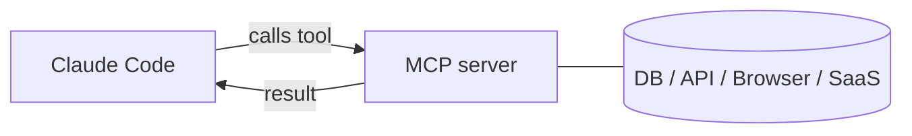

<LevelBadge level="advanced" />

<VerifyNote lastVerified="2026-11-10" source="https://code.claude.com/docs/en/mcp">
`claude mcp` कमांड, कॉन्फ़िगरेशन स्कोप और ट्रांसपोर्ट समय के साथ बदलते रहते हैं — इन्हें आधिकारिक Claude Code MCP दस्तावेज़ और modelcontextprotocol.io पर जाँच लें। नीचे बताए गए चारों ट्रांसपोर्ट, स्कोप के स्टोरेज पाथ, SSE का अप्रचलित होना और प्रोजेक्ट-अनुमोदन का व्यवहार — सब उसी पेज से लिए गए हैं।
</VerifyNote>

**Model Context Protocol (MCP)** AI को बाहरी टूल और डेटा से जोड़ने का एक ओपन स्टैंडर्ड है। एक **MCP सर्वर** क्षमताएँ उपलब्ध कराता है (डेटाबेस क्वेरी करना, GitHub PR खोलना, ब्राउज़र चलाना); Claude Code उससे जुड़ता है और सत्र के दौरान **उन टूल को कॉल** कर सकता है। इसी तरह आप Claude को अपने फ़ाइल सिस्टम और शेल से आगे तक बढ़ाते हैं।

<Callout type="objectives" items={["समझाएँ कि MCP सर्वर क्या है और Claude Code उसके टूल को कैसे कॉल करता है", "दोनों ट्रांसपोर्ट में फ़र्क करें: लोकल stdio और रिमोट HTTP/SSE", "claude mcp add से सर्वर जोड़ें और उसके लिखे JSON को पढ़ें", "यह देखकर सही स्कोप (local, project, user) चुनें कि सर्वर कौन देखे", "एक असली डेटाबेस को Claude से शुरू से अंत तक जोड़ें", "सुरक्षा और कॉन्फ़िगरेशन के उन जालों से बचें जिनमें ज़्यादातर लोग फँसते हैं"]} />

## पूरी तस्वीर



आप वे सर्वर घोषित करते हैं जिन्हें Claude इस्तेमाल कर सकता है; हर सर्वर स्कीमा के साथ टूल का एक सेट प्रकाशित करता है; Claude उन्हें किसी भी दूसरे टूल की तरह चुनता और कॉल करता है।

<Flashcards title="MCP शब्दावली" cards={[{front: "Model Context Protocol (MCP)", back: "AI को बाहरी टूल और डेटा से जोड़ने का ओपन स्टैंडर्ड।"}, {front: "MCP सर्वर", back: "ऐसा प्रोग्राम जो क्षमताएँ — डेटाबेस क्वेरी करना, GitHub PR खोलना, ब्राउज़र चलाना — कॉल किए जा सकने वाले टूल के रूप में उपलब्ध कराता है।"}, {front: "टूल (Tool)", back: "वह क्षमता जिसे MCP सर्वर स्कीमा के साथ प्रकाशित करता है; Claude उसे किसी भी दूसरे टूल की तरह चुनता और कॉल करता है।"}, {front: "ट्रांसपोर्ट (Transport)", back: "Claude सर्वर तक कैसे पहुँचता है: stdio (लोकल प्रोसेस), HTTP (होस्ट किया हुआ, अक्सर OAuth के साथ), SSE (अप्रचलित — HTTP अपने आप इसी पर लौट आता है), या WebSocket ws/wss (स्थायी कनेक्शन, पुश, केवल हेडर-ऑथ, कोई --transport फ़्लैग नहीं)।"}, {front: "स्कोप (Scope)", back: "सर्वर कौन देखता है: local (आप, यह प्रोजेक्ट), project (कमिट की गई टीम), या user (आप, हर जगह)।"}]} />

## ट्रांसपोर्ट

Claude के किसी सर्वर तक पहुँचने के चार तरीके हैं। चुनाव इस पर निर्भर करता है कि सर्वर कहाँ चलता है और कैसे बात करता है।

- **stdio** — एक लोकल प्रोसेस जिसे Claude शुरू करता है (लोकल टूल/CLI के लिए बढ़िया)। बिना `type` वाली JSON एंट्री का यही मतलब है।
- **HTTP** — होस्ट किया हुआ सर्वर, अक्सर OAuth के साथ। किसी भी रिमोट चीज़ के लिए डिफ़ॉल्ट पसंद।
- **SSE** — **अप्रचलित**; जहाँ संभव हो HTTP इस्तेमाल करें। कुछ सेवाएँ अब भी सिर्फ़ SSE एंडपॉइंट देती हैं, और Claude Code v2.1.265 से `--transport http` पहले HTTP आज़माता है और अपने आप SSE पर चला जाता है, इसलिए आपको `--transport sse` साफ़ तौर पर लिखने की कम ही ज़रूरत पड़ती है।
- **WebSocket** (`ws` / `wss`) — एक स्थायी द्विदिश कनेक्शन, ऐसे सर्वर के लिए जो बिना माँगे इवेंट पुश करता है। `--transport` `ws` को स्वीकार *नहीं* करता: इसे `claude mcp add-json '{"type":"ws","url":"wss://…"}'` से जोड़ें या `.mcp.json` में लिखें। OAuth नहीं — ऑथेंटिकेशन केवल हेडर से होता है।

<Callout type="warning" items={["url वाली लेकिन type के बिना JSON एंट्री एक कॉन्फ़िगरेशन त्रुटि है, कोई समझदार डिफ़ॉल्ट नहीं: Claude Code type-रहित एंट्री को stdio सर्वर की तरह पढ़ता है, उसे छोड़ देता है, और बताता है कि उसमें \"url\" तो है पर \"type\" नहीं। हाथ से लिखे रिमोट सर्वर पर हमेशा \"type\": \"http\" (या \"sse\" / \"ws\") सेट करें।"]} />

## सर्वर कॉन्फ़िगर करना

सबसे तेज़ रास्ता `claude mcp add` कमांड है — यह आपके लिए कॉन्फ़िग लिख देता है। शून्य से जुड़े हुए सर्वर तक पहुँचने के लिए यह क्रम अपनाएँ।

<Steps items={[{title: "लोकल stdio सर्वर जोड़ें", body: "claude mcp add चलाएँ — -- के बाद की हर चीज़ वह लॉन्च कमांड है जो Claude आपके लिए चलाता है।"}, {title: "या रिमोट HTTP सर्वर जोड़ें", body: "--transport http और एक स्कोप दें, फिर सर्वर का URL। रिमोट सर्वर अक्सर होस्टेड होते हैं और OAuth इस्तेमाल करते हैं।"}, {title: "देखें क्या जुड़ा है", body: "कॉन्फ़िगर किए गए सर्वर और उनकी कनेक्शन स्थिति देखने के लिए claude mcp list चलाएँ।"}, {title: "जाँचें और ऑथेंटिकेट करें", body: "सत्र के भीतर /mcp का इस्तेमाल करके सर्वर के टूल जाँचें और रिमोट सर्वर को ऑथेंटिकेट करें।"}]} />

<PromptCard title="लोकल stdio सर्वर जोड़ें">{`# A local stdio server (everything after -- is the launch command)
claude mcp add filesystem -- npx -y @modelcontextprotocol/server-filesystem ~/code/myproject`}</PromptCard>

<PromptCard title="रिमोट HTTP सर्वर जोड़ें (प्रोजेक्ट के साथ साझा)">{`# A remote HTTP server, shared with everyone on the project
claude mcp add --transport http --scope project github https://api.githubcopilot.com/mcp/`}</PromptCard>

अंदर से यह बस JSON है। **project** स्कोप वाला सर्वर रेपो की रूट में `.mcp.json` में जाता है — इसे कमिट कर दें और आपके साथियों को वर्कस्पेस पर भरोसा करते ही वही टूल मिल जाते हैं:

```json
{
  "mcpServers": {
    "github": { "type": "http", "url": "https://api.githubcopilot.com/mcp/" }
  }
}
```

<Callout type="warning" items={["पुराने ट्यूटोरियल में मिलने वाले @modelcontextprotocol/server-github, -postgres, -slack या -puppeteer पैकेज न लें। वे आर्काइव हो चुके हैं और उन पर npm की अप्रचलन सूचना है: \"Archived and unmaintained; no security guarantees\"। जहाँ विक्रेता का अपना सर्वर हो, उसी का इस्तेमाल करें — GitHub का ऊपर दिया HTTP एंडपॉइंट है, और ब्राउज़र नियंत्रण @playwright/mcp पर चला गया है। TypeScript के रेफ़रेंस सर्वरों में सिर्फ़ filesystem, memory, everything और sequential-thinking अब भी मेंटेन किए जाते हैं।"]} />

### स्कोप तय करता है कि सर्वर कौन देखे

| स्कोप | कहाँ संग्रहीत | कहाँ लोड होता है | किसके लिए इस्तेमाल करें |
|---|---|---|---|
| `local` (डिफ़ॉल्ट) | `~/.claude.json`, इस प्रोजेक्ट के पाथ के अंतर्गत | केवल यह प्रोजेक्ट | निजी प्रयोग, सीक्रेट |
| `project` | रेपो में `.mcp.json` (कमिट किया हुआ) | केवल यह प्रोजेक्ट, टीम के साथ साझा | वे टूल जो पूरी टीम को साझा करने चाहिए |
| `user` | `~/.claude.json` | आपके सभी प्रोजेक्ट | वे सर्वर जो आप हर जगह चाहते हैं |

<Callout type="warning" items={["MCP का \"local स्कोप\" लोकल सेटिंग्स जैसा नहीं है। local स्कोप वाला MCP सर्वर आपकी होम डायरेक्टरी की ~/.claude.json में रहता है — प्रोजेक्ट की .claude/settings.local.json में नहीं। उसे प्रोजेक्ट फ़ोल्डर में ढूँढना बेकार है।"]} />

क्या जुड़ा है यह देखने के लिए `claude mcp list` चलाएँ, और टूल जाँचने तथा रिमोट सर्वर को ऑथेंटिकेट करने के लिए सत्र के भीतर `/mcp`। कॉपी-पेस्ट वाले शुरुआती नमूनों के लिए [MCP कॉन्फ़िग और सर्वर स्कैफ़ोल्ड](/docs/templates/mcp-config) देखें।

## व्यावहारिक उदाहरण: Claude को अपना डेटाबेस दें

मान लीजिए आप चाहते हैं कि क्वेरी के नतीजे खुद चिपकाने के बजाय Claude लोकल Postgres पर सवालों के जवाब दे। सर्वर को project स्कोप में जोड़ें ताकि साथियों को भी मिले।

डेटाबेस वहाँ हैं जहाँ आर्काइव किए गए सर्वरों की समस्या सबसे ज़्यादा चुभती है: पुराना `@modelcontextprotocol/server-postgres` अब मेंटेन नहीं होता और कोई आधिकारिक विकल्प नहीं है, इसलिए पैकेज का नाम ही वह एक फ़ैसला है जो आपको खुद लेना है। कोई मेंटेन किया जा रहा कम्युनिटी सर्वर चुनें, [उसकी समीक्षा करें](/docs/security/reviewing-third-party-code), फिर उसे जोड़ें — आप जो भी चुनें, ढाँचा वही रहता है:

<PromptCard title="project स्कोप में Postgres सर्वर जोड़ें">{`# Replace the package with a maintained Postgres MCP server you have reviewed.
# The connection string is read-only on purpose — see below.
claude mcp add --scope project db -- npx -y <postgres-mcp-server> "postgresql://readonly@localhost/app"`}</PromptCard>

अब सत्र में आप सवाल सामान्य भाषा में पूछ सकते हैं और क्वेरी का चक्र Claude पर छोड़ सकते हैं:

<PromptCard title="डेटाबेस से सवाल पूछें">{`How many users signed up last week? Check the DB.`}</PromptCard>

Claude सर्वर द्वारा प्रकाशित क्वेरी टूल को कॉल करता है, पंक्तियाँ पाता है और जवाब देता है — कॉपी-पेस्ट का चक्र नहीं। जब तक Claude को सचमुच लिखने की ज़रूरत न हो, कनेक्शन स्ट्रिंग को रीड-ओनली रखें। और अगर आपको बस एक ही क्वेरी चलानी थी, तो ध्यान रखें कि Bash के ज़रिए `psql -c '…'` में टोकन का एक छोटा हिस्सा ही लगता है; कब कौन सा जीतता है, यह [MCP टोकन टैक्स](/docs/claude-code/mcp-token-cost) में बताया गया है।

चूँकि यह project-स्कोप का है, रेपो खींचने वाले साथी को वही क्षमता मिलती है — लेकिन **न चुपचाप, न तुरंत**। कमिट किया हुआ `.mcp.json` का सर्वर तब तक `⏸ Pending approval` पर रहता है जब तक वे फ़ोल्डर में `claude` चलाकर वर्कस्पेस-ट्रस्ट डायलॉग स्वीकार न कर लें। क्लोन किया हुआ रेपो अपने ही सर्वर को पहले से अनुमोदित नहीं कर सकता: प्रोजेक्ट की `.claude/settings.json` में कमिट किए गए `enableAllProjectMcpServers` या `enabledMcpjsonServers` को अविश्वसनीय फ़ोल्डर में *अनदेखा* कर दिया जाता है। वहीं, यूज़र-स्तर की `~/.claude/settings.json`, मैनेज्ड सेटिंग्स या `--settings` के साथ दिए गए अनुमोदन वहाँ लागू होते हैं। "मेरे साथी को सर्वर क्यों नहीं दिख रहा?" का आम जवाब यही है।

## भरोसा और सुरक्षा

<Callout type="warning" items={["MCP सर्वर कोड चलाता है और डेटा पढ़ सकता है तथा कार्रवाइयाँ कर सकता है — केवल उन्हीं सर्वरों को जोड़ें जिन पर आप भरोसा करते हैं।", "हर सर्वर को उतनी ही न्यूनतम अनुमति दें जितनी उसे चाहिए।", "सर्वर जो भी बाहरी सामग्री लौटाता है, उसमें प्रॉम्प्ट इंजेक्शन हो सकता है।", "थर्ड-पार्टी सर्वरों को जोड़ने से पहले उनकी समीक्षा करें।"]} />

:::warning[MCP सर्वरों को सॉफ़्टवेयर इंस्टॉल करने की तरह लें]
MCP सर्वर कोड चलाता है और डेटा पढ़ सकता है तथा कार्रवाइयाँ कर सकता है। केवल उन्हीं सर्वरों को जोड़ें जिन पर आप भरोसा करते हैं, उन्हें ज़रूरी **न्यूनतम अनुमति** दें, और याद रखें कि वे जो भी बाहरी सामग्री लौटाते हैं उसमें [प्रॉम्प्ट इंजेक्शन](/docs/security/prompt-injection) हो सकता है। पहले थर्ड-पार्टी सर्वरों की समीक्षा करें — देखें [थर्ड-पार्टी कोड की समीक्षा](/docs/security/reviewing-third-party-code)।
:::

## ऐप्स में भी MCP

MCP Claude ऐप्स के **कनेक्टर** को भी चलाता है — वही स्टैंडर्ड, अलग सतह। देखें [ऐप्स में कनेक्टर (MCP)](/docs/claude-app/connectors) और API के लिए [MCP और टूल से जुड़ना](/docs/api/mcp)।

## आम गलतियाँ

- **गलत स्कोप।** `local` स्कोप में जोड़ा गया सर्वर साथियों को नहीं दिखेगा; जो सर्वर आप सिर्फ़ अपने लिए चाहते थे उसे `project` स्कोप में कमिट नहीं करना चाहिए। सोच-समझकर चुनें।
- **बहुत सारे सर्वर, बहुत सारे टूल।** टूल सर्च डिफ़ॉल्ट रूप से चालू है, इसलिए जुड़ा हुआ सर्वर आम तौर पर हर टर्न में अपनी पूरी स्कीमा की जगह टूल के *नाम* और सर्वर के निर्देशों का खर्च लेता है — फिर भी यह प्रति-टर्न टैक्स है, और जिस पल Claude उन्हें खोजता है, स्कीमा कॉन्टेक्स्ट में आ जाती हैं। वही जोड़ें जो काम के लिए चाहिए, अपना पूरा कैटलॉग नहीं। असली आँकड़ों, `ENABLE_TOOL_SEARCH` के मोड और कोड एक्ज़ीक्यूशन दूसरे खर्च को कैसे घटाता है, इसके लिए [MCP टोकन टैक्स](/docs/claude-code/mcp-token-cost) देखें।
- **ज़रूरत से ज़्यादा अनुमति वाले कनेक्शन।** डेटाबेस सर्वर को रीड-ओनली रोल दें, जब तक Claude को सचमुच लिखने की ज़रूरत न हो। MCP क्षमताओं को असली बनाता है — उन्हें सीमित करें।
- **इंजेक्शन का जोखिम भूल जाना।** सर्वर जो कुछ भी लौटाता है (वेब पेज, इश्यू की बॉडी, कोई पंक्ति) वह अविश्वसनीय टेक्स्ट है जिसमें [प्रॉम्प्ट इंजेक्शन](/docs/security/prompt-injection) हो सकता है। बिना अच्छी तरह सोचे किसी शक्तिशाली लिखने-योग्य सर्वर को किसी अविश्वसनीय पढ़ने-योग्य सर्वर के साथ न जोड़ें।

<Quiz title="खुद को परखें" questions={[{q: "कौन सा ट्रांसपोर्ट ऐसा लोकल प्रोसेस है जिसे Claude खुद शुरू करता है?", options: ["रिमोट HTTP/SSE", "stdio", "OAuth"], answer: 1, explain: "stdio एक लोकल प्रोसेस है जिसे Claude शुरू करता है — लोकल टूल और CLI के लिए आदर्श। बाकी तीनों रिमोट हैं: HTTP (अक्सर OAuth के साथ), अप्रचलित SSE, और WebSocket।"}, {q: "project-स्कोप वाला सर्वर कहाँ लिखा जाता है, और साथी को क्या करना पड़ता है?", options: ["आपकी यूज़र सेटिंग्स में; सिर्फ़ आप उसे देखते हैं", "रेपो की रूट में .mcp.json में; pull करने के बाद भी, सर्वर के Pending approval से निकलने के लिए उन्हें वर्कस्पेस पर भरोसा करना पड़ता है", "एक छिपे ग्लोबल कैश में; कोई उसे एडिट नहीं कर सकता"], answer: 1, explain: "project स्कोप रेपो की रूट में कमिट किए गए .mcp.json में जाता है। लेकिन क्लोन किया हुआ रेपो अपने सर्वर खुद अनुमोदित नहीं कर सकता — कमिट किया गया enableAllProjectMcpServers अविश्वसनीय फ़ोल्डर में अनदेखा कर दिया जाता है, इसलिए सर्वर तब तक Pending approval पर इंतज़ार करता है जब तक साथी वर्कस्पेस-ट्रस्ट डायलॉग स्वीकार नहीं करता।"}, {q: "जब Claude को सिर्फ़ पढ़ना है तो डेटाबेस कनेक्शन को रीड-ओनली क्यों रखें?", options: ["इससे क्वेरी तेज़ चलती हैं", "न्यूनतम अनुमति — MCP क्षमताओं को असली बनाता है, इसलिए राइट एक्सेस तब तक न दें जब तक सचमुच ज़रूरी न हो", "प्रोटोकॉल में रीड-ओनली अनिवार्य है"], answer: 1, explain: "सर्वरों को उतनी ही न्यूनतम अनुमति दें जितनी उन्हें चाहिए। MCP क्षमताओं को असली बनाता है, इसलिए रीड-ओनली रोल अनचाहे राइट से बचाता है।"}]} />

<Callout type="takeaways" items={["MCP एक ओपन स्टैंडर्ड है; MCP सर्वर ऐसे टूल उपलब्ध कराता है जिन्हें Claude Code किसी भी दूसरे टूल की तरह कॉल करता है।", "चार ट्रांसपोर्ट: stdio (Claude का शुरू किया प्रोसेस), HTTP (रिमोट के लिए डिफ़ॉल्ट), SSE (अप्रचलित — HTTP अपने आप इस पर चला जाता है), और WebSocket ws/wss (पुश, हेडर-ऑथ, केवल add-json)।", "claude mcp add आपके लिए कॉन्फ़िग लिखता है; अंदर से यह JSON है। project स्कोप कमिट किए गए .mcp.json में रहता है, और साथी की प्रति तब तक Pending approval पर रहती है जब तक वे वर्कस्पेस पर भरोसा न कर लें।", "स्कोप दृश्यता तय करता है: local (आप, यह प्रोजेक्ट), project (टीम के लिए कमिट किया हुआ), user (आप, हर जगह)।", "सर्वरों को सॉफ़्टवेयर इंस्टॉल करने की तरह लें: भरोसा, न्यूनतम अनुमति, और उनके लौटाए हर चीज़ में प्रॉम्प्ट इंजेक्शन पर नज़र।"]} />

## आगे

- [अपना पहला MCP सर्वर बनाएँ और जोड़ें (वॉकथ्रू)](/docs/walkthroughs/first-mcp-server)
- [MCP कॉन्फ़िग और सर्वर स्कैफ़ोल्ड](/docs/templates/mcp-config)
- [एजेंट और टूल को सुरक्षित करना](/docs/security/securing-agents)
