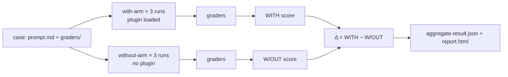

<LevelBadge level="advanced" />

<VerifyNote lastVerified="2026-09-14" source="https://code.claude.com/docs/en/plugin-evals">
`claude plugin eval` Claude Code **v2.1.269 (11 सितंबर 2026)** में आया और इसे एक नई सुविधा के रूप में दस्तावेज़ित किया गया है: केस स्कीमा `1.1` है, JSON परिणाम `schemaVersion: 1` है, और Anthropic सर्वर की ओर से इस कमांड को बंद कर सकता है ("plugin eval is currently unavailable")। नीचे दिए गए डिफ़ॉल्ट, फ़्लैग और grader के अर्थ दर्शाई गई तारीख के आधिकारिक पेज से हैं; कठोर CI गेट जोड़ने से पहले दोबारा जाँच लें।
</VerifyNote>

<Callout type="objectives" items={[
  "समझें कि plugin eval वह क्या मापता है जो `claude plugin validate` और हाथ से किया गया परीक्षण नहीं माप सकते: क्या skill *ट्रिगर* होती है, और क्या वह बिना प्लगइन वाले मॉडल से बेहतर है",
  "हर परिणाम के तीन अंक — WITH, W/OUT और Δ — पढ़ना सीखें, और जानें कि कुछ grader को जान-बूझकर स्कोर से बाहर क्यों रखा जाता है",
  "छह grader प्रकारों (चार मुफ़्त, दो judge-आधारित) में से चुनें और ऐसे रूब्रिक लिखें जो स्थिर संकेत दें",
  "प्लगइन के MCP सर्वर को मॉक करें ताकि सुइट दोहराने योग्य रहे और असली सेवा को कभी न छुए",
  "पिन किए गए मॉडल, लागत की सीमा और एग्ज़िट-कोड अनुबंध के साथ CI गेट लगाएँ"
]} />

अब तक प्लगइन लेखक के पास दो औज़ार थे: `claude plugin validate`, जो जाँचता है कि मैनिफ़ेस्ट और frontmatter पार्स होते हैं या नहीं, और अपनी आँखें। इनमें से कोई उस सवाल का जवाब नहीं देता जो तय करता है कि प्लगइन इंस्टॉल करने लायक है या नहीं: **जब उपयोगकर्ता कोई स्वाभाविक अनुरोध लिखता है, तो क्या Claude वह skill चुनता है, और क्या नतीजा उससे बेहतर है जो Claude वैसे भी कर देता?** `claude plugin eval` ठीक यही बताता है। यह हर केस को एक अस्थायी सेशन में चलाता है जिसमें सिर्फ़ आपका प्लगइन लोड होता है, फिर उसी को बिना किसी प्लगइन के दोबारा चलाता है, दोनों को ग्रेड करता है, और अंतर बताता है।

यह पेज उनके लिए है जिनके पास पहले से काम करता [प्लगइन](/docs/claude-code/plugins-marketplaces) या [skill](/docs/claude-code/skills) है। अगर आपको सिर्फ़ अवधारणा जाननी है, तो पहले दो खंड और क्विज़ पढ़ लें।

## मानसिक मॉडल: दो आर्म और एक डेल्टा

हर केस एक **prompt** और एक या अधिक **grader** होता है। grader Claude के बनाए नतीजे पर पास/फ़ेल जाँच है। हर केस के लिए Claude Code चलाता है:

- **with-arm**: एक ताज़ा headless सेशन जिसमें सिर्फ़ आपका प्लगइन लोड है, prompt भेजा जाता है, Claude तब तक काम करता है जब तक वह पूरा न कर ले या टर्न/समय की सीमा न छू ले, फिर grader लागू होते हैं;
- **without-arm**: वही prompt, उतने ही रन, कोई प्लगइन नहीं।

हर आर्म केस को **डिफ़ॉल्ट रूप से तीन बार** चलाता है, क्योंकि किसी अनिर्धारित एजेंट का एक रन लगभग कुछ नहीं बताता। एक रन का स्कोर पास हुए grader का अनुपात है (भार दिए हों तो भारित)। केस का स्कोर रनों का औसत है। आपको मिलता है:

| कॉलम | अर्थ |
|---|---|
| `WITH` | प्लगइन लोड होने पर औसत स्कोर |
| `W/OUT` | बिना प्लगइन के औसत स्कोर |
| `Δ` | `WITH − W/OUT` — प्लगइन ने असल में क्या जोड़ा |

अस्पष्ट बात: **अकेला ऊँचा `WITH` स्कोर कुछ साबित नहीं करता।** अगर किसी केस को दोनों आर्म में 1.0 मिलता है, तो Claude ने आपके बिना हल कर लिया, और उस prompt के लिए आपका प्लगइन बेकार बोझ है। Δ वह अंक है जो प्लगइन के होने को जायज़ ठहराता है। Anthropic के अपने दस्तावेज़ सबसे आम पहली खोज बताते हैं: Δ शून्य के पास *और* skill-fired grader फ़ेल, यानी Claude ने स्वाभाविक भाषा में आपकी skill कभी चुनी ही नहीं। यह `SKILL.md` के `description` की समस्या है, कोड की नहीं, और skill को नाम लेकर चलाने वाला कोई भी मैनुअल परीक्षण इसे नहीं पकड़ता।



### कुछ grader स्कोर से बाहर क्यों रखे जाते हैं

"`Skill` टूल बुलाया गया" जैसी जाँच without-arm में कभी पास नहीं हो सकती। अगर इसे गिना जाए तो यह `W/OUT` को शून्य की ओर खींचेगी और Δ को मुफ़्त में फुला देगी। इसलिए दो-आर्म वाले रन में Claude Code **दोनों आर्म में स्कोर से बाहर रखता है** हर वह `tool_used` grader जिसका `tool` `Skill` है, साथ ही वह सब जिसे आप `arm: with-only` से चिह्नित करें। वे रिपोर्ट में फिर भी पास/फ़ेल संकेतक के रूप में दिखते हैं (रिपोर्ट उन्हें "plugin-fired indicator" का बैज देती है), और JSON में उन पर `scored: false` लगा होता है। इससे दो किनारे के नियम निकलते हैं:

- अगर किसी केस के *सभी* grader बाहर हो जाते, तो उन्हें सामान्य रूप से स्कोर किया जाता है, वरना स्कोर करने को कुछ बचता ही नहीं।
- `arm: both` किसी grader को दोनों आर्म में गिनने पर मजबूर करता है। छलावे वाले prompt पर "skill **नहीं** बुलानी चाहिए" वाली जाँच के लिए आपको यही चाहिए, जिसे `tool_used` में `min: 0` और `max: 0` के साथ लिखा जाता है।

याद रखने लायक नतीजा: वही सुइट `--ablation none` (एक आर्म, कुछ भी बाहर नहीं) में डिफ़ॉल्ट दो-आर्म मोड से **अलग निरपेक्ष स्कोर** दे सकता है। ट्रेंड बनाते समय तुलनीय चीज़ों की ही तुलना करें।

## केस की बनावट

सुइट प्लगइन के भीतर `evals/` में रहता है (या आपके बताए किसी और डायरेक्टरी में)। हर केस एक फ़ोल्डर है जिसमें `prompt.md`, `case.yaml`, या दोनों होते हैं, और एक `graders/` फ़ोल्डर होता है जिसमें हर grader के लिए एक Markdown फ़ाइल होती है।

```text
my-plugin/
├── .claude-plugin/plugin.json
├── skills/...
└── evals/
    ├── drafts-commit-message/
    │   ├── prompt.md            # frontmatter: run limits; body: the user's request
    │   └── graders/
    │       ├── criteria.md      # type: llm — rubric in the body
    │       └── skill-fired.md   # type: tool_used, tool: Skill
    ├── ignores-unrelated-request/
    │   └── ...
    ├── mocks/                   # optional suite-wide MCP mocks
    └── results/                 # written by each run — add to .gitignore
```

prompt की बॉडी Claude को **ठीक वैसी ही** भेजी जाती है जैसी लिखी है। पहली बार लिखने वालों को दो बातें सबसे पहले चुभती हैं:

- हर रन एक **खाली वर्किंग डायरेक्टरी** में शुरू होता है, अस्थायी home के साथ, बिना उपयोगकर्ता सेटिंग, बिना `CLAUDE.md`, बिना निजी MCP सर्वर, बिना अन्य प्लगइन, और सिर्फ़ पर्यावरण चरों की एक अनुमति-सूची के साथ (`PATH` जैसे बुनियादी चर, प्रोवाइडर ऑथ, ज़्यादातर `ANTHROPIC_*`/`CLAUDE_CODE_*`, और `EVAL_*` नाम का कुछ भी)। अगर काम के लिए फ़ाइलें चाहिए, तो उन्हें prompt में रखें, scaffold से बनाएँ, या प्लगइन में शिप करें।
- prompt में `@path` उल्लेख अटैचमेंट में **विस्तारित नहीं** होते। अगर Claude को कोई फ़ाइल खोलनी है तो `allowed_tools` में `Read` दें।

`prompt.md` frontmatter के सबसे ज़रूरी फ़ील्ड:

| फ़ील्ड | डिफ़ॉल्ट | टिप्पणी |
|---|---|---|
| `runs` | 3 | प्रति आर्म 1 से 50; `--runs` इसे ओवरराइड करता है |
| `max_turns` | 10 | 200 तक। इसे छूना रन त्रुटि के रूप में दर्ज होता है और आमतौर पर स्कोर घटाता है, इसलिए उदार रहें |
| `timeout_seconds` | 300 | प्रति रन 3600 तक |
| `allowed_tools` | `[]` | सिर्फ़-पढ़ने वाले टूल सूची में लिखने भर से मिल जाते हैं; बाकी सबके लिए CLI से अनुमति चाहिए |
| `model` | सेशन का डिफ़ॉल्ट | `--model` ओवरराइड करता है; CI में इसे पिन करें |
| `env` | `{}` | कुंजियाँ `EVAL_[A-Z0-9_]*` से मेल खानी चाहिए वरना रन फ़ेल हो जाता है |
| `plugins` | निकटतम घेरने वाला प्लगइन | अगर ऑटो-डिटेक्शन आपका प्लगइन न पाए तो `["../.."]` रखें |

`case.yaml` में वही फ़ील्ड होते हैं (निष्पादन वाले `execution:` के नीचे) और तीन और जो दूसरी फ़ाइलों की ओर इशारा करते हैं: `context.scaffold_script` (वर्कस्पेस भरने वाली Bash स्क्रिप्ट, सिर्फ़ `--scaffold` के साथ चलती है), `context.history_file` (दोबारा शुरू करने के लिए `.jsonl` ट्रांसक्रिप्ट, ताकि आपका prompt अगला टर्न बन जाए), और `context.add_dirs` (फ़िक्स्चर डायरेक्टरी जिन्हें Claude पढ़ सकता है)।

## छह grader प्रकार

चार ट्रांसक्रिप्ट और फ़ाइलों से निकाले जाते हैं और कुछ नहीं लगाते। दो एक judge मॉडल को बुलाते हैं और बिल बढ़ाते हैं।

| प्रकार | मुफ़्त? | कब पास होता है |
|---|---|---|
| `regex` | हाँ | लक्ष्य में JavaScript regex मिलता है (डिफ़ॉल्ट `last_message`, या `trace`, `files`, कोई ख़ास फ़ाइल, या `mock_calls`)। अनुपस्थिति के लिए `match: not_contains`, ठीक-ठीक गिनती के लिए `match: "count:N"`। केस-असंवेदनशीलता `flags: i` में जाती है; इनलाइन `(?i)` समर्थित नहीं है |
| `tool_used` | हाँ | `tool` के वे कॉल, जिनका JSON-एन्कोडेड इनपुट `input_match` से मेल खाता है, `min` (डिफ़ॉल्ट 1) और `max` (असीमित) के बीच हों। `min: 0, max: 0` दावा करता है कि टूल कभी बुलाया ही नहीं गया |
| `tool_order` | हाँ | दोनों टूल बुलाए गए और पहला `before` मेल पहले `after` मेल से पहले आता है |
| `file_exists` | हाँ | **Claude की बनाई** कोई फ़ाइल `path` glob से मेल खाती है (या `exists: false` के साथ कोई नहीं खाती)। scaffold की बनाई या Claude द्वारा सिर्फ़ संपादित फ़ाइलें नहीं गिनी जातीं |
| `llm` | नहीं | judge मॉडल आपके रूब्रिक पर कम से कम **तीन में से दो वोट** में PASS देता है |
| `baseline` | नहीं | judge पाता है कि रन मानदंडों को कम से कम उतनी ही अच्छी तरह पूरा करता है जितना आपके `baseline_file` के रूप में सहेजा गया संदर्भ ट्रांसक्रिप्ट |

**कस्टम-कोड वाले grader नहीं हैं।** अगर आपको जाँचना है कि बिल्ड या टेस्ट पास हुआ, तो prompt से Claude को कहें कि उसे चलाए और नतीजा किसी फ़ाइल में लिखे, उस फ़ाइल को `regex` से ग्रेड करें, और कमांड चलने का दावा ऐसे `tool_used` grader से करें जिसका `input_match` उस कमांड का नाम ले।

लगभग हर केस को जो skill-fired grader चाहिए, वह ऐसा दिखता है (skill का नाम बदलें; पैटर्न नेमस्पेस वाले `plugin:skill` रूप से भी मेल खाता है):

<PromptCard title="graders/skill-fired.md — did my skill actually run?">{`---
type: tool_used
tool: Skill
input_match: '"skill"\\s*:\\s*"(?:[\\w-]+:)?your-skill-name"'
---`}</PromptCard>

और उसके बगल में judge का रूब्रिक, विशेषणों की जगह ठोस PASS/FAIL शर्तों में लिखा हुआ:

<PromptCard title="graders/criteria.md — a rubric that gives a stable verdict">{`---
type: llm
weight: 2
---

PASS if the reply is a single conventional-commit subject line under 72 characters,
starts with "refactor:", and mentions both the rename (getUser -> fetchUser) and the
number of call sites updated.
FAIL if the reply contains more than one candidate message, asks a clarifying
question, or omits the rename.`}</PromptCard>

### स्कोर को स्थिर रखने वाली आदतें

ये वे अभ्यास हैं जिनकी आधिकारिक दस्तावेज़ सलाह देते हैं, और ये उससे मेल खाते हैं जो LLM-as-judge पाइपलाइन चला चुका हर कोई मुश्किल से सीखता है:

- **लंबे आउटपुट को `llm` judge से नहीं, फ़ाइल पर `regex` से ग्रेड करें।** judge का विचलन उसके पढ़े पाठ की लंबाई के साथ बढ़ता है। `llm` grader को छोटे अंतिम संदेशों के लिए रखें।
- **नतीजे पर एक grader, रास्ते पर एक।** `regex`/`llm`/`file_exists` grader बताता है कि उत्तर सही था; `tool_used`/`tool_order` grader बताता है कि उसे *आपके प्लगइन* ने बनाया। Δ की व्याख्या के लिए दोनों चाहिए।
- **जब Δ ऋणात्मक हो पर skill चली हो, तो प्लगइन से पहले judge पर शक करें।** डिफ़ॉल्ट judge एक छोटा तेज़ मॉडल है; वह सही उत्तर को इसलिए फ़ेल कर सकता है कि उसका फ़ॉर्मैट रूब्रिक से अलग है। `--judge-model sonnet` के साथ दोबारा चलाएँ और रूब्रिक कसें ताकि फ़ॉर्मैट तय न करे।
- **एक आर्म से एक केस पर पुनरावृत्ति करें**, फिर तीन रन से पुष्टि करें: `--case <name> --runs 1 --ablation none`। एक आर्म में तालिका `WITH`/`W/OUT`/`Δ` की जगह `SCORE` और `PASS%` दिखाती है।

## MCP सर्वर को मॉक करें

अगर आपके प्लगइन की skill MCP टूल बुलाती हैं, तो रन **आपके कहे बिना असली सर्वर कभी शुरू नहीं करता**। इसके बजाय Claude Code हर सर्वर के नाम के तहत एक स्टैंड-इन रजिस्टर करता है और टूल कॉल का जवाब Markdown फ़ाइलों से देता है: पूरे सुइट के लिए `evals/mocks/<server>/<tool>.md`, या प्रति-केस ओवरराइड के लिए केस का अपना `mocks/` फ़ोल्डर। फ़ाइल की बॉडी टूल का परिणाम है, जिसमें `{{input.<field>}}` प्रतिस्थापन और `{{file:fixtures/...}}` सम्मिलन हो सकते हैं। जिस टूल की mock फ़ाइल नहीं है, वह Claude को उपलब्ध ही नहीं होता।

<PromptCard title="evals/mocks/tracker/create_issue.md — a mock that also asserts the input">{`---
expect:
  title: string
  priority: [low, medium, high]
---

Created issue #4821: {{input.title}}`}</PromptCard>

`expect:` ब्लॉक mock को एक दावे में बदल देता है: जो कॉल इसका उल्लंघन करता है वह **रन को स्कोर 0 के साथ रोक देता है** और सर्वर, टूल और कारण दर्ज करता है। प्लगइन ने सर्वर से क्या माँगा, यह ग्रेड करने के लिए किसी grader को `target: mock_calls` पर इंगित करें। जिन सर्वरों के उत्तर बातचीत पर निर्भर हैं, उनके लिए `type: agent` एक छोटे मॉडल को सर्वर की भूमिका निभाने देता है; साफ़ रन उसके उत्तर `results/<timestamp>/mock-recordings/` में सहेजते हैं, और एक बार आप किसी रिकॉर्डिंग को `mocks/.replay/<server>/` में कॉपी कर दें तो आगे के रन उसे बिना मॉडल कॉल के दोहराते हैं। CI को निर्धारित रखने के लिए `.replay/` कमिट करें। `_tools.json` (सहेजा गया `tools/list` उत्तर) मॉक किए गए टूल को ढीले प्लेसहोल्डर की जगह उनके असली विवरण और स्कीमा देता है।

असली सर्वर के लिए: `--allow-real-servers` उन्हें शुरू करता है जिनके mock नहीं हैं; `--mocks off` mock को पूरी तरह अनदेखा करता है। दोनों में वे प्रक्रियाएँ **आपके रूप में, सैंडबॉक्स के बाहर** चलती हैं, और उनके टूल को अब भी स्पष्ट अनुमति चाहिए, जैसे `--allow-tools "mcp__plugin_my-plugin_github__*"`।

## चलाना

<Steps items={[
  {title: "सुइट बनाएँ", body: "प्लगइन के रूट से `claude plugin eval init` चलाएँ। यह एक इंटरैक्टिव सेशन खोलता है जिसमें Claude प्लगइन पढ़ता है, पूछता है कि अच्छा नतीजा कैसा दिखता है, ऐसे prompt सुझाता है जो इसे ट्रिगर करें और जो न करें, grader डिज़ाइन करता है, एक बार उन्हें आज़माता है, और हर prompt के लिए एक केस डायरेक्टरी लिखता है। `claude plugin eval init --bare <name>` इसके बजाय एक खाली टेम्पलेट लिखता है (वही एकमात्र रूप जो टर्मिनल के बिना चलता है, जैसे CI में)।"},
  {title: "पूरा सुइट चलाएँ", body: "`claude plugin eval .` हर केस, दोनों आर्म, हर एक तीन रन चलाता है। पहली बार यह `Trust this plugin directory?` पूछता है; git रिपॉज़िटरी के भीतर हाँ कहने पर पूरी रिपॉज़िटरी पर भरोसा हो जाता है, इंटरैक्टिव सेशनों के लिए भी। हर रन के लिए एक प्रगति पंक्ति छपती है जिसमें हर grader का फ़ैसला होता है; फिर एक सार तालिका और `Report:` पथ आता है।"},
  {title: "सिर्फ़ वही अनुमति दें जो केस को चाहिए", body: "रन अनुमति माँगने के लिए कभी नहीं रुकते। जिन बिल्ट-इन टूल को ऐसी अनुमति चाहिए जो आपने नहीं दी (`Bash`, `Write`, `Edit`, `WebFetch`, `WebSearch`), वे सेशन से पूरी तरह हटा दिए जाते हैं। उन्हें पूरे रन के लिए दें: `--allow-tools Write Edit \"Bash(npm test *)\"`। कोई भी Bash अनुमति Claude Code के OS-स्तर के सैंडबॉक्स में चलती है; सैंडबॉक्स बैकएंड के बिना मशीन (नेटिव Windows) पर रन बिना सीमा के चलाने के बजाय अस्वीकार कर दिया जाता है।"},
  {title: "रिपोर्ट पढ़ें", body: "`report.html` एक आत्म-निहित फ़ाइल है जिसमें कोई बाहरी अनुरोध नहीं। ऊपर: एक निर्णय पंक्ति (baseline के मुक़ाबले प्लगइन का असर अंकों में, सुधरे/स्थिर/बिगड़े केस) और पाँच टाइलें (सुइट स्कोर, ablation Δ, baseline स्कोर, पास हुए केस, पूर्ण रन)। हर केस कार्ड Δ और सीमा पर निशान वाली स्कोर पट्टी दिखाता है; ऋणात्मक Δ को लाल बायाँ किनारा मिलता है। फ़ेल grader पहले से खुले होते हैं, judge के वोट और उसके देखे गए अंश के साथ।"},
  {title: "तय करें कि रिपोर्ट कहाँ जाए", body: "claude.ai सब्सक्रिप्शन से साइन-इन होने और artifact सक्षम होने पर रिपोर्ट निजी artifact के रूप में भी प्रकाशित होती है और `Published:` URL छपता है; `--no-publish` इसे स्थानीय रखता है। API-कुंजी ऑथ कभी प्रकाशित नहीं करता। Claude Code सेशन के भीतर से शुरू किया रन तब तक स्थानीय रहता है जब तक आप `--publish-report` न जोड़ें।"}
]} />

पूरा सुइट चलाने वाला कमांड, उन फ़्लैग के साथ जिन तक आप सच में पहुँचेंगे:

<PromptCard title="Run the suite with a stronger judge and a cost ceiling">{`claude plugin eval . \\
  --judge-model sonnet \\
  --max-cost-usd 10 \\
  --allow-tools Read Write "Bash(npm test *)" \\
  -j 4`}</PromptCard>

फ़्लैग पर टिप्पणियाँ: `-j`/`--concurrency` 1 से 8 तक जाता है और सिर्फ़ दीवार-घड़ी का समय घटाता है, क्योंकि सभी रन आपके खाते की रेट लिमिट साझा करते हैं। `--max-cost-usd` **सूची-मूल्य अनुमान** पर एक सीमा है, जो हर रन शुरू होने से पहले जाँची जाती है; पहले से चल रहे रन पूरे होते हैं, इसलिए ख़र्च उन रनों की वजह से सीमा से आगे जा सकता है, और जो शुरू नहीं हुआ वह कमांड को `partial: true` के साथ 2 पर एग्ज़िट कराता है। लक्ष्य (`.`) को `--tag`, `--allow-tools` और `--json` से **पहले** रखें: इनमें से हर एक सूची या वैकल्पिक मान लेता है और बाद में आने वाले लक्ष्य को निगल लेगा ("`--json` output path must end in `.json`" त्रुटि यही ग़लती है)।

## इसकी लागत

हर रन और judge का हर वोट आपके खाते पर एक असली मॉडल कॉल है, जो आपके प्लान के उपयोग या API बिल में गिना जाता है। मोटा हिसाब: with-arm के लिए `cases × runs` एजेंट रन, उतने ही फिर से without-arm के लिए, साथ में **हर रन में हर `llm` या `baseline` grader के लिए तीन छोटे judge कॉल**। आधिकारिक वॉकथ्रू के दो grader (एक `llm`, एक `tool_used`) वाले अकेले केस ने 74 सेकंड में छह एजेंट रन चलाए, लगभग $0.41 के सूची-मूल्य अनुमान पर। तीन उपाय सुइट को किफ़ायती रखते हैं:

- जब आप grader पर पुनरावृत्ति कर रहे हों और Δ की ज़रूरत न हो, तब `--ablation none` एजेंट रन आधे कर देता है।
- हर कमिट वाले सुइट के लिए सिर्फ़ मुफ़्त grader (`regex`, `tool_used`, `tool_order`, `file_exists`); रात वाले के लिए judge grader।
- सुइट के बीच में उपयोग-सीमा या रेट-लिमिट त्रुटि से हर बाद का रन **उस त्रुटि के साथ ख़त्म होता है और आमतौर पर 0 स्कोर करता है, और सुइट `partial` चिह्नित नहीं होता**, इसलिए थ्रॉटल हुआ रन बिल्कुल रिग्रेशन जैसा दिख सकता है। अचानक गिरावट पर यक़ीन करने से पहले `NOTES` कॉलम या `cases[].arms.with[].error` जाँचें।

## इस पर CI का गेट लगाएँ

<PromptCard title="CI job — pinned models, local report, exit code drives the build">{`claude plugin eval . \\
  --trust-plugin \\
  --json results.json \\
  --threshold 0.8 \\
  --model claude-sonnet-5 \\
  --judge-model claude-haiku-4-5 \\
  --no-publish \\
  --max-cost-usd 20`}</PromptCard>

हर फ़्लैग क्यों है:

- `--trust-plugin` पहले रन के भरोसे के फ़ैसले की घोषणा करता है। इसके बिना गैर-इंटरैक्टिव जॉब एग्ज़िट 1 के साथ अस्वीकार हो जाता है (या अगर रनर TTY देता है तो प्रॉम्प्ट पर अटक जाता है)। इसे सिर्फ़ उन प्लगइन के लिए दें जिनका कोड और सुइट आप अपनी मशीन पर चलाते।
- `--model` और `--judge-model` **पिन** किए जाते हैं ताकि किसी मॉडल रोलआउट को प्लगइन के रिग्रेशन से न जोड़ा जाए। यह सुनने से ज़्यादा मायने रखता है: परीक्षण में एजेंट डिफ़ॉल्ट रूप से `ANTHROPIC_MODEL` या Claude Code का मौजूदा डिफ़ॉल्ट इस्तेमाल करता है, जो रिलीज़ के साथ बदलता है।
- `--threshold 0.8` क्योंकि डिफ़ॉल्ट **1.0** है, जिससे कमांड तब भी 1 पर एग्ज़िट करता है जब कोई केस पूर्ण से ज़रा भी कम हो। किसी अनिर्धारित एजेंट के तीन रन के औसत पर 1.0 की पट्टी एक अस्थिर गेट है।
- `--json results.json` संस्करणित परिणाम दस्तावेज़ लिखता है (`schemaVersion: 1`, camelCase, नए फ़ील्ड बिना नाम बदले जुड़ते हैं) और प्रगति आउटपुट शांत कर देता है।

एग्ज़िट-कोड अनुबंध:

| एग्ज़िट | अर्थ |
|---|---|
| 0 | हर केस सीमा पर या उससे ऊपर और हर केस फ़ाइल लोड हुई |
| 1 | कोई केस सीमा से नीचे, केस फ़ाइल लोड नहीं हुई, कोई केस नहीं मिला, रन शुरू नहीं हो सका, `--trust-plugin` के बिना अविश्वसनीय डायरेक्टरी, या अमान्य विकल्प |
| 2 | आंशिक रन: लागत सीमा छू ली गई, या क्रेडेंशियल पहले रन पर या उससे पहले अस्वीकृत। `results.json` फिर भी `partial: true` के साथ लिखा जाता है |
| 130 / 143 | बाधित / समाप्त (जैसे CI टाइमआउट)। आंशिक परिणाम लिखे जाते हैं |

रिपोर्ट लिखने या प्रकाशित करने की समस्याएँ एग्ज़िट कोड को **कभी** नहीं बदलतीं। ट्रेंड बनाते समय `partial: true` वाले दस्तावेज़ और `skippedPaidGraders` से चिह्नित रन छोड़ दें, क्योंकि उनके स्कोर तुलनीय नहीं हैं।

गेट करने वाली स्क्रिप्ट JSON से ये फ़ील्ड पढ़ती है: `aggregates.overallScore`, `aggregates.casesPassed` / `casesTotal`, `aggregates.meanDelta`, और प्रति केस `cases[].aggregates.score` तथा `.delta` (आर्म तुलनीय न होने पर छोड़ा जाता है)। जिस रन में `cases[].arms.with[].error` शून्य-भिन्न है (जैसे `timed out after 300s`), उसे फिर भी उसके बनाए पर ग्रेड किया जाता है, इसलिए त्रुटि का मतलब स्कोर 0 नहीं है; `aborted` रन (किसी mock का `expect:` चला) 0 स्कोर करता है और `error` तब भी `null` रहता है।

## रन क्या छू सकता है और क्या नहीं

जो प्लगइन आपने नहीं लिखा, उसे परखने से पहले यह पढ़ें। `claude plugin eval` को किसी डायरेक्टरी पर इंगित करना वही भरोसे का फ़ैसला है जो `claude --plugin-dir` है: प्लगइन की skill **और hook** आपकी मशीन पर आपके रूप में लोड और चलते हैं। आइसोलेशन *परीक्षण में एजेंट* क्या कर सकता है, उसे सीमित करता है; यह प्लगइन के अपने कोड के विरुद्ध कोई सीमा नहीं है, और पास होता सुइट प्लगइन के सुरक्षित होने के बारे में कुछ नहीं कहता।

- **आइसोलेटेड एजेंट।** हर रन को अस्थायी home, वर्किंग डायरेक्टरी और Claude Code कॉन्फ़िग मिलता है, `claude -p` चाइल्ड के रूप में चलता है, eval डायरेक्टरी नहीं पढ़ सकता (इसलिए केस या उसके पड़ोसी केसों के prompt और grader कभी नहीं देखता), और Artifact टूल बंद रहता है।
- **प्रबंधित सेटिंग अब भी लागू होती हैं।** व्यवस्थापक द्वारा मशीन पर तैनात प्रतिबंध रन के भीतर भी लागू होते हैं, इसलिए प्रबंधित लैपटॉप पर परिणाम अप्रबंधित CI रनर से अलग हो सकते हैं।
- **ऑप्ट-इन निकास रास्ते।** केस का `scaffold_script` आपके रूप में, सैंडबॉक्स के बाहर, और सिर्फ़ `--scaffold` के साथ चलता है। असली MCP सर्वर सिर्फ़ `--allow-real-servers` या `--mocks off` के साथ। केस का `allowed_tools` या skill का अपना `allowed-tools` frontmatter इन्हें कभी चौड़ा नहीं कर सकते।
- **नेटवर्क।** आपके दिए शेल कमांड सैंडबॉक्स के नेटवर्क नियम मानते हैं; `WebFetch(domain:…)` अनुमति सीधे उस डोमेन तक पहुँचती है; प्लगइन के hook और आपके शुरू किए कोई भी असली MCP सर्वर किसी भी होस्ट तक पहुँच सकते हैं।

ऐसे तृतीय-पक्ष प्लगइन के लिए जिसमें hook हैं या जिसे अपने असली सर्वर चाहिए, स्कोर को सलाहकारी मानें, जब तक आपने सुइट किसी कंटेनर या CI रनर में न चलाया हो। व्यापक चेकलिस्ट के लिए [Reviewing Third-Party Code](/docs/security/reviewing-third-party-code) देखें।

## त्वरित संदर्भ: फिसलन वाली जगहें

- `regex` का डिफ़ॉल्ट `target` `last_message` है। जब आप `trace` को लक्ष्य करते हैं, तो वह प्रति पंक्ति JSON है, इसलिए उद्धरण चिह्न `\"` की तरह और नई पंक्तियाँ एस्केप होकर दिखती हैं।
- `files` Claude की बनाई **पथों की सूची** है, उनकी सामग्री नहीं। सामग्री ग्रेड करने के लिए `target`/`focus` के रूप में `{ source: file, path: <path> }` इस्तेमाल करें। `llm` judge PNG/JPEG/GIF/WebP को छवि के रूप में देखता है और अन्य बाइनरी (`.pptx`, PDF) से इनकार करता है।
- `trace` पढ़ने वाला `llm` judge सिर्फ़ **पहले 12 और आख़िरी 12 संदेश** देखता है।
- `file_exists` सिर्फ़ रन के दौरान बनी फ़ाइलें देखता है। scaffold से बनी या सिर्फ़ संपादित फ़ाइल उसे नहीं दिखती; उसकी सामग्री ग्रेड करें या `Edit` पर `tool_used` इस्तेमाल करें।
- `prompt.md` frontmatter में अज्ञात कुंजियाँ त्रुटि हैं, और `env` कुंजियाँ `EVAL_*` होनी चाहिए।
- नाम से इंस्टॉल किए प्लगइन (`name@marketplace`) को परखने पर परिणाम आपकी मौजूदा डायरेक्टरी के `./evals/results/` में लिखे जाते हैं और भरोसे का प्रॉम्प्ट छोड़ दिया जाता है।
- plugin-eval का केस फ़ॉर्मैट उस `evals/evals.json` फ़ाइल से **अलग** है जिसे skill-creator प्लगइन skill evals के लिए इस्तेमाल करता है।

<Flashcards cards={[
  {front: "with-arm / without-arm", back: "किसी केस के रनों के दो समूह: सिर्फ़ आपके प्लगइन के साथ, और बिना किसी प्लगइन के। Δ यानी with-arm स्कोर में से without-arm स्कोर घटाना।"},
  {front: "`tool_used: Skill` का स्कोर क्यों नहीं गिना जाता?", back: "बिना प्लगइन के यह कभी पास नहीं हो सकता, इसलिए गिनने पर W/OUT शून्य की ओर खिंचता और Δ फूलता। इसे दोनों आर्म में बाहर रखा जाता है और प्लगइन-चला संकेतक के रूप में दिखाया जाता है।"},
  {front: "डिफ़ॉल्ट सीमा", back: "1.0 — पूर्ण से नीचे कोई भी केस कमांड को 1 पर एग्ज़िट कराता है। CI में `--threshold` को अपनी असली पट्टी पर सेट करें।"},
  {front: "Judge वोट का नियम", back: "`llm` grader तब पास होता है जब judge तीन में से कम से कम दो वोट में PASS दे; `baseline` grader सहेजे गए संदर्भ ट्रांसक्रिप्ट से तुलना करता है।"},
  {front: "एग्ज़िट कोड 2", back: "आंशिक रन: --max-cost-usd सीमा छू ली गई या क्रेडेंशियल अस्वीकृत हुआ। results.json फिर भी partial: true के साथ लिखा जाता है।"},
  {front: "Mock का `expect:` ब्लॉक", back: "मॉक किए गए MCP टूल का इनपुट पहरेदार। उल्लंघन करने वाला कॉल रन को स्कोर 0 के साथ रोकता है और सर्वर, टूल और कारण दर्ज करता है।"},
  {front: "EVAL_* चर", back: "अकेले कस्टम पर्यावरण चर जो रन तक पहुँचते हैं। आपके शेल का बाकी सब, एक छोटी अनुमति-सूची को छोड़कर, रोक लिया जाता है।"}
]} />

<Quiz title="ख़ुद को परखें" questions={[
  {q: "किसी केस को WITH में 1.00 और W/OUT में 1.00 मिलता है। इससे क्या पता चलता है?", options: ["प्लगइन एकदम सही काम करता है", "Claude यह prompt बिना प्लगइन के हल कर लेता है, इसलिए यहाँ प्लगइन कुछ नहीं जोड़ता", "grader टूटे हैं", "judge मॉडल बहुत कमज़ोर है"], answer: 1, explain: "Δ शून्य है। अकेला ऊँचा with-arm स्कोर कभी साबित नहीं करता कि प्लगइन ने मदद की; सिर्फ़ आर्म के बीच का अंतर करता है।"},
  {q: "आपका CI जॉब बिना किसी और फ़्लैग के `claude plugin eval . --json results.json` चलाता है और हर केस के 0.9 स्कोर करने के बावजूद 1 पर एग्ज़िट करता है। क्यों?", options: ["JSON मोड हमेशा 1 पर एग्ज़िट करता है", "डिफ़ॉल्ट --threshold 1.0 है, इसलिए 0.9 फ़ेल है", "प्लगइन डायरेक्टरी पर भरोसा किया गया था", "--json स्कोरिंग बंद कर देता है"], answer: 1, explain: "डिफ़ॉल्ट सीमा पूर्ण (1.0) है। --threshold 0.8 या अपनी पट्टी दें। CI में --trust-plugin भी दें, वरना अविश्वसनीय-डायरेक्टरी जाँच भी 1 पर एग्ज़िट करती है।"},
  {q: "कौन से grader प्रकार चलाने में कुछ अतिरिक्त नहीं लगाते?", options: ["llm और baseline", "regex, tool_used, tool_order, file_exists", "सिर्फ़ regex", "सभी छह मुफ़्त हैं"], answer: 1, explain: "चार grader ट्रांसक्रिप्ट और फ़ाइलों से निकाले जाते हैं। llm और baseline हर एक प्रति रन तीन छोटे judge कॉल जोड़ते हैं।"},
  {q: "Δ ऋणात्मक है पर skill-fired grader with-arm के हर रन में पास हुआ। आधिकारिक मार्गदर्शन पहले क्या जाँचने को कहता है?", options: ["प्लगइन हटा दें", "max_turns बढ़ाएँ", "Judge: --judge-model sonnet के साथ दोबारा चलाएँ और रूब्रिक कसें ताकि फ़ॉर्मैट तय न करे", "और केस जोड़ें"], answer: 2, explain: "छोटा judge सही उत्तर को इसलिए फ़ेल कर सकता है कि उसका फ़ॉर्मैट रूब्रिक से अलग है। प्लगइन से पहले judge पर शक करें।"},
  {q: "रन में मॉक किए गए MCP टूल को ऐसा कॉल मिलता है जिसका इनपुट mock के `expect:` ब्लॉक का उल्लंघन करता है। क्या होता है?", options: ["कॉल एक त्रुटि स्ट्रिंग लौटाता है और रन जारी रहता है", "रन स्कोर 0 के साथ रुक जाता है और कारण दर्ज होता है", "grader छोड़ दिया जाता है", "विकल्प के रूप में असली सर्वर शुरू किया जाता है"], answer: 1, explain: "expect: एक दावा है। उल्लंघन करने वाला कॉल रन को रोकता है, 0 स्कोर करता है, और JSON में सर्वर, टूल और कारण के साथ `aborted` के रूप में दिखता है।"},
  {q: "रन के दौरान परीक्षण में एजेंट को इनमें से क्या मिलता है?", options: ["आपकी ~/.claude सेटिंग और CLAUDE.md", "आपके निजी MCP सर्वर", "केस का prompt और grader", "केस के allowed_tools में सूचीबद्ध सिर्फ़-पढ़ने वाले टूल, साथ में जो आपने --allow-tools से दिया"], answer: 3, explain: "रन आइसोलेटेड होते हैं: अस्थायी home और कॉन्फ़िग, कोई निजी सेटिंग नहीं, कोई अन्य प्लगइन नहीं, और eval डायरेक्टरी एजेंट से छिपी रहती है।"}
]} />

## स्रोत और आगे पढ़ें

- [Test plugins with evals](https://code.claude.com/docs/en/plugin-evals) — वह आधिकारिक संदर्भ जिस पर यह पेज बना है: केस फ़ॉर्मैट, grader तालिका, विकल्प, एग्ज़िट कोड, आइसोलेशन
- [Plugin CLI reference: `claude plugin eval`](https://code.claude.com/docs/en/plugins/cli-reference#plugin-eval) — हर फ़्लैग, साथ में सुइट का ढाँचा बनाने के लिए `plugin eval init`
- [Plugins reference: `experimental.evals`](https://code.claude.com/docs/en/plugins-reference#fields) — मैनिफ़ेस्ट फ़ील्ड जो गैर-डिफ़ॉल्ट eval डायरेक्टरी की ओर इशारा करता है
- [Claude Code changelog, v2.1.269 (11 सित. 2026)](https://code.claude.com/docs/en/changelog) — रिलीज़ की प्रविष्टि
- [Skills: frontmatter और `description` ट्रिगरिंग कैसे तय करता है](https://code.claude.com/docs/en/skills)
- [Sandboxing](https://code.claude.com/docs/en/sandboxing) — रन को Bash देने पर लागू होने वाला OS-स्तर का सैंडबॉक्स
- [Headless mode](https://code.claude.com/docs/en/headless) — `claude -p` चाइल्ड जिस पर हर रन बना है

## आगे

- [Plugins & Marketplaces](/docs/claude-code/plugins-marketplaces) — जो अभी परखा उसे पैकेज करें, और सुइट हरा होने पर प्रकाशित करें
- [Skills](/docs/claude-code/skills) — `description` फ़ील्ड ही वह है जिसे ठीक करने को फ़ेल होता skill-fired grader कह रहा है
- [Reviewing Third-Party Code](/docs/security/reviewing-third-party-code) — किसी और का प्लगइन (और उसके hook) अपनी मशीन पर eval से चलाने से पहले
