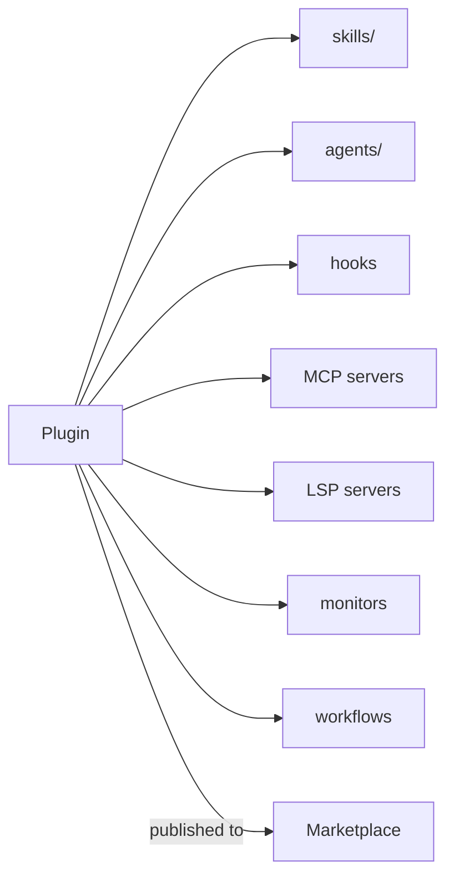

<LevelBadge level="advanced" />

<VerifyNote lastVerified="2026-10-22" source="https://code.claude.com/docs/en/plugins">
प्लगइन की संरचना और मार्केटप्लेस की कार्यप्रणाली तेज़ी से बदल रही हैं — विवरण की पुष्टि Claude Code के आधिकारिक दस्तावेज़ों में करें।
</VerifyNote>

एक **प्लगइन** कई अनुकूलनों — [स्किल](/docs/claude-code/skills), [सबएजेंट](/docs/claude-code/subagents), [स्लैश कमांड](/docs/claude-code/slash-commands), [हुक](/docs/claude-code/hooks), [MCP सर्वर](/docs/claude-code/mcp), और Claude Code v2.1.287 से एक [**मॉड**](/docs/claude-code/mods) — को एक ही वर्ज़न वाली, इंस्टॉल करने योग्य इकाई में बाँधता है। **मार्केटप्लेस** प्लगइनों की एक सूची है जिसे लोग खोज और इंस्टॉल कर सकते हैं।

## प्लगइन क्यों मायने रखते हैं

- **टीम का टूलकिट एक ही कदम में पहुँचाएँ।** सबसे पाँच फ़ाइलें कॉपी करने को कहने के बजाय एक प्लगइन प्रकाशित करें; साथी उसे इंस्टॉल करते हैं और उन्हें वही कमांड, हुक, एजेंट और MCP कनेक्शन मिल जाते हैं।
- **वर्ज़निंग।** प्लगइन अपडेट करें, और सब नया वर्ज़न खींच लेते हैं।
- **वितरण।** मार्केटप्लेस आपके (या दूसरों के) टूलकिट को खोजने योग्य बनाता है।

## आम तौर पर अंदर क्या होता है

प्लगइन घटकों वाला एक संरचित फ़ोल्डर है। `.claude-plugin/plugin.json` मैनिफ़ेस्ट **वैकल्पिक** है: इसके बिना Claude Code [मानक लेआउट](https://code.claude.com/docs/en/plugins-reference#standard-layout) में जो मिलता है उसे लोड कर लेता है — इसलिए जिस फ़ोल्डर में केवल एक `SKILL.md` हो, वह भी प्लगइन के रूप में लोड हो जाता है। मैनिफ़ेस्ट तब लिखें जब आपको मेटाडेटा, वर्ज़न, अपनी डिफ़ॉल्ट डायरेक्टरी से बाहर कोई घटक, या उपयोगकर्ता द्वारा कॉन्फ़िगर किए जा सकने वाले मान चाहिए हों।

स्किल के अलावा, प्लगइन सबएजेंट, हुक और MCP सर्वर बाँध सकता है, और — हाल ही में — कोड इंटेलिजेंस के लिए [LSP सर्वर](https://code.claude.com/docs/en/plugins-reference#lspservers), बैकग्राउंड [मॉनिटर](https://code.claude.com/docs/en/plugins-reference#monitors), [वर्कफ़्लो](https://code.claude.com/docs/en/workflows#distribute-a-workflow-in-a-plugin), एक्ज़ीक्यूटेबल फ़ाइलों का `bin/` फ़ोल्डर, और डिफ़ॉल्ट सेटिंग भी। हर प्लगइन को **सुसंगत** रखें — "टीम कन्वेंशन" प्लगइन, "Python टूलकिट" प्लगइन — किसी बेतरतीब पोटली की तरह नहीं।

## इंस्टॉल से पहले भरोसा

:::warning प्लगइन में चलने योग्य कोड हो सकता है
प्लगइन में मौजूद हुक और MCP सर्वर आपके अधिकारों के साथ चलते हैं। केवल भरोसेमंद स्रोतों से इंस्टॉल करें और पहले जाँचें कि प्लगइन क्या करता है — देखें [तृतीय-पक्ष कोड की समीक्षा](/docs/security/reviewing-third-party-code)।
:::

## अपने सेटअप को बड़ा करने का रास्ता

स्वाभाविक क्रम: एक `CLAUDE.md` → कुछ [स्किल](/docs/claude-code/skills) और [कमांड](/docs/claude-code/slash-commands) → उन्हें प्लगइन में बाँधें → अपनी टीम या समुदाय के लिए मार्केटप्लेस पर प्रकाशित करें। यह आख़िरी कदम इस बात का हिस्सा है कि AILmanac इकोसिस्टम को बढ़ने में कैसे मदद करना चाहता है।

## आगे

- [मॉड: इन-प्रोसेस एक्सटेंशन](/docs/claude-code/mods) — एकमात्र प्लगइन घटक जो Claude Code के *भीतर* चलता है और उसके अंतर्निहित व्यवहार को बदल सकता है
- [प्लगइन ईवैल](/docs/claude-code/plugin-evals) — प्रकाशित करने से पहले `claude plugin eval` से साबित करें कि प्लगइन मदद करता है
- [स्किल](/docs/claude-code/skills) · [सबएजेंट](/docs/claude-code/subagents) · [MCP](/docs/claude-code/mcp)
- [तृतीय-पक्ष कोड की समीक्षा](/docs/security/reviewing-third-party-code)
- AILmanac के [स्किल पैक](/docs/templates/skills)
