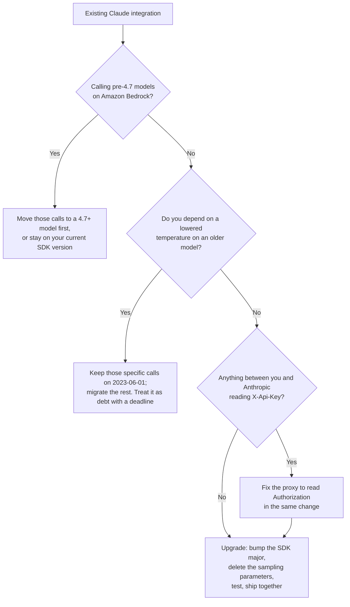

<LevelBadge level="intermediate" />

<VerifyNote lastVerified="2026-10-22" source="https://platform.claude.com/docs/en/api/versioning">
La versione API `2026-10-21` compare nella cronologia ufficiale delle versioni di Anthropic accanto a `2023-06-01` e `2023-01-01`. Ogni breaking change, numero di versione degli SDK e rinomina di campo in questa pagina proviene dalla [guida ufficiale alla migrazione](https://platform.claude.com/docs/en/api/migration-2026-10-21). Rileggila prima di rilasciare: una guida alla migrazione è l'unico tipo di documento che viene *modificato* dopo la pubblicazione.
</VerifyNote>

Per tre anni e mezzo c'è stata una sola risposta alla domanda «su quale versione dell'API sono?» — `2023-06-01`. Ogni SDK la inviava, ogni tutorial la incollava e nessuno ci ripensava.

Il **21 ottobre 2026** questo è cambiato. `anthropic-version: 2026-10-21` è ora la versione consigliata ed è una vera release con breaking change: **quattro modifiche a livello di wire e nove modifiche a SDK/CLI**, un header di autenticazione diverso e la rimozione di un parametro **più severa della deprecazione per modello che potresti aver già gestito**.

Ecco la parte che coglie di sorpresa i team, e il motivo per cui esiste questa pagina:

> **Non si passa a questa versione modificando un header. Ci si passa aggiornando una dipendenza.**

Gli SDK di Anthropic inviano la versione API che era corrente quando è uscita la loro versione **major**. Le major più vecchie continuano a inviare `2023-06-01` per sempre. Le nuove major inviano `2026-10-21`. Quindi un banale `pip install -U anthropic` o `npm update` che attraversa il confine della major cambia la versione API di tutta la tua applicazione — e porta con sé ogni breaking change, in un unico commit, che qualcuno abbia letto o no un changelog.

<Callout type="objectives" items={["Perché è la major dell'SDK — e non un header che controlli tu — a decidere quando adotti la 2026-10-21","Il triage di cinque minuti: quali breaking change toccano davvero il tuo codice","Perché i parametri di campionamento ora danno 400 anche al loro valore predefinito, e l'unica via di fuga rimasta","Il cambio di autenticazione da X-Api-Key ad Authorization: Bearer, e i proxy che rompe in silenzio","I due punti pericolosi che restituiscono un risultato sbagliato invece di un errore (doppie credenziali, header che sopprimono la chiave)","Cosa cambia sul wire e cosa cambia solo nei tipi del tuo SDK","L'ordine di aggiornamento che tiene verde un'integrazione in produzione"]} />

`★ Insight ─────────────────────────────────────`
In questa release sono raggruppati due tipi di modifica molto diversi, e confonderli fa perdere una giornata. Le **modifiche wire** (parametri rimossi, posizionamenti di blocchi rifiutati, campi di risposta rinominati) sono decise dall'header `anthropic-version`, quindi colpiscono `curl` puro, ogni SDK e anche i tuoi Message Batches. Le **modifiche SDK** (l'unione `MessageParam`, i Text Completions rimossi, gli enum a un solo valore che diventano costanti) sono normali refactoring di major version che viaggiano insieme — il JSON sul wire non cambia. Se chiami l'API via HTTP puro, ti riguarda solo il primo elenco e questa migrazione è piccola. Se usi un SDK, stai facendo entrambe le migrazioni insieme, ed è per questo che sembra più grande di quanto sia.
`─────────────────────────────────────────────────`

## Prima di tutto: sei coinvolto?

Esegui questo prima di leggere qualsiasi altra cosa. Ogni riscontro rimanda a una sezione qui sotto; nessun riscontro significa che il tuo aggiornamento è un semplice bump di versione.

<PromptCard title="Audit your codebase for 2026-10-21 breakage">{`# Wire changes — these break regardless of SDK or language
grep -rnE '\\b(temperature|top_p|top_k)\\b' --include='*.{py,ts,tsx,js,go,java,rb,php,cs}' .
grep -rn 'X-Api-Key\\|x-api-key' .            # auth header moved
grep -rnE 'workspace_id|group_type|actor\\.email|\\broles\\b' .   # Admin/Analytics renames

# SDK changes — only if you use an Anthropic SDK or the ant CLI
grep -rn 'MessageParam' .                     # now a union of three role types
grep -rn 'completions' --include='*.{ts,go,java,rb}' .   # Text Completions removed
grep -rn 'compactionControl\\|compaction_control' .       # client-side compaction removed
grep -rn 'models.list\\|models.retrieve' .    # betas moved to client.beta.models
grep -rn -- '--api-key \\|--auth-token ' .      # CLI flags removed`}</PromptCard>

| Se il grep trova… | Sei coinvolto da | Gravità |
|---|---|---|
| `temperature` / `top_p` / `top_k` | [Parametri di campionamento rimossi](#sampling-parameters-are-removed-even-at-their-defaults) | **400 a ogni richiesta** |
| `X-Api-Key` in un proxy, gateway o middleware | [Header di autenticazione spostato](#authentication-moved-to-authorization-bearer) | **401 a ogni richiesta** |
| `X-Api-Key` usato per *sopprimere* o *sovrascrivere* una chiave | [I due punti pericolosi silenziosi](#the-two-changes-that-dont-raise) | **Invio della credenziale sbagliata** |
| Sia una API key sia un auth token su un solo client | [Un client, una credenziale](#one-client-holds-one-credential) | Errore alla costruzione |
| Blocchi `document` nei turni dell'assistente | [Posizionamento dei blocchi document](#two-rejected-block-placements) | 400 |
| `citations` su blocchi di testo nei turni utente | [Posizionamento delle citazioni](#two-rejected-block-placements) | 400 |
| Chiamate al costruttore `MessageParam(...)`, sottoclassi o copie con spread | [MessageParam è un'unione](#messageparam-is-now-a-union-of-three-role-types) | Errore di tipo / runtime |
| `client.completions` | [Text Completions rimosso](#five-sdk-only-removals) | Metodo sparito |
| `compactionControl` | [Compattazione lato client rimossa](#five-sdk-only-removals) | Opzione sparita |
| `models.list(betas=…)` | [`betas` spostato](#five-sdk-only-removals) | Header beta non inviato |
| `workspace_id`, `group_type`, `actor.email`, `roles` | [Rinomine Admin e Analytics](#admin-api-and-analytics-api-field-renames) | Campo assente |

## L'aggiornamento, in ordine

<Steps items={[
  {title: "Decidi se puoi adottarla davvero", body: "Su Amazon Bedrock, la 2026-10-21 è disponibile solo per Claude 4.7 e modelli successivi. Se chiami un modello più vecchio su Bedrock, devi prima spostare quella chiamata su un modello 4.7+ oppure lasciarla sulla versione dell'SDK che usi oggi. Ovunque altrove — Claude API, Claude Platform on AWS, Microsoft Foundry e Google Cloud — è disponibile già adesso."},
  {title: "Aggiorna l'SDK (è questo che cambia la versione)", body: "Installa la prima major che invia 2026-10-21 per il tuo linguaggio — vedi la tabella qui sotto. Anche Go e la CLI ant cambiano i percorsi di import dei moduli, quindi un semplice \"go install …@latest\" sul vecchio percorso continua a darti la v1 senza errori né avvisi. Se chiami l'API via HTTP puro, imposta invece l'header anthropic-version a 2026-10-21."},
  {title: "Correggi prima le modifiche wire", body: "Elimina temperature, top_p e top_k. Sposta i documenti fuori dai messaggi dell'assistente e le citazioni fuori dai messaggi utente. Rinomina i campi di risposta Admin e Analytics che leggi. Sono le modifiche che producono 400, quindi sono quelle che mettono giù la produzione."},
  {title: "Correggi l'autenticazione e il tuo proxy", body: "L'SDK ora invia la tua chiave come Authorization: Bearer. Se qualcosa tra te e Anthropic legge X-Api-Key — un gateway, uno shim di osservabilità, un proxy di uscita aziendale — smette di vedere una credenziale. Cambia il proxy, oppure riaggiungi tu l'header."},
  {title: "Correggi i refactoring solo-SDK", body: "MessageParam ora è un'unione, i Text Completions non ci sono più, la compattazione lato client nel tool runner non c'è più, i betas sono stati tolti dai metodi Models non beta e gli enum a un solo valore sono diventati costanti. Il compilatore o il type checker ne trova la maggior parte al posto tuo."},
  {title: "Testa contro la 2026-10-21 prima del rilascio, poi pubblica entrambe le cose insieme", body: "L'istruzione di Anthropic stessa è rilasciare il bump di versione e le correzioni nello stesso deploy. Pubblicare solo il bump è ciò che trasforma una migrazione pianificata in un incidente."}
]} />

### Le versioni SDK che inviano `2026-10-21`

Le major più vecchie continuano a inviare `2023-06-01`. Queste sono le prime versioni sulla nuova versione API:

| Linguaggio / strumento | Prima versione su `2026-10-21` | Da notare |
|---|---|---|
| Python | `anthropic` **2.0.0** | — |
| TypeScript | `@anthropic-ai/sdk` **1.0.0** | I pacchetti di piattaforma (`bedrock-sdk`, `vertex-sdk`, `foundry-sdk`, `aws-sdk`, `google-cloud-sdk`) devono passare alla **v1** nello stesso aggiornamento, altrimenti il package manager installa per loro una seconda copia, più vecchia, dell'SDK core |
| Go | **2.0.0**, percorso del modulo `github.com/anthropics/anthropic-sdk-go/v2` | Ogni import — compresi i sottopacchetti come `/option` — richiede il prefisso `/v2`. **Serve Go 1.25+** |
| Java | `com.anthropic:anthropic-java` **3.0.0** | — |
| C# | `Anthropic` **13.0.0** | — |
| Ruby | gem `anthropic` **2.0.0** | — |
| PHP | `anthropic-ai/sdk` **1.0.0** | Usa `composer require`; il solo `composer update` resta dentro il vincolo attuale |
| CLI `ant` | **2.0.0** | Il percorso del modulo Go ora è `github.com/anthropics/anthropic-cli/v2`. **Il vecchio percorso di `go install` continua in silenzio a installare l'ultima v1** |

<Callout type="warning" items={["Due di questi aggiornamenti falliscono in silenzio invece che rumorosamente: il percorso della CLI Go (installa la v1 senza avvisi) e i pacchetti di piattaforma TypeScript (npm risolve volentieri un secondo @anthropic-ai/sdk più vecchio per loro). In entrambi i casi il codice compila, gira e continua a inviare 2023-06-01 — così concludi che la migrazione è finita mentre in realtà non è cambiato nulla."]} />

<a id="sampling-parameters-are-removed-even-at-their-defaults"></a>

## I parametri di campionamento sono rimossi, anche ai valori predefiniti

È la modifica che ha più probabilità di rompere codice che qualcuno aveva già «sistemato».

AILmanac documenta da tempo la deprecazione per modello: sui modelli della generazione Claude 4.7 e successivi, un `temperature`, `top_p` o `top_k` **non predefinito** restituisce un 400. Con `2026-10-21` la regola è più dura:

> Una richiesta che invia `temperature`, `top_p` o `top_k` restituisce un errore 400 — **anche al valore predefinito del parametro**.

Quindi il pattern difensivo che prima era sicuro — fissare esplicitamente `temperature: 1.0` perché nessuno potesse «ritoccarlo» in seguito — ora è un fallimento garantito su ogni modello, compresi quelli più vecchi che prima accettavano qualsiasi valore. Nelle nuove major i parametri sono spariti dai tipi dell'SDK e dai flag della CLI, quindi in un linguaggio tipizzato lo intercetta il compilatore; in un corpo della richiesta costruito con dict o hash arriva fino all'API.

```python
# Before — accepted under 2023-06-01 on every model
client.messages.create(model=MODEL, max_tokens=1024, temperature=1.0, messages=msgs)

# After — temperature: 1.0 is a 400 under 2026-10-21
client.messages.create(model=MODEL, max_tokens=1024, messages=msgs)
```

Omettere i parametri campiona esattamente con gli stessi valori predefiniti di una richiesta `2023-06-01` che li ometteva, `temperature` di 1.0 compresa. Quindi per i modelli di frontiera attuali, che già rifiutavano i valori non predefiniti, **l'output non cambia affatto** — è solo una pulizia della forma della richiesta.

La perdita vera è più circoscritta ed è bene essere precisi. Sui modelli più vecchi che *accettavano* altri valori — Sonnet 4.6, per esempio — una richiesta che abbassava `temperature` per un output più coerente perde quell'effetto, e **nessun'altra impostazione lo sostituisce.** Le opzioni documentate da Anthropic sono smettere di inviare il parametro, oppure lasciare quella specifica richiesta su `2023-06-01`.

<Callout type="tip" items={["Dato che le nuove major degli SDK hanno rimosso del tutto i tre parametri dai propri tipi, «lascia quella richiesta su 2023-06-01» in pratica significa tenere quelle chiamate sulla major precedente dell'SDK, oppure farle via HTTP puro con il vecchio header — un'inferenza da due fatti documentati, non un pattern documentato. Se dipendi da una temperature abbassata per il determinismo, trattala come debito tecnico con una scadenza, non come una configurazione supportata.", "La sostituzione duratura della temperature sui modelli attuali non è un parametro. Fissa il comportamento con il system prompt e spendi calcolo in modo deliberato con l'impostazione effort — vedi Extended Thinking & Effort ed Effort tuning."]} />

<a id="authentication-moved-to-authorization-bearer"></a>

## L'autenticazione è passata ad `Authorization: Bearer`

L'SDK e la CLI ora inviano la tua API key come `Authorization: Bearer <key>` invece che come `X-Api-Key: <key>`.

```text
# Before
X-Api-Key: <key>

# After
Authorization: Bearer <key>
```

**La Claude API accetta una chiave in entrambi gli header.** Quindi, se il tuo programma parla direttamente con `api.anthropic.com`, questo cambio è invisibile — non c'è nulla da fare.

Rompe lo strato intermedio. Qualunque cosa legga, imposti, riscriva o registri `X-Api-Key` smette di vedere una credenziale: un gateway LLM, un proxy di attribuzione dei costi, un filtro di uscita aziendale, un test double che fa asserzioni sull'header, un `fetch` personalizzato che inietta chiavi per tenant. Il sintomo è un 401 netto dalla tua infrastruttura, non da Anthropic — esattamente il tipo di errore che viene scambiato per un problema di rotazione delle chiavi.

Due vie d'uscita. Correggere il proxy perché legga `Authorization` (corretto), oppure riaggiungere tu il vecchio header (sbrigativo):

<PromptCard title="Keep sending X-Api-Key to a proxy that needs it">{`// TypeScript — Authorization: null stops the key going out twice
const client = new Anthropic({
  apiKey,
  defaultHeaders: { "X-Api-Key": apiKey, Authorization: null }
});`}</PromptCard>

Python lo fa con una funzione `auth` sul client HTTP (gira anche nei retry), Go con `option.WithHeader` più `option.WithHeaderDel("Authorization")`, Java con `putHeader` al posto di `apiKey`, PHP e Ruby con un middleware di richiesta. C# usa `ExtraHeaders` e richiede di impostare a `null` **sia** `ApiKey` **sia** `AuthToken`, altrimenti una credenziale trovata nell'ambiente parte comunque.

Tre dettagli per linguaggio facili da perdere:

- **`AnthropicFoundry` / `@anthropic-ai/foundry-sdk` / `FoundryBackend` continuano a inviare `x-api-key`.** Lì la modifica non si applica.
- **I client Bedrock Mantle inviavano già un bearer token.** Nessuna modifica.
- **L'SDK Ruby scarta `Authorization` quando segue un redirect verso un'altra origine** — compreso un redirect `http` → `https` sullo stesso host. Ora la chiave viene scartata anche lì, dove prima viaggiava in `X-Api-Key`. Se punti l'SDK a un URL interno `http://` e conti sul redirect, la credenziale smette in silenzio di arrivare.
- **In PHP, non usare `extraHeaders` del client per questo.** Una richiesta con i propri `extraHeaders` *sostituisce* quelli del client — e ogni endpoint sotto `$client->beta` che richiede un header beta li ha. Usa il middleware.

<a id="the-two-changes-that-dont-raise"></a>

## Le due modifiche che non generano errori

Tutto quanto sopra fallisce in modo rumoroso. Queste due continuano a funzionare e fanno la cosa sbagliata, il che le rende quelle da controllare a mano.

**1. Un header che prima sopprimeva la chiave non lo fa più.** L'idioma per inviare una richiesta senza credenziale — o con una credenziale *diversa* da quella del client — prendeva di mira `X-Api-Key`. Quell'header non è più dove vive la chiave:

```python
# Before — kept the client's key off this one request
client.messages.create(..., extra_headers={"X-Api-Key": omit})

# After — the key still goes out in Authorization. Suppress that instead.
client.messages.create(..., extra_headers={"Authorization": omit})
```

**2. Un override della chiave per singola richiesta ora invia due chiavi.** Passare un'altra chiave in `X-Api-Key` prima sostituiva quella del client. Non più: l'override parte in `X-Api-Key` e la chiave del client parte in `Authorization`, quindi **entrambe viaggiano sul wire.** Per inviare una chiave diversa per una sola richiesta, imposta invece `Authorization` (Python/TypeScript/PHP/Ruby), oppure usa `option.WithAPIKey(otherKey)` in Go.

Se hai costruito un instradamento di chiavi per tenant su un client condiviso, questo è il paragrafo su cui agire: il ripiego non è più «la richiesta fallisce», è «la richiesta riesce con la chiave sbagliata».

<a id="one-client-holds-one-credential"></a>

## Un client, una credenziale

Poiché una API key e un token di autenticazione ora condividono un header, un client SDK può contenere una sola credenziale. Passarne due prima le inviava entrambe, ciascuna nel proprio header. Ora genera un errore alla costruzione:

| SDK | Cosa succede ora con due credenziali |
|---|---|
| Python | `ValueError` |
| TypeScript | `TypeError` |
| C# | `ArgumentException` |
| Java | `IllegalStateException` da `build()`, con entrambe nominate |
| PHP | `InvalidArgumentException` |
| Ruby | `ArgumentError` |
| Go | `NewClient` non restituisce errori, quindi **fallisce invece ogni richiesta del client** |

Insieme a questo sono cambiate due regole di comportamento:

- **Una credenziale passata nel codice è l'unica.** Il client non ripiega più sull'ambiente o su un profilo su disco. Prima, un `ANTHROPIC_API_KEY` nell'ambiente poteva essere inviato accanto al token passato — o al suo posto.
- **Se non passi nulla, la precedenza è fissa:** `ANTHROPIC_API_KEY`, poi `ANTHROPIC_AUTH_TOKEN`, poi il profilo indicato da `ANTHROPIC_PROFILE`, poi le variabili di workload identity federation, poi il profilo attivo su disco. **Quest'ordine è cambiato:** diversi SDK prima mettevano il profilo attivo su disco *davanti* alle variabili di federation. Se ti autentichi con WIF e hai anche un profilo su disco, potresti ora usare una credenziale diversa da quella di ieri. Imposta `ANTHROPIC_PROFILE` per fissare il vecchio comportamento.

Quando sono impostati sia `ANTHROPIC_API_KEY` sia `ANTHROPIC_AUTH_TOKEN`, vince la chiave e l'SDK registra un avviso una volta per processo. In PHP questo significa **una volta per richiesta web** — rimuovi la variabile che non usi, altrimenti il log degli errori si riempie.

Il pattern legittimo che questo rompe è «token per il gateway, chiave per l'API dietro di esso». Ricostruiscilo esplicitamente: passa il **token** come unica credenziale del client, imposta `X-Api-Key` negli header predefiniti o nel middleware e fai in modo che il gateway tolga il proprio header `Authorization` prima di inoltrare. La Claude API si aspetta una credenziale per richiesta.

<a id="two-rejected-block-placements"></a>

## Due posizionamenti di blocchi rifiutati

Entrambi sono 400 con `2026-10-21`, ed entrambi valgono per la Messages API, per il [conteggio dei token](/docs/api/tokens-and-pricing) e per **ogni richiesta dentro un [Message Batch](/docs/api/message-batches) creato con la nuova versione.**

- **Un blocco `document` direttamente in un messaggio `assistant`.** Invia i documenti nei messaggi `user`. Un documento *annidato* dentro un altro blocco — il risultato di uno strumento web-fetch restituito da Claude, per esempio — va ancora bene, quindi riprodurre l'output stesso di Claude è sicuro.
- **Un blocco `text` con un array `citations` non vuoto in un messaggio `user`**, anche dentro un blocco `search_result`. Togli `citations` da quei blocchi. Le citazioni sui blocchi `text` nei messaggi **assistant** sono ancora accettate, così come `"citations": [brackets with enabled true]` come impostazione su documenti e risultati di ricerca.

Il secondo è una trappola specifica per le pipeline di retrieval. Se dai a Claude dei risultati di ricerca e rimandi indietro i metadati di citazione ricevuti, quel round-trip ora dà 400 — mentre il caso superficialmente simile di riprodurre la risposta citata di Claude continua a funzionare. L'asimmetria è tutto il bug.

<a id="messageparam-is-now-a-union-of-three-role-types"></a>

## `MessageParam` ora è un'unione di tre tipi di ruolo

Il singolo tipo `MessageParam` ora è `UserMessageParam | AssistantMessageParam | SystemMessageParam`, e `BetaMessageParam` si divide allo stesso modo. **Il JSON inviato dall'SDK non cambia.**

Prima la buona notizia: **un messaggio scritto come semplice dict, hash, array o letterale di oggetto che indica il proprio ruolo non richiede alcuna modifica.** `[brackets: role user, content Hello]` supera ancora il controllo dei tipi ovunque. Per la maggior parte delle codebase questa modifica è un no-op.

Quattro pattern si rompono:

```python
# 1. Calling the type as a constructor now raises TypeError
message = MessageParam(role="user", content="Hello")      # before
message: MessageParam = {"role": "user", "content": "Hello"}   # after
```

```typescript
// 2. Spread-copying a message of unknown role — system messages differ
const copy: Anthropic.MessageParam = { ...message, content: blocks };          // before
const copy: Anthropic.MessageParam =
  message.role === "system" ? message : { ...message, content: blocks };       // after
```

```typescript
// 3. Extending or implementing the type — you cannot extend a union
interface StoredMessage extends Anthropic.MessageParam { id: string }   // before
type StoredMessage = Anthropic.MessageParam & { id: string }            // after
```

```go
// 4. Struct/builder literals name the role's type and drop Role
anthropic.MessageParam{Role: anthropic.MessageParamRoleAssistant, Content: blocks}        // before
anthropic.MessageParam{OfAssistant: &anthropic.AssistantMessageParam{Content: blocks}}    // after
```

Un quinto è più sottile: un dict il cui `role` proviene da una **variabile** che può contenere più di un ruolo non corrisponde a nessun membro dell'unione, quindi un helper generico `to_message(role, text)` deve diramarsi per ruolo. E in beta, `clear_at` e `output_config` ora vivono solo su `BetaSystemMessageParam`, mentre il suo `content` è opzionale — quindi `message["content"]` può essere undefined.

Go nasconde nel refactoring un vero cambio di comportamento: **una copia di un `MessageParam` punta allo stesso messaggio sottostante.** Impostare `duplicate.OfUser.Content` modifica entrambi, mentre nella v1 impostare `duplicate.Content` cambiava solo la copia. Se costruisci varianti di conversazione copiando, è un vero bug di aliasing e non un errore di compilazione.

<a id="five-sdk-only-removals"></a>

## Cinque rimozioni solo-SDK

Il wire non cambia per nessuna di queste — solo il tuo codice.

| Rimosso | Riguarda | Sostituzione |
|---|---|---|
| **Text Completions API** (`client.completions`, `HUMAN_PROMPT`/`AI_PROMPT`, `ant completions create`) | TypeScript, Go, Java, Ruby, CLI | La Messages API. Il testo della risposta passa da `completion` a `content[0].text` — nella CLI, `--transform completion` diventa `--transform content.0.text` |
| **Compattazione lato client nel tool runner** (`compactionControl`, `compaction_control`) | TypeScript, Ruby | [Compattazione](/docs/api/compaction) lato server: beta `compact-2026-01-12` con una modifica `compact_20260112`, soglia **≥ 50.000 token**. Aveva già smesso di funzionare in TS v0.129.0 / Ruby v1.74.0 |
| **`betas` sui metodi Models non beta** (`--beta` su `ant models`) | Tutti gli SDK, CLI | Chiama `client.beta.models` / `ant beta:models`. **In Ruby, passare `betas:` a `client.models` non genera errori — semplicemente smette di impostare l'header** |
| **Enum a un solo valore** (un campo obbligatorio che poteva contenere un solo valore) | C#, Go, Java, PHP, Ruby, un flag della CLI | Elimina il campo; ora è una costante. Leggilo confrontando la stringa: `event.Type == "agent.message"` |
| **Flag CLI `--api-key` / `--auth-token`** | CLI `ant` | `ANTHROPIC_API_KEY` / `ANTHROPIC_AUTH_TOKEN`, `--api-key-stdin` / `--auth-token-stdin`, oppure `ant auth login`. Un comando che li passa ancora si ferma con `flag provided but not defined` |

La rimozione dei flag CLI è una correzione di sicurezza che vale la pena sottolineare: una chiave sulla riga di comando è visibile nella cronologia della shell e nell'elenco dei processi. I flag stampavano un avviso di deprecazione dalla v1.27.0. Nota che `--api-key-stdin` legge **tutto** lo standard input, quindi un comando che lo usa deve prendere il corpo della richiesta dai flag.

<PromptCard title="Pass a key to the ant CLI without putting it in argv">{`# From the environment
export ANTHROPIC_API_KEY="$KEY"
ant models list

# Straight from a secret manager
op read op://vault/anthropic/api-key | ant --api-key-stdin models list`}</PromptCard>

Altre due note su singoli SDK: **Go** richiede **1.25+** ed elimina `vertex.DefaultVersion` / `bedrock.DefaultVersion` (Ruby elimina le costanti equivalenti `DEFAULT_VERSION`). **Java** ora aggiunge l'header predefinito `anthropic-version` *prima* che girino gli interceptor, quindi un interceptor che imposta una propria versione deve chiamare `replaceHeaders` — `putHeader` ora aggiunge un secondo valore.

<a id="admin-api-and-analytics-api-field-renames"></a>

## Rinomine dei campi di Admin API e Analytics API

Rinomine dei campi di risposta. I vecchi nomi sono semplicemente assenti con `2026-10-21`, quindi il codice che li legge ottiene `undefined`/`nil` invece di un errore — rompono le dashboard, non i percorsi delle richieste. Per gli endpoint veri e propri vedi [The Admin API](/docs/api/admin-api).

| Gruppo di endpoint | Vecchio nome | Nuovo nome |
|---|---|---|
| Gruppi RBAC (create, list, retrieve, update) | `roles` | `role_ids` |
| Membri dei gruppi RBAC (risposta di list, add, remove) | `group_id` | `rbac_group_id` |
| Ruoli RBAC (list, retrieve) | `name` | `display_name` |
| Rate limit di organizzazione e workspace | `group_type` | `group.type` |
| API key (list, retrieve, update) | `workspace_id` | `scope` — **cambia anche la semantica, vedi sotto** |
| Analytics: report di utilizzo e costo per utente | `actor.email` | `actor.email_address` |
| Analytics: riepiloghi di attività | `summaries` | `data` |

Il **parametro di query** `group_type` sugli endpoint dei rate limit e il **filtro** `workspace_id` sull'endpoint di elenco delle API key restano invariati. Si sono spostati solo i campi di risposta.

**`workspace_id` sulle API key non è una rinomina — è una correzione semantica.** Con `2023-06-01`, un `workspace_id` `null` era ambiguo: significava *o* «legata al Default Workspace» *o* «non legata a un solo workspace» (una chiave per tutti i workspace). Non era possibile distinguere i due casi. Con `2026-10-21`:

- una chiave legata a un workspace, **compreso il Default Workspace**, ha `scope.workspace_id` impostato all'ID reale di quel workspace;
- una chiave per tutti i workspace ha `scope` di `[type: organization]` e **nessun** `workspace_id`.

L'ambiguità è sparita, il che è decisamente meglio — ma qualunque codice che leggesse `workspace_id === null` come «Default Workspace» ora è sbagliato. Recupera una volta l'ID reale del tuo Default Workspace (chiama List Workspaces con `include_default=true` e prendi quello chiamato `"Default"`) e confronta con `scope.workspace_id`.

## Dovresti aggiornare adesso?



La risposta onesta per la maggior parte dei team è **aggiorna con metodo e presto, ma non per caso.** `2023-06-01` non è annunciata come in dismissione, e la promessa di compatibilità di Anthropic per una data versione resta valida — i parametri di input e output esistenti sono preservati. Non c'è pressione di scadenza. Il rischio non è che la vecchia versione smetta di funzionare; è che qualcuno esegua un aggiornamento di dipendenze non vincolato e adotti tutte le modifiche insieme senza accorgersene.

<Callout type="warning" items={["Se porti via una sola azione da questa pagina: fissa il tuo SDK Anthropic a una versione major nel lockfile e nel manifest. Questo trasforma la migrazione da qualcosa che ti può capitare in qualcosa che pianifichi."]} />

## Errori comuni

- **Aggiornare l'SDK e correggere i danni in due deploy separati.** La finestra tra i due è un'interruzione totale per ogni percorso di codice che invia un parametro di campionamento. L'indicazione di Anthropic stessa è rilasciare entrambi insieme.
- **Dare per scontato che la regola di campionamento sia quella che hai già gestito.** La deprecazione per modello rifiutava i valori *non predefiniti*. Questa versione rifiuta i parametri *in assoluto*. Il codice che fissa esplicitamente `temperature: 1.0` prima era corretto e ora dà 400.
- **Trattare il cambio di autenticazione come «niente, tanto l'API accetta entrambi gli header».** Vero per la tua applicazione, falso per la tua infrastruttura. Il fatto che l'API accetti entrambi è proprio il motivo per cui il guasto sembra venire dal tuo proxy.
- **Migrare gli override di `X-Api-Key` rinominando l'header.** Se usavi `X-Api-Key` per sopprimere o sovrascrivere una credenziale, rinominarlo non basta — devi capire su quale dei due comportamenti facevi affidamento, perché uno ora invia due chiavi e l'altro ne invia una che non dovrebbe.
- **`go install …@latest` sul vecchio percorso del modulo.** Installa l'ultima **v1** e non ti dice nulla. Stessa classe di trappola di lasciare un pacchetto di piattaforma TypeScript alla v0 e lasciare che npm risolva un secondo SDK core sotto di esso.
- **Lasciare che un client Go contenga due credenziali.** Non genera errori alla costruzione — `NewClient` non restituisce errori — quindi lo scopri quando fallisce ogni singola richiesta.
- **Dimenticare i Message Batches.** Le regole di posizionamento dei blocchi e dei parametri di campionamento si applicano a ogni richiesta *dentro* un batch creato con `2026-10-21`, non solo alla chiamata del batch in sé.

<Flashcards title="I numeri da ricordare" cards={[
  {front: "Quali major degli SDK inviano per prime 2026-10-21?", back: "Python 2.0.0 · TypeScript 1.0.0 · Go 2.0.0 (percorso del modulo /v2) · Java 3.0.0 · C# 13.0.0 · Ruby 2.0.0 · PHP 1.0.0 · CLI ant 2.0.0"},
  {front: "Cosa fa l'invio di temperature con 2026-10-21?", back: "Restituisce un 400 — anche al valore predefinito del parametro, e su ogni modello. Ometterlo campiona con gli stessi valori predefiniti di prima."},
  {front: "Quale header porta ora la tua API key?", back: "Authorization: Bearer <key>, inviato da SDK e CLI. La Claude API accetta ancora X-Api-Key, quindi si rompono solo proxy e middleware."},
  {front: "Dove la 2026-10-21 NON è disponibile del tutto?", back: "Su Amazon Bedrock copre solo Claude 4.7 e modelli successivi. Claude API, Claude Platform on AWS, Microsoft Foundry e Google Cloud la hanno per tutto."},
  {front: "Cosa succede se un client contiene sia una API key sia un auth token?", back: "Nella maggior parte degli SDK genera un errore alla costruzione (ValueError / TypeError / ArgumentException / IllegalStateException / InvalidArgumentException / ArgumentError). In Go non genera nulla e fallisce invece ogni richiesta."},
  {front: "Cosa è cambiato nella licenza degli SDK?", back: "Le nuove major sono Apache 2.0. Le versioni precedenti restano MIT. Nessuna modifica al codice necessaria, ma gli inventari delle licenze delle dipendenze vanno aggiornati."}
]} />

<Quiz title="Verifica te stesso" questions={[
  {q: "Come si arriva sulla versione API 2026-10-21?", options: ["Impostando un feature flag nella Anthropic Console", "Aggiornando a una major dell'SDK che la invia, oppure impostando l'header da sé su HTTP puro", "Automaticamente a una data fissa per tutti gli account", "Con un'adesione per singolo modello"], answer: 1, explain: "Gli SDK inviano la versione API che era corrente quando è uscita la loro major. Le major più vecchie continuano a inviare 2023-06-01 a tempo indefinito; le nuove major inviano 2026-10-21. Su HTTP puro imposti tu l'header anthropic-version."},
  {q: "Con 2026-10-21, cosa restituisce una richiesta con temperature impostata al suo valore predefinito 1.0?", options: ["200, dato che il valore è quello predefinito", "200 con un avviso di deprecazione", "Un errore 400, perché il parametro è rimosso a prescindere dal valore", "Dipende dal modello"], answer: 2, explain: "I parametri sono rimossi, non solo limitati. Una richiesta che invia temperature, top_p o top_k restituisce un 400 anche al valore predefinito, su ogni modello — più severo della precedente deprecazione per modello dei valori non predefiniti."},
  {q: "La tua applicazione chiama api.anthropic.com tramite un gateway aziendale che autentica le richieste leggendo l'header X-Api-Key. Aggiorni l'SDK. Cosa succede?", options: ["Niente — la Claude API accetta entrambi gli header", "Anthropic restituisce 400 sull'header rimosso", "Il gateway smette di vedere una credenziale, perché l'SDK ora invia Authorization: Bearer", "L'SDK invia entrambi gli header per retrocompatibilità"], answer: 2, explain: "La Claude API accetta una chiave in entrambi gli header, quindi chi chiama direttamente non è toccato. Il guasto sta nel mezzo: l'SDK ora invia Authorization: Bearer, quindi tutto ciò che legge X-Api-Key non vede alcuna credenziale. Correggi il proxy perché legga Authorization, oppure riaggiungi l'header dal client."},
  {q: "Quale di questi breaking change NON si applica se chiami l'API via HTTP puro senza SDK?", options: ["I parametri di campionamento che restituiscono 400", "Un blocco document in un messaggio assistant che restituisce 400", "MessageParam che diventa un'unione di tre tipi di ruolo", "Il campo workspace_id dell'Admin API sostituito da scope"], answer: 2, explain: "La divisione di MessageParam è un refactoring dei tipi dell'SDK — il JSON sul wire è identico. Gli altri tre sono modifiche wire governate dall'header anthropic-version e si applicano anche a chi chiama via HTTP puro."}
]} />

<Callout type="takeaways" items={["2026-10-21 è la prima nuova anthropic-version dopo 2023-06-01, e la si adotta aggiornando una major dell'SDK — non cambiando un header. Fissa la major del tuo SDK così che sia una decisione, non un incidente.","Separa le modifiche wire da quelle SDK. Chi chiama via HTTP puro deve gestire solo il primo gruppo, il che rende la sua migrazione piccola.","temperature, top_p e top_k ora danno 400 anche ai valori predefiniti, su ogni modello. L'unica via di fuga documentata per una temperature abbassata davvero necessaria è tenere quella richiesta su 2023-06-01.","L'autenticazione è passata ad Authorization: Bearer. La tua applicazione non se ne accorgerà; il tuo proxy sì.","Due modifiche falliscono in silenzio invece che rumorosamente — un header che sopprimeva la chiave e ora non la sopprime più, e un override della chiave che ora mette due chiavi sul wire. Controllale a mano.","Le regole di posizionamento dei blocchi e di campionamento valgono anche per ogni richiesta dentro un Message Batch creato con la nuova versione.","Su Amazon Bedrock la nuova versione copre solo Claude 4.7 e modelli successivi; ovunque altrove è pienamente disponibile."]} />

## Prossimo passo

- Invia una richiesta sulla nuova versione → [Your First API Call](/docs/api/first-call)
- Cos'altro viene dismesso, e quando → [Deprecations & Migrations](/docs/whats-new/deprecations)
- La sostituzione della temperature sui modelli attuali → [Extended Thinking & Effort](/docs/api/thinking-and-effort) · [Effort tuning](/docs/api/effort-tuning)
- Automatizza gli endpoint dell'organizzazione i cui campi sono stati rinominati → [The Admin API](/docs/api/admin-api)
