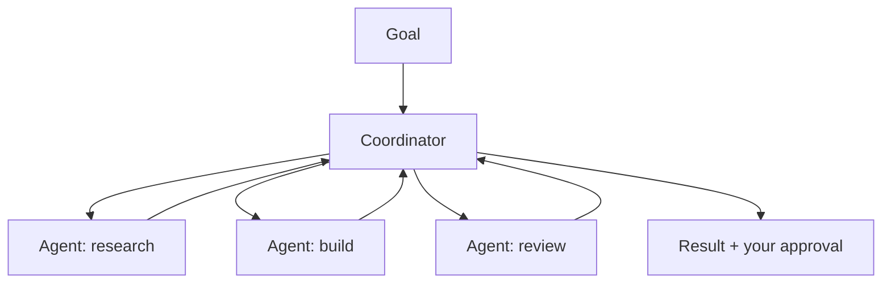

<LevelBadge level="advanced" />

<Callout type="objectives" items={[
  "Che cos'è Cowork — uno spazio di lavoro desktop agentico in cui tu indirizzi gli obiettivi e il loop è già fornito",
  "Che cosa sono i team di agent — più agent che si dividono un obiettivo, ciascuno con un ruolo e degli strumenti",
  "Come entrambi si collegano alle tre cose che puoi costruire da solo: subagent, Agent SDK e Managed Agents",
  "Perché più autonomia significa più supervisione, non meno",
]} />

<VerifyNote lastVerified="2026-07-23" source="https://platform.claude.com/docs">
Cowork e i team di agent sono superfici del 2026 in rapida evoluzione — nomi, disponibilità e funzionalità cambiano spesso. Conferma i dettagli attuali nella documentazione/negli annunci ufficiali di Anthropic.
</VerifyNote>

Oltre al singolo agent, Anthropic ha rilasciato superfici a **livello di prodotto** che permettono agli agent di svolgere un lavoro collaborativo e prolungato: **Cowork** (uno spazio di lavoro desktop agentico) e i **team di agent** (più agent che collaborano). Questa pagina è una mappa ad alto livello — verifica le specifiche nella documentazione ufficiale, poiché evolvono rapidamente.

## Claude Cowork

Pensalo come uno **spazio di lavoro dove un agent svolge un lavoro reale, in più passaggi** accanto a te — operando su file e strumenti su un orizzonte più lungo di un singolo turno di chat, con te a supervisionare. È il cugino consumer/pro della costruzione di un agent sull'API: il loop è fornito, tu indirizzi gli obiettivi.

## Team di agent

Quando un singolo agent non basta, **più agent collaborano** — dividendosi un obiettivo, ciascuno con un ruolo e degli strumenti, coordinandosi verso un risultato. Concettualmente rispecchia i [subagent](/docs/claude-code/subagents) di Claude Code, ma come superficie di prodotto per una collaborazione multi-agent prolungata anziché un singolo sottocompito delegato.

## Come si collega al resto del sito

- Costruirlo da solo, programmaticamente → [Costruire agent](/docs/api/building-agents) + l'[Agent SDK](/docs/claude-code/headless-and-agent-sdk).
- Delega all'interno di una sessione di coding → [Subagent](/docs/claude-code/subagents).
- Loop/stato/scheduling gestiti → [Agent gestiti](/docs/api/managed-agents).

<Flashcards title="Quattro modi in cui gli agent portano a termine il lavoro" cards={[
  {front: "Cowork", back: "Uno spazio di lavoro desktop agentico. Il loop è fornito; tu indirizzi gli obiettivi e supervisioni mentre l'agent lavora su file e strumenti su un orizzonte più lungo di un singolo turno di chat."},
  {front: "Team di agent", back: "Una superficie di prodotto in cui più agent collaborano — dividendosi un obiettivo, ciascuno con un ruolo e degli strumenti, coordinandosi verso un risultato che approvi tu."},
  {front: "Subagent", back: "Delega all'interno di una sessione di Claude Code. La stessa idea dei team di agent, ma limitata a un singolo sottocompito delegato anziché a una collaborazione prolungata."},
  {front: "Managed Agents", back: "Anthropic ospita per te il loop, lo stato e lo scheduling — l'opzione lato API quando non vuoi eseguire tu il loop dell'agent."},
  {front: "Agent SDK", back: "Costruisci il loop in modo programmatico. Massimo controllo, e orchestrazione, stato e gestione degli errori sono a tuo carico."},
]} />

## Quiz

<Quiz questions={[
  {
    q: "Vuoi un loop di agent che non devi eseguire né pianificare tu, chiamato dal tuo backend. Quale opzione indica questa pagina?",
    options: [
      "Cowork",
      "Managed Agents",
      "Subagent",
      "Team di agent"
    ],
    answer: 1,
    explain: "Managed Agents è l'opzione con loop/stato/scheduling ospitati. Cowork e i team di agent sono superfici di prodotto in cui lavori, non che chiami; i subagent sono delega dentro una sessione di Claude Code; l'Agent SDK è la strada del costruisci-da-solo."
  },
  {
    q: "Che rapporto c'è tra i team di agent e i subagent di Claude Code, come descritto qui?",
    options: [
      "Sono la stessa funzionalità con due nomi",
      "I team di agent sostituiscono i subagent, che sono deprecati",
      "Concettualmente la stessa idea, ma i team di agent sono una superficie di prodotto per una collaborazione multi-agent prolungata anziché un singolo sottocompito delegato",
      "I subagent girano nel cloud; i team di agent girano in locale"
    ],
    answer: 2,
    explain: "La pagina presenta i team di agent come l'equivalente concettuale dei subagent, ma come superficie di prodotto per una collaborazione multi-agent prolungata — mentre i subagent gestiscono un singolo sottocompito delegato all'interno di una sessione di coding."
  },
  {
    q: "Perché questa pagina considera la supervisione la costante di entrambe le superfici?",
    options: [
      "Perché il lavoro multi-agent a lungo orizzonte amplifica sia il valore sia il rischio",
      "Perché agli agent non si può proprio dare accesso agli strumenti",
      "Perché Anthropic richiede l'approvazione manuale di ogni chiamata a uno strumento",
      "Perché le superfici sono anteprime di ricerca senza addestramento alla sicurezza"
    ],
    answer: 0,
    explain: "Più autonomia su un orizzonte più lungo amplifica insieme valore e rischio. La risposta pratica è tenere gli umani nel loop sulle azioni di rilievo, limitare strettamente l'accesso agli strumenti e verificare gli output."
  }
]} />

## La costante: la supervisione

:::warning[Più autonomia, più attenzione]
Il lavoro multi-agent e a lungo orizzonte amplifica sia il valore *sia* il rischio. Mantieni gli umani nel loop sulle azioni di rilievo, limita strettamente l'accesso agli strumenti e verifica gli output — vedi [Uso responsabile](/docs/security/responsible-use) e [Mettere in sicurezza gli agent](/docs/security/securing-agents).
:::

<Callout type="takeaways" items={[
  "Cowork e i team di agent sono superfici di prodotto: il loop dell'agent è fornito, e il tuo compito è indirizzare gli obiettivi e supervisionare.",
  "Sono i cugini a livello di prodotto di ciò che puoi costruire da solo — subagent per la delega in sessione, Agent SDK per il controllo totale, Managed Agents per un loop ospitato.",
  "Queste superfici cambiano in fretta. Considera questa pagina una mappa e conferma i dettagli nella documentazione ufficiale.",
  "La supervisione è la costante: approvazione umana sulle azioni di rilievo, accessi agli strumenti limitati, output verificati.",
]} />

## Avanti

- [Cowork Scheduled Tasks: agent che girano senza alcun dispositivo acceso](/docs/claude-app/cowork-scheduled-tasks) — il lancio web + mobile di luglio 2026 in pratica, con la matrice delle funzionalità per superficie e le quattro insidie che interrompono le esecuzioni silenziose
- [Subagent e agent paralleli](/docs/claude-code/subagents)
- [Agent gestiti](/docs/api/managed-agents)
- [API multi-agent native](/docs/models/native-multi-agent-apis) — come si confronta la beta multi-agent delle Responses di OpenAI, e dove si colloca il divario di primitive sul lato Anthropic
- [Uso responsabile, etica e verifica](/docs/security/responsible-use)
