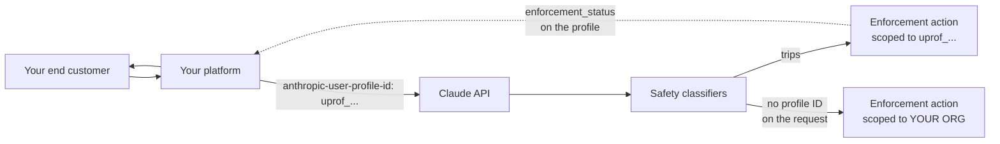

<LevelBadge level="advanced" />

<Callout type="objectives" items={[
  "Il problema del raggio d'azione che ha ogni piattaforma AI: senza attribuzione, un singolo cliente finale abusivo può far restringere l'intera organizzazione",
  "Come registrare un cliente finale (POST /v1/user_profiles) e attribuire ogni richiesta (l'header anthropic-user-profile-id)",
  "application vs passthrough — quale access_type corrisponde al modo in cui vendi Claude, e perché quello sbagliato indebolisce l'attribuzione",
  "I quattro valori di enforcement_status e la regola esatta che ne sceglie uno, incluso pending (che la documentazione narrativa omette)",
  "Lo schema enforcement_actions: sei motivi, il passo successivo verify e le regole di compatibilità futura che Anthropic chiede di codificare in modo difensivo",
  "Perché i webhook dell'organizzazione non sostituiscono ancora un ciclo di polling — e la query di elenco esatta che trova ogni profilo con restrizioni",
  "Dove tutto questo non fa nulla in silenzio: Claude Platform on AWS, Bedrock e Google Cloud gestito da Google si comportano ciascuno in modo diverso",
]} />

<VerifyNote lastVerified="2026-11-02" source="https://platform.claude.com/docs/en/manage-claude/user-profiles">
I profili utente sono stati lanciati il **20 ottobre 2026**; i campi `enforcement_status` e `enforcement_actions` sono stati aggiunti il **21 ottobre 2026** insieme alla [versione API 2026-10-21](/docs/api/api-version-2026-10-21). I webhook dell'organizzazione sono in **beta** (`webhooks-2026-10-07`) e la documentazione di Anthropic stessa afferma che **la consegna degli eventi non è attiva** — puoi registrare gli endpoint, ma non viene ancora inviato alcun evento. I nomi dei campi e i valori degli enum provengono dalla [guida ai profili utente](https://platform.claude.com/docs/en/manage-claude/user-profiles), dal [riferimento List User Profiles](https://platform.claude.com/docs/en/api/user_profiles/list) e dalla [guida ai webhook dell'organizzazione](https://platform.claude.com/docs/en/manage-claude/organization-webhooks). Ricontrolla prima di basarci una dipendenza rigida.
</VerifyNote>

Se rivendi Claude, gestisci un AI gateway o costruisci un prodotto sulla Claude API a cui si iscrivono migliaia di sconosciuti, hai un problema che chi costruisce per un singolo tenant non ha: **i classificatori di sicurezza automatici di Anthropic girano sul tuo traffico API, e ogni richiesta arriva sotto la tua organizzazione.** Un cliente finale che fa qualcosa che fa scattare un classificatore è, dal punto di vista di Anthropic, indistinguibile da *te* che lo fai. L'azione di enforcement che segue si applica all'intera organizzazione — e porta giù con sé tutti gli altri clienti.

I profili utente sono la soluzione. Dici ad Anthropic per quale cliente finale è ogni richiesta, e un'azione di enforcement ricade su quel profilo invece che altrove. Il resto del tuo traffico continua a funzionare.

:::tip[Questo è un controllo del raggio d'azione, non una funzione di fatturazione]
I profili non sono fatturabili e non cambiano i prezzi. Di per sé non concedono né revocano nulla. Il loro unico compito è rendere l'enforcement *mirato* — il che aiuta solo se hai attribuito il traffico **prima** che qualcosa vada storto. Non esiste attribuzione retroattiva.
:::

## La versione in un paragrafo

Crea un profilo per ogni cliente finale con `POST /v1/user_profiles`, conserva l'ID `uprof_…` restituito nel record del tuo cliente e invialo nell'header `anthropic-user-profile-id` a ogni richiesta che fai per quel cliente. Poi esegui un ciclo che elenca i tuoi profili filtrati per `enforcement_status[]=restricted` ed `enforcement_status[]=banned`, così vieni a sapere di un'azione prima della tua casella di supporto. Le richieste **senza** ID profilo contano come utilizzo tuo — e se una di esse fa scattare un classificatore, torni all'enforcement a livello di organizzazione.

## La configurazione in quattro passi

<Steps items={[
  {title: "Separa il tuo traffico in un'organizzazione diversa", body: "Un profilo appartiene a un'organizzazione, non a un workspace, quindi workspace separati all'interno di una stessa organizzazione non bastano. Tieni il traffico dei clienti finali in un'organizzazione e il tuo utilizzo interno in un'altra. Solo l'organizzazione dei clienti finali ha bisogno di profili."},
  {title: "Registra ogni cliente finale una sola volta, all'onboarding", body: "POST /v1/user_profiles restituisce un profilo con un ID uprof_. L'endpoint NON è idempotente — ogni chiamata crea un nuovo profilo, anche quando reference_id coincide con uno che hai già. Crealo nel tuo flusso di iscrizione e conserva l'ID; non lasciare mai che un'istanza di servizio ne crei uno al volo."},
  {title: "Invia l'ID a ogni richiesta per quel cliente", body: "L'header anthropic-user-profile-id. Gli SDK e la CLI ant lo espongono come argomento (user_profile_id; userProfileId in Java, UserProfileID in Go/C#, --user-profile-id nella CLI). Funziona allo stesso modo su Messages, sul conteggio dei token, su Message Batches e sul livello di compatibilità con l'SDK OpenAI."},
  {title: "Fai polling delle azioni di enforcement e mantieni aggiornati i profili", body: "Elenca i profili per enforcement_status per trovare restrizioni e ban. Aggiorna un profilo quando cambiano i dettagli o lo stato dell'account del cliente; eliminalo quando chiude l'account o ti chiede di cancellare i suoi dati."},
]} />



La linea tratteggiata è quella che devi costruire tu. Anthropic imposta i campi di enforcement; oggi nulla te li invia.

## Decidi chi ottiene un profilo

Ciò che un profilo *rappresenta* dipende da come vendi Claude. Il campo `access_type` registra quale caso si applica, e sbagliarlo indebolisce l'attribuzione per cui hai configurato il profilo.

| Per chi è il traffico | Cosa creare | `access_type` |
| --- | --- | --- |
| Un utente iscritto al tuo prodotto | Un profilo per utente, creato all'iscrizione | `application` — **il default**, usato quando ometti il campo |
| Un'azienda a cui rivendi l'accesso all'API (gateway, rivenditore) | Un profilo per **azienda**, non per persona al suo interno | `passthrough` — **non** il default, quindi devi inviarlo |
| L'utilizzo della tua stessa organizzazione | Niente. Una richiesta senza ID profilo conta come utilizzo tuo — tienila in un'organizzazione separata | n/d |
| Un workspace dentro la tua organizzazione | Nessun profilo separato. Un profilo appartiene all'organizzazione e il suo ID funziona attraverso qualsiasi workspace al suo interno | n/d |

<PromptCard title="Registrare un cliente rivenditore (passthrough)">{`curl https://api.anthropic.com/v1/user_profiles \\
  -H "x-api-key: $ANTHROPIC_API_KEY" \\
  -H "anthropic-version: 2023-06-01" \\
  -H "content-type: application/json" \\
  -d '{
    "name": "Acme Analytics, Inc.",
    "access_type": "passthrough",
    "external_user_details": {
      "reference_id": "cust-8f2a1c",
      "country": "US"
    }
  }'`}</PromptCard>

Per un profilo `application`, ometti `access_type` e descrivi in `name` e `external_user_details` una persona invece di un'azienda.

:::warning[Un profilo passthrough identifica un'azienda, non una persona]
Se una richiesta tramite un rivenditore proviene da un singolo essere umano identificabile, invia *anche* un identificatore di quella persona nel campo `metadata.user_id` della richiesta Messages stessa — che è un oggetto diverso dal `metadata` del profilo. Senza di esso, Anthropic vede l'azienda comportarsi male ma non quale dei suoi utenti, e l'azione che può intraprendere è di conseguenza più grossolana.
:::

### Cosa dire ad Anthropic, e cosa no

Ogni campo è facoltativo. Puoi inviare `name`, `metadata` (fino a 16 coppie; chiavi ≤ 64 caratteri, valori ≤ 512) e sette campi dentro `external_user_details`: `entity_type`, `country`, `reference_id`, `onboarded_at`, `account_status`, `name_hash`, `email_hash`. Un profilo contiene **solo** ciò che invii più gli stati impostati da Anthropic — mai il contenuto delle conversazioni, e Anthropic non verifica nulla di tutto ciò.

Quattro regole da interiorizzare prima di scrivere il codice di onboarding:

- **Lascia fuori gli sconosciuti, non inviare segnaposto.** Puoi sostituire un valore in `external_user_details` più avanti, ma non puoi **mai cancellarne** uno. L'API rifiuta `null` con un 400. Una stringa `"unknown"` scritta il primo giorno è permanente.
- **`country` è il paese del *cliente***, non il tuo.
- **`reference_id` è un tuo identificatore** per il cliente. Non deve essere univoco e non è una chiave di deduplicazione — vedi l'avviso sulla non-idempotenza qui sopra.
- **Se non puoi condividere un nome o un'email, invia un hash.** `name_hash` ed `email_hash` permettono ad Anthropic di vedere quali dei tuoi profili *condividono* un'identità senza riceverla mai. La funzione di hash la scegli tu — ma usa la stessa funzione e la stessa normalizzazione di maiuscole/minuscole e spazi per ogni profilo, perché combaciano solo valori calcolati in modo identico. Non esiste affatto un campo per un indirizzo email in chiaro.

## Attribuisci ogni richiesta

<PromptCard title="Una chiamata Messages attribuita a un cliente finale">{`curl https://api.anthropic.com/v1/messages \\
  -H "x-api-key: $ANTHROPIC_API_KEY" \\
  -H "anthropic-version: 2023-06-01" \\
  -H "anthropic-user-profile-id: $PROFILE_ID" \\
  -H "content-type: application/json" \\
  -d '{
    "model": "claude-opus-5-5",
    "max_tokens": 1024,
    "messages": [{"role": "user", "content": "Hello, Claude"}]
  }'`}</PromptCard>

Gli ID dei modelli cambiano — vedi [Modelli e prezzi attuali](/docs/whats-new/models-and-pricing) per la formazione aggiornata.

Sulla Claude API, su Claude Platform on AWS, sui deployment Microsoft Foundry ospitati da Anthropic e su Claude gestito da Anthropic su Google Cloud, l'ID è **convalidato a ogni richiesta**: un ID malformato, o appartenente a un'altra organizzazione, restituisce un `400` `invalid_request_error`. Quel controllo tra organizzazioni morde in un modo specifico e sorprendente — se invii traffico sotto due organizzazioni (diciamo una sulla Claude API e una su Claude Platform on AWS), un profilo creato da una viene rifiutato dall'altra.

**Message Batches è l'eccezione.** La creazione di un batch controlla solo il *formato* dell'ID. Un ID ben formato che non appartiene alla tua organizzazione permette comunque di creare il batch, e poi ogni richiesta al suo interno fallisce singolarmente con un risultato `errored` che porta lo stesso `invalid_request_error`. Se attribuisci i batch, convalida tu l'ID prima di inviare — vedi [Message Batches](/docs/api/message-batches).

### Dove fa silenziosamente di meno

Questa è la tabella da leggere prima di dare per scontato che l'attribuzione funzioni.

| Piattaforma | Creare lì i profili? | Dove inviare l'ID | I campi di enforcement funzionano? |
| --- | --- | --- | --- |
| Claude API | Sì | header `anthropic-user-profile-id` | Sì |
| Claude Platform on AWS | Sì | header `anthropic-user-profile-id` | **No** — sempre `unrestricted` / vuoto |
| Microsoft Foundry (ospitato da Anthropic) | Sì | header `anthropic-user-profile-id` | Sì |
| Claude Models on Google Cloud (gestito da Anthropic) | Sì | header `anthropic-user-profile-id` | Sì |
| Claude Models on Google Cloud (gestito da Google) | No — crea sulla Claude API o su Claude Platform on AWS | header `anthropic-user-profile-id` | Solo controllo del formato |
| Claude in Amazon Bedrock | No — crea sulla Claude API o su Claude Platform on AWS | **campo `user_profile_id` nel corpo della richiesta** | Solo controllo del formato |

Tre conseguenze:

1. **Su Claude Platform on AWS, `enforcement_status` è sempre `unrestricted` ed `enforcement_actions` è sempre vuoto** — e Anthropic lì non rifiuta richieste a causa di un'azione aperta. Non costruire una dashboard che legga "tutto a posto" da una piattaforma che non può riferire altro.
2. **Su Bedrock e su Google Cloud gestito da Google, l'ID viene controllato nel formato ma non viene mai cercato.** Una risposta `200` **non** conferma che l'ID corrisponda a un profilo reale. Un ID con un refuso ma ben formato sembra identico a un successo pur non attribuendo nulla.
3. **Su Bedrock l'ID è un campo del corpo, non un header** — `"user_profile_id": "uprof_…"` al livello superiore. E non funziona con l'integrazione Bedrock legacy che chiami via `InvokeModel` o `Converse`.

Per Bedrock e Google Cloud gestito da Google devi anche **collegare l'account** all'organizzazione Anthropic che possiede i tuoi profili, nel Verification Portal su `portal.anthropic.com` alla voce **Linked accounts** (l'admin avvia il collegamento → qualcuno con accesso IAM esegue un comando fornito → l'admin completa la verifica). Le approvazioni di programma associate a un profilo si applicano alle richieste di quell'account solo quando il portale lo mostra come **Linked**.

## Leggi lo stato di enforcement

Ogni risposta che restituisce un profilo — create, retrieve, update e ogni riga di un elenco — include `enforcement_status` ed `enforcement_actions`.

```json
{
  "type": "user_profile",
  "id": "uprof_011CZkZCu8hGbp5mYRQgUmz9",
  "enforcement_status": "restricted",
  "enforcement_actions": [
    {
      "type": "restriction",
      "id": "enac_011CZkZEq4TnWb7xLfRgPm2v",
      "reason": "fraud_or_abuse",
      "action": null,
      "opened_at": "2026-10-02T19:30:00Z",
      "expires_at": null
    }
  ]
}
```

### I quattro stati — e quello che la guida omette

`enforcement_status` viene scelto dalla **prima regola che si applica**, in quest'ordine:

| Valore | Regola |
| --- | --- |
| `banned` | Una qualsiasi azione aperta è un `ban` |
| `pending` | È aperta una restrizione che un controllo d'identità *può* rimuovere, l'utente finale ha inviato quel controllo, la revisione di Anthropic non è terminata e il `reason` di nessuna azione aperta è `account_compromise` |
| `restricted` | Una qualsiasi azione è aperta |
| `unrestricted` | Nessuna azione è aperta |

:::warning[La documentazione di Anthropic stessa non concorda sul numero di valori]
La [guida ai profili utente](https://platform.claude.com/docs/en/manage-claude/user-profiles) e la [guida ai webhook dell'organizzazione](https://platform.claude.com/docs/en/manage-claude/organization-webhooks) descrivono entrambe `enforcement_status` con tre valori — `unrestricted`, `restricted`, `banned`. Il [riferimento API](https://platform.claude.com/docs/en/api/user_profiles/list) ne documenta **quattro**, aggiungendo `pending`, e accetta `pending` nel filtro a lista `enforcement_status[]`. Considera il riferimento API autorevole sull'enum e gestisci `pending` esplicitamente: è l'unico stato in cui il cliente finale sta facendo qualcosa per risolvere il problema, e trattarlo come un generico `restricted` fa perdere quel segnale. Abbiamo segnalato la discrepanza; questa nota sparirà quando sarà riconciliata.
:::

### L'oggetto action

`enforcement_actions` elenca le azioni **aperte** ed è vuoto quando non ce ne sono. Un'azione che termina semplicemente esce dall'elenco.

| Campo | Significato |
| --- | --- |
| `type` | `restriction` (Anthropic ha limitato il modo in cui serve l'utente finale; può comunque essere servito in parte) oppure `ban` (Anthropic ha smesso di servirlo e non prevede di riprendere) |
| `id` | L'ID dell'azione, con prefisso `enac_`, stabile finché l'azione è aperta |
| `reason` | Uno tra `unsupported_region`, `fraud_or_abuse`, `high_harm`, `usage_policy_violation`, `account_compromise`, `unspecified` |
| `action` | Il passo successivo: `verify` (l'utente finale può risolverla subito superando un controllo d'identità) oppure `null` (al momento non può fare nulla — **anche mentre Anthropic sta esaminando un controllo che ha già inviato**). Sempre `null` su un ban |
| `opened_at` | Quando Anthropic l'ha aperta (RFC 3339) |
| `expires_at` | Quando termina da sola, oppure `null` se non ha data di fine. Sempre `null` su un ban, e sempre `null` quando `reason` è `account_compromise` |

Finché un'azione è aperta, Anthropic rifiuta alcune o tutte le richieste di inferenza che portano l'ID di quel profilo.

Due campi sono **in sola lettura**: una richiesta di create o update che includa `enforcement_status` o `enforcement_actions` restituisce un `400`. E non confondere `enforcement_status` (la decisione di Anthropic) con `external_user_details.account_status` (`active` / `suspended` / `blocked` — la *tua* decisione sull'account). Sono indipendenti, e vorrai entrambi: Anthropic che restringe un cliente che tu consideri attivo è esattamente l'alert per cui vale la pena far suonare un pager.

### Codifica subito le regole di compatibilità futura

Anthropic si riserva il diritto di aggiungere valori all'enum, e ti dice come degradare. Scrivi queste quattro righe di mappatura difensiva dal primo giorno invece di rilasciare un crash più avanti:

| Valore non riconosciuto di… | Trattalo come |
| --- | --- |
| `enforcement_status` | `restricted` |
| `type` dell'azione | `restriction` |
| `reason` | `unspecified` |
| `action` | `null` |

## Ti serve comunque un ciclo di polling

Il percorso in tempo reale previsto sono i **webhook dell'organizzazione** (beta, `webhooks-2026-10-07`), gestiti sotto `/v1/organizations/webhooks` con due tipi di evento:

| Evento | Innesco |
| --- | --- |
| `user_profile.enforcement_action_opened` | Anthropic apre un'azione di enforcement su un profilo |
| `user_profile.enforcement_action_resolved` | Un'azione termina — Anthropic la risolve, oppure il suo `expires_at` passa |

:::warning[La consegna degli eventi non è attiva]
La documentazione di Anthropic afferma chiaramente che **non invia questi due eventi**, quindi un endpoint che registri non riceve nulla. Puoi registrare gli endpoint e costruire il tuo handler sul formato di evento documentato, ma alla data di verifica di questa pagina **il polling è l'unico meccanismo che ti informa davvero di un'azione di enforcement.** Costruisci prima il ciclo e tratta l'handler del webhook come il percorso di upgrade.
:::

<PromptCard title="Trovare ogni profilo con restrizioni o bannato (il ciclo che ti serve davvero)">{`curl --globoff "https://api.anthropic.com/v1/user_profiles?\\
enforcement_status[]=restricted&\\
enforcement_status[]=banned&\\
limit=100" \\
  -H "x-api-key: $ANTHROPIC_API_KEY" \\
  -H "anthropic-version: 2026-10-21"`}</PromptCard>

C'è qui una regola di paginazione non ovvia, e saltarla è il modo in cui si costruisce un monitor che manca clienti in silenzio:

:::warning[Una pagina corta non significa la fine dell'elenco]
Con `enforcement_status[]` impostato, il servizio esamina un **numero limitato di profili per richiesta**. Una pagina può contenere meno profili di `limit` — **o nessuno** — e portare comunque un cursore `next_page`. **Solo un `next_page` `null` significa che l'elenco è completo.** Continua a richiedere pagine fino ad allora. Il filtro può anche fallire con `overloaded_error` quando le azioni di un profilo non possono essere lette al momento, quindi riprova invece di trattarlo come "nessun risultato".
:::

Altre due trappole nella stessa area:

- **Non osservare `updated_at`.** Anthropic dice che una modifica ai campi di enforcement *non lo sposta in modo affidabile*. Confronta i valori dei campi con quelli che hai salvato l'ultima volta.
- **Elimina l'header beta legacy.** Qualsiasi richiesta il cui header `anthropic-beta` porti `user-profiles-2026-09-04` o precedente **omette del tutto entrambi i campi di enforcement** e fa restituire un `400` al filtro `enforcement_status[]`. Il sintomo — ogni profilo sembra `unrestricted` perché il campo non c'è — si legge esattamente come una buona notizia. Rimuovi il valore per ottenere i campi.

### Se e quando gli eventi inizieranno a fluire

Il formato dell'evento è già specificato, quindi vale la pena scrivere l'handler. Gli eventi portano **ID, non stato**: `data.id` è l'ID del profilo, `data.enforcement_action_id` è l'ID `enac_`.

```json
{
  "type": "event",
  "id": "whe_4f2a9c1e7b3d5a8f0e6c2b9d1a7f3e5c",
  "created_at": "2026-10-15T17:02:41Z",
  "data": {
    "type": "user_profile.enforcement_action_opened",
    "id": "uprof_011CZkZCu8hGbp5mYRQgUmz9",
    "enforcement_action_id": "enac_011CZkZEq4TnWb7xLfRgPm2v",
    "organization_id": "org_011CZkZBj9RsYd3wNcHvKq6t"
  }
}
```

Quindi il compito dell'handler è sempre lo stesso: recuperare il profilo e leggerne lo stato corrente. Non ricostruire mai lo stato dall'ordine degli eventi — Anthropic avverte che gli eventi possono arrivare **in ritardo o fuori ordine**, e garantisce solo che, quando un evento arriva, il profilo rifletta già la modifica (o una successiva). Le consegne seguono la specifica [Standard Webhooks](https://www.standardwebhooks.com/) con gli header `webhook-id`, `webhook-timestamp` e `webhook-signature`; verifica la firma con il segreto `whsec_` dell'endpoint prima di fidarti di qualsiasi cosa, **rispondi con un 2xx entro 5 secondi** ed esegui il lavoro lento dopo, e **deduplica sull'`id` dell'evento** (lo stesso valore di `webhook-id`) perché un endpoint può ricevere due volte lo stesso evento. Le consegne fallite vengono ritentate alcune volte nei minuti successivi e poi scartate — quindi il ciclo di polling è anche, permanentemente, il tuo meccanismo di recupero.

Limiti operativi degli endpoint da conoscere in anticipo: un'organizzazione può avere fino a **32** endpoint (quelli disabilitati contano comunque); l'URL deve essere **HTTPS sulla porta 443 con un nome di dominio pubblico**, non un IP; due endpoint *abilitati* non possono condividere un URL; e Anthropic **disabilita automaticamente** un endpoint che restituisce un `3xx`, che si risolve in un IP non pubblico o che continua a fallire — saltandone gli eventi in modo permanente invece di riprodurli più tardi. L'accesso è a numero chiuso: la tua organizzazione ha bisogno che i webhook dell'organizzazione siano attivati dal tuo account team, non deve avere la HIPAA readiness abilitata e non deve usare una chiave di cifratura gestita dal cliente sul proprio workspace predefinito. Se vedi un `404` su questi endpoint, la causa abituale è l'header beta mancante o un'organizzazione non abilitata — non un ID sbagliato.

Nota anche: **eliminare un profilo termina le sue azioni aperte senza emettere un evento `…_resolved`**, e un'azione aperta prima che registrassi il tuo endpoint non produce nemmeno un evento `…_opened`. Entrambe le lacune si colmano con la stessa query di elenco.

## Mantieni aggiornati i profili

`POST /v1/user_profiles/[id]` modifica solo i campi che invii, con tre diverse semantiche di merge che non devi confondere:

- `name` e `access_type` — **sostituiscono** il valore memorizzato.
- Ogni campo dentro `external_user_details` — **sostituisce** il valore memorizzato e non può essere cancellato (`null` → `400`).
- `metadata` — **fa il merge chiave per chiave**. Una chiave che invii la sovrascrive, **una stringa vuota elimina la chiave** e le chiavi che ometti restano intatte.

<PromptCard title="Sospendere un account dal tuo lato ed eliminare una chiave di metadata">{`curl "https://api.anthropic.com/v1/user_profiles/$PROFILE_ID" \\
  -H "x-api-key: $ANTHROPIC_API_KEY" \\
  -H "anthropic-version: 2023-06-01" \\
  -H "content-type: application/json" \\
  -d '{
    "external_user_details": {"account_status": "suspended"},
    "metadata": {"trial_cohort": ""}
  }'`}</PromptCard>

`DELETE /v1/user_profiles/[id]` elimina in modo permanente tutto ciò che **tu** hai fornito — `name`, `external_user_details`, `metadata`. **Non** rimuove i record di trust and safety che Anthropic conserva su quell'ID profilo. Tre cose da fare bene:

1. **Smetti di inviare l'ID prima di eliminarlo.** Per circa **10 minuti** dopo un'eliminazione, le richieste di inferenza con l'ID eliminato possono ancora riuscire; dopo, le piattaforme che cercano i profili le rifiutano con un `400` — mentre Bedrock e Google Cloud gestito da Google, che non li cercano, continuano ad accettarle per sempre.
2. **Una richiesta di cancellazione da un cliente che continua significa crea-poi-passa-poi-elimina** — nuovo profilo, reindirizza il tuo traffico, elimina il vecchio.
3. **Un `404` su un nuovo tentativo di eliminazione significa che il primo ha funzionato.** Riprova sugli errori del server; leggi il `404` come successo.

## Errori comuni

| Errore | Cosa succede davvero |
| --- | --- |
| Creare il profilo in modo pigro alla prima richiesta, con chiave `reference_id` | `POST /v1/user_profiles` non è idempotente. Ottieni un nuovo `uprof_` a ogni chiamata e il tuo traffico si distribuisce su profili duplicati, quindi nessuno accumula il segnale su cui si basa l'enforcement |
| Tenere il tuo traffico interno nella stessa organizzazione | Le richieste non attribuite contano come utilizzo tuo; se una fa scattare un classificatore, l'azione torna a livello di organizzazione — esattamente l'esito che i profili esistono per evitare |
| Usare workspace separati invece di organizzazioni separate | Un profilo ha ambito di organizzazione. Il suo ID funziona attraverso qualsiasi workspace, quindi i workspace qui non ti danno alcun isolamento |
| Lasciare `user-profiles-2026-09-04` in `anthropic-beta` | Entrambi i campi di enforcement spariscono da ogni risposta e il filtro dell'elenco dà 400. Ogni cliente sembra a posto |
| Fermare la paginazione alla prima pagina corta | Con `enforcement_status[]`, una pagina corta o vuota è normale. Solo `next_page: null` chiude l'elenco — se ti fermi prima perdi i clienti bannati |
| Fare polling su `updated_at` per rilevare i cambiamenti | Non si sposta in modo affidabile quando cambia l'enforcement. Confronta i valori dei campi |
| Leggere "tutto a posto" da Claude Platform on AWS | Riporta sempre `unrestricted` senza azioni. Non può dirti altro |
| Trattare un `200` su Bedrock come prova di attribuzione | Bedrock controlla solo il formato dell'ID. Un ID ben formato ma sbagliato non attribuisce nulla e restituisce successo |
| Inviare `access_type: application` per un'azienda che rivende | L'attribuzione descrive allora un "utente" che in realtà è un'intera azienda, e il segnale per singola persona al suo interno si perde a meno che tu non invii anche `metadata.user_id` |
| Scrivere un segnaposto in `external_user_details` | I valori si possono sostituire ma mai cancellare. Il segnaposto è permanente |

## Quiz

<Quiz questions={[
  {
    q: "Il tuo monitor elenca i profili con enforcement_status[]=restricted&enforcement_status[]=banned e riceve una pagina con 0 profili e un next_page non nullo. Che cosa dovrebbe fare?",
    options: [
      "Fermarsi — una pagina vuota significa che non ci sono profili con restrizioni",
      "Continuare a richiedere pagine finché next_page è null",
      "Ritentare la stessa pagina, dato che una pagina vuota è sempre un errore",
      "Eliminare il filtro e scansionare invece ogni profilo"
    ],
    answer: 1,
    explain: "Con enforcement_status[] impostato, il servizio esamina un numero limitato di profili per richiesta, quindi una pagina può contenere meno profili di limit — o nessuno — e portare comunque un cursore next_page. Solo un next_page null significa che l'elenco è completo. Fermarsi alla prima pagina corta è il modo in cui un monitor perde in silenzio i clienti bannati."
  },
  {
    q: "Gestisci un AI gateway che rivende l'accesso all'API ad aziende. Ogni richiesta porta anthropic-user-profile-id e ogni profilo è enforcement_status: unrestricted — ma l'inferenza per un cliente continua a essere rifiutata. Chiami direttamente la Claude API. Qual è la causa più probabile?",
    options: [
      "L'external_user_details.account_status del profilo è impostato su blocked",
      "Stai inviando user-profiles-2026-09-04 (o precedente) nell'header anthropic-beta, quindi i campi di enforcement sono omessi da ogni risposta",
      "I profili passthrough non riportano lo stato di enforcement",
      "Il profilo è stato eliminato più di 10 minuti fa"
    ],
    answer: 1,
    explain: "Con user-profiles-2026-09-04 e i valori beta precedenti, le risposte omettono del tutto enforcement_status ed enforcement_actions — e il filtro enforcement_status[] restituisce un 400. Un campo mancante si deserializza in niente, che il tuo codice legge come 'tutto a posto'. Rimuovi il valore da anthropic-beta per ottenere i campi. (account_status è una tua decisione e non fa mai rifiutare nulla ad Anthropic; access_type non influisce sul reporting; un profilo eliminato darebbe 404 su retrieve.)"
  },
  {
    q: "Su un profilo è aperta una restrizione con reason \"fraud_or_abuse\". Il cliente finale ha inviato il controllo d'identità richiesto da Anthropic e la revisione è ancora in corso. Che cosa riporta enforcement_status e che cosa riporta il campo `action` dell'azione?",
    options: [
      "restricted, e action è \"verify\"",
      "pending, e action è null",
      "pending, e action è \"verify\"",
      "unrestricted, perché un controllo inviato rimuove l'azione"
    ],
    answer: 1,
    explain: "pending è esattamente lo stato in cui è aperta una restrizione rimovibile, il controllo è stato inviato, la revisione non è terminata e il reason di nessuna azione aperta è account_compromise. E `action` è null mentre la revisione è in corso — null significa 'al momento l'utente finale non può fare nulla', il che include l'attesa di un controllo che ha già inviato. Nota che le pagine narrative della guida omettono del tutto pending; il riferimento API lo documenta."
  }
]} />

<Flashcards title="I prefissi degli ID e gli header" cards={[
  {front: "uprof_", back: "L'ID di un profilo utente. Restituito da POST /v1/user_profiles; conservalo nel record del tuo cliente."},
  {front: "enac_", back: "L'ID di un'azione di enforcement. Stabile finché l'azione è aperta; esce da enforcement_actions quando l'azione termina."},
  {front: "wep_", back: "L'ID di un endpoint webhook dell'organizzazione. Fino a 32 per organizzazione, compresi quelli disabilitati."},
  {front: "whsec_", back: "Il segreto di firma di un endpoint webhook dell'organizzazione. Restituito solo quando crei l'endpoint o rigeneri il segreto — conservalo in modo sicuro."},
  {front: "anthropic-user-profile-id", back: "L'header di richiesta che attribuisce una chiamata a un cliente finale. Su Claude in Amazon Bedrock diventa invece un campo user_profile_id di primo livello nel corpo."},
  {front: "webhooks-2026-10-07", back: "Il valore di anthropic-beta richiesto a ogni richiesta /v1/organizations/webhooks. Se manca restituisce 404, non 400."},
  {front: "access_type: application", back: "Il default. Un profilo per ogni singolo utente finale del tuo prodotto."},
  {front: "access_type: passthrough", back: "Non è il default — devi inviarlo. Un profilo per ogni azienda a cui rivendi l'accesso a Claude."},
  {front: "enforcement_status: pending", back: "È aperta una restrizione rimovibile, l'utente finale ha inviato un controllo d'identità, la revisione non è terminata e nessuna azione aperta è account_compromise. Documentato solo nel riferimento API."},
]} />

<Callout type="takeaways" items={[
  "L'attribuzione è preventiva e non può essere applicata retroattivamente — una richiesta inviata senza ID profilo è per sempre utilizzo proprio della tua organizzazione.",
  "Costruisci il ciclo di polling prima dell'handler del webhook: Anthropic afferma che la consegna degli eventi non è attiva, quindi elencare per enforcement_status[] è oggi l'unico meccanismo che funziona.",
  "Pagina finché next_page è null. Con il filtro enforcement_status[], una pagina corta o vuota è prevista, non la fine dell'elenco.",
  "Elimina user-profiles-2026-09-04 e precedenti da anthropic-beta, altrimenti entrambi i campi di enforcement scompaiono in silenzio e ogni cliente sembra senza restrizioni.",
  "Gestisci pending esplicitamente e mappa i valori di enum sconosciuti su restricted / restriction / unspecified / null come chiede Anthropic.",
  "Conosci la tua piattaforma: Claude Platform on AWS non può riportare affatto l'enforcement, e Bedrock più Google Cloud gestito da Google controllano solo il formato dell'ID — un 200 lì non è prova di attribuzione.",
]} />

## Avanti

- [L'Admin API: automatizza la tua organizzazione Claude](/docs/api/admin-api) — gli endpoint a livello di organizzazione accanto a cui stanno queste chiamate di profili e webhook, compresa la credenziale che serve a ciascuno.
- [Managed Agents: restrizioni di dominio](/docs/api/managed-agents-domain-restrictions) — l'altro controllo di ottobre 2026 per restringere ciò che i tuoi agent possono raggiungere.
- [Inference Hooks: DLP in linea per Claude Enterprise](/docs/api/inference-hooks) — enforcement che esegui tu, prima che il modello veda un prompt, invece dell'enforcement che Anthropic applica a posteriori.
- [Uso responsabile, etica e verifica](/docs/security/responsible-use) — il lato di policy della stessa questione.
