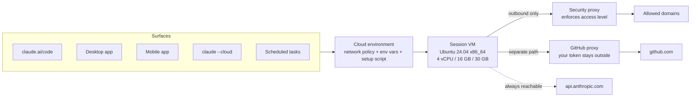

<LevelBadge level="intermediate" />

<Callout type="objectives" items={[
  "Costruire il modello mentale giusto: cinque superfici, un ambiente salvato, una VM nuova e usa e getta per ogni sessione",
  "Imparare la tabella che mette in difficoltà tutti: cosa si trasferisce dalla tua macchina a una sessione cloud, e le cinque cose che in silenzio non lo fanno",
  "Scegliere un livello di accesso alla rete — None, Trusted, Full, Custom — e conoscere i quattro tipi di traffico che aggirano comunque la tua allowlist",
  "Dare a una sessione una chiave API che può usare ma mai leggere, con un network secret",
  "Scegliere correttamente tra uno setup script e un hook SessionStart, e restare sotto la regola dei ~5 minuti che decide se il tuo ambiente viene messo in cache",
  "Pianificare attorno ai reali limiti di risorse e di tempo: 4 vCPU / 16 GB / 30 GB, un timeout predefinito dei comandi di 2 minuti e una VM che va in pausa quando ti allontani",
  "Eseguire l'intero viaggio di andata e ritorno: claude --cloud per inviare il lavoro, claude -p --cloud per guidarlo, claude --teleport per riportarlo indietro",
]} />

<VerifyNote lastVerified="2026-10-26" source="https://code.claude.com/docs/en/cloud-environments">
Verificato sulle pagine ufficiali [Configure cloud environments](https://code.claude.com/docs/en/cloud-environments) e [Use Claude Code in the cloud](https://code.claude.com/docs/en/claude-code-on-the-web). Le sessioni cloud sono disponibili sui piani **Pro, Max e Team**, e per gli utenti Enterprise con postazioni premium o postazioni Chat + Claude Code; se la tua organizzazione usa ruoli personalizzati, ti serve anche un ruolo che includa il permesso per le sessioni cloud. I limiti di risorse sono descritti da Anthropic come approssimativi e possono cambiare. Le versioni degli strumenti preinstallati cambiano di continuo: considera la tabella della toolchain qui riportata come una sagoma e conferma le versioni in una sessione reale.
</VerifyNote>

Una sessione cloud è una sessione di Claude Code che gira sulla macchina di qualcun altro anziché sulla tua — di Anthropic per impostazione predefinita, oppure sui [tuoi runner](/docs/claude-code/self-hosted-environments) se la tua organizzazione la instrada lì. Chiudi il portatile; il lavoro continua. Non c'è un costo separato per la VM: una sessione cloud attinge agli stessi limiti d'uso del piano di tutto il resto che fai con Claude.

Questa parte è facile da capire. La parte che costa un pomeriggio alle persone è più sottile: **una sessione cloud non è il tuo portatile con un altro hostname.** È una macchina Ubuntu nuova con sopra il tuo repository *committato* e nient'altro di tuo. Metà della configurazione che hai messo a punto per mesi vive in `~/.claude/` sulla tua macchina e non fa il viaggio. Questa pagina riguarda soprattutto quel confine.

## La versione in un paragrafo

Salvi un **ambiente cloud** — un insieme con nome di policy di rete, variabili d'ambiente e uno setup script. Ogni superficie che può avviare una sessione cloud sceglie uno dei tuoi ambienti. All'avvio di una sessione, Anthropic predispone una VM isolata (Ubuntu 24.04 su x86_64, a prescindere da ciò che usi in locale), clona il tuo repo da GitHub, esegue il tuo setup script, fa uno snapshot del filesystem perché la sessione successiva salti quel passo e avvia Claude Code. Tutto il traffico in uscita passa da un proxy che applica il tuo livello di accesso. Il traffico GitHub segue un percorso separato in cui la tua vera credenziale non entra mai nella VM. Quando smetti di scrivere, la VM va in pausa con i file intatti; se la lasci abbastanza a lungo viene recuperata, e riaprire la sessione ne costruisce una nuova.

### Un ambiente, cinque superfici

Gli stessi ambienti salvati valgono ovunque avvii una sessione cloud: il browser su claude.ai/code, l'app Desktop, l'app mobile di Claude, il terminale tramite `claude --cloud` e le attività pianificate cloud. Configuri l'ambiente una volta e ogni superficie lo eredita.

Due vicini *non* sono sessioni cloud, e confonderli causa vera confusione:

- **Remote Control** collega le interfacce web e mobile a una sessione che gira sulla **tua macchina**. Usa i tuoi file e la tua rete: non è coinvolto alcun ambiente cloud.
- **`--remote-control`** non c'entra con `--cloud`, nonostante i nomi simili. `--cloud` crea una sessione sull'infrastruttura di Anthropic; `--remote-control` espone una sessione locale al tuo telefono.

Se non hai ancora un ambiente, l'onboarding ne crea uno chiamato **Default**: accesso di rete **Trusted**, nessuna variabile, nessuno setup script. Su Team ed Enterprise, l'onboarding web può mostrarti invece un modulo per creare il primo ambiente, a meno che un Owner abbia abilitato **Quick setup**; mantenere i valori predefiniti del modulo produce lo stesso risultato.

## Cosa si trasferisce dalla tua macchina — e cosa no

Questa è la sezione da leggere due volte. Una sessione cloud parte da un **clone nuovo del tuo repository**. La regola che spiega ogni riga qui sotto: *se è nel commit, c'è; se esiste solo sulla tua macchina, non c'è.*

| La tua cosa | In una sessione cloud? | Perché |
| :--- | :--- | :--- |
| `CLAUDE.md` del repo, `.claude/rules/` | ✅ Sì | Fa parte del clone |
| `.claude/skills/`, `.claude/agents/`, `.claude/commands/` del repo | ✅ Sì | Fa parte del clone |
| Hook e regole di permesso di `.claude/settings.json` del repo | ✅ In una sessione a singolo repository | Fa parte del clone |
| Server MCP di `.mcp.json` del repo | ✅ In una sessione a singolo repository | Trovato dalla directory di lavoro della sessione |
| Impostazioni gestite dal server dell'organizzazione | ✅ Sì (non nelle sessioni Claude Tag) | Recuperate da Anthropic all'avvio della sessione |
| Skill abilitate su claude.ai | ✅ Sì | Caricate dal tuo account, non dal repo |
| **Il tuo `~/.claude/CLAUDE.md` utente** | ❌ No | Vive sulla tua macchina, non nel repo |
| **I tuoi `~/.claude/skills/`, `agents/`, `commands/` utente** | ❌ No | Stesso motivo. Mettili nel commit in `.claude/` del repo |
| **Plugin e marketplace** | ❌ No | Una sessione cloud non installa né `enabledPlugins` né i marketplace sotto `extraKnownMarketplaces` — dal repo o dalle tue impostazioni utente |
| **Server MCP aggiunti con ambito locale o utente** | ❌ No | Scrivono in `~/.claude.json`. Riaggiungili con `claude mcp add --scope project` e metti nel commit il `.mcp.json` risultante |
| **File di impostazioni MDM / gestite sul tuo dispositivo** | ❌ No | La sessione gira su una VM gestita da Anthropic |
| **Variabili di trasporto** come `NODE_EXTRA_CA_CERTS` o certificati client mTLS in un blocco `env` del repo | ❌ Ignorate | L'ambiente di hosting possiede la connessione API della sessione; ogni chiave ignorata è annotata nel log di debug della sessione |
| **Autenticazione interattiva** come AWS SSO | ❌ No | Richiede un login nel browser che non può girare in una sessione cloud |

In quella tabella si nascondono due trappole:

- **Il vuoto dei plugin è il più costoso.** Un repository che attiva un plugin in `.claude/settings.json` ottiene quel plugin in locale e nulla nel cloud. Se un flusso di lavoro dipende da skill o comandi forniti da plugin, o metti nel commit gli equivalenti in `.claude/` o accetti che le sessioni cloud si comportino diversamente. Vedi [plugin e marketplace](/docs/claude-code/plugins-marketplaces) per capire cosa vive dove.
- **"Sessione a singolo repository" è un'espressione portante.** In un ambiente ospitato da Anthropic, una sessione collegata a *più* repository non carica hook e regole di permesso da **nessuno** di essi, e un thread cloud dentro un [progetto](/docs/claude-code/projects-coordinator-threads) carica solo `CLAUDE.md` della radice del repository, `.claude/CLAUDE.md` e le `.claude/rules/` non specifiche per percorso. Se la tua configurazione dipende da un hook SessionStart, una sessione multi-repo non lo eseguirà: predisponi invece con uno setup script.

### Portare comunque le tue preferenze personali

Non sei obbligato a spingere regole di stile personali in un repository condiviso. Uno setup script su uno dei **tuoi** ambienti può scrivere direttamente il file di memoria a livello utente:

<PromptCard title="Setup script: preferenze personali senza toccare il repo">{`#!/bin/bash
mkdir -p ~/.claude
cat > ~/.claude/CLAUDE.md <<'EOF'
Use conventional commit messages.
Prefer small, reviewable diffs over one large change.
EOF`}</PromptCard>

Claude Code lo carica come istruzioni utente. Conferma che abbia funzionato eseguendo `/context` nella tua prossima sessione cloud e cercando `/root/.claude/CLAUDE.md` sotto **Memory files**. Non farlo su un ambiente condiviso: si applicherebbe a tutta l'organizzazione.

## Accesso alla rete: quattro livelli, e le quattro cose che li ignorano

Ogni ambiente ha esattamente un livello di accesso alla rete, che regola le connessioni in uscita dalla rete della sessione.

| Livello | Cosa possono raggiungere le sessioni |
| :--- | :--- |
| **None** | Nulla attraverso la rete della sessione |
| **Trusted** (predefinito) | Una allowlist mantenuta da Anthropic: registri di pacchetti, GitHub/GitLab/Bitbucket, registri di container, endpoint SDK dei principali cloud |
| **Full** | Qualsiasi dominio |
| **Custom** | Il tuo elenco, un dominio per riga; un `*.` iniziale corrisponde a ogni sottodominio. Una casella decide se includere anche i valori predefiniti Trusted |

Cambiare il livello su un ambiente ospitato da Anthropic ha effetto nelle sessioni **esistenti** entro circa un minuto. Non serve avviarne una nuova.

Ora la parte che conta per il threat modeling. Quattro tipi di traffico seguono un percorso che non tocca mai la tua allowlist, **qualunque livello tu scelga — compreso None**:

<Steps items={[
  {title: "GitHub, tramite il suo proxy", body: "Tutte le operazioni GitHub negli ambienti ospitati da Anthropic passano da un proxy dedicato che tiene la tua vera credenziale fuori dalla VM. Indipendente dal livello di accesso."},
  {title: "I connettori MCP che abiliti", body: "Il traffico dei connettori viaggia attraverso i server di Anthropic anziché la rete della sessione, quindi non aggiungi mai l'host di un connettore ai Domini consentiti. Il rovescio: una allowlist non limita ciò che un connettore abilitato può raggiungere. Disattiva i connettori che non ti servono."},
  {title: "Gli host elencati nei tuoi network secret", body: "Le sessioni possono raggiungere gli host di un secret anche quando il livello di accesso altrimenti non lo permetterebbe. Aggiungere un secret amplia la raggiungibilità oltre ad allegare una credenziale."},
  {title: "api.anthropic.com", body: "Le richieste di inferenza di Claude Code escono anche a None. Anthropic lo dice chiaramente nelle sue note sull'isolamento: con l'accesso di rete disabilitato, Claude Code può comunque parlare con l'API di Anthropic, il che può permettere ai dati di uscire dalla VM. None non è un air gap."},
]} />

Se pensavi di usare **None** come confine di contenimento per codice non fidato, rileggi il quarto punto, poi leggi [rendere sicure le esecuzioni autonome](/docs/security/hardening-autonomous-runs). Il livello di rete è un riduttore del raggio d'azione, non una garanzia da sandbox.

Non esiste nemmeno una allowlist a livello di organizzazione che un amministratore possa imporre agli ambienti di ogni membro, né un'impostazione gestita dal server che aggiunga domini a uno. Il modo per standardizzare un elenco in un team è un **ambiente condiviso dall'organizzazione** creato da un Owner, con accesso **Custom** e quell'elenco.

### Lo spigolo vivo del proxy GitHub: niente GraphQL

Merita un titolo a sé perché rompe la memoria muscolare. Il proxy GitHub **rifiuta del tutto GraphQL** con un 403, il che significa che i sottocomandi `gh` basati su GraphQL falliscono dentro le sessioni cloud:

- `gh pr ...` e `gh issue ...` → 403, che indica l'alternativa REST
- Un `GH_TOKEN` tuo non aiuta: la restrizione si applica a ogni richiesta attraverso il proxy a prescindere dalle credenziali
- Le API che esistono *solo* in GraphQL, come Projects v2, sono irraggiungibili attraverso il proxy

L'aggiramento è REST, che parlano sia gli strumenti GitHub integrati sia `gh api`:

<PromptCard title="REST al posto dei sottocomandi gh basati su GraphQL">{`gh api repos/OWNER/REPO/pulls --jq '.[] | "\\(.number) \\(.title)"'
gh api repos/OWNER/REPO/issues/42/comments -f body="rerunning the flaky suite"`}</PromptCard>

Il proxy applica altre tre regole da conoscere: rifiuta le **cancellazioni di branch** e i push di qualsiasi cosa non sia un branch (un tag, per esempio); serve richieste API solo per i repository **collegati alla sessione**, restituendo altrimenti un 403 contenente `is not enabled for this session` — anche per gli archivi sorgente recuperati da `codeload.github.com`, perfino quelli pubblici; e sostituisce la tua vera credenziale lato server, quindi quando il proxy gestisce l'autenticazione, `GH_TOKEN` e `GITHUB_TOKEN` risultano il segnaposto letterale `proxy-injected` dentro la VM. `gh` funziona benissimo con quel segnaposto. Un tuo script che legge direttamente `GITHUB_TOKEN` aspettandosi un token utilizzabile, no.

<PromptCard title="Controlla in quale caso di autenticazione GitHub si trova la tua sessione">{`echo $GH_TOKEN`}</PromptCard>

## Network secret: una chiave che la sessione usa ma non può leggere

Le variabili d'ambiente sono il posto sbagliato per le credenziali, e lo dice la stessa interfaccia di Anthropic: chiunque possa usare l'ambiente può leggerne le variabili. Un **network secret** è il posto giusto. Salvi una chiave API sull'ambiente, elenchi gli host a cui si applica, e il proxy dell'agente di Anthropic la allega alle richieste corrispondenti **dopo che hanno lasciato la VM**. La chiave stessa non entra mai nella sessione, non compare in `env` e non è in alcun file. Non puoi nemmeno rileggerla dopo il salvataggio: per cambiare il valore o gli host di un secret, eliminalo e aggiungilo di nuovo.

Note di configurazione che risparmiano un giro:

- **Piani**: Pro, Max, Team ed Enterprise. Su Pro, Max e Team puoi aggiungere secret ai tuoi ambienti a prescindere dal ruolo; su Enterprise ti serve un ruolo di amministratore dell'organizzazione, altrimenti chiedi a un Owner di mettere il secret su un ambiente condiviso e di eseguire lì le tue sessioni. Su Team senza quel ruolo, il modulo **Add secret** è una variante più breve a host singolo senza il carattere jolly `*.`.
- **Il tipo di secret predefinito** è **Bearer**: l'intestazione `Authorization` con prefisso `Bearer`. Per un'intestazione come `X-Api-Key` che porta il valore nudo, cambia il nome dell'intestazione e cancella il prefisso.
- **Blocchi duri**: gli ambienti self-hosted non hanno affatto network secret, l'API deve accettare connessioni da internet (le richieste partono dalla rete di Anthropic, non dalla tua), e le organizzazioni che usano chiavi di cifratura gestite dal cliente non possono salvare secret.

Per scelta di progettazione, alcune richieste non ricevono mai un secret che aggiungi: GitHub (il proxy GitHub lo autentica già), `api.anthropic.com` e i registri pubblici di pacchetti (`registry.npmjs.org`, `jsr.io`, `npm.jsr.io`, `pypi.org`, `files.pythonhosted.org`, `index.crates.io`, `proxy.golang.org`), qualsiasi cosa faccia il tuo **setup script** — gira prima che Claude Code si connetta al proxy dell'agente — e l'esportazione di telemetria di Claude Code stesso.

Una modalità di errore silenziosa: se due secret hanno host che **si sovrappongono senza coincidere esattamente**, nessuno dei due riceve un indicatore di avviso e il proxy ne invia soltanto uno. Mantieni gli elenchi di host disgiunti.

## Setup script contro hook SessionStart

Entrambi girano prima che tu possa fare del lavoro utile in una sessione, e le persone scelgono di continuo quello sbagliato. La linea di demarcazione è semplice:

- **Setup script** → predispone la **VM**: toolchain e strumenti CLI non preinstallati. Solo cloud.
- **[Hook SessionStart](/docs/claude-code/hooks)** → setup del progetto che deve avvenire **ovunque**, cloud e locale, come `npm install`.

| | Setup script | Hook SessionStart |
| :--- | :--- | :--- |
| Configurato in | La finestra di dialogo dell'ambiente (più la pagina admin **Cloud environments** per gli ambienti condivisi) | Un file di impostazioni, tipicamente il `.claude/settings.json` del repo |
| Quando gira | Prima dell'avvio di Claude Code — **saltato del tutto** quando esiste un ambiente in cache | Dopo l'avvio di Claude Code, a ogni sessione comprese quelle riprese |
| Dove gira | Solo sessioni cloud | In locale **e** nel cloud |
| Messo in cache | Sì, se termina in circa cinque minuti | No: paga il suo costo a ogni avvio e ripresa |

Uno setup script è Bash, gira **come root** su Ubuntu 24.04 e ha quattro vincoli attorno a cui scrivere:

<Steps items={[
  {title: "Esci con zero o la sessione non parte", body: "Un'uscita diversa da zero fa fallire la sessione, non solo il passo. Aggiungi || true a tutto ciò che non è critico, così un registro instabile non blocca il tuo lavoro."},
  {title: "Termina in circa cinque minuti, o perdi la cache", body: "Oltre, Anthropic non fa lo snapshot dell'ambiente e ogni sessione paga allora l'intero costo di setup. Parallelizza le installazioni indipendenti con & e wait; sposta un unico download enorme in un hook SessionStart in background."},
  {title: "Le installazioni richiedono la rete", body: "Le installazioni di pacchetti devono raggiungere i registri. Trusted copre npm, PyPI, RubyGems e crates.io. A None, ogni installazione nel tuo script fallisce."},
  {title: "Le variabili dell'ambiente non sono ancora impostate", body: "Lo script gira prima che la sessione applichi le variabili dell'ambiente. Qualsiasi cosa serva allo script stesso, impostala dentro lo script."},
]} />

<PromptCard title="Setup script: installare uno strumento non preinstallato">{`#!/bin/bash
apt update && apt install -y shellcheck || true`}</PromptCard>

### La cache dell'ambiente, e quando la cache sbaglia

Quando il setup si completa entro il budget di ~5 minuti, Anthropic fa lo snapshot del filesystem e avvia da lì le sessioni successive, saltando lo script. Per questo uno setup script lento vale la pena di essere ottimizzato una volta: immagini Docker scaricate, pacchetti installati e file scritti sopravvivono tutti.

Ciò che lo snapshot conserva e perde discende dal fatto che è uno snapshot del **filesystem**:

- ✅ Conservato: i pacchetti che hai installato, le immagini Docker che hai scaricato, i file che hai scritto
- ❌ Perso: tutto ciò che era semplicemente *in esecuzione*. Un database avviato dallo script, uno stack `docker compose up`, un server di sviluppo: tutto sparito. Avvia queste cose a ogni sessione, chiedendolo a Claude o da un hook SessionStart.

La cache si ricostruisce quando cambi lo setup script o gli host consentiti, e quando scade dopo circa sette giorni. **Non** si ricostruisce quando una VM in pausa viene ripristinata: quindi modificare lo setup script non raggiunge una sessione semplicemente inattiva. Per applicare subito una modifica, avvia una nuova sessione.

### Installare le dipendenze solo nel cloud

Poiché gli hook girano in entrambi i posti, delimitali con la variabile che imposta la VM. `CLAUDE_CODE_REMOTE` è `true` in una sessione cloud e mai `true` in locale:

<PromptCard title="scripts/install_pkgs.sh — solo cloud, e idempotente">{`#!/bin/bash

if [ "$CLAUDE_CODE_REMOTE" != "true" ]; then
  exit 0
fi

cd "$CLAUDE_PROJECT_DIR" || exit 1
hashes=node_modules/.install_pkgs.sha256

if ! sha256sum --check --status "$hashes" 2>/dev/null; then
  # Delete the old hashes first, so a failed install runs again next time
  rm -f "$hashes"
  if npm install; then
    sha256sum scripts/install_pkgs.sh package.json package-lock.json > "$hashes" || rm -f "$hashes"
  fi
fi

exit 0`}</PromptCard>

Il controllo dell'hash è la metà importante: un hook SessionStart gira a ogni avvio *e* a ogni ripresa, quindi un `npm install` incondizionato è latenza che paghi per sempre. Se la tua installazione legge altri input — un `package.json` di workspace, un `.npmrc`, i file di uno script `postinstall` — aggiungili alla riga `sha256sum`, altrimenti manterrai pacchetti obsoleti dopo che uno di essi cambia.

## Cosa c'è nella scatola, e dove sono i limiti

Ogni sessione ospitata da Anthropic riceve una VM nuova con toolchain comuni preinstallate: Python con pip/poetry/uv/pytest/ruff/mypy/black; Node 20, 21 e 22 con npm/yarn/pnpm/bun; Ruby, PHP con Composer, OpenJDK con Maven e Gradle, Go, Rust, GCC/Clang/cmake/ninja; Docker e Compose; PostgreSQL e Redis; e i soliti `git`, `gh`, `jq`, `yq`, `ripgrep`, `tmux`.

Quattro note pratiche in merito:

- **È Linux x86_64, non il tuo Mac.** Quando una dipendenza distribuisce binari precompilati — gemme Ruby native, wheel Python predefinite — ti serve la build Linux x86_64.
- **Non ottieni una shell.** Claude esegue ogni comando per te, quindi formula il lavoro sulla VM come richieste nel prompt. Per vedere le versioni, chiedi a Claude di eseguire `check-tools` (un comando di shell sulla VM, non un comando slash); per gli strumenti che non riporta, chiedi `psql --version` e simili.
- **I database sono installati ma non in esecuzione.** Chiedi a Claude di eseguire `service postgresql start` o `service redis-server start`.
- **Bun è installato ma ha noti problemi di compatibilità con il proxy** per il recupero dei pacchetti, perché tutto il traffico in uscita passa dal proxy di sicurezza. Le toolchain fuori dall'elenco — l'SDK .NET, per esempio — richiedono uno setup script, anche se i loro registri sono nella allowlist Trusted.

**Limiti di risorse** (approssimativi e soggetti a cambiamento): **4 vCPU, 16 GB di RAM, 30 GB di disco**. Una build o una suite di test che consuma molta memoria può essere fermata dalla VM. Oltre, le risposte sono Remote Control sul tuo hardware, o un [ambiente self-hosted](/docs/claude-code/self-hosted-environments) su risorse di calcolo gestite dalla tua organizzazione.

**I limiti di tempo** sono quelli che sorprendono a metà compito:

| Limite | Predefinito | Come cambiarlo |
| :--- | :--- | :--- |
| Comando in primo piano | 2 minuti (Claude può richiederne fino a 10) | `BASH_DEFAULT_TIMEOUT_MS` / `BASH_MAX_TIMEOUT_MS` nelle variabili dell'ambiente, in millisecondi |
| Comando spostato in background al timeout | Fino a 30 minuti in più | Alzare `BASH_DEFAULT_TIMEOUT_MS` oltre `1800000` allunga anche questo |
| Hook `command` SessionStart | Annullato dopo 600 secondi | Imposta `timeout` (secondi) sulla voce dell'hook, oppure eseguilo con `async: true` |
| Setup script | Non messo in cache oltre circa 5 minuti | Parallelizza, o sposta la parte lunga in un hook in background |
| Sessione inattiva | La VM va in pausa dopo pochi minuti, file salvati | Nulla da configurare: il tuo messaggio successivo la ripristina |

A proposito, un comando scaduto non viene ucciso: Claude Code lo sposta invece in background, a meno che inizi con `sleep`.

### Quando la VM torna — o non torna

Dopo qualche minuto di inattività la VM va in pausa con i file salvati, e il tuo messaggio successivo ripristina la stessa VM. Ne seguono due conseguenze:

- **Le variabili d'ambiente vengono rilette** alla creazione e a ogni avvio di Claude Code nella VM — il che significa al ripristino da inattività e alla ricostruzione. Quindi dopo aver modificato una variabile, una sessione in corso mantiene il vecchio valore finché la sua VM non viene ripristinata. Per usare subito un nuovo valore, chiedi a Claude di impostarlo inline (`LOG_LEVEL=trace npm test`) oppure avvia una nuova sessione.
- **Una VM in pausa può essere recuperata in seguito.** Riaprire la sessione allora predispone una VM *nuova*: la cronologia della conversazione viene ripristinata, ma il lavoro in background no. I comandi di shell ancora in esecuzione, i subagenti a metà strada e le attività pianificate di sessione o un `/loop` in attesa non si trasferiscono. Claude Code dice effettivamente a Claude quali comandi e subagenti si sono fermati — e quali subagenti si possono riprendere anziché riavviare — quindi "continua ciò che si è interrotto" è un prompt successivo ragionevole.

Due variabili d'ambiente si comportano in modo speciale. I valori `OTEL_*` sono riservati all'esportazione di telemetria di Claude Code stesso e non vengono passati ai comandi che Claude esegue. E le sessioni cloud impostano da sé `CLAUDE_AUTOCOMPACT_PCT_OVERRIDE`, quindi la compattazione scatta a metà della finestra di auto-compattazione anziché quando si riempie: impostare tu quella chiave non ha effetto. Se vuoi spostare la finestra, imposta invece `CLAUDE_CODE_AUTO_COMPACT_WINDOW`. ([Gestione del contesto](/docs/claude-code/context-management) tratta la finestra stessa.)

## Il viaggio di andata e ritorno: invialo, guidalo, riportalo indietro

<Steps items={[
  {title: "Invia il lavoro con claude --cloud", body: "Crea una nuova sessione cloud per il tuo repository corrente. La VM clona il remote GitHub della tua directory corrente al tuo branch corrente — non il tuo checkout locale. Esegui prima il push."},
  {title: "Guidalo da ovunque con claude -p --cloud <session-id>", body: "Pubblica un messaggio in una sessione in corso ed esce. Non invia alcuno stato locale e si autentica con il tuo account, quindi funziona da qualsiasi macchina in cui hai effettuato l'accesso — compreso uno script di CI."},
  {title: "Riportalo indietro con claude --teleport", body: "Recupera il branch della sessione, ne fa il checkout e carica l'intera conversazione nel tuo terminale. Dalla CLI questo passaggio è a senso unico: puoi scaricare una sessione cloud, ma non puoi caricare in alto una sessione esistente del terminale."},
]} />

<PromptCard title="Avvia una sessione cloud dal tuo terminale">{`claude --cloud "Fix the authentication bug in src/auth/login.ts"`}</PromptCard>

Ogni invocazione di `--cloud` è una sessione indipendente, il che rende banale la distribuzione in parallelo — e fa dei limiti di frequenza la cosa da tenere d'occhio, dato che le sessioni parallele li consumano in proporzione:

<PromptCard title="Distribuisci tre compiti indipendenti">{`claude --cloud "Fix the flaky test in auth.spec.ts"
claude --cloud "Update the API documentation"
claude --cloud "Refactor the logger to use structured output"`}</PromptCard>

Lo schema a più alto rendimento qui è **pianifica in locale, esegui nel cloud**. Pensare è economico e interattivo sulla tua macchina; l'esecuzione è ciò che vuoi delegare:

<PromptCard title="Pianifica in locale, poi passa il piano a una sessione cloud">{`claude --permission-mode plan
# collaborate on the approach, save the plan to the repo, commit, push
claude --cloud "Execute the migration plan in docs/migration-plan.md"`}</PromptCard>

<PromptCard title="Guida una sessione in corso da qualsiasi macchina con accesso effettuato">{`claude -p "add a test for the empty-list case" --cloud <session-id>

# machine-readable result: {ok, session_id, url}
claude -p "status?" --cloud <session-id> --output-format json`}</PromptCard>

<PromptCard title="Porta una sessione cloud nel tuo terminale">{`claude --teleport              # interactive picker
claude --teleport <session-id>  # straight to one session`}</PromptCard>

All'interno di una sessione CLI in corso, `/teleport` (o `/tp`) apre lo stesso selettore senza riavvio; `/tasks` elenca le sessioni in background e `t` esegue il teleport in quella selezionata. Il teleport verifica quattro cose prima di riprendere: **stato git pulito** (offre di fare lo stash), il **medesimo repository** (un fork non va bene), il **branch della sessione con push** sul remote e il **medesimo account claude.ai**. Inoltre non attende mai input: se git o ssh chiedessero una passphrase o la conferma di un host sconosciuto, il fetch fallisce, quindi carica la tua chiave in `ssh-agent` ed esegui prima un `git fetch` manuale.

Un dettaglio da interiorizzare: **la sessione trasferita con il teleport è una copia.** Il lavoro che fai poi in locale resta locale e non riappare nella sessione cloud su claude.ai o sul tuo telefono. Per continuare a guidarla dal telefono dopo il teleport, avvia `/remote-control` nella sessione locale. E `--teleport` non è `--resume`: `--resume` riapre una conversazione dalla cronologia locale di questa macchina e non elenca affatto le sessioni cloud.

### Collegare l'output alla sessione

Ogni sessione cloud ha un URL di trascrizione, e la sessione può leggere il proprio ID da `CLAUDE_CODE_REMOTE_SESSION_ID`. I commit che Claude crea in una sessione cloud portano già un trailer git `Claude-Session:` e i corpi delle PR includono il link (imposta `attribution.sessionUrl` a `false` per sopprimere entrambi). Per qualsiasi altra cosa — un report generato, un post su Slack — costruisci tu l'URL. Nota lo scambio di prefisso, che è l'unica cosa che le persone sbagliano:

<PromptCard title="Trasforma l'ID di sessione in un URL di trascrizione">{`echo "https://claude.ai/code/\${CLAUDE_CODE_REMOTE_SESSION_ID/#cse_/session_}"`}</PromptCard>

## Otto trappole

1. **`--cloud` clona il tuo remote, non il tuo albero di lavoro.** La VM fa il checkout del tuo branch corrente *da GitHub*. I commit locali di cui non hai fatto il push e le modifiche non committate non ci sono. Se vedi una riga che inizia con `Branch <name> is not on GitHub`, la sessione parte comunque — ma da un antenato con push o dal branch predefinito. Esegui il push e riparti.
2. **Nessun remote, o nessuna GitHub App? Claude Code carica invece il tuo repo.** Da un repository senza remote git, o da un repository github.com su cui non è installata la GitHub App di Claude, Claude Code impacchetta il repository locale e lo carica — la cronologia di tutti i branch più le modifiche non committate ai file tracciati. Forzalo con `CCR_FORCE_BUNDLE=1`. Limiti: un repo git con almeno un commit, sotto i 100 MB, e i **file non tracciati sono esclusi** (quindi esegui `git add` su tutto ciò che la sessione deve vedere).
3. **La protezione dei file di credenziali dipende dalla piattaforma.** Su macOS, Linux e WSL, il caricamento del bundle lascia fuori le modifiche non committate ai file con aspetto di credenziali — `.env`, `*.tfvars` di Terraform, `id_rsa`, `*.pem` — e stampa un avviso `Left on this machine:`. **Su Windows nativo no**: le modifiche non committate ai file tracciati vengono caricate così come sono, qualunque sia il nome del file. Fai prima lo stash.
4. **L'IP allowlisting uccide ogni sessione cloud ospitata da Anthropic.** Le sessioni cloud chiamano l'API di Anthropic dall'infrastruttura di Anthropic, non dalla tua rete. Se la tua organizzazione ha l'IP allowlisting attivo, ognuna fallisce con un errore di autenticazione — e così le esecuzioni di [Code Review](/docs/playbooks/ci-for-agent-written-code) e le attività pianificate cloud sugli ambienti ospitati. La soluzione è un'esenzione dal supporto Anthropic, o l'instradamento verso un ambiente self-hosted, che chiama l'API dalla tua rete.
5. **ZDR, HIPAA e CMEK sono blocchi duri.** Le organizzazioni con Zero Data Retention o la configurazione HIPAA non possono usare `/web-setup` né altre funzioni delle sessioni cloud; le organizzazioni che usano chiavi di cifratura gestite dal cliente non possono avviare affatto sessioni cloud.
6. **Le sessioni cloud richiedono un accesso a claude.ai, non una chiave API.** `--cloud` e `--teleport` non sono disponibili quando Claude Code è configurato per Amazon Bedrock, Agent Platform di Google Cloud o un altro provider di terze parti — l'errore nomina il tuo provider. Un gateway LLM configurato solo tramite `ANTHROPIC_BASE_URL` non fa scattare quel controllo, ma serve comunque `claude auth login`. Anche la policy `allow_remote_sessions` della tua organizzazione deve essere attiva.
7. **Archivia gli ambienti; non puoi eliminarli.** Gli ambienti ospitati da Anthropic non hanno un'opzione di eliminazione — solo **Archive**, che riguarda le nuove sessioni, non quelle in corso. Elimina i network secret che non vuoi più *prima* di archiviare: restano collegati nelle sessioni ancora in esecuzione. Se l'ambiente archiviato era il tuo predefinito salvato per la CLI, le nuove sessioni CLI ripiegano su un altro ambiente del tuo elenco.
8. **Alcuni comandi slash si comportano diversamente.** I comandi che aprono un selettore da terminale prendono invece un argomento — `/model sonnet`, `/effort`, `/rename`. I comandi solo-terminale come `/plugin` e `/resume` non sono disponibili. `/config` nel browser apre le tue impostazioni anziché impostare un valore; per cambiare un'impostazione di una sessione cloud, imposta una variabile d'ambiente o metti nel commit la chiave nel `.claude/settings.json` del repo. Gli [agent team](/docs/api/cowork-and-agent-teams) sono disattivati per impostazione predefinita e richiedono `CLAUDE_CODE_EXPERIMENTAL_AGENT_TEAMS=1` nelle variabili dell'ambiente.

## Standardizzarlo per un team

Sui piani Team ed Enterprise, un Owner può creare **ambienti condivisi dall'organizzazione** dalla pagina admin **Cloud environments**. Compaiono nel selettore di ogni membro sotto l'intestazione **Organization**, sotto gli ambienti **Personal** di quel membro, e si aprono in sola lettura per tutti — Owner compresi — dal selettore; le modifiche avvengono nella pagina admin. Un Owner può anche condividere uno dei propri ambienti personali dalla riga **Who can use it**, che mantiene l'ID dell'ambiente, quindi le sessioni e le attività pianificate che già puntano a esso non ne risentono.

Due cose da fare bene quando lo fai:

- **Metti le credenziali nei network secret, non nelle variabili.** Le sessioni di ogni membro possono leggere le variabili di un ambiente condiviso.
- **Imposta separatamente il predefinito dell'organizzazione**, nelle impostazioni di amministrazione di Claude Code. I membri che non hanno scelto un ambiente lo ricevono. Le sessioni di canale Claude Tag, in cui Claude agisce come l'organizzazione anziché come un membro, possono usare *solo* ambienti a livello di organizzazione — condivisi o self-hosted — quindi un canale che richiede una toolchain non predefinita ha bisogno di un ambiente condiviso con uno setup script che la installi.

Dalla CLI, `/remote-env` sceglie il tuo ambiente predefinito per `claude --cloud` e lo salva in `remote.defaultEnvironmentId` nelle tue [impostazioni utente](/docs/claude-code/settings), quindi si applica a ogni progetto sulla tua macchina finché non lo cambi — a meno che un livello di impostazioni a precedenza più alta, come le impostazioni di progetto di un repo, imposti la stessa chiave. `/remote-env` imposta solo il predefinito: non avvia una sessione e non può creare né modificare ambienti.

<Quiz title="Verifica la tua comprensione" questions={[
  {q: "Il ~/.claude/skills/ del tuo portatile contiene una skill che usi ogni giorno. Avvii una sessione cloud. La skill è disponibile?", options: ["Sì: le impostazioni utente si sincronizzano con il tuo account", "No: vive sulla tua macchina, non nel repo; mettila invece nel commit in .claude/skills/ del repo", "Solo se il repo ha un CLAUDE.md"], answer: 1, explain: "Le skill, gli agenti e i comandi a livello utente vivono in ~/.claude/ sulla tua macchina e non fanno il viaggio. La directory .claude/ del repo sì, perché fa parte del clone. Le skill che abiliti su claude.ai sono l'unica eccezione che si carica dal tuo account."},
  {q: "Imposti l'accesso di rete di un ambiente su None per contenere un audit di dipendenze rischioso. Cosa può ancora raggiungere la sessione?", options: ["Assolutamente nulla: None è un air gap", "api.anthropic.com, GitHub tramite il suo proxy, qualsiasi connettore MCP che hai abilitato e gli host dei tuoi network secret", "Solo la allowlist Trusted"], answer: 1, explain: "Quattro tipi di traffico aggirano la allowlist della sessione a ogni livello, compreso None: le richieste all'API Anthropic di Claude Code stesso, GitHub tramite il suo proxy dedicato, il traffico dei connettori MCP instradato dai server di Anthropic e gli host elencati nei network secret dell'ambiente. None riduce il raggio d'azione; non è una garanzia da sandbox."},
  {q: "Il tuo setup script installa una grande toolchain e richiede circa sette minuti. Cosa succede?", options: ["Nulla: gira una volta sola e viene messo in cache", "La sessione non riesce ad avviarsi", "L'ambiente non viene messo in cache, quindi ogni nuova sessione paga di nuovo tutti i sette minuti"], answer: 2, explain: "La cache richiede che lo script termini in circa cinque minuti. Oltre, Anthropic non fa lo snapshot del filesystem e ogni sessione riesegue il setup. Parallelizza le installazioni indipendenti con & e wait, oppure sposta un unico download lungo in un hook SessionStart in background."},
  {q: "Claude deve elencare le pull request aperte in una sessione cloud. Quale comando funziona?", options: ["gh pr list", "gh api repos/OWNER/REPO/pulls", "Nessuno dei due: GitHub è irraggiungibile dalle sessioni cloud"], answer: 1, explain: "Il proxy GitHub rifiuta GraphQL con un 403, e gh pr / gh issue si basano su GraphQL. REST funziona: gli strumenti GitHub integrati e gh api lo usano entrambi. Fornire un GH_TOKEN tuo non toglie la restrizione."},
  {q: "Fai il commit del lavoro locale, esegui claude --cloud \"run the test suite\" e la sessione testa il codice sbagliato. Causa più probabile?", options: ["Lo setup script è fallito in silenzio", "Hai fatto il commit ma non il push: la VM clona il tuo branch da GitHub, non il tuo checkout locale", "La cache dell'ambiente era obsoleta"], answer: 1, explain: "--cloud clona il remote GitHub della tua directory corrente al tuo branch corrente. I commit che esistono solo in locale non sono nella sessione. Se il branch non ha mai ricevuto il push, Claude Code stampa una riga che inizia con \"Branch <name> is not on GitHub\" e parte da un antenato con push o dal branch predefinito."},
]} />

<Callout type="takeaways" items={[
  "Una sessione cloud è una VM Ubuntu 24.04 x86_64 nuova con sopra il tuo repository COMMITTATO. Tutto ciò che vive solo in ~/.claude/ — memoria utente, skill, agenti, comandi, server MCP con ambito locale — non fa il viaggio. I plugin non lo fanno mai, né dal repo né dalle tue impostazioni utente.",
  "Un ambiente cloud salvato (policy di rete + variabili + setup script) serve tutte e cinque le superfici: browser, Desktop, mobile, claude --cloud e attività pianificate.",
  "Quattro livelli di rete: None, Trusted (predefinito), Full, Custom. Quattro tipi di traffico li aggirano tutti — api.anthropic.com, il proxy GitHub, i connettori MCP e gli host dei network secret. None non è un air gap.",
  "Le credenziali vanno nei network secret, mai nelle variabili d'ambiente: il proxy dell'agente allega la chiave dopo che la richiesta ha lasciato la VM, così la sessione può usarla ma mai leggerla. Le variabili sono leggibili da chiunque possa usare l'ambiente.",
  "Setup script = predispone la VM, solo cloud, messo in cache se termina in ~5 minuti. Hook SessionStart = setup del progetto, gira ovunque, mai messo in cache. Delimita un hook al cloud con CLAUDE_CODE_REMOTE=true.",
  "La cache è uno snapshot del filesystem: i pacchetti installati e le immagini scaricate sopravvivono, i processi in esecuzione no. Avvia database e stack compose a ogni sessione.",
  "Limiti attorno a cui pianificare: ~4 vCPU / 16 GB / 30 GB, un timeout predefinito dei comandi di 2 minuti (30 in più una volta in background) e una VM che va in pausa quando è inattiva e può essere recuperata — perdendo i comandi e i subagenti in corso, ma non la tua cronologia.",
  "claude --cloud clona il tuo remote GitHub, non il tuo albero di lavoro. Esegui prima il push. Il passaggio dalla CLI è a senso unico: --teleport scarica una sessione come copia locale, e nulla carica in alto una sessione del terminale.",
]} />

## Prossimi passi

- Esegui queste stesse sessioni su hardware tuo → [Ambienti self-hosted](/docs/claude-code/self-hosted-environments)
- Le tre vie con cui il lavoro sopravvive a un prompt, a confronto → [Attività in background, loop ed esecuzioni pianificate](/docs/claude-code/background-tasks)
- Una conversazione che coordina molte sessioni cloud → [Progetti e thread coordinatori](/docs/claude-code/projects-coordinator-threads)
- Metti una sessione cloud su un orologio → [Attività pianificate di Cowork](/docs/claude-app/cowork-scheduled-tasks)
