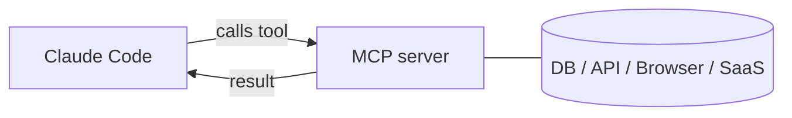

<LevelBadge level="advanced" />

<VerifyNote lastVerified="2026-11-10" source="https://code.claude.com/docs/en/mcp">
I comandi `claude mcp`, gli scope di configurazione e i trasporti evolvono nel tempo — verifica nella documentazione ufficiale di Claude Code MCP e su modelcontextprotocol.io. I quattro trasporti, i percorsi di archiviazione degli scope, la deprecazione di SSE e il comportamento dell'approvazione di progetto qui sotto provengono tutti da quella pagina.
</VerifyNote>

Il **Model Context Protocol (MCP)** è uno standard aperto per collegare l'AI a strumenti e dati esterni. Un **server MCP** espone funzionalità (interrogare un database, aprire una PR su GitHub, pilotare un browser); Claude Code si connette a esso e può **chiamare quegli strumenti** durante una sessione. È così che estendi Claude oltre il tuo filesystem e la tua shell.

<Callout type="objectives" items={["Spiegare cos'è un server MCP e come Claude Code chiama i suoi strumenti", "Distinguere i due trasporti: stdio locale vs HTTP/SSE remoto", "Aggiungere un server con claude mcp add e leggere il JSON che scrive", "Scegliere lo scope giusto (local, project, user) per chi vede un server", "Collegare un vero database a Claude dall'inizio alla fine", "Evitare le trappole di sicurezza e configurazione in cui cade la maggior parte delle persone"]} />

## Come è strutturato



Dichiari i server che Claude può usare; ogni server pubblica un insieme di strumenti con i relativi schemi; Claude li sceglie e li chiama come qualsiasi altro strumento.

<Flashcards title="Vocabolario MCP" cards={[{front: "Model Context Protocol (MCP)", back: "Uno standard aperto per collegare l'AI a strumenti e dati esterni."}, {front: "Server MCP", back: "Un programma che espone funzionalità — interrogare un database, aprire una PR su GitHub, pilotare un browser — come strumenti richiamabili."}, {front: "Strumento (tool)", back: "Una funzionalità che un server MCP pubblica con uno schema; Claude la sceglie e la chiama come qualsiasi altro strumento."}, {front: "Trasporto", back: "Come Claude raggiunge un server: stdio (processo locale), HTTP (ospitato, spesso con OAuth), SSE (deprecato — HTTP ripiega su di esso in automatico) o WebSocket ws/wss (persistente, con push, solo autenticazione via header, nessun flag --transport)."}, {front: "Scope", back: "Chi vede un server: local (tu, in questo progetto), project (il team, tramite commit) o user (tu, ovunque)."}]} />

## Trasporti

Ci sono quattro modi in cui Claude raggiunge un server. Scegli in base a dove gira il server e a come comunica.

- **stdio** — un processo locale che Claude avvia (ottimo per strumenti e CLI locali). È ciò che significa una voce JSON senza `type`.
- **HTTP** — un server ospitato, spesso con OAuth. La scelta predefinita per qualsiasi cosa remota.
- **SSE** — **deprecato**; usa HTTP dove puoi. Alcuni servizi espongono ancora solo un endpoint SSE e, a partire da Claude Code v2.1.265, `--transport http` prova prima HTTP e passa a SSE da solo, quindi raramente serve `--transport sse` in modo esplicito.
- **WebSocket** (`ws` / `wss`) — una connessione bidirezionale persistente, per un server che invia eventi senza essere interrogato. `--transport` *non* accetta `ws`: aggiungilo con `claude mcp add-json '{"type":"ws","url":"wss://…"}'` oppure scrivilo in `.mcp.json`. Niente OAuth — l'autenticazione avviene solo tramite header.

<Callout type="warning" items={["Una voce JSON con un url ma senza type è un errore di configurazione, non un default sensato: Claude Code legge una voce senza type come server stdio, la salta e segnala che ha un \"url\" ma nessun \"type\". Imposta sempre \"type\": \"http\" (oppure \"sse\" / \"ws\") su un server remoto che scrivi a mano."]} />

## Configurare i server

Il percorso più rapido è il comando `claude mcp add` — scrive la configurazione al posto tuo. Segui questa sequenza per passare da zero a un server connesso.

<Steps items={[{title: "Aggiungi un server stdio locale", body: "Esegui claude mcp add — tutto ciò che segue il -- è il comando di avvio che Claude esegue per te."}, {title: "Oppure aggiungi un server HTTP remoto", body: "Passa --transport http e uno scope, poi l'URL del server. I server remoti sono spesso ospitati e usano OAuth."}, {title: "Vedi cosa è connesso", body: "Esegui claude mcp list per vedere i server configurati e il loro stato di connessione."}, {title: "Ispeziona e autentica", body: "Usa /mcp dentro una sessione per ispezionare gli strumenti di un server e autenticare i server remoti."}]} />

<PromptCard title="Aggiungi un server stdio locale">{`# A local stdio server (everything after -- is the launch command)
claude mcp add filesystem -- npx -y @modelcontextprotocol/server-filesystem ~/code/myproject`}</PromptCard>

<PromptCard title="Aggiungi un server HTTP remoto (condiviso con il progetto)">{`# A remote HTTP server, shared with everyone on the project
claude mcp add --transport http --scope project github https://api.githubcopilot.com/mcp/`}</PromptCard>

Sotto il cofano è solo JSON. Un server con scope **project** finisce in un `.mcp.json` nella radice del repo — fanne il commit e i tuoi colleghi ottengono gli stessi strumenti una volta che si fidano dell'area di lavoro:

```json
{
  "mcpServers": {
    "github": { "type": "http", "url": "https://api.githubcopilot.com/mcp/" }
  }
}
```

<Callout type="warning" items={["Non ricorrere ai pacchetti @modelcontextprotocol/server-github, -postgres, -slack o -puppeteer che trovi nei vecchi tutorial. Sono archiviati e riportano un avviso di deprecazione npm con la dicitura \"Archived and unmaintained; no security guarantees\". Usa il server del fornitore stesso, dove esiste — quello di GitHub è l'endpoint HTTP qui sopra, e il controllo del browser è passato a @playwright/mcp. Tra i server di riferimento in TypeScript sono ancora mantenuti solo filesystem, memory, everything e sequential-thinking."]} />

### Lo scope decide chi vede il server

| Scope | Archiviato in | Si carica in | Usalo per |
|---|---|---|---|
| `local` (predefinito) | `~/.claude.json`, sotto il percorso di questo progetto | solo questo progetto | esperimenti personali, segreti |
| `project` | `.mcp.json` nel repo (con commit) | solo questo progetto, condiviso con il team | strumenti che tutto il team deve condividere |
| `user` | `~/.claude.json` | tutti i tuoi progetti | server che vuoi ovunque |

<Callout type="warning" items={["Lo «scope local» di MCP non è la stessa cosa delle impostazioni locali. Un server MCP con scope local vive in ~/.claude.json nella tua home — NON in .claude/settings.local.json del progetto. Cercarlo nella cartella del progetto è un vicolo cieco."]} />

Esegui `claude mcp list` per vedere cosa è connesso e `/mcp` dentro una sessione per ispezionare gli strumenti e autenticare i server remoti. Vedi [Configurazione MCP e scaffold di server](/docs/templates/mcp-config) per punti di partenza da copiare e incollare.

## Esempio pratico: dai a Claude il tuo database

Supponi di volere che Claude risponda a domande su un Postgres locale, invece di incollare tu i risultati delle query. Aggiungi il server con scope project, così lo ottengono anche i colleghi.

I database sono il punto in cui il problema dei server archiviati morde di più: il vecchio `@modelcontextprotocol/server-postgres` non è più mantenuto e non esiste un sostituto ufficiale, quindi il nome del pacchetto è l'unica decisione che devi prendere da solo. Scegli un server community mantenuto, [rivedilo](/docs/security/reviewing-third-party-code), poi collegalo — la forma è la stessa qualunque tu scelga:

<PromptCard title="Aggiungi un server Postgres con scope project">{`# Replace the package with a maintained Postgres MCP server you have reviewed.
# The connection string is read-only on purpose — see below.
claude mcp add --scope project db -- npx -y <postgres-mcp-server> "postgresql://readonly@localhost/app"`}</PromptCard>

Ora in una sessione puoi fare la domanda in linguaggio naturale e lasciare che Claude esegua il ciclo di query al posto tuo:

<PromptCard title="Fai una domanda al database">{`How many users signed up last week? Check the DB.`}</PromptCard>

Claude chiama lo strumento di query che il server pubblica, riceve le righe e risponde — niente ciclo di copia-incolla. Tieni la stringa di connessione in sola lettura, a meno che Claude non debba davvero scrivere. E se tutto ciò che volevi era una sola query, tieni presente che `psql -c '…'` tramite Bash costa una frazione dei token; [La tassa dei token MCP](/docs/claude-code/mcp-token-cost) spiega quando vince l'uno o l'altro.

Poiché ha scope project, un collega che scarica il repo ottiene la stessa capacità — ma **non in silenzio, e non all'istante**. Un server di un `.mcp.json` con commit resta in `⏸ Pending approval` finché non esegue `claude` nella cartella e accetta la finestra di dialogo di fiducia dell'area di lavoro. Un repo clonato non può pre-approvare i propri server: `enableAllProjectMcpServers` o `enabledMcpjsonServers` messi nel `.claude/settings.json` del progetto vengono *ignorati* in una cartella non attendibile. Le approvazioni dal `~/.claude/settings.json` a livello utente, dalle impostazioni gestite o passate con `--settings` valgono invece anche lì. È la risposta consueta a «perché il mio collega non vede il server?»

## Fiducia e sicurezza

<Callout type="warning" items={["Un server MCP esegue codice e può leggere dati e compiere azioni — collega solo server di cui ti fidi.", "Dai a ogni server il minimo privilegio di cui ha bisogno.", "Qualsiasi contenuto esterno restituito da un server può contenere prompt injection.", "Rivedi i server di terze parti prima di collegarli."]} />

:::warning[Tratta i server MCP come l'installazione di software]
Un server MCP esegue codice e può leggere dati e compiere azioni. Collega solo server di cui ti fidi, dai loro il **minimo privilegio** necessario e ricorda che qualsiasi contenuto esterno che restituiscono può contenere [prompt injection](/docs/security/prompt-injection). Rivedi prima i server di terze parti — vedi [Revisione del codice di terze parti](/docs/security/reviewing-third-party-code).
:::

## MCP anche nelle app

MCP alimenta anche i **Connettori** nelle app di Claude — stesso standard, superficie diversa. Vedi [Connettori (MCP) nelle app](/docs/claude-app/connectors) e, per l'API, [MCP e collegamento agli strumenti](/docs/api/mcp).

## Errori comuni

- **Scope sbagliato.** Un server aggiunto con scope `local` non comparirà per i colleghi; uno che volevi solo per te non dovrebbe avere il commit con scope `project`. Scegli con cura.
- **Troppi server, troppi strumenti.** La ricerca degli strumenti è attiva per impostazione predefinita, quindi un server connesso di norma ti costa a ogni turno i *nomi* dei suoi strumenti e le istruzioni del server, anziché i loro schemi completi — ma resta comunque una tassa per turno, e gli schemi finiscono nel contesto nel momento in cui Claude li cerca. Collega ciò che serve al compito, non l'intero catalogo. Vedi [La tassa dei token MCP](/docs/claude-code/mcp-token-cost) per i numeri reali, le modalità di `ENABLE_TOOL_SEARCH` e come l'esecuzione di codice riduce il secondo costo.
- **Connessioni con privilegi eccessivi.** Dai a un server di database un ruolo di sola lettura, a meno che Claude non debba davvero scrivere. MCP rende reali le capacità — limitale.
- **Dimenticare il rischio di injection.** Tutto ciò che un server restituisce (una pagina web, il corpo di una issue, una riga) è testo non attendibile che può contenere [prompt injection](/docs/security/prompt-injection). Non collegare un server potente con capacità di scrittura accanto a uno non attendibile con capacità di lettura senza rifletterci bene.

<Quiz title="Verifica la tua comprensione" questions={[{q: "Quale trasporto è un processo locale che Claude avvia da sé?", options: ["HTTP/SSE remoto", "stdio", "OAuth"], answer: 1, explain: "stdio è un processo locale che Claude avvia — ideale per strumenti e CLI locali. Gli altri tre sono remoti: HTTP (spesso con OAuth), il deprecato SSE e WebSocket."}, {q: "Dove viene scritto un server con scope project e cosa deve fare un collega?", options: ["Nelle tue impostazioni utente; lo vedi solo tu", "In un .mcp.json nella radice del repo; dopo aver scaricato il repo, deve comunque fidarsi dell'area di lavoro prima che il server esca da Pending approval", "In una cache globale nascosta; nessuno può modificarla"], answer: 1, explain: "Lo scope project finisce in un .mcp.json con commit nella radice del repo. Ma un repo clonato non può approvare i propri server — un enableAllProjectMcpServers con commit viene ignorato in una cartella non attendibile, quindi il server resta in Pending approval finché il collega non accetta la finestra di dialogo di fiducia dell'area di lavoro."}, {q: "Perché tenere in sola lettura la connessione al database quando Claude deve solo leggere?", options: ["Le query vengono eseguite più velocemente", "Minimo privilegio — MCP rende reali le capacità, quindi non concedere l'accesso in scrittura a meno che non serva davvero", "La sola lettura è richiesta dal protocollo"], answer: 1, explain: "Dai ai server il minimo privilegio di cui hanno bisogno. MCP rende reali le capacità, quindi un ruolo di sola lettura evita scritture indesiderate."}]} />

<Callout type="takeaways" items={["MCP è uno standard aperto; un server MCP espone strumenti che Claude Code chiama come qualsiasi altro strumento.", "Quattro trasporti: stdio (un processo che Claude avvia), HTTP (il predefinito per il remoto), SSE (deprecato — HTTP passa a SSE da solo) e WebSocket ws/wss (push, autenticazione via header, solo con add-json).", "claude mcp add scrive la configurazione per te; sotto il cofano è JSON. Lo scope project vive in un .mcp.json con commit, e la copia di un collega resta in Pending approval finché non si fida dell'area di lavoro.", "Lo scope controlla la visibilità: local (tu, in questo progetto), project (con commit per il team), user (tu, ovunque).", "Tratta i server come l'installazione di software: fiducia, minimo privilegio e attenzione alla prompt injection in tutto ciò che restituiscono."]} />

## Avanti

- [Costruisci e collega il tuo primo server MCP (guida passo passo)](/docs/walkthroughs/first-mcp-server)
- [Configurazione MCP e scaffold di server](/docs/templates/mcp-config)
- [Proteggere agenti e strumenti](/docs/security/securing-agents)
