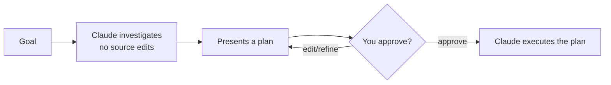

<LevelBadge level="beginner" />

<Callout type="objectives" items={["Spiegare cosa blocca Plan Mode — e cosa lascia comunque eseguire a Claude", "Entrare e uscire da Plan Mode in tre modi diversi", "Percorrere il ciclo investiga-proponi-approva-esegui", "Distinguere Plan Mode dai Permessi e usarli insieme"]} />

<VerifyNote lastVerified="2026-10-09" source="https://code.claude.com/docs/en/permission-modes">
Il modo in cui entri in Plan Mode (scorciatoia/flag) e quali comandi shell esattamente consente a Claude di eseguire durante la pianificazione cambiano tra le release — controlla la documentazione ufficiale di Claude Code.
</VerifyNote>

## L'idea di fondo

Immagina di consegnare le chiavi di casa a un artigiano oppure di chiedergli prima di fare un sopralluogo e mettere per iscritto *cosa* cambierebbe. Plan Mode è il sopralluogo.

**Plan Mode** dice a Claude di **studiare e proporre le modifiche senza farle**: legge i file, esegue comandi shell per esplorare e scrive un piano — ma **non modifica il tuo codice sorgente**. Le modifiche restano bloccate finché non approvi il piano.

<Callout type="tip" items={["Plan Mode significa che Claude INVESTIGA ma non CAMBIA il tuo codice sorgente — produce un piano e attende il tuo via."]} />

### Non è strettamente in sola lettura

Esplorare a volte richiede un comando, quindi Plan Mode riguarda il *non modificare*, non il *non eseguire*. Cosa accade a un comando shell durante la pianificazione dipende dalla sessione — vince il primo caso che corrisponde:

<Steps items={[{title: "Sessioni di terminale interattive con bypass permissions disponibile", body: "I blocchi di Plan Mode NON vengono imposti. Claude riceve comunque l'istruzione di pianificare senza modificare, ma una modifica o un comando che tenta durante la pianificazione viene eseguito senza chiedere conferma. Plan Mode mantiene i suoi blocchi in tutti gli altri casi: le esecuzioni headless con -p, l'Agent SDK e il pannello di chat dell'estensione VS Code."}, {title: "auto mode disponibile e useAutoModeDuringPlan attivo (l'impostazione predefinita)", body: "Il classificatore esamina i comandi shell invece di chiederti conferma, a eccezione delle rimozioni su percorsi critici. I comandi approvati vengono eseguiti; quelli rifiutati sono bloccati."}, {title: "auto mode non disponibile, oppure useAutoModeDuringPlan disattivato", body: "I comandi che escono dall'insieme in sola lettura integrato ti chiedono l'approvazione."}]} />

<Callout type="warning" items={["Se hai avviato con --allow-dangerously-skip-permissions, Plan Mode è un'istruzione forte più che una barriera rigida. Trattalo come una convenzione di pianificazione, non come una sandbox."]} />

## Perché è il modo più sicuro per iniziare

Per qualsiasi cosa grande, rischiosa o sconosciuta, vuoi vedere *cosa* Claude intende fare prima che tocchi il tuo repository. Plan Mode separa il **pensare** dal **fare**:

Il vantaggio: cogli le assunzioni sbagliate *prima* che diventino codice sbagliato.

## Quando usarla

<Callout type="tip" items={["SEMPRE per cambiamenti grandi o su più file, migrazioni o refactoring", "Quando lavori in un codebase che non conosci ancora del tutto", "Quando vuoi un piano revisionabile da condividere con un collega"]} />

Per modifiche minuscole e ovvie puoi saltarla — ma nel dubbio, pianifica prima.

## Come funziona in pratica

Segui il ciclo. Ogni passo guadagna il successivo — Claude passa a modificare *solo dopo* la tua approvazione.

<Steps items={[{title: "Entra in Plan Mode e dichiara il tuo obiettivo", body: "Premi Shift+Tab per scorrere le modalità dei permessi finché la barra di stato non mostra 'plan mode on', oppure fai precedere un singolo prompt da /plan. Per partire già da lì, avvia con claude --permission-mode plan. Poi descrivi cosa vuoi ottenere."}, {title: "Claude investiga", body: "Legge i file pertinenti, esegue comandi esplorativi e pone domande di chiarimento."}, {title: "Claude restituisce un piano passo passo", body: "I file da cambiare, l'approccio e come verificare il risultato. Premi Ctrl+G per aprire il piano proposto nel tuo editor e modificarlo direttamente."}, {title: "Tu approvi o affini", body: "Scegli 'Yes, and use auto mode', 'Yes, manually approve edits' oppure 'No, keep planning'. Approvando esci da Plan Mode ed entri nella modalità dei permessi descritta da quell'opzione, e Claude inizia a modificare."}]} />

Per uscire da Plan Mode senza approvare un piano, premi di nuovo `Shift+Tab`. Per renderla l'impostazione predefinita delle sessioni di terminale di un progetto, imposta `defaultMode` su `plan` in `.claude/settings.json` — vedi [Impostazioni](/docs/claude-code/settings).

### Provala tu stesso

Copia questo in una vera sessione di pianificazione e osserva il ciclo svolgersi:

<PromptCard title="Avvia una sessione di pianificazione">{`I want to migrate our auth from sessions to JWT. Stay in Plan Mode: investigate the current setup, ask anything you need, then propose a step-by-step plan with files to change and how to verify — don't edit anything yet.`}</PromptCard>

:::tip Abbinala a CLAUDE.md
Un buon [CLAUDE.md](/docs/claude-code/claude-md) rende i piani più affilati — Claude pianifica avendo già a mente le tue convenzioni e protezioni.
:::

## Plan Mode contro Permessi

Una classica confusione. Risolvono problemi diversi e lavorano insieme:

- **Plan Mode** = «investiga e proponi, non modificare ancora». (Questa pagina.)
- **[Permessi](/docs/claude-code/permissions)** = una volta in azione, *quali* azioni sono consentite senza chiedere.

Pensala come **se agire ora** (Plan Mode) contro **quali azioni sono consentite una volta in azione** (Permessi).

<Flashcards cards={[{front: "In quale stato Plan Mode mette Claude Code?", back: "Studia-e-proponi: legge i file, esegue comandi shell per esplorare e scrive un piano, ma non modifica il tuo codice sorgente. Le modifiche restano bloccate finché non approvi."}, {front: "Come si entra e si esce da Plan Mode?", back: "Entri con Shift+Tab, con il prefisso /plan su un singolo prompt oppure con claude --permission-mode plan. Esci senza approvare premendo di nuovo Shift+Tab."}, {front: "Qual è il ciclo di Plan Mode?", back: "Investiga → presenta un piano → tu approvi o affini → Claude esegue."}, {front: "Quando dovresti ricorrere a Plan Mode?", back: "Per impostazione predefinita per lavori grandi, rischiosi o sconosciuti (cambiamenti su più file, migrazioni, refactoring, codebase sconosciuti). Salta solo le modifiche minuscole e ovvie."}, {front: "Plan Mode contro Permessi?", back: "Plan Mode governa SE agire ora; i Permessi governano QUALI azioni sono consentite una volta in azione."}]} />

<Callout type="takeaways" items={["Plan Mode è studia-e-proponi: Claude legge ed esegue comandi esplorativi ma non modifica il tuo codice sorgente finché non approvi il piano", "Non è strettamente in sola lettura — durante la pianificazione i comandi vengono esaminati dal classificatore, sottoposti alla tua approvazione oppure (con bypass permissions disponibile in un terminale interattivo) sbloccati del tutto", "Entra con Shift+Tab, con il prefisso /plan o con --permission-mode plan; approvando la sessione passa alla modalità indicata dall'opzione di approvazione scelta", "Usala per impostazione predefinita per lavori grandi, rischiosi o sconosciuti; salta solo le modifiche minuscole e ovvie", "Plan Mode governa SE agire ora; i Permessi governano QUALI azioni sono consentite una volta in azione"]} />

<Quiz title="Mettiti alla prova" questions={[{q: "Cosa può fare Claude Code mentre è in Plan Mode?", options: ["Modificare i file ed eseguire qualsiasi comando", "Leggere i file ed eseguire comandi shell per esplorare — ma non modificare il tuo codice sorgente finché non approvi", "Solo rispondere alle domande, senza alcun accesso ai file"], answer: 1, explain: "Plan Mode riguarda il non modificare, non il non eseguire. Claude legge i file ed esegue comandi esplorativi (esaminati dal classificatore o sottoposti alla tua approvazione, a seconda della sessione), ma le modifiche al tuo codice sorgente restano bloccate finché non approvi il piano."}, {q: "Quando dovresti ricorrere a Plan Mode?", options: ["Solo per correzioni di refusi su una riga", "Per cambiamenti grandi o su più file, migrazioni, refactoring o codebase sconosciuti", "Mai — ti rallenta e basta"], answer: 1, explain: "Usala sempre per cambiamenti grandi o su più file, migrazioni o refactoring, e quando lavori in un codebase che non conosci ancora del tutto. Le modifiche minuscole e ovvie possono saltarla."}, {q: "Qual è l'ordine corretto del ciclo di Plan Mode?", options: ["Esegui, poi investiga, poi approva", "Investiga senza modificare, presenta un piano, tu approvi o affini, poi Claude esegue", "Approva prima, poi Claude investiga e modifica"], answer: 1, explain: "Claude investiga senza modificare il tuo codice sorgente, presenta un piano, tu approvi o affini, e solo allora passa a eseguire il piano."}, {q: "In cosa differiscono Plan Mode e i Permessi?", options: ["Sono due nomi per la stessa funzionalità", "Plan Mode = investiga e proponi, non modificare ancora; Permessi = una volta in azione, quali azioni sono consentite senza chiedere", "I Permessi decidono se pianificare; Plan Mode decide quali file modificare"], answer: 1, explain: "Plan Mode separa il pensare dal fare. I Permessi controllano quali azioni sono consentite senza chiedere una volta che Claude è in azione. Lavorano insieme."}]} />

## Avanti

- [Permessi e modalità dei permessi](/docs/claude-code/permissions)
- [Gestione del contesto](/docs/claude-code/context-management) — mantieni efficaci le sessioni lunghe
- [Tutorial: personalizza Claude Code per un repository reale](/docs/walkthroughs/customize-claude-code)
