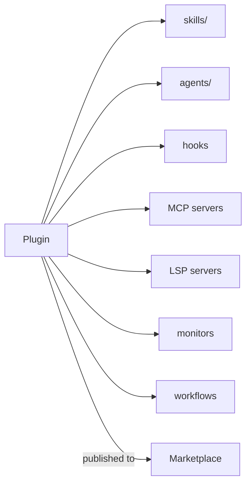

<LevelBadge level="advanced" />

<VerifyNote lastVerified="2026-10-22" source="https://code.claude.com/docs/en/plugins">
La struttura dei plugin e i meccanismi dei marketplace si stanno evolvendo rapidamente — verifica i dettagli nella documentazione ufficiale di Claude Code.
</VerifyNote>

Un **plugin** raggruppa diverse personalizzazioni — [skill](/docs/claude-code/skills), [subagent](/docs/claude-code/subagents), [comandi slash](/docs/claude-code/slash-commands), [hook](/docs/claude-code/hooks), [server MCP](/docs/claude-code/mcp) e, da Claude Code v2.1.287, una [**mod**](/docs/claude-code/mods) — in un'unica unità installabile e versionata. Un **marketplace** è un catalogo di plugin che le persone possono scoprire e installare.

## Perché i plugin contano

- **Distribuisci un toolkit di team in un passaggio.** Invece di chiedere a tutti di copiare cinque file, pubblica un plugin; i colleghi lo installano e ottengono gli stessi comandi, hook, agenti e connessioni MCP.
- **Versioning.** Aggiorna il plugin e tutti scaricano la nuova versione.
- **Distribuzione.** Un marketplace rende il tuo toolkit (o quello altrui) facile da scoprire.

## Cosa c'è tipicamente dentro

Un plugin è una cartella strutturata di componenti. Il manifest `.claude-plugin/plugin.json` è **facoltativo**: senza, Claude Code carica ciò che trova nel [layout standard](https://code.claude.com/docs/en/plugins-reference#standard-layout) — quindi una cartella che contiene solo un `SKILL.md` si carica già come plugin. Scrivi un manifest quando vuoi metadati, una versione, un componente fuori dalla sua directory predefinita o valori configurabili dall'utente.

Oltre alle skill, un plugin può raggruppare subagent, hook e server MCP e — più di recente — [server LSP](https://code.claude.com/docs/en/plugins-reference#lspservers) per l'intelligenza sul codice, [monitor](https://code.claude.com/docs/en/plugins-reference#monitors) in background, [workflow](https://code.claude.com/docs/en/workflows#distribute-a-workflow-in-a-plugin), una cartella `bin/` di eseguibili e impostazioni predefinite. Mantieni ogni plugin **coerente** — un plugin "convenzioni di team", un plugin "toolkit Python" — invece di un calderone di cose assortite.

## Fiducia prima di installare

:::warning[I plugin possono distribuire codice eseguibile]
Gli hook e i server MCP in un plugin vengono eseguiti con i tuoi privilegi. Installa da fonti di cui ti fidi e rivedi prima cosa fa un plugin — vedi [Revisione del codice di terze parti](/docs/security/reviewing-third-party-code).
:::

## Un percorso per scalare la tua configurazione

La progressione naturale: un `CLAUDE.md` → qualche [skill](/docs/claude-code/skills) e [comando](/docs/claude-code/slash-commands) → raggruppali in un plugin → pubblica su un marketplace per il tuo team o la community. Quest'ultimo passaggio fa parte di come AILmanac vuole aiutare l'ecosistema a crescere.

## Avanti

- [Mod: estensioni in-process](/docs/claude-code/mods) — l'unico componente di un plugin che gira *dentro* Claude Code e può sostituirne il comportamento integrato
- [Plugin Evals](/docs/claude-code/plugin-evals) — dimostra che il plugin aiuta con `claude plugin eval` prima di pubblicarlo
- [Skill](/docs/claude-code/skills) · [Subagent](/docs/claude-code/subagents) · [MCP](/docs/claude-code/mcp)
- [Revisione del codice di terze parti](/docs/security/reviewing-third-party-code)
- I [pacchetti di skill](/docs/templates/skills) di AILmanac
