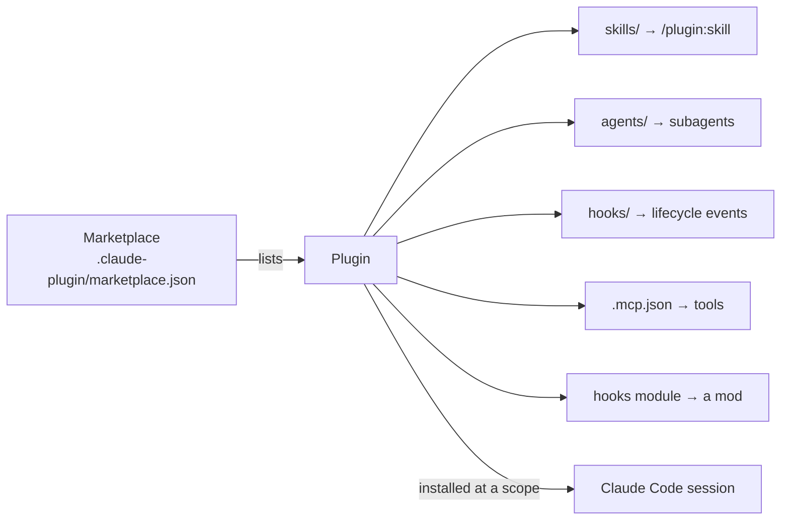

<LevelBadge level="intermediate" />

<Callout type="objectives" items={[
  "Decidere se ti serve davvero un plugin, o se basta una skill, un hook o un server MCP autonomo",
  "Installare il tuo primo plugin e capire, dal riepilogo di installazione, se è utilizzabile in questa sessione o richiede un ricaricamento",
  "Scegliere il giusto tra i tre ambiti di installazione — utente, progetto, locale — e sapere quale prevale su quale",
  "Leggere il livello di fiducia di un marketplace prima di fidarti, e capire perché i nomi ufficiale e community non si possono falsificare",
  "Preventivare il costo di contesto sempre attivo che ogni plugin abilitato addebita a ogni turno, e trovare i plugin che hai smesso di usare",
  "Eseguire l'intero ciclo di vita dalla shell: aggiungere un marketplace, installare, abilitare, disabilitare, aggiornare, disinstallare, potare",
  "Sviluppare il tuo plugin senza pubblicare nulla, usando --plugin-dir",
]} />

<VerifyNote lastVerified="2026-10-26" source="https://code.claude.com/docs/en/plugins">
Verificato sulle pagine ufficiali [Plugins overview](https://code.claude.com/docs/en/plugins) e [Install and manage plugins](https://code.claude.com/docs/en/plugins/install). Due dei comandi qui riportati hanno una versione minima: `/plugin install <plugin> --marketplace <source>` richiede Claude Code v2.1.275+, e l'equivalente da shell richiede v2.1.292+. La struttura dei plugin e il funzionamento dei marketplace cambiano ancora in fretta: conferma i dettagli sulla documentazione ufficiale prima di costruirci attorno la distribuzione.
</VerifyNote>

Un **plugin** raggruppa diverse personalizzazioni — [skill](/docs/claude-code/skills), [subagenti](/docs/claude-code/subagents), [comandi slash](/docs/claude-code/slash-commands), [hook](/docs/claude-code/hooks), [server MCP](/docs/claude-code/mcp) e una [**mod**](/docs/claude-code/mods) (hook scritti in JavaScript, che possono anche disegnare pannelli e aggiungere comandi) — in un'unica unità versionata e installabile. Un **marketplace** è un catalogo che elenca i plugin e da dove scaricare ciascuno. È un catalogo, non un negozio ospitato: i plugin vivono dove i loro autori li hanno messi.

## Ti serve davvero un plugin?

Parti da qui, perché la risposta è spesso no. Skill, subagenti, hook e server MCP funzionano benissimo anche da soli: un `SKILL.md` in `~/.claude/skills/` è disponibile in ogni progetto della tua macchina senza alcun pacchetto.

Ricorri a un plugin quando **vale una di queste tre condizioni**:

- Vuoi più componenti impacchettati come **un'unica unità** con un solo passo di installazione e un solo numero di versione.
- Vuoi la configurazione di **qualcun altro**, con gli aggiornamenti dal suo marketplace.
- Vuoi **dare** la tua configurazione ai colleghi, installarla su molti progetti o pubblicare rilasci versionati.

Tutto il resto è una skill o un hook, e deve restare tale.

## La parte di cui nessuno ti avvisa: un plugin abilitato è sempre attivo

È la cosa più importante da interiorizzare prima di installare cinque plugin perché sembravano utili.

**Un plugin abilitato fa parte di ogni sessione, non solo di quelle in cui lo usi.** Per ogni skill, agente e comando che Claude può invocare da solo, il *nome e la descrizione* stanno nel contesto di Claude a **ogni turno**, così Claude sa che esistono. Quei token contano nel tuo utilizzo e restringono la [finestra di contesto](/docs/claude-code/context-management) anche nelle sessioni in cui nulla del plugin viene mai attivato. Solo l'uso carica il testo completo.

Anche i suoi server MCP girano accanto a ogni sessione in cui è abilitato, e i suoi hook scattano ai loro eventi. E tutto ciò che esegue, lo esegue **come te**.

Quindi preventivalo. Ci sono tre momenti per controllare l'impatto:

<Steps items={[
  {title: "Prima di installare", body: "Apri il plugin indicando il suo marketplace — /plugin install <plugin>@<marketplace>, oppure la scheda Marketplaces. I plugin del marketplace ufficiale di Anthropic mostrano lì una stima del Context cost, divisa in Every turn e When invoked. Il pannello dei dettagli a cui arrivi dall'elenco Discover non mostra quei numeri."},
  {title: "Dopo l'installazione", body: "Esegui claude plugin details <name> nella shell. La riga Always-on è il numero di token che il plugin aggiunge a ogni sessione in cui è abilitato, e le righe per componente mostrano quale skill o agente è il più costoso."},
  {title: "Periodicamente, per potare", body: "La scheda Installed in /plugin raggruppa i plugin che non usi da un po' sotto l'intestazione Not used recently, e i dettagli di ciascun plugin riportano una riga Last used. Quelli continuano ad addebitarti contesto a ogni turno. Disabilitali o disinstallali."},
]} />

Mantieni ogni plugin **coerente** per lo stesso motivo — un plugin di "convenzioni del team", un plugin "toolkit Python" — anziché un miscuglio di cui paghi di continuo l'elenco di descrizioni. La lettura complementare è [Costo in token di MCP](/docs/claude-code/mcp-token-cost), che è la stessa aritmetica applicata alle definizioni degli strumenti.

## Installarne uno

Il marketplace ufficiale di Anthropic, `claude-plugins-official`, viene aggiunto per te la prima volta che avvii una sessione interattiva da terminale (a meno che una policy gestita lo blocchi). Installare da lì salta del tutto il passo di aggiunta del marketplace.

<PromptCard title="Apri i dettagli di un plugin per esaminarlo">{`/plugin install commit-commands@claude-plugins-official`}</PromptCard>

All'interno di una sessione questo comando **non installa subito**: apre il pannello `/plugin` sui dettagli di quel plugin, così puoi leggere cosa aggiunge e scegliere prima un ambito. Eseguire `/plugin` da solo apre invece la scheda **Discover**, che elenca i plugin di tutti i tuoi marketplace e permette di cercare digitando.

Il pannello dei dettagli è il passo di revisione. Leggi l'elenco **Will install**: i comandi, gli agenti, le skill, gli hook e i server MCP e LSP che stai per attivare. I plugin di un marketplace locale o personalizzato possono mostrare invece `Components will be discovered at installation`, il che significa che accetti i contenuti a scatola chiusa.

Poi scegli un ambito e leggi l'ultima frase del riepilogo di installazione, perché è quella che ti dice se è successo qualcosa:

| Il riepilogo termina con | Cosa significa |
| :--- | :--- |
| `Plugin is now active.` | Utilizzabile subito. Nessun ricaricamento. |
| `Plugin is now active.` + `Its bundled MCP server needs configuration before it can start` | Seleziona il plugin nella scheda **Installed** e scegli **Configure** per impostare le opzioni del server. |
| `Run /reload-plugins to apply.` | Claude Code esegue il ricaricamento per te — a meno che invaliderebbe la prompt cache, nel qual caso ti avvisa e lascia il plugin in sospeso. `/reload-plugins --force` lo attiva comunque, al costo di una richiesta non in cache. |
| `The plugin couldn't be loaded` | Apri la scheda **Errors** in `/plugin` per il motivo. |

Conferma che abbia funzionato digitando `/` e cercando le skill del plugin con il namespace del suo nome: `/commit-commands:commit`. Oppure esegui `claude plugin list` nella shell, che stampa ogni plugin con `Version`, `Scope` e `Status`.

### I tre ambiti e quale prevale

L'ambito decide **chi** riceve il plugin e **quale file di impostazioni** lo registra come abilitato. Sbagliare qui è il modo in cui un plugin finisce abilitato per tutto il team per errore.

| Ambito | Chi lo riceve | Scritto in |
| :--- | :--- | :--- |
| **Utente** | Tu, in ogni progetto su questa macchina | `enabledPlugins` in `~/.claude/settings.json` |
| **Progetto** | Chiunque lavori in questo repository | `.claude/settings.json` — che metti nel commit |
| **Locale** | Tu, solo in questo repository | `.claude/settings.local.json` |

**Precedenza quando lo stesso plugin è impostato su più ambiti: il locale prevale sul progetto, il progetto prevale sull'utente.**

La trappola dell'ambito di progetto va detta chiaramente: **inserire la voce nel commit abilita il plugin per i collaboratori ma non lo scarica sulle loro macchine.** Ogni collaboratore deve comunque eseguire l'installazione una volta da sé:

<PromptCard title="Un collaboratore che recupera un plugin con ambito di progetto">{`claude plugin install formatter@your-org --scope project`}</PromptCard>

Due comportamenti correlati: alcuni plugin sono distribuiti con `defaultEnabled` disattivato dal loro autore, quindi si installano ma restano spenti finché non esegui `claude plugin enable <name>`. E quando **disinstalli** un plugin abilitato dal `.claude/settings.json` del repository, Claude Code ti chiede cosa intendevi — **y** scrive per te `false` in `.claude/settings.local.json` e lo lascia installato per tutti gli altri; **u** lo rimuove dalle impostazioni condivise per l'intero team.

Il terminale, le sessioni locali dell'app desktop e l'estensione VS Code sulla stessa macchina leggono gli stessi file di impostazioni, quindi un'installazione a livello utente in uno qualsiasi di essi compare negli altri due.

### Dove i plugin non arrivano

Due punti ciechi che causano vera confusione:

- **Le [sessioni cloud](/docs/claude-code/cloud-sessions) non caricano nulla di tutto questo.** Una sessione cloud, incluso claude.ai/code, non ha un browser dei plugin e non carica né i plugin della tua macchina né quelli che il `.claude/settings.json` del tuo repository attiva. Arrivano solo i plugin che la tua organizzazione distribuisce tramite impostazioni gestite. Se un flusso di lavoro dipende da comandi forniti da plugin, nel cloud si comporta diversamente.
- **`claude -p` e le altre esecuzioni non interattive** non possono aprire `/plugin` — Claude risponde `/plugin isn't available in this environment.` I plugin già installati vengono caricati. Gestiscili invece dalla shell.

## Fiducia: i tre livelli dei marketplace

Un marketplace è un repository o una directory che contiene un file `.claude-plugin/marketplace.json`. Chiunque può pubblicarne uno. Un plugin che installi può eseguire codice con i tuoi privilegi utente, qualunque sia la sua origine.

Il **nome** di un marketplace lo colloca in uno di tre livelli, e i primi due non si possono falsificare: **Claude Code accetta i nomi ufficiale e community di Anthropic solo per marketplace con origine nei repository `github.com/anthropics/`.**

| Livello | Esempi | Cosa ti dice |
| :--- | :--- | :--- |
| **Ufficiale** | `claude-plugins-official`, il marketplace dimostrativo `claude-code-plugins` | Nome riservato ai repository di origine Anthropic. Aggiornamento automatico attivo per impostazione predefinita (con due eccezioni). |
| **Community** | `claude-community` e gli altri nomi community di Anthropic | Anch'esso con nome riservato ai repository di origine Anthropic, ma con contenuti contribuiti dalla community. Aggiornamento automatico **disattivato** per impostazione predefinita. |
| **Terze parti** | Tutto il resto — compresi quelli del tuo collega e della tua organizzazione | Nessuna garanzia sul nome. Aggiornamento automatico disattivato per impostazione predefinita. |

:::warning[I plugin possono includere codice eseguibile]
Gli hook e i server MCP in un plugin girano con i tuoi privilegi, in ogni sessione in cui il plugin è abilitato. Installa da fonti di cui ti fidi e leggi il pannello **Will install** prima di accettare. Vedi [Verificare il codice di terze parti](/docs/security/reviewing-third-party-code) e [Verificare le skill degli agenti](/docs/security/vetting-agent-skills).
:::

Nota anche cosa un marketplace di plugin *non* è: [claude.com/marketplace](https://claude.com/marketplace) è un sito web per sfogliare plugin, connettori e partner. Non è qualcosa che si aggiunge con `/plugin marketplace add`.

### Aggiungere un marketplace

Un marketplace si aggiunge una volta sola; poi i suoi plugin compaiono in **Discover** e si installano per nome. Quattro forme di origine:

| Origine | Cosa digiti |
| :--- | :--- |
| Repository GitHub | `owner/repo`, facoltativamente `owner/repo#ref` per fissare un branch o un tag |
| Qualsiasi host git | L'URL di clone completo, facoltativamente con `#ref` |
| Directory o file locale | Un percorso a una directory che contiene `.claude-plugin/marketplace.json`, oppure al JSON stesso — **inizia i percorsi relativi con `./`** |
| JSON ospitato | Un URL `https://` a un `marketplace.json` |

<PromptCard title="Aggiungere un marketplace, in quattro modi">{`/plugin marketplace add anthropics/claude-code
/plugin marketplace add your-org/plugins#v1.2.0
/plugin marketplace add ./my-marketplace
/plugin marketplace add https://example.com/marketplace.json`}</PromptCard>

In quella tabella si nascondono due trappole di interpretazione. Un percorso nudo come `name/name` viene letto come **abbreviazione GitHub `owner/repo`**, quindi un percorso locale deve iniziare con `./` o `../`. E un nudo `gitlab.example.com/group/repo.git` viene letto allo stesso modo e rifiutato: includi il prefisso `https://`, oppure usa la forma SSH `git@host:path`. (`/plugin market` è un'abbreviazione valida di `/plugin marketplace`.)

Per un plugin di un marketplace che non hai ancora aggiunto, fai entrambe le cose in un solo comando — nota che il nome del plugin va **senza** il suffisso `@marketplace`:

<PromptCard title="Aggiungere il marketplace e installare in un solo passo">{`# in a session (v2.1.275+); asks you to confirm the resolved source
/plugin install deploy-helper --marketplace your-org/plugins

# from your shell (v2.1.292+); no confirmation step
claude plugin install deploy-helper --marketplace your-org/plugins`}</PromptCard>

I **marketplace privati** funzionano con lo stesso comando, clonati usando le credenziali git già presenti sulla tua macchina — e Claude Code **non chiede mai nulla**. Questo rende i requisiti rigidi: su HTTPS i tuoi credential helper devono già funzionare (`gh auth login`, il Keychain di macOS, `git-credential-store`), perché i prompt di git e i programmi askpass sono disabilitati; su SSH l'host deve essere già in `known_hosts` e la chiave non deve richiedere una passphrase. Imposta `CLAUDE_CODE_PLUGIN_PREFER_HTTPS=1` per saltare il sondaggio SSH sull'abbreviazione GitHub e clonare sempre su HTTPS.

Un comportamento di rimozione da conoscere prima di eseguirla: **rimuovere un marketplace disinstalla ogni plugin che hai installato da esso** e toglie le loro voci `enabledPlugins` dalle tue impostazioni. La scheda **Marketplaces** li nomina prima di chiederti conferma.

## L'intero ciclo di vita dalla shell

Tutto ciò che fa il pannello `/plugin`, lo fa `claude plugin` in modo non interattivo — che è ciò che vuoi in uno script di setup o in un repository di dotfile. Gli ambiti predefiniti differiscono per verbo: `enable` e `disable` agiscono sull'**ambito più specifico che già elenca il plugin**, mentre `install` e `uninstall` hanno come predefinito l'ambito **utente**.

<PromptCard title="Gli otto comandi che coprono tutto">{`claude plugin marketplace add anthropics/claude-plugins-official
claude plugin install formatter@your-org --scope project
claude plugin list
claude plugin details formatter@your-org     # always-on token cost
claude plugin disable formatter@your-org
claude plugin enable formatter@your-org
claude plugin update formatter@your-org
claude plugin uninstall formatter@your-org --scope project`}</PromptCard>

Quattro note che ti risparmiano una sessione di debug:

- **Su una macchina nuova il marketplace ufficiale non è ancora registrato**, perché nessuno ha aperto una sessione interattiva. Uno script di provisioning deve eseguire `claude plugin marketplace add anthropics/claude-plugins-official` prima di installare da esso.
- **Alcuni plugin si installano eseguendo un comando** indicato dal loro marketplace. Claude Code lo mostra e ti chiede di accettare — uno script non ha nessuno che risponda, quindi passa `--yes`.
- **I plugin installati dalla shell vengono caricati all'avvio successivo**, oppure quando esegui `/reload-plugins` in una sessione aperta.
- **Non esiste un comando "aggiorna tutto".** `claude plugin update` accetta un solo plugin. Per farlo in blocco usa **Update marketplace** nella scheda **Marketplaces**, che aggiorna l'elenco e i plugin che hai installato da esso. `claude plugin marketplace update` senza nome aggiorna ogni elenco ma lascia i plugin installati alle versioni attuali.

### Dipendenze

Un plugin può dichiarare altri plugin da cui dipende, e Claude Code agisce su di essi con te:

- **Install** installa e abilita anche le dipendenze dichiarate nello stesso ambito; il messaggio di successo le elenca.
- **Enable** abilita anche le dipendenze installate ma disabilitate. Se una non è affatto installata, l'abilitazione fallisce e ti dice di installarla prima.
- **Disable** viene rifiutato quando un altro plugin abilitato ha ancora bisogno di quello che hai nominato — e stampa un comando concatenato che disabilita entrambi nell'ordine giusto.
- **Uninstall** lascia indietro le dipendenze installate automaticamente. È `claude plugin prune` a eliminarle.

## Sviluppare il tuo, senza pubblicare nulla

Non ti serve un marketplace per lavorare su un plugin. Punta Claude Code alla cartella:

<PromptCard title="Carica un plugin da disco per una sessione">{`claude --plugin-dir ./my-plugin`}</PromptCard>

Il manifest in `.claude-plugin/plugin.json` è **facoltativo**: senza, Claude Code carica ciò che trova nella struttura standard, quindi una cartella che contiene solo un `SKILL.md` si carica già come plugin. Scrivi un manifest quando vuoi un nome, una versione, dei metadati, un componente fuori dalla sua directory predefinita oppure opzioni `userConfig` configurabili dall'utente.

Oltre ai componenti di base, un plugin può includere [server LSP](https://code.claude.com/docs/en/plugins/components) per l'intelligenza del codice, monitor in background, workflow, una cartella `bin/` di eseguibili e impostazioni predefinite.

La progressione naturale — e quella che vale la pena seguire deliberatamente — è: un `CLAUDE.md` → qualche [skill](/docs/claude-code/skills) e [comando](/docs/claude-code/slash-commands) → impacchettali in un plugin → dimostra che aiuta con [`claude plugin eval`](/docs/claude-code/plugin-evals) → pubblica su un marketplace per il tuo team o la community.

## Quando un plugin non compare

Tre livelli devono allinearsi, e l'errore è quasi sempre in uno di essi:

<Steps items={[
  {title: "Impostazioni", body: "Le tue impostazioni elencano i marketplace che hai aggiunto e i plugin abilitati. Controlla tutti e tre gli ambiti — ricorda che il locale prevale sul progetto che prevale sull'utente, quindi un false in .claude/settings.local.json vince in silenzio."},
  {title: "Disco", body: "~/.claude/plugins/ contiene ciò che Claude Code ha davvero scaricato e installato. Le impostazioni di progetto che abilitano un plugin che nessuno ha scaricato sono il classico disallineamento: la voce è nel commit, i file non ci sono."},
  {title: "Sessione", body: "I plugin si caricano all'avvio. Un plugin installato a sessione in corso richiede /reload-plugins — e se questo invalidasse la prompt cache, Claude Code lo lascia in sospeso finché non esegui /reload-plugins --force."},
]} />

<Quiz title="Verifica la tua comprensione" questions={[
  {q: "Installi sei plugin perché ciascuno sembrava utile. Ne usi sempre uno solo. Qual è il costo degli altri cinque?", options: ["Nessuno: costano token solo quando vengono invocati", "Ogni plugin abilitato mette nel contesto a ogni turno i nomi e le descrizioni delle sue skill e dei suoi agenti invocabili, ed esegue i suoi server MCP e hook in ogni sessione", "Solo spazio su disco"], answer: 1, explain: "Un plugin abilitato fa parte di ogni sessione, non solo di quelle in cui lo usi. Nomi e descrizioni sono nel contesto a ogni turno perché Claude sappia che esistono; i server MCP girano e gli hook scattano accanto a ogni sessione. Usa claude plugin details <name> per leggere il costo sempre attivo, e il gruppo Not used recently in /plugin per trovare quelli da eliminare."},
  {q: "Metti nel commit una voce di plugin con ambito di progetto in .claude/settings.json. Cosa deve fare un collega?", options: ["Nulla: si installa automaticamente al prossimo pull", "Eseguire l'installazione una volta da sé: claude plugin install <name>@<marketplace> --scope project", "Aggiungere il marketplace, che installa tutto ciò che contiene"], answer: 1, explain: "Mettere nel commit la voce enabledPlugins abilita il plugin per i collaboratori ma non lo scarica sulle loro macchine. Ciascuno deve comunque installarlo una volta. Claude Code segnala il disallineamento quando le impostazioni abilitano un plugin non installato."},
  {q: "Un plugin è abilitato a livello utente, disabilitato in .claude/settings.local.json e abilitato nel .claude/settings.json nel commit. È attivo?", options: ["Sì: le impostazioni di progetto sono quelle che fanno fede", "Sì: l'ambito utente viene per primo", "No: il locale prevale sul progetto, che prevale sull'utente"], answer: 2, explain: "La precedenza è locale > progetto > utente. Un false in .claude/settings.local.json vince su entrambi gli altri livelli, ed è esattamente così che funziona l'opzione \"disabilita per me\" quando disinstalli un plugin abilitato dal progetto."},
  {q: "Qualcuno ti manda un marketplace in ./shared/plugins. Esegui /plugin marketplace add shared/plugins e fallisce. Perché?", options: ["I marketplace locali non sono supportati", "Un nudo name/name viene letto come abbreviazione GitHub owner/repo: un percorso locale deve iniziare con ./ o ../", "Devi aggiungere direttamente il file marketplace.json"], answer: 1, explain: "Claude Code legge un nudo name/name come GitHub owner/repo. Inizia un percorso relativo con ./ o ../. La stessa trappola di interpretazione rifiuta un nudo gitlab.example.com/group/repo.git, che richiede il prefisso https:// o la forma SSH git@host:path."},
  {q: "Il tuo flusso di lavoro dipende da un comando slash fornito da un plugin. Esegui lo stesso compito in una sessione cloud su claude.ai/code. Cosa succede?", options: ["Funziona: i plugin si sincronizzano con il tuo account", "Il comando non c'è: le sessioni cloud non caricano né i tuoi plugin locali né quelli che il .claude/settings.json del repo abilita", "Funziona solo se il plugin ha ambito di progetto"], answer: 1, explain: "Una sessione cloud non ha un browser dei plugin e non carica né i plugin della tua macchina né gli enabledPlugins di un repository. Arrivano solo i plugin distribuiti tramite le impostazioni gestite dell'organizzazione. Metti nel commit in .claude/ le skill e i comandi equivalenti se il flusso di lavoro deve girare nel cloud."},
]} />

<Callout type="takeaways" items={[
  "Usa un plugin solo per impacchettare più componenti come un'unica unità versionata, per usare la configurazione di qualcun altro o per distribuire la tua. Una skill o un hook isolato non ha bisogno di un plugin.",
  "Un plugin abilitato è sempre attivo: nomi e descrizioni delle skill e degli agenti invocabili stanno nel contesto a ogni turno, i suoi server MCP girano e i suoi hook scattano — in ogni sessione, usato o no. Misura con claude plugin details, pota con il gruppo Not used recently.",
  "Tre ambiti, con precedenza locale > progetto > utente. L'utente scrive ~/.claude/settings.json, il progetto scrive il .claude/settings.json nel commit, il locale scrive .claude/settings.local.json. L'ambito di progetto abilita per il team ma ogni collega deve comunque installare una volta.",
  "Tre livelli di fiducia dal nome. I nomi ufficiale e community di Anthropic sono accettati solo per marketplace con origine nei repository github.com/anthropics/; tutto il resto è terze parti. Qualsiasi plugin può eseguire codice come te: leggi prima il pannello Will install.",
  "Due trappole di interpretazione quando aggiungi un marketplace: un percorso locale deve iniziare con ./, e un host git non GitHub richiede il prefisso https://. Un nudo name/name è sempre letto come abbreviazione GitHub.",
  "Rimuovere un marketplace disinstalla ogni plugin che ne hai ricavato e toglie le loro voci dalle impostazioni. Disinstallare un plugin abilitato dal progetto chiede se intendevi \"solo io\" o \"tutti\".",
  "Le sessioni cloud non caricano affatto plugin locali o abilitati dal repo — solo quelli gestiti dall'organizzazione. Metti nel commit in .claude/ gli equivalenti se un flusso di lavoro cloud ne dipende.",
  "Sviluppa con claude --plugin-dir ./my-plugin; nessun marketplace, nessun manifest richiesto. Dimostra che vale il suo costo di contesto con claude plugin eval prima di pubblicare.",
]} />

## Prossimi passi

- [Mod: estensioni in-process](/docs/claude-code/mods) — l'unico componente di plugin che gira *dentro* Claude Code e può sostituirne il comportamento integrato
- [Plugin Evals](/docs/claude-code/plugin-evals) — dimostra che il plugin aiuta con `claude plugin eval` prima di pubblicarlo
- [Costo in token di MCP](/docs/claude-code/mcp-token-cost) — la stessa aritmetica di contesto, applicata alle definizioni degli strumenti
- [Skill](/docs/claude-code/skills) · [Subagenti](/docs/claude-code/subagents) · [MCP](/docs/claude-code/mcp)
- [Verificare il codice di terze parti](/docs/security/reviewing-third-party-code) · i [pacchetti di skill](/docs/templates/skills) di AILmanac
