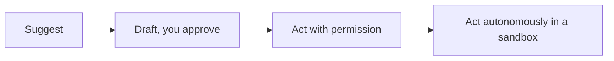

<LevelBadge level="all" />

<Callout type="objectives" items={[
  "Calibrare la verifica in base alla posta in gioco invece di verificare tutto o niente",
  "Salire la scala dell'autonomia in modo deliberato — quattro gradini, ciascuno da guadagnare",
  "Sapere quali dati non vanno mai in uno strumento che non hai valutato",
  "Mantenere una persona responsabile dove l'output incide sulle persone, e restare coinvolti nel lavoro"
]} />

Ottenere il massimo dall'AI significa anche usarla in modo *responsabile*. Questa pagina è breve, pratica e vale per tutti — dal principiante a chi costruisce.

## La mentalità della verifica

L'abitudine più importante: **commisura la verifica alla posta in gioco.**

| Posta in gioco | Esempio | Quanto verificare |
|---|---|---|
| Bassa | Brainstorming, bozze approssimative | Fidati liberamente, dai una scorsa |
| Media | Un'email di lavoro, un riassunto | Leggilo, controlla i fatti con buon senso |
| Alta | Statistiche pubblicate, codice che eseguirai, ambito legale/medico/finanziario | Verifica ogni affermazione su una fonte affidabile |

L'AI è una prima bozza veloce, mai un'autorità finale — vedi [Allucinazioni](/docs/foundations/hallucinations).

## La scala dell'autonomia

Dai all'AI più indipendenza solo man mano che la fiducia viene guadagnata:

Parti da "propongo, approvi tu" ([Plan Mode](/docs/claude-code/plan-mode)); riserva la piena autonomia al lavoro a basso rischio, isolato in un sandbox e reversibile ([Rendere sicure le esecuzioni autonome](/docs/security/hardening-autonomous-runs)).

<Steps items={[
  {
    title: "Suggerisce",
    body: "Il modello propone; il lavoro lo fai tu. Resta utile molto più a lungo di quanto la gente si aspetti, perché rimani padrone di ciò che deleghi."
  },
  {
    title: "Prepara una bozza, approvi tu",
    body: "Produce il risultato e tu lo riesamini prima che entri in vigore. È l'impostazione predefinita giusta per la maggior parte del lavoro reale — vedi [Plan Mode](/docs/claude-code/plan-mode)."
  },
  {
    title: "Agisce con permesso",
    body: "Compie azioni, fermandosi a ognuna che ha conseguenze. Promuovi un compito a questo gradino solo dopo averlo visto riuscire più volte al gradino precedente."
  },
  {
    title: "Agisce in autonomia in un sandbox",
    body: "Riservato al lavoro a basso rischio, reversibile e circoscritto. Se non puoi annullarlo a basso costo, qui non va — vedi [Rendere sicure le esecuzioni autonome](/docs/security/hardening-autonomous-runs)."
  }
]} />

:::tip[Promuovi i compiti, non gli strumenti]
L'autonomia si guadagna per *compito*, non si concede per *strumento*. Lo stesso agente può essere pienamente autonomo su "riformatta questi file" e fermo a "bozza, approvo io" su "rispondi a questo cliente" — ed è la configurazione corretta, non un'incoerenza.
:::

## Privacy e dati

- Non incollare segreti, credenziali o dati personali altrui in uno strumento che non hai valutato.
- Conosci la politica del tuo fornitore su gestione dei dati e addestramento prima di condividere materiale sensibile — vedi [Privacy e gestione dei dati](/docs/foundations/privacy).
- Per dati regolamentati o riservati, usa le impostazioni enterprise/controllate appropriate.

## Pregiudizi, equità e limiti

I modelli riflettono schemi presenti nei loro dati di addestramento, che possono contenere **pregiudizi**. Fai particolare attenzione quando l'output dell'AI influenza decisioni sulle persone (assunzioni, credito, moderazione). Mantieni una persona responsabile delle decisioni importanti e tratta l'AI come un aiuto al giudizio, non come un suo sostituto.

## Non delegare il tuo pensiero

:::tip[Usa l'AI per pensare meglio, non di meno]
Gli utenti migliori restano coinvolti: mettono in discussione gli output, ne imparano e fanno proprio il risultato. Per lo studio significa il [ciclo del teach-back](/docs/playbooks/learning), non il copia-incolla. Sei responsabile di ciò che consegni con l'aiuto dell'AI.
:::

## Sicurezza, in breve

Se l'AI legge contenuti non affidabili (pagine web, email, documenti) o compie azioni, erediti un modello di sicurezza. Leggi [Prompt Injection](/docs/security/prompt-injection) e [Proteggere gli agenti](/docs/security/securing-agents).

<Quiz questions={[
  {
    q: "Stai usando l'AI per proporre nomi per un progetto interno. Quanto dovresti verificare?",
    options: [
      "Ogni suggerimento, su una banca dati di marchi",
      "Fidarti liberamente e dare una scorsa — la posta è bassa e il lavoro è reversibile",
      "Non verificare mai nulla, dato che la verifica spetta al modello",
      "Quanto per le statistiche pubblicate"
    ],
    answer: 1,
    explain: "La verifica dovrebbe essere proporzionale alla posta in gioco. Dedicare a un brainstorming lo sforzo da alta posta è il modo in cui ci si esaurisce sulla verifica e poi la si salta dove conta davvero."
  },
  {
    q: "Un compito gira alla perfezione da settimane in modalità \"agisce con permesso\". Cosa giustifica promuoverlo ad autonomo?",
    options: [
      "Il solo storico — se l'è guadagnato",
      "Che sia anche a basso rischio, reversibile e contenuto in un sandbox",
      "Niente; l'autonomia non è mai appropriata",
      "L'approvazione del modello stesso"
    ],
    answer: 1,
    explain: "Un buono storico è necessario ma non sufficiente. Il gradino richiede anche che il caso peggiore costi poco: basso rischio, reversibile, in sandbox. Un compito irreversibile resta sotto controllo per quanto sia stato affidabile."
  },
  {
    q: "Dove dovresti essere più cauto riguardo ai pregiudizi del modello?",
    options: [
      "Nel riassumere i tuoi appunti di una riunione",
      "Nel generare codice boilerplate",
      "Ovunque l'output influenzi una decisione su una persona — assunzioni, credito, moderazione",
      "Nel tradurre documentazione"
    ],
    answer: 2,
    explain: "I modelli riflettono schemi dei dati di addestramento. Il rischio diventa rilevante proprio dove l'output determina esiti per le persone, cioè dove una persona deve restare responsabile."
  }
]} />

<Callout type="takeaways" items={[
  "Commisura la verifica alla posta in gioco — paranoia uniforme e fiducia uniforme falliscono entrambe",
  "Sali la scala dell'autonomia compito per compito, e solo dove il caso peggiore costa poco ed è reversibile",
  "Non incollare segreti o dati personali altrui in uno strumento che non hai valutato",
  "Mantieni una persona responsabile ovunque l'output incida sulle persone; l'AI aiuta il giudizio, non lo sostituisce"
]} />

## Prossimi passi

- [La prompt injection spiegata](/docs/security/prompt-injection)
- [Allucinazioni e come ridurle](/docs/foundations/hallucinations)
- [Privacy e gestione dei dati](/docs/foundations/privacy)
