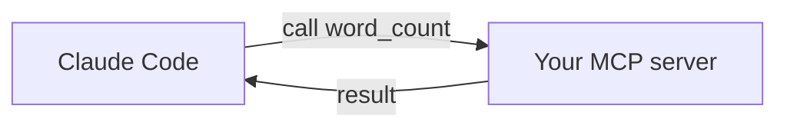

<LevelBadge level="advanced" />

<Callout type="objectives" items={[
  "Scrivere un server MCP funzionante con uno strumento in una decina di righe di Python",
  "Dichiararlo a Claude Code con un file .mcp.json a livello di progetto",
  "Verificare che lo strumento venga davvero chiamato — e fare il debug quando non succede",
  "Sostituire lo strumento giocattolo con una capacità reale senza ampliare la superficie di attacco"
]} />

<VerifyNote lastVerified="2026-07-23" source="https://modelcontextprotocol.io">
Le API dell'SDK MCP e la configurazione evolvono — verifica sulla documentazione ufficiale di MCP e su quella di Claude Code per MCP.
</VerifyNote>

Esponiamo uno strumento personalizzato a Claude costruendo un piccolissimo server [MCP](/docs/claude-code/mcp) e collegandolo. Lo teniamo minimo perché il *collegamento* sia chiaro — poi inserisci la tua logica reale.

## Cosa stiamo costruendo

Un server stdio con uno strumento, `word_count`, che Claude può chiamare. Lo stesso schema vale per "interroga il mio DB", "apri un ticket" e così via.



## Passo 1 — Il server

`server.py` (Python; una versione TypeScript è negli [scaffold MCP](/docs/templates/mcp-config)):

```python
from mcp.server.fastmcp import FastMCP

mcp = FastMCP("text-tools")

@mcp.tool()
def word_count(text: str) -> int:
    """Count the words in a piece of text."""
    return len(text.split())

if __name__ == "__main__":
    mcp.run()  # stdio transport
```

La docstring non è decorazione — è la descrizione dello strumento che il modello legge per decidere se chiamarlo. Docstring vaga, strumento inutilizzato.

## Passo 2 — Dichiaralo

Aggiungi a `.mcp.json` nella radice del repository:

```json
{ "mcpServers": {
  "text-tools": { "command": "python", "args": ["server.py"] }
} }
```

## Passo 3 — Collega e prova

<Steps items={[
  {
    title: "Avvia Claude Code nel repository",
    body: "Il server è dichiarato nella radice del progetto, quindi la directory di lavoro conta — avvia dallo stesso posto in cui si trova .mcp.json."
  },
  {
    title: "Chiedi lo strumento per nome",
    body: "Nominare il server nella prima richiesta elimina ogni ambiguità sul fatto che il modello *abbia scelto* di non chiamarlo oppure *non lo vedesse*."
  },
  {
    title: "Conferma che la chiamata sia avvenuta davvero",
    body: "Devi vedere l'invocazione dello strumento, non solo una risposta plausibile. Un modello può contare quattro parole da solo — questo non dimostra nulla sul tuo collegamento."
  },
  {
    title: "Se lo strumento non è visibile, isola il problema",
    body: "Esegui prima il server da solo: deve avviarsi senza errori e restare in esecuzione. Se funziona, il difetto è in .mcp.json — di solito un percorso relativo sbagliato o l'interprete sbagliato nel PATH."
  }
]} />

<PromptCard title="Prompt di verifica">
{`Use the text-tools server to count the words in: "the quick brown fox".`}
</PromptCard>

Claude dovrebbe chiamare `word_count` e riportare `4`.

## Passo 4 — Rendilo reale

Sostituisci `word_count` con la tua capacità effettiva — una query a un DB, una chiamata a un'API interna, un'operazione su file. Aggiungi la validazione degli input e restituisci gli errori come risultati.

Restituire gli errori *come risultati* invece di sollevarli è ciò che permette al modello di riprendersi: un messaggio come `"no such project: foo"` porta a un nuovo tentativo con un argomento corretto, mentre un server andato in crash semplicemente sparisce dalla sessione.

## Lista di controllo per la sicurezza

:::warning[Un server è codice + accesso]
- **Privilegio minimo** — solo i dati e le azioni che gli servono ([Proteggere gli agenti](/docs/security/securing-agents)).
- **Valida gli input** che invia il modello.
- I dati non affidabili che restituisce possono veicolare [prompt injection](/docs/security/prompt-injection).
- **Esamina** qualsiasi server di terze parti prima di collegarlo.
:::

<Quiz questions={[
  {
    q: "Claude risponde \"4\" ma non vedi alcuna chiamata allo strumento. Cosa hai dimostrato?",
    options: [
      "Che il server funziona — la risposta è corretta",
      "Niente sul collegamento; il modello può contare quattro parole senza aiuto",
      "Che il trasporto stdio è configurato male",
      "Che la docstring è troppo lunga"
    ],
    answer: 1,
    explain: "Una risposta corretta non è la prova di una chiamata allo strumento. Verifica sempre l'invocazione stessa — per questo lo strumento giocattolo dovrebbe essere qualcosa di cui vedi l'esecuzione, non qualcosa che il modello potrebbe indovinare."
  },
  {
    q: "Il tuo strumento è dichiarato ma Claude non lo vede. Cosa controlli per prima cosa?",
    options: [
      "Riscrivere la docstring dello strumento",
      "Passare il trasporto da stdio a HTTP",
      "Eseguire il server da solo — deve avviarsi senza errori e restare in esecuzione",
      "Spostare .mcp.json nella tua directory home"
    ],
    answer: 2,
    explain: "Isola il problema: se il server gira bene da solo, il difetto è in .mcp.json (di solito un percorso relativo o l'interprete sbagliato). Se non gira, hai un bug del server, non del collegamento."
  },
  {
    q: "Perché restituire gli errori come risultati dello strumento invece di sollevare un'eccezione?",
    options: [
      "Le eccezioni non sono ammesse dalla specifica MCP",
      "Un errore restituito può essere letto dal modello, che riprova con argomenti corretti",
      "Rende il server più veloce",
      "Evita la necessità di validare gli input"
    ],
    answer: 1,
    explain: "Un risultato che il modello può leggere diventa un passo recuperabile. Un crash toglie il server dalla sessione, così il modello perde del tutto la capacità — e di solito non sa dirti perché."
  }
]} />

<Callout type="takeaways" items={[
  "Uno strumento, trasporto stdio, .mcp.json a livello di progetto — questo è l'intero server minimo funzionante",
  "La docstring è l'unico segnale che il modello ha su quando chiamare il tuo strumento; scrivila come un contratto di API",
  "Verifica l'invocazione, non la risposta, o consegnerai un collegamento che non è mai stato eseguito",
  "Gli errori restituiti come risultati sono recuperabili; le eccezioni tolgono la capacità senza rumore"
]} />

## Prossimi passi

- [Server MCP in Claude Code](/docs/claude-code/mcp)
- [Configurazione MCP e scaffold di server](/docs/templates/mcp-config)
- [Tool Use / Function Calling](/docs/api/tool-use)
