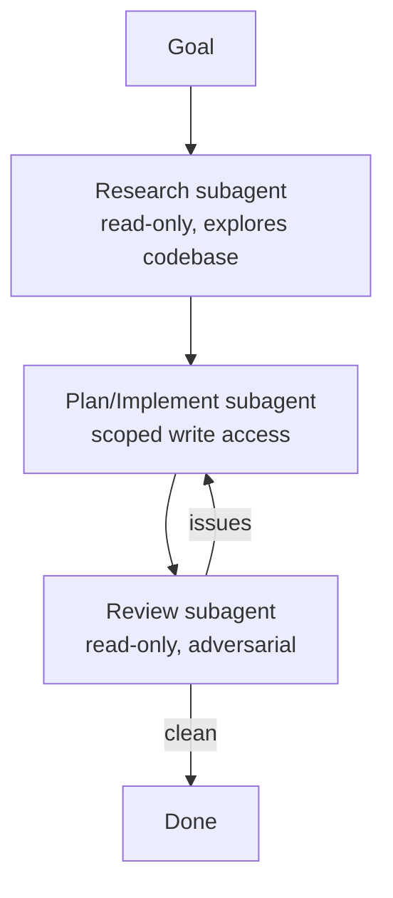

<LevelBadge level="advanced" />

<Callout type="objectives" items={[
  "Impostare una pipeline ricerca, implementazione, revisione in cui ogni fase ha il proprio contesto e il proprio set di strumenti",
  "Scrivere descrizioni abbastanza precise da far delegare all'agente principale il subagent giusto senza che glielo si dica",
  "Aggiungere un controllo di revisione che torna indietro invece di chiudersi con un timbro di routine",
  "Riconoscere i tre casi in cui il coordinamento multi-agent costa più di quanto fa risparmiare",
  "Verificare una run conclusa con quattro segnali che dicono se la suddivisione ha funzionato davvero"
]} />

I compiti grandi vanno meglio se divisi tra [subagent](/docs/claude-code/subagents) mirati invece di infilare tutto in un unico contesto. Progettiamo una pipeline ricerca → implementazione → revisione.

## La forma

Ogni subagent ha il **proprio contesto** e un **set di strumenti su misura** — e alla sessione principale torna solo il *risultato*, che così resta pulita.

## Passo 1 — Definisci gli agenti

Tramite l'interfaccia `/agents`, definiscine tre, ciascuno con una `description` precisa (così l'agente principale delega correttamente) e strumenti limitati:

<Steps items={[
  {title: "researcher — solo lettura e ricerca", body: "Mappa il codice rilevante e restituisce i risultati. Nessuno strumento di scrittura, ed è proprio questo che rende sicuro lasciarlo leggere ovunque. L'esplorazione pesante avviene qui, così non finisce mai nel tuo contesto principale."},
  {title: "implementer — può modificare file ed eseguire test", body: "Riceve in input i risultati del researcher, così parte da una mappa invece di rileggere lui stesso il codebase. Accesso in scrittura limitato: più ristretto è l'insieme di file che può toccare, meno può sorprenderti."},
  {title: "reviewer — sola lettura, avversariale", body: "Cerca bug, casi mancanti e violazioni delle convenzioni. Sola lettura di proposito: un reviewer che può correggere ciò che trova smette di segnalare e comincia a rattoppare, e perdi il segnale."}
]} />

Il campo `description` non è documentazione — è la chiave di instradamento che l'agente principale legge quando decide se delegare. Le descrizioni vaghe sono la singola causa più comune per cui un subagent che hai definito non viene mai usato.

<PromptCard title="A reviewer description that actually gets delegated to">{`Use this agent to review a completed code change adversarially before it ships.
Invoke it after the implementer reports done, and before telling the user the
task is finished. It reads the diff and the surrounding code and reports
problems; it does not fix them.`}</PromptCard>

## Passo 2 — Orchestra con i passaggi di consegne

La sessione principale passa l'output di ogni fase alla successiva: ricerca → implementazione (usando la ricerca) → revisione (dell'implementazione). Aggiungi un **controllo di revisione**: se il reviewer trova problemi, si torna all'implementer prima di concludere.

<PromptCard title="The handoff instruction that creates the gate">{`Run this as three stages, and do not skip the gate:

1. Delegate the exploration to the researcher. Wait for its findings.
2. Give those findings to the implementer as its starting context.
   Do not ask it to re-explore.
3. Give the implementer's result to the reviewer. If the reviewer reports
   any issue, hand the issues back to the implementer and review again.
   Only report the task complete after a review that found nothing.`}</PromptCard>

## Passo 3 — Sapere quando NON farlo

:::warning[Parallelo/multi-agent non è gratis]
- Le **dipendenze sequenziali** (l'implementazione ha bisogno della ricerca) restano sequenziali — non aprire a ventaglio dove l'ordine conta.
- Le **scritture su file condivisi** possono andare in conflitto — isolale con i [git worktree](/docs/claude-code/worktrees) o serializzale.
- Per i compiti piccoli, il costo di coordinamento supera il beneficio. Usalo per lavoro **corposo e scomponibile**.
:::

## Passo 4 — Verifica

Una buona run multi-agent mostra: un contesto principale mirato (la lettura pesante è avvenuta nel researcher), un'implementazione che riflette la ricerca e una revisione che ha davvero individuato qualcosa (o ha dato un via libera credibile). Se il reviewer è un timbro di routine, rendi il suo prompt **avversariale** ("prova a trovare cosa non va").

<Quiz questions={[
  {
    q: "Hai definito un subagent reviewer, ma in diverse run l'agente principale non delega mai a lui. Qual è la causa più probabile?",
    options: [
      "Il reviewer ha bisogno di strumenti di scrittura per poter essere invocato",
      "La sua description è troppo vaga per fare da chiave di instradamento — l'agente principale legge la description per decidere quando delegare",
      "I subagent possono essere invocati solo dall'utente con un comando esplicito",
      "Tre subagent sono più di quanti la pipeline ne supporti"
    ],
    answer: 1,
    explain: "La description è ciò che l'agente principale legge quando decide se delegare, quindi una description precisa è ciò che fa usare un subagent. Un reviewer deve restare in sola lettura e avversariale — dargli strumenti di scrittura lo fa rattoppare invece di segnalare, e ti costa il segnale."
  },
  {
    q: "Il tuo compito è piccolo: rinominare una funzione e aggiornare i suoi tre punti di chiamata. Dovresti eseguire la pipeline ricerca/implementazione/revisione?",
    options: [
      "Sì — il controllo di revisione individua errori su qualsiasi dimensione di compito",
      "Sì, ma togli la fase di ricerca",
      "No — per i compiti piccoli il costo di coordinamento supera il beneficio; questo schema è per lavoro corposo e scomponibile",
      "No, perché i subagent non possono modificare file"
    ],
    answer: 2,
    explain: "Il coordinamento multi-agent non è gratis. La pagina indica tre casi da evitare: dipendenze sequenziali che non si possono aprire a ventaglio, scritture su file condivisi che possono andare in conflitto e compiti piccoli in cui il costo supera il risparmio."
  },
  {
    q: "Due subagent devono scrivere sugli stessi file nello stesso momento. Qual è la soluzione?",
    options: [
      "Dare a entrambi il set completo di strumenti perché risolvano da soli i conflitti",
      "Isolarli con i git worktree, oppure serializzare le scritture",
      "Spostare le scritture nella sessione principale",
      "Aggiungere un secondo reviewer che individui il conflitto a posteriori"
    ],
    answer: 1,
    explain: "Le scritture su file condivisi possono andare in conflitto. I rimedi sono l'isolamento — un git worktree per agente — o la serializzazione, in modo che scriva uno alla volta. Aprire a ventaglio dove l'ordine conta davvero è l'errore, non qualcosa da aggirare."
  }
]} />

<Callout type="takeaways" items={[
  "Dividi per contesto e set di strumenti, non solo per nome del compito: researcher in sola lettura, implementer con scrittura limitata, reviewer in sola lettura e avversariale.",
  "Alla sessione principale torna solo il risultato, ed è proprio questo il punto — la lettura pesante resta nel contesto del researcher.",
  "La description è una chiave di instradamento. Una vaga significa che il subagent che hai definito con cura non viene mai chiamato.",
  "Un controllo di revisione funziona solo se può tornare indietro: i problemi tornano all'implementer, e il compito è concluso solo dopo una revisione che non ha trovato nulla.",
  "Tieni il reviewer in sola lettura. Se gli dai accesso in scrittura corregge invece di segnalare, e perdi il segnale per cui l'avevi costruito.",
  "Salta lo schema per lavoro solo sequenziale, per scritture condivise in conflitto che non hai isolato e per tutto ciò che è piccolo."
]} />

## Per andare oltre

Lo stesso schema, in modo programmatico, è [Costruire agenti sull'API](/docs/api/building-agents) e nelle superfici di prodotto come [Cowork e Agent Teams](/docs/api/cowork-and-agent-teams).

## Avanti

- [Subagent e agenti paralleli](/docs/claude-code/subagents)
- [Git Worktrees](/docs/claude-code/worktrees)
- [Costruire agenti sull'API](/docs/api/building-agents)
