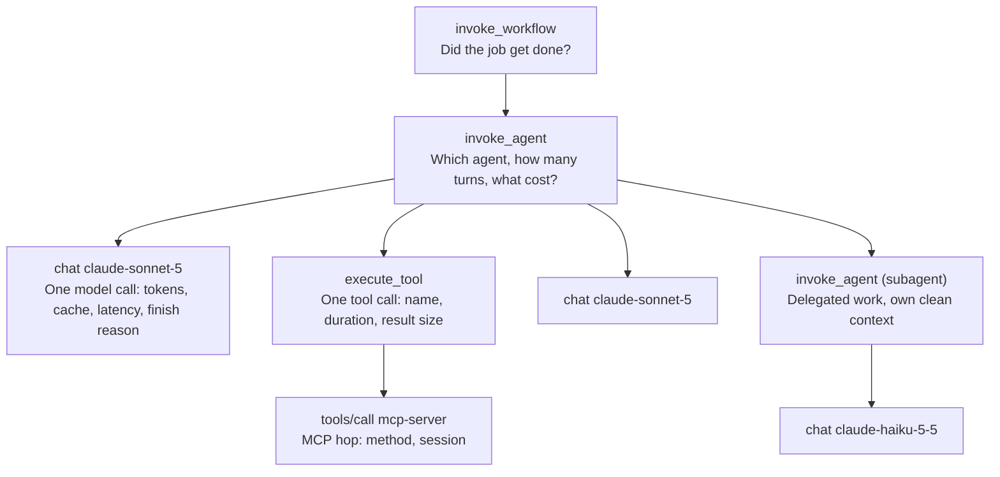

<LevelBadge level="advanced" />

本番環境でエージェントが説明のつかない動きをしたとき、最初にやるのは再現でしょう。同じプロンプトを同じツールに対して再実行すると、まったく違う、それでいて筋の通った答えが返ってきます。バグは消えたのではなく、修正されないまま身を潜めているのです。

この瞬間こそ、このページの主張のすべてです。従来のサービスは十分に決定的なので、ログは「あると便利」な程度のものです。入力が分かれば挙動を再導出できます。エージェントの実行は**非決定的な分散トレース**です。トークンごとにサンプリングされ、すでに変化したツールの結果によって分岐し、あなたのプロセス、モデルプロバイダ、そして任意の数の MCP サーバーにまたがります。再導出はできません。記録したか、失われたか、そのどちらかです。

つまりエージェントのオブザーバビリティは「ダッシュボードは後回し」で済む話ではありません。インシデントがそもそもデバッグ可能かどうかを決めるものです。2026 年にはようやく共通の語彙が整いました。悪いニュースは、そしてほとんどのチームが最初の取り組みをやり直す羽目になる理由は、その語彙が**まだ安定していない**ことです。変更が明示的に許されている属性名に 40 枚のパネルを結び付ける前に、それを教えてくれる人はほとんどいません。

<Callout type="objectives" items={[
  "エージェントの実行が生成すべき 4 種類のスパンと、それぞれに何を載せるかを知る",
  "すべての gen_ai.* 属性が OpenTelemetry の 'Development' バッジを付けたままである理由と、それに耐えるダッシュボードの作り方を理解する",
  "正確な変数名で Claude Code の OpenTelemetry エクスポートを有効にし、出力されるメトリクスとイベントを読む",
  "Anthropic サポートが検索できる唯一の識別子である request-id を取得する",
  "3 つのプライバシーの落とし穴を避ける: ID は伏せ字にならない、コンテンツの制御はシグナルごと、コレクターのエンドポイントは流出経路になる",
  "メトリクスの請求書が届く前に、カーディナリティの予算を決める"
]} />

:::info[もうこの計装を自分で書かなくてよいかもしれません]
2026 年 10 月以降、Claude API と Claude SDK はこれらのスパンを自分で出力します（ベータ）。1 回の API リクエスト内の各モデルリクエストや、API が実行した各サーバーツールなど、あなたのプロセスからは見えないものについてのスパンも含みます。このページは、名前が*何を意味するか*と、変更されうる名前の上にどう構築するかについてのページであり続けます。セットアップ、トークン数を正直に保つための重複ルール、配信のセマンティクスについては、[ファーストパーティの OpenTelemetry トレーシング](/docs/api/opentelemetry-tracing)を参照してください。
:::

## 再実行はデバッグではない

エージェントの実行には、通常のデバッグの反射を壊す 4 つの性質があります。

| 性質 | 壊れる反射 |
| --- | --- |
| **サンプリングは確率的** | 「同じ入力でもう一度実行する」。同じ入力は同じ実行ではありません。 |
| **ツールの結果はライブ** | temperature 0 でも、データベース、時計、Web を読むツールは新しい値を返します。軌跡はステップ 2 で分岐します。 |
| **判断はコードではなくコンテキストの中にある** | スタックトレースには `callModel()` が出ます。モデルに誤ったツールを選ばせた 180 KB の蓄積された履歴は出ません。 |
| **失敗はしばしば静か** | 壊れたエージェントはめったに例外を投げません。HTTP 200 で自信満々の誤答を返します。捕まえる例外がありません。 |

最後の点は強調に値します。通常の計装の優先順位を逆転させるからです。典型的なサービスではまずエラーを計装します。エージェントでは、**興味深い失敗は成功の形をしています**。完了し、お金がかかり、誤ったことをしたターンです。`error.type` で終わったスパンだけを記録していれば、問題のうち簡単な半分しか記録していません。

## エージェント実行の 4 つのスパン

OpenTelemetry の GenAI セマンティック規約がその構造を定義しています。実用的なメンタルモデルは、それぞれ別の問いに答える 4 階層の入れ子です。

命名規則は仕様で定められており、それに従うことで、自分で書いたわけではないツールでもトレースが読めるようになります。

- **推論スパン** — `gen_ai.operation.name` は `chat`（または `embeddings`、`text_completion`、`generate_content`）で、スパン名は `{gen_ai.operation.name} {gen_ai.request.model}`、たとえば `chat claude-sonnet-5` です。スパン種別は `CLIENT`。
- **エージェントスパン** — `create_agent {gen_ai.agent.name}` と `invoke_agent {gen_ai.agent.name}`。名前がない場合は素の `invoke_agent` にフォールバックします。クライアント版と内部版の両方があり、ホスト型エージェントと自前のループを区別できるのはこのためです。
- **ワークフロースパン** — `invoke_workflow {gen_ai.workflow.name}`。エージェントの上位にあるマルチエージェントのオーケストレーション用です。
- **ツールスパン** — `execute_tool`。ツールの実際の実行用です。
- **MCP スパン** — 別の規約です。スパン名は `{mcp.method.name} {target}`（低カーディナリティのターゲットがない場合は `{mcp.method.name}` のみ）で、`mcp.method.name` は必須、`mcp.session.id` は推奨です。MCP のツール呼び出しスパンにも `gen_ai.operation.name` を設定することが明示的に推奨されており、利用側が MCP のツール呼び出しを他のツール呼び出しと同様に扱えるようになります。

バイト数を割く価値のある呼び出しごとの属性: `gen_ai.provider.name`、`gen_ai.request.model`、`gen_ai.response.model`（この 2 つはプロバイダがスナップショットを固定すると異なります）、`gen_ai.usage.input_tokens`、`gen_ai.usage.output_tokens`、`gen_ai.usage.cache_read.input_tokens`、`gen_ai.usage.cache_write.input_tokens`、`gen_ai.usage.reasoning.output_tokens`、`gen_ai.response.finish_reasons`、そしてストリーミングでは `gen_ai.response.time_to_first_chunk` です。

Anthropic については、汎用規約を上書きするプロバイダ規約があります。`gen_ai.provider.name` は `"anthropic"` でなければならず（MUST）、最後に付け足すのではなく**スパン作成時**に設定すべきです（SHOULD）。この細かい点は見た目以上に重要です。テールベースのサンプリングやプロバイダ単位のルーティングルールは、スパン開始時に存在する属性にしか作用できないからです。

<VerifyNote lastVerified="2026-10-09" source="https://github.com/open-telemetry/semantic-conventions-genai">
上記のスパン名、オペレーション名、属性名は、OpenTelemetry GenAI セマンティック規約リポジトリ（`docs/gen-ai/gen-ai-spans.md`、`gen-ai-agent-spans.md`、`anthropic.md`、`mcp.md`）によるものです。その中のすべての文書は **Status: Development** と記されています。特定の名前に依存する前に再確認してください。
</VerifyNote>

## 誰も警告してくれない点: 規約は安定していない

設計を左右すべき事実があります。ベンダーのオブザーバビリティのランディングページには載っていません。

**`gen_ai.*` のすべての属性、スパン、メトリクス、イベントは "Development" とマークされています**。これは以前「experimental」と呼ばれていたものを OpenTelemetry が言い換えた用語です。Stable なものは一つもありません。そして 2026 年に規約は物理的に移動しました。GenAI の資料はメインの `open-telemetry/semantic-conventions` リポジトリを離れ、専用の `open-telemetry/semantic-conventions-genai` リポジトリに移りました。こちらには**タグ付きリリースが一つもなく**、タグもリリースもゼロで、コミットは毎日積み上がっています。

そのリポジトリの属性表を読むと、非対称性にほとんど笑ってしまいます。GenAI 推論スパンで緑の **Stable** バッジが付いている属性は `error.type`、`server.address`、`server.port` です。GenAI とは何の関係もない 3 つです。スパンを*LLM についてのもの*にしているものはすべて Development です。

だから、「規約を使うな」と読まないでください。使いましょう。変わるかもしれない共通語彙のほうが、確実に通用しない独自語彙よりましです。**高価なものをそれらの名前に直接結び付けるな**と読んでください。次の 3 つの習慣で安く済みます。

<Steps items={[
  {
    "title": "インラインの文字列リテラルではなく、マッピング層経由で出力する",
    "body": "アプリが書き込むすべての属性キーを所有するモジュールを一つ置きます。`gen_ai.usage.reasoning.output_tokens` の名前が変わったとき、変更するのは 60 か所の呼び出し箇所ではなく一つの定数です。20 行のファイルで、このページで最もリターンの大きいことです。"
  },
  {
    "title": "規約のバージョンをリソース属性として記録する",
    "body": "出力した際の semconv のリビジョンをすべてのスパンに刻みます。タグがないので、コミット SHA でかまいません。半年後、古いトレースを正しく解釈する唯一の方法は、それがどの綴りを使っていたかを知ることです。これがないと、名前の変更で一つのメトリクスが静かに二つに割れ、両方をまたいで平均してしまいます。"
  },
  {
    "title": "生の属性名ではなく導出値でアラートを出す",
    "body": "`cost_per_completed_task`、`cache_hit_ratio`、`tool_error_rate` をクエリ層かレコーディングルールで一度だけ定義し、すべてのダッシュボードとアラートをそこに向けます。名前が変わったとき、40 枚のパネルが静かに壊れるのではなく、一つの定義が大きな音を立てて壊れます。"
  },
  {
    "title": "標準の識別子と並べて、プロバイダ自身の識別子を保持する",
    "body": "規約は揺れるかもしれませんが、`request-id` は揺れません。次のセクションを参照してください。トレースをプロバイダと突き合わせる必要が生じたときの脱出口です。"
  }
]} />

## インシデントを実際に解決する識別子: `request-id`

すべての Claude API レスポンスには、`req_018EeWyXxfu5pfWkrYcMdjWG` のような値の `request-id` レスポンスヘッダが付きます。同じ値がエラーレスポンスの本文では `request_id` フィールドとして現れます。Anthropic サポートが求める識別子であり、向こう側の誰かがあなたの特定の呼び出しを調べられる唯一のものです。

スパンに載せてください。30 バイトで済み、「エージェントは 03:12 UTC に失敗した、候補は 900 件のリクエスト」と、一回の検索との違いになります。

<PromptCard title="Capture the Anthropic request ID onto the current span (Python)">
{`import anthropic
from opentelemetry import trace

client = anthropic.Anthropic()
span = trace.get_current_span()

message = client.messages.create(
    model="claude-sonnet-5",
    max_tokens=1024,
    messages=[{"role": "user", "content": "Hello, Claude"}],
)

# The Python and TypeScript SDKs expose it directly on the response object.
span.set_attribute("anthropic.request_id", message._request_id)
span.set_attribute("gen_ai.usage.input_tokens", message.usage.input_tokens)
span.set_attribute("gen_ai.usage.output_tokens", message.usage.output_tokens)`}
</PromptCard>

必要になる前に知っておきたい 3 つの注意点があります。

- **Python と TypeScript** は、トップレベルのレスポンスオブジェクトの `_request_id` として公開しています。**C#、Go、Java、PHP** は生のレスポンスアクセサ（`with_raw_response` / `.withResponse()` / `.withRawResponse()` / `WithRawResponse` / `option.WithResponseInto` / `->raw`）経由で公開します。**Ruby** は SDK がオブジェクト上に出さないため、リクエストごとのミドルウェアが必要です。
- **エラーでもこれは付いています。** 呼び出しが失敗したとき、`request_id` は JSON のエラー本文にあります。相関付けは、最も必要なまさにそのケースで生き残ります。
- **Claude Platform on AWS には 2 つの ID があり、主たるものは Anthropic のものではありません。** `x-amzn-requestid` が主 ID で CloudTrail にインデックスされるものです。`request-id` は副です。CloudTrail の検索には AWS のもの、Anthropic サポートへのチケットには Anthropic のものを使います。両方をラベル付きで記録しないと、間違ったシステムの検索で午後を費やすことになります。

<VerifyNote lastVerified="2026-10-09" source="https://platform.claude.com/docs/en/api/errors">
`request-id` ヘッダ、`request_id` エラー本文フィールド、SDK ごとのアクセサ、Claude Platform on AWS での 2 つの ID の挙動は、いずれも Claude API のエラーページに記載されています。ヘッダ名とフィールド名は安定した API 面であり、SDK ごとの使い勝手は SDK のバージョンで変わります。
</VerifyNote>

## Claude Code: すでにすべてをエクスポートする唯一のエージェント

あなたのエージェントが Claude Code そのもの、つまり CI、フリート、チーム全体で動いているものなら、何も計装する必要はありません。OpenTelemetry エクスポーターが同梱されています。大規模に運用しているチームの多くはこれを一度も有効にしていませんが、それは惜しいことです。「これにいくらかかっていて、機能しているのか」に直接答えてくれるからです。

<PromptCard title="Enable Claude Code telemetry against a local OTLP collector">
{`export CLAUDE_CODE_ENABLE_TELEMETRY=1
export OTEL_METRICS_EXPORTER=otlp
export OTEL_LOGS_EXPORTER=otlp
export OTEL_EXPORTER_OTLP_PROTOCOL=grpc
export OTEL_EXPORTER_OTLP_ENDPOINT=http://localhost:4317
export OTEL_EXPORTER_OTLP_HEADERS="Authorization=Bearer your-token"
claude`}
</PromptCard>

`CLAUDE_CODE_ENABLE_TELEMETRY=1` がマスタースイッチです。これがなければ、他に何を設定しても何もエクスポートされません。その上でシグナルごとにエクスポーターを選びます。`OTEL_METRICS_EXPORTER` は `otlp`、`prometheus`、`console`、`none` を受け付け、`OTEL_LOGS_EXPORTER` は `otlp`、`console`、`none` を受け付けます。**トレースは別でベータのゲートがあります**。`CLAUDE_CODE_ENHANCED_TELEMETRY_BETA=1` も設定し、そのうえで `OTEL_TRACES_EXPORTER` を設定します。エクスポート間隔のデフォルトは、メトリクスが 60,000 ms、ログが 5,000 ms です。

ダッシュボードを構築する価値があるのはメトリクスです。コスト系は、現実の問いに答えられるだけ細かく帰属されているからです。

| メトリクス | 答えられる問い |
| --- | --- |
| `claude_code.cost.usage` (USD) | 支出。モデル別、クエリソース別（メインエージェント / サブエージェント / 補助）に帰属可能 |
| `claude_code.token.usage` (tokens) | 同じ形のトークン版。実際に最適化する対象はこちら |
| `claude_code.session.count` | 導入度。セッションが横ばいでコストが上昇するのは、両方上昇するのとは別の話です。 |
| `claude_code.active_time.total` (s) | ターミナルを開きっぱなしにしたのとは区別された、実際に使われた時間 |
| `claude_code.lines_of_code.count` | 変更の量。分母であり、目標にはしてはいけません |
| `claude_code.code_edit_tool.decision` | **品質シグナル。** 編集ツールの承認/拒否。拒否の増加は、エージェントがより悪い提案をしていることを意味します。 |
| `claude_code.commit.count`、`claude_code.pull_request.count` | 実際にマシンから外へ出た成果物 |

イベント（ログとしてエクスポート）は、アクションごとの記録です。`claude_code.user_prompt`、`claude_code.assistant_response`、`claude_code.tool_result`、`claude_code.tool_decision`、`claude_code.api_request`、`claude_code.api_error`、`claude_code.api_refusal`、`claude_code.api_retries_exhausted`、`claude_code.permission_mode_changed`、`claude_code.mcp_server_connection`、`claude_code.skill_activated`、`claude_code.plugin_installed`、`claude_code.plugin_loaded`、`claude_code.at_mention`、`claude_code.auth`、`claude_code.hook_registered`、`claude_code.managed_settings_resolved`、`claude_code.internal_error`、さらに生のペイロード用に `claude_code.api_request_body` / `claude_code.api_response_body` があります。

そのうち 2 つは初日から保存クエリにする価値があります。`claude_code.api_retries_exhausted` は、障害が開発者に届く形そのものです。SDK のバックオフが諦めた後に発火します。そして `claude_code.permission_mode_changed` は監査証跡です。誰のトランスクリプトも読まずに、フリートがポリシーより緩いモードで動いていたことを知る方法です。

<VerifyNote lastVerified="2026-10-09" source="https://code.claude.com/docs/en/monitoring-usage">
変数名、エクスポーターのオプション、メトリクス名、イベント名、トレースのベータゲートは、Claude Code の監視ドキュメントによるものです。Claude Code は頻繁にリリースされ、この面は広がり続けます。アラートを構築する前に、公式ページで名前を確認してください。
</VerifyNote>

### 複数チームへの帰属を安く行う

一つの変数が、タグ戦略全体の役割を果たします。`OTEL_RESOURCE_ATTRIBUTES` はメトリクスのラベルとしてエクスポートされる（`OTEL_METRICS_INCLUDE_RESOURCE_ATTRIBUTES` で制御、デフォルトはオン）ので、コストセンターへの帰属は、開発環境をプロビジョニングする仕組みの中の 1 行で済みます。

<PromptCard title="Attribute agent spend to a team and cost center">
{`export OTEL_RESOURCE_ATTRIBUTES="department=engineering,team.id=platform,cost_center=eng-123"`}
</PromptCard>

## 3 つのプライバシーの落とし穴

善意のテレメトリ導入がつまずくのはここで、3 つともコレクターが稼働する前に知っていれば避けられます。

**1. コンテンツはデフォルトで伏せ字になる。ID はならない。** Claude Code のデフォルトは*コンテンツ*については本当に保守的です。プロンプト、アシスタントの応答、ツールのパラメータとツール出力は、シグナルごとにオプトインしない限りすべて伏せ字です（`OTEL_LOG_USER_PROMPTS`、`OTEL_LOG_ASSISTANT_RESPONSES`、`OTEL_LOG_TOOL_DETAILS`、`OTEL_LOG_TOOL_CONTENT`、`OTEL_LOG_RAW_API_BODIES`）。サードパーティのプラグイン名は、`OTEL_LOG_TOOL_DETAILS=1` にするまで `"third-party"` というプレースホルダで表示されます。しかし `user.email`、つまりサインイン時の、あるいはクラウドセッション自身の認証情報から得た実際のアドレスは、利用可能なら含まれ、`organization.id` は認証済みなら常に存在します。つまりデフォルトの姿勢は*「何を入力したかは分からないが、誰であるかは正確に分かる」*です。

ほとんどの企業にとっては正しいデフォルトで、一部にとっては誤りです。隣のものと区別する価値があります。`user.id` は初回起動時に生成されて `~/.claude.json` に保存されるランダムな匿名識別子で、個人情報を含まず、Claude アカウントから導出されたものではないと文書化されています。`user.account_uuid` と `user.account_id` はアカウントに紐付くもので、`OTEL_METRICS_INCLUDE_ACCOUNT_UUID` でオプトアウトできます。この 3 つのうちどれをコレクターに保持させるかを意図的に決め、開発者にどれなのかを伝えてください。

**2. コンテンツのキャプチャを有効にすると、シークレットが第二のシステムに移る。** `OTEL_LOG_TOOL_CONTENT=1` は、望んで当然のものです。エージェントのバグの多くが見えるのはツール出力だからです。同時にそれは、エージェントが読んだすべてのファイル、すべてのコマンド出力、`.env` がたまたま含んでいたものすべてが、あなたのリポジトリではなく、オブザーバビリティバックエンドの保持ポリシーとアクセス制御の下に置かれることを意味します。有効化は、オブザーバビリティのベンダーにソース管理と同じ権限を与えることだと考えてください。実際にそうだからです。インシデント中だけ必要なら、インシデントの間だけ有効にします。

**3. コレクターのエンドポイントは流出経路である。** これは牙のある落とし穴です。テレメトリは環境変数で設定され、クラウド環境ではそれがすべてのユーザーから読めるため、開発者が設定した `OTEL_EXPORTER_OTLP_ENDPOINT` が、セッション全体のテレメトリを聞いたこともないホストに向けることができます。ドキュメント自身のガイダンスが対策です。認証情報とエンドポイントは、環境変数に置くのではなくサーバー管理の設定に置きます。そこでは管理された認証情報が、無許可のコレクターへのエクスポートを防ぐために、開発者が設定した変数を取り除けます。コンテンツのキャプチャを有効にしているなら、これは衛生の項目ではなく、効いてくる統制になります。

認証情報をローテーションする場合は、静的なトークンではなく動的ヘッダーのフックがあります。`otelHeadersHelper` を JSON を出力するスクリプトに向けると、起動時とその後およそ 29 分ごとに実行されます（`CLAUDE_CODE_OTEL_HEADERS_HELPER_DEBOUNCE_MS` で調整可能）。`http/protobuf` と `http/json` で動作し、`grpc` では動作しません。クイックスタートが grpc を使っているので、知らないと 1 時間を失う点です。

## カーディナリティ: 請求の前に予算を決める

エージェントのテレメトリは、高カーディナリティのラベルを生み出すのが異様に得意です。自然な識別子が実行ごとのものだからです。セッション ID は定義上セッションごとに一意で、メトリクスに付けると、セッションごとに一つの時系列を製造することになります。

Claude Code はこのトレードオフを隠さず明示しており、デフォルトを見れば設計者がどう重みづけたかが分かります。

| 変数 | デフォルト | 追加されるもの |
| --- | --- | --- |
| `OTEL_METRICS_INCLUDE_SESSION_ID` | `true` | `session.id`、`ccr.session.id` — **このセットで最高のカーディナリティ** |
| `OTEL_METRICS_INCLUDE_ACCOUNT_UUID` | `true` | `user.account_uuid`、`user.account_id` |
| `OTEL_METRICS_INCLUDE_RESOURCE_ATTRIBUTES` | `true` | `OTEL_RESOURCE_ATTRIBUTES` に入れたもの |
| `OTEL_METRICS_INCLUDE_VERSION` | `false` | `app.version` |
| `OTEL_METRICS_INCLUDE_ENTRYPOINT` | `false` | `app.entrypoint` |
| `OTEL_METRICS_INCLUDE_REPOSITORY` | `false` | `vcs.*` リポジトリ属性 |

Claude Code を超えて通用するルールは、**実行ごとの識別子はメトリクスのラベルではなく、スパンとイベントに置く**ことです。スパンはもともと実行ごとに一つなので、そこに付けるセッション ID は無料で、トレースを結合可能にします。カウンタやヒストグラムに付けると、時系列の数にトラフィック量が掛け算されます。ある数値が一つの実行にしか意味を持たないなら、それはメトリクスではありません。

メトリクスとトレースの結合が本当に役立つため、セッション ID はデフォルトでオンです。バックエンドが時系列ごとに課金するなら、それが最初に切り替えるスイッチであり、請求書に驚いたときに最初に確認すべきものです。

## 計装の出発点となる計画

成熟度モデルではありません。下の順序は、各ステップがそれ単体で役に立ち、エージェントが引き起こしうるコストに見合うところで止められるように選んであります。

<Steps items={[
  {
    "title": "すべてのターンについて、トークン数、キャッシュの内訳、モデル、request-id を記録する",
    "body": "どのダッシュボードよりも前に。入力、出力、キャッシュ読み取り、キャッシュ書き込み、推論トークン、要求したモデル、応答したモデル、プロバイダのリクエスト ID。この一つのレコードがコストに関する問いの大半に答え、すべてのインシデントをプロバイダと突き合わせ可能にします。このページで他に何もしないなら、これだけはやってください。"
  },
  {
    "title": "呼び出しだけでなく、ループにスパンを張る",
    "body": "エージェント呼び出しごとに一つのスパンが、モデル呼び出しごとに一つ、ツール呼び出しごとに一つのスパンを包みます。高くつくエージェントのバグは、ほとんど単一の呼び出しの中にはありません。2 ターンで済む仕事に 11 ターンかかったループであり、親スパンがなければそれは見えません。"
  },
  {
    "title": "サーフェスごとに品質シグナルを一つ加える",
    "body": "品質という分母のないコストは、「やらないこと」へ最適化されます。Claude Code では claude_code.code_edit_tool.decision が最初から与えられています。自前のエージェントでは、ユーザーがすでに暗黙に承認または拒否しているものを選び、初日からスパン属性として記録します。"
  },
  {
    "title": "導出した比率でアラートを出し、予算アラートを最優先にする",
    "body": "cost_per_completed_task、cache_hit_ratio、tool_error_rate、turns_per_task。3 ターンから 30 ターンへ静かに変わったエージェントは、緩やかな週の絶対コストでは見えず、比率なら明白です。これに実際の支出上限を組み合わせてください。テレメトリは起きたことを教えてくれますが、止めてはくれません。"
  },
  {
    "title": "コンテンツのキャプチャを意図的に決め、その決定を書き残す",
    "body": "デフォルトはオフ、インシデント時はオン、どちらの場合も文書化し、コレクターがどの ID 属性を保持するかも含めます。チームには知る権利があり、一年後にはあなた自身もそうなります。"
  }
]} />

## よくある間違い

- **ループではなくモデル呼び出しだけを計装する。** 呼び出しレベルのデータは、30 ターン分を支払っていると気づくまでは問題なさそうに見えます。親スパンがなければ、それに気づくための `turns_per_task` もありません。
- **失敗したスパンだけを残す。** エージェントは HTTP 200 で失敗します。成功もサンプリングしないと、トレースストアには、すでに簡単だったバグしか入りません。
- **`gen_ai.*` の名前をダッシュボードにハードコードする。** すべて Development で、タグ付きリリースのないリポジトリにあり、コミットは毎日積み上がっています。マッピングモジュールを一つ、semconv バージョンのリソース属性を一つ。
- **セッション ID や実行 ID をメトリクスのラベルに付ける。** 実行ごとに一つの時系列になります。スパンに付ければ無料で、より役立ちます。
- **品質シグナルなしでコストを測る。** コストを下げるあらゆるレバーは、行われる仕事も減らします。比率は目標であり、生のコスト値は罠です。
- **`request-id` を捨てる。** 30 バイトで、プロバイダのシステムへ境界を越える唯一の識別子です。
- **「とりあえず」ツールの内容をログに残す。** 保持は即座に、現実に発生し、「とりあえず」には終了日がありません。決めて、インシデントのために有効にし、終わったら無効にします。
- **クイックスタートのトランスポートがすべてをサポートすると思い込む。** 動的な認証ヘッダーは `http/protobuf` と `http/json` で動作し、クイックスタートが渡してくる `grpc` では動作しません。
- **コストのテレメトリを統制として扱う。** `claude_code.cost.usage` は各リクエストが完了した*後に*増加します。優れた観測手段であり、何かをブロックしたことは一度もありません。

## プロバイダ横断の現実チェック

規約は設計上プロバイダ中立です。`semantic-conventions-genai` には、汎用の文書と並んで Anthropic、OpenAI、AWS Bedrock、Azure AI Inference 専用の文書があり、混在するフリートが扱えるのはそのおかげです。それでも正規化はあなたの仕事として 2 つ残ります。

**トークンの勘定は、どこでも同じ意味ではありません。** キャッシュされた入力、推論トークン、マルチモーダルのトークンは、プロバイダごとに価格も、ときに数え方も異なるため、プロバイダをまたいで合計した `gen_ai.usage.input_tokens` は意味のない数字です。末端で各プロバイダ自身のレートを使って金額に換算し、金額を集計してください。実際に比較可能な単位はコストだけです。

**プロバイダ自身のリクエスト識別子には標準の属性がありません。** どのプロバイダにもあり、呼び方はそれぞれ違い、規約はそれがどこに入るかを規定していません。キーを一つ選び（`provider.request_id` で十分です）、すべてのプロバイダのものをそこに書き込んでください。曖昧さは、すでにスパンに付いている `gen_ai.provider.name` が解消します。

<Quiz questions={[
  {
    "q": "「ローカルで再現する」がエージェント実行のデバッグ戦略として成り立たないのはなぜですか。",
    "options": [
      "ローカルのマシンはフロンティアモデルを動かすには遅すぎる",
      "サンプリングは確率的でツールの結果はライブなので、temperature 0 でも軌跡は数ステップで分岐する",
      "エージェントフレームワークはトレースを暗号化する",
      "プロバイダは同一リクエストの繰り返しを拒否する"
    ],
    "answer": 1,
    "explain": "エージェントの実行は非決定的な分散トレースです。サンプリングは変動し、データベース、時計、Web を読むツールは新しい値を返すため、軌跡は早い段階で分岐します。実行は入力から再導出できません。記録されたか、失われたかのどちらかです。"
  },
  {
    "q": "GenAI 推論スパンで、OpenTelemetry の 'Stable' バッジが付いている属性はどれですか。",
    "options": [
      "gen_ai.request.model と gen_ai.usage.input_tokens",
      "gen_ai.provider.name のみ",
      "error.type、server.address、server.port。GenAI 固有ではない汎用のもの",
      "semconv v1.42.0 以降はすべて"
    ],
    "answer": 2,
    "explain": "すべての gen_ai.* 属性、スパン、メトリクス、イベントは Development とマークされています。GenAI スパン上の Stable バッジは、汎用属性の error.type、server.address、server.port のものです。この非対称性を前提に設計します。高価なダッシュボードは、生の gen_ai.* 名ではなく、マッピング層と導出メトリクスを経由させます。"
  },
  {
    "q": "文書化されたデフォルトのまま Claude Code のテレメトリを有効にしました。コレクターには何が保持されますか。",
    "options": [
      "完全なプロンプトとツール出力。ただし ID はなし",
      "CLAUDE_CODE_ENHANCED_TELEMETRY_BETA=1 も設定するまで何もなし",
      "user.email と organization.id を持つメトリクスとイベント。ただしプロンプト、応答、ツールの内容は伏せ字",
      "属性がまったくない集計カウントのみ"
    ],
    "answer": 2,
    "explain": "コンテンツはデフォルトで伏せ字です。プロンプト、応答、ツールの詳細、ツールの内容は、それぞれ個別のオプトイン変数が必要です。ID は伏せ字ではありません。user.email は利用可能なら含まれ、organization.id は認証済みなら常に存在します。ベータゲートはメトリクスやイベントではなく、トレースに特有のものです。"
  },
  {
    "q": "セッションごとの識別子はどこに置くべきですか。",
    "options": [
      "セッション別に支出をグループ化できるよう、メトリクスのラベルに",
      "スパンとイベントに。メトリクスのラベルには決して置かない",
      "どこにも置かない。常に個人データだから",
      "生の API リクエスト本文のログにのみ"
    ],
    "answer": 1,
    "explain": "スパンはすでに一つの実行を表すので、そこに付けたセッション ID は何のコストもかからず、トレースを結合可能にします。カウンタやヒストグラムに付けるとセッションごとに一つの時系列が生まれ、時系列の数にトラフィック量が掛け算されます。Claude Code は結合が有用なので OTEL_METRICS_INCLUDE_SESSION_ID をデフォルトで true にしており、バックエンドが時系列ごとに課金するなら最初に切り替えるスイッチです。"
  }
]} />

<Flashcards cards={[
  { "front": "エージェントの実行に必要なのは再現ではなく記録である理由", "back": "確率的なサンプリング + ライブなツール結果 + 蓄積されたコンテキストの中にある判断 + 静かな HTTP 200 の失敗。軌跡は数ステップで分岐するため、実行は入力から再導出できません。" },
  { "front": "GenAI 推論スパン名", "back": "{gen_ai.operation.name} {gen_ai.request.model}。例: 'chat claude-sonnet-5'。スパン種別は CLIENT。オペレーション名には chat、embeddings、text_completion、generate_content があります。" },
  { "front": "エージェントとワークフローのスパン名", "back": "create_agent {gen_ai.agent.name} · invoke_agent {gen_ai.agent.name}（名前がなければ素の 'invoke_agent'。クライアント版と内部版あり）· invoke_workflow {gen_ai.workflow.name} · ツール実行は execute_tool。" },
  { "front": "MCP スパンの規約", "back": "スパン名は {mcp.method.name} {target}。低カーディナリティのターゲットがなければ {mcp.method.name} のみ。mcp.method.name は必須、mcp.session.id は推奨。gen_ai.operation.name も設定することが推奨され、MCP のツール呼び出しが他のツール呼び出しと一緒にグループ化されます。" },
  { "front": "Anthropic プロバイダ規約", "back": "gen_ai.provider.name は \"anthropic\" でなければならず（MUST）、スパン作成時に設定すべき（SHOULD）。最後に付け足すのではなく、サンプリングとルーティングのルールが作用できるようにします。" },
  { "front": "gen_ai.* の安定性ステータス（2026 年 10 月）", "back": "すべて Development で、Stable は一つもありません。規約は open-telemetry/semantic-conventions-genai に移り、タグもリリースもゼロで毎日コミットされています。GenAI スパンで Stable なのは error.type、server.address、server.port のみ。" },
  { "front": "不安定な規約を生き延びる", "back": "1) すべての属性キーを一つのマッピングモジュールが所有する。2) 出力時の semconv コミットを各スパンに刻む。3) 生の名前ではなく導出した比率でアラートを出す。4) プロバイダ自身のリクエスト ID を並べて保持する。" },
  { "front": "Anthropic の request-id", "back": "request-id レスポンスヘッダ（例: req_018EeWyXxfu5pfWkrYcMdjWG）。エラー本文の request_id と同じ値。Python/TS ではレスポンスオブジェクトの _request_id、他は生のレスポンスアクセサ、Ruby はミドルウェア。Anthropic サポートが検索できる唯一の ID。" },
  { "front": "Claude Platform on AWS — 2 つのリクエスト ID", "back": "x-amzn-requestid が主で CloudTrail にインデックスされる。Anthropic の request-id は副。CloudTrail の検索には AWS の ID、Anthropic サポートには Anthropic の ID。両方をラベル付きで記録します。" },
  { "front": "Claude Code テレメトリのマスタースイッチ", "back": "CLAUDE_CODE_ENABLE_TELEMETRY=1。その上で OTEL_METRICS_EXPORTER（otlp/prometheus/console/none）と OTEL_LOGS_EXPORTER（otlp/console/none）。トレースは CLAUDE_CODE_ENHANCED_TELEMETRY_BETA=1 も必要で、その後 OTEL_TRACES_EXPORTER。" },
  { "front": "Claude Code の品質メトリクス", "back": "claude_code.code_edit_tool.decision — 編集ツールの承認/拒否。コストに分母を与える唯一のメトリクス。拒否の増加は、支出が横ばいでもエージェントがより悪い提案をしていることを意味します。" },
  { "front": "初日にクエリしておくべき Claude Code の 2 つのイベント", "back": "claude_code.api_retries_exhausted（バックオフが諦めた後、障害が開発者に届く形）と claude_code.permission_mode_changed（トランスクリプトを読まずに、ポリシーより緩く動いているフリートの監査証跡）。" },
  { "front": "コンテンツと ID のデフォルト", "back": "コンテンツはデフォルトで伏せ字（OTEL_LOG_USER_PROMPTS / _ASSISTANT_RESPONSES / _TOOL_DETAILS / _TOOL_CONTENT / _RAW_API_BODIES をそれぞれオプトイン）。ID は伏せ字ではない: 利用可能なら user.email、認証済みなら常に organization.id。" },
  { "front": "Claude Code の user.id と user.account_uuid", "back": "user.id は初回起動時に ~/.claude.json に生成されるランダムな匿名識別子で、個人情報を含まずアカウントから導出されないと文書化されています。user.account_uuid / user.account_id はアカウントに紐付き、OTEL_METRICS_INCLUDE_ACCOUNT_UUID でオプトアウトできます。" },
  { "front": "流出経路としてのテレメトリ設定", "back": "クラウド環境の環境変数はすべてのユーザーから読めるため、開発者が設定した OTEL_EXPORTER_OTLP_ENDPOINT がセッションのテレメトリをリダイレクトできます。エンドポイントと認証情報はサーバー管理の設定に置き、管理された認証情報が開発者設定の変数を取り除くようにします。" },
  { "front": "動的な OTel 認証ヘッダー", "back": "otelHeadersHelper は JSON を出力するスクリプトを指す。起動時と約 29 分ごとに実行（CLAUDE_CODE_OTEL_HEADERS_HELPER_DEBOUNCE_MS）。http/protobuf と http/json で動作 — クイックスタートが使う grpc では動作しません。" },
  { "front": "エージェントのカーディナリティのルール", "back": "実行ごとの識別子はスパンとイベントに置き、メトリクスのラベルには決して置かない。カウンタにセッション ID を付ければ、セッションごとに一つの時系列になります。ある数値が一つの実行にしか意味を持たないなら、それはメトリクスではありません。" },
  { "front": "プロバイダ横断のトークン合計が無意味な理由", "back": "キャッシュされた入力、推論トークン、マルチモーダルのトークンは、プロバイダごとに数え方も価格も異なります。末端で各プロバイダ自身のレートで金額に換算し、金額を集計します。比較可能な単位はコストだけです。" }
]} />

<Callout type="takeaways" items={[
  "エージェントの実行は再現できないので、オブザーバビリティは任意のツールではなく、存在する唯一の記録です。",
  "エラーだけでなく、興味深い成功も記録する。エージェントは HTTP 200 と自信満々の誤答で失敗します。",
  "すべての gen_ai.* の名前は 'Development' で、タグ付きリリースのないリポジトリにあります。規約は使いつつ、ダッシュボードはマッピング層と導出メトリクスを経由させます。",
  "呼び出しだけでなくループにスパンを張る。高くつくバグは 2 ターンの仕事を 11 ターンかけてやることで、呼び出しレベルでは見えません。",
  "すべてのスパンに request-id を載せる。30 バイトで、プロバイダのシステムへ越境する唯一の識別子です。",
  "Claude Code はすでにこれをすべてエクスポートします。環境変数一つで。claude_code.code_edit_tool.decision は、多くのチームに欠けている品質の分母です。",
  "コンテンツはデフォルトで伏せ字。ID はそうではない。user.id、user.email、user.account_uuid のどれをコレクターが保持するかを把握し、チームに伝えましょう。",
  "OTLP エンドポイントは流出経路です。特にコンテンツのキャプチャがオンの場合は、サーバー側で管理します。",
  "実行ごとの ID はスパンに、メトリクスのラベルには決して置かない。コストのテレメトリは観測するだけで、リクエストを一つもブロックしたことはありません。"
]} />

## 次へ

- [ファーストパーティの OpenTelemetry トレーシング](/docs/api/opentelemetry-tracing) — API と SDK が自動で出力するスパンと、トークンの二重計上を防ぐ唯一のルール
- [キャッシュ診断](/docs/api/cache-diagnostics) — 当てにしていたキャッシュ読み取りが*なぜ*起きなかったかを説明する、リクエストごとのフィールド
- [ハードな支出上限](/docs/models/hard-spend-caps) — このページが観測するだけの強制レイヤー。どのプロバイダが実際にリクエストをブロックするか
- [エージェントの評価](/docs/playbooks/evaluating-agents) — 記録を始めた品質シグナルを、再現可能な判断に変える

## 出典と参考資料

- [OpenTelemetry GenAI semantic conventions](https://github.com/open-telemetry/semantic-conventions-genai) — GenAI 規約の移転先の専用リポジトリ。スパンとエージェントスパンの文書、Anthropic / OpenAI / Bedrock / Azure 向けのプロバイダ文書、MCP 規約、そしてそのすべてに付いた Development ステータスのバッジ
- [Generative AI semantic conventions — OpenTelemetry](https://opentelemetry.io/docs/specs/semconv/gen-ai/) — 移転の通知（"This page has moved and is no longer maintained in this repository"）
- [Monitoring usage — Claude Code](https://code.claude.com/docs/en/monitoring-usage) — テレメトリの変数、エクスポーター、メトリクス名とイベント名、コンテンツ制御とカーディナリティのスイッチ、動的ヘッダー、認証情報に関するサーバー管理設定のガイダンス
- [Claude API errors — Anthropic](https://platform.claude.com/docs/en/api/errors) — `request-id` ヘッダと `request_id` エラーフィールド、SDK ごとのアクセサ、Claude Platform on AWS の 2 つのリクエスト ID
- [Model Context Protocol specification](https://modelcontextprotocol.io/specification/2025-06-18/basic/transports) — セッション管理。`mcp.session.id` が識別するもの
- 関連: [エラーとレート制限](/docs/api/errors-and-rate-limits) · [エージェントの構築](/docs/api/building-agents) · [MCP のトークンコスト](/docs/claude-code/mcp-token-cost) · [長時間実行エージェントのハーネス](/docs/frontiers/long-running-agent-harnesses) · [エージェントがアップロードするもの](/docs/security/what-your-agent-uploads) · [AI ゲートウェイ](/docs/models/ai-gateways-litellm-openrouter-portkey)
