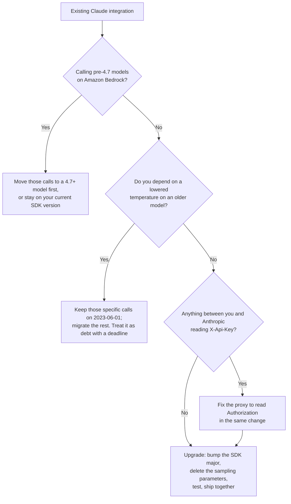

<LevelBadge level="intermediate" />

<VerifyNote lastVerified="2026-10-22" source="https://platform.claude.com/docs/en/api/versioning">
API バージョン `2026-10-21` は、Anthropic 公式のバージョン履歴に `2023-06-01` と `2023-01-01` と並んで掲載されています。このページの破壊的変更、SDK のバージョン番号、フィールド名の変更はすべて[公式の移行ガイド](https://platform.claude.com/docs/en/api/migration-2026-10-21)に基づいています。リリース前に必ず読み直してください — 移行ガイドは、公開後に*編集*される唯一の種類のドキュメントです。
</VerifyNote>

3年半のあいだ、「自分はどの API バージョンを使っているのか」という問いへの答えはちょうど1つでした — `2023-06-01` です。すべての SDK がそれを送り、すべてのチュートリアルがそれを貼り付け、誰も二度と考えませんでした。

**2026年10月21日**、それが変わりました。`anthropic-version: 2026-10-21` が現在の推奨バージョンであり、本物の破壊的リリースです：**ワイヤレベルの変更4件と SDK／CLI の変更9件**、異なる認証ヘッダー、そして**すでに対応済みかもしれないモデル別の非推奨化よりも厳しい**パラメーター削除があります。

チームが不意を突かれる部分、そしてこのページが存在する理由はここです：

> **このバージョンはヘッダーを編集して選ぶのではありません。依存関係をアップグレードして選ぶのです。**

Anthropic の SDK は、その**メジャー**バージョンが出荷された時点で最新だった API バージョンを送ります。古いメジャーは永遠に `2023-06-01` を送り続けます。新しいメジャーは `2026-10-21` を送ります。したがって、メジャーの境界をまたぐ通常の `pip install -U anthropic` や `npm update` が、アプリケーション全体の API バージョンを切り替えてしまい — 誰かが changelog を読んだかどうかに関わらず、すべての破壊的変更が1回のコミットで一緒にやってきます。

<Callout type="objectives" items={["2026-10-21 をいつ採用するかを決めるのが、あなたが制御するヘッダーではなく SDK のメジャーバージョンである理由","5分間のトリアージ：どの破壊的変更が実際にあなたのコードに影響するか","サンプリングパラメーターが既定値でも 400 になる理由と、残された唯一の抜け道","X-Api-Key から Authorization: Bearer への認証の変更と、それが静かに壊すプロキシ","エラーではなく誤った結果を返す2つの落とし穴（二重の認証情報、キーを抑制するヘッダー）","ワイヤ上で変わるものと、SDK の型でのみ変わるものの違い","本番の統合を緑のまま保つアップグレード順序"]} />

`★ Insight ─────────────────────────────────────`
このリリースには、性質のまったく異なる2種類の変更が同梱されており、混同すると丸一日を無駄にします。**ワイヤの変更**（削除されたパラメーター、拒否されるブロック配置、名前が変わったレスポンスフィールド）は `anthropic-version` ヘッダーによって決まるため、生の `curl`、あらゆる SDK、そして Message Batches のすべてに影響します。**SDK の変更**（`MessageParam` の共用体、削除された Text Completions、値が1つだけの enum の定数化）は、たまたま一緒についてくる通常のメジャーバージョンのリファクタリングで、ワイヤ上の JSON は変わりません。生の HTTP で API を呼んでいるなら、前者のリストだけが該当し、この移行は小さなものです。SDK を使っているなら、両方の移行を同時に行うことになり、実際より大きく感じるのはそのためです。
`─────────────────────────────────────────────────`

## まず：影響を受けますか？

ほかのものを読む前にこれを実行してください。ヒットした項目は下のセクションに対応します。ヒットがなければ、アップグレードは単なるバージョンの引き上げです。

<PromptCard title="Audit your codebase for 2026-10-21 breakage">{`# Wire changes — these break regardless of SDK or language
grep -rnE '\\b(temperature|top_p|top_k)\\b' --include='*.{py,ts,tsx,js,go,java,rb,php,cs}' .
grep -rn 'X-Api-Key\\|x-api-key' .            # auth header moved
grep -rnE 'workspace_id|group_type|actor\\.email|\\broles\\b' .   # Admin/Analytics renames

# SDK changes — only if you use an Anthropic SDK or the ant CLI
grep -rn 'MessageParam' .                     # now a union of three role types
grep -rn 'completions' --include='*.{ts,go,java,rb}' .   # Text Completions removed
grep -rn 'compactionControl\\|compaction_control' .       # client-side compaction removed
grep -rn 'models.list\\|models.retrieve' .    # betas moved to client.beta.models
grep -rn -- '--api-key \\|--auth-token ' .      # CLI flags removed`}</PromptCard>

| grep でヒットしたもの… | 影響を受ける変更 | 深刻度 |
|---|---|---|
| `temperature` / `top_p` / `top_k` | [サンプリングパラメーターの削除](#sampling-parameters-are-removed-even-at-their-defaults) | **すべてのリクエストで 400** |
| プロキシ、ゲートウェイ、ミドルウェア内の `X-Api-Key` | [認証ヘッダーの移動](#authentication-moved-to-authorization-bearer) | **すべてのリクエストで 401** |
| キーを*抑制*または*上書き*するために使われる `X-Api-Key` | [2つの静かな落とし穴](#the-two-changes-that-dont-raise) | **誤った認証情報が送信される** |
| 1つのクライアントに API キーと認証トークンの両方 | [1クライアント、1認証情報](#one-client-holds-one-credential) | 構築時に例外 |
| アシスタントターン内の `document` ブロック | [document ブロックの配置](#two-rejected-block-placements) | 400 |
| ユーザーターンのテキストブロック上の `citations` | [引用の配置](#two-rejected-block-placements) | 400 |
| `MessageParam(...)` のコンストラクター呼び出し、サブクラス化、スプレッドコピー | [MessageParam は共用体](#messageparam-is-now-a-union-of-three-role-types) | 型エラー／ランタイムエラー |
| `client.completions` | [Text Completions の削除](#five-sdk-only-removals) | メソッドが消える |
| `compactionControl` | [クライアント側コンパクションの削除](#five-sdk-only-removals) | オプションが消える |
| `models.list(betas=…)` | [`betas` の移動](#five-sdk-only-removals) | ベータヘッダーが送られない |
| `workspace_id`、`group_type`、`actor.email`、`roles` | [Admin と Analytics の名前変更](#admin-api-and-analytics-api-field-renames) | フィールドが存在しない |

## アップグレードを順番に

<Steps items={[
  {title: "そもそも採用できるかを決める", body: "Amazon Bedrock では、2026-10-21 は Claude 4.7 以降のモデルでのみ利用できます。Bedrock で古いモデルを呼んでいる場合は、その呼び出しをまず 4.7+ のモデルに移すか、現在使っている SDK バージョンのままにする必要があります。それ以外のすべて — Claude API、Claude Platform on AWS、Microsoft Foundry、Google Cloud — では今すぐ利用できます。"},
  {title: "SDK を更新する（これがバージョンを切り替える）", body: "お使いの言語で 2026-10-21 を送る最初のメジャーバージョンをインストールします — 下の表を参照してください。Go と ant CLI はモジュールのインポートパスも変わるため、古いパスでの単純な \"go install …@latest\" は、エラーも警告もなく v1 を入れ続けます。生の HTTP で API を呼んでいる場合は、代わりに anthropic-version ヘッダーを 2026-10-21 に設定してください。"},
  {title: "まずワイヤの変更を直す", body: "temperature、top_p、top_k を削除します。ドキュメントをアシスタントメッセージの外へ、引用をユーザーメッセージの外へ移します。読み取っている Admin と Analytics のレスポンスフィールド名を変更します。これらは 400 を引き起こす変更であり、本番を止めるのはこれらです。"},
  {title: "認証とプロキシを直す", body: "SDK はキーを Authorization: Bearer として送るようになりました。あなたと Anthropic の間にある何か — ゲートウェイ、オブザーバビリティのシム、社内の送信プロキシ — が X-Api-Key を読んでいる場合、認証情報が見えなくなります。プロキシを変更するか、自分でヘッダーを付け直してください。"},
  {title: "SDK のみのリファクタリングを直す", body: "MessageParam は共用体になり、Text Completions はなくなり、ツールランナーのクライアント側コンパクションはなくなり、betas は非ベータの Models メソッドから移動し、値が1つだけの enum は定数になりました。コンパイラーや型チェッカーがほとんどを見つけてくれます。"},
  {title: "リリース前に 2026-10-21 でテストし、両方を一緒に出荷する", body: "Anthropic 自身の指示は、バージョンの引き上げと修正を同じデプロイでリリースすることです。引き上げだけを出荷すると、計画された移行がインシデントに変わります。"}
]} />

### `2026-10-21` を送る SDK バージョン

古いメジャーは `2023-06-01` を送り続けます。以下が新しい API バージョンになった最初のバージョンです：

| 言語／ツール | `2026-10-21` での最初のバージョン | 補足 |
|---|---|---|
| Python | `anthropic` **2.0.0** | — |
| TypeScript | `@anthropic-ai/sdk` **1.0.0** | プラットフォームパッケージ（`bedrock-sdk`、`vertex-sdk`、`foundry-sdk`、`aws-sdk`、`google-cloud-sdk`）は同じアップグレードで **v1** に移す必要があります。そうしないと、パッケージマネージャーがそれらのために、より古いコア SDK の2つ目のコピーをインストールします |
| Go | **2.0.0**、モジュールパス `github.com/anthropics/anthropic-sdk-go/v2` | `/option` のようなサブパッケージを含むすべてのインポートに `/v2` プレフィックスが必要です。**Go 1.25+ が必要** |
| Java | `com.anthropic:anthropic-java` **3.0.0** | — |
| C# | `Anthropic` **13.0.0** | — |
| Ruby | `anthropic` gem **2.0.0** | — |
| PHP | `anthropic-ai/sdk` **1.0.0** | `composer require` を使います。`composer update` だけでは現在の制約の範囲内にとどまります |
| `ant` CLI | **2.0.0** | Go モジュールパスは `github.com/anthropics/anthropic-cli/v2` になりました。**古い `go install` のパスは、静かに最新の v1 をインストールし続けます** |

<Callout type="warning" items={["これらのアップグレードのうち2つは、大きな音を立てずに静かに失敗します：Go CLI のパス（警告なしに v1 をインストール）と TypeScript のプラットフォームパッケージ（npm は喜んでそれらのために、より古い @anthropic-ai/sdk の2つ目を解決する）。どちらの場合も、コードはコンパイルされ、動作し、2023-06-01 を送り続けます — そのため、実際には何も変わっていないのに移行が完了したと結論づけてしまいます。"]} />

<a id="sampling-parameters-are-removed-even-at-their-defaults"></a>

## サンプリングパラメーターは既定値でも削除される

これは、誰かがすでに「修正した」コードを壊す可能性が最も高い変更です。

AILmanac は以前からモデル別の非推奨化を記録してきました：Claude 4.7 世代以降のモデルでは、**既定値でない** `temperature`、`top_p`、`top_k` は 400 を返します。`2026-10-21` では、ルールがより厳しくなります：

> `temperature`、`top_p`、`top_k` を送るリクエストは、**パラメーターの既定値であっても** 400 エラーを返します。

したがって、以前は安全だった防御的パターン — 後で誰も「調整」できないように `temperature: 1.0` を明示的に固定する — は、以前は任意の値を受け付けていた古いモデルを含め、すべてのモデルで確実に失敗するようになりました。新しいメジャーでは、このパラメーターは SDK の型と CLI フラグから消えているので、型付き言語ではコンパイラーが捕まえます。dict やハッシュで組み立てたリクエストボディでは、API まで届いてしまいます。

```python
# Before — accepted under 2023-06-01 on every model
client.messages.create(model=MODEL, max_tokens=1024, temperature=1.0, messages=msgs)

# After — temperature: 1.0 is a 400 under 2026-10-21
client.messages.create(model=MODEL, max_tokens=1024, messages=msgs)
```

パラメーターを省略すると、それらを省略した `2023-06-01` のリクエストとまったく同じ既定値（`temperature` の 1.0 を含む）でサンプリングされます。したがって、すでに既定値以外を拒否していた現在のフロンティアモデルでは、**出力はまったく変わりません** — 純粋にリクエストの形の整理です。

本当の損失はより限定的で、正確に述べる価値があります。他の値を*受け付けていた*古いモデル — たとえば Sonnet 4.6 — では、より一貫した出力のために `temperature` を下げていたリクエストはその効果を失い、**他のどの設定もそれを置き換えません。** Anthropic が文書化している選択肢は、そのパラメーターを送るのをやめるか、その特定のリクエストを `2023-06-01` に留めることです。

<Callout type="tip" items={["新しい SDK のメジャーは3つのパラメーターを型から完全に削除したため、「そのリクエストを 2023-06-01 に留める」とは実際には、それらの呼び出しを以前の SDK メジャーに留めるか、古いヘッダーで生の HTTP 経由で発行することを意味します — これは文書化された2つの事実からの推論であり、文書化されたパターンではありません。決定性のために下げた temperature に依存しているなら、それをサポートされた構成ではなく、期限付きの技術的負債として扱ってください。", "現在のモデルで temperature に代わる持続的な手段はパラメーターではありません。システムプロンプトで挙動を固定し、effort 設定で計算量を意図的に使ってください — Extended Thinking & Effort と Effort tuning を参照。"]} />

<a id="authentication-moved-to-authorization-bearer"></a>

## 認証が `Authorization: Bearer` に移動した

SDK と CLI は、API キーを `X-Api-Key: <key>` ではなく `Authorization: Bearer <key>` として送るようになりました。

```text
# Before
X-Api-Key: <key>

# After
Authorization: Bearer <key>
```

**Claude API はどちらのヘッダーのキーも受け付けます。** したがって、プログラムが `api.anthropic.com` と直接通信しているなら、この変更は目に見えません — 何もする必要はありません。

壊れるのは、その間にある層です。`X-Api-Key` を読み取り、設定し、書き換え、ログに記録する何もかもが、認証情報を見失います：LLM ゲートウェイ、コスト配賦プロキシ、社内の送信フィルター、ヘッダーをアサートするテストダブル、テナントごとにキーを注入するカスタム `fetch`。症状は、Anthropic からではなくあなた自身のインフラからの明確な 401 であり、まさにキーのローテーションの問題と誤診されやすい種類のエラーです。

出口は2つ。プロキシを `Authorization` を読むように直す（正しい方法）か、古いヘッダーを自分で付け直す（手っ取り早い方法）：

<PromptCard title="Keep sending X-Api-Key to a proxy that needs it">{`// TypeScript — Authorization: null stops the key going out twice
const client = new Anthropic({
  apiKey,
  defaultHeaders: { "X-Api-Key": apiKey, Authorization: null }
});`}</PromptCard>

Python は HTTP クライアントの `auth` 関数で行います（リトライ時にも実行されます）。Go は `option.WithHeader` と `option.WithHeaderDel("Authorization")`、Java は `apiKey` の代わりに `putHeader`、PHP と Ruby はリクエストミドルウェアで行います。C# は `ExtraHeaders` を使い、`ApiKey` と `AuthToken` の**両方**を `null` に設定する必要があります。そうしないと、環境で見つかった認証情報がそのまま送られます。

見落としやすい言語別の詳細が3つ：

- **`AnthropicFoundry` / `@anthropic-ai/foundry-sdk` / `FoundryBackend` は引き続き `x-api-key` を送ります。** そこでは変更は適用されません。
- **Bedrock Mantle クライアントはすでにベアラートークンを送っていました。** 変更なし。
- **Ruby SDK は、別のオリジンへのリダイレクトをたどるときに `Authorization` を落とします** — 同じホストでの `http` → `https` のリダイレクトも含みます。以前は `X-Api-Key` で運ばれていたキーが、そこでも落とされるようになりました。SDK を内部の `http://` URL に向け、リダイレクトに頼っている場合、認証情報は静かに届かなくなります。
- **PHP では、このためにクライアントの `extraHeaders` を使わないでください。** 独自の `extraHeaders` を持つリクエストは、クライアントのものを*置き換え*ます — そしてベータヘッダーが必要な `$client->beta` 配下のすべてのエンドポイントがそれを持っています。ミドルウェアを使ってください。

<a id="the-two-changes-that-dont-raise"></a>

## 例外を出さない2つの変更

上記はすべて大きな音を立てて失敗します。この2つは動き続けながら誤ったことをするため、手作業で監査する価値があります。

**1. かつてキーを抑制していたヘッダーは、もう抑制しません。** 認証情報なしで、あるいはクライアントとは*異なる*認証情報でリクエストを送るための慣用法は、`X-Api-Key` を狙っていました。そのヘッダーはもうキーのある場所ではありません：

```python
# Before — kept the client's key off this one request
client.messages.create(..., extra_headers={"X-Api-Key": omit})

# After — the key still goes out in Authorization. Suppress that instead.
client.messages.create(..., extra_headers={"Authorization": omit})
```

**2. リクエストごとのキー上書きは、2つのキーを送るようになりました。** `X-Api-Key` に別のキーを渡すと、以前はクライアントのキーを置き換えていました。もうそうではありません：上書きは `X-Api-Key` で送られ、クライアント自身のキーは `Authorization` で送られるため、**両方がワイヤ上に載ります。** 1つのリクエストだけ別のキーを送るには、代わりに `Authorization` を設定するか（Python／TypeScript／PHP／Ruby）、Go では `option.WithAPIKey(otherKey)` を使います。

共有クライアント上にテナントごとのキールーティングを構築しているなら、これが行動すべき段落です：フォールバックはもはや「リクエストが失敗する」ではなく、「リクエストが誤ったキーのもとで成功する」です。

<a id="one-client-holds-one-credential"></a>

## 1つのクライアントは1つの認証情報を持つ

API キーと認証トークンが1つのヘッダーを共有するようになったため、SDK クライアントは1つの認証情報しか保持できません。以前は2つ渡すと、それぞれ自分のヘッダーで両方が送られていました。今は構築時に例外を出します：

| SDK | 2つの認証情報を渡したときの挙動 |
|---|---|
| Python | `ValueError` |
| TypeScript | `TypeError` |
| C# | `ArgumentException` |
| Java | `build()` から両方を名指しした `IllegalStateException` |
| PHP | `InvalidArgumentException` |
| Ruby | `ArgumentError` |
| Go | `NewClient` はエラーを返さないため、**代わりにクライアントが行うすべてのリクエストが失敗する** |

これと併せて、2つの挙動ルールが変わりました：

- **コードで渡した認証情報だけが使われます。** クライアントはもう環境やディスク上のプロファイルにフォールバックしません。以前は、環境内の `ANTHROPIC_API_KEY` が、渡したトークンと一緒に、あるいはその代わりに送られることがありました。
- **何も渡さない場合、優先順位は固定されています：** `ANTHROPIC_API_KEY`、次に `ANTHROPIC_AUTH_TOKEN`、次に `ANTHROPIC_PROFILE` で指定されたプロファイル、次にワークロード ID フェデレーションの変数、最後にディスク上のアクティブなプロファイル。**この順序は変わりました：** 複数の SDK は以前、ディスク上のアクティブなプロファイルをフェデレーション変数の*前*に置いていました。WIF で認証していてディスク上にもプロファイルがある場合、昨日とは別の認証情報を使っているかもしれません。以前の挙動に固定するには `ANTHROPIC_PROFILE` を設定してください。

`ANTHROPIC_API_KEY` と `ANTHROPIC_AUTH_TOKEN` の両方が設定されている場合は、キーが優先され、SDK はプロセスごとに1回警告をログに出します。PHP では、これは**ウェブリクエストごとに1回**を意味します — 使わない変数を unset しないと、エラーログがあふれます。

これが壊す正当なパターンは「ゲートウェイにはトークン、その背後の API にはキー」です。明示的に作り直してください：**トークン**をクライアントの唯一の認証情報として渡し、デフォルトヘッダーまたはミドルウェアで `X-Api-Key` を設定し、ゲートウェイが転送前に自分の `Authorization` ヘッダーを取り除くようにします。Claude API は1リクエストにつき1つの認証情報を期待しています。

<a id="two-rejected-block-placements"></a>

## 拒否される2つのブロック配置

どちらも `2026-10-21` では 400 であり、どちらも Messages API、[トークンカウント](/docs/api/tokens-and-pricing)、そして新しいバージョンで作成された **[Message Batch](/docs/api/message-batches) 内の各リクエスト**に適用されます。

- **`assistant` メッセージ内に直接ある `document` ブロック。** ドキュメントは `user` メッセージで送ってください。別のブロックの*内部にネストされた*ドキュメント — たとえば Claude が返した web-fetch ツールの結果 — は引き続き問題ないので、Claude 自身の出力を再生するのは安全です。
- **`user` メッセージ内の、空でない `citations` 配列を持つ `text` ブロック**（`search_result` ブロック内を含む）。それらのブロックから `citations` を取り除いてください。**assistant** メッセージ内の `text` ブロック上の引用は引き続き受け付けられ、ドキュメントや検索結果上の設定としての `"citations": [brackets with enabled true]` も同様です。

2つ目は検索拡張パイプラインに固有の落とし穴です。Claude に検索結果を渡し、受け取った引用メタデータをそのまま返送すると、そのラウンドトリップは 400 になります — 表面的に似た、Claude の引用付き回答を再生するケースは動き続けます。この非対称性こそがバグのすべてです。

<a id="messageparam-is-now-a-union-of-three-role-types"></a>

## `MessageParam` は3つのロール型の共用体になった

単一の `MessageParam` 型は `UserMessageParam | AssistantMessageParam | SystemMessageParam` になり、`BetaMessageParam` も同じように分かれます。**SDK が送る JSON は変わりません。**

まず良いニュース：**ロールを明示した、プレーンな dict、ハッシュ、配列、オブジェクトリテラルとして書かれたメッセージは、まったく変更不要です。** `[brackets: role user, content Hello]` は今でもどこでも型チェックを通ります。ほとんどのコードベースにとって、この変更は何も起こしません。

壊れるパターンは4つ：

```python
# 1. Calling the type as a constructor now raises TypeError
message = MessageParam(role="user", content="Hello")      # before
message: MessageParam = {"role": "user", "content": "Hello"}   # after
```

```typescript
// 2. Spread-copying a message of unknown role — system messages differ
const copy: Anthropic.MessageParam = { ...message, content: blocks };          // before
const copy: Anthropic.MessageParam =
  message.role === "system" ? message : { ...message, content: blocks };       // after
```

```typescript
// 3. Extending or implementing the type — you cannot extend a union
interface StoredMessage extends Anthropic.MessageParam { id: string }   // before
type StoredMessage = Anthropic.MessageParam & { id: string }            // after
```

```go
// 4. Struct/builder literals name the role's type and drop Role
anthropic.MessageParam{Role: anthropic.MessageParamRoleAssistant, Content: blocks}        // before
anthropic.MessageParam{OfAssistant: &anthropic.AssistantMessageParam{Content: blocks}}    // after
```

5つ目はより微妙です：`role` が複数のロールを保持しうる**変数**から来る dict は、共用体のどのメンバーにも一致しないため、汎用の `to_message(role, text)` ヘルパーはロールごとに分岐する必要があります。また beta では、`clear_at` と `output_config` は `BetaSystemMessageParam` にのみ存在し、その `content` はオプションです — つまり `message["content"]` は undefined になりえます。

Go には、リファクタリングの陰に隠れた本物の挙動変化が1つあります：**`MessageParam` のコピーは、同じ基底メッセージを指します。** `duplicate.OfUser.Content` を設定すると両方が変わりますが、v1 では `duplicate.Content` を設定するとコピーだけが変わりました。コピーで会話のバリエーションを作っているなら、それはコンパイルエラーではなく本物のエイリアシングのバグです。

<a id="five-sdk-only-removals"></a>

## SDK のみの5つの削除

これらのどれもワイヤは変わらず、変わるのはあなたのコードだけです。

| 削除されたもの | 影響範囲 | 代替 |
|---|---|---|
| **Text Completions API**（`client.completions`、`HUMAN_PROMPT`/`AI_PROMPT`、`ant completions create`） | TypeScript、Go、Java、Ruby、CLI | Messages API。返信テキストは `completion` から `content[0].text` に移ります — CLI では `--transform completion` が `--transform content.0.text` になります |
| **ツールランナーのクライアント側コンパクション**（`compactionControl`、`compaction_control`） | TypeScript、Ruby | サーバー側の[コンパクション](/docs/api/compaction)：ベータ `compact-2026-01-12` と `compact_20260112` の edit、しきい値 **≥ 50,000 トークン**。TS v0.129.0／Ruby v1.74.0 ですでに動作しなくなっていました |
| **非ベータの Models メソッド上の `betas`**（`ant models` の `--beta`） | すべての SDK、CLI | `client.beta.models`／`ant beta:models` を呼びます。**Ruby では、`client.models` に `betas:` を渡しても例外にならず、ヘッダーが設定されなくなるだけです** |
| **値が1つだけの enum**（1つの値しか取れない必須フィールド） | C#、Go、Java、PHP、Ruby、CLI フラグ1つ | フィールドを削除します。今は定数です。文字列を比較して読みます：`event.Type == "agent.message"` |
| **`--api-key`／`--auth-token` CLI フラグ** | `ant` CLI | `ANTHROPIC_API_KEY`／`ANTHROPIC_AUTH_TOKEN`、`--api-key-stdin`／`--auth-token-stdin`、または `ant auth login`。まだそれらを渡しているコマンドは `flag provided but not defined` で停止します |

CLI フラグの削除は、特筆すべきセキュリティ修正です：コマンドライン上のキーは、シェルの履歴やプロセス一覧から見えます。このフラグは v1.27.0 以降、非推奨の警告を出していました。`--api-key-stdin` は標準入力を**すべて**読むため、これを使うコマンドはリクエストボディをフラグから取る必要があることに注意してください。

<PromptCard title="Pass a key to the ant CLI without putting it in argv">{`# From the environment
export ANTHROPIC_API_KEY="$KEY"
ant models list

# Straight from a secret manager
op read op://vault/anthropic/api-key | ant --api-key-stdin models list`}</PromptCard>

SDK ごとのさらに2つの注意点：**Go** は **1.25+** を必要とし、`vertex.DefaultVersion`／`bedrock.DefaultVersion` を削除します（Ruby も同等の `DEFAULT_VERSION` 定数を削除）。**Java** は、既定の `anthropic-version` ヘッダーをインターセプターが走る*前*に追加するようになったため、独自のバージョンを設定するインターセプターは `replaceHeaders` を呼ぶ必要があります — `putHeader` は今では2つ目の値を追加します。

<a id="admin-api-and-analytics-api-field-renames"></a>

## Admin API と Analytics API のフィールド名変更

レスポンスフィールドの名前変更です。古い名前は `2026-10-21` では単に存在しないため、それを読むコードはエラーではなく `undefined`／`nil` を得ます — リクエストの経路ではなく、ダッシュボードを壊します。エンドポイント自体については [The Admin API](/docs/api/admin-api) を参照してください。

| エンドポイントグループ | 旧名称 | 新名称 |
|---|---|---|
| RBAC グループ（作成、一覧、取得、更新） | `roles` | `role_ids` |
| RBAC グループメンバー（一覧、追加、削除のレスポンス） | `group_id` | `rbac_group_id` |
| RBAC ロール（一覧、取得） | `name` | `display_name` |
| 組織・ワークスペースのレート制限 | `group_type` | `group.type` |
| API キー（一覧、取得、更新） | `workspace_id` | `scope` — **セマンティクスも変わります、下記参照** |
| Analytics：ユーザー別の使用量・コストレポート | `actor.email` | `actor.email_address` |
| Analytics：アクティビティの要約 | `summaries` | `data` |

レート制限エンドポイントの `group_type` **クエリパラメーター**と、API キー一覧エンドポイントの `workspace_id` **フィルター**は変わりません。動いたのはレスポンスフィールドだけです。

**API キーの `workspace_id` は名前変更ではなく、セマンティクスの修正です。** `2023-06-01` では、`null` の `workspace_id` は曖昧でした：「Default Workspace に紐づいている」*または*「単一のワークスペースに紐づいていない」（全ワークスペース対象のキー）のどちらかを意味し、この2つを区別できませんでした。`2026-10-21` では：

- ワークスペース（**Default Workspace を含む**）に紐づくキーは、`scope.workspace_id` にそのワークスペースの実際の ID が設定されます。
- 全ワークスペース対象のキーは、`scope` が `[type: organization]` で、`workspace_id` は**まったく**ありません。

曖昧さはなくなり、これは間違いなく改善です — ただし、`workspace_id === null` を「Default Workspace」と読んでいたコードは誤りになります。Default Workspace の実際の ID を一度取得し（`include_default=true` で List Workspaces を呼び、`"Default"` という名前のものを取る）、`scope.workspace_id` と比較してください。

## 今すぐアップグレードすべきですか？



ほとんどのチームにとっての正直な答えは、**計画的に、早めに、ただし偶然ではなくアップグレードする**ことです。`2023-06-01` は廃止が告知されておらず、特定のバージョンに対する Anthropic の互換性の約束も依然として有効です — 既存の入力・出力パラメーターは保持されます。期限のプレッシャーはありません。リスクは古いバージョンが動かなくなることではなく、誰かがピン留めされていない依存関係の更新を実行し、気づかないまま一度にすべての変更を採用してしまうことです。

<Callout type="warning" items={["このページから1つだけ行動を持ち帰るなら：ロックファイルとマニフェストで Anthropic SDK をメジャーバージョンに固定してください。それにより、この移行は自分に降りかかりうるものから、自分でスケジュールするものに変わります。"]} />

## よくある間違い

- **SDK の更新と、壊れたものの修正を2回のデプロイに分ける。** その間の時間は、サンプリングパラメーターを送るあらゆるコード経路にとって全面的な障害になります。Anthropic 自身のガイダンスは、両方を一緒にリリースすることです。
- **サンプリングのルールを、すでに対応したものと同じだと思い込む。** モデル別の非推奨化は*既定値以外*を拒否しました。このバージョンはパラメーターを*そもそも*拒否します。明示的に `temperature: 1.0` を固定していたコードは以前は正しく、今は 400 になります。
- **認証の変更を「API は両方のヘッダーを受け付けるので何もない」として扱う。** アプリケーションにとっては真、インフラにとっては偽です。API が両方を受け付けることこそ、障害が自分のプロキシから来たように見える理由です。
- **ヘッダー名を変えるだけで `X-Api-Key` の上書きを移行する。** `X-Api-Key` を認証情報の抑制や上書きに使っていたなら、名前を変えるだけでは足りません — どちらの挙動に頼っていたかを理解する必要があります。一方は今や2つのキーを送り、もう一方は送るべきでないキーを送るからです。
- **古いモジュールパスでの `go install …@latest`。** 最新の **v1** をインストールし、何も教えてくれません。TypeScript のプラットフォームパッケージを v0 のままにして、npm にその下で2つ目のコア SDK を解決させるのと同じ種類の罠です。
- **Go クライアントに2つの認証情報を持たせる。** 構築時に例外を投げません — `NewClient` はエラーを返さないため — すべてのリクエストが失敗して初めて気づきます。
- **Message Batches を忘れる。** ブロック配置とサンプリングパラメーターのルールは、`2026-10-21` で作成されたバッチ*内*の各リクエストに適用されます。バッチ呼び出し自体だけではありません。

<Flashcards title="覚えておくべき数字" cards={[
  {front: "2026-10-21 を最初に送る SDK のメジャーは？", back: "Python 2.0.0 · TypeScript 1.0.0 · Go 2.0.0（モジュールパス /v2）· Java 3.0.0 · C# 13.0.0 · Ruby 2.0.0 · PHP 1.0.0 · ant CLI 2.0.0"},
  {front: "2026-10-21 で temperature を送るとどうなる？", back: "400 を返す — パラメーターの既定値であっても、すべてのモデルで。省略すれば以前と同じ既定値でサンプリングされる。"},
  {front: "API キーは今どのヘッダーで運ばれる？", back: "Authorization: Bearer <key>。SDK と CLI が送る。Claude API は引き続き X-Api-Key も受け付けるので、壊れるのはプロキシとミドルウェアだけ。"},
  {front: "2026-10-21 が完全には利用できない場所は？", back: "Amazon Bedrock では Claude 4.7 以降のモデルのみが対象。Claude API、Claude Platform on AWS、Microsoft Foundry、Google Cloud ではすべてで利用可能。"},
  {front: "クライアントが API キーと認証トークンの両方を持つとどうなる？", back: "ほとんどの SDK では構築時に例外（ValueError / TypeError / ArgumentException / IllegalStateException / InvalidArgumentException / ArgumentError）。Go では何も投げず、代わりにすべてのリクエストが失敗する。"},
  {front: "SDK のライセンスは何が変わった？", back: "新しいメジャーは Apache 2.0。以前のバージョンは MIT のまま。コードの変更は不要だが、依存関係のライセンス台帳は更新が必要。"}
]} />

<Quiz title="自分で確認" questions={[
  {q: "API バージョン 2026-10-21 を使うことになるのはどのようにしてですか。", options: ["Anthropic Console でフィーチャーフラグを設定する", "それを送る SDK のメジャーバージョンにアップグレードする、または生の HTTP で自分でヘッダーを設定する", "すべてのアカウントで決まった日付に自動的に", "モデルごとにオプトインする"], answer: 1, explain: "SDK は、そのメジャーバージョンが出荷された時点で最新だった API バージョンを送ります。古いメジャーは無期限に 2023-06-01 を送り続け、新しいメジャーは 2026-10-21 を送ります。生の HTTP では anthropic-version ヘッダーを自分で設定します。"},
  {q: "2026-10-21 で、temperature を既定値の 1.0 に設定したリクエストは何を返しますか。", options: ["値が既定値なので 200", "非推奨の警告付きの 200", "パラメーターが値に関係なく削除されているため、400 エラー", "モデルによる"], answer: 2, explain: "パラメーターは制限されたのではなく削除されました。temperature、top_p、top_k を送るリクエストは、既定値でもすべてのモデルで 400 を返します — これは、既定値以外を対象にしていた以前のモデル別の非推奨化よりも厳しいものです。"},
  {q: "あなたのアプリケーションは、X-Api-Key ヘッダーを読んでリクエストを認証する社内ゲートウェイ経由で api.anthropic.com を呼んでいます。SDK をアップグレードします。何が起こりますか。", options: ["何も起こらない — Claude API はどちらのヘッダーも受け付ける", "Anthropic が削除されたヘッダーに対して 400 を返す", "SDK が今は Authorization: Bearer を送るため、ゲートウェイは認証情報を見失う", "SDK は後方互換のために両方のヘッダーを送る"], answer: 2, explain: "Claude API はどちらのヘッダーのキーも受け付けるので、直接呼ぶ側は影響を受けません。壊れるのは中間です：SDK は今 Authorization: Bearer を送るため、X-Api-Key を読むものは認証情報を見られません。プロキシを Authorization を読むように直すか、クライアントからヘッダーを付け直してください。"},
  {q: "SDK なしで生の HTTP から API を呼んでいる場合、これらの破壊的変更のうち当てはまらないのはどれですか。", options: ["サンプリングパラメーターが 400 を返す", "assistant メッセージ内の document ブロックが 400 を返す", "MessageParam が3つのロール型の共用体になる", "Admin API の workspace_id フィールドが scope に置き換わる"], answer: 2, explain: "MessageParam の分割は SDK の型のリファクタリングで、ワイヤ上の JSON は同一です。他の3つは anthropic-version ヘッダーによって決まるワイヤの変更で、生の HTTP の呼び出し側にも当てはまります。"}
]} />

<Callout type="takeaways" items={["2026-10-21 は 2023-06-01 以来初めての新しい anthropic-version であり、ヘッダーの変更ではなく SDK のメジャーバージョンのアップグレードで採用する。SDK のメジャーを固定して、これを事故ではなく意思決定にする。","ワイヤの変更と SDK の変更を分ける。生の HTTP の呼び出し側は前者のグループだけを扱えばよく、移行は小さくなる。","temperature、top_p、top_k は、すべてのモデルで既定値でも 400 になる。本当に必要な下げた temperature の、文書化された唯一の抜け道は、そのリクエストを 2023-06-01 に留めること。","認証は Authorization: Bearer に移った。アプリケーションは気づかないが、プロキシは気づく。","2つの変更は大きな音を立てずに静かに失敗する — もう抑制しなくなったキー抑制ヘッダーと、今ではワイヤ上に2つのキーを載せるキー上書き。手作業で監査する。","ブロック配置とサンプリングのルールは、新しいバージョンで作成された Message Batch 内の各リクエストにも適用される。","Amazon Bedrock では新しいバージョンは Claude 4.7 以降のモデルのみが対象。それ以外のすべての場所では完全に利用できる。"]} />

## 次へ

- 新しいバージョンでリクエストを送る → [Your First API Call](/docs/api/first-call)
- ほかに何がいつ廃止されるか → [Deprecations & Migrations](/docs/whats-new/deprecations)
- 現在のモデルで temperature の代わりになるもの → [Extended Thinking & Effort](/docs/api/thinking-and-effort) · [Effort tuning](/docs/api/effort-tuning)
- フィールド名が変わった組織向けエンドポイントを自動化する → [The Admin API](/docs/api/admin-api)
