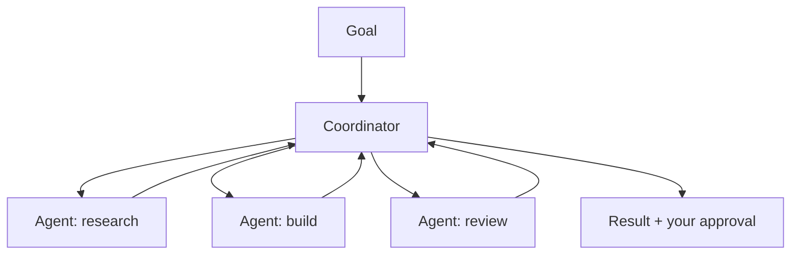

<LevelBadge level="advanced" />

<Callout type="objectives" items={[
  "Cowork とは何か — あなたが目標を指示し、ループは用意されているエージェント型デスクトップワークスペース",
  "エージェントチームとは何か — 複数のエージェントが 1 つの目標を分担し、それぞれが役割とツールを持つ仕組み",
  "この 2 つが、自分で構築できる 3 つ(サブエージェント、Agent SDK、Managed Agents)とどう関係するか",
  "自律性が高まるほど、監督は減るのではなく増える理由",
]} />

<VerifyNote lastVerified="2026-07-23" source="https://platform.claude.com/docs">
Cowork とエージェントチームは動きの速い 2026 年の領域です — 名称、提供状況、機能は頻繁に変わります。最新の詳細は公式の Anthropic ドキュメント/告知で確認してください。
</VerifyNote>

単一のエージェントを超えて、Anthropic はエージェントに持続的で協調的な作業を行わせるための**製品レベル**の領域を提供してきました: **Cowork**（エージェント型のデスクトップワークスペース）と**エージェントチーム**（複数のエージェントが協調する仕組み）です。このページは概観のマップです — これらは急速に進化するため、具体的な内容は公式ドキュメントで確認してください。

## Claude Cowork

これは、**エージェントがあなたと並んで実際の複数ステップの作業を行うワークスペース**と考えてください — 単一のチャットターンよりも長いスパンで、あなたが監督しながら、ファイルやツールを操作します。API でエージェントを構築するものの、消費者/プロ向けの従兄弟のような存在です。ループは用意されており、あなたは目標を指示します。

## エージェントチーム

1 つのエージェントでは足りない場合、**複数のエージェントが協調します** — 目標を分担し、それぞれが役割とツールを持ち、結果に向けて連携します。概念的には Claude Code の[サブエージェント](/docs/claude-code/subagents)を反映していますが、単一の委任サブタスクではなく、持続的なマルチエージェント協調のための製品領域です。

## サイトの他の部分との関係

- 自分でプログラム的に構築する → [エージェントの構築](/docs/api/building-agents) + [Agent SDK](/docs/claude-code/headless-and-agent-sdk)。
- コーディングセッション内での委任 → [サブエージェント](/docs/claude-code/subagents)。
- ホスト型のループ/状態/スケジューリング → [マネージドエージェント](/docs/api/managed-agents)。

<Flashcards title="エージェントが仕事を進める 4 つの方法" cards={[
  {front: "Cowork", back: "エージェント型のデスクトップワークスペース。ループは用意されており、あなたは目標を指示して監督します。エージェントは単一のチャットターンよりも長いスパンで、ファイルやツールを操作して作業します。"},
  {front: "エージェントチーム", back: "複数のエージェントが協調する製品領域 — 目標を分担し、それぞれが役割とツールを持ち、あなたが承認する結果に向けて連携します。"},
  {front: "サブエージェント", back: "Claude Code セッション内での委任。エージェントチームと同じ発想ですが、持続的な協調ではなく、単一の委任サブタスクに限定されます。"},
  {front: "Managed Agents", back: "ループ、状態、スケジューリングを Anthropic がホストします — エージェントループを自分で動かしたくない場合の API 側の選択肢です。"},
  {front: "Agent SDK", back: "ループをプログラムで自分で構築します。最大限の制御ができる一方、オーケストレーション、状態、エラー処理は自分で担います。"},
]} />

## クイズ

<Quiz questions={[
  {
    q: "自分のバックエンドから呼び出す、自分で動かしたりスケジュールしたりする必要のないエージェントループが欲しい場合。このページが示す選択肢はどれですか?",
    options: [
      "Cowork",
      "Managed Agents",
      "サブエージェント",
      "エージェントチーム"
    ],
    answer: 1,
    explain: "Managed Agents は、ループ/状態/スケジューリングをホストしてくれる選択肢です。Cowork とエージェントチームは呼び出すものではなく、その中で作業する製品領域です。サブエージェントは Claude Code セッション内の委任で、Agent SDK は自分で構築する道です。"
  },
  {
    q: "ここでの説明によると、エージェントチームと Claude Code のサブエージェントの関係はどうなっていますか?",
    options: [
      "同じ機能の 2 つの名前である",
      "エージェントチームがサブエージェントに取って代わり、サブエージェントは非推奨である",
      "概念的には同じ発想だが、エージェントチームは単一の委任サブタスクではなく、持続的なマルチエージェント協調のための製品領域である",
      "サブエージェントはクラウドで動き、エージェントチームはローカルで動く"
    ],
    answer: 2,
    explain: "このページは、エージェントチームを概念的にはサブエージェントを反映するものとしつつ、持続的なマルチエージェント協調のための製品領域と位置づけています — サブエージェントは、コーディングセッション内で単一の委任サブタスクを扱います。"
  },
  {
    q: "このページが、監督を両方の領域に共通する不変の要素として扱うのはなぜですか?",
    options: [
      "マルチエージェントで長スパンの作業は、価値とリスクの両方を増幅するから",
      "エージェントにはそもそもツールアクセスを与えられないから",
      "Anthropic がすべてのツール呼び出しに手動承認を求めているから",
      "これらの領域はリサーチプレビューで、安全性のトレーニングがないから"
    ],
    answer: 0,
    explain: "より長いスパンでの自律性の向上は、価値とリスクを同時に増幅します。現実的な対応は、重大なアクションに人間を関与させ、ツールアクセスを厳格にスコープし、出力を検証することです。"
  }
]} />

## 変わらないもの: 監督

:::warning[自律性が高まるほど、注意も必要]
マルチエージェントで長スパンの作業は、価値*も*リスク*も*増幅します。重大なアクションには人間を関与させ、ツールアクセスを厳格にスコープし、出力を検証してください — [責任ある利用](/docs/security/responsible-use)と[エージェントのセキュリティ](/docs/security/securing-agents)を参照。
:::

<Callout type="takeaways" items={[
  "Cowork とエージェントチームは製品領域です: エージェントループは用意されており、あなたの仕事は目標の指示と監督です。",
  "これらは、自分で構築できるものの製品レベルの従兄弟です — セッション内の委任にはサブエージェント、完全な制御には Agent SDK、ホスト型ループには Managed Agents。",
  "これらの領域は動きが速いです。このページはマップとして扱い、具体的な内容は公式ドキュメントで確認してください。",
  "監督は不変の要素です: 重大なアクションには人間の承認、厳格なツールスコープ、検証された出力。",
]} />

## 次へ

- [Cowork のスケジュールタスク: デバイスの電源が入っていなくても動くエージェント](/docs/claude-app/cowork-scheduled-tasks) — 2026 年 7 月のウェブ + モバイル版ローンチの実際、サーフェスごとの機能マトリクス、サイレント実行を壊す 4 つの落とし穴
- [サブエージェント & 並列エージェント](/docs/claude-code/subagents)
- [マネージドエージェント](/docs/api/managed-agents)
- [ネイティブのマルチエージェント API](/docs/models/native-multi-agent-apis) — OpenAI の Responses マルチエージェントベータとの比較、および Anthropic 側でプリミティブが不足している箇所
- [責任ある利用、倫理 & 検証](/docs/security/responsible-use)
