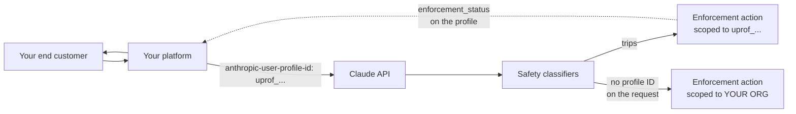

<LevelBadge level="advanced" />

<Callout type="objectives" items={[
  "あらゆる AI プラットフォームが抱える影響範囲の問題: 帰属がなければ、悪用する 1 人のエンドカスタマーのせいで組織全体が制限されかねない",
  "エンドカスタマーを登録する方法(POST /v1/user_profiles)と、各リクエストを帰属させる方法(anthropic-user-profile-id ヘッダー)",
  "application と passthrough — Claude の販売方法に合う access_type はどちらか、そして間違った方が帰属を弱める理由",
  "4 つの enforcement_status の値と、そのうち 1 つを選ぶ正確なルール(解説ドキュメントが省いている pending を含む)",
  "enforcement_actions スキーマ: 6 つの理由、次のステップ verify、そして Anthropic が防御的にコード化するよう求める前方互換性のルール",
  "組織 Webhook がまだポーリングループの代わりにならない理由 — そして制限されたすべてのプロファイルを見つける正確な一覧クエリ",
  "これが黙って何もしない場所: Claude Platform on AWS、Bedrock、Google 管理の Google Cloud はそれぞれ挙動が異なる",
]} />

<VerifyNote lastVerified="2026-11-02" source="https://platform.claude.com/docs/en/manage-claude/user-profiles">
ユーザープロファイルは **2026 年 10 月 20 日**にローンチされました。`enforcement_status` と `enforcement_actions` フィールドは、[API バージョン 2026-10-21](/docs/api/api-version-2026-10-21) とともに **2026 年 10 月 21 日**に追加されました。組織 Webhook は**ベータ**(`webhooks-2026-10-07`)で、Anthropic 自身のドキュメントが**イベント配信は有効ではない**と述べています — エンドポイントは登録できますが、まだイベントは送信されません。フィールド名と enum の値は、[ユーザープロファイルのガイド](https://platform.claude.com/docs/en/manage-claude/user-profiles)、[List User Profiles リファレンス](https://platform.claude.com/docs/en/api/user_profiles/list)、[組織 Webhook のガイド](https://platform.claude.com/docs/en/manage-claude/organization-webhooks)に基づきます。厳密な依存関係を持ってリリースする前に、再確認してください。
</VerifyNote>

Claude を再販している、AI ゲートウェイを運営している、あるいは何千人もの見知らぬ人が登録する製品を Claude API の上に構築しているなら、シングルテナントの開発者にはない問題を抱えています: **Anthropic の自動安全分類器があなたの API トラフィックに対して動作し、すべてのリクエストはあなたの組織の名で届きます。** 分類器に引っかかることをした 1 人のエンドカスタマーは、Anthropic の側から見ると、*あなた*がそれをしたのと区別がつきません。その後に続くエンフォースメントアクションは組織全体に適用され、他のすべての顧客も道連れになります。

ユーザープロファイルがその解決策です。各リクエストがどのエンドカスタマーのためのものかを Anthropic に伝えれば、エンフォースメントアクションはそのプロファイルに及びます。残りのトラフィックは動き続けます。

:::tip[これは影響範囲の制御であり、課金機能ではありません]
プロファイルは課金対象ではなく、料金も変わりません。それ自体では何も付与も取り消しもしません。その役割のすべては、エンフォースメントを*的を絞ったもの*にすることです — 何かがおかしくなる**前**にトラフィックを帰属させていた場合にのみ役立ちます。遡及的な帰属はありません。
:::

## 1 段落でわかる要約

`POST /v1/user_profiles` でエンドカスタマーごとに 1 つのプロファイルを作成し、返された `uprof_…` ID を顧客レコードに保存し、その顧客のために行うすべてのリクエストの `anthropic-user-profile-id` ヘッダーで送ります。次に、`enforcement_status[]=restricted` と `enforcement_status[]=banned` でフィルターしたプロファイル一覧を取得するループを実行し、サポートの受信箱より先にアクションを知るようにします。プロファイル ID が**ない**リクエストは自分自身の使用量として数えられ — そのうち 1 つが分類器に引っかかれば、組織全体へのエンフォースメントに逆戻りします。

## 4 ステップのセットアップ

<Steps items={[
  {title: "自分自身のトラフィックを別の組織に分ける", body: "プロファイルはワークスペースではなく組織に属するため、1 つの組織内でワークスペースを分けるだけでは不十分です。エンドカスタマーのトラフィックを 1 つの組織に、社内の使用量を別の組織に置いてください。プロファイルが必要なのはエンドカスタマーの組織だけです。"},
  {title: "各エンドカスタマーをオンボーディング時に一度だけ登録する", body: "POST /v1/user_profiles は uprof_ ID を持つプロファイルを返します。このエンドポイントは冪等ではありません — reference_id が既存のものと一致していても、呼び出すたびに新しいプロファイルが作られます。サインアップフローで作成して ID を保存し、サービスインスタンスにその場で作らせてはいけません。"},
  {title: "その顧客のすべてのリクエストで ID を送る", body: "anthropic-user-profile-id ヘッダーです。SDK と ant CLI は引数として公開しています(user_profile_id。Java では userProfileId、Go/C# では UserProfileID、CLI では --user-profile-id)。Messages、トークンカウント、Message Batches、OpenAI SDK 互換レイヤーでも同じように動作します。"},
  {title: "エンフォースメントアクションをポーリングし、プロファイルを最新に保つ", body: "enforcement_status でプロファイルを一覧し、制限と BAN を見つけます。顧客の詳細やアカウント状態が変わったらプロファイルを更新し、アカウントを閉じたりデータの消去を求められたりしたら削除します。"},
]} />



点線は、自分で構築しなければならない部分です。Anthropic がエンフォースメントのフィールドを設定しますが、現時点ではそれをあなたにプッシュするものは何もありません。

## 誰にプロファイルを与えるか決める

プロファイルが*何を表すか*は、Claude をどう販売するかによって決まります。`access_type` フィールドはどのケースに当たるかを記録し、これを間違えると、プロファイルを設定した目的である帰属が弱まります。

| トラフィックの相手 | 何を作成するか | `access_type` |
| --- | --- | --- |
| 自社製品にサインアップしたユーザー | ユーザーごとに 1 つのプロファイル、サインアップ時に作成 | `application` — **デフォルト**。フィールドを省略したときに使われる |
| API アクセスを再販する企業(ゲートウェイ、再販業者) | 内部の個人ごとではなく、**企業**ごとに 1 つのプロファイル | `passthrough` — デフォルトでは**ない**ため、送る必要がある |
| 自分自身の組織の使用量 | 何も作らない。プロファイル ID のないリクエストは自分自身の使用量として数えられる — 別の組織に分けておく | 該当なし |
| 自組織内のワークスペース | 別個のプロファイルは不要。プロファイルは組織に属し、その ID は組織内のどのワークスペースを通じても機能する | 該当なし |

<PromptCard title="再販業者の顧客を登録する(passthrough)">{`curl https://api.anthropic.com/v1/user_profiles \\
  -H "x-api-key: $ANTHROPIC_API_KEY" \\
  -H "anthropic-version: 2023-06-01" \\
  -H "content-type: application/json" \\
  -d '{
    "name": "Acme Analytics, Inc.",
    "access_type": "passthrough",
    "external_user_details": {
      "reference_id": "cust-8f2a1c",
      "country": "US"
    }
  }'`}</PromptCard>

`application` プロファイルでは、`access_type` を省略し、`name` と `external_user_details` に企業ではなく 1 人の人物を記述します。

:::warning[passthrough プロファイルが識別するのは企業であり、個人ではありません]
再販業者経由のリクエストが識別可能な 1 人の人間から来ている場合は、Messages リクエスト自体の `metadata.user_id` フィールドにその人物の識別子を*も*送ってください — これはプロファイルの `metadata` とは別のオブジェクトです。これがないと、Anthropic は企業が不正行為をしていることは分かっても、その企業のどのユーザーかは分からず、取れる措置もそれに応じて大雑把になります。
:::

### Anthropic に伝えるべきことと、伝えないこと

すべてのフィールドは任意です。`name`、`metadata`(最大 16 組。キーは 64 文字以下、値は 512 文字以下)、そして `external_user_details` 内の 7 つのフィールド(`entity_type`、`country`、`reference_id`、`onboarded_at`、`account_status`、`name_hash`、`email_hash`)を送れます。プロファイルが保持するのは、あなたが送ったものと Anthropic が設定するステータス**だけ**です — 会話の内容は決して保持せず、Anthropic はそのいずれも検証しません。

オンボーディングのコードを書く前に身につけておきたい 4 つのルール:

- **不明なものは省き、プレースホルダーを送らない。** `external_user_details` の値は後から置き換えられますが、**クリアすることは決してできません**。API は `null` を 400 で拒否します。初日に書いた `"unknown"` という文字列は永久に残ります。
- **`country` は*顧客の*国**であり、あなたの国ではありません。
- **`reference_id` は顧客に対するあなた自身の識別子**です。一意である必要はなく、重複排除のキーでもありません — 上の非冪等性の警告を参照してください。
- **名前やメールを共有できないなら、ハッシュを送る。** `name_hash` と `email_hash` により、Anthropic は、あなたのどのプロファイルが ID を*共有*しているかを、ID そのものを受け取ることなく把握できます。ハッシュ関数は自分で選べますが、すべてのプロファイルで同じ関数、同じ大文字小文字/空白の正規化を使ってください。同一に計算された値だけが一致するからです。生のメールアドレスのためのフィールドはまったくありません。

## 各リクエストを帰属させる

<PromptCard title="1 人のエンドカスタマーに帰属させた Messages 呼び出し">{`curl https://api.anthropic.com/v1/messages \\
  -H "x-api-key: $ANTHROPIC_API_KEY" \\
  -H "anthropic-version: 2023-06-01" \\
  -H "anthropic-user-profile-id: $PROFILE_ID" \\
  -H "content-type: application/json" \\
  -d '{
    "model": "claude-opus-5-5",
    "max_tokens": 1024,
    "messages": [{"role": "user", "content": "Hello, Claude"}]
  }'`}</PromptCard>

モデル ID は変わります — 最新のラインナップは[最新のモデルと料金](/docs/whats-new/models-and-pricing)を参照してください。

Claude API、Claude Platform on AWS、Anthropic がホストする Microsoft Foundry デプロイ、Anthropic 管理の Google Cloud 上の Claude では、ID は**リクエストのたびに検証されます**: 不正な形式の ID や別の組織に属する ID は `400` の `invalid_request_error` を返します。この組織間チェックは、特定の意外な形で効いてきます — 2 つの組織(たとえば Claude API 上の 1 つと Claude Platform on AWS 上の 1 つ)の下でトラフィックを送る場合、一方で作成したプロファイルは他方に拒否されます。

**Message Batches は例外です。** バッチの作成では ID の*形式*しかチェックされません。形式が正しくても自組織に属さない ID でもバッチは作成でき、その後バッチ内の各リクエストが、同じ `invalid_request_error` を伴う `errored` の結果としてそれぞれ失敗します。バッチを帰属させる場合は、送信前に自分で ID を検証してください — [Message Batches](/docs/api/message-batches) を参照。

### 黙って機能が少なくなる場所

帰属が機能していると思い込む前に、読んでおくべき表です。

| プラットフォーム | そこでプロファイルを作成できるか | ID を送る場所 | エンフォースメントのフィールドは機能するか |
| --- | --- | --- | --- |
| Claude API | はい | `anthropic-user-profile-id` ヘッダー | はい |
| Claude Platform on AWS | はい | `anthropic-user-profile-id` ヘッダー | **いいえ** — 常に `unrestricted` / 空 |
| Microsoft Foundry(Anthropic ホスト) | はい | `anthropic-user-profile-id` ヘッダー | はい |
| Claude Models on Google Cloud(Anthropic 管理) | はい | `anthropic-user-profile-id` ヘッダー | はい |
| Claude Models on Google Cloud(Google 管理) | いいえ — Claude API か Claude Platform on AWS で作成 | `anthropic-user-profile-id` ヘッダー | 形式チェックのみ |
| Claude in Amazon Bedrock | いいえ — Claude API か Claude Platform on AWS で作成 | **リクエストボディ内の** `user_profile_id` **フィールド** | 形式チェックのみ |

3 つの帰結:

1. **Claude Platform on AWS では、`enforcement_status` は常に `unrestricted` で `enforcement_actions` は常に空です** — そして Anthropic は、そこでは未解決のアクションを理由にリクエストを拒否しません。他の値を報告できないプラットフォームから「異常なし」を読み取るダッシュボードを作ってはいけません。
2. **Bedrock と Google 管理の Google Cloud では、ID は形式チェックされるだけで、検索されることはありません。** `200` レスポンスは、ID が実在のプロファイルと一致することを**確認しません**。タイプミスがあるが形式は正しい ID は、何も帰属させていないのに成功とまったく同じに見えます。
3. **Bedrock では ID はヘッダーではなくボディのフィールドです** — トップレベルの `"user_profile_id": "uprof_…"` です。また、`InvokeModel` や `Converse` で呼び出す従来の Bedrock 統合では機能しません。

Bedrock と Google 管理の Google Cloud では、プロファイルを所有する Anthropic 組織に**アカウントをリンク**する必要もあります。`portal.anthropic.com` の Verification Portal の **Linked accounts** で行います(管理者がリンクを開始 → IAM アクセスを持つ人が提供されたコマンドを実行 → 管理者が検証を完了)。プロファイルに紐づくプログラム承認は、ポータルがそのアカウントを **Linked** と表示して初めて、そのアカウントのリクエストに適用されます。

## エンフォースメントの状態を読む

プロファイルを返すすべてのレスポンス — create、retrieve、update、一覧の各行 — には `enforcement_status` と `enforcement_actions` が含まれます。

```json
{
  "type": "user_profile",
  "id": "uprof_011CZkZCu8hGbp5mYRQgUmz9",
  "enforcement_status": "restricted",
  "enforcement_actions": [
    {
      "type": "restriction",
      "id": "enac_011CZkZEq4TnWb7xLfRgPm2v",
      "reason": "fraud_or_abuse",
      "action": null,
      "opened_at": "2026-10-02T19:30:00Z",
      "expires_at": null
    }
  ]
}
```

### 4 つのステータス — そしてガイドが省いている 1 つ

`enforcement_status` は、**最初に当てはまるルール**によって、次の順序で選ばれます:

| 値 | ルール |
| --- | --- |
| `banned` | 未解決のアクションのいずれかが `ban` |
| `pending` | ID チェックで解除できる制限が未解決で、エンドユーザーがそのチェックを提出済みで、Anthropic による審査が終わっておらず、未解決のどのアクションの `reason` も `account_compromise` ではない |
| `restricted` | いずれかのアクションが未解決 |
| `unrestricted` | 未解決のアクションがない |

:::warning[Anthropic 自身のドキュメントでも値の数が一致していません]
[ユーザープロファイルのガイド](https://platform.claude.com/docs/en/manage-claude/user-profiles)と[組織 Webhook のガイド](https://platform.claude.com/docs/en/manage-claude/organization-webhooks)はどちらも、`enforcement_status` を 3 つの値 — `unrestricted`、`restricted`、`banned` — として説明しています。[API リファレンス](https://platform.claude.com/docs/en/api/user_profiles/list)は `pending` を加えた**4 つ**を記載し、`enforcement_status[]` の一覧フィルターでも `pending` を受け付けます。enum については API リファレンスを正とし、`pending` を明示的に扱ってください: これは、エンドカスタマーが問題に対して何かしている唯一の状態であり、一般的な `restricted` として扱うとそのシグナルが失われます。この食い違いは報告済みで、解消され次第この注記は削除します。
:::

### アクションオブジェクト

`enforcement_actions` は**未解決**のアクションを列挙し、ない場合は空です。終了したアクションは、リストから単に消えます。

| フィールド | 意味 |
| --- | --- |
| `type` | `restriction`(Anthropic がエンドユーザーへの提供方法を制限した。一部は引き続き提供される場合がある)または `ban`(Anthropic が提供を停止し、再開する予定もない) |
| `id` | アクションの ID。接頭辞は `enac_` で、アクションが未解決の間は安定している |
| `reason` | `unsupported_region`、`fraud_or_abuse`、`high_harm`、`usage_policy_violation`、`account_compromise`、`unspecified` のいずれか |
| `action` | 次のステップ: `verify`(エンドユーザーが ID チェックに合格すれば今すぐ解除できる)または `null`(今できることは何もない — **すでに提出したチェックを Anthropic が審査している間も含む**)。BAN では常に `null` |
| `opened_at` | Anthropic がアクションを開始した日時(RFC 3339) |
| `expires_at` | 自動的に終了する日時。終了日がない場合は `null`。BAN では常に `null`、`reason` が `account_compromise` のときも常に `null` |

アクションが未解決の間、Anthropic はそのプロファイルの ID を持つ推論リクエストの一部またはすべてを拒否します。

2 つのフィールドは**読み取り専用**です: `enforcement_status` や `enforcement_actions` を含む create や update のリクエストは `400` を返します。また、`enforcement_status`(Anthropic の判断)と `external_user_details.account_status`(`active` / `suspended` / `blocked` — アカウントについての*あなた*の判断)を混同しないでください。両者は独立しており、どちらも必要になります: あなたが有効とみなしている顧客を Anthropic が制限している状態こそ、ページ通知を飛ばす価値のあるアラートです。

### 前方互換性のルールを今すぐコード化する

Anthropic は enum の値を追加する権利を留保しており、どう縮退すべきかも示しています。後でクラッシュをリリースするのではなく、初日にこの 4 行の防御的なマッピングを書いてください:

| 認識できない… | 次として扱う |
| --- | --- |
| `enforcement_status` | `restricted` |
| アクションの `type` | `restriction` |
| `reason` | `unspecified` |
| `action` | `null` |

## それでもポーリングループは必要

想定されているリアルタイムの経路は**組織 Webhook**(ベータ、`webhooks-2026-10-07`)で、`/v1/organizations/webhooks` の下で管理され、2 つのイベントタイプがあります:

| イベント | トリガー |
| --- | --- |
| `user_profile.enforcement_action_opened` | Anthropic がプロファイルにエンフォースメントアクションを開始する |
| `user_profile.enforcement_action_resolved` | アクションが終了する — Anthropic が解決するか、`expires_at` が過ぎる |

:::warning[イベント配信は有効ではありません]
Anthropic のドキュメントは、これら 2 つのイベントを**送信しない**とはっきり述べているため、登録したエンドポイントは何も受け取りません。エンドポイントを登録し、文書化されたイベント形式に対してハンドラーを構築することはできますが、このページの検証日時点では、**エンフォースメントアクションを実際に知らせてくれる仕組みはポーリングだけです。** まずループを構築し、Webhook ハンドラーはアップグレードの道筋として扱ってください。
:::

<PromptCard title="制限された、または BAN されたすべてのプロファイルを見つける(実際に必要なループ)">{`curl --globoff "https://api.anthropic.com/v1/user_profiles?\\
enforcement_status[]=restricted&\\
enforcement_status[]=banned&\\
limit=100" \\
  -H "x-api-key: $ANTHROPIC_API_KEY" \\
  -H "anthropic-version: 2026-10-21"`}</PromptCard>

ここには自明ではないページネーションのルールが 1 つあり、これを飛ばすと顧客を黙って見逃すモニターができあがります:

:::warning[短いページは一覧の終わりを意味しません]
`enforcement_status[]` を設定すると、サービスは**リクエストごとに限られた数のプロファイル**を調べます。1 ページが `limit` より少ないプロファイル — **あるいはゼロ** — しか含まなくても、`next_page` カーソルを持っていることがあります。**一覧が完了したことを意味するのは、`null` の `next_page` だけです。** それまでページを要求し続けてください。フィルターは、プロファイルのアクションが一時的に読み取れないときに `overloaded_error` で失敗することもあるため、それを「結果なし」と扱わずにリトライしてください。
:::

同じ領域にあるさらに 2 つの落とし穴:

- **`updated_at` を監視しない。** Anthropic は、エンフォースメントのフィールドの変更が*確実には*それを動かさないと述べています。保存しておいた値とフィールドの値を比較してください。
- **レガシーのベータヘッダーを外す。** `anthropic-beta` ヘッダーに `user-profiles-2026-09-04` かそれ以前のものを含むリクエストは、**エンフォースメントの両方のフィールドを完全に省略**し、`enforcement_status[]` フィルターが `400` を返します。症状 — フィールドがないためにすべてのプロファイルが `unrestricted` に見える — は、まさに良いニュースのように読めます。フィールドを得るには、その値を削除してください。

### イベントが実際に流れ始めたら

イベントの形式はすでに規定されているので、ハンドラーを書く価値はあります。イベントが運ぶのは**状態ではなく ID** です: `data.id` はプロファイル ID、`data.enforcement_action_id` は `enac_` ID です。

```json
{
  "type": "event",
  "id": "whe_4f2a9c1e7b3d5a8f0e6c2b9d1a7f3e5c",
  "created_at": "2026-10-15T17:02:41Z",
  "data": {
    "type": "user_profile.enforcement_action_opened",
    "id": "uprof_011CZkZCu8hGbp5mYRQgUmz9",
    "enforcement_action_id": "enac_011CZkZEq4TnWb7xLfRgPm2v",
    "organization_id": "org_011CZkZBj9RsYd3wNcHvKq6t"
  }
}
```

つまりハンドラーの仕事は常に、プロファイルを取得して現在の状態を読むことです。イベントの順序から状態を再構築してはいけません — Anthropic は、イベントが**遅れて、または順不同で**届くことがあると警告しており、イベントが届く時点でプロファイルがその変更(またはそれ以降の変更)をすでに反映していることだけを保証しています。配信は [Standard Webhooks](https://www.standardwebhooks.com/) 仕様に従い、`webhook-id`、`webhook-timestamp`、`webhook-signature` ヘッダーが付きます。何かを信頼する前に、エンドポイントの `whsec_` シークレットに対して署名を検証し、**5 秒以内に 2xx を返して**重い処理はその後に回し、同じイベントを 2 回受け取ることがあるため**イベントの `id`(`webhook-id` と同じ値)で重複排除**してください。失敗した配信は、その後数分間に数回リトライされ、その後は破棄されます — そのためポーリングループは、恒久的にあなたの追いつきの仕組みでもあります。

最初に知っておくべきエンドポイントの運用上の制限: 1 つの組織は最大 **32** 個のエンドポイントを持てます(無効化されたものも数えられます)。URL は**公開ドメイン名を持つポート 443 の HTTPS** でなければならず、IP は不可です。*有効な* 2 つのエンドポイントが URL を共有することはできません。そして Anthropic は、`3xx` を返す、非公開 IP に解決される、または失敗し続けるエンドポイントを**自動的に無効化**し、後で再送するのではなくそのイベントを恒久的にスキップします。アクセスは制限されています: 組織の組織 Webhook をアカウントチームに有効化してもらう必要があり、HIPAA readiness が有効であってはならず、デフォルトワークスペースでカスタマーマネージド暗号鍵を使用していてはいけません。これらのエンドポイントで `404` が出る場合、通常の原因は ID の誤りではなく、ベータヘッダーの欠落か、有効化されていない組織です。

また次にも注意してください: **プロファイルを削除すると、`…_resolved` イベントを発行せずに未解決のアクションが終了します**。また、エンドポイントを登録する前に開始されたアクションも `…_opened` イベントを生成しません。どちらの隙間も、同じ一覧クエリで埋められます。

## プロファイルを最新に保つ

`POST /v1/user_profiles/[id]` は送ったフィールドだけを変更しますが、混同してはいけない 3 種類のマージ意味論があります:

- `name` と `access_type` — 保存された値を**置き換える**。
- `external_user_details` 内の各フィールド — 保存された値を**置き換え**、クリアはできない(`null` → `400`)。
- `metadata` — **キーごとにマージする**。送ったキーは上書きされ、**空文字列はそのキーを削除**し、省略したキーはそのまま残る。

<PromptCard title="自分の側でアカウントを停止し、metadata のキーを削除する">{`curl "https://api.anthropic.com/v1/user_profiles/$PROFILE_ID" \\
  -H "x-api-key: $ANTHROPIC_API_KEY" \\
  -H "anthropic-version: 2023-06-01" \\
  -H "content-type: application/json" \\
  -d '{
    "external_user_details": {"account_status": "suspended"},
    "metadata": {"trial_cohort": ""}
  }'`}</PromptCard>

`DELETE /v1/user_profiles/[id]` は、**あなたが**提供したすべて — `name`、`external_user_details`、`metadata` — を恒久的に削除します。Anthropic がそのプロファイル ID について保持している trust-and-safety の記録は削除**しません**。正しく行うべき 3 点:

1. **削除する前に ID の送信をやめる。** 削除後およそ **10 分間**は、削除された ID を持つ推論リクエストがまだ成功することがあります。その後は、プロファイルを検索するプラットフォームでは `400` で拒否されます — 検索しない Bedrock と Google 管理の Google Cloud では、永遠に受け入れられ続けます。
2. **継続中の顧客からの消去リクエストは、作成 → 切り替え → 削除を意味する** — 新しいプロファイルを作り、トラフィックを向け直し、古いものを削除する。
3. **削除のリトライでの `404` は、最初の削除が成功したことを意味する。** サーバーエラーはリトライし、`404` は成功と読む。

## よくある間違い

| 間違い | 実際に起こること |
| --- | --- |
| 最初のリクエスト時に、`reference_id` をキーにしてプロファイルを遅延作成する | `POST /v1/user_profiles` は冪等ではない。呼び出しごとに新しい `uprof_` が作られ、トラフィックが重複したプロファイルに分散するため、エンフォースメントの根拠となるシグナルがどれにも蓄積されない |
| 自社の内部トラフィックを同じ組織に置く | 帰属のないリクエストは自分自身の使用量として数えられる。1 つでも分類器に引っかかれば、アクションは再び組織全体になる — プロファイルが防ぐために存在する、まさにその結果 |
| 別々の組織の代わりに別々のワークスペースを使う | プロファイルは組織スコープ。その ID はどのワークスペースを通じても機能するため、ワークスペースではここで何の分離も得られない |
| `anthropic-beta` に `user-profiles-2026-09-04` を残す | エンフォースメントの両フィールドがすべてのレスポンスから消え、一覧フィルターが 400 になる。どの顧客も問題なく見える |
| 最初の短いページでページネーションを止める | `enforcement_status[]` では、短いページや空のページは普通。一覧を終えるのは `next_page: null` だけ — 早く止めると BAN された顧客を見逃す |
| 変更の検出に `updated_at` をポーリングする | エンフォースメントが変わっても確実には動かない。フィールドの値を比較する |
| Claude Platform on AWS から「異常なし」を読み取る | 常にアクションなしの `unrestricted` を報告する。それ以外は伝えられない |
| Bedrock での `200` を帰属の証拠として扱う | Bedrock は ID の形式しかチェックしない。形式が正しくても間違った ID は何も帰属させず、成功を返す |
| 再販する企業に `access_type: application` を送る | 帰属が、実際には企業全体である「ユーザー」を記述することになり、`metadata.user_id` も送らない限り、その内部の個人単位のシグナルは失われる |
| `external_user_details` にプレースホルダーを書き込む | 値は置き換えられてもクリアはできない。プレースホルダーは恒久的に残る |

## クイズ

<Quiz questions={[
  {
    q: "モニターが enforcement_status[]=restricted&enforcement_status[]=banned でプロファイルを一覧し、プロファイルが 0 件で next_page が null でないページを受け取りました。どうすべきですか?",
    options: [
      "止める — 空のページは制限されたプロファイルがないことを意味する",
      "next_page が null になるまでページを要求し続ける",
      "空のページは常にエラーなので、同じページをリトライする",
      "フィルターを外して、代わりにすべてのプロファイルをスキャンする"
    ],
    answer: 1,
    explain: "enforcement_status[] を設定すると、サービスはリクエストごとに限られた数のプロファイルを調べるため、1 ページが limit より少ないプロファイル — あるいはゼロ — しか含まなくても、next_page カーソルを持つことがあります。一覧が完了したことを意味するのは null の next_page だけです。最初の短いページで止めるのが、モニターが BAN された顧客を黙って見逃す原因です。"
  },
  {
    q: "企業に API アクセスを再販する AI ゲートウェイを運営しています。すべてのリクエストが anthropic-user-profile-id を持ち、すべてのプロファイルが enforcement_status: unrestricted なのに、ある顧客の推論が拒否され続けています。Claude API を直接呼び出しています。最も可能性の高い原因は何ですか?",
    options: [
      "プロファイルの external_user_details.account_status が blocked に設定されている",
      "anthropic-beta ヘッダーで user-profiles-2026-09-04(またはそれ以前)を送っているため、すべてのレスポンスからエンフォースメントのフィールドが省かれている",
      "passthrough プロファイルはエンフォースメントの状態を報告しない",
      "プロファイルが 10 分以上前に削除された"
    ],
    answer: 1,
    explain: "user-profiles-2026-09-04 以前のベータ値では、レスポンスから enforcement_status と enforcement_actions が完全に省かれ、enforcement_status[] フィルターは 400 を返します。欠けたフィールドは何もないものとしてデシリアライズされ、コードはそれを「問題なし」と読みます。フィールドを得るには、anthropic-beta からその値を削除してください。(account_status はあなた自身の判断であり、Anthropic に拒否させることはありません。access_type はレポートに影響しません。削除されたプロファイルは retrieve で 404 になります。)"
  },
  {
    q: "プロファイルに reason が \"fraud_or_abuse\" の制限が未解決のままです。エンドカスタマーは Anthropic が求めた ID チェックを提出済みで、審査はまだ進行中です。enforcement_status は何と読めますか。また、アクションの `action` フィールドは何と読めますか?",
    options: [
      "restricted で、action は \"verify\"",
      "pending で、action は null",
      "pending で、action は \"verify\"",
      "unrestricted — 提出されたチェックがアクションを解除するから"
    ],
    answer: 1,
    explain: "pending は、解除可能な制限が未解決で、チェックが提出され、審査が終わっておらず、未解決のどのアクションの reason も account_compromise ではない状態そのものです。そして審査中は `action` が null です — null は「今エンドユーザーができることは何もない」を意味し、すでに提出したチェックの審査待ちも含まれます。解説のガイドページは pending をまったく省いていますが、API リファレンスには記載されています。"
  }
]} />

<Flashcards title="ID の接頭辞とヘッダー" cards={[
  {front: "uprof_", back: "ユーザープロファイル ID。POST /v1/user_profiles が返す。顧客レコードに保存する。"},
  {front: "enac_", back: "エンフォースメントアクション ID。アクションが未解決の間は安定し、アクションが終了すると enforcement_actions から消える。"},
  {front: "wep_", back: "組織 Webhook エンドポイント ID。無効化されたものを含め、組織あたり最大 32 個。"},
  {front: "whsec_", back: "組織 Webhook エンドポイントの署名シークレット。エンドポイントを作成したときか、シークレットを再生成したときにだけ返される — 安全に保管する。"},
  {front: "anthropic-user-profile-id", back: "呼び出しを 1 人のエンドカスタマーに帰属させるリクエストヘッダー。Claude in Amazon Bedrock では、代わりにトップレベルの user_profile_id ボディフィールドになる。"},
  {front: "webhooks-2026-10-07", back: "すべての /v1/organizations/webhooks リクエストに必要な anthropic-beta の値。欠けていると 400 ではなく 404 を返す。"},
  {front: "access_type: application", back: "デフォルト。自社製品の個々のエンドユーザーごとに 1 つのプロファイル。"},
  {front: "access_type: passthrough", back: "デフォルトではない — 送る必要がある。Claude へのアクセスを再販する企業ごとに 1 つのプロファイル。"},
  {front: "enforcement_status: pending", back: "解除可能な制限が未解決で、エンドユーザーが ID チェックを提出済みで、審査が終わっておらず、未解決のアクションに account_compromise がない状態。API リファレンスにのみ記載されている。"},
]} />

<Callout type="takeaways" items={[
  "帰属は予防的であり、遡及適用はできない — プロファイル ID なしで送ったリクエストは、永久に組織自身の使用量である。",
  "Webhook ハンドラーより先にポーリングループを構築する: Anthropic はイベント配信が有効でないと述べているため、enforcement_status[] で一覧するのが今日機能する唯一の仕組みである。",
  "next_page が null になるまでページを送る。enforcement_status[] フィルターでは、短いページや空のページは想定内であり、一覧の終わりではない。",
  "anthropic-beta から user-profiles-2026-09-04 以前を外すこと。さもないとエンフォースメントの両フィールドが黙って消え、どの顧客も制限なしに見える。",
  "pending を明示的に扱い、未知の enum の値は Anthropic の求めるとおり restricted / restriction / unspecified / null にマップする。",
  "プラットフォームを知る: Claude Platform on AWS はエンフォースメントをまったく報告できず、Bedrock と Google 管理の Google Cloud は ID の形式しかチェックしない — そこでの 200 は帰属の証拠ではない。",
]} />

## 次へ

- [Admin API: Claude 組織を自動化する](/docs/api/admin-api) — これらのプロファイルと Webhook の呼び出しが並ぶ組織レベルのエンドポイントと、それぞれに必要な認証情報。
- [Managed Agents: ドメイン制限](/docs/api/managed-agents-domain-restrictions) — エージェントが到達できる範囲を狭めるための、2026 年 10 月のもう 1 つの制御。
- [Inference Hooks: Claude Enterprise のインライン DLP](/docs/api/inference-hooks) — Anthropic が事後に適用するエンフォースメントではなく、モデルがプロンプトを見る前に自分で実行するエンフォースメント。
- [責任ある利用、倫理 & 検証](/docs/security/responsible-use) — 同じ問いのポリシー面。
