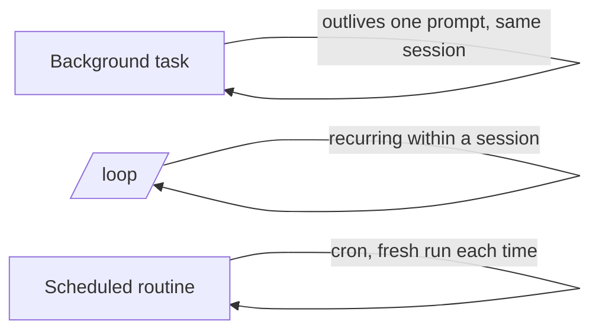

<LevelBadge level="advanced" />

<VerifyNote lastVerified="2026-07-15" source="https://code.claude.com/docs/en">
バックグラウンドタスク、/loop、スケジュール実行の正確なコマンドと提供状況はリリースごとに変わります。公式ドキュメントで確認してください。
</VerifyNote>

すべてが素早い編集とは限りません。Claude Code は**一つのプロンプトより長く続く**作業を実行できます。バックグラウンドでの長いコマンド、繰り返しのループ、スケジュールされた実行です。

<Callout type="objectives" items={[
  "三つの仕組みを区別する: バックグラウンドタスク、/loop、スケジュールされたルーティン",
  "セッションをブロックせずに長いコマンドを開始する。そして、それを密なループでポーリングするのが誤りである理由を知る",
  "一つの問いから適切なものを選ぶ: その作業はプロンプトより長く続くのか、セッションより長いのか、どちらでもないのか",
  "スケジュール実行の指示を自己完結させる。各実行は新しく始まるから",
  "無人で動作するものにはガードレールを敷く"
]} />

## バックグラウンドタスク

長時間実行されるコマンド（開発サーバー、テストウォッチャー、ビルド）を、セッションを**ブロックせずに**開始します。Claude は作業を続け、タスクが出力を出したり終了したりすると通知を受け取ります。通常 `&` でバックグラウンドにするようなものすべてに使えますが、管理されているので、Claude があとで出力を読めます。

:::tip[ビジーウェイトしない]
タスクをバックグラウンドで開始して先に進み、密なループでポーリングする代わりに、完了通知に呼び戻してもらいましょう。
:::

## 繰り返しのループ（`/loop`）

`/loop` は、セッション内でプロンプトやコマンドを**一定間隔で繰り返し**実行します。たとえば「5 分ごとにデプロイの状況を確認して」のように。間隔を指定するか、Claude に自分のペースで進めさせます。CI の実行を見守ったり、ハーネスが通知してくれない外部ジョブをポーリングしたりするのに最適です。

<PromptCard title="セッション内で 5 分ごとにデプロイをポーリングする">
{`/loop 5m check the deploy status and tell me the moment it goes green or fails`}
</PromptCard>

間隔を省略すると、Claude はあなたの時計ではなく自分のペースで進めます。

## スケジュールされたクラウドエージェント

**時計に従って、継続的に**行うべき作業、たとえば「毎朝新しい issue を要約する」「1 時間ごとにニュースを確認してドキュメントを更新する」には、**スケジュールタスク / ルーティン**（cron 形式）を使います。各実行は新しく始まるので、その指示は**自己完結**していなければなりません。

## どれを選ぶか

| 必要なこと | 使うもの |
|---|---|
| 長いコマンドを実行しつつ作業を続ける | バックグラウンドタスク |
| このセッション中、N 分ごとに何かをポーリングする | `/loop` |
| スケジュールに従って、無期限に何かを行う | スケジュールされたルーティン |

<Steps items={[
  {
    "title": "その作業が何より長く続く必要があるのかを問う",
    "body": "一つのプロンプトより長いが、セッションよりは短い? バックグラウンドタスク。このセッション内で、プロンプトを繰り返す? /loop。セッション自体より長く、時計に従って、無期限に? スケジュールされたルーティン。"
  },
  {
    "title": "ブロックせずに開始する",
    "body": "長いコマンドをバックグラウンドで開始して作業を続けます。タスクが出力を出したり終了したりすると Claude に通知されます。密なループでポーリングしないでください。"
  },
  {
    "title": "スケジュール実行を自己完結させる",
    "body": "スケジュールされた各実行は新しく始まるので、その指示に必要なコンテキストをすべて含めます。設定したセッションからは何も引き継がれません。"
  },
  {
    "title": "無人で動くものはスコープを絞り、限界を設ける",
    "body": "スコープを厳密に絞った、元に戻せる作業だけに限り、厳格な権限と組み合わせます。ガードレールのない自律性は、この機能が陥りやすくしている失敗モードです。"
  }
]} />

:::warning[自律性にはガードレールが必要]
スケジュールに従って無人で動作するものは、スコープを厳密に絞り、元に戻せるものにしてください。厳格な[権限](/docs/claude-code/permissions)と組み合わせ、[自律実行の堅牢化](/docs/security/hardening-autonomous-runs)を読んでください。
:::

<Quiz questions={[
  {
    "q": "毎朝、新しい issue の要約が欲しい。継続的に。どの仕組みが合いますか。",
    "options": [
      "バックグラウンドタスク",
      "24 時間間隔の /loop",
      "スケジュールされたルーティン",
      "& で開始した長時間実行コマンド"
    ],
    "answer": 2,
    "explain": "時計に従って、無期限に行うべき作業こそ、スケジュールタスク / ルーティンの役目です。cron 形式で実行され、どのセッションよりも長く続きます。/loop はセッション内でしか繰り返されないので、セッションが終われば止まります。"
  },
  {
    "q": "スケジュールされたルーティンの指示が自己完結していなければならないのはなぜですか。",
    "options": [
      "スケジュール実行はコンテキストウィンドウが小さいから",
      "各実行が新しく始まり、設定したセッションのコンテキストを何も持たないから",
      "cron の構文では長いプロンプトを表現できないから",
      "実行のたびに権限が読み取り専用にリセットされるから"
    ],
    "answer": 1,
    "explain": "各実行は新しく始まるので、実行に必要なものはすべて自分の指示の中になければなりません。ルーティンを作成したセッションのコンテキストは引き継がれません。"
  },
  {
    "q": "長いテストウォッチャーをバックグラウンドで開始しました。次にやってはいけないことは何ですか。",
    "options": [
      "同じセッションで他の作業を続ける",
      "完了通知に呼び戻してもらうのを待つ",
      "終了するまでタスクを密なループでポーリングする",
      "タスクが出力を出したあとで、その出力を読む"
    ],
    "answer": 2,
    "explain": "ビジーウェイトは意味を台無しにします。タスクは管理されているので、出力を出したり終了したりすると Claude に通知されます。開始して、作業を続け、通知に呼び戻してもらいましょう。"
  }
]} />

<Callout type="takeaways" items={[
  "三つの仕組み、一つの問い: その作業はプロンプトより長く続くのか（バックグラウンドタスク）、セッション内で繰り返すのか（/loop）、セッションそのものより長く続くのか（スケジュールされたルーティン）。",
  "バックグラウンドタスクは & でバックグラウンドにしただけではなく管理されている。Claude があとで出力を読め、終了時に通知される。",
  "ビジーウェイトしない。開始して先に進み、完了通知に呼び戻してもらう。",
  "/loop は間隔を取るか、間隔を省けば自分のペースで進む。",
  "スケジュールされた各実行は新しく始まるので、その指示は単体で成り立たなければならない。",
  "無人の自律性には、厳格な権限と元に戻せるスコープが必要。この組み合わせは任意ではない。"
]} />

## 次へ

- [自動コミットのバックグラウンドエージェント: ドラフト PR への引き渡し](/docs/claude-code/auto-commit-background-agents) — バックグラウンドセッションが終了したときに起きること
- [ヘッドレスモードと Agent SDK](/docs/claude-code/headless-and-agent-sdk)
- [権限とモード](/docs/claude-code/permissions)
- [自律実行の堅牢化](/docs/security/hardening-autonomous-runs)
