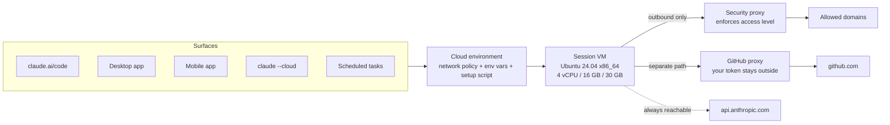

<LevelBadge level="intermediate" />

<Callout type="objectives" items={[
  "正しいメンタルモデルを作る: 5 つの利用面、保存された 1 つの環境、セッションごとに新品の使い捨て VM",
  "誰もがつまずく表を理解する: 手元のマシンからクラウドセッションに引き継がれるものと、黙って引き継がれない 5 つのもの",
  "ネットワークアクセスレベル(None・Trusted・Full・Custom)を選び、許可リストをそれでも迂回する 4 種類の通信を把握する",
  "ネットワークシークレットで、セッションが使えても読めない API キーを渡す",
  "セットアップスクリプトと SessionStart フックを正しく使い分け、環境がキャッシュされるかどうかを決める約 5 分のルールを守る",
  "実際のリソースと時間の上限を前提に計画する: 4 vCPU / 16 GB / 30 GB、デフォルト 2 分のコマンドタイムアウト、席を外すと一時停止する VM",
  "往復の流れを一通り実行する: claude --cloud で作業を送り出し、claude -p --cloud で操縦し、claude --teleport で引き戻す",
]} />

<VerifyNote lastVerified="2026-10-26" source="https://code.claude.com/docs/en/cloud-environments">
公式の [Configure cloud environments](https://code.claude.com/docs/en/cloud-environments) と [Use Claude Code in the cloud](https://code.claude.com/docs/en/claude-code-on-the-web) のページで確認済みです。クラウドセッションは **Pro、Max、Team** プランで利用でき、プレミアムシートまたは Chat + Claude Code シートを持つ Enterprise ユーザーも利用できます。組織でカスタムロールを使っている場合は、クラウドセッションの権限を持つロールも必要です。リソース上限は Anthropic によって概算とされており、変更される可能性があります。プリインストールされたツールのバージョンは常に変わるため、ここのツールチェーン表は目安として扱い、バージョンは実際のセッションで確認してください。
</VerifyNote>

クラウドセッションとは、自分のマシンではなく他人のマシン上で動く Claude Code セッションのことです。デフォルトでは Anthropic のマシンで、組織がそう設定していれば[自前のランナー](/docs/claude-code/self-hosted-environments)で動きます。ノートPCを閉じても作業は続きます。VM に別料金はかかりません。クラウドセッションは、Claude で行う他のあらゆる作業と同じプランの利用上限を消費します。

そこまでは簡単に理解できます。人が午後を丸ごと失うのはもっと微妙な部分です。**クラウドセッションは、ホスト名が違うだけのノートPCではありません。** *コミット済み*のリポジトリだけが入った、あなたの持ち物が何もない新品の Ubuntu マシンです。何か月もかけて調整してきた設定の半分は手元のマシンの `~/.claude/` にあり、移動してきません。このページの大半は、その境界線についてです。

## 一段落でまとめると

**クラウド環境**、つまりネットワークポリシー・環境変数・セットアップスクリプトをひとまとめにした名前付きのバンドルを保存します。クラウドセッションを開始できるどの利用面も、あなたの環境のどれかを選びます。セッションが始まると、Anthropic は隔離された VM(手元の環境に関係なく x86_64 の Ubuntu 24.04)を用意し、GitHub からリポジトリをクローンし、セットアップスクリプトを実行し、次のセッションがその手順を省けるようにファイルシステムのスナップショットを取り、Claude Code を起動します。外向きの通信はすべて、アクセスレベルを強制するプロキシを通ります。GitHub の通信は別の経路を通り、本物の認証情報は VM に入りません。入力をやめると VM はファイルを保ったまま一時停止し、長く放置すると回収され、セッションを開き直すと新しい VM が作られます。

### 1 つの環境、5 つの利用面

保存した環境は、クラウドセッションをどこから始めても同じように適用されます。ブラウザの claude.ai/code、Desktop アプリ、Claude モバイルアプリ、ターミナルの `claude --cloud`、そしてクラウドのスケジュールタスクです。環境を一度設定すれば、すべての利用面がそれを引き継ぎます。

クラウドセッションでは*ない*似たものが 2 つあり、混同すると実害が出ます。

- **Remote Control** は、Web とモバイルのインターフェースを**自分のマシン**で動いているセッションにつなぎます。自分のファイルと自分のネットワークを使い、クラウド環境は関係しません。
- **`--remote-control`** は、名前が似ていても `--cloud` とは無関係です。`--cloud` は Anthropic のインフラ上にセッションを作り、`--remote-control` はローカルセッションをスマートフォンに公開します。

まだ環境がない場合、オンボーディングで **Default** という環境が作られます。ネットワークアクセスは **Trusted**、変数なし、セットアップスクリプトなしです。Team と Enterprise では、Owner が **Quick setup** を有効にしていない限り、Web のオンボーディングで最初の環境を作るフォームが表示されることがありますが、フォームのデフォルトのままにすれば同じものができます。

## 手元のマシンから引き継がれるもの、引き継がれないもの

ここは 2 回読むべき節です。クラウドセッションは**リポジトリの新規クローン**から始まります。以下のすべての行を説明するルールは、*コミットされていれば存在し、手元のマシンにしかなければ存在しない*、です。

| あなたのもの | クラウドセッションにある? | 理由 |
| :--- | :--- | :--- |
| リポジトリの `CLAUDE.md`、`.claude/rules/` | ✅ ある | クローンの一部 |
| リポジトリの `.claude/skills/`、`.claude/agents/`、`.claude/commands/` | ✅ ある | クローンの一部 |
| リポジトリの `.claude/settings.json` のフックと権限ルール | ✅ 単一リポジトリのセッションなら | クローンの一部 |
| リポジトリの `.mcp.json` の MCP サーバー | ✅ 単一リポジトリのセッションなら | セッションの作業ディレクトリから見つかる |
| 組織のサーバー管理設定 | ✅ ある(Claude Tag セッションを除く) | セッション開始時に Anthropic から取得される |
| claude.ai で有効にしたスキル | ✅ ある | リポジトリではなくアカウントから読み込まれる |
| **ユーザーの `~/.claude/CLAUDE.md`** | ❌ ない | リポジトリではなく手元のマシンにある |
| **ユーザーの `~/.claude/skills/`、`agents/`、`commands/`** | ❌ ない | 同じ理由。代わりにリポジトリの `.claude/` にコミットする |
| **プラグインとマーケットプレイス** | ❌ ない | クラウドセッションは、リポジトリのものもユーザー設定のものも、`enabledPlugins` も `extraKnownMarketplaces` のマーケットプレイスもインストールしない |
| **ローカルまたはユーザースコープで追加した MCP サーバー** | ❌ ない | それらは `~/.claude.json` に書き込まれる。`claude mcp add --scope project` で追加し直し、生成された `.mcp.json` をコミットする |
| **デバイス上の MDM / 管理設定ファイル** | ❌ ない | セッションは Anthropic 管理の VM で動く |
| リポジトリの `env` ブロックにある `NODE_EXTRA_CA_CERTS` や mTLS クライアント証明書などの**トランスポート変数** | ❌ 無視される | セッションの API 接続はホスティング環境が管理する。無視された各キーはセッションのデバッグログに記録される |
| AWS SSO などの**対話的な認証** | ❌ ない | クラウドセッションでは実行できないブラウザログインが必要 |

この表には 2 つの罠があります。

- **プラグインの欠落が最も高くつきます。** リポジトリが `.claude/settings.json` でプラグインを有効にしていると、ローカルではそのプラグインが使えますが、クラウドでは何も使えません。ワークフローがプラグイン提供のスキルやコマンドに依存しているなら、同等のものを `.claude/` にコミットするか、クラウドセッションの挙動が違うことを受け入れてください。何がどこにあるかは[プラグインとマーケットプレイス](/docs/claude-code/plugins-marketplaces)を参照してください。
- **「単一リポジトリのセッション」は重要な条件です。** Anthropic ホスト環境では、*複数*のリポジトリをアタッチしたセッションは、そのどれからもフックと権限ルールを読み込みません。また、[プロジェクト](/docs/claude-code/projects-coordinator-threads)内のクラウドスレッドが読み込むのは、リポジトリルートの `CLAUDE.md`、`.claude/CLAUDE.md`、パス指定のない `.claude/rules/` だけです。構成が SessionStart フックに依存している場合、複数リポジトリのセッションではそれが実行されないので、代わりにセットアップスクリプトで準備してください。

### それでも個人の設定を持ち込む

個人のスタイルルールを共有リポジトリにコミットする必要はありません。**自分の**環境のセットアップスクリプトから、ユーザーレベルのメモリファイルを直接書き込めます。

<PromptCard title="Setup script: personal preferences without touching the repo">{`#!/bin/bash
mkdir -p ~/.claude
cat > ~/.claude/CLAUDE.md <<'EOF'
Use conventional commit messages.
Prefer small, reviewable diffs over one large change.
EOF`}</PromptCard>

Claude Code はこれをユーザー指示として読み込みます。次のクラウドセッションで `/context` を実行し、**Memory files** の下に `/root/.claude/CLAUDE.md` があることで動作を確認できます。共有環境ではこれをしないでください。組織内の全員に適用されてしまいます。

## ネットワークアクセス: 4 つのレベルと、それを無視する 4 つの通信

各環境にはアクセスレベルがちょうど 1 つあり、セッションのネットワークからの外向き接続を制御します。

| レベル | セッションが到達できる先 |
| :--- | :--- |
| **None** | セッションのネットワーク経由では何にも到達できない |
| **Trusted**(デフォルト) | Anthropic が管理する許可リスト: パッケージレジストリ、GitHub/GitLab/Bitbucket、コンテナレジストリ、主要クラウド SDK のエンドポイント |
| **Full** | あらゆるドメイン |
| **Custom** | 自分のリスト(1 行に 1 ドメイン)。先頭の `*.` はすべてのサブドメインに一致する。Trusted のデフォルトも含めるかどうかはチェックボックスで決まる |

Anthropic ホスト環境でレベルを変更すると、**既存の**セッションにも約 1 分以内に反映されます。新しいセッションを始める必要はありません。

ここからが脅威モデリングで重要な部分です。4 種類の通信は、**どのレベルを選んでも(None でも)**、許可リストをまったく通らない経路を使います。

<Steps items={[
  {title: "GitHub は専用のプロキシ経由", body: "Anthropic ホスト環境でのすべての GitHub 操作は、本物の認証情報を VM の外に保つ専用プロキシを通ります。アクセスレベルとは無関係です。"},
  {title: "有効にした MCP コネクタ", body: "コネクタの通信はセッションのネットワークではなく Anthropic のサーバーを経由するため、コネクタのホストを Allowed domains に追加する必要はありません。裏を返せば、許可リストは有効なコネクタの到達先を制限しません。不要なコネクタは無効にしてください。"},
  {title: "ネットワークシークレットに登録したホスト", body: "アクセスレベルが本来許可しないホストでも、セッションはシークレットのホストには到達できます。シークレットを追加すると、認証情報が付くだけでなく到達可能な範囲も広がります。"},
  {title: "api.anthropic.com", body: "Claude Code 自身の推論リクエストは、None でも送信されます。Anthropic は隔離に関する注記で明確に述べています。ネットワークアクセスを無効にしても Claude Code は Anthropic API と通信でき、データが VM の外に出る可能性があります。None はエアギャップではありません。"},
]} />

信頼できないコードの封じ込めに **None** を使うつもりだったなら、4 つ目の項目をもう一度読んでから、[自律実行の堅牢化](/docs/security/hardening-autonomous-runs)を読んでください。ネットワークレベルは被害範囲を狭めるものであって、サンドボックスの保証ではありません。

また、管理者がすべてのメンバーの環境に一括で適用できる組織レベルの許可リストはなく、ドメインを追加するサーバー管理設定もありません。チーム全体でリストを統一する方法は、Owner が **Custom** アクセスとそのリストで作成する**組織共有環境**です。

### GitHub プロキシの落とし穴: GraphQL は使えない

手に染みついた操作が壊れるので、独立した見出しにします。GitHub プロキシは **GraphQL をすべて 403 で拒否**します。そのため GraphQL ベースの `gh` サブコマンドはクラウドセッション内で失敗します。

- `gh pr ...` と `gh issue ...` → 403 になり、代替の REST が示される
- 自分の `GH_TOKEN` を使っても解決しない — この制限は認証情報に関係なく、プロキシを通るすべてのリクエストに適用される
- Projects v2 のように GraphQL にしか存在しない API には、プロキシ経由では到達できない

回避策は REST です。組み込みの GitHub ツールも `gh api` も REST を使います。

<PromptCard title="REST instead of the GraphQL-backed gh subcommands">{`gh api repos/OWNER/REPO/pulls --jq '.[] | "\\(.number) \\(.title)"'
gh api repos/OWNER/REPO/issues/42/comments -f body="rerunning the flaky suite"`}</PromptCard>

プロキシにはさらに 3 つ知っておくべきルールがあります。**ブランチの削除**や、ブランチ以外(たとえばタグ)のプッシュを拒否します。API リクエストは**セッションにアタッチされた**リポジトリにしか応答せず、それ以外には `is not enabled for this session` を含む 403 を返します。これは `codeload.github.com` から取得するソースアーカイブにも当てはまり、公開リポジトリでも同様です。そして本物の認証情報はサーバー側で差し替えられるため、プロキシが認証を処理する場合、VM 内では `GH_TOKEN` と `GITHUB_TOKEN` がリテラルのプレースホルダー `proxy-injected` として読み取れます。`gh` はそのプレースホルダーのままで問題なく動きます。`GITHUB_TOKEN` を直接読んで使えるトークンを期待する自作スクリプトは動きません。

<PromptCard title="Check which GitHub auth case your session is in">{`echo $GH_TOKEN`}</PromptCard>

## ネットワークシークレット: セッションは使えるが読めないキー

環境変数は認証情報を置く場所として不適切で、Anthropic 自身の UI もそう説明しています。環境を使える人は誰でもその変数を読めるからです。**ネットワークシークレット**が正しい置き場所です。API キーを環境に保存し、適用するホストを列挙しておくと、Anthropic のエージェントプロキシが、一致するリクエストに**VM を出た後で**それを付与します。キー自体はセッションに入らず、`env` にも表示されず、どのファイルにもありません。保存後に読み返すこともできません。シークレットの値やホストを変更するには、削除して追加し直します。

手戻りを減らすための設定メモです。

- **プラン**: Pro、Max、Team、Enterprise。Pro、Max、Team では、ロールに関係なく自分の環境にシークレットを追加できます。Enterprise では組織管理者ロールが必要で、そうでない場合は Owner に共有環境へシークレットを置いてもらい、そこでセッションを実行します。該当ロールのない Team では、**Add secret** フォームは `*.` ワイルドカードのない 1 ホスト用の簡易版になります。
- **デフォルトのシークレットタイプ**は **Bearer** で、`Bearer` プレフィックス付きの `Authorization` ヘッダーです。`X-Api-Key` のように値だけを載せるヘッダーなら、ヘッダー名を変更してプレフィックスを消します。
- **確実なブロッカー**: セルフホスト環境にはネットワークシークレットがまったくありません。API はインターネットからの接続を受け付ける必要があります(リクエストはあなたのネットワークではなく Anthropic のネットワークから出ます)。顧客管理の暗号鍵を使う組織はシークレットを保存できません。

追加したシークレットが設計上付かないリクエストもあります。GitHub(GitHub プロキシがすでに認証している)、`api.anthropic.com` と公開パッケージレジストリ(`registry.npmjs.org`、`jsr.io`、`npm.jsr.io`、`pypi.org`、`files.pythonhosted.org`、`index.crates.io`、`proxy.golang.org`)、**セットアップスクリプト**が行う通信(Claude Code がエージェントプロキシに接続する前に実行されるため)、そして Claude Code 自身のテレメトリのエクスポートです。

目立たない失敗パターンが 1 つあります。2 つのシークレットのホストが**完全一致せずに重なっている**と、どちらにも警告マークは付かず、プロキシはどちらか一方しか送りません。ホストのリストは重ならないようにしてください。

## セットアップスクリプトと SessionStart フック

どちらもセッションで有用な作業を始める前に実行されるため、間違った方を選ぶ人が後を絶ちません。分け方は単純です。

- **セットアップスクリプト** → **VM** を準備する: プリインストールされていないツールチェーンや CLI ツール。クラウド専用。
- **[SessionStart フック](/docs/claude-code/hooks)** → クラウドでもローカルでも**どこでも**行うべきプロジェクトの準備(`npm install` など)。

| | セットアップスクリプト | SessionStart フック |
| :--- | :--- | :--- |
| 設定場所 | 環境ダイアログ(共有環境では管理者の **Cloud environments** ページも) | 設定ファイル。通常はリポジトリの `.claude/settings.json` |
| 実行タイミング | Claude Code の起動前 — キャッシュ済みの環境があれば**完全にスキップ**される | Claude Code の起動後、再開したセッションを含むすべてのセッションで |
| 実行場所 | クラウドセッションのみ | ローカル**と**クラウド |
| キャッシュされる? | される(約 5 分以内に終われば) | されない — 起動と再開のたびにコストを払う |

セットアップスクリプトは Bash で、Ubuntu 24.04 上で**root として**実行され、守るべき制約が 4 つあります。

<Steps items={[
  {title: "ゼロで終了しないとセッションが始まらない", body: "終了コードがゼロ以外だと、ステップだけでなくセッション自体が失敗します。重要でないコマンドには || true を付けて、レジストリの一時的な不調で作業が止まらないようにします。"},
  {title: "約 5 分以内に終わらせないとキャッシュを失う", body: "それより長いと Anthropic は環境のスナップショットを取らず、毎回のセッションでセットアップの全コストを払うことになります。独立したインストールは & と wait で並列化し、巨大なダウンロードが 1 つだけならバックグラウンドの SessionStart フックに移します。"},
  {title: "インストールにはネットワークが必要", body: "パッケージのインストールにはレジストリへの到達が必要です。Trusted なら npm、PyPI、RubyGems、crates.io をカバーします。None ではスクリプト内のインストールがすべて失敗します。"},
  {title: "環境の変数はまだ設定されていない", body: "スクリプトは、セッションが環境の変数を適用する前に実行されます。スクリプト自身が必要とするものは、スクリプトの中で設定してください。"},
]} />

<PromptCard title="Setup script: install a tool that isn't pre-installed">{`#!/bin/bash
apt update && apt install -y shellcheck || true`}</PromptCard>

### 環境キャッシュと、キャッシュが古くなるとき

セットアップが約 5 分の枠内に完了すると、Anthropic はファイルシステムのスナップショットを取り、以降のセッションはそこから始まってスクリプトを省略します。遅いセットアップスクリプトを一度だけ最適化する価値があるのはそのためです。取得した Docker イメージ、インストールしたパッケージ、書き込んだファイルがすべて残ります。

スナップショットが残すものと失うものは、それが**ファイルシステム**のスナップショットであることから決まります。

- ✅ 残る: インストールしたパッケージ、取得した Docker イメージ、書き込んだファイル
- ❌ 失われる: ただ*動いていた*だけのもの。スクリプトが起動したデータベース、`docker compose up` のスタック、開発サーバー — すべて消えます。これらはセッションごとに、Claude に頼むか SessionStart フックから起動してください。

キャッシュは、セットアップスクリプトや許可ホストを変更したとき、および約 7 日で期限切れになったときに再構築されます。一時停止した VM を復元するときは再構築**されません**。つまり、アイドル状態のセッションにはセットアップスクリプトの編集が届きません。変更をすぐに反映するには、新しいセッションを始めてください。

### クラウドだけで依存関係をインストールする

フックは両方の場所で実行されるため、VM が設定する変数でスコープを絞ります。`CLAUDE_CODE_REMOTE` はクラウドセッションでは `true` で、ローカルでは決して `true` になりません。

<PromptCard title="scripts/install_pkgs.sh — cloud-only, and idempotent">{`#!/bin/bash

if [ "$CLAUDE_CODE_REMOTE" != "true" ]; then
  exit 0
fi

cd "$CLAUDE_PROJECT_DIR" || exit 1
hashes=node_modules/.install_pkgs.sha256

if ! sha256sum --check --status "$hashes" 2>/dev/null; then
  # Delete the old hashes first, so a failed install runs again next time
  rm -f "$hashes"
  if npm install; then
    sha256sum scripts/install_pkgs.sh package.json package-lock.json > "$hashes" || rm -f "$hashes"
  fi
fi

exit 0`}</PromptCard>

重要なのはハッシュチェックの方です。SessionStart フックは起動のたびに*そして*再開のたびに実行されるので、無条件の `npm install` は永遠に払い続けるレイテンシになります。インストールがほかの入力(ワークスペースの `package.json`、`.npmrc`、`postinstall` スクリプト自身のファイルなど)も読むなら、それらを `sha256sum` の行に加えてください。そうしないと、どれかが変わっても古いパッケージが残ります。

## 箱の中身と上限

Anthropic ホストの各セッションには、よく使うツールチェーンがプリインストールされた新品の VM が割り当てられます。pip/poetry/uv/pytest/ruff/mypy/black 付きの Python、npm/yarn/pnpm/bun 付きの Node 20・21・22、Ruby、Composer 付きの PHP、Maven と Gradle 付きの OpenJDK、Go、Rust、GCC/Clang/cmake/ninja、Docker と Compose、PostgreSQL と Redis、そしてお馴染みの `git`、`gh`、`jq`、`yq`、`ripgrep`、`tmux` です。

これについての実用上の注意が 4 つあります。

- **これは Mac ではなく x86_64 の Linux です。** 依存関係がビルド済みバイナリ(ネイティブの Ruby gem、ビルド済みの Python wheel など)を配布している場合、必要なのは x86_64 Linux 向けのビルドです。
- **シェルは渡されません。** すべてのコマンドは Claude が実行するので、VM での作業はプロンプトでの依頼として書きます。バージョンを確認するには、Claude に `check-tools`(VM 上のシェルコマンドで、スラッシュコマンドではない)の実行を頼みます。報告されないツールは `psql --version` などを実行してもらいます。
- **データベースはインストールされていますが、起動していません。** Claude に `service postgresql start` や `service redis-server start` を実行してもらいます。
- **Bun はインストールされていますが、パッケージ取得に既知のプロキシ互換性の問題があります。** すべての外向き通信がセキュリティプロキシを通るためです。.NET SDK など、リストにないツールチェーンは、レジストリが Trusted の許可リストに入っていても、セットアップスクリプトが必要です。

**リソース上限**(概算で、変更される可能性あり): **4 vCPU、16 GB RAM、30 GB ディスク**。メモリを大量に使うビルドやテストスイートは、VM に停止されることがあります。それを超える場合の答えは、自前のハードウェアへの Remote Control か、組織が運用するコンピュート上の[セルフホスト環境](/docs/claude-code/self-hosted-environments)です。

**時間の上限**は、作業の途中で人を驚かせるものです。

| 制限 | デフォルト | 変更方法 |
| :--- | :--- | :--- |
| フォアグラウンドのコマンド | 2 分(Claude は最大 10 分まで要求可能) | 環境の変数で `BASH_DEFAULT_TIMEOUT_MS` / `BASH_MAX_TIMEOUT_MS`(ミリ秒) |
| タイムアウトでバックグラウンドに移されたコマンド | さらに最大 30 分 | `BASH_DEFAULT_TIMEOUT_MS` を `1800000` より大きくすると、これも長くなる |
| SessionStart の `command` フック | 600 秒でキャンセル | フックのエントリに `timeout`(秒)を設定するか、`async: true` で実行する |
| セットアップスクリプト | 約 5 分を超えるとキャッシュされない | 並列化するか、長い部分をバックグラウンドのフックに移す |
| アイドル状態のセッション | 数分後に VM が一時停止し、ファイルは保存される | 設定不要 — 次のメッセージで復元される |

ちなみに、タイムアウトしたコマンドは強制終了されません。`sleep` で始まるものを除き、Claude Code がバックグラウンドに移します。

### VM が戻ってくるとき、戻ってこないとき

数分間操作がないと、VM はファイルを保存した状態で一時停止し、次のメッセージで同じ VM が復元されます。これには 2 つの帰結があります。

- **環境変数は再読み込みされます。** 作成時と、VM 内で Claude Code が起動するたび(つまりアイドルからの復元時と再構築時)に読み込まれます。そのため、変数を編集しても、実行中のセッションは VM が次に復元されるまで古い値のままです。新しい値をすぐに使うには、Claude にインラインで設定してもらう(`LOG_LEVEL=trace npm test`)か、新しいセッションを始めます。
- **一時停止した VM は、あとで回収されることがあります。** その場合、セッションを開き直すと*新しい* VM が用意されます。会話履歴は復元されますが、バックグラウンドの作業は復元されません。まだ実行中だったシェルコマンド、途中だったサブエージェント、セッションスコープのスケジュールタスクや待機中の `/loop` は引き継がれません。Claude Code は、どのコマンドとサブエージェントが止まったか、どのサブエージェントを最初からではなく再開できるかを Claude に伝えるので、「中断されたところから続けて」は妥当な次のプロンプトです。

2 つの環境変数は特別な扱いです。`OTEL_*` の値は Claude Code 自身のテレメトリのエクスポート用に予約されており、Claude が実行するコマンドには渡されません。また、クラウドセッションは `CLAUDE_AUTOCOMPACT_PCT_OVERRIDE` を自分で設定するため、自動コンパクトは枠がいっぱいになったときではなく、自動コンパクトウィンドウの途中で発動します。このキーを自分で設定しても効果はありません。ウィンドウを動かしたい場合は、代わりに `CLAUDE_CODE_AUTO_COMPACT_WINDOW` を設定してください。(ウィンドウ自体は[コンテキスト管理](/docs/claude-code/context-management)で扱っています。)

## 往復の流れ: 送り出し、操縦し、引き戻す

<Steps items={[
  {title: "claude --cloud で作業を送り出す", body: "現在のリポジトリ用に新しいクラウドセッションを作ります。VM は、ローカルのチェックアウトではなく、現在のディレクトリの GitHub リモートを現在のブランチでクローンします。先にプッシュしてください。"},
  {title: "claude -p --cloud <session-id> でどこからでも操縦する", body: "実行中のセッションにメッセージを 1 件送って終了します。ローカルの状態は送らず、アカウントで認証するので、ログインしているどのマシンからでも(CI スクリプトからでも)動作します。"},
  {title: "claude --teleport で引き戻す", body: "セッションのブランチを取得してチェックアウトし、会話全体をターミナルに読み込みます。CLI からのこの受け渡しは一方通行です。クラウドセッションを引き下ろすことはできても、既存のターミナルセッションを上げることはできません。"},
]} />

<PromptCard title="Start a cloud session from your terminal">{`claude --cloud "Fix the authentication bug in src/auth/login.ts"`}</PromptCard>

`--cloud` の呼び出しはそれぞれ独立したセッションになるので、ファンアウトは簡単です。ただし並列セッションは比例してレート制限を消費するため、注意すべきはレート制限です。

<PromptCard title="Fan out three independent tasks">{`claude --cloud "Fix the flaky test in auth.spec.ts"
claude --cloud "Update the API documentation"
claude --cloud "Refactor the logger to use structured output"`}</PromptCard>

ここでもっとも効果の高いパターンは、**ローカルで計画し、クラウドで実行する**ことです。考える作業は手元のマシンで安く対話的にでき、オフロードしたいのは実行の方です。

<PromptCard title="Plan locally, then hand the plan to a cloud session">{`claude --permission-mode plan
# collaborate on the approach, save the plan to the repo, commit, push
claude --cloud "Execute the migration plan in docs/migration-plan.md"`}</PromptCard>

<PromptCard title="Steer a running session from any logged-in machine">{`claude -p "add a test for the empty-list case" --cloud <session-id>

# machine-readable result: {ok, session_id, url}
claude -p "status?" --cloud <session-id> --output-format json`}</PromptCard>

<PromptCard title="Pull a cloud session into your terminal">{`claude --teleport              # interactive picker
claude --teleport <session-id>  # straight to one session`}</PromptCard>

実行中の CLI セッション内では、`/teleport`(または `/tp`)で再起動なしに同じピッカーが開きます。`/tasks` はバックグラウンドセッションを一覧表示し、`t` で選択中のものにテレポートします。テレポートは再開前に 4 つを確認します。**クリーンな git の状態**(stash を提案します)、**同じリポジトリ**(フォークは不可)、セッションの**ブランチがリモートにプッシュ済み**であること、そして**同じ claude.ai アカウント**です。また、入力を待つことはありません。git や ssh がパスフレーズや未知のホストの確認を求める場合、取得は失敗するので、先に鍵を `ssh-agent` に読み込み、手動で `git fetch` を一度実行しておいてください。

覚えておくべき点があります。**テレポートしたセッションはコピーです。** その後ローカルで行った作業はローカルに留まり、claude.ai やスマートフォン上のクラウドセッションには反映されません。テレポート後もスマートフォンから操作し続けたい場合は、ローカルセッションで `/remote-control` を開始してください。また `--teleport` は `--resume` ではありません。`--resume` はこのマシンのローカル履歴から会話を再び開くもので、クラウドセッションは一覧に出ません。

### 出力をセッションにリンクする

すべてのクラウドセッションにはトランスクリプトの URL があり、セッションは自分の ID を `CLAUDE_CODE_REMOTE_SESSION_ID` から読み取れます。クラウドセッションで Claude が作成するコミットにはすでに `Claude-Session:` の git トレーラーが付き、PR の本文にもリンクが入ります(両方を抑止するには `attribution.sessionUrl` を `false` に設定します)。それ以外、たとえば生成したレポートや Slack の投稿では、URL を自分で組み立てます。人がよく間違えるのはプレフィックスの置換です。

<PromptCard title="Turn the session ID into a transcript URL">{`echo "https://claude.ai/code/\${CLAUDE_CODE_REMOTE_SESSION_ID/#cse_/session_}"`}</PromptCard>

## 8 つの落とし穴

1. **`--cloud` はワーキングツリーではなくリモートをクローンします。** VM は現在のブランチを*GitHub から*チェックアウトします。プッシュしていないローカルのコミットや未コミットの変更はありません。`Branch <name> is not on GitHub` で始まる行が表示された場合も、セッションは開始されますが、プッシュ済みの祖先コミットかデフォルトブランチから始まります。プッシュしてからやり直してください。
2. **リモートがない、または GitHub App がない場合、Claude Code はリポジトリをアップロードします。** git リモートのないリポジトリ、または Claude GitHub App がインストールされていない github.com リポジトリからは、Claude Code がローカルリポジトリをバンドルしてアップロードします。ブランチをまたぐ履歴と、追跡対象ファイルの未コミットの変更が含まれます。`CCR_FORCE_BUNDLE=1` で強制できます。制限: 1 コミット以上ある git リポジトリであること、100 MB 未満であること、そして**未追跡のファイルは除外される**ことです(セッションに見せたいものは `git add` してください)。
3. **認証情報ファイルの保護はプラットフォームによって異なります。** macOS、Linux、WSL では、バンドルのアップロードから、認証情報の形をしたファイル(`.env`、Terraform の `*.tfvars`、`id_rsa`、`*.pem`)の未コミットの変更が除外され、`Left on this machine:` という通知が表示されます。**ネイティブ Windows ではそうなりません**: 追跡対象ファイルの未コミットの変更は、ファイル名に関係なくそのままアップロードされます。先に stash してください。
4. **IP 許可リストは、Anthropic ホストのすべてのクラウドセッションを使えなくします。** クラウドセッションは、あなたのネットワークではなく Anthropic のインフラから Anthropic API を呼び出します。組織で IP 許可リストを有効にしていると、どれも認証エラーで失敗し、ホスト環境での [Code Review](/docs/playbooks/ci-for-agent-written-code) の実行やクラウドのスケジュールタスクも同様に失敗します。解決策は、Anthropic サポートへの例外申請か、自分のネットワークから API を呼び出すセルフホスト環境への切り替えです。
5. **ZDR、HIPAA、CMEK は完全なブロックです。** Zero Data Retention や HIPAA 構成の組織は `/web-setup` などのクラウドセッション機能を使えません。顧客管理の暗号鍵を使う組織は、クラウドセッションをそもそも開始できません。
6. **クラウドセッションに必要なのは API キーではなく claude.ai へのサインインです。** Claude Code が Amazon Bedrock、Google Cloud の Agent Platform、その他のサードパーティプロバイダー向けに構成されていると、`--cloud` と `--teleport` は使えず、エラーにプロバイダー名が示されます。`ANTHROPIC_BASE_URL` だけで構成した LLM ゲートウェイはこのチェックに引っかかりませんが、それでも `claude auth login` が必要です。組織の `allow_remote_sessions` ポリシーも有効になっている必要があります。
7. **環境はアーカイブできますが、削除はできません。** Anthropic ホスト環境に削除はなく、**Archive** のみです。これは新しいセッションに影響し、実行中のものには影響しません。不要なネットワークシークレットは、アーカイブする*前に*削除してください。実行中のセッションにはシークレットが付いたまま残ります。アーカイブした環境が保存済みの CLI デフォルトだった場合、新しい CLI セッションはリスト内の別の環境にフォールバックします。
8. **一部のスラッシュコマンドは動作が異なります。** ターミナルのピッカーを開くコマンドは、代わりに引数を取ります(`/model sonnet`、`/effort`、`/rename`)。`/plugin` や `/resume` のようなターミナル専用コマンドは使えません。ブラウザの `/config` は値を設定せず設定画面を開きます。クラウドセッションの設定を変えるには、環境変数を設定するか、そのキーをリポジトリの `.claude/settings.json` にコミットします。[エージェントチーム](/docs/api/cowork-and-agent-teams)はデフォルトで無効で、環境の変数に `CLAUDE_CODE_EXPERIMENTAL_AGENT_TEAMS=1` が必要です。

## チーム向けに標準化する

Team と Enterprise プランでは、Owner が管理者の **Cloud environments** ページから**組織共有環境**を作成できます。これらは全メンバーのセレクターの **Organization** 見出しの下に、そのメンバーの **Personal** 環境の下に並んで表示され、セレクターからは Owner を含む全員に読み取り専用で開きます。編集は管理者ページで行います。Owner は自分の個人環境を **Who can use it** の行から共有することもでき、その場合は環境の ID が保たれるので、すでにそれを指しているセッションやスケジュールタスクには影響しません。

これを行うときに押さえるべき点が 2 つあります。

- **認証情報は変数ではなくネットワークシークレットに置きます。** すべてのメンバーのセッションが、共有環境の変数を読めます。
- **組織のデフォルトは別に設定します。** Claude Code の管理設定で行います。環境を選んでいないメンバーにはそれが適用されます。Claude が一メンバーとしてではなく組織として動作する Claude Tag のチャンネルセッションは、組織レベルの環境(共有またはセルフホスト)*だけ*を使えます。そのため、デフォルトにないツールチェーンが必要なチャンネルには、それをインストールするセットアップスクリプトを持つ共有環境が必要です。

CLI からは、`/remote-env` が `claude --cloud` のデフォルト環境を選び、それを[ユーザー設定](/docs/claude-code/settings)の `remote.defaultEnvironmentId` に保存するので、変更するまでマシン上のすべてのプロジェクトに適用されます。ただし、リポジトリのプロジェクト設定など、優先度の高い設定レイヤーが同じキーを設定している場合は除きます。`/remote-env` はデフォルトを設定するだけで、セッションの開始も環境の作成や編集もできません。

<Quiz title="理解度チェック" questions={[
  {q: "ノートPCの ~/.claude/skills/ に、毎日頼りにしているスキルがあります。クラウドセッションを開始しました。そのスキルは使えますか?", options: ["はい — ユーザー設定はアカウントに同期される", "いいえ — リポジトリではなく手元のマシンにあるので、代わりにリポジトリの .claude/skills/ にコミットする", "リポジトリに CLAUDE.md がある場合のみ"], answer: 1, explain: "ユーザーレベルのスキル、エージェント、コマンドは手元のマシンの ~/.claude/ にあり、移動してきません。リポジトリの .claude/ ディレクトリはクローンの一部なので移動します。claude.ai で有効にしたスキルだけは例外で、アカウントから読み込まれます。"},
  {q: "リスクのある依存関係の監査を封じ込めるため、環境のネットワークアクセスを None にしました。セッションは何に到達できますか?", options: ["何にも到達できない — None はエアギャップ", "api.anthropic.com、プロキシ経由の GitHub、有効にした MCP コネクタ、そしてネットワークシークレットのホスト", "Trusted の許可リストだけ"], answer: 1, explain: "4 種類の通信は、None を含むすべてのレベルでセッションの許可リストを迂回します。Claude Code 自身の Anthropic API リクエスト、専用プロキシ経由の GitHub、Anthropic のサーバーを経由する MCP コネクタの通信、そして環境のネットワークシークレットに登録したホストです。None は被害範囲を狭めますが、サンドボックスの保証ではありません。"},
  {q: "セットアップスクリプトが大きなツールチェーンをインストールし、約 7 分かかります。何が起きますか?", options: ["何も起きない — 一度実行されてキャッシュされるだけ", "セッションが開始されない", "環境がキャッシュされず、新しいセッションごとに 7 分を丸ごと払うことになる"], answer: 2, explain: "キャッシュされるには、スクリプトが約 5 分以内に終わる必要があります。それを超えると Anthropic はファイルシステムのスナップショットを取らず、セッションごとにセットアップが再実行されます。独立したインストールは & と wait で並列化するか、長いダウンロードが 1 つだけならバックグラウンドの SessionStart フックに移してください。"},
  {q: "Claude がクラウドセッションでオープンな pull request を一覧したいとします。どのコマンドが動きますか?", options: ["gh pr list", "gh api repos/OWNER/REPO/pulls", "どちらも不可 — クラウドセッションから GitHub には到達できない"], answer: 1, explain: "GitHub プロキシは GraphQL を 403 で拒否し、gh pr / gh issue は GraphQL ベースです。REST は動作します。組み込みの GitHub ツールも gh api も REST を使います。自分の GH_TOKEN を渡しても制限は解除されません。"},
  {q: "ローカルの作業をコミットして claude --cloud \"run the test suite\" を実行したところ、セッションが違うコードをテストしました。最も可能性が高い原因は?", options: ["セットアップスクリプトが黙って失敗した", "コミットしたがプッシュしていない — VM はローカルのチェックアウトではなく GitHub からブランチをクローンする", "環境キャッシュが古かった"], answer: 1, explain: "--cloud は、現在のディレクトリの GitHub リモートを現在のブランチでクローンします。ローカルにしかないコミットはセッションにありません。ブランチが一度もプッシュされていなければ、Claude Code は「Branch <name> is not on GitHub」で始まる行を表示し、プッシュ済みの祖先かデフォルトブランチから始めます。"},
]} />

<Callout type="takeaways" items={[
  "クラウドセッションは、コミット済みのリポジトリが入った新品の Ubuntu 24.04 x86_64 VM です。~/.claude/ にしかないもの(ユーザーメモリ、スキル、エージェント、コマンド、ローカルスコープの MCP サーバー)は移動しません。プラグインは、リポジトリ由来でもユーザー設定由来でも移動しません。",
  "保存した 1 つのクラウド環境(ネットワークポリシー + 変数 + セットアップスクリプト)が、ブラウザ、Desktop、モバイル、claude --cloud、スケジュールタスクの 5 つの利用面すべてで使われます。",
  "ネットワークレベルは 4 つ: None、Trusted(デフォルト)、Full、Custom。4 種類の通信はそのすべてを迂回します — api.anthropic.com、GitHub プロキシ、MCP コネクタ、ネットワークシークレットのホスト。None はエアギャップではありません。",
  "認証情報は環境変数ではなく、ネットワークシークレットに置きます。エージェントプロキシがリクエストの VM 退出後にキーを付与するので、セッションは使えても読めません。変数は、環境を使えるすべての人が読めます。",
  "セットアップスクリプト = VM の準備、クラウド専用、約 5 分で終わればキャッシュされる。SessionStart フック = プロジェクトの準備、どこでも実行、キャッシュされない。フックをクラウドに限定するには CLAUDE_CODE_REMOTE=true を使います。",
  "キャッシュはファイルシステムのスナップショットです。インストールしたパッケージや取得したイメージは残り、実行中のプロセスは残りません。データベースや compose スタックはセッションごとに起動します。",
  "計画の前提となる上限: 約 4 vCPU / 16 GB / 30 GB、デフォルト 2 分のコマンドタイムアウト(バックグラウンド化後はさらに 30 分)、そしてアイドル時に一時停止して回収されうる VM — 履歴は残りますが、実行中のコマンドとサブエージェントは失われます。",
  "claude --cloud はワーキングツリーではなく GitHub のリモートをクローンします。先にプッシュしてください。CLI での受け渡しは一方通行です。--teleport はセッションをローカルのコピーとして引き下ろし、ターミナルセッションを上げる手段はありません。",
]} />

## 次へ

- 同じセッションを自分が所有するハードウェアで動かす → [セルフホスト環境](/docs/claude-code/self-hosted-environments)
- 作業がプロンプトより長く続く 3 つの方法の比較 → [バックグラウンドタスク、ループ、スケジュール実行](/docs/claude-code/background-tasks)
- 多数のクラウドセッションを取りまとめる 1 つの会話 → [プロジェクトとコーディネータースレッド](/docs/claude-code/projects-coordinator-threads)
- クラウドセッションを時刻で動かす → [Cowork のスケジュールタスク](/docs/claude-app/cowork-scheduled-tasks)
