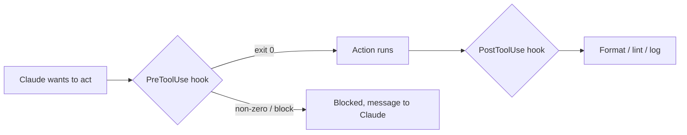

<LevelBadge level="advanced" />

<VerifyNote lastVerified="2026-08-22" source="https://code.claude.com/docs/en/hooks">
Claude Code は、フェーズごとに分類された 30 以上のフックイベントを文書化しています。完全な一覧、イベントごとのマッチャーの文法、共通の JSON 出力フィールドは公式のフックリファレンスにあります。名前やペイロードの形は変化するため、特定のイベントやフィールドに固定する前に、必ず一次情報で確認してください。
</VerifyNote>

フックは、ライフサイクルの定められたポイントで **Claude Code が自動的に実行するシェルコマンド**です。[権限](/docs/claude-code/permissions)がアクションを許可するか*どうか*を決めるのに対し、フックではそのアクションの前後で*あなた*が決定論的なロジック（フォーマット、検証、ログ記録、ゲート、マスキング）を実行できます。「忘れずにやってね」というお願いではなく、動作を保証にするための仕組みです。

<Callout type="objectives" items={["指示・権限・スキルではなく、フックを選ぶべきとき", "ライフサイクル全体：セッション、プロンプト、ツール、サブエージェント、タスク、コンパクション、ターン終了のイベント", "フックの配線方法：イベント、マッチャー、そして stdin の JSON ペイロード", "フックがアクションをブロックする 2 つの方法 — 終了コード 2 と stdout の JSON", "イベント間で共通の JSON 出力フィールド：continue、additionalContext、systemMessage、reloadSkills、sessionTitle、suppressOutput、updatedInput", "高速で安全なフックと、遅くて沈黙するフックを分けるグッドプラクティスとよくある間違い"]} />

## フックを使うべきとき

動作を単に頼むのではなく*保証*したいときにフックを使います。よくある用途は、それぞれライフサイクルイベントに対応します。

- ファイル編集のたびに**自動フォーマット／lint**（`Edit|Write` に対する `PostToolUse`）。
- ルールに違反するアクションを実行前に**ブロック**（`PreToolUse`）。
- アシスタントのメッセージがターミナルに出る前に**マスキング**（`MessageDisplay`）。
- `SessionStart` の後に**スキルを再読み込み**、または**セッションタイトル**を設定。
- セッション終了、タスク完了、ターン失敗時に**通知またはログ記録**（`Stop`、`StopFailure`、`SessionEnd`）。
- セッション開始時や指示の読み込み時に**コンテキストを注入**。

## 仕組み

フックは [`settings.json`](/docs/claude-code/settings) に登録し、**イベント**（そして多くの場合はマッチャー — 通常はツール名、ときにはサブエージェントの種類、コンパクションのトリガー、通知の種類）に対応づけます。イベントが発火すると、Claude はあなたのコマンドを実行し、**stdin で JSON ペイロード**（イベント名、セッション、ツール名や入力などイベント固有のフィールド）を渡します。コマンドの終了コードと stdout が次の動作を決めます。

<Steps items={[{title: "イベントを選ぶ", body: "対象にしたいライフサイクルイベントの下に、settings.json でフックを登録します — たとえばツール実行後の自動化なら PostToolUse、マスキングなら MessageDisplay。"}, {title: "マッチャーで絞り込む", body: "必要なときだけ発火するようにマッチャーを追加します。例：ファイル編集なら matcher \"Edit|Write\"、SessionStart なら matcher \"startup|resume\"。"}, {title: "stdin からペイロードを読む", body: "イベントが発火すると、Claude はコマンドを実行し、stdin に JSON ペイロードをパイプで渡します — イベント名、セッション、イベント固有のフィールド（tool_name、tool_input、notification など）です。"}, {title: "次に何が起きるかを決める", body: "コマンドの終了コードと出力が結果を決めます：アクションをそのまま進める、独自のロジックを実行する、ブロックする、または Claude が見る内容を変える構造化 JSON を返す。"}]} />

```json
{
  "hooks": {
    "PostToolUse": [
      {
        "matcher": "Edit|Write",
        "hooks": [
          { "type": "command", "command": "jq -r '.tool_input.file_path' | xargs npx prettier --write" }
        ]
      }
    ]
  }
}
```

上のフックは、stdin の JSON（`.tool_input.file_path`）から編集されたファイルのパスを取り出してフォーマットします。環境変数にパスが入っていると思い込まないでください — **stdin から読みます。** スクリプトの場所を指すには `${CLAUDE_PROJECT_DIR}` のようなパスのプレースホルダーが*使えます*。

## ライフサイクル早見表

Claude Code のフックは、ツール呼び出しだけでなくセッション全体にわたります。ロジックをどこに掛けるかが分かるよう、フェーズごとにまとめました。

| フェーズ | イベント | 典型的な用途 |
| --- | --- | --- |
| **セッション** | `SessionStart`、`SessionEnd`、`Setup`、`InstructionsLoaded`、`ConfigChange`、`CwdChanged`、`DirectoryAdded`、`FileChanged` | 開始時にコンテキストを注入、終了時にスナップショット、`CLAUDE.md` の再読み込みやディスク上の `.env` の変更に反応 |
| **プロンプト** | `UserPromptSubmit`、`UserPromptExpansion` | Claude がプロンプトを見る前にゲートまたは書き換え |
| **ツール** | `PreToolUse`、`PermissionRequest`、`PermissionDenied`、`PostToolUse`、`PostToolUseFailure`、`PostToolBatch` | アクションの許可／拒否、人間へのエスカレーション、編集後のフォーマット、auto モードで拒否された後の再試行 |
| **サブエージェント** | `SubagentStart`、`SubagentStop` | 起動／停止のログ記録、サブエージェントが結果を返すのをブロック |
| **タスク** | `TaskCreated`、`TaskCompleted` | 誤って作られたタスクのロールバック、完了のゲート |
| **コンパクション** | `PreCompact`、`PostCompact` | コンパクション前にトランスクリプトをスナップショット、後で検証 |
| **モデル** | `PreModelSwitch`、`PostModelSwitch` | 適用前にモデル切り替えをブロック、切り替え後（再開したセッションがモデルを復元した場合を含む）に反応 |
| **ターン** | `Stop`、`StopFailure`、`Notification`、`MessageDisplay` | 完了時の通知、API 障害時のアラート、表示テキストのマスキング |
| **チーム + MCP** | `TeammateIdle`、`Elicitation`、`ElicitationResult`、`WorktreeCreate`、`WorktreeRemove` | セッション間の連携、MCP の elicitation のゲート、worktree 操作のラップ |

各イベントの stdin フィールド、マッチャーの文法、ブロックのルールの正確な内容は[公式のフックリファレンス](https://code.claude.com/docs/en/hooks)にあります。上のカタログは地図で、リファレンスが現地です。

## フックがブロックする方法

イベントに応じて 2 通りあります。

- **終了コード 2** — フックがアクションを失敗させ、**stderr** に書いた内容が Claude の見るメッセージになります。シンプルで、ブロック可能なイベント（`PreToolUse`、`UserPromptSubmit`、`UserPromptExpansion`、`Stop`、`SubagentStop`、`TeammateIdle`、`TaskCreated`、`TaskCompleted`、`ConfigChange`、`PostToolBatch`、`PreCompact`、`PreModelSwitch`、`Elicitation`、`ElicitationResult`、`WorktreeCreate`、`WorktreeRemove`）のコマンドフックで使えます。`PermissionRequest` では終了コード 2 は無視されます。代わりに `decision` オブジェクトで拒否してください。
- **stdout の JSON（終了コード 0）** — 構造化された決定を返します。`PreToolUse` では、`permissionDecision` に `"allow"`、`"deny"`、`"ask"`（その呼び出しをユーザーに提示）、`"defer"`（アプリが再開する `-p` 実行でのみ使用）のいずれかを指定し、`permissionDecisionReason` を付けます。ブロックしないイベント（`PostToolUse`、`Notification`、`MessageDisplay`、`StopFailure`、ほとんどのセッションイベント）はブロックの試みを無視します — ただし JSON 出力で Claude が次に見る内容を誘導することはできます。

以下のスクリプトは Bash ツールに対する `PreToolUse` フックです。上から順に読んでください：stdin からコマンドを取り出し、破壊的に見えたら stderr に理由を書いて終了コード 2 でブロックします。

```bash
#!/usr/bin/env bash
# PreToolUse hook on the Bash tool: refuse to delete things.
command=$(jq -r '.tool_input.command' < /dev/stdin)
if [[ "$command" == rm\ * || "$command" == *"rm -rf"* ]]; then
  echo "Blocked: destructive 'rm' is not allowed by policy." >&2
  exit 2
fi
exit 0
```

## 共通の JSON 出力フィールド

ほとんどのイベントは、次に起きることを誘導する構造化 JSON オブジェクトを stdout で受け付けます。これは `permissionDecision` のようなイベント固有の決定フィールドとは別物です。特に便利なもの：

| フィールド | 動作 | 使える場所 |
| --- | --- | --- |
| **`continue`** | `false` の場合、Claude は処理を完全に停止します — イベント固有のあらゆる決定より優先されます | ほとんどのイベント |
| **`systemMessage`** | Claude のコンテキスト／トランスクリプトにメッセージを追加し、なぜ介入したかが分かるようにします | ほとんどのブロック可能なイベント |
| **`additionalContext`** | 次のターンで Claude が読んで活用できる追加コンテキストを注入します | `SessionStart`、`UserPromptSubmit`、ほか |
| **`reloadSkills`** | スキルのディレクトリを再スキャンし、書いたばかりのスキルをセッションが認識できるようにします | `SessionStart`（およびその他のセッションイベント） |
| **`sessionTitle`** | UI のセッションタイトルを設定します — `SessionStart` では `hookSpecificOutput` の下に置きます | `SessionStart` |
| **`suppressOutput`** | ツールの出力を Claude から隠します（出力の多いコマンドに便利） | ツールイベント |
| **`updatedInput`** | 実行前にツールの入力を書き換えます（例：`--dry-run` フラグを追加） | `PreToolUse` |
| **`terminalSequence`** | ターミナルのエスケープシーケンス（ベル、ウィンドウタイトル、通知バッジ）を出力します | `Notification`、`StopFailure`、ほか |

イベント固有の決定フィールド — `PreToolUse` の `permissionDecision`（`"allow"`、`"deny"`、`"ask"`、`"defer"` と `permissionDecisionReason`）、`PermissionRequest` の `decision.behavior`（`"allow"` または `"deny"`）、`PermissionDenied` で Claude に拒否された呼び出しを再試行させる `retry: true` — は、これらの共通フィールドの上に重ねて使います。

## メンタルモデル

`PreToolUse` フックはアクションの*前*に実行されてブロックでき、`PostToolUse` フックはアクションが成功した*後*に実行されて結果に反応します。



<Flashcards title="フックイベント早見" cards={[{front: "PreToolUse", back: "アクションの実行前に発火します。ブロックやゲートに使います — 例：破壊的なコマンドを実行前に拒否。決定フィールド：permissionDecision。"}, {front: "PostToolUse", back: "一致するアクションの後に発火します。直前に変更された内容のフォーマット、lint、ログ記録に使います。ブロックはしません。"}, {front: "MessageDisplay", back: "アシスタントのメッセージテキストが表示される際に発火します。ターミナルから秘密情報や PII をマスキングするのに使います — 表示専用で、ブロックはできません。"}, {front: "SessionStart", back: "セッションの開始時（または再開時）に発火します。additionalContext でコンテキストを注入、新しいスキルの追加後に reloadSkills、または sessionTitle の設定に使います。"}, {front: "Stop / StopFailure", back: "Stop は Claude がターンを正常に終えたときに、StopFailure は API エラー（rate_limit、overloaded、auth など）でターンが終わったときに発火します。失敗側のバリアントで通知または自動リトライを行います。"}, {front: "PreCompact / PostCompact", back: "コンテキストのコンパクションの前後で発火します。PreCompact はブロック（終了コード 2）や、先にトランスクリプトのスナップショットを取ることができ、PostCompact はコンパクション後の状態に反応します。"}]} />

## グッドプラクティス

- **フックは高速かつ冪等に保つ** — 頻繁に実行されます。`SessionEnd` フックは、すべてのフックで 1.5 秒の予算を 1 つ共有するため、セッション終了時の処理は最小限にしてください。
- **本当の問題では大きな音で失敗する**。ただし見た目の問題ではブロックしない。
- **フックの出力を Claude へのフィードバックとして扱う** — stderr（終了コード 2）または `systemMessage`（JSON）の明確なメッセージは、Claude の自己修正に役立ちます。
- **「ブロック」以上のことを伝えたいなら、終了コードより JSON 出力を選ぶ** — `PreToolUse` の `permissionDecision: "ask"` は、扉を叩きつけずに人間へ判断を委ねます。`additionalContext` なら、拒否するだけでなく*誘導*できます。
- フックはあなたのシェルの権限で動きます — 自分で書いていないフックは必ず確認してください（[サードパーティコードのレビュー](/docs/security/reviewing-third-party-code)）。

## よくある間違い

- **ファイルパスを環境変数から読む。** パスは stdin の JSON（`.tool_input.file_path`）にあり、`$CLAUDE_FILE_PATH` にはありません。stdin を `jq` にパイプしてください。
- **無言のブロック。** `PreToolUse` フックが stderr に何も書かずに終了コード 2 で終わると、Claude はブロックされても*理由*が分からず、対応できません。必ず明確な理由を書いてください（または `permissionDecisionReason` を使う）。
- **ブロックしないイベントをブロックしようとする。** `PostToolUse` はツールが実行された*後*に発火します — 終了コード 2 は Claude の耳元にメッセージを届けるだけで、アクションを取り消せません。ゲートが必要なら `PreToolUse` に掛けてください。
- **遅いフック。** `PostToolUse` フックは、一致する編集の*たびに*実行されます。3 秒かかる linter はセッション全体を重くします — フックは高速に保ち、できれば変更された部分だけを対象にしましょう。
- **広すぎるマッチャー。** `matcher: ".*"` はすべてのツールで発火します。正確な名前、`Edit|Write` のような一覧、またはハンドラーごとの `if` フィールド（例：`"if": "Bash(git push *)"`）で絞り込んでください。
- **ツール以外のイベントにもマッチャーがあることを忘れる。** `SessionStart` は `startup|resume|clear|compact|fork` に、`Notification` は `permission_prompt|idle_prompt|agent_completed` のような種類に、`PreCompact` は `manual|auto` にマッチします。間違った部分集合に配線したフックは、発火しすぎるか、まったく発火しません。
- **自分で書いていないフックを信用する。** フックは任意のシェルをあなたの権限で実行します。プラグインやテンプレート由来のフックは、使う前に必ず確認してください — [サードパーティコードのレビュー](/docs/security/reviewing-third-party-code)を参照。

<Callout type="warning" items={["フックは任意のシェルをあなたの権限で実行します — プラグインやテンプレート由来のフックは、読まずに配線しないでください。"]} />

## 盗む価値のあるレシピ

コピー＆ペーストで使えるスターターは [フックと settings.json のレシピ](/docs/templates/hooks-settings)にあります。新しめのイベントの形が分かる、効果の高いものをいくつか紹介します。

<PromptCard title="編集したファイルを自動フォーマット（Edit|Write に対する PostToolUse）">{`{
  "hooks": {
    "PostToolUse": [
      {
        "matcher": "Edit|Write",
        "hooks": [
          { "type": "command", "command": "jq -r '.tool_input.file_path' | xargs npx prettier --write" }
        ]
      }
    ]
  }
}`}</PromptCard>

<PromptCard title="開始時にプロジェクトごとのセッションタイトルを設定（SessionStart）">{`{
  "hooks": {
    "SessionStart": [
      {
        "matcher": "startup|resume",
        "hooks": [
          {
            "type": "command",
            "command": "jq -nc --arg t \\"$(basename \\"$PWD\\") — $(git rev-parse --abbrev-ref HEAD 2>/dev/null || echo detached)\\" '{hookSpecificOutput:{sessionTitle:$t}}'"
          }
        ]
      }
    ]
  }
}`}</PromptCard>

<PromptCard title="SessionStart の後にスキルを再読み込み（書いたばかりのスキルを認識）">{`{
  "hooks": {
    "SessionStart": [
      {
        "matcher": "startup|resume",
        "hooks": [
          { "type": "command", "command": "printf '{\\"reloadSkills\\": true}\\n'" }
        ]
      }
    ]
  }
}`}</PromptCard>

<PromptCard title="表示されるアシスタントのテキストから API キーをマスキング（MessageDisplay）">{`{
  "hooks": {
    "MessageDisplay": [
      {
        "hooks": [
          {
            "type": "command",
            "command": "jq -r '.message.content' | sed -E 's/(sk-[A-Za-z0-9_-]{20,})/sk-***REDACTED***/g'"
          }
        ]
      }
    ]
  }
}`}</PromptCard>

<PromptCard title="ターンの失敗を通知（StopFailure — レート制限、過負荷、認証）">{`{
  "hooks": {
    "StopFailure": [
      {
        "matcher": "rate_limit|overloaded|authentication_failed|billing_error",
        "hooks": [
          { "type": "command", "command": "osascript -e 'display notification \\"Claude Code turn failed — check the terminal\\" with title \\"Claude Code\\"'" }
        ]
      }
    ]
  }
}`}</PromptCard>

<Quiz title="理解度チェック" questions={[{q: "フックは、編集されたばかりのファイルのパスをどこで見つけますか？", options: ["環境変数 $CLAUDE_FILE_PATH", "stdin の JSON ペイロードの .tool_input.file_path", "Claude が渡すコマンドライン引数"], answer: 1, explain: "パスは環境変数ではなく、stdin の JSON（.tool_input.file_path）にあります。stdin を jq にパイプして読み取ります。"}, {q: "PreToolUse フックが終了コード 2 で終了すると、何が起きますか？", options: ["アクションは許可され、stdout はログに記録される", "アクションはブロックされ、フックが stderr に書いた内容が Claude の見るメッセージになる", "終了コード 2 は予約されているため、Claude は結果を無視する"], answer: 1, explain: "終了コード 2 はアクションを失敗させ、stderr が Claude の見るメッセージになります。Claude が対応できるよう、必ず明確な理由を書いてください。"}, {q: "再起動せずに、.claude/skills/ に追加したばかりのスキルをセッションに認識させたいとき、どのイベントでどの出力フィールドを使いますか？", options: ["SessionStart での reloadSkills: true", "Stop での restart: true", "PostToolUse での refresh: true"], answer: 0, explain: "SessionStart フックから {\"reloadSkills\": true} を出力すると、スキルのディレクトリが再スキャンされ、現在のセッションが新規または編集済みのスキルを認識します。"}, {q: "Claude のテキストがユーザーの画面に表示される前に、秘密情報をマスキングしたい。どのイベントを使いますか？", options: ["PreToolUse", "PostToolUse", "MessageDisplay"], answer: 2, explain: "MessageDisplay はアシスタントのメッセージテキストが表示される際に発火します — ターミナルに向かうテキストを変換・マスキングするのに適した場所です。ブロックはできません。"}]} />

<Callout type="takeaways" items={["フックは動作を「お願い」ではなく「保証」にします — 権限が許可か拒否しかできないアクションの周囲に、決定論的なロジックを置けます。", "ライフサイクルはセッション、プロンプト、ツール、サブエージェント、タスク、コンパクション、ターンの各フェーズにまたがる 30 以上のイベントに及びます — スクリプトを書く前に適切なフェーズを選びましょう。", "settings.json にイベントとマッチャーを登録します。Claude は stdin に JSON ペイロードをパイプし、あなたの終了コードと出力を読み取ります。", "ファイルパスは stdin（.tool_input.file_path）から読みます — 環境変数からではありません。", "終了コード 2（stderr がメッセージになる）または stdout の構造化 JSON（ツールイベントでは permissionDecision、すべてを止めるなら {continue: false}）でブロックします。", "共通の出力フィールド — additionalContext、systemMessage、reloadSkills、sessionTitle、suppressOutput、updatedInput — を使えば、許可か拒否だけでなく Claude を誘導できます。", "フックは高速・冪等・狭いマッチャーに保ち、自分で書いていないフックは必ず確認しましょう。シェルの権限で動くからです。"]} />

## 次へ

- [Mods：インプロセス拡張](/docs/claude-code/mods) — インプロセスの兄弟機能：イベントを許可・ブロックするだけでなく*書き換え*られる TypeScript ミドルウェアで、このページのすべてのイベントに `classic.<Event>` としてアクセスできます
- [settings.json](/docs/claude-code/settings) · [権限](/docs/claude-code/permissions)
- [スキル](/docs/claude-code/skills) — 専門知識と自動化の違い
- [自律実行の堅牢化](/docs/security/hardening-autonomous-runs)
