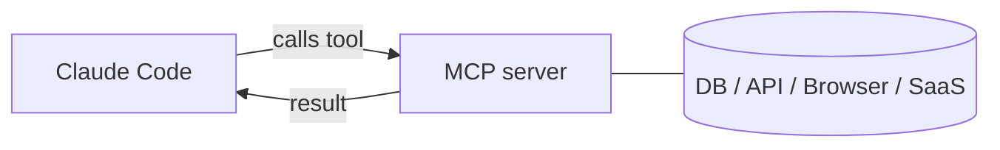

<LevelBadge level="advanced" />

<VerifyNote lastVerified="2026-11-10" source="https://code.claude.com/docs/en/mcp">
`claude mcp` コマンド、設定スコープ、トランスポートは進化し続けています。Claude Code の公式 MCP ドキュメントおよび modelcontextprotocol.io で確認してください。以下の 4 つのトランスポート、スコープの保存先パス、SSE の非推奨化、プロジェクト承認の挙動は、いずれもそのページに基づいています。
</VerifyNote>

**Model Context Protocol（MCP）** は、AI を外部のツールやデータにつなぐためのオープンな標準です。**MCP サーバー** は機能（データベースへのクエリ、GitHub の PR の作成、ブラウザの操作）を公開し、Claude Code はそれに接続して、セッション中に**それらのツールを呼び出す**ことができます。ファイルシステムとシェルの外へ Claude を拡張する仕組みがこれです。

<Callout type="objectives" items={["MCP サーバーとは何か、Claude Code がそのツールをどう呼び出すかを説明できる", "2 種類のトランスポート（ローカルの stdio とリモートの HTTP/SSE）を区別できる", "claude mcp add でサーバーを追加し、書き込まれる JSON を読める", "サーバーを誰に見せるかに応じて適切なスコープ（local、project、user）を選べる", "実際のデータベースを Claude にエンドツーエンドで接続できる", "多くの人がはまるセキュリティと設定の落とし穴を避けられる"]} />

## 全体像



Claude が使ってよいサーバーを宣言します。各サーバーはスキーマ付きのツール群を公開し、Claude は他のツールと同じようにそれらを選んで呼び出します。

<Flashcards title="MCP の用語" cards={[{front: "Model Context Protocol（MCP）", back: "AI を外部のツールやデータにつなぐためのオープンな標準。"}, {front: "MCP サーバー", back: "データベースへのクエリ、GitHub の PR の作成、ブラウザの操作といった機能を、呼び出し可能なツールとして公開するプログラム。"}, {front: "ツール", back: "MCP サーバーがスキーマ付きで公開する機能。Claude は他のツールと同じように選んで呼び出す。"}, {front: "トランスポート", back: "Claude がサーバーに到達する方法：stdio（ローカルプロセス）、HTTP（ホスト型、多くは OAuth）、SSE（非推奨 — HTTP が自動的にフォールバックする）、WebSocket ws/wss（永続接続、プッシュ対応、ヘッダー認証のみ、--transport フラグなし）。"}, {front: "スコープ", back: "誰にサーバーが見えるか：local（自分、このプロジェクト）、project（コミットされたチーム）、user（自分、すべての場所）。"}]} />

## トランスポート

Claude がサーバーに到達する方法は 4 つあります。サーバーがどこで動き、どう通信するかで選びます。

- **stdio** — Claude が起動するローカルプロセス（ローカルのツールや CLI に最適）。`type` のない JSON エントリはこれを意味します。
- **HTTP** — ホスト型のサーバーで、多くは OAuth を使います。リモートなら基本的にこれを選びます。
- **SSE** — **非推奨**。可能なら HTTP を使ってください。今でも SSE のエンドポイントしか公開していないサービスがありますが、Claude Code v2.1.265 以降は `--transport http` がまず HTTP を試し、自動的に SSE に切り替えるため、`--transport sse` を明示する必要はほとんどありません。
- **WebSocket**（`ws` / `wss`） — 永続的な双方向接続で、サーバーが呼び出しなしにイベントをプッシュする場合に使います。`--transport` は `ws` を*受け付けません*。`claude mcp add-json '{"type":"ws","url":"wss://…"}'` で追加するか、`.mcp.json` に書き込みます。OAuth は使えず、認証はヘッダーのみです。

<Callout type="warning" items={["url はあるが type がない JSON エントリは、妥当なデフォルトではなく設定ミスです。Claude Code は type のないエントリを stdio サーバーとして読み、スキップして、\"url\" があるのに \"type\" がないと報告します。手書きするリモートサーバーには、必ず \"type\": \"http\"（または \"sse\" / \"ws\"）を設定してください。"]} />

## サーバーの設定

最短の方法は `claude mcp add` コマンドです。設定を書き込んでくれます。次の手順で、ゼロから接続済みのサーバーまで進みましょう。

<Steps items={[{title: "ローカルの stdio サーバーを追加する", body: "claude mcp add を実行します。-- の後ろはすべて、Claude が代わりに実行する起動コマンドです。"}, {title: "または、リモートの HTTP サーバーを追加する", body: "--transport http とスコープを渡し、続けてサーバーの URL を指定します。リモートサーバーはホスト型で、OAuth を使うことが多くあります。"}, {title: "接続されているものを確認する", body: "claude mcp list を実行して、設定済みのサーバーと接続状態を確認します。"}, {title: "確認と認証", body: "セッション内で /mcp を使うと、サーバーのツールを確認し、リモートサーバーを認証できます。"}]} />

<PromptCard title="ローカルの stdio サーバーを追加する">{`# A local stdio server (everything after -- is the launch command)
claude mcp add filesystem -- npx -y @modelcontextprotocol/server-filesystem ~/code/myproject`}</PromptCard>

<PromptCard title="リモートの HTTP サーバーを追加する（プロジェクトと共有）">{`# A remote HTTP server, shared with everyone on the project
claude mcp add --transport http --scope project github https://api.githubcopilot.com/mcp/`}</PromptCard>

中身はただの JSON です。**project** スコープのサーバーはリポジトリのルートにある `.mcp.json` に書かれます。これをコミットしておけば、チームメンバーはワークスペースを信頼した時点で同じツールを使えます。

```json
{
  "mcpServers": {
    "github": { "type": "http", "url": "https://api.githubcopilot.com/mcp/" }
  }
}
```

<Callout type="warning" items={["古いチュートリアルにある @modelcontextprotocol/server-github、-postgres、-slack、-puppeteer のパッケージには手を出さないでください。これらはアーカイブ済みで、npm には \"Archived and unmaintained; no security guarantees\" という非推奨の通知が付いています。ベンダー自身のサーバーがあるならそれを使ってください。GitHub のものは上記の HTTP エンドポイントで、ブラウザ操作は @playwright/mcp に移りました。TypeScript のリファレンスサーバーのうち、今もメンテナンスされているのは filesystem、memory、everything、sequential-thinking だけです。"]} />

### スコープがサーバーを誰に見せるかを決める

| スコープ | 保存先 | 読み込まれる範囲 | 用途 |
|---|---|---|---|
| `local`（デフォルト） | `~/.claude.json` の、このプロジェクトのパス配下 | このプロジェクトのみ | 個人的な実験、シークレット |
| `project` | リポジトリ内の `.mcp.json`（コミットされる） | このプロジェクトのみ、チームと共有 | チーム全体で共有すべきツール |
| `user` | `~/.claude.json` | 自分のすべてのプロジェクト | どこでも使いたいサーバー |

<Callout type="warning" items={["MCP の「local スコープ」は、ローカル設定とは別物です。local スコープの MCP サーバーはホームディレクトリの ~/.claude.json にあり、プロジェクトの .claude/settings.local.json には「ありません」。プロジェクトフォルダ内を探しても見つかりません。"]} />

接続されているものは `claude mcp list` で、ツールの確認やリモートサーバーの認証はセッション内の `/mcp` で行えます。コピー＆ペーストで使える出発点は [MCP 設定とサーバーのひな形](/docs/templates/mcp-config) を参照してください。

## 実践例：Claude にデータベースを使わせる

クエリ結果を自分で貼り付ける代わりに、ローカルの Postgres に対する質問へ Claude に答えてほしいとします。チームメンバーも使えるように、project スコープでサーバーを追加します。

アーカイブ済みサーバーの問題が最も深刻なのがデータベースです。旧来の `@modelcontextprotocol/server-postgres` はメンテナンスされておらず、公式の後継もないため、パッケージ名は自分で決めなければならない唯一の判断になります。メンテナンスされているコミュニティ製サーバーを選び、[レビュー](/docs/security/reviewing-third-party-code)したうえで組み込みましょう。どれを選んでも形は同じです。

<PromptCard title="Postgres サーバーを project スコープで追加する">{`# Replace the package with a maintained Postgres MCP server you have reviewed.
# The connection string is read-only on purpose — see below.
claude mcp add --scope project db -- npx -y <postgres-mcp-server> "postgresql://readonly@localhost/app"`}</PromptCard>

これでセッション内で普通の言葉で質問すれば、クエリのやり取りは Claude に任せられます。

<PromptCard title="データベースに質問する">{`How many users signed up last week? Check the DB.`}</PromptCard>

Claude はサーバーが公開しているクエリツールを呼び出し、行を受け取って答えます。コピー＆ペーストの往復は不要です。Claude が本当に書き込む必要がない限り、接続文字列は読み取り専用にしておいてください。また、必要なのが 1 回のクエリだけなら、Bash 経由の `psql -c '…'` のほうがトークンは何分の一かで済みます。どちらが有利になるかは [MCP のトークン税](/docs/claude-code/mcp-token-cost) で扱っています。

project スコープなので、リポジトリを pull したチームメンバーも同じ機能を得られます。ただし、**黙って、すぐに、ではありません**。コミットされた `.mcp.json` のサーバーは、そのフォルダで `claude` を実行してワークスペースの信頼ダイアログを承認するまで `⏸ Pending approval` のままです。クローンしたリポジトリが自分のサーバーを事前承認することはできません。プロジェクトの `.claude/settings.json` にコミットされた `enableAllProjectMcpServers` や `enabledMcpjsonServers` は、信頼されていないフォルダでは*無視*されます。ユーザーレベルの `~/.claude/settings.json`、管理対象設定、または `--settings` で渡した承認は、そこでも有効です。「なぜチームメイトにサーバーが見えないのか」への、よくある答えがこれです。

## 信頼とセキュリティ

<Callout type="warning" items={["MCP サーバーはコードを実行し、データを読み、操作を行えます。信頼できるサーバーだけを接続してください。", "各サーバーには必要最小限の権限だけを与えてください。", "サーバーが返す外部コンテンツには、プロンプトインジェクションが含まれている可能性があります。", "サードパーティ製サーバーは、接続する前にレビューしてください。"]} />

:::warning[MCP サーバーはソフトウェアのインストールと同じように扱う]
MCP サーバーはコードを実行し、データを読み、操作を行えます。信頼できるサーバーだけを接続し、必要な**最小権限**だけを与え、返ってくる外部コンテンツには[プロンプトインジェクション](/docs/security/prompt-injection)が含まれうることを忘れないでください。サードパーティ製サーバーは先にレビューしましょう。[サードパーティ製コードのレビュー](/docs/security/reviewing-third-party-code)を参照してください。
:::

## アプリでも MCP

MCP は Claude アプリの**コネクタ**も支えています。同じ標準で、使う場面が違うだけです。[アプリのコネクタ（MCP）](/docs/claude-app/connectors) と、API については [MCP とツールへの接続](/docs/api/mcp) を参照してください。

## よくある間違い

- **スコープの間違い。** `local` スコープで追加したサーバーはチームメンバーには表示されません。自分だけで使いたいものを `project` スコープでコミットすべきでもありません。意識して選んでください。
- **サーバーが多すぎ、ツールが多すぎ。** ツール検索はデフォルトで有効なので、接続したサーバーが毎ターン消費するのは通常、完全なスキーマではなくツールの*名前*とサーバーの指示だけです。それでも毎ターンの税であることに変わりはなく、Claude がスキーマを検索した時点でそれらがコンテキストに入ります。タスクに必要なものだけを接続し、カタログ全体は接続しないでください。実際の数値、`ENABLE_TOOL_SEARCH` のモード、コード実行で 2 つ目のコストをどう削減するかは [MCP のトークン税](/docs/claude-code/mcp-token-cost) を参照してください。
- **過剰な権限の接続。** Claude が本当に書き込む必要がない限り、データベースサーバーには読み取り専用のロールを与えてください。MCP は機能を現実のものにします。権限は絞りましょう。
- **インジェクションのリスクを忘れる。** サーバーが返すもの（Web ページ、Issue の本文、行）は、[プロンプトインジェクション](/docs/security/prompt-injection)を含みうる信頼できないテキストです。書き込み可能な強力なサーバーを、信頼できない読み取り可能なサーバーの隣に、よく考えずに配線しないでください。

<Quiz title="理解度チェック" questions={[{q: "Claude が自分で起動するローカルプロセスはどのトランスポートですか？", options: ["リモートの HTTP/SSE", "stdio", "OAuth"], answer: 1, explain: "stdio は Claude が起動するローカルプロセスで、ローカルのツールや CLI に最適です。他の 3 つはリモートです：HTTP（多くは OAuth）、非推奨の SSE、そして WebSocket。"}, {q: "project スコープのサーバーはどこに書き込まれ、チームメンバーは何をする必要がありますか？", options: ["自分のユーザー設定。見えるのは自分だけ", "リポジトリのルートの .mcp.json。pull した後も、Pending approval から抜けるにはワークスペースを信頼する必要がある", "隠されたグローバルキャッシュ。誰も編集できない"], answer: 1, explain: "project スコープは、リポジトリのルートでコミットされる .mcp.json に書き込まれます。ただしクローンしたリポジトリは自分のサーバーを承認できません。コミットされた enableAllProjectMcpServers は信頼されていないフォルダでは無視されるため、チームメンバーがワークスペースの信頼ダイアログを承認するまで、サーバーは Pending approval のままです。"}, {q: "Claude が読むだけでよいとき、データベース接続を読み取り専用にするのはなぜですか？", options: ["クエリが速く実行されるから", "最小権限のため。MCP は機能を現実のものにするので、本当に必要でない限り書き込みアクセスは与えない", "プロトコルが読み取り専用を要求しているから"], answer: 1, explain: "サーバーには必要最小限の権限を与えます。MCP は機能を現実のものにするので、読み取り専用のロールにすれば意図しない書き込みを避けられます。"}]} />

<Callout type="takeaways" items={["MCP はオープンな標準。MCP サーバーはツールを公開し、Claude Code は他のツールと同じようにそれを呼び出す。", "トランスポートは 4 つ：stdio（Claude が起動するプロセス）、HTTP（リモートの標準）、SSE（非推奨 — HTTP が自動的に切り替える）、WebSocket ws/wss（プッシュ、ヘッダー認証、add-json のみ）。", "claude mcp add が設定を書き込む。中身は JSON。project スコープはコミットされた .mcp.json にあり、チームメンバーのコピーはワークスペースを信頼するまで Pending approval のまま。", "スコープが可視範囲を決める：local（自分、このプロジェクト）、project（チーム向けにコミット）、user（自分、すべての場所）。", "サーバーはソフトウェアのインストールと同じように扱う：信頼、最小権限、そして返ってくるものすべてでのプロンプトインジェクションへの警戒。"]} />

## 次のステップ

- [最初の MCP サーバーを作って接続する（ウォークスルー）](/docs/walkthroughs/first-mcp-server)
- [MCP 設定とサーバーのひな形](/docs/templates/mcp-config)
- [エージェントとツールの保護](/docs/security/securing-agents)
