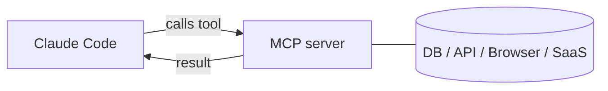

<LevelBadge level="advanced" />

<VerifyNote lastVerified="2026-11-10" source="https://code.claude.com/docs/en/mcp">
`claude mcp` コマンド、設定スコープ、トランスポートは変化していきます — Claude Code の公式 MCP ドキュメントと modelcontextprotocol.io で確認してください。以下の 4 つのトランスポート、スコープの保存先パス、SSE の非推奨化、プロジェクト承認の挙動は、いずれもそのページに基づいています。
</VerifyNote>

**Model Context Protocol (MCP)** は、AI を外部のツールやデータにつなぐためのオープン標準です。**MCP サーバー**は機能(データベースへのクエリ、GitHub の PR の作成、ブラウザの操作など)を公開し、Claude Code はそれに接続してセッション中に**それらのツールを呼び出す**ことができます。Claude をファイルシステムとシェルの外へ拡張する方法です。

<Callout type="objectives" items={["MCP サーバーとは何か、Claude Code がそのツールをどう呼び出すかを説明できる", "2 種類のトランスポート(ローカルの stdio とリモートの HTTP/SSE)を区別できる", "claude mcp add でサーバーを追加し、書き込まれる JSON を読める", "サーバーを誰に見せるかに応じて適切なスコープ(local、project、user)を選べる", "実際のデータベースを Claude にエンドツーエンドで接続できる", "多くの人がはまるセキュリティと設定の落とし穴を避けられる"]} />

## 全体像



Claude が使えるサーバーを宣言します。各サーバーはスキーマ付きのツール一式を公開し、Claude は他のツールと同じようにそれを選んで呼び出します。

<Flashcards title="MCP の用語" cards={[{front: "Model Context Protocol (MCP)", back: "AI を外部のツールやデータにつなぐためのオープン標準。"}, {front: "MCP サーバー", back: "データベースへのクエリ、GitHub の PR の作成、ブラウザの操作といった機能を、呼び出し可能なツールとして公開するプログラム。"}, {front: "ツール", back: "MCP サーバーがスキーマ付きで公開する機能。Claude は他のツールと同じように選んで呼び出す。"}, {front: "トランスポート", back: "Claude がサーバーに到達する方法:stdio(ローカルプロセス)、HTTP(ホスト型、多くは OAuth)、SSE(非推奨 — HTTP が自動的にフォールバックする)、WebSocket ws/wss(常時接続、プッシュ対応、ヘッダー認証のみ、--transport フラグなし)。"}, {front: "スコープ", back: "誰がサーバーを見られるか:local(自分、このプロジェクト)、project(コミットされたチーム)、user(自分、どこでも)。"}]} />

## トランスポート

Claude がサーバーに到達する方法は 4 つあります。サーバーがどこで動き、どう通信するかで選びます。

- **stdio** — Claude が起動するローカルプロセス(ローカルのツールや CLI に最適)。`type` のない JSON エントリはこれを意味します。
- **HTTP** — ホスト型のサーバーで、多くは OAuth を使います。リモートのものにはこれが標準の選択です。
- **SSE** — **非推奨**。可能なら HTTP を使ってください。SSE のエンドポイントしか公開していないサービスもまだありますが、Claude Code v2.1.265 以降は `--transport http` がまず HTTP を試し、自動で SSE に切り替えるため、`--transport sse` を明示する必要はほとんどありません。
- **WebSocket**(`ws` / `wss`) — 双方向の常時接続で、サーバーが自発的にイベントをプッシュする場合に使います。`--transport` は `ws` を*受け付けません*:`claude mcp add-json '{"type":"ws","url":"wss://…"}'` で追加するか、`.mcp.json` に直接書いてください。OAuth は使えず、認証はヘッダーのみです。

<Callout type="warning" items={["url はあるが type がない JSON エントリは、妥当なデフォルトではなく設定エラーです。Claude Code は type のないエントリを stdio サーバーとして読み取り、スキップして、「url」はあるが「type」がないと報告します。手書きでリモートサーバーを書くときは、必ず \"type\": \"http\"(または \"sse\" / \"ws\")を指定してください。"]} />

## サーバーの設定

最も手早いのは `claude mcp add` コマンドで、設定を代わりに書いてくれます。次の手順で、ゼロからサーバー接続までたどり着けます。

<Steps items={[{title: "ローカルの stdio サーバーを追加する", body: "claude mcp add を実行します — -- 以降はすべて、Claude があなたの代わりに実行する起動コマンドです。"}, {title: "または、リモートの HTTP サーバーを追加する", body: "--transport http とスコープを渡し、続けてサーバーの URL を指定します。リモートサーバーはホスト型で OAuth を使うことが多いです。"}, {title: "接続状況を確認する", body: "claude mcp list を実行して、設定済みのサーバーとその接続状態を確認します。"}, {title: "調べて認証する", body: "セッション内で /mcp を使うと、サーバーのツールを確認したり、リモートサーバーを認証したりできます。"}]} />

<PromptCard title="ローカルの stdio サーバーを追加する">{`# A local stdio server (everything after -- is the launch command)
claude mcp add filesystem -- npx -y @modelcontextprotocol/server-filesystem ~/code/myproject`}</PromptCard>

<PromptCard title="リモートの HTTP サーバーを追加する(プロジェクトで共有)">{`# A remote HTTP server, shared with everyone on the project
claude mcp add --transport http --scope project github https://api.githubcopilot.com/mcp/`}</PromptCard>

内部では単なる JSON です。**project** スコープのサーバーはリポジトリのルートにある `.mcp.json` に書き込まれます — これをコミットすれば、チームメイトはワークスペースを信頼した時点で同じツールを使えるようになります。

```json
{
  "mcpServers": {
    "github": { "type": "http", "url": "https://api.githubcopilot.com/mcp/" }
  }
}
```

<Callout type="warning" items={["古いチュートリアルにある @modelcontextprotocol/server-github、-postgres、-slack、-puppeteer といったパッケージには手を出さないでください。これらはアーカイブ済みで、npm の非推奨通知に「Archived and unmaintained; no security guarantees」と書かれています。ベンダー自身のサーバーがあるならそれを使ってください — GitHub の場合は上の HTTP エンドポイントで、ブラウザ操作は @playwright/mcp に移りました。TypeScript のリファレンスサーバーのうち、今もメンテナンスされているのは filesystem、memory、everything、sequential-thinking だけです。"]} />

### スコープがサーバーを見られる人を決める

| スコープ | 保存先 | 読み込まれる場所 | 用途 |
|---|---|---|---|
| `local`(デフォルト) | `~/.claude.json` 内の、このプロジェクトのパスの下 | このプロジェクトのみ | 個人的な実験、シークレット |
| `project` | リポジトリ内の `.mcp.json`(コミットされる) | このプロジェクトのみ、チームと共有 | チーム全員で共有すべきツール |
| `user` | `~/.claude.json` | 自分のすべてのプロジェクト | どこでも使いたいサーバー |

<Callout type="warning" items={["MCP の「local スコープ」は、ローカル設定とは別物です。local スコープの MCP サーバーはホームディレクトリの ~/.claude.json にあり、プロジェクトの .claude/settings.local.json には入りません。プロジェクトのフォルダで探しても見つかりません。"]} />

`claude mcp list` で接続状況を、セッション内の `/mcp` でツールの確認とリモートサーバーの認証を行えます。コピー&ペーストで使えるひな形は [MCP 設定とサーバーのスキャフォールド](/docs/templates/mcp-config)を参照してください。

## 実践例:Claude にデータベースを渡す

クエリ結果を自分で貼り付ける代わりに、ローカルの Postgres に対する質問へ Claude に答えてほしい場合を考えます。チームメイトにも使えるように、project スコープでサーバーを追加します。

データベースは、アーカイブ済みサーバーの問題がいちばん響く領域です。古い `@modelcontextprotocol/server-postgres` はメンテナンスされておらず、公式の後継もないため、パッケージ名は自分で決めるしかない唯一の判断になります。メンテナンスされているコミュニティ製のサーバーを選び、[レビューしたうえで](/docs/security/reviewing-third-party-code)組み込みます — どれを選んでも形は同じです。

<PromptCard title="project スコープで Postgres サーバーを追加する">{`# Replace the package with a maintained Postgres MCP server you have reviewed.
# The connection string is read-only on purpose — see below.
claude mcp add --scope project db -- npx -y <postgres-mcp-server> "postgresql://readonly@localhost/app"`}</PromptCard>

これでセッション内では、普通の言葉で質問するだけで、クエリの繰り返しは Claude が行ってくれます。

<PromptCard title="データベースに質問する">{`How many users signed up last week? Check the DB.`}</PromptCard>

Claude はサーバーが公開しているクエリ用ツールを呼び出し、返ってきた行をもとに答えます — コピー&ペーストの往復は不要です。Claude が本当に書き込む必要がない限り、接続文字列は読み取り専用にしておきましょう。また、必要なクエリが 1 回だけなら、Bash 経由の `psql -c '…'` のほうがトークン消費はずっと少なくて済みます。どちらが有利になるかは [MCP のトークン税](/docs/claude-code/mcp-token-cost)で扱っています。

project スコープなので、リポジトリを pull したチームメイトも同じ機能を得られます — ただし**黙ってでも、すぐにでもありません**。コミットされた `.mcp.json` のサーバーは、そのフォルダで `claude` を実行してワークスペース信頼のダイアログを承認するまで `⏸ Pending approval` のままです。クローンしたリポジトリが自分のサーバーを事前承認することはできません。プロジェクトの `.claude/settings.json` にコミットされた `enableAllProjectMcpServers` や `enabledMcpjsonServers` は、信頼されていないフォルダでは*無視されます*。一方、ユーザーレベルの `~/.claude/settings.json`、管理設定、`--settings` で渡した承認はそこでも有効です。「チームメイトにサーバーが見えないのはなぜ?」という疑問への、よくある答えがこれです。

## 信頼とセキュリティ

<Callout type="warning" items={["MCP サーバーはコードを実行し、データを読み、操作を行えます — 信頼できるサーバーだけを接続してください。", "各サーバーには、必要最小限の権限だけを与えてください。", "サーバーが返す外部コンテンツには、プロンプトインジェクションが含まれている可能性があります。", "サードパーティ製のサーバーは、接続する前にレビューしてください。"]} />

:::warning[MCP サーバーはソフトウェアのインストールと同じように扱う]
MCP サーバーはコードを実行し、データを読み、操作を行えます。信頼できるサーバーだけを接続し、必要な**最小権限**だけを与え、サーバーが返す外部コンテンツにはどれも[プロンプトインジェクション](/docs/security/prompt-injection)が含まれうることを忘れないでください。サードパーティ製のサーバーは先にレビューしましょう — [サードパーティコードのレビュー](/docs/security/reviewing-third-party-code)を参照してください。
:::

## アプリでも MCP

MCP は Claude アプリの**コネクタ**も支えています — 同じ標準で、画面が違うだけです。[アプリのコネクタ(MCP)](/docs/claude-app/connectors)と、API については [MCP とツールへの接続](/docs/api/mcp)を参照してください。

## よくある間違い

- **スコープの取り違え。** `local` スコープで追加したサーバーはチームメイトには表示されません。自分だけで使いたいサーバーを `project` スコープでコミットするのも避けるべきです。意図して選びましょう。
- **サーバーが多すぎ、ツールが多すぎ。** ツール検索はデフォルトで有効なので、接続したサーバーは通常、完全なスキーマではなくツールの*名前*とサーバーの指示だけを毎ターン消費します — それでも毎ターンの税であることに変わりはなく、Claude が検索した時点でスキーマはコンテキストに入ります。カタログ全部ではなく、タスクに必要なものだけを接続しましょう。実際の数値、`ENABLE_TOOL_SEARCH` のモード、コード実行が後者のコストをどう減らすかは [MCP のトークン税](/docs/claude-code/mcp-token-cost)を参照してください。
- **権限が過剰な接続。** Claude が本当に書き込む必要がない限り、データベースサーバーには読み取り専用のロールを与えてください。MCP は機能を現実にします — だからこそ範囲を絞りましょう。
- **インジェクションのリスクを忘れる。** サーバーが返すものはすべて(Web ページ、issue の本文、1 行のデータ)、[プロンプトインジェクション](/docs/security/prompt-injection)を含みうる信頼できないテキストです。強力な書き込み可能サーバーを、信頼できない読み取り可能サーバーの隣に、よく考えずに配線しないでください。

<Quiz title="理解度チェック" questions={[{q: "Claude 自身が起動するローカルプロセスは、どのトランスポートですか?", options: ["リモートの HTTP/SSE", "stdio", "OAuth"], answer: 1, explain: "stdio は Claude が起動するローカルプロセスで、ローカルのツールや CLI に最適です。残りの 3 つはリモートです:HTTP(多くは OAuth)、非推奨の SSE、そして WebSocket。"}, {q: "project スコープのサーバーはどこに書き込まれ、チームメイトは何をする必要がありますか?", options: ["自分のユーザー設定。見えるのは自分だけ", "リポジトリのルートの .mcp.json。pull した後も、Pending approval から抜けるにはワークスペースを信頼する必要がある", "隠れたグローバルキャッシュ。誰も編集できない"], answer: 1, explain: "project スコープはリポジトリのルートにあるコミット済みの .mcp.json に書き込まれます。ただしクローンしたリポジトリは自分のサーバーを承認できません — コミットされた enableAllProjectMcpServers は信頼されていないフォルダでは無視されるため、チームメイトがワークスペース信頼のダイアログを承認するまで、サーバーは Pending approval のままです。"}, {q: "Claude が読み取りしか必要としないとき、データベース接続を読み取り専用にしておくのはなぜですか?", options: ["クエリが速く実行されるから", "最小権限のため — MCP は機能を現実にするので、本当に必要でない限り書き込み権限を与えない", "プロトコルが読み取り専用を必須としているから"], answer: 1, explain: "サーバーには必要最小限の権限を与えてください。MCP は機能を現実にするので、読み取り専用のロールにしておけば意図しない書き込みを防げます。"}]} />

<Callout type="takeaways" items={["MCP はオープン標準で、MCP サーバーは Claude Code が他のツールと同じように呼び出すツールを公開する。", "トランスポートは 4 つ:stdio(Claude が起動するプロセス)、HTTP(リモートの標準)、SSE(非推奨 — HTTP が自動で切り替える)、WebSocket ws/wss(プッシュ、ヘッダー認証、add-json のみ)。", "claude mcp add が設定を書いてくれる。中身は JSON。project スコープはコミットされた .mcp.json にあり、チームメイト側ではワークスペースを信頼するまで Pending approval のまま。", "スコープが見える範囲を決める:local(自分、このプロジェクト)、project(チーム向けにコミット)、user(自分、どこでも)。", "サーバーはソフトウェアのインストールと同じように扱う:信頼、最小権限、そして返ってくるものすべてに潜むプロンプトインジェクションへの警戒。"]} />

## 次へ

- [最初の MCP サーバーを作って接続する(ウォークスルー)](/docs/walkthroughs/first-mcp-server)
- [MCP 設定とサーバーのスキャフォールド](/docs/templates/mcp-config)
- [エージェントとツールを守る](/docs/security/securing-agents)
