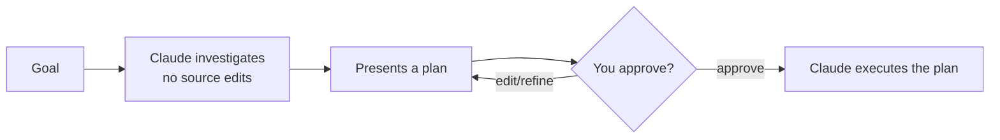

<LevelBadge level="beginner" />

<Callout type="objectives" items={["プランモードが何をブロックし、何を引き続き実行できるのかを説明する", "プランモードに入る方法と抜ける方法を3通り押さえる", "調査 → 提案 → 承認 → 実行のループを順にたどる", "プランモードと権限（Permissions）の違いを理解し、併用する"]} />

<VerifyNote lastVerified="2026-10-09" source="https://code.claude.com/docs/en/permission-modes">
プランモードへの入り方（ショートカット/フラグ）や、計画中に Claude が実行できるシェルコマンドの正確な範囲はリリースごとに変わります。公式の Claude Code ドキュメントで確認してください。
</VerifyNote>

## 基本の考え方

業者に家の鍵を渡すのと、まず現場を見て「何を変えるつもりか」を書き出してもらうのとでは違います。プランモードは後者の下見にあたります。

**プランモード**は、Claude に**変更せずに調べて提案する**よう指示します。ファイルを読み、調査のためにシェルコマンドを実行し、計画を書きますが、**ソースは編集しません**。計画を承認するまで、編集はブロックされたままです。

<Callout type="tip" items={["プランモードでは、Claude はソースを「調査」するが「変更」はしない。計画を作り、あなたの合図を待つ。"]} />

### 厳密な読み取り専用ではない

調べるにはコマンドが必要なこともあるため、プランモードは「実行しない」ではなく「編集しない」ためのものです。計画中のシェルコマンドがどう扱われるかはセッションによって決まり、最初に当てはまるケースが優先されます。

<Steps items={[{title: "bypass permissions が使えるインタラクティブなターミナルセッション", body: "プランモードのブロックは強制されません。Claude は編集せずに計画するよう指示されたままですが、計画中に試みた編集やコマンドは確認なしで実行されます。それ以外の環境（ヘッドレスの -p 実行、Agent SDK、VS Code 拡張のチャットパネル）ではプランモードのブロックが維持されます。"}, {title: "auto mode が利用可能で useAutoModeDuringPlan がオン（デフォルト）", body: "重要なパスの削除を除き、シェルコマンドは確認ダイアログではなく分類器（classifier）が審査します。承認されたコマンドは実行され、却下されたものはブロックされます。"}, {title: "auto mode が利用できない、または useAutoModeDuringPlan がオフ", body: "組み込みの読み取り専用セットに含まれないコマンドは、承認を求めるプロンプトが表示されます。"}]} />

<Callout type="warning" items={["--allow-dangerously-skip-permissions で起動した場合、プランモードは強固な指示にすぎず、厳格なガードレールではありません。サンドボックスではなく、計画のための取り決めとして扱ってください。"]} />

## 最も安全な出発点である理由

大規模・高リスク・不慣れな作業では、Claude がリポジトリに触れる前に「何をするつもりか」を確認したいものです。プランモードは**考えること**と**実行すること**を切り離します。

得られるものは、誤った前提が誤ったコードになる*前*に気づけることです。

## 使うタイミング

<Callout type="tip" items={["大規模または複数ファイルにまたがる変更、マイグレーション、リファクタリングでは必ず使う", "まだ十分に把握していないコードベースで作業するとき", "チームメイトと共有できる、レビュー可能な計画が欲しいとき"]} />

ごく小さく自明な編集なら省いてかまいませんが、迷ったらまず計画しましょう。

## 実際の流れ

ループを順にたどります。各ステップが次のステップの前提になり、Claude は承認の*後*にはじめて編集に移ります。

<Steps items={[{title: "プランモードに入り、目標を伝える", body: "ステータスバーに 'plan mode on' と表示されるまで Shift+Tab で権限モードを切り替えるか、1回のプロンプトの先頭に /plan を付けます。最初からプランモードで始めるには claude --permission-mode plan で起動します。その後、達成したいことを説明します。"}, {title: "Claude が調査する", body: "関連ファイルを読み、調査用のコマンドを実行し、必要に応じて確認の質問をします。"}, {title: "Claude が段階的な計画を返す", body: "変更するファイル、アプローチ、結果の検証方法が示されます。Ctrl+G を押すと、提案された計画をエディタで開いて直接修正できます。"}, {title: "承認または修正する", body: "'Yes, and use auto mode'、'Yes, manually approve edits'、'No, keep planning' のいずれかを選びます。承認するとプランモードを抜け、そのオプションが示す権限モードに移行して、Claude が編集を始めます。"}]} />

計画を承認せずにプランモードを抜けるには、もう一度 `Shift+Tab` を押します。プロジェクトのターミナルセッションでデフォルトにするには、`.claude/settings.json` で `defaultMode` を `plan` に設定します。詳しくは[設定](/docs/claude-code/settings)を参照してください。

### 試してみよう

実際の計画セッションにこれをコピーして、ループが進む様子を確かめてみましょう。

<PromptCard title="計画セッションを始める">{`I want to migrate our auth from sessions to JWT. Stay in Plan Mode: investigate the current setup, ask anything you need, then propose a step-by-step plan with files to change and how to verify — don't edit anything yet.`}</PromptCard>

:::tip CLAUDE.md と組み合わせる
優れた [CLAUDE.md](/docs/claude-code/claude-md) があると計画が鋭くなります。Claude があなたの規約やガードレールを踏まえて計画を立てるからです。
:::

## プランモードと権限の違い

よくある取り違えです。この二つは解決する問題が違い、組み合わせて使います。

- **プランモード** = 「まだ編集せず、調査して提案する」。（このページ）
- **[権限（Permissions）](/docs/claude-code/permissions)** = 実際に動く段階で、*どの*操作を確認なしで許可するか。

**いま動くかどうか**（プランモード）と、**動くときにどの操作が許されるか**（権限）の違いだと考えてください。

<Flashcards cards={[{front: "プランモードは Claude Code をどんな状態にする？", back: "調査して提案する状態。ファイルを読み、調べるためにシェルコマンドを実行し、計画を書くが、ソースは編集しない。承認するまで編集はブロックされたまま。"}, {front: "プランモードへの入り方と抜け方は？", back: "Shift+Tab、1回のプロンプトの先頭に /plan を付ける、または claude --permission-mode plan で入る。承認せずに抜けるには、もう一度 Shift+Tab。"}, {front: "プランモードのループとは？", back: "調査 → 計画を提示 → あなたが承認または修正 → Claude が実行。"}, {front: "どんなときにプランモードを使う？", back: "大規模・高リスク・不慣れな作業（複数ファイルの変更、マイグレーション、リファクタリング、未知のコードベース）ではデフォルトで使う。省いてよいのは、ごく小さく自明な編集だけ。"}, {front: "プランモードと権限の違いは？", back: "プランモードは、いま動くかどうかを決める。権限は、動くときにどの操作を許可するかを決める。"}]} />

<Callout type="takeaways" items={["プランモードは「調査して提案する」モード：Claude は読み取りと調査用コマンドの実行はするが、計画を承認するまでソースを編集しない", "厳密な読み取り専用ではない — 計画中のコマンドは、分類器による審査、確認プロンプト、または（インタラクティブなターミナルで bypass permissions が使える場合）完全に無制限、のいずれかになる", "Shift+Tab、/plan プレフィックス、--permission-mode plan で入る。承認すると、選んだ承認オプションが示すモードにセッションが切り替わる", "大規模・高リスク・不慣れな作業ではデフォルトで使い、省くのはごく小さく自明な編集だけ", "プランモードは、いま動くかどうかを決める。権限は、動くときにどの操作を許可するかを決める"]} />

<Quiz title="理解度チェック" questions={[{q: "プランモード中、Claude Code にできることは？", options: ["ファイルを編集し、あらゆるコマンドを実行できる", "ファイルを読み、調査のためにシェルコマンドを実行できるが、承認するまでソースは編集できない", "質問に答えるだけで、ファイルには一切アクセスできない"], answer: 1, explain: "プランモードは「実行しない」ではなく「編集しない」ためのものです。Claude はファイルを読み、調査用のコマンドを実行します（セッションに応じて分類器の審査または確認プロンプトを経由）が、ソースの編集は計画を承認するまでブロックされます。"}, {q: "プランモードを使うべきなのはどんなとき？", options: ["1行のタイポ修正のときだけ", "大規模または複数ファイルの変更、マイグレーション、リファクタリング、不慣れなコードベースのとき", "使わない — 遅くなるだけ"], answer: 1, explain: "大規模または複数ファイルの変更、マイグレーション、リファクタリング、そしてまだ十分に把握していないコードベースでの作業では常に使いましょう。ごく小さく自明な編集は省いてかまいません。"}, {q: "プランモードのループの正しい順序は？", options: ["実行し、次に調査し、そのあと承認する", "編集せずに調査し、計画を提示し、あなたが承認または修正し、そのあと Claude が実行する", "まず承認し、そのあと Claude が調査して編集する"], answer: 1, explain: "Claude はソースを編集せずに調査し、計画を提示します。あなたが承認または修正してはじめて、計画の実行に切り替わります。"}, {q: "プランモードと権限はどう違う？", options: ["同じ機能の別名である", "プランモード = 調査して提案し、まだ編集しない。権限 = 動く段階で、どの操作を確認なしで許可するか", "権限は計画するかどうかを決め、プランモードは編集するファイルを決める"], answer: 1, explain: "プランモードは考えることと実行することを切り離します。権限は、Claude が動く段階でどの操作を確認なしで許可するかを制御します。両者は併用します。"}]} />

## 次へ

- [権限（Permissions）とパーミッションモード](/docs/claude-code/permissions)
- [Context Management](/docs/claude-code/context-management) — 長いセッションを効果的に保つ
- [ウォークスルー：実際のリポジトリ向けに Claude Code をカスタマイズする](/docs/walkthroughs/customize-claude-code)
