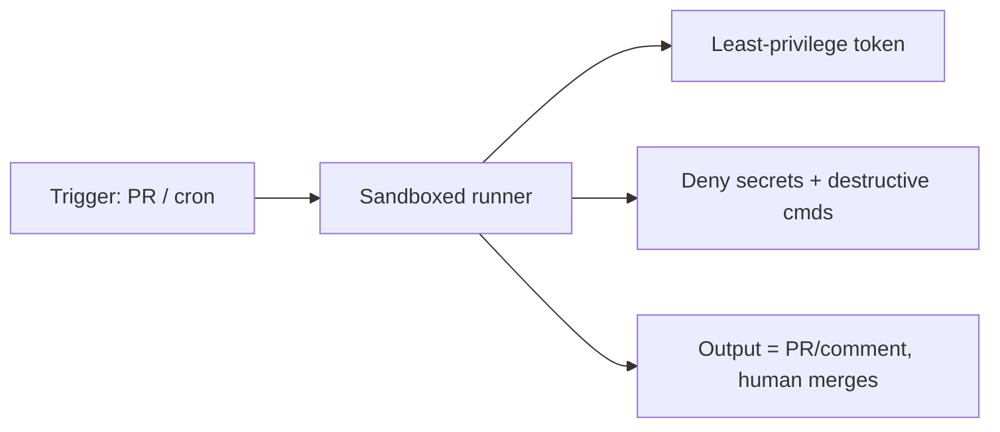

<LevelBadge level="advanced" />

<Callout type="objectives" items={[
  "人が見ていない実行に固有の 3 つのリスク",
  "適用すべき順に並べた 8 項目の堅牢化チェックリスト",
  "どの権限プリミティブが実際に機能を取り除き、どれが事前承認するだけなのか",
  "なぜ慎重なプロンプトよりも最小権限トークンのほうが重要なのか",
  "暴走ループを、願望ベースの指示ではなくプラットフォームが強制する予算で抑える方法",
  "永続的な指示ファイルを、エージェントが書き込めない場所へ diff しておくべき理由"
]} />

Claude を[ヘッドレス](/docs/claude-code/headless-and-agent-sdk)や[スケジュール](/docs/claude-code/background-tasks)で実行する場合 — CI、cron ジョブ、pre-commit フック — 本来なら不適切な操作を止めてくれる人間がいなくなります。この便利さこそ、こうした実行に最も厳しいガードレールが必要な理由です。

## 無人実行に固有のリスク

- 危険なツール呼び出しをその場で**止める人がいない**。
- **環境に存在する認証情報。** CI には強力なトークン(デプロイ、パッケージレジストリ、クラウド)があることが多く、そこで動くエージェントはそれらを継承します。
- **信頼できない入力。** PR や issue をきっかけに起動した実行は、攻撃者が書いたコンテンツを処理する可能性があります([インジェクション](/docs/security/prompt-injection))。

<Callout type="warning">
設計で防ぐべき失敗モードは、悪意あるモデルではありません。持たせるべきでないトークンを握った普通のモデルが、攻撃者の書いたテキストに従って動くことです。以下の各項目は、この 3 つの要素のどれかを取り除きます。
</Callout>

## 堅牢化チェックリスト

<Steps items={[
  {title: "シークレットを明示的に拒否する", body: <><a href="/docs/claude-code/permissions">権限の deny ルール</a>で <code>.env</code>、鍵ファイル、認証情報のパスの読み取りをブロックします。モデルが避けてくれることに頼ってはいけません。deny ルールは機能を取り除ける<em>唯一の</em>プリミティブです。allow リストにこの役目が果たせない理由は、<a href="/docs/claude-code/agent-sdk-permissions">6 段階の評価順序</a>を参照してください。</>},
  {title: "実際のアクセス権を持つマシンでは bypass/yolo モードを使わない", body: <>「すべてのプロンプトをスキップ」は使い捨てのサンドボックス専用にしてください。また、それが上書き<em>しない</em>ものも知っておきましょう。deny ルール、ask ルール、<code>PreToolUse</code> フックは、いずれもモードより上流で実行されます。</>},
  {title: "トークンのスコープを絞る", body: <>フルアクセスの認証情報ではなく、最小権限のトークン(可能なら読み取り専用)を実行に与えます。注入された指示が言いくるめて回避することのできない唯一の対策なので、リストの中で最もレバレッジの高い項目です。</>},
  {title: "サンドボックス化し、使い捨てにする", body: <>終了後に破棄されるコンテナで実行し、本番環境への永続的なアクセスは持たせません。<a href="/docs/claude-code/sandbox-credential-masking">認証情報のマスキング</a>と組み合わせると、漏れた値が実行の外では使えなくなります。</>},
  {title: "コマンドとドメインを許可リスト化する", body: <>テスト/lint/ビルドのコマンドは許可し、ネットワークを使うものや破壊的なものは拒否します。ルールにはスコープを付けてください — 素の <code>Bash</code> ではなく <code>Bash(npm test *)</code> です。</>},
  {title: "上限を設ける", body: <>最大イテレーション数、時間予算、トークン/コスト予算 — ループや操作されたエージェントが暴走しないようにします。Anthropic がホストするループでは、<a href="/docs/api/managed-agents-session-budgets">Managed Agents Session Budgets</a> を使うと、プラットフォームが強制する USD の厳格な上限が設定され、セッションは <code>stop_reason: "budget_reached"</code> で一時停止します。</>},
  {title: "出力は自動適用ではなくレビュー可能にする", body: <>「main に push」より「PR を開く/コメントを投稿する」を優先します。マージするのは人間です。これにより、あらゆる失敗がインシデントから却下された diff に変わります。</>},
  {title: "永続的なメモリファイルをセッション間で diff する", body: <><code>CLAUDE.md</code>、<code>.cursorrules</code>、<code>SOUL.md</code>、<code>MEMORY.md</code>、エージェントスキルのファイル — 指示として自動注入されるものはすべて、エージェントが書き込めない場所へ diff してログに残すべきです。これが防ぐ、実測された拡散メカニズムについては <a href="/docs/security/mind-viruses-agent-to-agent-propagation">Mind Viruses</a> を参照してください。</>}
]} />

## deny は取り除き、allow は事前承認するだけ

堅牢化した実行で最もよくある間違いは、使うレバーを間違えることです。allow リストは鍵のように見えますが、そうではありません。リストに載せなかったものもエージェントは使え続けられ、セッションの権限モードにフォールスルーするだけです。

<PromptCard title="機能を取り除く — リクエストからツールが消える">{`claude -p "run the test suite" \\
  --disallowedTools "Bash(curl *)" "Read(//.ssh/**)" "Edit(//etc/**)"`}</PromptCard>

<PromptCard title="事前承認リストを厳密にする — それ以外は確認ではなく拒否される">{`claude -p "run the test suite" \\
  --permission-mode dontAsk \\
  --allowedTools "Bash(npm test)" "Read"`}</PromptCard>

CI で使いたいのは後者の形です。`dontAsk` は確認プロンプトになるはずのものをすべて拒否に変えるため、想定外の事態に遭遇した実行は、ハングしたり、緩いデフォルトに黙ってフォールバックしたりせず、はっきりと失敗します。

## 呼び出しごとに走るチェック

allow ルールと deny ルールはパターンにマッチします。呼び出しの*内容* — 引数に含まれるシークレットらしき文字列や、想定外のホスト名 — を検査するチェックが必要なら、`PreToolUse` [フック](/docs/claude-code/hooks)に置きます。フックは他のすべての権限ステップより先に実行され、フックによる拒否は bypass モードでも有効です。

<PromptCard title="シークレットを含むツール呼び出しをすべて拒否する">{`# .claude/settings.json -> hooks.PreToolUse
# Exit code 2 blocks the call and tells Claude why.
jq -e '.tool_input | tostring | test("AKIA|BEGIN PRIVATE KEY|ghp_")' >/dev/null \\
  && { echo "secret material in tool input" >&2; exit 2; } || exit 0`}</PromptCard>

## 例: 安全な CI レビュアー

PR レビューボットは、コードを読み取り専用でチェックアウトし、デプロイやシークレットへのアクセスを**持たず**、コンテナ内で動き、発見事項を**コメント**する — 保護されたブランチは決して変更しない、という形であるべきです。[PR レビューのウォークスルー](/docs/walkthroughs/pr-review-action)を参照してください。

<Quiz questions={[
  {
    q: "CI の実行がコンテナ内で bypassPermissions を使っています。次のうち、ツール呼び出しをそれでもブロックするのはどれですか?",
    options: [
      "追加し忘れた allowedTools のエントリ",
      "deny ルール、ask ルール、または PreToolUse フック",
      "何もない — bypass は bypass",
      "モデル自身の判断"
    ],
    answer: 1,
    explain: "deny ルール、ask ルール、フックはいずれも権限モードより前に評価されるため、bypassPermissions でも有効です。allowedTools はモードより後ろにあり、何も制限できません。"
  },
  {
    q: "CI の実行で、プロンプトインジェクションが成功した場合の被害を最も抑えられる単一の対策はどれですか?",
    options: [
      "PR テキスト内の指示を無視するようエージェントに告げる、より長く強い system prompt",
      "ジョブが実際に必要とする範囲に絞った最小権限トークン",
      "行動する前に、信頼できない入力をエージェントに要約させる",
      "自己修正の余地を持たせるためにイテレーション上限を引き上げる"
    ],
    answer: 1,
    explain: "プロンプトレベルの防御は言いくるめられうるが、デプロイできないトークンはデプロイできない。認証情報のスコープを絞れば、エージェントが何を試すよう説得されたかにかかわらず、最悪のケースは小さくなります。"
  },
  {
    q: "CLAUDE.md とスキルファイルを、エージェントが書き込めない場所へ diff しておくべきなのはなぜですか?",
    options: [
      "git の履歴をきれいに保つため",
      "指示として自動注入されるため、黙って編集されると以後のすべての実行が変わるから",
      "実行ごとのトークン使用量を減らすため",
      "変更されていると Claude Code が起動を拒否するから"
    ],
    answer: 1,
    explain: "指示として自動注入されるものはすべて永続化チャネルです。エージェントがファイルを書き込めて、ログも保持できてしまうなら、侵害によって指示を書き換え、証拠を消せてしまいます。だからログはエージェントの手が届かない場所に置く必要があります。"
  }
]} />

<Callout type="takeaways" items={[
  "無人実行は人間の拒否権を失い、環境の認証情報を継承し、攻撃者が書いたテキストを読むことも多い — 要素を一つずつ取り除く。",
  "deny ルールとフックは機能を取り除き、allow リストは事前承認するだけ。allowedTools を dontAsk と組み合わせて厳密にする。",
  "プロンプトを調整する前にトークンのスコープを絞る。インジェクションが言いくるめられない防御だ。",
  "コストとイテレーションの上限は、指示ではなくプラットフォームが強制する予算で設ける。",
  "出力は PR かコメントとして出し、人間のマージを挟む。",
  "自動注入される指示ファイルは、エージェントが書き込めないストレージへ diff する。"
]} />

## 次へ

- [Agent SDK の権限: 6 段階の順序](/docs/claude-code/agent-sdk-permissions) — どのプリミティブが優先されるか、そして許可リストが黙って何もしなくなる 5 つのケース
- [権限と権限モード](/docs/claude-code/permissions)
- [エージェントとツールの保護](/docs/security/securing-agents)
- [ヘッドレスモードと Agent SDK](/docs/claude-code/headless-and-agent-sdk)
- [claude CLI: 結果を変えるフラグ](/docs/claude-code/cli-flags) — 上限付き実行のフラグ群と、共有マシン向けの `--restricted`
