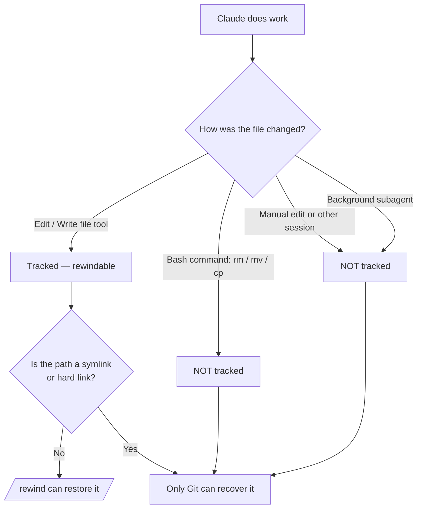

<LevelBadge level="intermediate" />

<Callout type="objectives" items={["체크포인트가 무엇을 캡처하는지, 그리고 말없이 캡처하지 않는 것이 무엇인지 이해한다", "되감기 메뉴를 두 가지 방법으로 열고, 매번 알맞은 복원 동작을 고른다", "'restore'(상태 되돌리기)와 'summarize'(컨텍스트 압축)를 구분한다", "체크포인트가 Git을 보완하지만 결코 대체하지 않는 이유를 정확히 안다"]} />

<VerifyNote lastVerified="2026-10-20" source="https://code.claude.com/docs/en/checkpointing">
체크포인트 동작, 되감기 메뉴의 동작, 스냅샷 상한과 보관 기간은 릴리스마다 바뀝니다 — 공식 문서에서 확인하세요.
</VerifyNote>

## 핵심 아이디어

야심 찬 대규모 변경을 Claude에게 맡길 때 가장 무서운 질문은 "편집을 세 번쯤 하다가 잘못되면 어떡하지?"입니다. **체크포인트(Checkpointing)**가 그 답입니다. Claude Code는 매 편집 전에 코드를 자동으로 스냅샷으로 저장하므로, 반쯤 끝난 리팩터링을 손으로 풀어내는 대신 이전 상태로 되감을 수 있습니다.

**세션 전체에 대한 로컬 실행 취소**라고 생각하세요. "좋아, 과감한 방법을 시도해 봐"라고 두려움 없이 말할 수 있게 해 주는 안전망입니다.

## 체크포인트가 만들어지는 방식

체크포인트를 직접 만들 필요는 없습니다. 자동으로 생깁니다.

<Steps items={[{title: "턴을 시작하는 프롬프트마다 체크포인트 1개", body: "턴을 시작하는 각 프롬프트는 Claude의 파일 편집 도구가 실행되기 전의 코드 상태를 캡처합니다. 명령도, 설정도, 의식도 필요 없습니다."}, {title: "가장 최근 100개만 유지", body: "Claude Code는 세션에서 가장 최근 100개 체크포인트의 파일 스냅샷을 보관합니다. 더 오래된 것은 버려지므로, 아주 긴 세션은 시작 지점까지 되감을 수 없습니다."}, {title: "세션을 넘어 유지", body: "체크포인트는 대화와 함께 저장되므로, 진행 중인 세션뿐 아니라 세션을 재개한 뒤에도 /rewind를 실행할 수 있습니다."}, {title: "스스로 정리", body: "세션의 파일 스냅샷은 보관 정리 작업에서 삭제되며, 기본적으로는 세션이 마지막으로 스냅샷을 저장한 지 약 30일 뒤입니다. 스냅샷이 사라진 체크포인트로 되감으면 'No files were restored'와 함께 실패합니다 — 더 오래 보관하려면 cleanupPeriodDays를 늘리세요."}]} />

## 되감기 메뉴 열기

들어가는 방법은 두 가지입니다.

<Steps items={[{title: "/rewind 실행 — 또는 별칭 /checkpoint, /undo", body: "프롬프트에서 슬래시 명령을 입력합니다. 항상 동작합니다. /checkpoint와 /undo는 같은 명령의 별칭이므로, 떠오르는 이름을 쓰면 됩니다."}, {title: "Esc 두 번 누르기 — 단, 입력창이 비어 있을 때만", body: "프롬프트 입력창이 비어 있을 때 Esc를 두 번 누르면 되감기 메뉴가 열립니다. 텍스트가 들어 있으면 Esc 두 번은 대신 그 텍스트를 지웁니다(지워진 텍스트는 입력 기록에 저장되므로 위쪽 화살표로 되살릴 수 있습니다)."}]} />

<PromptCard title="되감기 메뉴 열기">{`/rewind`}</PromptCard>

<Callout type="warning" items={["별칭 이름은 글자 그대로의 뜻보다 친숙하게 지은 이름입니다. /checkpoint는 요청 시 스냅샷을 찍지 않으며(스냅샷은 자동입니다), /undo는 마지막 편집을 혼자서 취소하지 않습니다. 세 이름 모두 같은 메뉴를 열고, 그 안에서 시점과 동작을 직접 고릅니다."]} />

메뉴에는 **이 세션에서 보낸 모든 프롬프트**가 나열됩니다. 작업할 시점을 고른 다음, 동작 하나를 선택하세요.

## Restore와 Summarize: 핵심 구분

여기서 사람들이 헷갈립니다. 메뉴는 두 *종류*의 동작을 제공합니다.

- **Restore** 동작은 디스크 및/또는 대화의 상태를 바꿉니다 — 되돌리는 동작입니다.
- **Summarize** 동작은 파일을 절대 건드리지 않습니다 — 컨텍스트 창의 공간을 확보하기 위해 대화를 압축합니다.

<Callout type="warning" items={["Restore = 실행 취소(코드, 대화 또는 둘 다 되돌림). Summarize = 컨텍스트 압축(디스크의 파일은 그대로).", "편집이 무언가를 망가뜨렸다면 restore를 쓰세요. 세션은 비대해졌지만 코드는 괜찮다면 summarize를 쓰세요."]} />

### Restore 동작

<Steps items={[{title: "Restore code and conversation", body: "파일과 채팅 기록을 모두 선택한 시점으로 되돌립니다 — 그 순간으로 깔끔하게 '시간을 되감는' 동작입니다."}, {title: "Restore conversation", body: "채팅을 해당 메시지까지 되감되 현재 코드는 유지합니다. 남기고 싶은 편집을 잃지 않고 질문을 다시 할 때 유용합니다."}, {title: "Restore code", body: "파일 변경은 되돌리되 대화는 유지합니다. 편집은 취소하고, 그에 대한 논의는 남깁니다."}]} />

두 가지 **코드** restore 옵션은 선택한 체크포인트에 되돌릴 추적된 파일 변경이 실제로 있을 때만 나타납니다. 그 시점 이후에 캡처된 파일 편집이 없다면 메뉴에는 **Restore conversation**, 두 summarize 옵션, 그리고 **Never mind**(아무것도 바꾸지 않고 메시지 목록으로 돌아감)만 표시됩니다.

대화를 복원한 뒤(또는 "Summarize from here"를 선택한 뒤)에는 선택한 메시지의 원래 프롬프트가 입력창에 다시 채워져, 다시 보내거나 수정할 수 있습니다.

### Summarize 동작

둘 다 대화의 일부를 AI가 생성한 요약으로 압축합니다 — 선택한 메시지의 어느 쪽을 압축할지 고를 수 있는 **표적형 `/compact`**와 같습니다.

<Steps items={[{title: "Summarize from here", body: "선택한 메시지 이전의 메시지는 그대로 유지됩니다. 선택한 메시지와 그 이후는 요약이 됩니다. 곁가지 논의는 버리면서 초반 컨텍스트는 자세히 유지하고 싶을 때 쓰세요."}, {title: "Summarize up to here", body: "선택한 메시지 이전의 메시지가 요약이 되고, 선택한 메시지와 그 이후는 그대로 유지됩니다. 대화의 끝에 머뭅니다. 초반의 준비 대화는 압축하면서 최근 작업은 원문 그대로 유지하고 싶을 때 쓰세요."}]} />

어느 쪽이든 원래 메시지는 세션 기록에 남으므로 Claude가 여전히 세부 내용을 참조할 수 있고, 압축된 메시지가 있던 자리에 **Summarized conversation** 표시가 나타납니다. 요약이 무엇에 초점을 둘지 조정하려면, 화살표 키로 **Summarize** 옵션을 강조하고 줄에 **add context (optional)**이라고 표시된 곳에 지침을 입력한 뒤 Enter를 누르세요 — 숫자 키로 옵션을 고르면 지침 없이 즉시 요약됩니다.

전체 흐름은 [컨텍스트 관리](/docs/claude-code/context-management)를 참고하세요 — `/compact`가 굵은 붓이라면 `/rewind`의 summarize 동작은 메스입니다.

<Callout type="note" items={["Summarize는 같은 세션에 머뭅니다. 원래 세션은 그대로 둔 채 가지를 쳐서 다른 접근을 시도하려면 /branch 또는 claude --continue --fork-session을 대신 사용하세요."]} />

## `/clear` 이전으로 되감기

같은 Claude Code 프로세스에서 앞서 `/clear`를 실행했다면, 되감기 메뉴 맨 위에 항목이 하나 더 나타납니다: `/resume <session-id> (previous session)`. 이를 선택하면 `/clear` 이전에 활성 상태였던 대화로 돌아갑니다.

<VerifyNote lastVerified="2026-10-20" source="https://code.claude.com/docs/en/checkpointing">
이 항목은 Claude Code를 종료하거나 다른 세션을 재개하기 전까지만 사용할 수 있습니다. 사라진 뒤에는 `/resume`을 실행하고 목록에서 이전 세션을 고르세요.
</VerifyNote>

## 체크포인트가 멈추는 곳 — 아프게 다가오는 한계

체크포인트는 마법처럼 느껴지다가 그렇지 않게 되는 순간이 있습니다. 다음 빈틈이 중요합니다.

<Steps items={[{title: "Bash로 한 변경은 보이지 않음", body: "Claude가 실행하는 셸 명령 — rm, mv, cp, 코드 생성기, 포매터 — 이 건드린 파일은 추적되지 않습니다. Claude의 파일 편집 도구를 통한 직접 편집만 체크포인트에 기록됩니다. rm으로 삭제된 파일은 되감기 입장에서는 사라진 것입니다."}, {title: "대부분의 서브에이전트 편집은 복원되지 않음", body: "서브에이전트는 같은 파일 도구로 편집하지만, 내 세션은 보통 그 편집을 캡처하지 않습니다. 예외는 포그라운드로 포크된 스킬(background: false인 context: fork)로, 내 턴 중에 편집하므로 정상적으로 되감깁니다. 그 외의 모든 서브에이전트 — 기본값인 백그라운드 포크 스킬 포함 — 는 되돌리려면 Git이 필요합니다. /docs/claude-code/subagents를 참고하세요."}, {title: "외부 및 동시 변경은 보이지 않음", body: "Claude Code 밖에서 직접 한 편집이나 동시에 실행 중인 다른 세션의 편집은 보통 캡처되지 않습니다 — 현재 세션이 편집한 파일과 우연히 같은 파일을 건드린 경우는 예외입니다."}, {title: "턴 도중의 메시지는 체크포인트가 없음", body: "Claude가 작업하는 동안 대기열에 넣어 진행 중인 턴 안에서 전달된 메시지는 새 턴을 시작하는 대신 그 턴에 합류하므로 자체 체크포인트가 생기지 않습니다 — 되감기 메뉴에는 'No code restore'로 표시됩니다. 그 이후에 일어난 일을 되돌리려면 그 턴을 시작한 프롬프트로 되감으세요. 이는 메시지가 도착하기 전에 이뤄진 작업까지 포함해 턴 전체를 되감습니다. 표시된 메시지 자체를 선택해도 Restore conversation은 그대로 제공되며, 파일은 그대로 유지됩니다."}, {title: "심볼릭 링크와 하드 링크는 건너뜀", body: "Restore는 심볼릭 링크나 하드 링크인 추적 경로를 건너뛰고 'Restored the code, but skipped N files'라는 경고를 냅니다. 해당 파일들은 현재 내용이 그대로 유지됩니다. dotfile 관리자의 심볼릭 링크와 pnpm의 하드 링크가 모두 이에 해당합니다. 복원하기 전에 /debug를 실행하면 건너뛴 경로가 디버그 로그에 명시됩니다."}, {title: "히스토리가 아니라 세션 수준", body: "체크포인트는 빠른 로컬 복구입니다. 커밋도, 브랜치도 아니며, 팀과 공유할 수도 없습니다."}]} />

## 체크포인트 vs. Git: 둘 다 쓰세요

해결하는 문제가 다르니 함께 쓰세요.

| | 체크포인트 (`/rewind`) | Git |
|---|---|---|
| 범위 | 하나의 세션 | 프로젝트 전체 히스토리 |
| 세분성 | 턴을 시작하는 프롬프트마다, 자동 | 커밋마다, 의도적 |
| bash로 한 변경을 추적? | 아니요 | 예 (스테이징/커밋한 뒤) |
| 수명 | 최근 100개 체크포인트, 세션 후 약 30일 뒤 정리 | 영구 |
| 공유 / 협업 | 불가 | 가능 |
| 멘탈 모델 | "로컬 실행 취소" | "영구 히스토리" |

<Callout type="tip" items={["위험하고 대규모인 작업 전에 동작하는 상태를 Git으로 커밋하세요 — 그것이 내구성 있는 바닥선입니다.", "커밋 사이의 빠른 세션 내 복구에는 /rewind를 사용해 Git 히스토리를 어지럽히지 마세요.", "Claude가 파괴적인 bash(rm/mv), 생성기, 백그라운드 서브에이전트를 실행할 거라면 Git에 의존하세요 — 되감기는 그 파일들을 구하지 못합니다."]} />

## 언제 쓸까

<Steps items={[{title: "대안 탐색", body: "과감한 구현을 시도해 보고, 마음에 들지 않으면 분기 지점으로 코드와 대화를 복원해 다른 방법을 시도하세요."}, {title: "잘못된 편집에서 복구", body: "세 프롬프트 전의 편집이 버그를 만들었나요? 잔해를 디버깅하는 대신 바로 그 직전으로 코드를 복원하세요."}, {title: "기능을 반복 개선", body: "여러 변형을 실험하면서, 검증된 상태가 언제나 /rewind 한 번이면 돌아올 거리에 있음을 알고 있으세요."}, {title: "컨텍스트 공간 확보", body: "장황한 디버깅 우회로가 컨텍스트 창을 다 먹었나요? 중간 지점부터 앞으로 summarize하고 원래 지침은 자세히 유지하세요."}]} />

<Quiz title="스스로 점검해 보세요" questions={[{q: "Claude가 bash 명령으로 `rm config.old.json`을 실행했고 그 파일을 되찾고 싶습니다. `/rewind`로 복원할 수 있나요?", options: ["예 — Claude가 하는 모든 변경은 체크포인트에 기록된다", "아니요 — bash로 한 변경은 추적되지 않고, 파일 도구를 통한 직접 편집만 추적된다", "30초 안에 /rewind를 실행했을 때만"], answer: 1, explain: "체크포인트는 Claude의 파일 편집 도구를 통한 편집만 캡처합니다. bash 명령(rm, mv, cp)으로 바뀐 파일은 추적되지 않습니다 — 바로 그것이 Git이 있는 이유입니다."}, {q: "코드는 괜찮은데 긴 디버깅 곁길이 컨텍스트 창을 가득 채웠습니다. 어떤 동작이 맞을까요?", options: ["곁길 이전으로 Restore code and conversation", "Restore code", "곁길이 시작된 지점에서 Summarize from here"], answer: 2, explain: "Summarize 동작은 파일을 건드리지 않고 대화를 압축합니다. 'Summarize from here'는 곁길을 요약으로 바꾸면서 앞선 컨텍스트는 그대로 유지합니다 — 코드 변경 없이 컨텍스트 공간을 확보합니다."}, {q: "체크포인트는 어떻게 만들어지나요?", options: ["/checkpoint를 실행한다. 요청 시 코드 스냅샷을 찍는다", "자동으로 — 턴을 시작하는 모든 프롬프트가 하나씩 만든다", "Git에 커밋할 때만"], answer: 1, explain: "체크포인트는 자동입니다. 턴을 시작하는 모든 프롬프트가 편집 전의 코드 상태를 캡처합니다. 수동 단계는 없습니다 — /checkpoint 명령은 있지만 /rewind의 별칭일 뿐이며, 스냅샷을 찍는 대신 메뉴를 엽니다. 또한 턴 도중에 도착한 메시지는 진행 중인 턴에 합류하며 자체 체크포인트가 없다는 점도 기억하세요."}]} />

<Flashcards title="체크포인트와 되감기 용어" cards={[{front: "체크포인트", back: "턴을 시작하는 각 프롬프트 전에 찍는 코드의 자동 스냅샷. 세션 범위이며, 최근 100개를 유지하고, 세션 후 약 30일 뒤 정리된다."}, {front: "/rewind", back: "이 세션의 모든 프롬프트를 나열하는 되감기 메뉴를 열어, 어느 시점에서든 restore 또는 summarize할 수 있게 한다. 별칭: /checkpoint, /undo. 빈 입력창에서 Esc 두 번으로도 열 수 있다."}, {front: "Restore 동작", back: "선택한 시점으로 상태 — 코드, 대화 또는 둘 다 — 를 되돌린다. 즉 '실행 취소'다. 코드 옵션은 해당 체크포인트에 추적된 변경이 있을 때만 나타난다."}, {front: "Summarize 동작", back: "대화의 일부를 AI 요약으로 압축해 컨텍스트를 확보한다. 디스크의 파일은 절대 건드리지 않는다."}, {front: "Bash의 사각지대", back: "셸 명령(rm/mv/cp)으로 바뀐 파일은 체크포인트에 기록되지 않는다 — 파일 도구를 통한 직접 편집만 기록된다. 그런 경우엔 Git을 쓴다."}, {front: "서브에이전트의 사각지대", back: "포그라운드로 포크된 스킬의 편집만 되감긴다. 백그라운드 서브에이전트(기본 백그라운드 포크 포함)는 Git이 필요하다."}]} />

<Callout type="takeaways" items={["체크포인트는 턴을 시작하는 각 프롬프트 전에 찍는 자동 스냅샷 — 세션의 로컬 실행 취소다. 최근 100개를 유지한 뒤 세션 후 약 30일 뒤 정리된다.", "되감기 메뉴는 /rewind(별칭: /checkpoint, /undo) 또는 빈 입력창에서 Esc 두 번으로 연다. 보낸 모든 프롬프트가 나열된다.", "Restore 동작은 상태(코드, 대화 또는 둘 다)를 되돌리고, summarize 동작은 컨텍스트를 압축하며 파일을 절대 건드리지 않는다.", "bash로 한 변경, 외부 변경, 동시 변경, 그리고 대부분의 서브에이전트 변경은 추적되지 않으며 — 심볼릭 링크나 하드 링크 경로는 restore 때 건너뛴다.", "체크포인트는 Git을 보완할 뿐 대체하지 않는다: '로컬 실행 취소'와 '영구적이고 공유 가능한 히스토리'로 기억하자."]} />

## 다음

- [컨텍스트 관리](/docs/claude-code/context-management) — `/compact`, `/clear`, 그리고 summarize가 큰 그림에서 어떻게 들어맞는지
- [플랜 모드](/docs/claude-code/plan-mode) — 편집이 실행되기 전에 조사하고 계획을 승인해 되감는 횟수를 줄이세요
- [권한](/docs/claude-code/permissions) — 야심 찬 작업을 안전하게 실행하기 위한 나머지 절반
