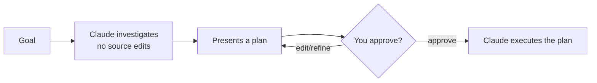

<LevelBadge level="beginner" />

<Callout type="objectives" items={["플랜 모드가 무엇을 차단하는지 — 그리고 Claude가 여전히 실행할 수 있는 것은 무엇인지 설명한다", "플랜 모드에 진입하고 벗어나는 세 가지 방법을 익힌다", "조사-제안-승인-실행 루프를 짚어본다", "플랜 모드와 권한을 구분하고 함께 쓴다"]} />

<VerifyNote lastVerified="2026-10-09" source="https://code.claude.com/docs/en/permission-modes">
플랜 모드에 진입하는 방법(단축키/플래그), 그리고 계획 중에 Claude가 실행할 수 있는 셸 명령이 정확히 무엇인지는 릴리스마다 바뀝니다 — 공식 Claude Code 문서를 확인하세요.
</VerifyNote>

## 핵심 아이디어

계약자에게 집 열쇠를 넘기는 것과, 먼저 둘러보고 *무엇*을 바꿀지 적어달라고 하는 것을 상상해 보세요. 플랜 모드는 그 둘러보기입니다.

**플랜 모드**는 Claude에게 **변경을 실행하지 않고 조사하고 제안하라고** 지시합니다: 파일을 읽고, 탐색을 위해 셸 명령을 실행하고, 계획을 작성하지만 — **당신의 소스를 편집하지는** 않습니다. 당신이 계획을 승인할 때까지 편집은 차단된 상태로 남습니다.

<Callout type="tip" items={["플랜 모드는 Claude가 조사는 하되 당신의 소스를 변경하지는 않는다는 뜻입니다 — 계획을 만들어 당신의 신호를 기다립니다."]} />

### 엄격한 읽기 전용은 아니다

탐색에는 때때로 명령이 필요하므로, 플랜 모드의 핵심은 *실행하지 않는 것*이 아니라 *편집하지 않는 것*입니다. 계획 중에 셸 명령이 어떻게 처리되는지는 세션에 따라 달라집니다 — 아래에서 먼저 들어맞는 경우가 적용됩니다:

<Steps items={[{title: "auto mode 사용 가능 + useAutoModeDuringPlan 켜짐(기본값)", body: "분류기가 당신에게 묻는 대신 셸 명령을 검토합니다. 핵심 경로를 삭제하는 명령만 예외입니다. 승인된 명령은 실행되고, 거부된 명령은 차단됩니다."}, {title: "auto mode 사용 불가, 또는 useAutoModeDuringPlan 꺼짐", body: "내장 읽기 전용 집합을 벗어난 명령은 당신에게 승인을 요청합니다."}, {title: "bypass permissions를 쓸 수 있는 대화형 터미널 세션", body: "플랜 모드의 차단이 강제되지 않습니다. Claude는 여전히 편집하지 않고 계획하도록 지시받지만, 계획 중에 시도하는 편집이나 명령은 묻지 않고 실행됩니다. 그 밖의 모든 곳에서는 플랜 모드가 차단을 유지합니다 — 헤드리스 -p 실행, Agent SDK, 그리고 VS Code 확장의 채팅 패널."}]} />

<Callout type="warning" items={["--allow-dangerously-skip-permissions로 실행했다면, 플랜 모드는 단단한 가드레일이 아니라 강한 지시에 가깝습니다. 샌드박스가 아니라 계획 관례로 취급하세요."]} />

## 왜 가장 안전한 시작인가

크거나, 위험하거나, 낯선 무엇이든, Claude가 리포지토리를 건드리기 *전에* 무엇을 의도하는지 보고 싶을 것입니다. 플랜 모드는 **생각**과 **행동**을 분리합니다:

대가: 잘못된 가정이 잘못된 코드가 되기 *전에* 잡아냅니다.

## 언제 쓰나

<Callout type="tip" items={["크거나 다중 파일 변경, 마이그레이션, 리팩터링에는 항상", "아직 완전히 모르는 코드베이스에서 작업할 때", "팀원과 공유할 검토 가능한 계획을 원할 때"]} />

작고 뻔한 편집에는 건너뛸 수 있지만 — 의심스러우면 먼저 계획하세요.

## 실전에서 작동하는 법

루프를 따르세요. 각 단계가 다음 단계를 얻습니다 — Claude는 당신이 승인한 *뒤에야* 편집으로 전환합니다.

<Steps items={[{title: "플랜 모드에 진입하고 목표를 말하기", body: "Shift+Tab을 눌러 권한 모드를 순환하다가 상태 바에 'plan mode on'이 표시되면 멈추거나, 프롬프트 하나에 /plan을 접두사로 붙이세요. 처음부터 플랜 모드로 시작하려면 claude --permission-mode plan으로 실행하세요. 그런 다음 무엇을 이루고 싶은지 설명하세요."}, {title: "Claude가 조사", body: "관련 파일을 읽고, 탐색용 명령을 실행하고, 명확화 질문을 합니다."}, {title: "Claude가 단계별 계획을 반환", body: "바꿀 파일, 접근 방식, 그리고 결과를 검증하는 법. Ctrl+G를 누르면 제안된 계획이 에디터에서 열려 직접 고칠 수 있습니다."}, {title: "당신이 승인하거나 다듬기", body: "'Yes, and use auto mode', 'Yes, manually approve edits', 'No, keep planning' 중에서 고르세요. 승인하면 플랜 모드를 벗어나 그 옵션이 설명하는 권한 모드로 들어가고, Claude가 편집을 시작합니다."}]} />

계획을 승인하지 않고 플랜 모드를 벗어나려면 `Shift+Tab`을 다시 누르세요. 프로젝트의 터미널 세션에서 기본값으로 만들려면 `.claude/settings.json`에서 `defaultMode`를 `plan`으로 설정하세요 — [설정](/docs/claude-code/settings)을 참고하세요.

### 직접 해보기

이것을 실제 계획 세션에 붙여넣고 루프가 펼쳐지는 것을 지켜보세요:

<PromptCard title="계획 세션 시작하기">{`I want to migrate our auth from sessions to JWT. Stay in Plan Mode: investigate the current setup, ask anything you need, then propose a step-by-step plan with files to change and how to verify — don't edit anything yet.`}</PromptCard>

:::tip CLAUDE.md와 짝지으세요
좋은 [CLAUDE.md](/docs/claude-code/claude-md)는 계획을 더 날카롭게 만듭니다 — Claude가 당신의 관례와 가드레일을 이미 염두에 두고 계획합니다.
:::

## 플랜 모드 vs 권한

전형적인 혼동. 둘은 다른 문제를 풀고 함께 작동합니다:

- **플랜 모드** = "조사하고 제안하되, 아직 편집하지 마." (이 페이지.)
- **[권한](/docs/claude-code/permissions)** = 일단 행동하면, *어떤* 동작이 묻지 않고 허용되는가.

**지금 행동할지 여부**(플랜 모드) 대 **일단 행동하면 어떤 동작이 허용되는가**(권한)로 생각하세요.

<Flashcards cards={[{front: "플랜 모드는 Claude Code를 어떤 상태로 두나요?", back: "조사하고 제안하는 상태: 파일을 읽고, 탐색을 위해 셸 명령을 실행하고, 계획을 작성하지만 당신의 소스는 편집하지 않습니다. 당신이 승인할 때까지 편집은 차단된 채로 남습니다."}, {front: "플랜 모드에 어떻게 진입하고 어떻게 벗어나나요?", back: "Shift+Tab, 프롬프트 하나에 붙이는 /plan 접두사, 또는 claude --permission-mode plan으로 진입합니다. 승인하지 않고 벗어나려면 Shift+Tab을 다시 누르세요."}, {front: "플랜 모드 루프는 무엇인가요?", back: "조사 → 계획 제시 → 당신이 승인하거나 다듬기 → Claude가 실행."}, {front: "언제 플랜 모드를 써야 하나요?", back: "크거나 위험하거나 낯선 작업(다중 파일 변경, 마이그레이션, 리팩터링, 미지의 코드베이스)에는 기본으로. 작고 뻔한 편집만 건너뛰세요."}, {front: "플랜 모드 vs 권한?", back: "플랜 모드는 지금 행동할지를, 권한은 일단 행동하면 어떤 동작이 허용되는지를 다스립니다."}]} />

<Callout type="takeaways" items={["플랜 모드는 조사하고 제안하는 모드입니다: Claude가 파일을 읽고 탐색용 명령을 실행하지만, 당신이 계획을 승인할 때까지 당신의 소스를 편집하지 않습니다", "엄격한 읽기 전용은 아닙니다 — 계획 중의 명령은 분류기 검토를 받거나, 승인을 묻거나, (대화형 터미널에서 bypass permissions를 쓸 수 있으면) 아예 차단되지 않습니다", "Shift+Tab, /plan 접두사, 또는 --permission-mode plan으로 진입하고; 승인하면 세션이 그 승인 옵션이 가리키는 모드로 전환됩니다", "크거나 위험하거나 낯선 작업에는 기본으로 쓰고; 작고 뻔한 편집만 건너뛰세요", "플랜 모드는 지금 행동할지를, 권한은 일단 행동하면 어떤 동작이 허용되는지를 다스립니다"]} />

<Quiz title="스스로 점검하기" questions={[{q: "플랜 모드에 있는 동안 Claude Code는 무엇을 할 수 있나요?", options: ["파일을 편집하고 아무 명령이나 실행", "파일을 읽고 탐색을 위해 셸 명령을 실행 — 하지만 당신이 승인할 때까지 소스는 편집하지 않음", "질문에만 답하고 파일 접근은 전혀 없음"], answer: 1, explain: "플랜 모드의 핵심은 실행하지 않는 것이 아니라 편집하지 않는 것입니다. Claude는 파일을 읽고 탐색용 명령을 실행하지만(세션에 따라 분류기 검토를 받거나 승인을 묻습니다), 당신의 소스에 대한 편집은 계획을 승인할 때까지 차단된 채로 남습니다."}, {q: "언제 플랜 모드를 써야 하나요?", options: ["한 줄짜리 오타 수정에만", "크거나 다중 파일 변경, 마이그레이션, 리팩터링, 또는 낯선 코드베이스에", "절대 — 그냥 느리게 만들 뿐"], answer: 1, explain: "크거나 다중 파일 변경, 마이그레이션, 리팩터링에는 항상 쓰고, 완전히 모르는 코드베이스에서 작업할 때도 쓰세요. 작고 뻔한 편집은 건너뛸 수 있습니다."}, {q: "플랜 모드 루프의 올바른 순서는 무엇인가요?", options: ["실행, 그다음 조사, 그다음 승인", "편집 없이 조사, 계획 제시, 당신이 승인하거나 다듬기, 그다음 Claude가 실행", "먼저 승인, 그다음 Claude가 조사하고 편집"], answer: 1, explain: "Claude가 당신의 소스를 편집하지 않고 조사하고, 계획을 제시하고, 당신이 승인하거나 다듬고, 그다음에야 계획 실행으로 전환합니다."}, {q: "플랜 모드와 권한은 어떻게 다른가요?", options: ["같은 기능의 두 이름", "플랜 모드 = 조사하고 제안, 아직 편집 안 함; 권한 = 일단 행동하면 어떤 동작이 묻지 않고 허용되는가", "권한은 계획할지를 결정; 플랜 모드는 어떤 파일을 편집할지 결정"], answer: 1, explain: "플랜 모드는 생각과 행동을 분리합니다. 권한은 Claude가 일단 행동하면 어떤 동작이 묻지 않고 허용되는지를 제어합니다. 둘은 함께 작동합니다."}]} />

## 다음

- [권한 & 권한 모드](/docs/claude-code/permissions)
- [컨텍스트 관리](/docs/claude-code/context-management) — 긴 세션을 효과적으로 유지
- [워크스루: 실제 리포지토리에 맞게 Claude Code 커스터마이즈](/docs/walkthroughs/customize-claude-code)
