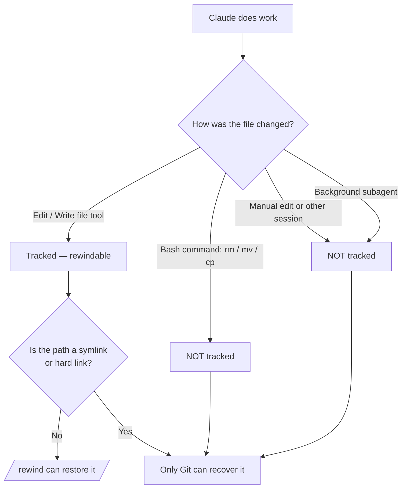

<LevelBadge level="intermediate" />

<Callout type="objectives" items={["Entender o que um checkpoint captura — e o que ele silenciosamente não captura", "Abrir o menu de rewind de duas formas e escolher a ação de restauração certa todas as vezes", "Distinguir 'restaurar' (desfazer o estado) de 'resumir' (comprimir o contexto)", "Saber exatamente por que os checkpoints complementam o Git, mas nunca o substituem"]} />

<VerifyNote lastVerified="2026-10-09" source="https://code.claude.com/docs/en/checkpointing">
O comportamento dos checkpoints, as ações do menu de rewind, o limite de snapshots e a retenção mudam entre versões — confirme na documentação oficial.
</VerifyNote>

## A grande ideia

Quando você solta o Claude em uma mudança ambiciosa e de grande escala, a pergunta mais assustadora é "e se der errado três edições adiante?" O **checkpointing** é a resposta: o Claude Code tira automaticamente um snapshot do seu código antes de cada edição, para que você possa voltar a qualquer estado anterior em vez de desembaraçar à mão uma refatoração pela metade.

Pense nele como um **desfazer local para a sessão inteira** — uma rede de segurança que permite dizer "sim, tente a abordagem ousada" sem medo.

## Como os checkpoints são criados

Você não cria checkpoints — eles acontecem automaticamente.

<Steps items={[{title: "Todo prompt que inicia um turno = um checkpoint", body: "Cada prompt que inicia um turno captura o estado do seu código antes de as ferramentas de edição de arquivos do Claude rodarem. Sem comando, sem configuração, sem cerimônia."}, {title: "Só os 100 mais recentes são mantidos", body: "O Claude Code mantém snapshots de arquivos para os 100 checkpoints mais recentes de uma sessão. Os mais antigos são descartados, então uma sessão muito longa não pode ser revertida até o começo."}, {title: "Eles persistem entre sessões", body: "Os checkpoints são salvos junto com a conversa, então você ainda pode executar /rewind depois de retomar uma sessão, não apenas na sessão ativa."}, {title: "Eles se limpam sozinhos", body: "Os snapshots de arquivos de uma sessão são apagados na varredura de retenção, por padrão cerca de 30 dias depois que a sessão salvou um snapshot pela última vez. Voltar a um checkpoint cujos snapshots já se foram falha com 'No files were restored' — aumente cleanupPeriodDays para mantê-los por mais tempo."}]} />

## Abrindo o menu de rewind

Há duas formas de entrar:

<Steps items={[{title: "Execute /rewind", body: "Digite o comando de barra no prompt. Sempre funciona."}, {title: "Pressione Esc duas vezes — mas apenas com a entrada vazia", body: "Esc duplo abre o menu de rewind quando a caixa do prompt está vazia. Se houver texto nela, o Esc duplo limpa esse texto (o texto apagado é salvo no histórico de entrada, então pressione ↑ depois para recuperá-lo)."}]} />

<PromptCard title="Abrir o menu de rewind">{`/rewind`}</PromptCard>

O menu lista **todos os prompts que você enviou nesta sessão**. Escolha o ponto em que quer agir e depois escolha uma ação.

## Restaurar vs. resumir: a distinção-chave

É aqui que as pessoas se confundem. O menu oferece dois *tipos* de ação:

- As ações de **restauração** mudam o estado em disco e/ou na conversa — elas desfazem.
- As ações de **resumo** nunca tocam nos seus arquivos — elas comprimem a conversa para liberar espaço na janela de contexto.

<Callout type="warning" items={["Restaurar = desfazer (reverte o código, a conversa ou ambos). Resumir = comprimir o contexto (os arquivos em disco ficam intactos).", "Recorra a restaurar quando uma edição quebrou algo. Recorra a resumir quando a sessão está inchada mas o código está bom."]} />

### As ações de restauração

<Steps items={[{title: "Restaurar código e conversa", body: "Reverte tanto os seus arquivos quanto o histórico do chat até o ponto selecionado — um 'voltar no tempo' limpo até aquele momento."}, {title: "Restaurar conversa", body: "Volta o chat até aquela mensagem, mas mantém o seu código atual. Útil para refazer uma pergunta sem perder edições que você quer manter."}, {title: "Restaurar código", body: "Reverte as mudanças nos arquivos, mas mantém a conversa. Desfaça as edições, mantenha a discussão sobre elas."}]} />

As duas opções de restauração de **código** só aparecem quando o checkpoint selecionado realmente tem mudanças de arquivo rastreadas para reverter. Se nenhuma edição de arquivo foi capturada depois daquele ponto, o menu oferece apenas **Restaurar conversa**, as duas opções de resumo e **Never mind** (que volta para a lista de mensagens sem alterar nada).

Depois de restaurar a conversa (ou de escolher "Resumir a partir daqui"), o prompt original da mensagem selecionada é devolvido ao campo de entrada para que você possa reenviá-lo ou editá-lo.

### As ações de resumo

Ambas comprimem parte da conversa em um resumo gerado por IA — como um **`/compact` direcionado**, em que você escolhe qual lado da mensagem selecionada espremer.

<Steps items={[{title: "Resumir a partir daqui", body: "As mensagens ANTES da mensagem selecionada permanecem intactas. A mensagem selecionada e tudo o que vem depois viram um resumo. Use para descartar uma discussão paralela mantendo o contexto inicial em todos os detalhes."}, {title: "Resumir até aqui", body: "As mensagens ANTES da mensagem selecionada viram um resumo; a mensagem selecionada e tudo o que vem depois permanecem intactos. Você continua no fim da conversa. Use para comprimir a conversa inicial de preparação mantendo o trabalho recente palavra por palavra."}]} />

Em ambos os casos, as mensagens originais permanecem na transcrição da sessão, então o Claude ainda pode consultar os detalhes, e um marcador **Summarized conversation** aparece onde as mensagens comprimidas estavam. Para orientar o foco do resumo, destaque uma opção de **resumo** com as setas e digite instruções na linha que diz **add context (optional)**, depois pressione Enter — escolher a opção pela tecla numérica resume imediatamente, sem instruções.

Para o fluxo completo, veja [Gerenciamento de Contexto](/docs/claude-code/context-management) — as ações de resumo do `/rewind` são um bisturi, enquanto o `/compact` é um pincel largo.

<Callout type="note" items={["Resumir mantém você na mesma sessão. Para ramificar e tentar uma abordagem diferente deixando a sessão original intacta, use /branch ou claude --continue --fork-session."]} />

## Voltando além de um `/clear`

Se você executou `/clear` antes no mesmo processo do Claude Code, o menu de rewind mostra uma entrada extra no topo: `/resume <session-id> (previous session)`. Selecione-a para voltar à conversa que estava ativa antes do `/clear`.

<VerifyNote lastVerified="2026-10-09" source="https://code.claude.com/docs/en/checkpointing">
Essa entrada fica disponível apenas até você sair do Claude Code ou retomar outra sessão. Quando ela sumir, execute `/resume` e escolha a sessão anterior na lista.
</VerifyNote>

## Onde os checkpoints param — os limites que mordem

Os checkpoints parecem mágicos até deixarem de ser. Estas lacunas importam:

<Steps items={[{title: "Mudanças via bash são invisíveis", body: "Arquivos tocados por comandos de shell que o Claude executa — rm, mv, cp, geradores de código, formatadores — NÃO são rastreados. Apenas edições diretas feitas pelas ferramentas de edição de arquivos do Claude recebem checkpoint. Um arquivo apagado com rm está perdido no que diz respeito ao rewind."}, {title: "A maioria das edições de subagentes não é restaurada", body: "Um subagente edita com as mesmas ferramentas de arquivo, mas a sua sessão normalmente não captura essas edições. A exceção é uma skill bifurcada em primeiro plano (context: fork com background: false), que edita durante o seu próprio turno e reverte normalmente. Qualquer outro subagente — inclusive uma skill bifurcada em segundo plano, que é o padrão — precisa do Git para desfazer. Veja /docs/claude-code/subagents."}, {title: "Mudanças externas e concorrentes são invisíveis", body: "Edições manuais feitas fora do Claude Code e edições de outras sessões concorrentes normalmente não são capturadas — a menos que por acaso atinjam os mesmos arquivos que a sessão atual editou."}, {title: "Mensagens no meio do turno não ganham checkpoint", body: "Uma mensagem que você enfileira enquanto o Claude trabalha e que chega a ele dentro do turno em andamento se junta a esse turno em vez de iniciar um novo, então não ganha um checkpoint próprio. Para desfazer o que veio depois dela, volte ao prompt que iniciou o turno — o que reverte o turno inteiro, incluindo o trabalho feito antes de a sua mensagem chegar."}, {title: "Links simbólicos e hard links são ignorados", body: "A restauração ignora qualquer caminho rastreado que seja um link simbólico ou hard link e avisa 'Restored the code, but skipped N files'; esses arquivos mantêm o conteúdo atual. Links simbólicos de gerenciadores de dotfiles e hard links do pnpm caem nesse caso. Execute /debug antes de restaurar para que os caminhos ignorados sejam nomeados no log de depuração."}, {title: "É de nível de sessão, não histórico", body: "Checkpoints são uma recuperação local e rápida. Não são commits, não são branches e não podem ser compartilhados com a sua equipe."}]} />

## Checkpoints vs. Git: use os dois

Eles resolvem problemas diferentes, então combine-os.

| | Checkpoints (`/rewind`) | Git |
|---|---|---|
| Escopo | Uma sessão | Todo o histórico do projeto |
| Granularidade | Por prompt que inicia um turno, automático | Por commit, deliberado |
| Rastreia mudanças feitas via bash? | Não | Sim (depois de staged/commitadas) |
| Duração | Últimos 100 checkpoints, varridos ~30 dias após a sessão | Permanente |
| Compartilhável / colaborativo | Não | Sim |
| Modelo mental | "Desfazer local" | "Histórico permanente" |

<Callout type="tip" items={["Faça commit dos estados que funcionam no Git antes de uma execução arriscada e de grande escala — esse é o seu piso durável.", "Use /rewind para recuperação rápida dentro da sessão entre commits, sem poluir o seu histórico do Git.", "Se o Claude for executar bash destrutivo (rm/mv), geradores ou subagentes em segundo plano, apoie-se no Git — o rewind não salvará esses arquivos."]} />

## Quando recorrer a ele

<Steps items={[{title: "Explorar alternativas", body: "Tente uma implementação ousada e, se não gostar, restaure código e conversa até o ponto de bifurcação e tente outra."}, {title: "Recuperar-se de uma edição ruim", body: "Uma edição introduziu um bug três prompts atrás? Restaure o código para logo antes dela em vez de depurar os destroços."}, {title: "Iterar sobre uma funcionalidade", body: "Experimente variações sabendo sempre que um estado bom conhecido está a um /rewind de distância."}, {title: "Liberar espaço de contexto", body: "Um desvio verboso de depuração comeu a sua janela de contexto? Resuma do ponto do meio em diante e mantenha suas instruções originais em todos os detalhes."}]} />

<Quiz title="Teste-se" questions={[{q: "O Claude executou `rm config.old.json` por um comando bash e você quer o arquivo de volta. O `/rewind` consegue restaurá-lo?", options: ["Sim — toda mudança que o Claude faz recebe checkpoint", "Não — mudanças feitas via bash não são rastreadas; só edições diretas por ferramentas de arquivo são", "Só se você executar /rewind em até 30 segundos"], answer: 1, explain: "O checkpointing só captura edições feitas pelas ferramentas de edição de arquivos do Claude. Arquivos alterados por comandos bash (rm, mv, cp) não são rastreados — é exatamente para isso que serve o Git."}, {q: "Seu código está bom, mas um longo desvio de depuração encheu a janela de contexto. Qual ação serve?", options: ["Restaurar código e conversa até antes do desvio", "Restaurar código", "Resumir a partir daqui no início do desvio"], answer: 2, explain: "As ações de resumo comprimem a conversa sem tocar nos arquivos. 'Resumir a partir daqui' transforma o desvio em um resumo e mantém seu contexto anterior intacto — liberando espaço de contexto sem nenhuma mudança no código."}, {q: "Como um checkpoint é criado?", options: ["Você executa /checkpoint manualmente", "Automaticamente — todo prompt que inicia um turno cria um", "Só quando você faz commit no Git"], answer: 1, explain: "O checkpointing é automático: todo prompt que inicia um turno captura o estado do código antes da edição. Não há passo manual — mas uma mensagem que chega no meio do turno se junta ao turno em andamento e não ganha um checkpoint próprio."}]} />

<Flashcards title="Vocabulário de checkpoints e rewind" cards={[{front: "Checkpoint", back: "Um snapshot automático do seu código tirado antes de cada prompt que inicia um turno. Restrito à sessão, os últimos 100 são mantidos, varridos ~30 dias após a sessão."}, {front: "/rewind", back: "Abre o menu de rewind listando todos os prompts desta sessão, para você restaurar ou resumir a partir de qualquer ponto. Também acessível com Esc duplo em uma entrada vazia."}, {front: "Ação de restauração", back: "Reverte o estado — código, conversa ou ambos — até o ponto selecionado. Isto é o 'desfazer'. As opções de código só aparecem quando aquele checkpoint tem mudanças rastreadas."}, {front: "Ação de resumo", back: "Comprime parte da conversa em um resumo de IA para liberar contexto. Os arquivos em disco nunca são tocados."}, {front: "Ponto cego do bash", back: "Arquivos alterados por comandos de shell (rm/mv/cp) NÃO recebem checkpoint — só edições diretas por ferramentas de arquivo. Use o Git para esses."}, {front: "Ponto cego dos subagentes", back: "Só as edições de uma skill bifurcada em primeiro plano são revertidas. Subagentes em segundo plano (incluindo o fork em segundo plano padrão) precisam do Git."}]} />

<Callout type="takeaways" items={["Checkpoints são snapshots automáticos tirados antes de cada prompt que inicia um turno — um desfazer local para a sessão. Os últimos 100 são mantidos, depois varridos ~30 dias após a sessão.", "Abra o menu de rewind com /rewind ou Esc duplo em uma entrada vazia; ele lista todos os prompts que você enviou.", "Ações de restauração desfazem o estado (código, conversa ou ambos); ações de resumo comprimem o contexto e nunca tocam nos arquivos.", "Mudanças feitas via bash, externas, concorrentes e a maioria das de subagentes NÃO são rastreadas — e caminhos com link simbólico ou hard link são ignorados na restauração.", "Checkpoints complementam o Git, não o substituem: pense em 'desfazer local' vs. 'histórico permanente e compartilhável'."]} />

## Próximos passos

- [Gerenciamento de Contexto](/docs/claude-code/context-management) — `/compact`, `/clear` e como o resumo se encaixa no quadro maior
- [Plan Mode](/docs/claude-code/plan-mode) — investigue e aprove um plano antes de as edições rodarem, para precisar de menos rewinds
- [Permissões](/docs/claude-code/permissions) — a outra metade de executar tarefas ambiciosas com segurança
