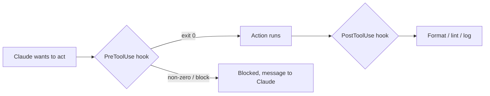

<LevelBadge level="advanced" />

<VerifyNote lastVerified="2026-08-22" source="https://code.claude.com/docs/en/hooks">
O Claude Code documenta mais de 30 eventos de hook agrupados por fase — a lista completa, a gramática de matcher de cada evento e os campos universais de saída JSON estão na referência oficial de hooks. Nomes e formatos de payload evoluem; confirme na fonte antes de fixar um evento ou campo específico.
</VerifyNote>

Hooks são **comandos de shell que o Claude Code executa automaticamente** em pontos definidos do seu ciclo de vida. Enquanto as [permissões](/docs/claude-code/permissions) decidem *se* uma ação é permitida, os hooks permitem que *você* execute uma lógica determinística em torno dela — formatação, validação, registro de logs, barreiras, ocultação de dados. É assim que você torna o comportamento garantido em vez de "por favor, lembre-se de".

<Callout type="objectives" items={["Quando recorrer a um hook em vez de uma instrução, uma permissão ou uma skill", "O ciclo de vida completo: eventos de sessão, prompt, ferramenta, subagente, tarefa, compactação e fim de turno", "Como um hook é configurado: evento, matcher e o payload JSON no stdin", "As duas formas pelas quais um hook bloqueia uma ação — código de saída 2 vs JSON no stdout", "Os campos universais de saída JSON compartilhados entre eventos: continue, additionalContext, systemMessage, reloadSkills, sessionTitle, suppressOutput, updatedInput", "As boas práticas e os erros comuns que separam hooks rápidos e seguros dos lentos e silenciosos"]} />

## Quando recorrer a um hook

Recorra a um hook quando quiser que um comportamento seja *garantido*, não apenas solicitado. Cada tarefa comum mapeia para um evento do ciclo de vida:

- **Formatar / fazer lint automaticamente** após cada edição de arquivo (`PostToolUse` em `Edit|Write`).
- **Bloquear** uma ação que viola uma regra antes que ela seja executada (`PreToolUse`).
- **Ocultar dados** da mensagem do assistente antes que ela chegue ao terminal (`MessageDisplay`).
- **Recarregar skills** ou definir um **título de sessão** após um `SessionStart`.
- **Notificar ou registrar em log** quando uma sessão termina, uma tarefa é concluída ou um turno falha (`Stop`, `StopFailure`, `SessionEnd`).
- **Injetar contexto** no início da sessão ou quando as instruções são carregadas.

## Como funcionam

Você registra hooks em [`settings.json`](/docs/claude-code/settings), associando um **evento** (e, muitas vezes, um matcher — geralmente o nome de uma ferramenta, às vezes um tipo de subagente, um gatilho de compactação ou um tipo de notificação). Quando o evento dispara, o Claude executa seu comando, passando um **payload JSON no stdin** (o nome do evento, a sessão e campos específicos do evento, como o nome da ferramenta e suas entradas). O código de saída e o stdout do seu comando decidem o que acontece em seguida.

<Steps items={[{title: "Associe a um evento", body: "Registre o hook em settings.json sob o evento do ciclo de vida que lhe interessa — por exemplo, PostToolUse para automação após a ferramenta, ou MessageDisplay para ocultar dados."}, {title: "Restrinja com um matcher", body: "Adicione um matcher para que o hook dispare apenas quando relevante, ex.: matcher \"Edit|Write\" para edições de arquivo, ou matcher \"startup|resume\" em SessionStart."}, {title: "Leia o payload do stdin", body: "Quando o evento dispara, o Claude executa seu comando e canaliza um payload JSON no stdin — o nome do evento, a sessão e campos específicos do evento (tool_name, tool_input, notification etc.)."}, {title: "Decida o que acontece em seguida", body: "O código de saída e a saída do seu comando determinam o resultado: deixar a ação prosseguir, executar sua lógica, bloqueá-la ou retornar JSON estruturado para mudar o que o Claude vê."}]} />

```json
{
  "hooks": {
    "PostToolUse": [
      {
        "matcher": "Edit|Write",
        "hooks": [
          { "type": "command", "command": "jq -r '.tool_input.file_path' | xargs npx prettier --write" }
        ]
      }
    ]
  }
}
```

O hook acima lê o caminho do arquivo editado a partir do JSON de stdin (`.tool_input.file_path`) e o formata. Não presuma que uma variável de ambiente contém o caminho — **leia-o do stdin.** Placeholders de caminho úteis como `${CLAUDE_PROJECT_DIR}` *estão* disponíveis para localizar scripts.

## O ciclo de vida em resumo

Os hooks do Claude Code abrangem a sessão inteira, não apenas as chamadas de ferramenta. Agrupe-os por fase para saber onde pendurar sua lógica.

| Fase | Eventos | Uso típico |
| --- | --- | --- |
| **Sessão** | `SessionStart`, `SessionEnd`, `Setup`, `InstructionsLoaded`, `ConfigChange`, `CwdChanged`, `DirectoryAdded`, `FileChanged` | Injetar contexto no início, fazer um snapshot no fim, reagir a um recarregamento de `CLAUDE.md` ou a uma mudança de `.env` em disco |
| **Prompt** | `UserPromptSubmit`, `UserPromptExpansion` | Colocar uma barreira ou reescrever o prompt antes que o Claude o veja |
| **Ferramenta** | `PreToolUse`, `PermissionRequest`, `PermissionDenied`, `PostToolUse`, `PostToolUseFailure`, `PostToolBatch` | Permitir/negar uma ação, escalar para uma pessoa, formatar após edições, tentar de novo após uma negação do modo automático |
| **Subagente** | `SubagentStart`, `SubagentStop` | Registrar início/parada, impedir que um subagente retorne |
| **Tarefa** | `TaskCreated`, `TaskCompleted` | Reverter uma tarefa acidental, colocar uma barreira na conclusão |
| **Compactação** | `PreCompact`, `PostCompact` | Fazer um snapshot da transcrição antes da compactação, verificar depois |
| **Modelo** | `PreModelSwitch`, `PostModelSwitch` | Bloquear uma troca de modelo antes de ser aplicada; reagir depois que o modelo muda, inclusive quando uma sessão retomada o restaura |
| **Turno** | `Stop`, `StopFailure`, `Notification`, `MessageDisplay` | Notificar na conclusão, alertar sobre falha da API, ocultar dados do texto exibido |
| **Equipe + MCP** | `TeammateIdle`, `Elicitation`, `ElicitationResult`, `WorktreeCreate`, `WorktreeRemove` | Coordenação entre sessões, barreira em elicitations do MCP, encapsular operações de worktree |

Os campos exatos de stdin de cada evento, a gramática de matcher e as regras de bloqueio estão na [referência oficial de hooks](https://code.claude.com/docs/en/hooks). O catálogo acima é o mapa; a referência é o território.

## Como um hook bloqueia

Duas formas, dependendo do evento:

- **Código de saída 2** — o hook faz a ação falhar e o que quer que ele tenha escrito no **stderr** se torna a mensagem que o Claude vê. Simples e funciona para hooks de comando em eventos bloqueantes (`PreToolUse`, `UserPromptSubmit`, `UserPromptExpansion`, `Stop`, `SubagentStop`, `TeammateIdle`, `TaskCreated`, `TaskCompleted`, `ConfigChange`, `PostToolBatch`, `PreCompact`, `PreModelSwitch`, `Elicitation`, `ElicitationResult`, `WorktreeCreate`, `WorktreeRemove`). Em `PermissionRequest` a saída 2 é ignorada; negue por meio do objeto `decision` dele.
- **JSON no stdout (saída 0)** — retorne uma decisão estruturada. Para `PreToolUse`, isso é uma `permissionDecision` de `"allow"`, `"deny"`, `"ask"` (colocar a chamada diante do usuário) ou `"defer"` (apenas para execuções `-p` conduzidas por um app que as retoma), com uma `permissionDecisionReason`. Eventos não bloqueantes (`PostToolUse`, `Notification`, `MessageDisplay`, `StopFailure`, a maioria dos eventos de sessão) ignoram tentativas de bloqueio — mas a saída JSON deles ainda pode orientar o que o Claude vê em seguida.

O script abaixo é um hook `PreToolUse` na ferramenta Bash. Leia-o de cima para baixo: ele extrai o comando do stdin e, se ele parecer destrutivo, escreve uma razão no stderr e sai com código 2 para bloquear.

```bash
#!/usr/bin/env bash
# PreToolUse hook on the Bash tool: refuse to delete things.
command=$(jq -r '.tool_input.command' < /dev/stdin)
if [[ "$command" == rm\ * || "$command" == *"rm -rf"* ]]; then
  echo "Blocked: destructive 'rm' is not allowed by policy." >&2
  exit 2
fi
exit 0
```

## Campos universais de saída JSON

A maioria dos eventos aceita um objeto JSON estruturado no stdout que orienta o que acontece em seguida — separado dos campos de decisão específicos do evento, como `permissionDecision`. Os mais úteis:

| Campo | O que faz | Onde funciona |
| --- | --- | --- |
| **`continue`** | Se `false`, o Claude para de processar por completo — tem precedência sobre toda decisão específica de evento | A maioria dos eventos |
| **`systemMessage`** | Adiciona uma mensagem ao contexto / transcrição do Claude para que ele veja por que você agiu | A maioria dos eventos bloqueantes |
| **`additionalContext`** | Injeta contexto extra que o Claude pode ler e usar no próximo turno | `SessionStart`, `UserPromptSubmit`, outros |
| **`reloadSkills`** | Reescaneia os diretórios de skills para que a sessão pegue uma skill que você acabou de escrever | `SessionStart` (e outros eventos de sessão) |
| **`sessionTitle`** | Define o título da sessão na UI — sob `hookSpecificOutput` em `SessionStart` | `SessionStart` |
| **`suppressOutput`** | Oculta a saída da ferramenta do Claude (útil para comandos ruidosos) | Eventos de ferramenta |
| **`updatedInput`** | Reescreve a entrada da ferramenta antes de ela rodar (ex.: adicionar um flag `--dry-run`) | `PreToolUse` |
| **`terminalSequence`** | Emite sequências de escape do terminal — sino, título da janela, selo de notificação | `Notification`, `StopFailure`, outros |

Os campos de decisão específicos de evento — `permissionDecision` (`"allow"`, `"deny"`, `"ask"` ou `"defer"`, mais `permissionDecisionReason`) em `PreToolUse`, `decision.behavior` (`"allow"` ou `"deny"`) em `PermissionRequest`, e `retry: true` em `PermissionDenied` para deixar o Claude tentar de novo a chamada negada — são aplicados por cima destes universais.

## O modelo mental

Um hook `PreToolUse` roda *antes* da ação e pode bloqueá-la; um hook `PostToolUse` roda *depois* que ela tem sucesso e reage ao resultado.



<Flashcards title="Eventos de hook em resumo" cards={[{front: "PreToolUse", back: "Dispara antes de uma ação ser executada. Use-o para bloquear ou criar uma barreira — ex.: recusar um comando destrutivo antes de ele ser executado. Campo de decisão: permissionDecision."}, {front: "PostToolUse", back: "Dispara após uma ação correspondente. Use-o para formatar, fazer lint ou registrar o que acabou de mudar. Não bloqueante."}, {front: "MessageDisplay", back: "Dispara quando o texto da mensagem do assistente é exibido. Use-o para ocultar segredos ou dados pessoais do terminal — apenas exibição, não pode bloquear."}, {front: "SessionStart", back: "Dispara no início (ou na retomada) de uma sessão. Use-o para injetar contexto via additionalContext, reloadSkills depois que uma nova skill aparece, ou definir sessionTitle."}, {front: "Stop / StopFailure", back: "Stop dispara quando o Claude termina um turno normalmente; StopFailure dispara quando o turno terminou com um erro de API (rate_limit, overloaded, auth etc.). Notifique ou tente de novo automaticamente na variante de falha."}, {front: "PreCompact / PostCompact", back: "Disparam em torno da compactação de contexto. PreCompact pode bloquear (saída 2) ou fazer antes um snapshot da transcrição; PostCompact reage ao estado compactado."}]} />

## Boas práticas

- **Mantenha os hooks rápidos e idempotentes** — eles rodam muito. Os hooks `SessionEnd` compartilham um único orçamento de 1,5 segundo entre todos, então mantenha o trabalho de fim de sessão mínimo.
- **Falhe de forma ruidosa em problemas reais**, mas não bloqueie por questões cosméticas.
- **Trate a saída do hook como feedback para o Claude** — uma mensagem clara no stderr (saída 2) ou em `systemMessage` (JSON) o ajuda a se autocorrigir.
- **Prefira a saída JSON aos códigos de saída** quando quiser dizer mais do que "bloqueado" — `permissionDecision: "ask"` em `PreToolUse` encaminha a uma pessoa sem bater a porta, e `additionalContext` permite *conduzir* em vez de apenas recusar.
- Hooks rodam com os privilégios do seu shell — revise qualquer hook que você não escreveu ([Revisando Código de Terceiros](/docs/security/reviewing-third-party-code)).

## Erros comuns

- **Ler o caminho do arquivo a partir de uma variável de ambiente.** O caminho vive no JSON de stdin (`.tool_input.file_path`), não em `$CLAUDE_FILE_PATH`. Encaminhe o stdin através do `jq`.
- **Bloqueios silenciosos.** Se um hook `PreToolUse` sai com código 2 sem nada no stderr, o Claude é bloqueado, mas não sabe *por quê* e não consegue se adaptar. Sempre escreva uma razão clara (ou use `permissionDecisionReason`).
- **Tentar bloquear um evento não bloqueante.** `PostToolUse` dispara *depois* que a ferramenta rodou — uma saída 2 apenas sussurra uma mensagem ao Claude, não desfaz a ação. Se precisar de uma barreira, use `PreToolUse`.
- **Hooks lentos.** Um hook `PostToolUse` roda após *cada* edição correspondente. Um linter de 3 segundos faz toda a sessão parecer lenta — mantenha os hooks rápidos e, idealmente, atue apenas sobre o que mudou.
- **Matchers excessivamente amplos.** `matcher: ".*"` dispara em cada ferramenta. Restrinja com um nome exato, uma lista `Edit|Write` ou o campo `if` por handler (ex.: `"if": "Bash(git push *)"`).
- **Esquecer que matchers existem também para eventos que não são de ferramenta.** `SessionStart` corresponde a `startup|resume|clear|compact|fork`; `Notification` corresponde a tipos como `permission_prompt|idle_prompt|agent_completed`; `PreCompact` corresponde a `manual|auto`. Um único hook ligado ao subconjunto errado dispara ou demais ou nunca.
- **Confiar em hooks que você não escreveu.** Um hook executa shell arbitrário com os seus privilégios. Revise primeiro qualquer hook vindo de um plugin ou template — veja [Revisando Código de Terceiros](/docs/security/reviewing-third-party-code).

<Callout type="warning" items={["Um hook executa shell arbitrário com os seus privilégios — nunca configure um hook de um plugin ou template sem lê-lo primeiro."]} />

## Receitas que valem a pena copiar

Modelos prontos para copiar e colar estão em [Receitas de Hooks e settings.json](/docs/templates/hooks-settings). Algumas receitas de alto impacto para ver o formato dos eventos mais novos:

<PromptCard title="Formatar automaticamente arquivos editados (PostToolUse em Edit|Write)">{`{
  "hooks": {
    "PostToolUse": [
      {
        "matcher": "Edit|Write",
        "hooks": [
          { "type": "command", "command": "jq -r '.tool_input.file_path' | xargs npx prettier --write" }
        ]
      }
    ]
  }
}`}</PromptCard>

<PromptCard title="Definir um título de sessão por projeto ao iniciar (SessionStart)">{`{
  "hooks": {
    "SessionStart": [
      {
        "matcher": "startup|resume",
        "hooks": [
          {
            "type": "command",
            "command": "jq -nc --arg t \\"$(basename \\"$PWD\\") — $(git rev-parse --abbrev-ref HEAD 2>/dev/null || echo detached)\\" '{hookSpecificOutput:{sessionTitle:$t}}'"
          }
        ]
      }
    ]
  }
}`}</PromptCard>

<PromptCard title="Recarregar skills após um SessionStart (pega uma skill que você acabou de escrever)">{`{
  "hooks": {
    "SessionStart": [
      {
        "matcher": "startup|resume",
        "hooks": [
          { "type": "command", "command": "printf '{\\"reloadSkills\\": true}\\n'" }
        ]
      }
    ]
  }
}`}</PromptCard>

<PromptCard title="Ocultar chaves de API do texto exibido do assistente (MessageDisplay)">{`{
  "hooks": {
    "MessageDisplay": [
      {
        "hooks": [
          {
            "type": "command",
            "command": "jq -r '.message.content' | sed -E 's/(sk-[A-Za-z0-9_-]{20,})/sk-***REDACTED***/g'"
          }
        ]
      }
    ]
  }
}`}</PromptCard>

<PromptCard title="Notificar quando um turno falha (StopFailure — limites de taxa, sobrecarga, autenticação)">{`{
  "hooks": {
    "StopFailure": [
      {
        "matcher": "rate_limit|overloaded|authentication_failed|billing_error",
        "hooks": [
          { "type": "command", "command": "osascript -e 'display notification \\"Claude Code turn failed — check the terminal\\" with title \\"Claude Code\\"'" }
        ]
      }
    ]
  }
}`}</PromptCard>

<Quiz title="Teste seus conhecimentos" questions={[{q: "Onde um hook encontra o caminho do arquivo que acabou de ser editado?", options: ["Na variável de ambiente $CLAUDE_FILE_PATH", "No payload JSON do stdin, em .tool_input.file_path", "Em um argumento de linha de comando passado pelo Claude"], answer: 1, explain: "O caminho vive no JSON de stdin (.tool_input.file_path), não em uma variável de ambiente. Encaminhe o stdin através do jq para lê-lo."}, {q: "Um hook PreToolUse sai com código 2. O que acontece?", options: ["A ação é permitida e o stdout é registrado em log", "A ação é bloqueada, e o que quer que o hook tenha escrito no stderr se torna a mensagem que o Claude vê", "O Claude ignora o resultado porque a saída 2 é reservada"], answer: 1, explain: "O código de saída 2 faz a ação falhar; o stderr se torna a mensagem que o Claude vê. Sempre escreva uma razão clara para que o Claude possa se adaptar."}, {q: "Você quer que uma sessão pegue uma skill que acabou de adicionar em .claude/skills/ sem reiniciar. Qual campo de saída, em qual evento?", options: ["reloadSkills: true em SessionStart", "restart: true em Stop", "refresh: true em PostToolUse"], answer: 0, explain: "Emitir {\"reloadSkills\": true} de um hook SessionStart reescaneia os diretórios de skills para que a sessão atual pegue skills novas ou editadas."}, {q: "Você quer ocultar segredos do texto do Claude antes que ele apareça na tela do usuário. Qual evento?", options: ["PreToolUse", "PostToolUse", "MessageDisplay"], answer: 2, explain: "MessageDisplay dispara quando o texto da mensagem do assistente é exibido — o lugar certo para transformar ou ocultar texto a caminho do terminal. Ele não pode bloquear."}]} />

<Callout type="takeaways" items={["Hooks tornam o comportamento garantido, não solicitado — lógica determinística em torno de ações que as permissões apenas permitem ou negam.", "O ciclo de vida abrange mais de 30 eventos nas fases de sessão, prompt, ferramenta, subagente, tarefa, compactação e turno — escolha a fase certa antes de escrever o script.", "Registre em settings.json contra um evento mais um matcher; o Claude canaliza um payload JSON no stdin e lê seu código de saída e sua saída.", "Leia o caminho do arquivo do stdin (.tool_input.file_path) — não de uma variável de ambiente.", "Bloqueie com o código de saída 2 (o stderr se torna a mensagem) ou com JSON estruturado no stdout (permissionDecision em eventos de ferramenta, {continue: false} para parar tudo).", "Os campos universais de saída — additionalContext, systemMessage, reloadSkills, sessionTitle, suppressOutput, updatedInput — permitem conduzir o Claude em vez de apenas permitir ou recusar.", "Mantenha os hooks rápidos, idempotentes e com matchers estreitos — e revise qualquer hook que você não escreveu, já que ele roda com os privilégios do seu shell."]} />

## Próximos passos

- [Mods: Extensões em Processo](/docs/claude-code/mods) — o irmão em processo: middleware TypeScript que pode *reescrever* um evento em vez de apenas permiti-lo ou bloqueá-lo, e alcança todos os eventos desta página como `classic.<Event>`
- [settings.json](/docs/claude-code/settings) · [Permissões](/docs/claude-code/permissions)
- [Skills](/docs/claude-code/skills) — expertise vs automação
- [Fortalecendo Execuções Autônomas](/docs/security/hardening-autonomous-runs)
